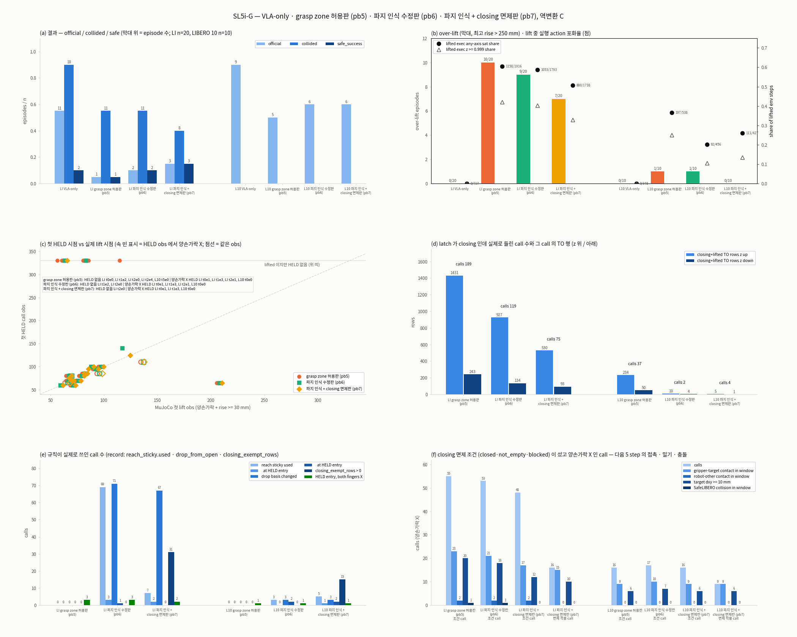

# AG3S Benchmark — 겪은 문제와 해결 방법 (문제별 정리)

> **이 문서의 용도.** `feature/panda-benchmark` 에서 V11AB Panda / LIBERO 계열 평가를 하며 겪은 문제를 **문제별로 다시 모은 요약 · 색인**이다.
> 사용자 지시(2026-10-23)로 새로 만든 문서다. **시간순 정본은 [`AG3S_BENCHMARK_LOG.md`](AG3S_BENCHMARK_LOG.md) 그대로**이고, 이 문서는 그 기록을 문제 단위로 재배열한 것이다. 두 문서가 어긋나면 LOG 와 `handoff/*.verify.json` 이 우선한다.
>
> **읽는 사람.** 이 project 의 사용자(연구자), 같은 문제를 다시 만날 팀원, development branch 로 옮길 때 참고할 사람. 결과를 처음 보는 사람도 따라갈 수 있게 문제 → 원인 → 해결 → 검증 순서로 쓴다.
>
> **수치 규칙.** 모든 수치는 `AG3S/ag3s/docs/handoff/<STEP>.verify.json` 의 `numbers` 를 출처로 하고, 항목마다 출처 verify.json 을 링크한다. 출처가 없는 수치는 쓰지 않고 "숫자 없음(측정 안 함)" 으로 둔다. 기록 시각 · commit 같은 식별자는 verify.json 이나 구현 기록(`impl.md`)에 있는 것만 옮겼다.
>
> **판정 규칙.** "사용자 판정" 칸에는 사용자가 이미 내린 판정만 날짜와 함께 옮긴다. 판정이 없는 결과는 "판정 대기" 또는 "판정 기록 없음" 으로 쓴다.
>
> 작성 2026-10-23 KST. 이 문서는 commit 하지 않았다.

---

## 이름 규칙 (사용자 2026-10-22)

version 과 단계는 **바꾼 내용**으로 부른다. 내부 key (`pbN`, `SLxx`) 는 괄호로만 붙인다.

| 부르는 이름 | 내부 key | 바꾼 내용 |
|---|---|---|
| V11AB 기준선 (변환 A / B) | V11AB | 알고리즘을 바꾸지 않은 기준선 + Panda adapter |
| grasp reach 측정 시점 수정판 | V11AB-pb1 | latch 의 reach 를 geometry 를 관측한 시점의 자세로 잰다 |
| 최소 개입 gate 판 (역변환 C 포함) | V11AB-pb2 | reference 가 충분히 안전하면 TrajOpt 결과 대신 reference 를 그대로 낸다 (gate 10 mm) |
| arm link 제약 추가판 | V11AB-pb3 | 제약 모델에 `panda_link1 ~ 7` sphere 를 더한다 (`--links arms`) |
| 쥔 물체 hand 면제판 | V11AB-pb4 | latch 가 held 일 때 손이 쥔 물체에 대해 가진 행을 제약에서 뺀다 |
| grasp zone 허용판 | V11AB-pb5 | 쥔 물체 hand 면제판 + latch 에서 contact phase 를 받음 + grasp zone 10 mm |
| 파지 인식 수정판 | V11AB-pb6 | grasp zone 허용판 + 같은 닫힘 시도 안 reach 유지(sticky reach) + 열린 개도 기준 `dropped` |
| 파지 인식 + closing 면제판 | V11AB-pb7 | 파지 인식 수정판 + closing 중 쥔 물체에 대한 손 제약 제외 |
| 역변환 A (지연 역보정) | `lag_inverse` | TO 가 낸 joint 목표를 OSC action 으로 돌릴 때 OSC 1차 응답 모델의 역을 쓴다 |
| 역변환 B (명령 offset) | `command_offset` | 목표 변화를 그대로 action offset 으로 쓴다 (`Dx = Dy`) |
| 역변환 C (지연 역보정 + 추종) | `lag_inverse_tracking` | A 에 더해, response model 이 예측한 실제 deviation 을 추적해 refined 누적 위치를 목표로 한다 |

## 상태 정의

| 상태 | 뜻 |
|---|---|
| 해결 | 겨냥한 원인이 측정으로 확인되었고 고친 뒤 같은 조건에서 사라졌다 |
| 부분 해결 | 일부 효과가 측정되었지만 남은 한계가 있다 (항목의 "남은 한계" 칸) |
| 미해결 | 증상이 남아 있다. 진단 중이거나 보류 |
| 되돌림 | 고쳤다가 결과가 나빠 철회했다 (이번 기록에는 해당 항목이 없다) |

"상태" 는 측정 결과를 기준으로 한 표시이고, "사용자 판정" 칸과는 별개다. 측정으로는 효과가 있어도 사용자 판정이 없으면 "판정 대기" 로 둔다.

---

## 요약표

| ID | 문제 | 상태 | 사용자 판정 | 한 줄 해결 |
|---|---|---|---|---|
| **A. 환경 · 인프라** | | | | |
| [A1](#a1-libero-client-python-38-환경-장애와-렌더러) | LIBERO client(Python 3.8) 환경 장애 3종과 종료 시 abort | 해결 | 확정 | client / launcher 쪽 우회, 독립 `.venv-libero` |
| [A2](#a2-공용-gpu-동시-사용으로-latency-와-replay-시간이-오염) | 공용 GPU 동시 사용으로 latency · replay 시간 오염 | 해결 | 규칙 채택 | GPU lock + `nvidia-smi` 확인 + 다른 checkout 동시 금지 |
| [A3](#a3-flock-명령-형식-오류로-공용-lock-이-잡히지-않음) | `flock` 명령 형식 오류로 lock 이 안 잡힘 | 해결 | 판정 기록 없음 | 규칙 예시를 fd 형식으로 수정 |
| [A4](#a4-같은-checkout-안-병렬-gpu-실행) | GPU 를 한 번에 한 run 만 쓰는 비효율 | 해결 | 지시 | caller 가 lock 을 한 번 쥐고 job ≤ 2 병렬, bit 재현 확인 |
| [A5](#a5-pod-메모리-working-set-과-nfs-stall-의심-징후) | pod 메모리 압박과 NFS stall 의심 징후 | 해결 | 규칙 채택 | working set 정의 · 상한 · 중단 규칙 |
| [A6](#a6-run-중-code-파일-변경으로-run-이-거부되거나-dirty-가-됨) | run 중 code · 파일 변경으로 run 거부 / dirty | 해결 | 판정 기록 없음 | run 진행 중 runner 수정 금지, 원인 기록 |
| [A7](#a7-결정성과-vla-only-재사용의-pairing-근거) | VLA-only 를 다시 안 돌리는 pairing 의 근거 | 해결 | 지시 | code 경로 · settings · seed · 결과 array 동일성 측정 |
| **B. Panda adapter** | | | | |
| [B1](#b1-policy-image-의-좌우-반전-un-mirror) | policy image 가 180° 회전이 아니라 좌우 반전 | 해결 | 확정 | attention 을 depth 로 올릴 때 열 반전 mapping (un-mirror) |
| [B2](#b2-intrinsics-k-의-principal-point-어긋남) | K 의 principal point 0.5 pixel 어긋남 | 해결 | 확정 | `(W-1)/2 = 127.5` |
| [B3](#b3-robot_state-가-image-보다-한-physics-substep-늦음) | `robot_state` 가 image 보다 1 substep 늦음 | 해결 | 확정 | image 순간의 qpos 로 기록 |
| [B4](#b4-table-이-기본-esdf-box-밖에-있음) | table 이 기본 ESDF box(z ≥ 0) 밖 | 해결 | SL4 확정에 포함 | Panda ESDF box 의 z 하한 −0.10 m override |
| [B5](#b5-panda-urdf-의-hand-장착-offset) | cuRobo URDF 의 hand 장착 offset 이 MuJoCo 와 다름 | 해결 | 확정 | adapter URDF 보정 |
| [B6](#b6-self-filter-덮개가-target-과-stove-를-지움) | self-filter 덮개가 target bowl · stove · table 을 지움 | 부분 해결 | 확정 | confined hand + mount cover 를 Panda 기본으로 |
| [B7](#b7-constraint-sphere-가-gripper-몸체보다-mm-수준-안쪽) | constraint sphere 가 gripper 몸체보다 안쪽 | 부분 해결 | 확정 | `franka.yml` sphere 그대로 두고 한계 기록 |
| [B8](#b8-gripper-빈-손-판정-기준-empty_below) | Panda 에서 rim 파지가 빈 손으로 판정 | 해결 | 확정 | `empty_below` 0.10 → 0.025325 |
| [B9](#b9-실행-피드백-exec_feedback-계약-불일치) | 실행 피드백 `measured_gripper` 가 한 chunk 늦음 | 해결 | 확정 | 다음 요청 때 실제 진행 step 기준으로 확정 |
| [B10](#b10-ee-delta-joint-역변환-a-b-c) | TO 의 회피 보정이 실행으로 옮겨지지 않거나 포화 | 부분 해결 | 판정 대기 | 역변환 A / B / C 를 명시 모드로 분리 · 비교 |
| [B11](#b11-libero-fixture-reset-이력-불일치) | fixture 위치가 episode 마다 다시 뽑힘 | 해결 | 확정 | export · replay 가 rollout 의 task 별 reset 이력을 재현 |
| [B12](#b12-safelibero-와-libero-의-package-이름-충돌) | SafeLIBERO 와 LIBERO 가 같은 `libero` package | 해결 | 판정 기록 없음 | fork 를 `sys.path` 앞에 두고 출처 확인 |
| **C. 평가 · 판정기** | | | | |
| [C1](#c1-safelibero-충돌-판정기가-장면-자체의-움직임을-충돌로-세는가) | 충돌 판정기가 장면의 움직임을 충돌로 세는지 | 해결 | 확정 | robot 을 가만히 둔 100 step 으로 검증 |
| [C2](#c2-official-success-와-safe-success-의-구분) | official success 와 safe success 가 다른 이야기 | 해결 | 확정 | 두 지표를 분리해 항상 같이 보고 |
| [C3](#c3-dev--test-분리) | layer / cell 선택이 test 에 새는 위험 | 해결 | 확정 | dev init 0~4, test 5~49 |
| [C4](#c4-safelibero-level-ii-의-v11ab-미실행) | Level II V11AB 가 실행되지 못함 | 미해결 | 보류 | `NOT_RUN` 으로 기록 |
| **D. 알고리즘 개선판** | | | | |
| [D1](#d1-grasp-reach-측정-시점-수정판-pb1) | 쥔 bowl 이 가려져 reach 가 한도를 넘어 attach 실패 | 부분 해결 | 판정 기록 없음 | grasp reach 측정 시점 수정판 (pb1) |
| [D2](#d2-최소-개입-gate-판--역변환-c-pb2) | 위반이 없는 chunk 도 크게 고침 | 부분 해결 | 판정 기록 없음 | 최소 개입 gate 판 (pb2) + 역변환 C |
| [D3](#d3-arm-link-제약-추가판-pb3) | arm link 접촉 충돌 | 부분 해결 | 판정 기록 없음 | arm link 제약 추가판 (pb3) |
| [D4](#d4-쥔-물체-hand-면제판과-grasp-zone-허용판의-초기-구현-결함) | pb4 · pb5 초기 구현의 결함 2개 | 해결 | 판정 기록 없음 | authorized mask 와 기록 위치 수정 |
| [D5](#d5-쥔-물체-hand-면제판-pb4) | 쥔 물체 때문에 손 제약이 위반 | 부분 해결 | 방향 확정 | 쥔 물체 hand 면제판 (pb4) |
| [D6](#d6-latch-contact-phase-와-grasp-zone-허용판-pb5) | 잡는 단계에도 approach 규칙이 적용 | 부분 해결 | 방향 확정 | grasp zone 허용판 (pb5) |
| [D7](#d7-over-lift-와-action-포화의-원인-사슬) | 쥔 bowl 을 250 mm 넘게 들어 올리고 action 이 포화 | 부분 해결 | 판정 대기 | 원인 사슬 진단 → D8, D9 |
| [D8](#d8-파지-인식-수정판-pb6) | 실제로 쥐고 있는데 latch 가 closing 에 머묾 | 부분 해결 | 판정 대기 | 파지 인식 수정판 (pb6) |
| [D9](#d9-파지-인식--closing-면제판-pb7) | closing 중 쥔 물체가 손 제약으로 남음 | 부분 해결 | 판정 대기 | 파지 인식 + closing 면제판 (pb7) |
| **E. 아직 풀리지 않은 문제** | | | | |
| [E1](#e1-쥔-뒤에도-손을-위로-민다) | 쥔 뒤에도 손을 위로 민다 | 미해결 | A안 지시 | 제약 기록 run 준비 완료, 측정은 GPU 정지로 보류 |
| [E2](#e2-잘못된-cluster-를-잠금-li-t2e0) | 잘못된 cluster 를 잠금 (LI t2e0) | 미해결 | 판정 대기 | 없음 |
| [E3](#e3-panda-손가락이-테두리를-끝까지-닫아-blocked-check-가-실패-li-t1e2) | 손가락이 테두리를 끝까지 닫아 `blocked` 실패 (LI t1e2) | 미해결 | 판정 대기 | 없음 |
| [E4](#e4-vla-only-가-충돌하며-성공한-episode-에서-생기는-회귀) | VLA-only 가 충돌하며 성공한 episode 의 회귀 | 미해결 | 판정 대기 | 없음 |
| [E5](#e5-ats-grounding-탈락-libero-t4-t5-t9) | ATS grounding 탈락 (LIBERO t4 · t5 · t9) | 미해결 | 판정 기록 없음 | 측정 완료, 변경 없음 |

항목 수 37 (A 7 · B 12 · C 4 · D 9 · E 5). 상태별: 해결 20 · 부분 해결 11 · 미해결 6 · 되돌림 0.

---

# A. 환경 · 인프라

## A1. LIBERO client (Python 3.8) 환경 장애와 렌더러

| 칸 | 내용 |
|---|---|
| 문제 | SL0 (2026-10-12) 에서 독립 `.venv-libero` (Python 3.8.20, OpenPI 예제 pin) 를 만들 때 네 가지가 막혔다. ① 이 fork 의 `openpi-client` 가 보내는 `ping_timeout` 을 Python 3.8 의 마지막 websockets 가 받지 못해 연결 시 `TypeError`. ② pod 의 전역 `LD_LIBRARY_PATH` 가 다른 Python 의 `torch/lib` 를 가리켜 venv 의 torch 가 import 되지 않음. ③ LIBERO 최상위 `libero/` 에 `__init__.py` 가 없어 일반 editable 설치로 import 불가. ④ torch 1.11.0+cu113 이 standalone import 후 process 종료 시 `free(): invalid pointer` 로 abort. |
| 원인 | ①~③ 은 위 증상 그대로 (구조상 확정). ④ 는 **원인을 확인하지 않았다.** |
| 해결 | ① `ping_timeout` 없이 연결하는 websockets subclass (upstream OpenPI client 와 같은 연결). ② launcher 가 client env 에서 foreign site/dist-packages 항목을 제거. ③ LIBERO editable compat 모드. 공식 requirements 는 `uv pip sync` 로 그대로 설치. 전역 `python3.11` shim 은 건드리지 않았다. 렌더러는 공식 GPU EGL 이 아니라 CPU `osmesa`. |
| 검증 | SL0 episode 1개: `official_success` true, `status` success, env step 113, policy 호출 21, client returncode 0. checkpoint 16 파일 12,439,085,481 bytes 를 전부 다시 해시해 aggregate 가 기록값과 일치. 출처 [`SL0.verify.json`](handoff/SL0.verify.json). |
| 상태 | **해결** (④ 는 episode 에 영향이 없어 원인 미확인으로 남김) |
| 사용자 판정 | 2026-10-12 SL0 확정. `pi05_libero` 는 공개 GCS 에서 storage 로 받고 LIBERO client 는 공식 protocol 과 같은 별도 Python 3.8 `.venv-libero` 를 checkout 안에 만든다. |
| 남은 한계 · 회귀 | osmesa 대 공식 EGL 의 pixel 영향은 **측정하지 않았다.** depth sample 위치도 osmesa llvmpipe 에서만 쟀다 (B2). |
| development 이식 메모 | Python 3.8 client 환경은 이 checkout 전용이다. development checkout 의 환경 상태는 별도 확인. |
| 상세 기록 | [LOG SL0](AG3S_BENCHMARK_LOG.md#sl0--pi05-only-libero-spatial-1-episode-2026-10-12) |

## A2. 공용 GPU 동시 사용으로 latency 와 replay 시간이 오염

| 칸 | 내용 |
|---|---|
| 문제 | 한 GPU 를 여러 checkout 이 쓴다. SL3 의 dev rollout 이 development checkout 의 closed-loop run 과 GPU 를 동시에 써서 그 rollout 의 latency 가 경합 하의 값이 되었다. SL4b 의 grounding-only replay 19 개는 job 마다 lock 을 풀어서 다른 세션의 GPU 작업이 사이에 끼었다. |
| 원인 | 두 checkout 이 같은 GPU 를 동시에 썼다 (규칙 채택 전). 이 규칙의 사유는 development 쪽 TrajOpt 가 wall-clock 마감(`sqp.time_budget_ms`)으로 반복 수가 정해져서, GPU 를 나눠 쓰면 timing 뿐 아니라 closed-loop 결과도 바뀐다는 것이다 (프로젝트 규칙). |
| 해결 | 사용자가 development 와 같은 규칙을 이 checkout 에도 적용 (commit `41339944`). GPU 작업 전체를 `flock` 으로 잡고, 시작 전 `nvidia-smi --query-compute-apps` 로 다른 compute process 가 없음을 확인하고, 다른 checkout 과 동시에 실행하지 않는다. 경합 하에서 잰 latency 와 job 별 lock 대기 구간이 있는 replay 시간은 **시간 기준선으로 인용하지 않는다**고 기록했다. |
| 검증 | 숫자 없음 (규칙 채택 기록). SL4b 의 replay latency 는 기준이 아니라는 점을 verify.json 이 job 별 lock 대기 구간으로 남긴다. 출처 [`SL4b.verify.json`](handoff/SL4b.verify.json). |
| 상태 | **해결** (규칙). 이미 잰 경합 하 latency 는 경합 하 값으로 표시된 채 남는다. |
| 사용자 판정 | 규칙 채택 (LOG SL3 "운영 기록": 사용자가 development 와 같은 공용 GPU lock · pod 자원 규칙을 이 checkout 에도 적용하기로 결정). |
| 남은 한계 · 회귀 | SL3 rollout latency 는 경합 하의 값이다. 경합 없는 latency 는 측정하지 않았다 (SL3 "측정하지 않은 것"). |
| development 이식 메모 | 규칙은 두 checkout 이 같은 lock 파일 `/tmp/ag3s-vla-gpu-validation.lock` 을 공유하는 것이 전제다. |
| 상세 기록 | [LOG SL3](AG3S_BENCHMARK_LOG.md#sl3--v11ab-attention-read-out-audit-on-pi05_libero--sl2-후속-2건-2026-10-12) "운영 기록" · [LOG SL4b](AG3S_BENCHMARK_LOG.md#sl4b--ats-용-attention-cell-dev-calibration-2026-10-13) "replay 시간 측정은 기준이 아니다" |

## A3. `flock` 명령 형식 오류로 공용 lock 이 잡히지 않음

| 칸 | 내용 |
|---|---|
| 문제 | SL4 task 에 적힌 `flock -w 1800 9 CMD … 9>/tmp/ag3s-vla-gpu-validation.lock` 은 fd 번호 뒤에 command 가 붙으면 `9` 를 **파일 이름**으로 받아 cwd 에 `./9` 를 만들어 잠근다. 공용 lock 은 fd 9 로 열려 있기만 하고 잡히지 않는다. implementer 의 GPU smoke 두 번이 이 형식으로 돌아 공용 lock 을 잡지 않았다. |
| 원인 | `flock` 의 인자 해석. 바깥 flock 아래에서 다른 `flock -n` 이 성공하는 것으로 재현했다. 시작 직전 compute process 는 비어 있었다. |
| 해결 | 실제로 잡는 형식으로 규칙 예시를 고쳤다: `( flock -w N 9 \|\| exit 1; CMD ) 9>/tmp/ag3s-vla-gpu-validation.lock` 또는 `flock -w N /tmp/ag3s-vla-gpu-validation.lock CMD`. commit `d53d8e07`. 검증 run 은 모두 올바른 형식으로 lock 을 잡았다. |
| 검증 | 숫자 없음. 출처: LOG SL4 "운영 기록". |
| 상태 | **해결** |
| 사용자 판정 | 판정 기록 없음 (규칙 문구 수정). |
| 남은 한계 · 회귀 | 문제의 형식으로 돈 smoke 두 번은 lock 없이 돌았다 (그 시점 compute process 는 없었음). |
| development 이식 메모 | 프로젝트 CLAUDE.md 에 같은 주의가 들어 있다. development 의 스크립트에 같은 형식이 없는지 확인. |
| 상세 기록 | [LOG SL4](AG3S_BENCHMARK_LOG.md#sl4--panda-관측을-v11ab-perception--esdf-에-연결-ats--lte--esdf-offline-2026-10-12) "운영 기록" |

## A4. 같은 checkout 안 병렬 GPU 실행

| 칸 | 내용 |
|---|---|
| 문제 | `launch_libero_paired.py` 의 `run_mode` 가 mode 마다 공용 GPU lock 을 직접 잡고 다른 compute process 가 있으면 기다려서, launcher 를 둘 동시에 띄울 수 없었다. 사용자는 H200 GPU 를 적절히 활용하라고 지시했다 (2026-10-19). |
| 원인 | launcher 가 lock 을 job 마다 잡는 구조. |
| 해결 | `AG3S_GPU_LOCK_HELD=1` 이면 launcher 가 lock 을 직접 잡지 않고 caller 가 물려준 fd 로 lock 을 쥐고 있는지만 확인한다 (실패하면 run 디렉터리를 만들기 전에 `refused`, rc 2). `benchmark/runners/run_parallel_gpu.sh` 가 lock 을 한 번 잡고 → compute process 확인 → pod working set + 추정(12 GiB/run × 동시 수) ≤ 64 GiB 확인 → job 을 **최대 2개** 동시에 실행. commit `e2b5deaa`. checkout 사이 동시 실행은 계속 배제한다. |
| 검증 | **병렬 bit 재현 (G0)**: 병렬 batch 에서 돈 LIBERO 10 의 파지 인식 이전 최신판(grasp zone 허용판 + 역변환 C) 재실행과 단독 run 의 npz array **550 / 550 일치**, 처음 달라진 지점 없음, `episodes.jsonl` 결과 field 10 / 10 episode 일치. 달라진 것은 시각 · timing 기록뿐. 최대 동시 실행 2. 출처 [`SL5h-G.verify.json`](handoff/SL5h-G.verify.json) (`G0`). |
| 상태 | **해결** |
| 사용자 판정 | 지시 2026-10-19 (GPU 를 적절히 활용). 재현 결과에 대한 별도 판정 기록은 없다. |
| 남은 한계 · 회귀 | 병렬 재실행은 LIBERO 10 의 grasp zone 허용판 + 역변환 C 한 집합(10 episode)만 했다. 역변환 A · B run 은 한 번씩만 돌려 직렬 쌍둥이가 없다. 두 launcher 가 같은 port 를 고를 확률이 job 쌍마다 약 1/10⁴ 남는다 (구현 기록; 그러면 두 번째 server 의 bind 가 실패해 그 job 이 rc ≠ 0). 12 GiB/run 은 실측값이 아니다. |
| development 이식 메모 | 같은 checkout 안에서만 허용되는 방식이다. TrajOpt 가 반복 수 상한으로만 끝나는 benchmark V11AB 계열 가정에 기대므로 (구현 기록), wall-clock 마감에 걸리는 development 설정에는 그대로 옮기지 않는다. |
| 상세 기록 | LOG SL5h-G "병렬 실행 option" · "G0" · [`SL5h-launcher.impl.md`](handoff/SL5h-launcher.impl.md) |

## A5. pod 메모리 working set 과 NFS stall 의심 징후

| 칸 | 내용 |
|---|---|
| 문제 | 공용 pod 의 메모리가 빠듯했다. SL0 실행 중 pod working set 이 최대 **61.403 GiB**. SL3 에서 benchmark 쪽 CPU 측정 job 이 working set 을 64 GiB 위로 올려 lead 가 중단했다. |
| 원인 | benchmark 쪽 CPU 측정 job (self-filter 측정) 의 메모리 사용이 같은 pod 의 다른 사용량에 더해졌다. 그 이상의 분해는 기록이 없다. working set 은 `memory.current − inactive_file` 로 정의한다 (inactive file cache 를 뺀 실제 압박 지표). |
| 해결 | 상한과 중단 규칙: working set + 추정 ≤ 64 GiB (cgroup 하드 한도 80 GiB), CPU worker 세션당 ≤ 2, 측정 job 은 RSS ≤ 3 GB 로 npz 를 하나씩 열고 닫으며, working set 이 62 GiB 를 넘으면 멈추고 보고한다. self-filter 측정은 row band 16 단위 처리와 RSS 기록으로 다시 실행했다. 측정 전 checkpoint page cache 를 `posix_fadvise DONTNEED` 로 비웠다 (파일 내용 · mtime 불변). NFS stall 의심 징후(0 byte log, D state)가 보이면 같은 파일을 반복 stat 하지 말고 보고한다 (SL5h task). |
| 검증 | SL0 working set 최대 61.403 GiB 출처 [`SL0.verify.json`](handoff/SL0.verify.json). SL3 중단 시점의 최대값은 verify.json 에 없다 (숫자 없음). **NFS stall 이 실제로 일어난 사례의 측정 기록은 없다.** 규칙 문구만 있다. |
| 상태 | **해결** (규칙) |
| 사용자 판정 | 규칙 채택 (A2 와 같은 시점). |
| 남은 한계 · 회귀 | 공유 host 의 부하(SL0 실행 직전 load average 68~92) 는 통제할 수 없다. |
| development 이식 메모 | 공용 pod 한도는 모든 세션이 공유한다. |
| 상세 기록 | LOG SL0 열린 항목 5 · SL3 "운영 기록" · [`SL5h.task.md`](handoff/SL5h.task.md) "실행 규칙" |

## A6. run 중 code · 파일 변경으로 run 이 거부되거나 dirty 가 됨

| 칸 | 내용 |
|---|---|
| 문제 | ① SL5b-libero10 첫 시도(2026-10-14): VLA-only 는 `5b1e11ce` 에서 돌았는데 V11AB-B client 가 시작되기 전에 SafeLIBERO 연결을 commit(`1df077b8`) 했다. client 가 "다른 commit 의 run" 이라며 거부했고 episode 가 없다. ② SL5h-G(2026-10-20): 새 run 4 개 중 3 개의 manifest 가 `dirty = True`. |
| 원인 | ① run 이 시작된 commit(`5b1e11ce`)과 client 가 시작될 때의 HEAD 가 달랐고, client 가 이를 거부했다. ② **untracked 파일 하나** (`AG3S/ag3s/docs/handoff/SL5h-G.task.md`) 때문이고 `source_diff` 는 비어 있다. 즉 code 변경이 아니다. |
| 해결 | ① VLA-only 와 V11AB-B 를 `1df077b8` 에서 다시 돌렸다 (`-r2`). 첫 VLA-only 는 짝이 없으므로 비교에 쓰지 않았다. 그 뒤 run 진행 중에는 runner 코드를 고치지 않는다. ② 기록에 원인을 남겼다 (dirty 의 원인이 code 가 아님을 `source_diff` 로 확인). |
| 검증 | ① 첫 VLA-only 와 r2 VLA-only 의 task 별 성공이 10 / 10 같다 (그래도 비교에는 쓰지 않음). ② dirty 4 run 중 3 개의 원인이 모두 같은 untracked 파일 하나, `source_diff` 비어 있음. 출처 [`SL5b-libero10.verify.json`](handoff/SL5b-libero10.verify.json) · [`SL5h-G.verify.json`](handoff/SL5h-G.verify.json). |
| 상태 | **해결** (운영 규칙) |
| 사용자 판정 | 판정 기록 없음. |
| 남은 한계 · 회귀 | 단순 untracked 파일도 `dirty` 로 찍히므로 manifest 의 `dirty` 만으로는 code 변경 여부를 알 수 없다. `source_diff` 를 같이 본다. |
| development 이식 메모 | run 을 시작하기 전에 task 문서 같은 untracked 파일이 없는지 확인하는 것이 안전하다 (권장; 이 기록의 측정은 아니다). |
| 상세 기록 | LOG SL5b-libero10 "진행 중 생긴 문제" · SL5h-G "dirty = True run 3 개와 그 원인" |

## A7. 결정성과 VLA-only 재사용의 pairing 근거

| 칸 | 내용 |
|---|---|
| 문제 | VLA-only 는 다시 돌리지 않고 SL5f(`38722284`) run 을 재사용했다. 비교 대상은 서로 다른 commit(`a2489584`, `a8ad92ef`, `743a1e76`, `1ddb9376`)에서 돌았다. 서로 다른 commit 의 run 을 pairing 해도 되는가. |
| 원인 | 재사용 조건은 **실행 경로 · 환경 · checkpoint · settings · task / init · policy seed · reset 이력이 같을 것**이다. VLA-only 경로(`--no-safe` server 는 `SeededPolicy` 만 쓴다)는 SafePolicy method 를 거치지 않는다. |
| 해결 | 조건을 숫자로 검사해 근거로 남겼다 (사용자 지시 2026-10-18). |
| 검증 | SL5g: `38722284 → a8ad92ef` 에서 바뀐 file 4개 (SafePolicy method · test · docs 뿐). VLA-only 가 지나는 경로 7 개(`serve_safe.py`, `policy_seed.py`, `benchmark`, `AG3S/adapters`, `third_party/openpi`, `common`, `scripts`)는 7 / 7 변화 없음. settings diff(protocol · runtime_schedule · versions · checkpoint) 0, VLA-only npz 전 array 일치 (SL5e · SL5d commit 의 run 과), pairing key(task · init · policy seed · obstacle) 일치. SL5i-G: `38722284 → 1ddb9376` 사이 바뀐 code file 12개 중 `serve_safe.py` 의 diff hunk 두 개는 `--no-safe` 분기와 겹치지 않고, protocol · schedule · checkpoint · dependencies 차이 0. 출처 [`SL5g.verify.json`](handoff/SL5g.verify.json) (`n0_pairing_basis`) · [`SL5i-G.verify.json`](handoff/SL5i-G.verify.json) (`I0`). |
| 상태 | **해결** |
| 사용자 판정 | 지시 2026-10-18 (VLA-only 재사용과 서로 다른 commit 을 pairing 한 근거를 남길 것). |
| 남은 한계 · 회귀 | reset 이력(fixture 위치를 뽑는 `reset` 횟수와 순서)을 따로 비교한 key 는 verify.json 에 없다. VLA-only npz 전 array 가 세 commit 에서 bit 단위로 같다는 숫자로 간접 확인했다. 파지 인식 수정판 · closing 면제판 run 의 bit 재현은 각 한 번만 돌렸다. |
| development 이식 메모 | 같은 방식(경로 diff + settings diff + npz 일치)으로 재사용 가능 여부를 검사할 수 있다. |
| 상세 기록 | LOG SL5g "VLA-only 재사용과 서로 다른 commit 을 pairing 한 근거" · [LOG SL5i](AG3S_BENCHMARK_LOG.md#sl5i--파지-인식-수정과-closing-중-쥔-물체-면제-2026-10-22~23) I0 |

---

# B. Panda adapter

## B1. policy image 의 좌우 반전 (un-mirror)

| 칸 | 내용 |
|---|---|
| 문제 | SL0 은 pi0.5 의 입력 변환을 "180° 회전" 으로 적었다. attention 이 놓인 token 위치를 depth pixel 로 옮길 때 이를 잘못 되돌리면 attention 이 물체의 좌우가 바뀐 곳에 놓인다. |
| 원인 | robosuite 의 raw image 는 OpenGL row order 이고 공식 client 는 `[::-1, ::-1]` 로 행과 열을 모두 뒤집는다. 행 뒤집기는 OpenGL → OpenCV 변환과 상쇄되므로 결과는 OpenCV image 에서 **열만 뒤집은 것 (left-right mirror)** 이다. 180° 회전이 아니다. |
| 해결 | policy 입력은 바꾸지 않았다. 읽는 쪽에서 `policy224 (dx, dy) = 0.875 * (-du, +dv)` 로 16×16 attention grid 의 열을 되돌린다 (un-mirror mapping). 뒤집지 않은 비교용은 mirror left in. |
| 검증 | SL1: `policy256 == opencv[:, ::-1]` 228 / 228 image, 180° 회전과 일치 0 / 228. SL3: 16×16 block MAE 가 head · wrist 모두 un-mirror 0.077 대 mirror left in 42.20 (head) · 30.72 (wrist), 221 / 221 call 에서 un-mirror 가 작다. SL4: ATS 접근 단계 centroid 오차 median 이 un-mirror 12.0 mm 대 mirror 로 돌린 236.2 mm. 출처 [`SL1.verify.json`](handoff/SL1.verify.json) · [`SL3.verify.json`](handoff/SL3.verify.json) · [`SL4.verify.json`](handoff/SL4.verify.json). 그림 [SL3 scene](figures/sl3-scene.png) · [SL4 graph](figures/sl4-graph.png). |
| 상태 | **해결** |
| 사용자 판정 | 2026-10-12 SL1 확정, SL3 확정 (mapping un-mirror). |
| 남은 한계 · 회귀 | SL3 에서 wrist 의 target mass 평균만 mirror left in 이 높게 나왔다 (0.2939 대 0.1826). SL4 질량 분해로 풀렸다: transport 단계에서 attention 이 target bowl 에서 destination plate 로 옮겨 가서, 뒤집으면 면적이 큰 bowl 에 우연히 걸린 것이다. mapping 이 더 정확해서가 아니다. |
| development 이식 메모 | LIBERO 계열(Python 3.8 client) 고유의 image 규약이다. |
| 상세 기록 | [LOG SL1](AG3S_BENCHMARK_LOG.md#sl1--libero-panda-camera-adapter-rgbdepth--k--t_base_cam--v11ab-wire-관측-2026-10-12) #3 · [LOG SL3](AG3S_BENCHMARK_LOG.md#sl3--v11ab-attention-read-out-audit-on-pi05_libero--sl2-후속-2건-2026-10-12) #5 · [LOG SL4](AG3S_BENCHMARK_LOG.md#sl4--panda-관측을-v11ab-perception--esdf-에-연결-ats--lte--esdf-offline-2026-10-12) #4 |

## B2. intrinsics K 의 principal point 어긋남

| 칸 | 내용 |
|---|---|
| 문제 | adapter 가 robosuite 와 같은 `cx = W/2 = 128` 을 썼다. pixel 중심이 정수 index 인 AG3S `backproject` 규약에서는 광축이 `(W-1)/2 = 127.5` 라 0.5 pixel 어긋난다. |
| 원인 | principal point 규약 하나. 격자 실험에서 depth 는 pixel 안 `(u+0.375, v+0.875)` 에서 sample 되었지만(osmesa llvmpipe, MSAA 4), RGB · segmentation 은 pixel 중심에서 sample 된다. |
| 해결 | adapter 의 calibration 만 `127.5` 로 바꿨다 (V11AB algorithm 은 바꾸지 않음). 바뀐 규약은 manifest 에 기록한다. 사용자는 MSAA sample 위치 K (127.625 / 127.125) 는 채택하지 않았다: renderer 에 따라 달라지는 값이기 때문. |
| 검증 | head table 표면 거리 median / p95 가 K 128.0 → 127.5 에서 **2.00 / 2.85 → 0.90 / 1.28 mm**. 새 adapter 출력의 값이 SL1 의 오프라인 `K_pixel_centre` 열과 같다. head table plane 의 z − table top 평균 +2.001 → +0.836 mm. 출처 [`SL1.verify.json`](handoff/SL1.verify.json) · [`SL2.verify.json`](handoff/SL2.verify.json) (`n1b_pixel_centre_K_remeasure`). 그림 [SL1 graph](figures/sl1-graph.png). |
| 상태 | **해결** |
| 사용자 판정 | 2026-10-12 SL1 판정 2 (K = 127.5), 판정 3 (MSAA K 비채택). |
| 남은 한계 · 회귀 | 세 K 규약 모두 median · p95 가 5 mm (fine voxel) 아래라 SL1 의 중단 조건에는 걸리지 않았다. 5 mm 초과 꼬리(head table 0.40 % 등)의 원인은 분리하지 않았다. 공식 EGL renderer 에서 depth sample 위치가 같은지는 측정하지 않았다. |
| development 이식 메모 | LIBERO / robosuite renderer 의존 값이다. renderer 를 EGL 로 바꾸면 재측정 필요 (A1). |
| 상세 기록 | [LOG SL1](AG3S_BENCHMARK_LOG.md#sl1--libero-panda-camera-adapter-rgbdepth--k--t_base_cam--v11ab-wire-관측-2026-10-12) #2 · 판정 / [LOG SL2](AG3S_BENCHMARK_LOG.md#sl2--panda-geometry-sphere-chain--self-filter--contact-link-sl1-후속-2건-2026-10-12) "SL1 후속 2건" |

## B3. `robot_state` 가 image 보다 한 physics substep 늦음

| 칸 | 내용 |
|---|---|
| 문제 | robosuite 는 camera render 를 physics substep loop 안에서 하므로 `env.step` 이 돌려준 joint 값은 image 가 찍힌 순간보다 한 substep(0.002 s) 뒤다. self-filter 가 robot pose 와 image 를 같은 순간으로 보지 못한다. |
| 원인 | `robot_state` 가 obs 의 `robot0_joint_pos` · `gripper_qpos` 와 bit 단위로 같은 값(substep 뒤)이었다. SL1 측정: image 순간 qpos 와의 차이 최대 0.0017 rad. |
| 해결 | `robot_state` 를 image 순간의 qpos (`integratePos(sim_state.qpos, qvel, -dt)` 로 만든 값) 로 기록한다. |
| 검증 | adapter URDF 로 FK 한 wrist camera pose 와 기록된 `T_world_cam` 의 차이가 위치 최대 **2.6e-16 m**, 회전 최대 6.4e-6 deg. image 순간에서 re-render 한 RGB · depth 가 기록과 같은 frame 수 head 114 / 114, left_wrist 114 / 114. 출처 [`SL1.verify.json`](handoff/SL1.verify.json) (`capture_instant`) · [`SL2.verify.json`](handoff/SL2.verify.json) (`n1a_image_instant_robot_state`). |
| 상태 | **해결** |
| 사용자 판정 | 2026-10-12 SL1 판정 4 (`robot_state` 를 image 순간 값으로 고친다). |
| 남은 한계 · 회귀 | 기록된 segmentation 은 여전히 `env.step` 반환 시점에 render 되어 image 순간보다 1 substep 뒤다 (head 4 frame, left_wrist 1 frame 만 image 순간과 같다). attention 채점은 image 순간으로 다시 render 한 `segP` 를 쓰고 `segRec` 과의 차이는 작았다. |
| development 이식 메모 | LIBERO 고유 (robosuite render 순서). |
| 상세 기록 | LOG SL1 "capture instant" · SL2 "SL1 후속 2건" |

## B4. table 이 기본 ESDF box 밖에 있음

| 칸 | 내용 |
|---|---|
| 문제 | V11AB 기본 ESDF box 는 base frame z ∈ [0, 1.6] 이다. LIBERO 에서 table top 은 base frame z = −0.012 m (robot base 원점보다 12 mm 아래) 라 table 이 거리장 안에 없다. |
| 원인 | robot base 원점이 table top 보다 높다 (base 원점 world z 0.912 m, table top 0.9 m). 점 cloud 의 약 69 % 가 z < 0 이다. |
| 해결 | Panda profile 의 `esdf.bounds_lower` z 를 −0.10 m 로 override 한다 (profile 이 선언한 override 는 `contact.contact_links` 와 이 하나뿐이고 `diff_against_v11ab()` 가 그 밖의 차이를 `UNDECLARED` 로 잡는다). |
| 검증 | 같은 frame · 같은 ATS 로 box 만 바꾼 비교에서 table visible 점의 ESDF ≤ 5 mm 비율 **Panda box 0.979 대 V11AB box 0.005**, fused cloud 점 중 box 밖 비율 0.0014 대 0.670. 출처 [`SL4.verify.json`](handoff/SL4.verify.json) (`n7_esdf_box`). robot base 원점 world z 0.912 m, 점 cloud 의 z < 0 비율 head 68.84 % 는 [`SL1.verify.json`](handoff/SL1.verify.json) (`n6`). 그림 [SL4 table](figures/sl4-table.png). |
| 상태 | **해결** |
| 사용자 판정 | 2026-10-13 SL4 확정 (override 는 SL4 profile 의 일부). box 를 z 외에도 바꿀 때는 근거와 함께 사용자 판정을 받는다는 조건이 되돌아올 지점에 있다. |
| 남은 한계 · 회귀 | gripper sphere 중심의 main ESDF 값 차이(V11AB box − Panda box)는 median 0.00 mm 로 작았다 (이 dev frame 에서 gripper 가 table 을 가장 가까운 장애물로 갖는 경우가 드물어서로 보이나 분해하지 않았다). 그래도 table 이 장애물로 field 에 없다는 점은 바뀌지 않는다. |
| development 이식 메모 | 지지면이 base 보다 낮은 robot 배치에서는 같은 box 문제가 생긴다. |
| 상세 기록 | [LOG SL4](AG3S_BENCHMARK_LOG.md#sl4--panda-관측을-v11ab-perception--esdf-에-연결-ats--lte--esdf-offline-2026-10-12) #7 · 알게 된 것 (d) |

## B5. Panda URDF 의 hand 장착 offset

| 칸 | 내용 |
|---|---|
| 문제 | cuRobo `franka_panda.urdf` 는 팔 관절이 LIBERO 와 같지만 손 장착 offset 만 robosuite 와 달랐다. |
| 원인 | URDF 의 hand · finger 장착 offset 이 MuJoCo 모델과 다름 (offset 크기는 `SL2.impl.md` 에만 있어 여기에 옮기지 않았다). |
| 해결 | adapter URDF 의 offset 을 robosuite 에 맞게 고쳤다. |
| 검증 | 114 frame 에서 link1 ~ 7, hand, finger 의 FK 가 MuJoCo 와 **4.8e-9 mm** 이내로 같다. 출처 [`SL2.verify.json`](handoff/SL2.verify.json) (`n2_fk`). 그림 [SL2 graph](figures/sl2-graph.png). |
| 상태 | **해결** |
| 사용자 판정 | 2026-10-12 SL2 확정. |
| 남은 한계 · 회귀 | robosuite mesh 에 대해서만 쟀다. URDF 쪽(cuRobo `franka_description`) mesh 에 대한 sphere coverage 는 측정하지 않았다. |
| development 이식 메모 | 해당 없음 (Panda 전용). |
| 상세 기록 | [LOG SL2](AG3S_BENCHMARK_LOG.md#sl2--panda-geometry-sphere-chain--self-filter--contact-link-sl1-후속-2건-2026-10-12) 알게 된 것 (a) |

## B6. self-filter 덮개가 target 과 stove 를 지움

| 칸 | 내용 |
|---|---|
| 문제 | self-filter 는 depth 에서 robot 자신의 pixel 을 지우는 단계다. V11AB 의 덮개(cover capsule) fitter 를 Panda 에 그대로 쓰면 robot 이 아닌 물체가 지워졌다. default 덮개(245 sphere)에서 head 기준 stove 30.92 %, table 5.75 %, target bowl 5.46 % (wrist 11.00 %) 오제거. 오제거된 target pixel 은 쥐려는 bowl 이 손가락 사이로 들어오는 구간에 몰렸다 (RB-Y1 T17 — 쥔 사과가 17 frame 동안 통째로 지워진 사건 — 과 같은 종류의 기하). |
| 원인 | 두 곳으로 분리되었다. ① **mount 덮개**: 큰 capsule 의 끝 반구가 mount 몸체 밖으로 나가 base 옆의 table · stove 까지 닿음 (stove 오제거의 원인; mount 만 confined 로 바꾸면 stove 0.00 %). ② **hand 덮개**: 큰 capsule 이 palm 아래 두 손가락 사이, 즉 파지할 bowl rim 이 들어오는 자리까지 나옴 (target 오제거의 원인; 제거된 wrist target pixel 의 92 % 가 `panda_hand` 덮개에 귀속). 두 variant 가 서로의 값에 영향을 주지 않아 원인이 분리된다. |
| 해결 | 덮개를 body 별로 그 body 의 collision hull 안쪽에 가두어 다시 맞춘 **confined cover** 를 hand 와 mount 에 쓴다 (sphere 245 → 4,271). 이것은 algorithm 변경이 아니라 robot geometry 보정이다. SL3 에서 confined cover 를 Panda 기본값으로 하고 `robot_geometry.py` CLI 를 추가했다. |
| 검증 | default 대 confined hand+mount: stove 오제거 30.92 % → 0.00 % (head), table 5.75 % → 0.72 %, target bowl 5.46 % → 1.91 % (head) · 11.00 % → 4.30 % (wrist). robot 제거율은 head 99.23 % → 99.17 %, wrist 99.98 % → 99.97 % 로 거의 같다. 출처 [`SL2.verify.json`](handoff/SL2.verify.json) (`n4_self_filter`). 그림 [SL2 scene](figures/sl2-scene.png) · [SL2 graph](figures/sl2-graph.png). |
| 상태 | **부분 해결** |
| 사용자 판정 | 2026-10-12 SL2 판정 2: self-filter model 의 Panda 기본 = confined hand+mount cover. |
| 남은 한계 · 회귀 | wrist 의 target 오제거 4.30 % 가 남는다 (finger–bowl 접촉 구간; 제거된 pixel 대부분이 `panda_rightfinger` 덮개에 귀속). head mount 제거율 98.70 % 라 mount pixel 1.3 % 가 남는다. mount 의 visual mesh 일부(pedestal 93 mm, torso 34 mm)가 sphere union 밖에 남지만 SL4 에서 ESDF 에 남은 mount 점은 call 당 최대 7개, gripper 에서 326 mm 이상이었다. `franka.yml` sphere 만 쓰면 target 은 거의 안 지우지만(0.02 % · 0.01 %) robot 을 head 41.86 %, wrist 36.29 % 밖에 못 지운다 — 덮개는 필요하다. |
| development 이식 메모 | 덮개 sphere 수 4,271 에서 self-filter mask 만 head 17.1 ms · wrist 19.1 ms (SL4 p50) 이다. 다른 robot 이식 시 hand 근처 덮개가 파지 공간을 침범하는지 같은 분리 실험이 필요하다. |
| 상세 기록 | [LOG SL2](AG3S_BENCHMARK_LOG.md#sl2--panda-geometry-sphere-chain--self-filter--contact-link-sl1-후속-2건-2026-10-12) #4 · SL3 #2 |

## B7. constraint sphere 가 gripper 몸체보다 mm 수준 안쪽

| 칸 | 내용 |
|---|---|
| 문제 | optimizer 의 clearance constraint 에 쓰는 `franka.yml` sphere 는 몸체 밖으로 거의 나가지 않는다 (hand protrusion p95 1.6 mm). 접촉 지점에서 gripper 의 sphere 가 몸체보다 안쪽에 있어 접촉을 침투로 못 잡는 경우가 있다. arm link 의 coverage 는 12 ~ 74 %, hand 는 13.4 % 다. |
| 원인 | `franka.yml` sphere 는 constraint 용(실제 몸체보다 크지 않게)이지 self-filter 용이 아니다. |
| 해결 | 바꾸지 않았다. constraint model 은 cuRobo `franka.yml` sphere 그대로(V11AB main)이고, gripper-only protection 으로 본다. arm coverage 의 빈틈은 기록으로 남기고, 이후 arm link 를 제약에 넣는 시도가 D3 다. |
| 검증 | 접촉 지점의 `sphere_sd`: right finger +0.47 ~ +2.02 mm (24 cell 전부 침투 없음), hand +1.08 ~ +1.40 mm (3 cell). link 별 confusion 에서 trajectory 의 접촉을 침투로 잡는 것은 left finger 뿐 (22 / 24). miss 는 hand 3 · right finger 24 · left finger 2 cell, **false alarm 은 0**. forbidden-contact fixture 7개 중 F4 (hand – plate) 는 MuJoCo contact 깊이 −4.31 mm 인데 hand sphere signed distance +0.36 mm (miss). 출처 [`SL2.verify.json`](handoff/SL2.verify.json) (`n5_contact`). 그림 [SL2 table](figures/sl2-table.png). |
| 상태 | **부분 해결** (수용된 한계) |
| 사용자 판정 | 2026-10-12 SL2 판정 3: constraint model = `franka.yml` sphere 그대로. whole-body 보호가 필요해지면 MJCF-fit variant 를 따로 만든다. MuJoCo contact 를 정답으로 쓰는 독립 evaluator 는 SL-7 에서. |
| 남은 한계 · 회귀 | 이 mm 수준의 gap 이 clearance constraint 의 margin 에 흡수되는지는 측정하지 않았다. fixture 7개는 관절 설정으로 만든 정적 scene 이므로 "7개에서" 그렇다는 뜻이다. trajectory 는 arm 이 장애물에 가까워지지 않는 장면이라 arm 보호가 충분하다는 뜻이 아니다. |
| development 이식 메모 | 다른 robot 의 sphere 모델을 쓸 때 같은 contact × penetration confusion table 로 검증할 수 있다. |
| 상세 기록 | [LOG SL2](AG3S_BENCHMARK_LOG.md#sl2--panda-geometry-sphere-chain--self-filter--contact-link-sl1-후속-2건-2026-10-12) #5 · 판정 |

## B8. gripper 빈 손 판정 기준 `empty_below`

| 칸 | 내용 |
|---|---|
| 문제 | latch 의 `empty_below` 기본값 0.10 (RB-Y1 값) 이 Panda 의 bowl rim 파지(normalised opening 약 0.06)를 빈 손으로 판정했다. |
| 원인 | RB-Y1 기본값 0.10 이 Panda 의 bowl rim 파지 개도(약 0.06)보다 높다. |
| 해결 | Panda 의 빈 손 닫힘(normalised opening 0.0125) 과 물체를 쥐고 들어올린 순간의 opening 최소값(0.0381) 을 측정해 그 중간점 **0.025325** 를 Panda 값으로 정했다. 다른 `LatchConfig` 값은 V11AB 기본 그대로. 근거 파일 `robots/panda/description/gripper_calibration.json`. commit `945b608c`. |
| 검증 | 측정값 0.0125 · 0.0381 · 결정값 0.025325 출처 [`SL5b-smoke.verify.json`](handoff/SL5b-smoke.verify.json). |
| 상태 | **해결** (물리적 robot 사양 보정) |
| 사용자 판정 | 2026-10-14 사용자 판정 두 가지 중 하나로 반영 (`empty_below` Panda 보정). |
| 남은 한계 · 회귀 | 이 보정만으로 V11AB-A 의 t0 smoke 결과는 바뀌지 않았다 (원인은 reach, D1). |
| development 이식 메모 | robot 마다 빈 손 / 쥔 손 개도를 측정해 정해야 한다. |
| 상세 기록 | [LOG SL5b-smoke](AG3S_BENCHMARK_LOG.md#sl5b-smoke--t0-init0-paired-smoke-재확인-conversion-a--b-2026-10-14) |

## B9. 실행 피드백 `exec_feedback` 계약 불일치

| 칸 | 내용 |
|---|---|
| 문제 | V11AB 는 `exec_feedback` 를 세 곳에서 쓴다: continuity 정렬(`executed_chunk`, `n_exec`), `w_deflection_rate` 항(`applied_arm[-1]`), grasp latch (`measured_gripper`, `applied_gripper`). 기존 client 는 피드백을 호출 시점에 미리 만들었고 `measured_gripper` 에 **한 chunk 전 촬영값**을 넣었다. wire 계약은 "이번 요청의 촬영 시점" 이다. 변환 B 에서는 `applied_arm` 이 실제 명령과 달랐다. |
| 원인 | 확정 시점이 호출 때였고, `applied_arm` 에 refined joint 행(예측 경로)을 넣었다. |
| 해결 | adapter 범위만 고쳤다 (알고리즘 변경 없음, commit `a06b2ac2`). 피드백을 **다음 요청 때, 실제로 진행한 env step 수 `n_steps` 로 확정**한다. `measured_gripper` = 이번 요청의 촬영값. `applied_arm` = 실제 적용한 OSC 명령(HOLD 포함)을, 그 chunk 를 보낸 요청과 같은 forward map · 같은 시작 상태로 옮긴 joint 명령 행. 근거가 없으면 `available=False` 로 철회. |
| 검증 | t0 init0: `n_steps` = 실제 진행 step 이 B 22 / 22 · A 43 / 43, `measured_gripper` = 이번 촬영값 22 / 22 · 43 / 43, 철회된 피드백 0. LIBERO 10: 372 / 372 (B) · 383 / 383 (A). 무개입 행 action bit 동일 B 940 / 940 · A 902 / 902. 출처 [`SL5b-feedback.verify.json`](handoff/SL5b-feedback.verify.json) · [`SL5b-libero10.verify.json`](handoff/SL5b-libero10.verify.json). 그림 [feedback 전후 비교](figures/sl5b-smoke5-t0e0-ab-feedback.png). |
| 상태 | **해결** |
| 사용자 판정 | 2026-10-14: B feedback 은 수정 후 재측정. 예측 경로를 `applied_arm` 에 넣는 안은 **승인하지 않았다.** 통과 기준은 피드백 의미의 일치와 무개입 동일성, 관찰 지표는 보정 횟수와 action 변화. |
| 남은 한계 · 회귀 | V11AB 가 거의 모든 chunk 를 보정해서 무개입 chunk 표본이 각 1개뿐이다 (t0). attach 여부가 들어올리기 전에 `settled` 가 통과하느냐에 달려 있다는 의존성은 그대로 남았다 (D1). |
| development 이식 메모 | wire 계약의 시점 의미(촬영 시점 / 실제 진행 step)를 다른 client 에서도 맞춰야 한다. |
| 상세 기록 | [LOG SL5b-feedback](AG3S_BENCHMARK_LOG.md#sl5b-feedback--exec_feedback-를-실제-실행-기준으로-확정-t0-재측정-2026-10-14) |

## B10. EE delta ↔ joint 역변환 A / B / C

| 칸 | 내용 |
|---|---|
| 문제 | TrajOpt(TO) 는 joint 목표를 내고 LIBERO 는 OSC_POSE EE delta action 을 받는다. 그 사이의 역변환이 TO 의 회피 보정을 충분히 실행하지 못하거나, 실행하더라도 action 을 포화시킨다. **변환 B**: SafeLIBERO Level I 의 V11AB-B 충돌 18건을 분석하니 refined 계획은 obstacle 을 피했는데 실행이 관통한 경우가 14건이었다 (refined 도 관통 3, 둘 다 안 닿음 1). **변환 A**: B 보다 계획을 잘 실현하지만 saturation 이 크고 official success 가 떨어진다. |
| 원인 | B (`Dx = Dy`) 는 요구된 경로 변화의 일부만 실현한다. A 는 직전 행의 deviation 이 계획대로 실현됐다고 가정해 clip 된 행의 부족분을 버리고, refined 가 reference 로 돌아온 뒤에는 원래 action bit 를 내보내 1차 lag 꼬리가 계속 밀고 나간다. |
| 해결 | 역변환을 명시 실행 모드 A / B 로 분리 (`--conversion`, run id · manifest 에 모드를 남김, commit `945b608c`). 변환 C `lag_inverse_tracking` 추가 (response model 이 예측하는 실제 deviation 을 추적하고 refined 누적 위치를 목표로 함, commit `6d1723de`). |
| 검증 | t0 init0 feedback 수정 후 실현 비율 call median B 0.13 · A 0.84 ([`SL5b-feedback.verify.json`](handoff/SL5b-feedback.verify.json)). SafeLIBERO Level I 충돌 episode 의 refined / 실행 분류 14 / 3 / 1 ([`SL5c-safelibero-dev.verify.json`](handoff/SL5c-safelibero-dev.verify.json)). **같은 grasp zone 허용판 규칙에서 변환만 A / B / C 로 바꾼 비교** (SafeLIBERO Level I dev 20 / LIBERO 10 init 0): official success A 4 · B 2 · C 1 / 5 · 7 · 5, 충돌 A 9 · B 17 · C 11 (VLA-only 18), lifted 구간 실행 any-axis 포화 비율 A 0.274 · B 0.041 · C 0.604 (LIBERO 10: 0.227 · 0.022 · 0.366), over-lift episode A 2 · B 0 · C 10 (LIBERO 10: 0 · 0 · 1). 출처 [`SL5h-G.verify.json`](handoff/SL5h-G.verify.json). 그림 [변환별 결과와 서명](figures/sl5h-g-graph-conversion.png). |
| 상태 | **부분 해결** (어느 변환도 두 가지 목적 — 회피 실현과 task success — 을 함께 만족하지 못했다) |
| 사용자 판정 | 2026-10-14: 역변환을 명시 실행 모드로 분리, 같은 20 episode 로 V11AB-A 를 돌려 사후 pairing. 변환 A / B / C 차이에 대한 원인 판정은 판정 대기 (LOG SL5h-G). |
| 남은 한계 · 회귀 | B 는 충돌이 VLA-only 에 가깝다 (17 / 20). C 는 포화와 over-lift 가 가장 크다 (D7). A 는 그 중간이고 safe success 3 / 20 이 나왔다. 참고로 SL5h-G 의 "ref" 행(SL5c A · B, 파지 reach 수정판)은 gate · arms · 쥔 물체 규칙이 없던 run 이라 한 변수만 바꾼 비교가 아니다. |
| development 이식 메모 | 변환은 Panda adapter (`AG3S/adapters/panda/action.py`) 에 있어 RB-Y1 에는 해당하지 않는다. |
| 상세 기록 | LOG SL5b-smoke · SL5c · SL5c-A · SL5h · SL5h-G |

## B11. LIBERO fixture reset 이력 불일치

| 칸 | 내용 |
|---|---|
| 문제 | LIBERO 는 `env.reset()` 을 부를 때마다 fixture(`wooden_cabinet_1`, `flat_stove_1`)의 위치를 global numpy RNG 로 **다시 뽑는다.** fixture 는 joint 가 없어 기록된 `sim_state` 에 들어 있지 않다. SL4b 의 첫 scene GT · phase / segmentation export 는 episode 마다 새 env 를 만들고 reset 을 한 번만 해서, init 2 ~ 4 는 rollout 과 fixture 가 달랐다. |
| 원인 | rollout client 는 task 마다 env 를 하나 만들고 episode 마다 reset 하므로 k 번째 episode 의 scene 은 그 task 의 k 번째 reset 결과다. export 가 이 이력을 재현하지 않았다. rollout 이 기록한 head segmentation 의 cabinet · stove 위치와 export 를 비교하다 드러났다. |
| 해결 | export 와 action replay 가 rollout 의 **task 별 reset 이력을 그대로 재현**한다 (commit `8f0a07ec`). `env_history.py` 는 `episodes.jsonl` 의 순서가 manifest 의 `task_ids × episode_ids` 와 같음을 확인하고 어긋나면 거부한다. export 는 call frame 마다 두 camera 의 RGB re-render 를 기록과 대조해 하나라도 다르면 파일을 쓰지 않고 멈춘다. 첫 export 를 쓴 산출물은 `superseded` 로 두고 결과 해석에 쓰지 않았다. |
| 검증 | 수정 전 fixture 이동량: 첫 call frame 에서 init 1 = 0.0 mm, init 2 = 57.7 mm, init 3 = 35.4 mm, init 4 = 23.1 mm. fixture entry 80개 중 1 mm 를 넘은 것 60개. 수정 후 모든 init 에서 최대 0.0 mm. L8H2 grounding-only 를 수정 전후로 반복하면 50 / 50 episode 에서 grounding 결과 동일 (달라진 것은 init 2 ~ 4 30 episode 의 GT depth 잔차 두 key 뿐). 출처 [`SL4b.verify.json`](handoff/SL4b.verify.json) (`fixture_shift_finding`). |
| 상태 | **해결** |
| 사용자 판정 | 2026-10-13 SL4b 확정. |
| 남은 한계 · 회귀 | 이 규칙은 paired 비교에도 적용된다: task 별 episode 순서와 reset 횟수를 같게 유지해야 같은 scene 에서 비교된다. episode 일부만 replay 하거나 순서를 바꾸면 fixture 가 달라진다 (`libero_replay` 는 이제 source 순서의 부분열이 아니면 거부한다). |
| development 이식 메모 | LIBERO env 고유. env 를 episode 마다 새로 만드는 평가를 설계할 때 fixture 위치가 reset 마다 바뀐다는 점을 확인. |
| 상세 기록 | [LOG SL4b](AG3S_BENCHMARK_LOG.md#sl4b--ats-용-attention-cell-dev-calibration-2026-10-13) #5 |

## B12. SafeLIBERO 와 LIBERO 의 package 이름 충돌

| 칸 | 내용 |
|---|---|
| 문제 | SafeLIBERO (`benchmark/SafeLIBERO`, vlsa-aegis 의 LIBERO fork) 는 package 이름이 `libero` 로 같다. |
| 원인 | 같은 이름의 두 package. |
| 해결 | client 가 `libero` 를 import 하기 전에 fork 를 `sys.path` 앞에 두고 전용 config(`.runtime/safelibero`)로 바꾼다. `libero.libero` 가 fork 에서 왔는지 확인한다 (commit `1df077b8`). step protocol 은 공식 `main_aegis.py` (wait 20, wait 포함 t < 300) 를 쓴다. |
| 검증 | 충돌 판정기 검증은 C1. 숫자 없음 (연결 확인). |
| 상태 | **해결** |
| 사용자 판정 | 2026-10-14: step protocol = 공식 `main_aegis.py`. |
| 남은 한계 · 회귀 | 없음. |
| development 이식 메모 | 해당 없음 (benchmark 전용). |
| 상세 기록 | [LOG SL5c](AG3S_BENCHMARK_LOG.md#sl5c--safelibero-spatial-dev-연결과-v11ab-기준선-2026-10-14) "환경 연결" |

---

# C. 평가 · 판정기

## C1. SafeLIBERO 충돌 판정기가 장면 자체의 움직임을 충돌로 세는가

| 칸 | 내용 |
|---|---|
| 문제 | 충돌 판정은 README 규칙이다: wait 직후 작업공간 안 obstacle 의 `sum\|Δpos\|` > 1 mm. 장면이 스스로 움직여도 충돌로 세면 모든 비교가 오염된다. |
| 원인 | 검증 전에는 알 수 없었다. |
| 해결 | robot 을 wait 뒤 100 step 동안 움직이지 않는 idle 검사를 했다. |
| 검증 | dev 40 장면(Level I · II 각 20)에서 충돌 판정 **0 건**, 최대 obstacle 변위 Level I 9.0e-7 m · Level II 1.0e-7 m. 출처 [`SL5c-safelibero-dev.verify.json`](handoff/SL5c-safelibero-dev.verify.json) (`evaluator_idle_check`). |
| 상태 | **해결** |
| 사용자 판정 | 2026-10-14: 성공 기준 = safe_success = official success 이고 obstacle 충돌 없음 (README 충돌 규칙). |
| 남은 한계 · 회귀 | 충돌 원인 분석에서 "기록된 순간에는 닿은 body 가 없음" (sub-step 사이 접촉)으로 분류된 episode 가 있어, 접촉 body 를 기록된 순간으로 특정하지 못하는 경우가 있다 (SL5c-A, 최소 개입 gate 판). |
| development 이식 메모 | 해당 없음. |
| 상세 기록 | [LOG SL5c](AG3S_BENCHMARK_LOG.md#sl5c--safelibero-spatial-dev-연결과-v11ab-기준선-2026-10-14) "충돌 판정기 검증" |

## C2. official success 와 safe success 의 구분

| 칸 | 내용 |
|---|---|
| 문제 | LIBERO 의 official success (`env.step()` 의 `done`) 는 충돌을 보지 않는다. SafeLIBERO 에서 VLA-only 는 official 11 / 20 인데 충돌이 18 / 20 이라 safe success 가 2 / 20 뿐이다. 한 지표만 보면 개선 version 의 의미가 뒤집힌다. |
| 원인 | VLA-only 는 obstacle 을 고려하지 않는다. |
| 해결 | 두 지표를 분리해 항상 같이 보고한다: official success, collided, safe_success (= official success 이고 무충돌). 후보 규칙도 둘로 센다: (a) VLA-only official fail → version official success, (b) VLA-only safe_success False → version safe_success True. |
| 검증 | SafeLIBERO Level I dev 20: VLA-only official 11 · collided 18 · safe 2. 출처 [`SL5c-safelibero-dev.verify.json`](handoff/SL5c-safelibero-dev.verify.json). |
| 상태 | **해결** (지표 정의) |
| 사용자 판정 | 2026-10-14: 성공 기준 정의 (C1 과 같다). |
| 남은 한계 · 회귀 | 10 ~ 20 episode 표본이므로 비저하 · 성능 주장을 하지 않는다 (사용자 판정 2026-10-14: LIBERO 10 소규모는 통합 오류와 뚜렷한 저하의 확인이지 비저하 증명이 아니다). VLA-only 가 충돌하며 성공하는 episode 에서 생기는 회귀는 E4. |
| development 이식 메모 | 해당 없음. |
| 상세 기록 | LOG SL5b-libero10 판정 · SL5c |

## C3. dev / test 분리

| 칸 | 내용 |
|---|---|
| 문제 | attention cell 이나 개선판 설계를 같은 episode 로 고르고 평가하면 결과가 부풀려진다. |
| 원인 | 해당 없음 (설계 단계의 위험). |
| 해결 | LIBERO Spatial: init state 0 ~ 4 = dev, 5 ~ 49 = test (plan §6.0 안 A). SafeLIBERO Spatial: task 0 ~ 3 × Level I / II 마다 episode 0 ~ 4 = dev (40), 5 ~ 49 = test (360). attention cell 선택은 사전 등록(SL4b) 후 dev 에서만 했다. 지금까지 모든 개선판 측정은 dev 다. |
| 검증 | 숫자 없음 (설계 규칙). SL4b 는 test 데이터를 쓰지 않았다. |
| 상태 | **해결** |
| 사용자 판정 | 2026-10-12 SL3 판정 2, 2026-10-14 SafeLIBERO 판정. |
| 남은 한계 · 회귀 | 개선판 설계도 dev 의 같은 20 + 10 episode 로 거듭 보고 있어 test 에서의 일반화는 측정하지 않았다. |
| development 이식 메모 | 해당 없음. |
| 상세 기록 | LOG SL3 판정 · SL5b-libero10 판정 |

## C4. SafeLIBERO Level II 의 V11AB 미실행

| 칸 | 내용 |
|---|---|
| 문제 | Level II 에서 VLA-only 는 official 11 · collided 18 · safe 2 로 돌았지만 V11AB-B 는 실행되지 못했다. |
| 원인 | 다른 checkout 의 GPU 작업을 기다리던 중 session 이 끝났다. |
| 해결 | `NOT_RUN.json` 으로 기록했다. |
| 검증 | Level II VLA-only 숫자 출처 [`SL5c-safelibero-dev.verify.json`](handoff/SL5c-safelibero-dev.verify.json) (`LII_vla_only`). V11AB 숫자 없음 (미실행). |
| 상태 | **미해결** (보류) |
| 사용자 판정 | 보류 (사용자 판정). |
| 남은 한계 · 회귀 | 개선판은 Level I 에서만 시험했다. Level II 결과는 어떤 version 에도 없다. |
| development 이식 메모 | 해당 없음. |
| 상세 기록 | LOG SL5c "결과 — Level II" |

---

# D. 알고리즘 개선판

각 version 이 겨냥한 원인과 그 효과 · 한계를 version 순서로 둔다. 모든 비교는 SafeLIBERO Level I dev 20 (LI) 과 LIBERO task 0 ~ 9 × init 0 (LIBERO 10), 같은 init · policy_seed 의 paired 다.

**version 별 결과 한눈에 보기** (official success / 충돌 / safe success. 출처는 각 항목)

| version | 역변환 | LI official | LI 충돌 | LI safe | LIBERO 10 official |
|---|---|---|---|---|---|
| VLA-only | – | 11 | 18 | 2 | 9 |
| V11AB 기준선 | B | 3 | 18 | 0 | 3 |
| V11AB 기준선 | A | 3 | 14 | 3 | 2 |
| grasp reach 측정 시점 수정판 | B | – (측정 안 함) | – | – | 7 |
| 최소 개입 gate 판 | C | 2 | 11 | 1 | 6 |
| arm link 제약 추가판 | C | 0 | 8 | 0 | 4 |
| 쥔 물체 hand 면제판 (수정본) | C | 0 | 7 | 0 | 3 |
| grasp zone 허용판 (수정본) | C | 1 | 11 | 1 | 5 |
| 파지 인식 수정판 | C | 2 | 11 | 2 | 6 |
| 파지 인식 + closing 면제판 | C | 3 | 8 | 3 | 6 |

출처: [`SL5c-safelibero-dev.verify.json`](handoff/SL5c-safelibero-dev.verify.json) · [`SL5c-safelibero-dev-A.verify.json`](handoff/SL5c-safelibero-dev-A.verify.json) · [`SL5d-pb1-repro.verify.json`](handoff/SL5d-pb1-repro.verify.json) · [`SL5d-pb2.verify.json`](handoff/SL5d-pb2.verify.json) · [`SL5e-pb3.verify.json`](handoff/SL5e-pb3.verify.json) · [`SL5g.verify.json`](handoff/SL5g.verify.json) · [`SL5i-G.verify.json`](handoff/SL5i-G.verify.json). 같은 safe success 3 / 20 은 V11AB 기준선 A 와 grasp zone 허용판 + 역변환 A (SL5h-G) 에도 있어 파지 인식 + closing 면제판이 그 값을 넘지는 않았다.

## D1. grasp reach 측정 시점 수정판 (pb1)

| 칸 | 내용 |
|---|---|
| 문제 | 들어올린 bowl 이 카메라에서 안 보여 `occluded` 가 되고, geometry 가 마지막 관측 frame 에 고정된다. latch 와 `AG3S.attach` 는 손의 **지금** 원점에서 재므로 reach 가 한도 120 mm 를 넘어 attach 하지 못한다. 쥔 bowl 이 장애물로 남아 `panda_hand ↔ esdf` 충돌 HOLD 가 난다. LIBERO 10 V11AB-B 3 / 10 (VLA-only 9 / 10), 실패 7건 중 6건이 이 기전. |
| 원인 | **시점이 다른 두 값을 비교했다.** held snapshot 은 이미 관측 시점 자세를 쓰는데 reach 검사만 지금 자세를 썼다 (확정). |
| 해결 | `AG3S.reach_at_capture` (기본 False = V11AB). True 면 latch evidence 와 attach 관문이 centroid 를 그 geometry 를 관측한 frame 의 robot state 와 짝지어 잰다. 한도 120 mm 와 다른 검사는 그대로. flag `--reach-at-capture`, commit `3dea2bc0`. |
| 검증 | LIBERO 10 (변환 B): V11AB-B **3 / 10 → pb1-B 7 / 10**. 기준선에서 reach 때문에 attach 하지 못한 6건 중 4건(t2 · t3 · t6 · t8)이 attach 하고 성공. 모든 latch 기록의 reach 는 capture 시점 자세로 쟀다. 남은 실패 3건: t4 (target 을 잃음, `uncertified` HOLD 8회), t5 (VLA-only 도 실패하는 episode), t9 (capture 시점으로 재도 reach 가 120 mm 를 넘음, closing 중 35회). 출처 [`SL5d-pb1-repro.verify.json`](handoff/SL5d-pb1-repro.verify.json). 그림 [pb1 재현](figures/sl5d-pb1-libero10-repro.png). |
| 상태 | **부분 해결** |
| 사용자 판정 | 2026-10-14: reach 실패는 development branch 로 전달, 한도 120 mm 유지, benchmark 는 latch 한도를 바꾸지 않는다 (SL5b-smoke 판정). 이 version 은 한도가 아니라 측정 시점만 바꾼 flag 이다. 결과 판정 기록 없음. |
| 남은 한계 · 회귀 | 이후 SL5h 에서 pb2 이후 version 들에도 closing·lifted 구간에서 reach False 가 많음을 측정했다 (LI grasp zone 허용판 179 / 189 call). **같은 닫힘 시도 안에서 나중 capture 로 reach 가 다시 재져 실패하는 것**이 남은 원인이고 D8 이 그것을 겨냥한다. attach 여부가 들어올리기 전 `settled` 통과에 달려 있다는 의존성도 그대로다. 남은 실패 t4 · t9 는 ATS 오선택 task 와 겹친다 (E5, 가설). |
| development 이식 메모 | flag 하나로 켜진다. RB-Y1 에서도 같은 의미다 (손을 들어올린 뒤 occluded). `_state_by_frame` 이 last-seen frame 을 지우지 않도록 바뀐다 (flag 켤 때만). 이 문제는 development 에도 전달되어 있다 ([`SL5b-reach-to-development.md`](handoff/SL5b-reach-to-development.md)). |
| 상세 기록 | LOG "개선 기록 — V11AB-pb1 · 변환 C · V11AB-pb2" · SL5d-1 · SL5b-smoke 판정 |

## D2. 최소 개입 gate 판 + 역변환 C (pb2)

| 칸 | 내용 |
|---|---|
| 문제 | SL5c-A 의 보정 call 중 status `feasible`, verdict `budget_only` (위반 없음)가 대부분이다. 위반이 없는 chunk 에서도 TO 가 경로를 크게 바꿔 action 변화가 크다. SafeLIBERO Level I 에서 A 의 official success 가 11 → 3 으로 떨어졌다. |
| 원인 | TrajOpt 목적함수의 track + continuity + deflection-rate 항이 VLA 의 새 chunk 를 이전 계획 쪽으로 당긴다. official success 저하의 유력한 원인이라는 것은 구현 당시 **가설**이었다. |
| 해결 | `SqpConfig.minimal_intervention` (m, 기본 None = V11AB): SQP 전에 reference 의 step clearance 최소값을 보고 기준(10 mm) 이상이면 reference 를 그대로 계획으로 낸다 (commit `7740ac17`, `--minimal-intervention-mm`). 역변환은 C (B10) 를 함께 쓴다. |
| 검증 | SafeLIBERO Level I dev 20 (변환 C): official 2 · **충돌 11** · safe 1 (A 는 3 · 14 · 3, B 는 3 · 18 · 0). 지금까지 충돌이 가장 적다. 새 사례 1건: 기록 묶음 [`sl5d-LI-t2e2-V11AB-pb2-C`](cases/sl5d-LI-t2e2-V11AB-pb2-C/keyframes.png) — VLA-only 는 task 성공이지만 milk 를 넘어뜨렸고(t 84), pb2-C 는 건드리지 않고 bowl 을 plate 에 놓았다 (안전 실패 → safe success). A · B · VLA-only 에 있던 task 3 의 cabinet 경유 충돌(t ≈ 35)은 사라졌다. LIBERO 10: pb2-C 6 / 10 (pb1-B 7 / 10, t1 이 실패). **gate 적용 / 최적화된 call**: LI 360 / 709, LIBERO 10 184 / 135. 남은 충돌 11건의 원인: arm link 접촉 5 (t0e1, t1e3, t3e2, t3e3, t3e4), gripper 1, 쥔 bowl 1, 기록된 순간에 닿은 body 없음 4. 출처 [`SL5d-pb2.verify.json`](handoff/SL5d-pb2.verify.json). 그림 [pb2-C](figures/sl5d-safelibero-spatial-LI-dev-pb2C.png). |
| 상태 | **부분 해결** |
| 사용자 판정 | 판정 기록 없음 (방향은 2026-10-14 사용자 지시: 실제 비교에서 확인된 영향 순서로 원인을 고친다). |
| 남은 한계 · 회귀 | gate 가 덜 작동한다: **reference 자체가 접촉 단계에서 위반한다.** 최적화된 call(reference 가 위반한 call)의 latch 상태는 LI 에서 closing 262 · latched 187 · held 63 · searching 25, LIBERO 10 에서 closing 41 · held 34 · latched 28. 대표 위반은 closing 중 `panda_hand ↔ esdf` −16 ~ −39 mm. 즉 잡기 · 옮기기 · 놓기의 정상 접촉을 위반으로 보고 수정한다 (측정에서 나온 해석). official success 2 / 20 은 낮고, A 의 사례 2건 중 t0e0 은 충돌 없이 task 실패, t2e4 는 t 48 에 충돌로 pb2-C 에서는 실패했다. |
| development 이식 메모 | gate 는 RB-Y1 에서도 동작한다. 다만 RB-Y1 V11AB 는 free-space 보정을 의도적으로 허용해 왔다 (T43 TA 기록). 이식할 때는 RB-Y1 기준선에서 따로 판정해야 한다. |
| 상세 기록 | LOG "V11AB-pb2" · SL5d-2 |

## D3. arm link 제약 추가판 (pb3)

| 칸 | 내용 |
|---|---|
| 문제 | V11AB 기준선의 제약 모델은 `--links gripper` 라 arm (link5 ~ 7) 을 모른다. 변환 A 의 남은 충돌 14건 중 5건이 arm link 접촉이었고, 최소 개입 gate 판의 남은 충돌 11건 중 5건도 arm link 였다. |
| 원인 | 제약 모델에 arm sphere 가 없다 (B7 의 coverage 빈틈). |
| 해결 | 제약 모델에 `panda_link1 ~ 7` sphere 를 더했다 (`--links arms`, commit `a2489584`). 먼저 t0e0 smoke 로 arm sphere 가 HOLD 를 계속 일으키지 않는지 확인했다 (수치는 LOG SL5e 본문에만 있고 verify.json 에는 없어 여기에 옮기지 않았다). |
| 검증 | SafeLIBERO Level I dev 20 (변환 C): 충돌 **11 → 8** (가장 적음), official **2 → 0**, safe 0. LIBERO 10: 6 → 4 / 10. 출처 [`SL5e-pb3.verify.json`](handoff/SL5e-pb3.verify.json). |
| 상태 | **부분 해결** (충돌은 줄고 task success 는 줄었다) |
| 사용자 판정 | 판정 기록 없음. 2026-10-17: 결과를 보고 "held 면제 + grasp zone" 방향으로 진행한다 (D5, D6). 각 변경은 따로 검증한다. |
| 남은 한계 · 회귀 | 제약이 늘어난 만큼 접촉 단계의 과잉 개입도 늘었다. LIBERO 10 의 최소 개입 gate 판 에서 reference 가 위반한 103 call 의 gripper 최근접 물체: held 일 때 쥔 bowl 자신 34 · closing 일 때 table 24 · latched 일 때 cabinet top (bowl 의 받침) 19 · closing 일 때 target bowl 17 · latched 일 때 target bowl 6. 진단된 원인 둘: ① client 가 latch 상태와 무관하게 contact phase 를 `approach` 로 고정해 잡는 중에도 손가락이 target 에서 20 mm (approach 규칙 0.4 × 50 mm) 를 지켜야 한다, ② 받침면(table · cabinet top · plate)이 obstacle margin 을 받아 손가락이 내려가면 sphere 근사가 3 ~ 37 mm 겹친다. |
| development 이식 메모 | 제약 모델을 늘리는 flag 이므로 `--links arms` 를 켠 RB-Y1 설정과는 별도로 판정해야 한다. |
| 상세 기록 | LOG SL5e |

## D4. 쥔 물체 hand 면제판과 grasp zone 허용판의 초기 구현 결함

| 칸 | 내용 |
|---|---|
| 문제 | 쥔 물체 hand 면제판 (pb4) 과 grasp zone 허용판 (pb5) 을 처음 구현해 같은 commit(`38722284`)에서 돌렸는데 task success 가 거의 회복되지 않았다 (LI: 쥔 물체 hand 면제판 0 / 20, grasp zone 허용판 2 / 20, LIBERO 10: 4 · 3 / 10). |
| 원인 | **구현 결함 둘.** ① authorized mask 오류: latch 의 grasp links (손가락 둘)로 만들어서 손바닥 `panda_hand` 가 빠졌다. 진단에서 위반이 많았던 것이 손바닥이다. ② 기록 오류: `to.grasp_contact` 를 TO 가 쓰지 않는 linearizer 에서 읽어 늘 `{}` 였다. 그래서 규칙이 적용됐는지 알 수 없었다. |
| 해결 | mask 를 제약을 지을 때 쓴 ClearancePolicy 의 authorized links (손바닥 + 손가락, verdict 와 같은 집합)로 바꾸고, 기록은 TO 의 linearizer 에서 읽는다. commit `f4f97337`. |
| 검증 | 초기 run: `grasp_contact` 가 `{}` 인 call 이 쥔 물체 hand 면제판 LI 1120 / 1120 · grasp zone 허용판 LI 1078 / 1078. 수정본: 모든 call 에 기록이 있다 (1120 / 1120 · 1084 / 1084). 규칙이 실제로 적용되었다: 쥔 물체 hand 면제판 LI held 면제 1823 행 (149 call) · LIBERO 10 141 행 (26 call), grasp zone 허용판 LI zone 5397 행 (137 call) · LIBERO 10 7285 행 (77 call). 출처 [`SL5f-pb4pb5-initial.verify.json`](handoff/SL5f-pb4pb5-initial.verify.json) · [`SL5g.verify.json`](handoff/SL5g.verify.json) (`n2_rule_application`). 그림 [SL5g 표](figures/sl5g-tables.png). |
| 상태 | **해결** (결함 자체). 효과는 D5, D6. |
| 사용자 판정 | 판정 기록 없음. 초기 구현의 수치는 결함 있는 구현의 결과로 남기고 재검증을 하라는 흐름 (LOG SL5f). |
| 남은 한계 · 회귀 | 초기 run 의 수치 (쥔 물체 hand 면제판 · grasp zone 허용판 "초기") 는 결함 있는 구현의 결과이므로 version 비교에 쓰지 않는다. |
| development 이식 메모 | 규칙을 만들 때 기록 위치(어느 linearizer 가 실제로 쓰이는지)와 mask 의 집합이 verdict 와 같은지를 먼저 확인할 것. |
| 상세 기록 | LOG SL5f · SL5g |

## D5. 쥔 물체 hand 면제판 (pb4)

| 칸 | 내용 |
|---|---|
| 문제 | latch 가 held 일 때 TO 가 쥔 물체를 obstacle 로 보고 손을 밀어낸다 (`authorized panda_hand ↔ manipulated` 위반). |
| 원인 | 쥔 물체에 대한 손의 contact-link 행이 clearance 제약으로 남는다. |
| 해결 | latch 가 held 일 때 손이 쥔 물체에 대해 가진 행을 제약에서 뺀다 (held exemption). commit `38722284` + 수정 `f4f97337`. |
| 검증 | 수정본: SafeLIBERO Level I dev 20 에서 official **0** · 충돌 7 · safe 0, LIBERO 10 에서 3 / 10 (초기 구현 4 / 10). 규칙 적용은 D4 (held 면제 1823 행 / 149 call). VLA-only 성공 → 실패 episode: LI 11, LIBERO 10 6. 출처 [`SL5g.verify.json`](handoff/SL5g.verify.json). 그림 [SL5g 버전별](figures/sl5g-graph-versions-timeline.png). |
| 상태 | **부분 해결** (규칙은 적용되나 task success 가 회복되지 않았다) |
| 사용자 판정 | 2026-10-17 방향 확정: "held 면제 + grasp zone" 방향으로 진행, 각 변경은 따로 검증. 결과에 대한 판정은 판정 대기 (LOG SL5g). |
| 남은 한계 · 회귀 | 쥔 물체 hand 면제판의 VLA-only 성공 → 실패 episode 분류 (SL5g class): LI 11건 중 C over-lift 5 · A no-lift 6 (hold 2 · other 4), LIBERO 10 6건 중 C 2 · A 2 · B 1 · D 1. 면제는 latch 가 held 일 때만 적용되므로 닫히는 중에 이미 bowl 을 든 구간은 면제되지 않는다 (D9). |
| development 이식 메모 | 이 규칙은 `grasp_latch` 의 held 판정이 정확하다는 전제 위에 있다 (D8). |
| 상세 기록 | LOG SL5e · SL5f · SL5g |

## D6. latch contact phase 와 grasp zone 허용판 (pb5)

| 칸 | 내용 |
|---|---|
| 문제 | client 가 latch 상태와 무관하게 contact phase 를 `approach` 로 고정해서 잡는 중에도 손가락이 target 에서 20 mm 를 지켜야 하고 rim 파지가 위반이 된다. 받침면이 obstacle margin 을 받는다 (D3 의 원인 ①②). |
| 원인 | contact phase 가 client 설정 고정이고, 손의 contact link 가 target 과 그 받침면에 가까이 가는 것을 허용하는 규칙이 없다. |
| 해결 | latched · closing 에서 V11AB phase 규칙을 client 의 고정 `approach` 가 아니라 **latch 에서 받는다** (latch phase). 그리고 손의 contact link 가 target 과 그 받침면에 **10 mm 더 가까이** 가도록 허용 (grasp zone; 물체 centroid 에서 수평 100 mm 안, class 가 target 또는 support). 내부 key 는 `AG3S/adapters/panda/profile.py` 의 `AG3S_VERSIONS`. |
| 검증 | 수정본: SafeLIBERO Level I dev 20 에서 official **1** · 충돌 11 · safe 1, LIBERO 10 에서 **5 / 10** (쥔 물체 hand 면제판 3 / 10). 규칙 적용: contact phase 출처가 latch 인 call 952 / request 인 call 132 (LI). official 결과가 갈린 episode 는 쥔 물체 hand 면제판 → grasp zone 허용판에서 LI t1e1, LIBERO 10 t0e0 · t1e0 세 건이고 모두 grasp zone 허용판이 success 다. 초기 구현에서 LI t0e0 한 건이던 규칙 (a) · (b) 후보가 수정본에서는 0건이다. 출처 [`SL5g.verify.json`](handoff/SL5g.verify.json). |
| 상태 | **부분 해결** |
| 사용자 판정 | 2026-10-17 방향 확정 (D5 와 같음). 결과 판정은 판정 대기. |
| 남은 한계 · 회귀 | 실패 episode 의 분류: LI 10건 중 C over-lift 4 · B lost 2 · A no-lift 4 (hold 1 · other 3), LIBERO 10 4건 중 B 1 · A 2 · D 1. VLA-only 성공 → 실패 episode 의 실행 action 포화: LI 실패 episode 의 lift 구간 `dz ≥ 0.999` step 이 398 / 916, 같은 episode 의 VLA-only 는 0. zone 이 켜진 call 은 latched 중 74 / 328, closing 중 63 / 440 (LI) 이다. |
| development 이식 메모 | latch 에서 phase 를 받는 구조는 `ag3s/phase` 를 client 가 고정해 보내는 환경(V11AB client 설정)에서만 의미가 있다. |
| 상세 기록 | LOG SL5e 판정 · SL5g |

## D7. over-lift 와 action 포화의 원인 사슬

| 칸 | 내용 |
|---|---|
| 문제 | 쥐고 있는 bowl 을 250 mm 넘게 들어 올리는 over-lift (VLA-only 성공 episode 의 최고 rise 는 LI 186.3 mm · LIBERO 10 182.2 mm 이하) 와 실행 action 의 포화(arm 성분 중 하나라도 \|a\| ≥ 0.999). SL5g 에서 VLA-only 성공 → 실패 31건 중 가장 큰 유형이 over-lift 11건이었다. |
| 원인 | **진단 결과 (SL5h CPU 진단 + SL5h-G GPU counterfactual).** 포화는 VLA 원본이 아니라 TO 가 바꾼 행에서 시작하고(VLA 원본이 포화한 lifted step 0 / 1916, TO 가 바꾸지 않은 행의 포화 0 / 389), 역변환 C 가 그것을 그대로 실행한다. 쥔 bowl 을 든 구간에서 latch 가 held 로 못 가면(reach 검사 실패) AG3S 의 manipulated centroid 가 table 위 옛 위치에 남고, TO 가 손 근처의 쥔 bowl 을 obstacle 로 보고 손을 위로 민다 (TO 행의 dz 가 위로 1431 · 아래로 243). 이 사슬의 첫 고리 — closing 인데 이미 bowl 을 든 call 의 실패 check — 가 D8 · D9 의 표적이다. 아래 숫자는 verifier 의 구분이며 사용자 판정은 판정 대기이다. |
| 해결 | 진단만 했다. 수정은 D8 (latch 가 held 로 가도록), D9 (closing 중 쥔 물체 제약 제외). 변환만 바꾼 counterfactual 은 B10. |
| 검증 | grasp zone 허용판 + 역변환 C (LI): lifted 구간 실행 any-axis 포화 1158 / 1916 step (60 %), VLA-only 0 / 717. closing·lifted call 189 중 reach False 179 (95 %). over-lift episode 10 / 12 (VLA-only 0 / 14). **같은 grasp zone 허용판 규칙에서 변환만 바꾸면** (A · B · C): over-lift LI 2 · 0 · 10, 실행 any-axis 포화 비율 0.274 · 0.041 · 0.604. 같은 TO 규칙의 B 와 C 를 대비하면 포화와 over-lift 는 역변환에서 크게 갈린다. 반면 B 에서도 closing·lifted 중 reach False 가 59 / 144 call 이고 TO 행 dz 는 위 1009 · 아래 344 이므로 reach 실패는 변환과 무관하게 나타난다. VLA 원본 any-axis 포화 lifted step 은 A · B · C 모두 0. 출처 [`SL5h.verify.json`](handoff/SL5h.verify.json) · [`SL5h-G.verify.json`](handoff/SL5h-G.verify.json). 그림 [단계 분해와 reach](figures/sl5h-graph-stages-reach.png) · [변환별 결과](figures/sl5h-g-graph-conversion.png) · [대표 사례 LI t2e4](figures/sl5h-scene-t2e4-pb5.png) · [C 대 B 사례](figures/sl5h-g-scene-C-vs-B.png). |
| 상태 | **부분 해결** (진단 완료, 수정은 D8 · D9, 가설 H1 ~ H4 별 판정은 대기) |
| 사용자 판정 | 판정 대기 (SL5h · SL5h-G 의 원인 판정과 다음 수정 방향). 2026-10-22 "추천 방향에 맞게 수행" 으로 사슬의 첫 고리와 closing 중 제약 제외를 시도했다 (D8, D9). |
| 남은 한계 · 회귀 | 가설 4개의 숫자를 판정 없이 정리했다: H1 포화는 역변환 C 의 windup (conv_carry row 가 포화 response row 의 일부인 87 / 2624 이고 역변환 상태는 call 마다 0 에서 시작), H2 TO 수정에서 생긴다, H3 latch 가 reach check 에서 막혀 held 로 못 가고 쥔 bowl 이 제약으로 남는다, H4 VLA reference 가 포화한다 (반박 숫자: VLA 원본 포화 0). TO row 가 어느 ESDF 물체에 binding 인지는 calls log 에 count 만 남아 직접 확인하지 못했다 (E1 이 그 측정을 준비했다). |
| development 이식 메모 | 포화 · over-lift 서명(over-lift 수, lifted step 의 실행 포화율, closing·lifted 중 reach False)은 다른 version / robot 에서도 같은 정의로 비교할 수 있다. |
| 상세 기록 | LOG SL5h · SL5h-G |

## D8. 파지 인식 수정판 (pb6)

| 칸 | 내용 |
|---|---|
| 문제 | 실제로 쥐고 있는데 latch 가 `closing` 에 머문다. closing 이면서 lifted (두 손가락 면이 target 에 닿고 rise ≥ 30 mm) 인 call 이 LI 189, LIBERO 10 37. 실패한 check: LI reach 179 · blocked 53 · dropped 42 · settled 17 · not_empty 1, LIBERO 10 dropped 36 · reach 33 · settled 2. |
| 원인 | 두 가지가 확인되었다 (수치 출처는 지시서 [`SL5i.task.md`](handoff/SL5i.task.md) 와 offline replay 요약 `outputs/verify/SL5i-pre/replay_summary.json` 이고 verify.json 이 아니다). ① **reach 가 나중 capture 로 다시 재져 실패한다**: closing 에 들어갈 때는 통과하지만(LI t2e4 seq 6: 91.1 mm, 한도 120 mm) 다른 capture 가 들어오면 123 mm 로 실패하고 34 call 고정. bowl 은 쥐기 전에는 움직이지 않으므로 한 닫힘 시도 안에서 "손이 닿을 거리였다" 는 사실은 변하지 않는다. ② **`dropped` 가 늦은 latch 때문에 기준을 잃는다**: `opening_before` 가 LATCHED→CLOSING 전이 순간의 직전 개도라, latch 가 손가락이 이미 거의 닫힌 뒤에 잠기면 기준이 0.0719 로 잡혀 34 call 동안 `dropped=False` (LIBERO t5e0). |
| 해결 | flag 2개 (기본 꺼짐), commit `1ddb9376`. `--grasp-reach-sticky`: 같은 닫힘 시도(LATCHED→CLOSING 부터 reopen · revoke · LATCHED 복귀 전까지) 안에서 reach check 가 한 번 통과했으면 그 시도가 끝날 때까지 통과로 둔다 (같은 `manipulated_id` 일 때만, AG3S `attach` 의 reach gate 에도 같은 판단을 넘김). `--grasp-drop-from-open`: `dropped` 의 기준 개도를 닫힘 명령이 시작되기 전 마지막으로 열려 있던 측정 개도로 바꾼다. |
| 검증 | **flag 꺼진 상태에서 기존 동작과 bit 동일** (출처 [`SL5i.impl.md`](handoff/SL5i.impl.md), verify.json 아님): legacy 기준선 14/15 · 15/15 · −29.031 mm 와 clearance sha1 일치, RB-Y1 golden 동일, offline latch replay 가 SL5g 의 30 episode 모든 call 에서 기록과 같다 (0 diff). 아래는 [`SL5i-G.verify.json`](handoff/SL5i-G.verify.json). **replay 가 예측한 대로 갈라졌다**: closed-loop 에서 처음 달라지는 call 이 replay 예측과 LI 20 / 20 · LIBERO 10 10 / 10 episode 에서 같다. closing·lifted call: LI **189 → 119**, LIBERO 10 **37 → 2**. 그 중 reach False LI **179 → 67**, LIBERO 10 33 → 0; `dropped` 실패 LI 42 → 0, LIBERO 10 36 → 0. official LI **1 → 2** (t0e0 추가), safe 1 → 2, LIBERO 10 **5 → 6** (t5e0 추가). **새 거짓 held (양손가락이 target 에 안 닿는데 held 가 된 것) 0.** 출처 [`SL5i-G.verify.json`](handoff/SL5i-G.verify.json). 그림 [version 별 결과](figures/sl5i-graph-versions.png) · [쥔 순간과 최고점](figures/sl5i-scene-grasp-moment.png) · [표 I0 ~ I6](figures/sl5i-tables.png). |
| 상태 | **부분 해결** |
| 사용자 판정 | 2026-10-22 "추천 방향에 맞게 수행" (latch 가 실제 파지를 인정하도록 파지 확인을 고친다). 결과는 판정 대기. |
| 남은 한계 · 회귀 | over-lift episode 는 LI 10 → 9 로 거의 안 줄었다. 실행 action 포화 비율은 0.604 → 0.587. **held 가 된 뒤에도 AG3S centroid 와 실제 bowl 사이 거리의 median 이 줄지 않았다** (LI held call 287.7 → 305.5 mm, LIBERO 10 172.2 → 169.5 mm). 이 version 에도 남는 실패 check: LI t1e2 는 `blocked` (E3), LI t2e0 은 reach (E2). 새 flag 를 켠 run 의 bit 재현은 한 번만 돌렸다. |
| development 이식 메모 | flag 3개 모두 기본 꺼짐이다. RB-Y1 golden 의 `PB_DEFAULT_OFF` allowlist (`tests/trajopt/_sl5a_golden.py`) 에 새 argparse key 를 꺼진 값으로 등록했다. sticky reach 는 AG3S `attach` 의 reach gate 까지 바꾸므로 RB-Y1 에서 같은 어긋남(latch 는 held 인데 attach 가 거부)이 있는지 따로 확인. |
| 상세 기록 | [LOG SL5i](AG3S_BENCHMARK_LOG.md#sl5i--파지-인식-수정과-closing-중-쥔-물체-면제-2026-10-22~23) |

## D9. 파지 인식 + closing 면제판 (pb7)

| 칸 | 내용 |
|---|---|
| 문제 | 직전 version 의 held 면제는 latch 가 `held` 일 때만 적용된다. 손가락이 이미 닫혀 bowl 을 쥔 closing 구간은 면제되지 않아 같은 위쪽 밀기가 나온다. |
| 원인 | held 면제의 적용 조건이 latch state `held` 하나. |
| 해결 | `--closing-hand-exempt` (기본 꺼짐, commit `1ddb9376`): latch 가 CLOSING 이고 그 call 의 `closed` · `not_empty` · `blocked` 가 모두 참일 때(손가락이 무언가를 쥐고 멈춘 상태) held 면제와 같은 규칙을 적용한다. 손의 authorized link 행 중 nearest surface 가 manipulated object 인 행만 뺀다. 다른 물체 · table · obstacle 행은 남는다. 파지 인식 수정판 + 이 flag = 파지 인식 + closing 면제판. |
| 검증 | SafeLIBERO Level I dev 20: official **2 → 3**, 충돌 11 → **8**, safe **2 → 3**; LIBERO 10: 6 / 10 (파지 인식 수정판과 같다. t7e0 추가, t6e0 상실). 면제가 실제로 적용된 call: LI 31 (빠진 행 872), LIBERO 10 15 (211). 사례: LI t1e2 는 파지 인식 수정판까지 held 가 없었으나 면제판에서 held (seq 13) 가 되고 최고 rise 738.3 → 370.9 mm, 충돌 없음. LI t0e3 은 허용판 · 수정판과 첫 held (seq 15) 가 같지만 면제판만 call 12 에서 갈라져 최고 rise 320.7 → 106.9 mm 로 성공. over-lift episode LI 9 → 7, 실행 any-axis 포화 비율 0.587 → 0.506. 출처 [`SL5i-G.verify.json`](handoff/SL5i-G.verify.json). |
| 상태 | **부분 해결** |
| 사용자 판정 | 2026-10-22 "추천 방향에 맞게 수행" (closing 중 쥔 물체에 대한 손의 제약을 뺀다). 결과는 판정 대기. |
| 남은 한계 · 회귀 | ① safe success 3 / 20 은 기준선 A 와 grasp zone 허용판 + 역변환 A 의 값과 같아 그 값을 넘지는 않았다. official 은 3 / 20 대 VLA-only 11 / 20. ② 면제가 적용된 call 은 **closing·lifted 이면서 TO 가 최적화한 call 과 겹치지 않는다.** 이 구간의 면제 call 수는 모든 version 에서 0 이고 closing·lifted 의 위쪽 TO 행 530 은 면제 대상이 아니었다. ③ **부작용 점검**: 면제 조건을 만족하는데 양손가락이 target 에 안 닿은 call 이 LI 16 · LIBERO 10 9 있었고, 창(call 뒤 실행 5 step) 안 robot–other 접촉과 SafeLIBERO 충돌은 0 이다. 다만 gripper–target 접촉은 LI 15 · LIBERO 10 9 call 에서 있었고 target 이 10 mm 이상 수평 이동한 call 이 10 · 6 개다 (같은 조건의 이전 version 에서도 비슷한 규모). ④ LI t2e1 은 class 가 B (놓침) → C (over-lift) 로 바뀌었다 (최고 rise 288.6 → 537.3 mm). |
| development 이식 메모 | 면제는 manipulated 로 식별된 물체와 가장 가까운 면이 같은 행만 뺀다. manipulated 식별이 틀리면 (E2) 잘못된 행을 뺄 수 있다. |
| 상세 기록 | [LOG SL5i](AG3S_BENCHMARK_LOG.md#sl5i--파지-인식-수정과-closing-중-쥔-물체-면제-2026-10-22~23) I1 ~ I6 |

---

# E. 아직 풀리지 않은 문제

## E1. 쥔 뒤에도 손을 위로 민다

| 칸 | 내용 |
|---|---|
| 문제 | 파지 인식 + closing 면제판에서도 LI over-lift episode 가 7건 남는다 (t0e1, t1e2, t1e4, t2e0, t2e1, t2e2, t2e4; 최고 rise 최댓값 926.5 mm). closing·lifted 구간의 TO 행 dz 는 위 530 · 아래 93, held·lifted 구간은 위 1317 · 아래 307. **held 가 된 뒤에도** AG3S manipulated centroid 와 실제 bowl 의 거리 median 이 LI 345.4 mm · LIBERO 10 190.4 mm 로 줄지 않았다. |
| 원인 | **가설 (확인 전).** 쥔 뒤에 위로 미는 제약 행의 주인을 아직 모른다. 후보: H-ghost (쥔 bowl 의 옛 자리 잔상이 거리장에 남음), H-self (self-filter 가 쥔 bowl 자체를 지우지 못함), H-support (받침면 · 목적지), H-attached (쥔 물체 구가 받침에 막힘). TO row 가 binding 인 ESDF 물체는 calls log 에 count 만 남아 있어 지금까지 직접 확인하지 못했다. |
| 해결 | **진단 준비만 되었다.** launcher 에 `--record-constraints {none,occupancy,full}` (기본 `none` 이면 server argv · manifest · dry-run 이 이전과 byte 단위로 같고, `vla_only` 와 함께 주면 run 을 만들기 전에 거부), Panda server 에 `ConstraintRecordWriter` 연결 (flag 가 없으면 `recorder=None`, 있으면 정상 종료 · SIGINT · SIGTERM 에서 `close()`; 기록기를 켜도 응답 actions 는 sha1 까지 같음). commit `2c58cee1` (CPU test 15 passed 등). 계획된 측정 SL5j-G 는 J0 (기록이 실행을 바꾸지 않았나), J1 (위로 미는 행의 주인), J2 (over-lift episode 별 요약), J3 (성공 episode 대조) 이다. |
| 검증 | **숫자 없음 (측정 안 함).** SL5j-G 는 실행되지 않았고 `SL5j-G.verify.json` 은 없다. 위 문제 칸의 수치 출처는 [`SL5i-G.verify.json`](handoff/SL5i-G.verify.json). cuRobo 다계층(`coarse`, `free`) 기록은 GPU 가 필요해서 확인하지 못했다 (GPU smoke 에서 확인할 항목). 구현 기록 [`SL5j-launcher.impl.md`](handoff/SL5j-launcher.impl.md) · [`SL5j-recorder.impl.md`](handoff/SL5j-recorder.impl.md), 측정 지시서 [`SL5j-G.task.md`](handoff/SL5j-G.task.md). |
| 상태 | **미해결** |
| 사용자 판정 | 2026-10-23: **A안.** 쥔 뒤에 위로 미는 원인을 먼저 진단한다. 진단만 하고 고치는 것은 결과를 본 뒤 따로 정한다. 같은 날 사용자 지시: 진단을 위한 GPU 사용은 잠시 멈춘다 (SL5j-G 보류). |
| 남은 한계 · 회귀 | 진단이 보류된 동안 위로 미는 원인에 대한 개선 version 은 만들지 않는다. |
| development 이식 메모 | 제약 기록기(`ConstraintRecordWriter`)는 RB-Y1 server 에 이미 있던 것을 Panda server 에 연결한 것이다. 기록 key 와 meta 는 RB-Y1 과 같은 규칙에 Panda 값을 더했다. |
| 상세 기록 | [`SL5j-G.task.md`](handoff/SL5j-G.task.md) · LOG SL5i-G I3 |

## E2. 잘못된 cluster 를 잠금 (LI t2e0)

| 칸 | 내용 |
|---|---|
| 문제 | LI t2e0 에서 latch 가 잠근 manipulated 가 손에서 먼 곳에 있어 reach 검사가 계속 실패한다. 세 version 모두 closing 43 call 에서 reach 가 실패하고 (grasp zone 허용판은 `dropped` 42 call 도), 최고 rise 926.5 mm, 충돌이 있다. |
| 원인 | **가설.** latch 가 잠근 manipulated 가 target 이 아닐 가능성 (대상 식별 문제). 이 episode 의 reach 는 세 version 모두 399.9 ~ 1039.1 mm 이고 manipulated id 는 1 로 같다. `manipulated_id` 가 가리키는 MuJoCo body 는 **측정하지 않았다** (AG3S centroid − target 거리를 대리 지표로 썼다). |
| 해결 | 없음. 파지 인식 수정판의 sticky reach 는 이 reach 를 통과시키지 못한다 (다시 잰 값이 아니라 처음부터 먼 값이기 때문). `dropped` 실패는 파지 인식 수정판에서 사라졌지만 reach 는 그대로다. |
| 검증 | reach 범위 399.9 ~ 1039.1 mm, 최고 rise 926.5 mm. 출처 [`SL5i-G.verify.json`](handoff/SL5i-G.verify.json) (`I4`). |
| 상태 | **미해결** |
| 사용자 판정 | 판정 대기. |
| 남은 한계 · 회귀 | 이 episode 는 모든 version 에서 over-lift 로 남는다. SL5h 에서 AG3S 의 manipulated centroid 와 실제 bowl 의 차가 closing 구간에서 크다는 것은 측정되었으나 원인 분리는 하지 않았다. |
| development 이식 메모 | 잘못 잠긴 manipulated 는 쥔 물체 면제 규칙(D5, D9)을 잘못된 행에 적용할 수 있다. |
| 상세 기록 | LOG SL5i-G I4 "초점 episode" |

## E3. Panda 손가락이 테두리를 끝까지 닫아 `blocked` check 가 실패 (LI t1e2)

| 칸 | 내용 |
|---|---|
| 문제 | LI t1e2 에서 closing call 45개 중 `blocked` 가 44 call 실패한다 (grasp zone 허용판 · 파지 인식 수정판 모두). 최고 rise 738.3 mm, 충돌 있음. |
| 원인 | **가설.** Panda 손가락이 bowl 테두리를 끝까지 닫고 쥐어, 닫힘 명령 ≈ 0 에서 개도가 `blocked_gap` 이상 위에서 멈추는 조건(`blocked`)이 만족되지 않는다. 이 해석은 offline latch replay (`outputs/verify/SL5i-pre/replay_summary.json`, verify.json 아님) 에서 나왔고 개도 값은 여기에 옮기지 않았다. closed loop 로 원인 분리를 하지는 않았다. |
| 해결 | 없음. `blocked` 기준은 바꾸지 않았다. 파지 인식 + closing 면제판 run 에서는 이 episode 가 closing 2 call · `settled` 2 만 남기고 held (seq 13, 양손가락 O, rise 77.5 mm) 가 되어 최고 rise 370.9 mm, 충돌 없음이 되었다. 왜 경로가 갈라졌는지는 분리하지 않았다. |
| 검증 | closing 45 call · blocked 44 (허용판 · 수정판), 면제판 closing 2 call. 최고 rise 738.3 → 738.3 → 370.9 mm. 출처 [`SL5i-G.verify.json`](handoff/SL5i-G.verify.json) (`I4`). |
| 상태 | **미해결** |
| 사용자 판정 | 판정 대기. |
| 남은 한계 · 회귀 | 면제판의 한 run 에서만 갈라졌으므로 같은 episode 가 다른 조건에서 같은 결과를 내는지는 알 수 없다. `blocked` 가 Panda gripper 의 사양에 맞는 기준인지는 별도로 판정되지 않았다. |
| development 이식 메모 | latch 기준(`blocked_gap` 등)은 `LatchConfig` 값이고 RB-Y1 기본값이 쓰였다. Panda 사양 보정은 `empty_below` 하나만 했다 (B8). |
| 상세 기록 | LOG SL5i-1 offline replay · SL5i-G I4 |

## E4. VLA-only 가 충돌하며 성공한 episode 에서 생기는 회귀

| 칸 | 내용 |
|---|---|
| 문제 | VLA-only 성공 → version 실패(S→F)로 바뀐 SafeLIBERO Level I episode 의 대부분은 VLA-only 도 충돌하면서 task 를 성공한 episode 다: 쥔 물체 hand 면제판 9 / 11, grasp zone 허용판 9 / 10. |
| 원인 | 숫자 관찰만 있다 (판정 대기). **가설:** VLA-only 는 obstacle 을 고려하지 않아 obstacle 근처에서 충돌하며 성공한다. 개선 version 이 무충돌로 task 를 성공하려면 그 근처에서 경로를 바꿔야 하는데, 그 개입이 task success 를 깬다. 이 연결은 측정으로 분리하지 않았다. |
| 해결 | 없음. |
| 검증 | LI 에서 VLA-only 는 official 11 · collided 18 · safe 2. official T→F (VLA-only 성공 → version 실패)는 grasp zone 허용판 · 파지 인식 수정판 · 파지 인식 + closing 면제판 세 version 모두 10 episode (t1e4, t2e0, t2e1, t2e2, t2e3, t2e4, t3e0, t3e2, t3e3, t3e4). LIBERO 10 은 4 episode. 출처 [`SL5g.verify.json`](handoff/SL5g.verify.json) · [`SL5i-G.verify.json`](handoff/SL5i-G.verify.json). |
| 상태 | **미해결** |
| 사용자 판정 | 판정 대기. |
| 남은 한계 · 회귀 | safe success 는 지금까지 최고 3 / 20 (VLA-only 2 / 20) 에서 정체해 있다. "VLA-only 실패 → version safe success" 규칙 사례는 기준선 A 에서 2건(LI t0e0 · t2e4), 최소 개입 gate 판에서 1건(t2e2), 파지 인식 수정판에서 1건(t0e0), 파지 인식 + closing 면제판에서 2건(t0e0 · t0e3) 이다. |
| development 이식 메모 | 해당 없음. |
| 상세 기록 | LOG SL5g #3 · #5 · 가설 6, SL5i-G I1 |

## E5. ATS grounding 탈락 (LIBERO t4 · t5 · t9)

| 칸 | 내용 |
|---|---|
| 문제 | ATS (Attention-based Target Segmentation: VLA attention 으로 seed 를 고르고 target 점 cluster 를 고르는 V11AB 단계) 가 일부 task 에서 진짜 target bowl 이 아닌 물체를 고른다. SL4 (offline, dev 10 episode): t4 (bowl 이 top drawer 안) 는 target 점의 nearest-instance 가 plate 100 %, t5 (bowl 이 ramekin 위) 는 `bowl_2` 0.49 · 진짜 target 0.10, t9 (bowl 이 cabinet 위) 는 `bowl_2` 0.79 · 진짜 target 0. 오선택의 비용은 비대칭이다: 잘못 고른 물체가 target-free layer 에서 지워지고 진짜 target 은 장애물로 남는다. closed loop 에서는 LIBERO 10 t4 가 grasp reach 수정판 · 최소 개입 gate 판 · 쥔 물체 hand 면제판 · grasp zone 허용판 · 파지 인식 수정판 · 파지 인식 + closing 면제판에서 모두 실패한다. |
| 원인 | **attention cell 이 아니다** (SL4b). 최고 후보 L12H3 도 607 call 중 409 (L8H2 는 400, +1.48 %p) 로 사전 등록 기준 +10 %p 에 못 미치고, oracle (GT target mask 를 attention 으로 준 상한 참고) 도 t4 · t9 에서 0 이다. L8H2 의 오선택 150 call 중 attention 원인 67 (0.447), grounding 원인 83 (0.553). **SL4c 가 그 뒤 단계를 진단했다 (측정 완료, 판정 기록 없음).** 병합 가설 (target 점이 받침 물체와 하나의 cluster 로 합쳐짐) 과 개도 한계 가설 (Panda 8 cm 한계가 bowl 크기 cluster 를 탈락시킴) 에 관련되는 숫자: 아래 검증 칸. |
| 해결 | 없음. attention cell 은 사전 등록 규칙대로 V11AB L8H2 를 유지한다. |
| 검증 | **SL4b**: L8H2 400 / 607 (0.659), oracle 415 / 607, t4 · t9 는 L8H2 · L12H3 · oracle 모두 0. **SL4c (oracle grounding-only, dev)**: 적용된 개도 한계 **78.0 mm** (Panda robot model 의 finger collision 내면 간격, finger joint 가 열림 한계 0.04 m 일 때; RB-Y1 V11AB 는 71.46 mm). target 점이 속한 cluster 의 지배 다른 물체와 narrowest extent 중앙값: t4 `wooden_cabinet_1` 67 / 67 call, target 라벨 비율 0.122, **224.06 mm**, admissibility 사유 `not_graspable` 67 / 67; t9 `wooden_cabinet_1` 55 / 55 call, 0.127, **203.62 mm**, `not_graspable` 55 / 55. target 점만으로 잰 narrowest extent 는 t4 57.1 mm · t9 57.6 mm. t5: `not_graspable` 20 · `admissible` 24 · `destination_overlap` 4, narrowest extent 75.4 mm. 정답 task 대조 t7: `admissible` 42 · `not_graspable` 11, narrowest extent 55.35 mm. split 이 시도된 call 은 t4 67 / 67 이지만 split 성공 0. 출처 [`SL4b.verify.json`](handoff/SL4b.verify.json) · [`SL4c.verify.json`](handoff/SL4c.verify.json) · [`SL4.verify.json`](handoff/SL4.verify.json). 그림 [SL4b graph](figures/sl4b-graph.png) · [SL4c scene](figures/sl4c-scene.png) · [SL4c graph](figures/sl4c-graph.png) · [SL4c table](figures/sl4c-table.png). |
| 상태 | **미해결** |
| 사용자 판정 | 2026-10-13: SL4c 는 원인 진단까지만 한다. cluster 병합과 Panda 8 cm 개도 한계는 **가설**로 둔다. code · parameter 변경은 진단 후 별도로 판정한다. 물리적 robot 사양을 잘못 옮긴 오류는 adapter 보정 후보이고, 성능을 위해 clustering · 선택 기준을 바꾸는 것은 **별도의 method 변경**이다. SL4c 결과에 대한 판정은 기록되어 있지 않다. |
| 남은 한계 · 회귀 | closed loop 영향: LIBERO 10 t4 는 target 을 잃어 `uncertified` HOLD 8회로 끝난다 (grasp reach 수정판의 HOLD 8, 쥔 물체 hand 면제판 · grasp zone 허용판에서 class A no-lift 로 최장 HOLD 연속 8). 이것이 ATS 오선택과 같은 원인인지는 분리하지 않았다. t5 는 VLA-only 도 실패하는 episode 이고 t9 는 reach 가 계속 실패한다 (D1). SL4c 는 dev oracle frame 의 진단이며 closed loop 에서 이 숫자들이 그대로 나오는지는 측정하지 않았다. cabinet 윗면 · 서랍 바닥이 support plane 으로 잡히지 않는 이유(plane fitting 내부)는 추적하지 않았다. |
| development 이식 메모 | 개도 한계 78.0 mm 는 robot model 에서 유도한 값이다. 병합이 원인이면 V11AB grounding 규칙 변경이므로 variant 로 분리한다 (SL4 "되돌아올 지점"). |
| 상세 기록 | [LOG SL4](AG3S_BENCHMARK_LOG.md#sl4--panda-관측을-v11ab-perception--esdf-에-연결-ats--lte--esdf-offline-2026-10-12) #2 · [LOG SL4b](AG3S_BENCHMARK_LOG.md#sl4b--ats-용-attention-cell-dev-calibration-2026-10-13) · [`SL4c.task.md`](handoff/SL4c.task.md) |

---

## 이 문서에서 쓰지 못한 숫자

verify.json 에 출처가 없어 비워 둔 곳이다. 필요하면 verifier 에게 측정을 요청한다.

| 항목 | 비워 둔 것 |
|---|---|
| A1 | osmesa 대 공식 EGL 의 pixel 영향, `torch` 종료 시 abort 의 원인 |
| A2 | SL3 rollout latency 의 경합 없는 값 |
| A5 | SL3 에서 pod working set 이 64 GiB 를 넘었을 때의 최대값, **NFS stall 이 실제로 일어난 사례** (규칙 문구만 있음) |
| B5 | hand 0.5 mm · finger 6.5 mm 장착 offset 크기 (`SL2.impl.md` 에만 있음) |
| B10 | 변환 C 의 offline 비교 (보정 call 965개 위 open loop 비교)와 최소 개입 gate 기준 10 mm 의 근거(무변경 chunk 의 response model 오차) 의 수치 — 구현 기록에만 있어 옮기지 않았다 |
| C1 | 판정기의 sub-step 사이 접촉 누락 빈도 |
| C4 | Level II 의 V11AB 결과 (미실행) |
| D1 | 파지 reach 측정 시점 수정판의 SafeLIBERO Level I 결과 (LIBERO 10 에서만 측정) |
| D2 | A 에서 최소 개입 gate 판 · 역변환 C 로 가며 충돌 시점이 늦어진 정도 (episode 별 `collide_t` 는 verify.json 에 있으나 요약하지 않았다) |
| E1 | SL5j-G 의 모든 측정 (J0 ~ J3). 측정 자체가 실행되지 않았다 |
| E2 | latch 의 `manipulated_id` 가 가리키는 MuJoCo body |
| E3 | 면제판에서 t1e2 의 경로가 갈라진 원인, `blocked` 가 Panda 사양에 맞는 기준인지 |
| E5 | closed loop 에서 SL4c 숫자의 재현 여부 |
| 전반 | reset 이력을 직접 비교한 key (A7, 간접 확인만), 새 flag run 의 bit 재현 (D8, D9) |
