# AG3S Benchmark — V11AB Panda / LIBERO 계열 평가 기록

> **이 파일의 용도.** `feature/panda-benchmark` 에서 수행하는 **V11AB(paired v2) Panda benchmark 평가**의
> 구현과 검증 기록이다. 단계는 SL-0 부터 이어 쓴다. 2026-10-12 사용자 지시로 Panda/LIBERO 계열 기록은
> 이 파일이 정본이다.
>
> RB-Y1 16D 모델의 T0→T6 기록은 [`AG3S_T0T6_LOG.md`](AG3S_T0T6_LOG.md) 가 그대로 맡는다. 두 파일은
> 대상 로봇·환경·checkpoint 가 달라 서로의 숫자를 대신하지 않는다.
>
> **계획 정본** — [`doc/develope_PLAN_SUMMARY.md`](../../../doc/develope_PLAN_SUMMARY.md)
> (§0 한눈에 · §2.1 SL-0~SL-8 · §7 Phase 순서와 통과 기준).
>
> **수치 규칙.** 이 파일의 모든 수치는 `AG3S/ag3s/docs/handoff/<STEP>.verify.json` 의 `numbers` 를 출처로 한다.
> 출처가 없는 숫자는 쓰지 않고, 필요하면 verifier 에게 측정을 요청한다. 식별자(경로 · SHA · commit)는
> verify.json 또는 impl.md 에 있는 것만 옮긴다.

---

## 진행 현황

실행 경로는 plan §0 의 다섯 단계다: **Panda adapter → LIBERO Spatial 소규모 → SafeLIBERO Spatial I/II pilot →
전체 SafeLIBERO → LIBERO-Safety**.

| Phase (plan §7) | 범위 | 상태 | 비고 |
|---|---|---|---|
| **P1** Panda adapter | SL-0 pi0.5-only 1 episode, 독립 환경 · checkpoint · run 기록 | **완료 (2026-10-12, 사용자 확정)** | 아래 [SL0](#sl0--pi05-only-libero-spatial-1-episode-2026-10-12) |
| | SL-1 agent-view · wrist RGB/depth, intrinsics/extrinsics → AG3S 관측 형식 | **완료 (2026-10-12, 사용자 확정)** | 아래 [SL1](#sl1--libero-panda-camera-adapter-rgbdepth--k--t_base_cam--v11ab-wire-관측-2026-10-12). ~~판정 2건(K principal point 127.5, `robot_state` image 순간)은 SL2 에서 구현 예정~~ → SL2 에서 구현·측정 완료 |
| | SL-2 Panda geometry / self-filter | **완료 (2026-10-12, 사용자 확정)** | 아래 [SL2](#sl2--panda-geometry-sphere-chain--self-filter--contact-link-sl1-후속-2건-2026-10-12). self-filter 기본 = confined hand+mount cover, constraint model = `franka.yml` sphere 그대로 |
| | SL-3 attention read-out audit | **완료 (2026-10-12, 사용자 확정)** | 아래 [SL3](#sl3--v11ab-attention-read-out-audit-on-pi05_libero--sl2-후속-2건-2026-10-12). SL2 후속 2건(confined cover 기본값, `robot_geometry.py` CLI) 구현·확인 완료. V11AB cell L8H2 를 Panda 에 그대로 쓴다(recalibration 없음) |
| | SL-4 Panda 를 V11AB core 에 연결 (ATS / LTE / ESDF), offline | **완료 (2026-10-13, 사용자 확정)** | 아래 [SL4](#sl4--panda-관측을-v11ab-perception--esdf-에-연결-ats--lte--esdf-offline-2026-10-12). core diff 0 줄, 기준선 둘 다 일치. 접근 단계 ATS 는 대체로 target 을 잡았으나(101/105 call) **t4 · t5 · t9 에서 다른 물체를 target 으로 골랐다**. ~~SL3 열린 항목(head block mass, wrist mirror 비교 원인, core 주입 지점)~~ → SL4 에서 측정(head seed 기여, wrist mirror 질량 분해, offline 주입 profile). online 주입은 SL-5 |
| | SL-4b ATS 용 attention cell dev calibration 연구 | **진행 중 (사전 등록 2026-10-13)** | [`handoff/SL4b.task.md`](handoff/SL4b.task.md) (commit `41a5b28a`). 선택 규칙을 결과 전에 고정했다(아래 SL4 "판정" 절). test 데이터는 쓰지 않는다 |
| | SL-5 EE delta ↔ joint-space 변환 + online 연결 | **다음 (SL-4b 이후)** | core 변경은 **robot model · contact link · bound 주입만 허용하는 최소 변경**으로 하고 RB-Y1 동작은 baseline 으로 동일함을 확인한다 (사용자 판정 2026-10-13) |
| | SL-6 phase / gate source | 미착수 | Panda main 의 phase source = gripper-state strong rule 또는 pi05_libero feature 로 dev 에서 새로 학습한 probe(GT phase 는 oracle 비교용). **SL-6 에서 결정** |
| | SL-7 ~ SL-8 (contact evaluator, runner) | 미착수 | P1 통과 기준에는 pi0.5-only 뿐 아니라 V11AB 최소 1 episode 도 포함. ~~SL-3 은 attention → depth 사상에서 policy image 의 좌우 반전을 되돌려야 한다(SL1)~~ → SL3 에서 un-mirror mapping 구현·측정 완료(image 검사 221/221 call), **SL4 에서 ATS 결과로도 확인**(mirror 로 돌린 접근 단계 centroid 오차 median 236.2 mm 대 12.0 mm). 이후 단계는 이 mapping 을 그대로 쓴다 |
| **P2** LIBERO Spatial 소규모 평가 | 고정 task/seed paired 비교 | 미착수 | SL0 의 1 episode 로는 성능을 말할 수 없다 |
| **P3** SafeLIBERO Spatial Level I/II pilot | contact 판정 검증 + paired 결과 | 미착수 | |
| **P4** 전체 SafeLIBERO | official I/II 전체 | 미착수 | |
| **P5** LIBERO-Safety 추가 평가 | 독립 protocol · adapter | 미착수 | |

---

## 용어

기록에 쓰는 말을 여기 모은다. **새 용어를 쓸 때는 여기 추가한다.**

| 용어 | 뜻 |
|---|---|
| **V11AB** | 평가 대상으로 고정한 method. 원본 benchmark v2 와 pi05_TO_hybrid v2 를 통합한 paired-v2 기반 설정(plan §0.1). 개선 branch 의 후속 algorithm 은 섞지 않는다 |
| **pi0.5-only** | VLA(pi0.5)만 쓰고 AG3S safety layer 를 붙이지 않은 조건. V11AB 와 비교할 **기준 경로** |
| **frozen pi0.5 LIBERO checkpoint** | 이번 평가에서 다시 학습하지 않는 `pi05_libero` weight. RB-Y1 checkpoint 를 Panda 에 쓰지 않는다 |
| **official success** | 공식 LIBERO 예제와 같은 판정: `env.step()` 이 돌려주는 `done` 이 True 가 되면 성공. AG3S 가 따로 정의한 metric 과 구분한다 |
| **status** | episode 종료 사유. `success`(done) · `max_steps`(상한까지 done 없음) · `execution_error`(예외) 셋 중 하나 |
| **execution_error** | client 가 예외를 잡고 episode 를 끝낸 경우. 성공·실패로 조용히 섞지 않고 별도 status 와 traceback 으로 기록한다. 이후 단계의 오류 · UNKNOWN 집계가 이 구분에 기대므로 처음부터 분리했다 |
| **action chunk / replan** | policy 가 한 번의 호출로 돌려주는 연속 action 묶음. 이번 protocol 에서는 chunk 전체가 아니라 앞부분 `replan_steps` 개만 실행하고 다시 policy 를 호출한다 |
| **wait steps / dummy action** | episode 시작 직후 물체가 안정되도록 policy 없이 넣는 10 step. 고정 action `[0]*6 + [-1]` (gripper open) |
| **init state** | LIBERO 가 task 마다 제공하는 초기 물리 상태 목록. episode 번호가 그 인덱스를 고른다 |
| **OSC_POSE** | LIBERO 의 EE delta controller. action 앞 6 차원이 EE 위치·회전 delta, 7번째가 gripper 다 |
| **run dir / run manifest** | 실행마다 `results/benchmark/<시각_commit_run-id>/` 에 새로 만드는 고유 디렉터리와, 그 안의 `run_manifest.json`(설정 · 환경 · 실행 argv · checkpoint 식별). 기존 기록을 덮어쓰지 않는다 |
| **norm stats** | policy 입력/출력 정규화 통계(`norm_stats.json`). checkpoint 와 짝이 맞아야 하므로 SHA-256 을 함께 고정한다 |
| **aggregate SHA** | `CHECKSUMS.json` 의 파일별 SHA-256 들을 하나로 묶은 값. checkpoint 전체의 동일성 확인에 쓴다 |
| **JIT first call** | JAX 가 첫 호출에서 model 을 compile 하는 시간. steady-state latency 가 아니므로 나머지 호출과 분리해 보고한다 |
| **policy_records** | OpenPI server 가 호출마다 저장하는 입출력 기록(`policy_records/step_*.npy`) |
| **osmesa / EGL** | MuJoCo offscreen 렌더러. 공식 Docker 기본은 GPU EGL, 이번 실행은 CPU software 렌더링(osmesa) |
| **pod working set** | pod 의 `memory.current` 에서 inactive file cache 를 뺀 값. pod 메모리 압박의 실제 지표 |
| **paired 비교** | 같은 task · init state · seed · checkpoint · controller · horizon 에서 조건만 바꿔 비교하는 방식 |
| **camera adapter** | LIBERO/robosuite 관측(OpenGL row order RGB · normalized depth · camera pose)을 V11AB 가 읽는 형식(OpenCV row order · metric z-depth · K · `T_base_cam`)으로 바꾸는 Python 3.8 module (`benchmark/adapters/libero_panda/`) |
| **wire replica** | AG3S 를 import 할 수 없는 Python 3.8 쪽에서 `AG3S.trajopt.wire` 의 camera 직렬화(key · dtype)를 그대로 다시 구현한 것. 3.11 쪽 `unpack_camera_observations` 로 왕복 test 해 동치를 보장한다 |
| **K / `T_base_cam`** | K = pinhole intrinsics(3×3, fx fy cx cy). `T_base_cam` = camera 좌표(OpenCV 축)를 robot base frame 으로 옮기는 4×4. base frame 은 MuJoCo body `robot0_base` |
| **OpenCV / OpenGL row order** | OpenGL render 는 image 의 첫 행이 아래쪽(bottom-up)이고, OpenCV 는 첫 행이 위쪽(top-down, +y 가 아래, +z 가 앞). adapter 는 raw 를 `[::-1]` 로 OpenCV 순서로 바꾼다 |
| **z-depth** | camera 광축(+z) 방향 거리. ray 를 따라간 거리(range)가 아니다. robosuite 는 `near / (1 - d (1 - near/far))` 로 normalized depth 를 metric z-depth 로 바꾼다 |
| **back-project** | pixel (u, v)과 depth 로 3D 점을 만드는 연산. K 의 역 + `T_base_cam` |
| **principal point (cx, cy)** | 광축이 image 와 만나는 pixel 좌표. pixel 중심이 정수 index 인 좌표계에서 W = 256 이면 정중앙은 127.5 이고, robosuite 의 `W/2 = 128` 은 0.5 pixel 어긋난다 |
| **pixel centre / MSAA sample position** | RGB · segmentation 은 pixel 중심에서 sample 된다. 이 renderer(osmesa llvmpipe, MSAA `offsamples` 4)에서 depth 는 pixel 안 `(u+0.375, v+0.875)` 에서 sample 된다. renderer 에 따라 달라질 수 있다 |
| **physics substep / image instant** | MuJoCo 가 `env.step` 하나 안에서 여러 번 도는 시간 단위(0.002 s). robosuite 는 camera render 를 substep loop 안에서 하므로 `env.step` 이 돌려준 joint 값은 image 보다 한 substep 뒤다. image 가 찍힌 순간을 image instant 라 부른다 |
| **segmentation** | pixel 마다 그 pixel 에 보이는 MuJoCo geom id 를 담은 image. 이 STEP 에서는 depth 정합의 정답(어느 물체인가)으로만 쓴다 |
| **action replay** | 기존 run 의 기록 action 을 policy 없이 같은 task · init state · seed 로 다시 실행해 새 run 에 추가 정보(geometry)를 기록하는 방식. 원 기록과 byte 단위로 같은지 확인할 수 있다 |
| **left-right mirror (policy image)** | pi0.5 가 받는 image 는 OpenCV image 의 열만 뒤집은 것(`policy256 == opencv[:, ::-1]`)이다. 180° 회전이 아니다 |
| **co-visible** | 두 camera 가 모두 보고 있는 영역. cross-camera 일관성(#4)은 이 영역에서만 의미가 있다 |
| **self-filter** | depth 에서 robot 자신의 pixel 을 지우는 단계(V11AB 의 `DepthRobotMask`). robot 의 sphere 를 현재 joint 값으로 FK 해 camera 로 투영하고, 그 안에 들어온 depth 점을 제거한다. 지우지 못한 robot 점은 ESDF 에서 장애물이 된다 |
| **constraint model / self-filter model** | V11AB 가 robot 을 두 가지 sphere 집합으로 쓴다. constraint model = optimizer 의 clearance constraint 에 쓰는 sphere(실제 몸체에 가깝게). self-filter model = constraint model + 덮개(cover) capsule(몸체 표면이 depth 에 남지 않게 덮는다). 덮개는 constraint 에 넣지 않는다 |
| **sphere chain (`UrdfSphereChain`)** | URDF 의 link frame 에 sphere/capsule 을 붙이고 joint 값으로 FK 해 sphere 위치를 내는 V11AB 의 robot 표현. finger 개도는 학습 변수가 아닌 parameter joint 로 받는다 |
| **zero-length capsule** | 길이 0, 반지름 r 인 capsule = sphere 하나. cuRobo `franka.yml` 의 collision sphere 를 sphere chain 에 넣는 형태 |
| **cover capsule / self_filter_cover** | self-filter model 에만 들어가는 덮개. robot collision mesh 표면 중 `franka.yml` sphere 가 덮지 못한 부분을 V11AB 의 `self_filter_covering_capsules` fitter 로 맞춘 capsule(sphere role `self_filter_cover`) |
| **confined cover** | 덮개를 body 별로 그 body 의 collision hull 안쪽에 가두어 다시 맞춘 것. 큰 capsule 몇 개 대신 작은 capsule 을 많이 써서 capsule 끝 반구가 몸체 밖으로 나가는 양을 줄인다. V11AB 에서는 RB-Y1 `base` 만 이 방식이다 |
| **protrusion** | sphere union 의 경계가 robot collision hull 밖으로 나간 두께(mm). 덮개가 실제 몸체보다 크게 나간 정도를 본다 |
| **coverage** | robot collision mesh 표면 표본점 중 sphere union 안에 들어간 비율과, 밖인 점의 최대 거리 |
| **false removal (오제거)** | self-filter 가 robot 이 아닌 pixel(target · table · stove 등)을 지운 것. segmentation 이 robot 이 아니라고 한 pixel 중 제거된 비율 |
| **T17 (RB-Y1)** | RB-Y1 쪽 episode 이름. 옛 sphere 모델에서 쥔 사과가 17 frame 동안 통째로 지워졌고(`AG3S_T0T6_LOG.md` §3 T28 Phase 1: 사과 retention 0.472), 원인은 손목 부근 capsule 이 쥔 물체까지 덮은 것이었다. 같은 종류의 문제가 Panda 에서 재현되는지가 SL2 의 되돌아올 지점이었다 |
| **fixture (SL2)** | 금지 접촉(robot 의 arm link 나 hand 가 장애물에 파고드는 자세)을 만든 정적 scene. 관절 값을 random 하게 뽑아 MuJoCo contact 가 의도한 link-물체 쌍에 생기는 q 를 골랐다 |
| **FK (forward kinematics)** | joint 값에서 각 link frame 의 pose 를 계산하는 것. 여기서는 adapter URDF 의 FK 를 robosuite MuJoCo body pose 와 비교한다 |
| **MuJoCo contact** | MuJoCo 가 `mj_step` 중 geom 쌍의 접촉으로 보고하는 것(`dist` < 0 이 접촉 깊이). 독립 정답으로 쓴다 |
| **signed distance (`sphere_sd`)** | link 의 sphere 와 물체 collision geom 사이의 signed distance. 양수 = 떨어져 있음, 음수 = 침투(penetrate). link 별 최솟값을 쓴다 |
| **confusion table (contact × penetration)** | cell 마다 MuJoCo contact 가 있었는가(C) 와 sphere 가 침투했는가(P)로 4칸을 센 표. `C&P` = 접촉을 sphere 가 침투로 잡음, `C&noP` = 접촉을 놓침(miss), `noC&P` = 접촉 없는데 침투(false alarm), `noC&noP` = 둘 다 없음 |
| **manipulator side** | V11AB 의 16-D layout `[L7, Lg, R7, Rg]` 에서 robot 의 팔이 놓이는 쪽. Panda 한 팔은 `left`(wrist camera 가 `left_wrist` 이므로) |
| **attention cell** | V11AB 가 attention 을 읽는 고정 좌표 (denoise step, aggregation, layer, head). V11AB 의 cell = denoise step 0 · aggregation `last` · layer 8 · head 2 (이하 L8H2). RB-Y1 checkpoint 에서 고른 값이다 |
| **denoise step** | pi0.5 의 action expert 가 noise 에서 action chunk 를 만드는 반복(flow-matching) 단계. attention cell 의 step 0 은 첫 번째 단계이고, audit 은 한 call 에 10 step 을 돈다(`num_denoise` 10) |
| **aggregation `last`** | suffix 의 query token(예측 action step 마다 하나)을 하나로 합치는 방식(`AGGREGATIONS` 의 `mean` / `first` / `last`) 중 하나. `last` 는 action horizon 의 마지막 query token 의 attention 을 쓴다 |
| **token block** | VLA prefix 에서 image 한 장이 차지하는 token 구간. pi05_libero 는 `base_0_rgb`(0–256) · `left_wrist_0_rgb`(256–512) · `right_wrist_0_rgb`(512–768, LIBERO 에서는 padding)이고 각 16×16 grid |
| **block mass** | 한 attention cell 의 attention 합 중 token block 하나에 놓인 양. 이 cell 은 wrist block 에 거의 전부(median 0.995)를, head block 에 median 0.00105 를 둔다 |
| **mirror-undo (un-mirror) mapping** | policy image 는 OpenCV image 의 좌우 반전이므로, 16×16 attention grid 의 열을 뒤집고 224→256 scale 을 적용해 OpenCV pixel 로 옮기는 사상. 뒤집지 않은 비교용 mapping 은 mirror left in |
| **grounding** | attention 이 target object 에 놓이는 정도. 여기서는 target mass(target mask 가 덮는 patch 가중 attention 합), area 대비 mass/area, argmax 가 target 위인 비율, rank 로 잰다 |
| **uniform baseline** | attention 이 token 에 균일하게 퍼졌을 때 기대되는 target mass = target 이 image 에서 차지하는 면적 비율(area). mass/area > 1 이면 chance 보다 target 에 모인다 |
| **phase (approach / grasp / transport)** | MuJoCo contact · target 높이로 정한 단계. approach = 첫 gripper–target contact 이전, grasp = 첫 contact ~ lift(target z > z0 + 1 cm), transport = lift ~ 마지막 contact |
| **segP / segRec** | `segP` = image instant 로 다시 render 한 segmentation, `segRec` = `env.step` return 시점에 기록된 segmentation. attention 채점은 `segP` 를 기본으로 썼다 |
| **diagnostic grid** | 전체 18 layer × 8 head = 144 cell 의 grounding 지표 표. V11AB cell 의 순위를 보는 진단용이며 layer/head 선택에는 쓰지 않는다 |
| **dev / test split** | LIBERO Spatial 각 task 의 init state 0–4 를 dev(측정 · 필요 시 calibration), 5–49 를 test 로 분리(안 A, plan §6.0). layer/head 는 dev 에서만 정할 수 있고 test 에 쓰지 않는다 |
| **GPU lock** | 여러 checkout 이 한 GPU 를 쓰므로 GPU 작업은 `/tmp/ag3s-vla-gpu-validation.lock` 을 `flock` 으로 잡고, `nvidia-smi` 로 다른 compute process 가 없음을 확인한 뒤 시작하는 규칙 |
| **ATS** | Attention-based Target Segmentation. VLA attention 을 depth 점에 올리고(attention lifting) 가장 높은 점들을 seed 로 target 점 cluster 를 고르는 V11AB 단계 |
| **LTE** | Link-specific Target Exemption. target 접촉을 허가된(authorized) link 에만 허용한다. 이 기록에서는 허가 link 가 읽는 **target-free layer** 가 그 구현 |
| **target-free layer** | ESDF 에서 ATS target 점(+ 그 주변 target ball)을 제외하고 만든 별도 거리장. 허가 link(Panda 는 `panda_hand` · 두 finger)는 이 layer 를 읽고, 나머지 link 는 target 이 들어 있는 main layer 를 읽는다. 대비 용어: **main layer** |
| **profile (Panda AG3S profile)** | V11AB server 가 쓰는 AG3S 를 Panda 로 만드는 설정 묶음(`AG3S/adapters/panda/profile.py`). config 는 serve_safe 의 V11AB flag 에서 유도하고, Panda 와 다른 부분만 override 로 덮는다 |
| **override** | profile 이 V11AB 값 대신 쓰는 Panda 값. 반드시 근거를 manifest 에 적고 `diff_against_v11ab()` 가 이 목록 외의 차이를 `UNDECLARED` 로 잡는다. 이번 STEP 의 config override 는 `contact.contact_links` 와 `esdf.bounds_lower` 의 z 둘 |
| **offline harness (perception replay)** | 기록된 dev rollout 의 policy-call frame 을 V11AB 의 실제 perception 경로(`process_multi_debug`)에 다시 넣어 closed loop 없이 ATS · ESDF 를 측정하는 도구(`benchmark/runners/perception_replay.py`). 로봇이 움직이지 않으므로 측정이 policy 와 TrajOpt 의 영향을 받지 않는다. 한계: grasp latch · attach 가 없다 |
| **nearest-instance** | ATS target 점 하나가 어느 scene 물체의 표면에 가장 가까운가(10 mm 이내). 점들이 실제로 어떤 물체 위에 있는지의 분포로, GT target 외의 물체(plate, bowl_2 등)를 target 으로 골랐는지 본다. 10 mm 안에 어느 물체도 없으면 `none` |
| **grounding-only** | (SL4b) ESDF · constraint 단계를 건너뛰고 ATS grounding 까지만 실행하는 빠른 선별 모드. full 실행의 grounding 과 같아야 한다 |
| **target_correct** | (SL4b 1차 지표) call 에서 ATS 가 target 을 냈고, target 점의 nearest-instance 다수결이 진짜 target 이며, centroid 오차 ≤ 30 mm 이면 1 |
| **pre-registration (사전 등록)** | 결과를 보기 전에 지표 · 후보 · 채택 조건을 문서로 고정해 두는 것. dev 에서 cell 을 고르더라도 고른 뒤에 기준을 바꾸지 못하게 한다 |
| **oracle** | GT(MuJoCo segmentation 등 privileged 정보)로 만든 참고 값. 방법의 상한을 보는 용도이며 선택이나 실제 입력에 쓰지 않고 privileged 로 표시한다 |

---

## 고정 기준

SL0 에서 확정했고 이후 단계가 바꾸지 않는다. 바뀌면 그 STEP 이 사유를 기록한다.

| 항목 | 값 |
|---|---|
| branch / 기준 commit | `feature/panda-benchmark` / SL0 구현 `6ba81024`, 검증 `696abd52` |
| checkpoint | `/mnt/dev/AG3S_VLA-storage/checkpoints/panda/pi05_libero` (read-only storage input, 공개 GCS 에서 받음, OpenPI config `pi05_libero`) |
| checkpoint aggregate SHA-256 | `1cb098d84bde409fb4b3931ed676195b80b0755c6ee60177e3d6c96508f1d891` |
| norm stats SHA-256 | `b3a44bb2810436fb62917decaea58bd4d9110255df527dea21e8fd40c960bd84` (`assets/physical-intelligence/libero/norm_stats.json`) |
| LIBERO client 환경 | `.venv-libero`, **Python 3.8.20**, OpenPI 예제 `requirements.txt` pin 그대로 (robosuite 1.4.1, mujoco 3.2.3, numpy 1.22.4, torch 1.11.0+cu113). 재현 기록: `environments/libero/` |
| policy server 환경 | `.venv-openpi-live`, Python 3.11.16, GPU |
| launcher 환경 | `.venv-ag3s`, Python 3.11.16 (CPU) |
| LIBERO source | submodule `benchmark/LIBERO` @ `f78abd68ee28` (수정 금지) |
| client 기준 | `third_party/openpi/examples/libero/main.py` |
| protocol 상수 | suite `libero_spatial`, seed 7, `num_steps_wait` 10, `replan_steps` 5, `resize_size` 224, render 256, `max_steps` 220 (Spatial), dummy action `[0]*6+[-1]`, video 10 fps |
| 판정 | official success = `env.step()` 의 `done` |
| 렌더러 | `MUJOCO_GL=osmesa` |

사용자 판정 (2026-10-12): `pi05_libero` 는 공개 GCS 에서 storage 의 새 input 으로 받는다. LIBERO client 는 공식
protocol 과 같은 별도 Python 3.8 `.venv-libero` 를 이 checkout 안에 만든다. 전역 `python3.11` shim 은 건드리지 않는다.

---

## SL0 — pi0.5-only LIBERO Spatial 1 episode (2026-10-12)

> 2026-10-12 KST. 구현 commit `6ba81024`(KST 04:40) · 검증 commit `696abd52`(KST 05:00). 사용자 확정.
> run dir 이름의 시각(예: `20261012T045129`)은 **KST 다.** `common/run_artifacts.py` 의 `create_run` 이 UTC+9 timezone 으로 시각을 만들기 때문이다(구조상 확정, 추정 아님).
> 원본: [`handoff/SL0.task.md`](handoff/SL0.task.md) · [`handoff/SL0.impl.md`](handoff/SL0.impl.md) ·
> [`handoff/SL0.verify.json`](handoff/SL0.verify.json). raw 출력은 `outputs/verify/SL0/`.

### 이 STEP 이 답하는 질문

이 checkout 만으로(이전 workspace 없이) frozen pi0.5 LIBERO checkpoint 가 공식 LIBERO Spatial protocol 의
1 episode 를 공식 판정까지 완주하고, 그 run 이 입력을 건드리지 않고 고유 디렉터리에 재현 가능하게 기록되는가.

```
LIBERO sim (.venv-libero, py3.8) --websocket--> OpenPI policy server (.venv-openpi-live, GPU)
   obs: agentview/wrist RGB(~~180 deg rotation~~ → SL1 측정: left-right mirror, 180° 회전 아님), eef pos + axis-angle + gripper qpos, prompt
   <-- action chunk (EE delta 6 + gripper 1), replan_steps 만 실행 후 다시 호출
   official success = env.step() 의 done
```

### 무엇을 만들었나

공식 LIBERO client 와 같은 동작의 client 와, run 생성 → 빈 port 선택 → storage checkpoint 로 server 기동 →
client 실행 → **자기가 띄운 server 만** 종료하는 launcher 를 만들었다. AG3S 코드와 `third_party/openpi`,
`benchmark/LIBERO` 는 수정하지 않았다.

| 파일 | 역할 |
|---|---|
| `scripts/setup/create_libero_env.sh` | 자기 `.python` 에 Python 3.8.20 을 설치하고 `.venv-libero` 생성. 공식 두 requirements 를 `uv pip sync` 로 설치, freeze 기록과 재현 확인(no-op 여부) |
| `environments/libero/{requirements,libero-requirements,validated-freeze}.txt` | 공식 requirements 의 byte 사본과 설치 결과 freeze |
| `benchmark/runners/libero_pi05_client.py` | Python 3.8 client. 공식 loop 와 같은 동작에 `episodes.jsonl` · step 별 npz · mp4 를 exclusive create 로 기록 |
| `benchmark/runners/launch_libero_pi05_only.py` | launcher. port 선택(8123 금지, bind 확인), checkpoint identity 확인, server/client 실행과 manifest 기록, `--dry-run` |
| `tests/benchmark/test_libero_pi05_sl0.py` | CPU unit test (공식 예제와 protocol 상수 · `_quat2axisangle` 일치, `--run-dir` 거부 규칙, port 선택, launcher command 구성 등) |

`.venv-libero` 는 Python 3.8 용으로 구현 중 세 가지 장애를 client/launcher 쪽에서 막았다.
(1) 이 fork 의 `openpi-client` 가 보내는 `ping_timeout` 을 Python 3.8 에서 쓸 수 있는 마지막 websockets 가 받지 못해 연결 시 `TypeError` 가 난다.
(2) pod 의 전역 `LD_LIBRARY_PATH` 가 다른 Python 의 `torch/lib` 를 가리켜 venv 의 torch 가 import 되지 않는다.
(3) LIBERO 최상위 `libero/` 에 `__init__.py` 가 없어 일반 editable 설치로는 import 되지 않는다.

### 실행

| 항목 | 값 |
|---|---|
| 명령 | `.venv-ag3s/bin/python benchmark/runners/launch_libero_pi05_only.py --task-suite-name libero_spatial --task-ids 0 --episode-ids 0 --seed 7 --run-id sl0-pi05only-t0e0` |
| run dir | `/mnt/dev/AG3S_VLA-storage/results/benchmark/20261012T045129_6ba81024d243_sl0-pi05only-t0e0` |
| task | libero_spatial task 0, episode 0 (init state 0): "pick up the black bowl between the plate and the ramekin and place it on the plate" |
| server port | 24038 |
| client / server returncode | 0 / -2 (launcher 가 보낸 종료 signal. `server_console.log` 의 `KeyboardInterrupt` traceback 은 이 종료다) |

### 결과 — Figure

세 figure 는 verifier 가 만들었다 (`outputs/verify/SL0/scripts/make_figures.py`, sidecar `.json` 동봉).

**실제 scene** — agentview · wrist 원본 frame 의 시작 / 첫 policy 호출 / 중간 / 끝 montage (raw 256×256, 공식 ~~180° 회전~~ 좌우 반전(SL1 #3) 전).

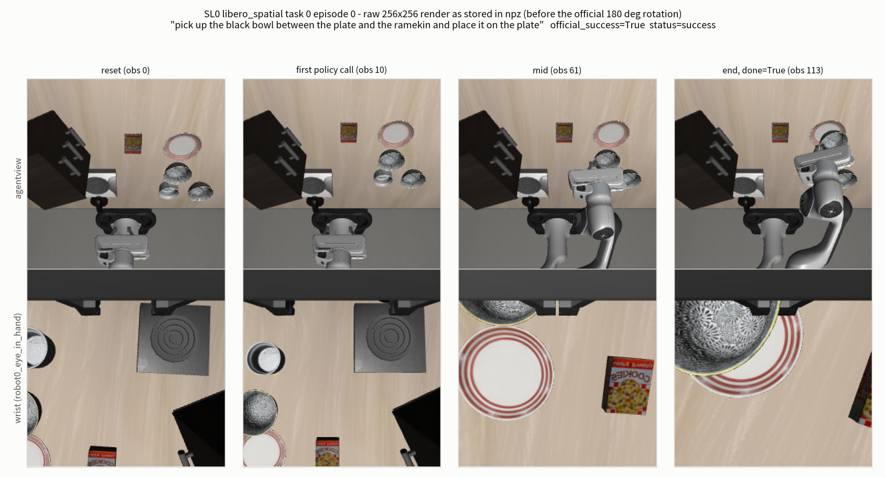

**graph** — EEF xyz · gripper qpos · 실행 action · gripper 명령의 step 별 시계열(회색 = wait 10 step, 점선 = done step)과
호출별 latency. 첫 호출(JIT compile 포함)은 steady-state 와 자릿수가 달라 막대로 따로 그렸다.

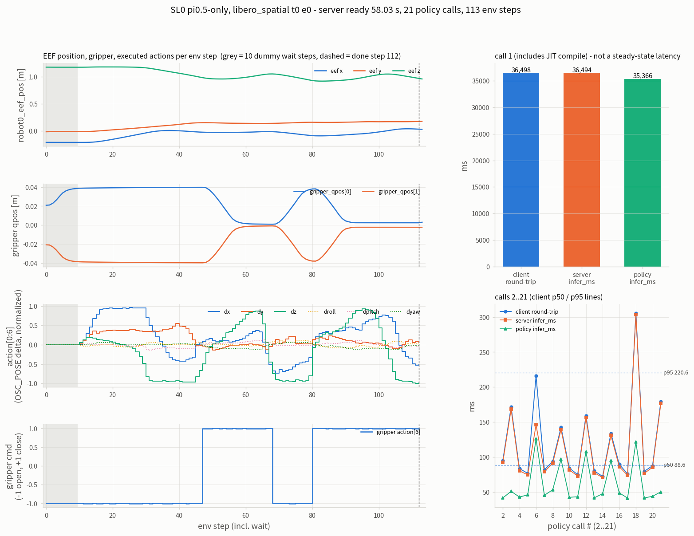

**table** — protocol · checkpoint · 환경 · 결과 · 입력 보호 · 회귀를 한 장에 모은 표.

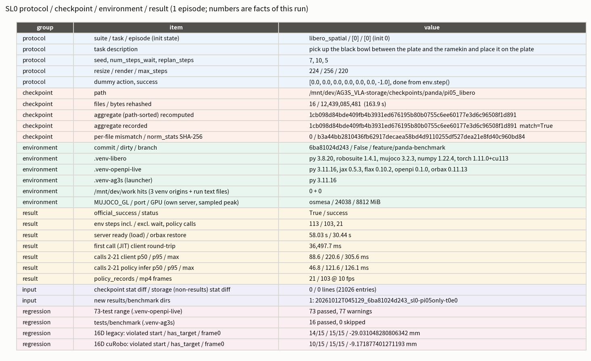

### 결과 — 수치

> **episode 1개의 사실이다. 성공률이 아니다.** task 0 · init state 0 · seed 7 에서 한 번 성공했다는 것 이상은
> 말하지 않는다. 이 episode 로 pi0.5 의 성능이나 공개 수치와의 일치 여부를 판정하지 않는다
> (성능 확인은 P2 소규모 평가의 일이다).

**Episode**

| 항목 | 값 |
|---|---|
| official_success | `true` |
| status | `success` (error 없음) |
| env step (wait 포함 / 제외) | 113 / 103 (wait 10, `max_steps` 220) |
| done 이 선 step index | 112 |
| policy 호출 수 | 21 |
| action chunk 배열 shape | 21 × 10 × 7 |
| mp4 | `libero_spatial_t0_e0_success.mp4`, 103 frames, 10 fps, 224×224 |
| 실행 action 과 chunk 불일치 step | 0 |
| wait 구간 action = dummy action | `true` |

**Latency** (client 는 `client.infer` 왕복, server 는 서버 측 `infer_ms`, policy 는 모델 추론 구간)

| 항목 | 값 |
|---|---|
| server ready (Popen → `/healthz` 200) | 58.03 s |
| orbax restore (server log) | 30.44 s |
| client episode 총 시간 | 90.42 s |

| 구간 | 첫 호출 (JIT 포함) | 호출 2~21 (n=20) p50 | p95 | max |
|---|---|---|---|---|
| client 왕복 | 36,497.7 ms | 88.6 ms | 220.6 ms | 305.6 ms |
| server infer | 36,493.9 ms | 85.8 ms | 182.9 ms | 303.6 ms |
| policy infer | 35,366.2 ms | 46.8 ms | 121.6 ms | 126.1 ms |

첫 호출 36.5 s 는 JIT compile 이 지배한다. 이 값을 steady-state latency 로 쓰지 않는다. 이후 호출이 V11AB 의 runtime
deadline 안에 드는지는 AG3S 가 붙은 뒤에 따로 잰다 — SL0 는 측정과 기록만 한다.

**기록 완결성** (plan §6.1 필수 항목 중 이 단계 해당분)

| 산출물 | 상태 |
|---|---|
| `episodes.jsonl` 필수 field | 누락 0 |
| episode npz 배열 | 누락 0 |
| mp4 | 있음 |
| `policy_records/` | 21 파일, 21 개 모두 npz 의 action chunk 와 일치 |
| server log | `logs/libero_client.log` · `logs/serve_policy_24038.log` · `logs/server_console.log` 있음 |
| `run_manifest.json` 필수 20 항목 | 16 present, **4 missing** (아래 열린 항목) |
| `source.patch` | 0 bytes, dirty = false |

**입력 보호** (실행 전후 storage 비교)

| 항목 | 값 |
|---|---|
| checkpoint 디렉터리 stat diff | 0 줄 |
| storage 기존 input (results 제외, 21,026 entries) stat diff | 0 줄 |
| `results/benchmark` 새 dir | 1개 (이번 run), 삭제된 dir 0 |
| `/mnt/dev/work` 경로 hit | 3 venv origin 0, run 의 text file 0 |

**checkpoint identity** — 독립 rehash script 로 16 파일 12,439,085,481 bytes 를 163.9 s 에 전부 다시 해시했다.
aggregate(파일 path 순 정렬) 재계산 값이 기록값 `1cb098d8…` 과 일치하고 per-file mismatch 는 0 이다.
(launcher 의 `--verify-checksums` 경로 자체는 이 STEP 에서 실행하지 않았다. 아래 not measured.)

**환경 독립성**

| venv | interpreter | 위치 |
|---|---|---|
| `.venv-libero` | Python 3.8.20 | `/mnt/dev/AG3S_VLA-benchmark/.python/cpython-3.8.20-linux-x86_64-gnu` |
| `.venv-openpi-live` | Python 3.11.16 | `/mnt/dev/AG3S_VLA-benchmark/.python/cpython-3.11.16-linux-x86_64-gnu` |
| `.venv-ag3s` | Python 3.11.16 | 같은 3.11.16 |

**회귀**

| 검사 | 결과 |
|---|---|
| live 보고서 범위 CPU test (`.venv-openpi-live`) | 73 passed, 0 skipped, 77 warnings |
| `tests/benchmark` (`.venv-ag3s`) | 16 passed, 0 skipped |
| `tests/benchmark` + `test_run_artifacts` + `test_policy_recorder_destination` | 20 passed, 1 skipped (`.venv-ag3s` 에 flax 가 없어 recorder test skip. impl.md 가 기존과 같은 skip 이라고 기록) |
| 16D legacy ESDF 기준선 | violated start 14/15 · has_target 15/15 · frame0 clearance -29.031 mm — 기준값과 일치 |
| 16D cuRobo ESDF 기준선 | violated start 10/15 · has_target 15/15 · frame0 clearance -9.172 mm — 기준값과 일치 |

SL0 가 새 파일만 추가했고 기존 코드를 바꾸지 않았으므로, 위 16D 기준선이 그대로인 것을 확인했다.

**자원** (실행 중 sampling 70 회)

| 항목 | 값 |
|---|---|
| pod working set 최대 | 61.403 GiB |
| GPU 전체 사용 최대 | 44,948 MiB (외부 2 process 36,136 MiB 포함) |
| 이 run 의 server GPU 최대 | 8,812 MiB |

### 공식 예제와의 차이

공식 `third_party/openpi/examples/libero/main.py` 와 **정책 입력 · 실행 action 은 같고**, 아래는 기록·운영 쪽 차이다
(출처 `SL0.impl.md`).

| # | 차이 | 영향 |
|---|---|---|
| 1 | `--task-ids` / `--episode-ids` 로 부분집합 실행 | task 0 episode 0 은 공식 sweep 의 첫 episode 와 같은 순서. 뒤쪽 episode 는 앞선 episode 를 거치지 않아 전체 sweep 의 같은 번호와 env 이력이 다를 수 있다 |
| 2 | 예외 시 `status=execution_error` + traceback 기록, client exit code 1. episode 시작 시 `done=False` | 공식은 예외 시 이전 episode 의 `done` 이 남을 수 있다 |
| 3 | 영상 이름 `videos/<suite>_t<task>_e<ep>_<success|failure>.mp4`, exclusive publish | 공식은 같은 task 의 다음 episode 가 덮어쓴다. frame · fps 동일 |
| 4 | 추가 기록: `episodes.jsonl`, step 별 npz, `client.infer` 왕복 시간, `server_timing` / `policy_timing` | 정책 입력 · 실행 action 불변 |
| 5 | 무거운 import 를 함수 안으로 이동 | 없음 (CPU test 가 Python 3.11 에서 module 을 import 하기 위함) |
| 6 | CLI 를 argparse 로, `--port` 필수, launcher 는 `--host 127.0.0.1` 전달 | 없음 |
| 7 | websockets 13.1 (Python 3.8) 에서 `ping_timeout` 없이 연결하는 subclass | upstream OpenPI client 와 같은 연결 |
| 8 | LIBERO import 전 `LIBERO_CONFIG_PATH/config.yaml` 이 없으면 거부 | 없음 (config 가 없으면 LIBERO 가 `input()` 으로 멈춘다) |
| 9 | 환경: `MUJOCO_GL=osmesa`, PYTHONPATH 제거, foreign torch `LD_LIBRARY_PATH` 제거, thread 수 제한 | **렌더러가 공식 GPU EGL 이 아니라 CPU llvmpipe.** pixel 단위 차이 가능성은 측정하지 않았다 |
| 10 | 설치 도구 버전, LIBERO editable compat 모드 | pin 은 예제 그대로 |

`pip check` 는 공식 방식(`uv pip sync` 는 의존성을 풀지 않는다)으로 LIBERO requirements 의 transitive 의존성이
설치되지 않아 불일치를 보고한다. 목록은 `SL0.impl.md`. 평가 경로(benchmark → env → `OffScreenRenderEnv` → step)는
이것들 없이 import · 실행됐다.

### 측정하지 않은 것

- renderer 차이(osmesa vs 공식 EGL)의 pixel 영향
- **성공률** (episode 1개)
- launcher 의 `--verify-checksums` 경로 자체 (독립 rehash script 로 대신 재계산)
- 다른 task / episode

### 열린 항목

| # | 내용 | 영향 / 다음 |
|---|---|---|
| 1 | ~~**manifest 필수 항목 4개 누락**: `protected_authorized_links`, `phase`, `level`, `runtime_schedule`~~ | ~~pi0.5-only 에는 해당하지 않는 항목이지만 "해당 없음" 이라는 **선언도 기록돼 있지 않다**. V11AB 와 같은 형식으로 비교하려면 N/A 를 명시해 채워야 한다. 처리 시점은 lead 판정 대기~~ **SL1 에서 처리**: manifest 에 `n/a` + 이유와 `runtime_schedule`(control 20 Hz, replan 5 step 등)을 명시하도록 launcher 를 고쳤다. 확인은 unit test(`run_cpu_regression.sh` B 44 passed) 수준이며, 실제 policy server 를 띄운 launcher 실행에서 manifest 를 다시 확인한 것은 아니다. |
| 2 | ~~manifest 의 `serve_policy` 자기 execution 항목에 `settings.env = "aloha_sim"` 이 기록됨~~ | ~~serve_policy `Args` 기본값이 그대로 기록된 것이다. 실제 policy 는 `policy:checkpoint` 경로(`pi05_libero`, storage checkpoint)로 로딩됐다. 그러나 manifest 만 읽으면 환경이 aloha_sim 처럼 보여 오독 위험이 있다. 같은 항목의 `record_dir` 은 null~~ **SL1 에서 처리**: checkpoint 경로로 서빙하면 `env = None`, `policy = {source, config, dir}` 로 기록한다(`serve_policy.py` 최소 변경). unit test 확인 수준이며 live 서버 실행의 manifest 는 재확인 전이다. 이전 run 의 `aloha_sim` 기록은 그대로 남아 있다. |
| 3 | `.venv-libero` 의 torch(1.11.0+cu113)가 standalone import 후 process 종료 시 `free(): invalid pointer` 로 abort | episode 는 영향받지 않았다(client returncode 0, 기록 완료). pod 의 `LD_LIBRARY_PATH` 를 그대로 쓰면 torch import 자체가 `undefined symbol` 로 실패해, launcher 가 client env 에서 foreign site/dist-packages 항목을 제거한다. 종료 시 abort 의 원인은 확인하지 않았다 |
| 4 | ~~**73-test 의 명령이 이전에 기록돼 있지 않았다.**~~ | ~~이전 live 보고서와 live-validation run 에 정확한 argv 가 없어, verifier 가 collected 수 4+2+23+6+38 = 73 과 warning 출처(t43ta 16+61 = 77)로 파일 구성을 **재구성**해 실행했다. 재구성 명령은 verify.json `pytest_regression73` 에 있다. 이 범위의 정본 명령으로 삼을지는 lead 판정 대기~~ **SL1 에서 처리**: 정본 명령은 `bash scripts/testing/run_cpu_regression.sh` 이다(A 가 SL0 의 5 파일 73 개). SL1 검증에서 A 73 passed, exit 0. |
| 5 | **pod working set 이 실행 중 최대 61.403 GiB.** lead 가 전달한 pod budget 은 64 GiB 인데(이 값은 verify.json 에 없다), 여유가 작다 | 측정 전 checkpoint page cache 를 `posix_fadvise DONTNEED` 로 비웠다(파일 내용 · mtime 불변, stat diff 0). 공유 host 의 load average 는 실행 직전 68~92 였다. server 와 client 가 한 pod 에서 돌 때의 memory 여유를 V11AB(추가 geometry 처리) 단계에서 다시 본다 |
| 6 | `CHECKSUMS.json` 의 `aggregate_rule` 문구와 실제 계산이 다르다 | 문구는 "sorted `<sha256>  <path>\n` lines" 인데 producer 는 record 를 **path 순** 으로 정렬한다. line 문자열 정렬로 재계산하면 `baffa4ca…` 가 나와 불일치, path 순이면 기록값과 일치한다. launcher 는 path 순을 쓴다. 문구 수정은 이 STEP 의 범위 밖 |
| 7 | manifest 의 `storage.rollouts`(`<run>/runs`) 경로가 만들어지지 않았다 | 이 run 의 산출물은 그 경로를 쓰지 않으므로 기록만 한다 |

### 판정

verifier 판정(`verify.json` 의 verdict): 16D 기준선 일치(legacy · cuRobo), `status=success` · `official_success=true`,
checkpoint aggregate 일치, input stat diff 0 · 새 results dir 1, 73 passed · `tests/benchmark` 16 passed.
**SL0 의 통과 기준은 "완주와 기록"이며(완주 = status 가 success 또는 max_steps), 충족했다.** 사용자가 2026-10-12 에 확정했다.
다음은 SL-1(agent-view · wrist RGB/depth 와 camera 변환 → AG3S 관측 형식)이다.

### 되돌아올 지점 (SL0)

| 전환 신호 | 돌아와서 할 일 |
|---|---|
| Python 3.8 pinned stack 이 이 host(CUDA driver 580, OSMesa)에서 설치 · 렌더가 안 된다 | 3.11 단일 env 대안은 공식 조건과 달라지므로 **사용자에게 다시 묻는다.** (이번에는 설치 · 렌더 모두 되어 해당 없음) |
| 1 episode 가 `execution_error` | adapter 단계로 넘어가지 않고 원인(관측 형식 · norm stats · port/통신)을 먼저 닫는다. (이번에는 `success` 라 해당 없음) |
| 이후 episode 가 failure | SL0 통과와 별개다(완주 · 기록이 기준). 성능 확인은 P2 소규모 평가에서 한다 |
| ~~V11AB 와 manifest 형식을 맞출 때 열린 항목 1 · 2 가 비교를 막는다~~ | ~~launcher 의 settings 에 N/A 선언과 policy source 를 명시하도록 고친다 (구현은 implementer)~~ SL1 에서 처리 |
| renderer 가 결과 차이의 원인으로 의심된다 | osmesa 와 EGL 의 pixel 영향을 verifier 에게 측정 요청한다 (이번에는 측정하지 않음) |

---

## SL1 — LIBERO Panda camera adapter: RGB/depth · K · T_base_cam → V11AB wire 관측 (2026-10-12)

> 2026-10-12 KST. 구현 commit `0e13395e`(KST 12:33) · 검증 commit `6c7ce76f`(KST 13:14). 사용자 확정 2026-10-12.
> 원본: [`handoff/SL1.task.md`](handoff/SL1.task.md) · [`handoff/SL1.impl.md`](handoff/SL1.impl.md) ·
> [`handoff/SL1.verify.json`](handoff/SL1.verify.json). raw 출력은 `outputs/verify/SL1/`.
> 이 절의 수치는 모두 `SL1.verify.json` 의 `numbers` 가 출처다. 단위는 mm 이고, 따로 적지 않으면 114 observation(task 0 · episode 0 의 replay 전체) 위의 값이다.

### 이 STEP 이 답하는 질문

LIBERO Panda 의 두 camera 관측을, **policy 입력을 바꾸지 않고**, V11AB 가 읽는 OpenCV / robot-base 규약의
metric depth · K · `T_base_cam` 으로 **물체 · table 에 mm 수준으로** 옮길 수 있는가?

```
robosuite render (OpenGL row order, depth = normalized z-buffer [0,1])
  -> [SL1 adapter, Python 3.8]  OpenCV row order, metric z-depth(m), K(fovy), T_base_cam = inv(T_world_base) * T_world_cam (OpenCV axes)
  -> V11AB wire key: ag3s/cameras, ag3s/depth/<cam>(uint16 mm), ag3s/K/<cam>, ag3s/T_base_cam/<cam>,
                     ag3s/robot_state/<cam>, ag3s/stamp/<cam>, ag3s/stamp_mode = sim_frozen
  -> AG3S.trajopt.wire.unpack_camera_observations -> CameraObservation (OpenCV, robot base frame)
camera 이름 table: agentview -> head, robot0_eye_in_hand -> left_wrist
```

`left_wrist` 로 매핑한 이유는 pi05_libero transform 이 wrist image 를 `left_wrist_0_rgb` slot 에 넣기 때문이다. SL-3 attention token 순서와 맞추기 위한 선택이며, SL-3 audit 결과가 다르면 adapter table 만 바꾼다.

### 무엇을 만들었나

| 구성 | 내용 |
|---|---|
| camera adapter (`benchmark/adapters/libero_panda/camera.py`, Python 3.8) | camera 별 metric z-depth(OpenCV row order) · K(fovy 식) · `T_base_cam`(MuJoCo body `robot0_base` 기준, OpenCV 축) · 9D `robot_state`(joint 7 + gripper 2) · stamp. robosuite `camera_utils` 의 세 공식을 다시 썼다(그 module 이 `h5py` 를 import 하는데 `.venv-libero` 는 공식 pin 이라 설치하면 freeze 재현이 깨진다). 원 공식과의 일치는 AST 로 꺼내 exec 한 값으로 비교한다 |
| policy image <-> OpenCV pixel 사상 | client 의 `[::-1, ::-1]` + `resize_with_pad` 256→224 를 명시적 함수(`opencv_to_policy_pixel` / `policy_to_opencv_pixel`)와 역함수로 만들었다 |
| `capture_state` observable | robosuite 는 camera render 를 `env.step` 끝이 아니라 physics substep loop 안에서 찍는다. 그래서 `env.step` 이 돌아온 뒤의 `env.sim` 은 image 보다 늦다. image 와 같은 substep 의 `T_world_cam` 등을 obs 에 싣는 읽기 전용 observable 을 geometry capture 가 켜졌을 때만 설치한다 |
| wire replica (`wire_pack.py`, Python 3.8) | `AG3S.trajopt.wire.pack_request` 의 camera 부분과 key · dtype 이 같은 dict/npz. AG3S 를 import 하지 않는 복제이므로 cross-env test 로 동치성을 보장한다 |
| client `--capture-geometry` (기본 off) | on 이면 `camera_depths=True` 로 env 를 만들고 step 마다 `episodes/<stem>_geom.npz` 기록. `--capture-segmentation` · `--capture-float-depth` 도 기본 off. off 이면 client argv · 출력이 SL0 와 같다 |
| action replay (`libero_replay.py` + `launch_libero_replay.py`) | 기존 run 의 기록 action 으로 policy 없이 같은 task · init state · seed 를 재생하고 새 run 에 geometry 를 기록한다. client 의 `run_tasks` 를 그대로 써서 seed · env 생성 · 대기 · replan · done 처리가 같다. 기록 `action` 과 chunk 가 bit 단위로 안 맞으면 시작을 거부하고, 기록이 모자라면 action 을 만들어내지 않고 `execution_error` 로 끝낸다 |
| manifest 해당 없음 항목 + `runtime_schedule` | SL0 launcher 의 manifest settings 에 protected/authorized links · phase · level 등 pi0.5-only 에 해당 없는 항목을 `n/a` + 이유로 명시. `runtime_schedule` 은 LIBERO source 에서 AST 로 읽은 control 20 Hz, replan 5 step, policy 호출 주기 5 step = 0.25 s sim 등을 적는다 |
| `serve_policy` env 기록 수정 | checkpoint 경로로 서빙하면 manifest 의 `env` 를 `None`, `policy = {source, config, dir}` 로 기록한다(이전에는 `Args` 기본값 `aloha_sim` 이 그대로 남았다). load · serve 동작은 변경 없음 |
| 고정 CPU 회귀 `scripts/testing/run_cpu_regression.sh` | A: SL0 verifier 가 재구성한 5 파일(`.venv-openpi-live` + `run_without_legacy.py`), B: `tests/benchmark`(같은 venv), C: `tests/benchmark`(`.venv-ag3s`). 하나라도 실패면 exit 1 |
| test | `tests/benchmark/test_libero_sl1.py` + `.venv-libero` 용 `libero_py38_checks.py`(pytest 가 subprocess 로 호출) |

`AG3S/**` algorithm · config, `robots/**`, `benchmark/LIBERO` submodule, storage 기존 input 은 건드리지 않았다.

**계획과 달라진 점** (출처 `SL1.impl.md`)

| # | 차이 | 영향 |
|---|---|---|
| 1 | robosuite `camera_utils` 를 import 하지 않고 공식을 다시 씀 | 값은 AST 비교로 확인 |
| 2 | depth 를 float64 로 계산 후 float32 저장 | robosuite 의 float32 계산과의 차이는 wire 양자화보다 작다고 impl.md 가 기록한다 (이 STEP 의 verify 수치는 아님). wire 왕복 오차는 #5 에서 측정 |
| 3 | geometry on 이면 env 에 `ag3s_capture_state` observable 추가 | 아래 #1 이 RGB 불변을 확인한다 |
| 4 | segmentation 은 `env.step` 이 돌아온 시점에 따로 render | image 순간보다 1 substep 뒤. 아래 "capture instant" 에서 크기를 잰다 |
| 5 | K 는 robosuite / AG3S RB-Y1 과 같은 `cx = W/2`, `cy = H/2` | pixel 중심이 정수 index 인 AG3S `backproject` 규약에서는 광축이 `(W-1)/2 = 127.5` 라 0.5 pixel 어긋난다. 이 STEP 에서는 고치지 않고 크기를 쟀다. 아래 판정 |

### 실행

| 항목 | 값 |
|---|---|
| source (replay 대상) | SL0 run `20261012T045129_6ba81024d243_sl0-pi05only-t0e0` (task 0, episode 0, 읽기만) |
| run a (geometry on, depth float 포함) | `/mnt/dev/AG3S_VLA-storage/results/benchmark/20261012T123505_0e13395ee6a6_sl1-replay-geom-t0e0` |
| run b (geometry + segmentation + depth float) | `/mnt/dev/AG3S_VLA-storage/results/benchmark/20261012T123554_0e13395ee6a6_sl1-replay-seg-t0e0` |
| run c (flag 없음 = SL0 경로 보존 확인) | `/mnt/dev/AG3S_VLA-storage/results/benchmark/20261012T123646_0e13395ee6a6_sl1-replay-off-t0e0` |
| 명령 | `.venv-ag3s/bin/python benchmark/runners/launch_libero_replay.py --source-run <SL0 run id> --task-ids 0 --episode-ids 0 [--capture-geometry --capture-float-depth [--capture-segmentation]] --run-id sl1-replay-{geom,seg,off}-t0e0` |
| 환경 | GPU · policy server 불필요. launcher `.venv-ag3s` -> replay `.venv-libero`. 렌더러 `llvmpipe (LLVM 15.0.7, 256 bits)`, Mesa 23.2.1 (OSMesa), `offsamples` 4 |
| 자원 | pod working set 최대 45.179 GiB, 새 results dir 3개 |

### 결과 — Figure

세 figure 는 verifier 가 만들었다 (`outputs/verify/SL1/scripts/make_figures.py`, sidecar `.json` 동봉).

**실제 scene** — run b 의 observation 55. 위 줄: head RGB(segmentation 윤곽 + 투영한 body origin + wrist depth 를 back-project 해 head 위에 얹은 점), wrist RGB(반대 방향 overlay), policy 가 실제로 받은 224×224 image(SL0 `policy_records` step_9), head depth(OpenCV row). 아래: 두 camera 를 `robot0_base` frame 으로 back-project 한 3D point cloud 와 camera frustum, table top z.

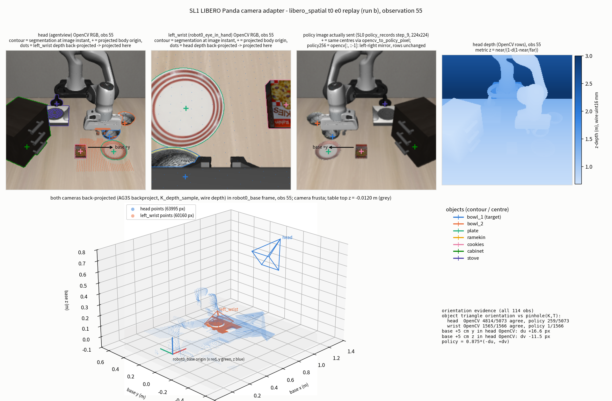

**graph** — 왼쪽 위부터 #1 replay 차이(전부 0), #2 물체별 median 거리 막대와 전체 CDF(세 K 규약), #4 wrist -> head nearest neighbour CDF, depth sample 위치 격자(`|z_ray - depth| < 0.01 mm` 인 pixel 비율), capture instant 별 robot 표면 거리 CDF.

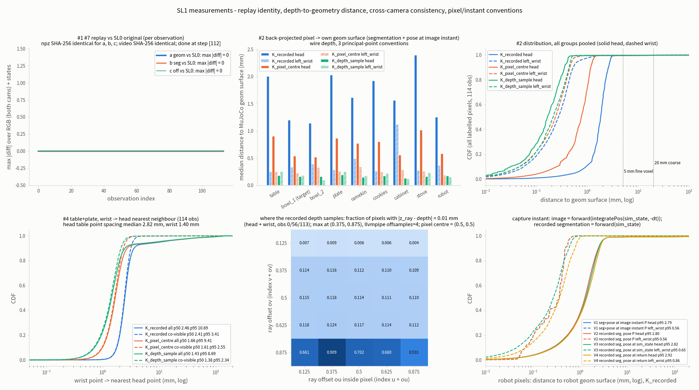

**table** — 변환 규약 · K · T 와 #1~#7 결과를 한 장에 모은 표.

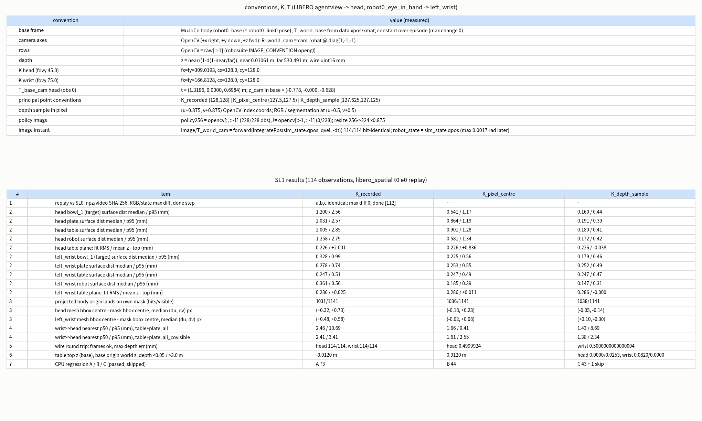

### 결과 — #1 replay 재현성 (depth 활성화가 policy 입력을 바꾸지 않는가)

| 비교 대상 (SL0 원 기록 vs) | episode npz SHA-256 | video SHA-256 | 비교 key 수 / 최대 절대 차이 | done step | jsonl |
|---|---|---|---|---|---|
| run a (depth on) | 동일 | 동일 | 14 / 0.0 | 112 | success, env step 113 (대기 제외 103), policy 호출 21 |
| run b (depth + segmentation) | 동일 | 동일 | 14 / 0.0 | 112 | 동일 |
| run c (flag 없음) | 동일 | 동일 | 14 / 0.0 | 112 | 동일 |

- episode npz SHA-256 은 네 run 모두 `e8a15133b8e2ae4aa9c069532d6eca9eba96ed453b070f1b3523a8c48aaaa088`, mp4 SHA-256 은 `9ce6114fb5d99dc57549b28c54a6e047d9b967f4b15b381584c88899e7036f8a` 다. 즉 **RGB · eef/joint/gripper state · action · video 가 byte 단위로 같다.**
- run a 와 run b 의 geometry npz 는 공통 32 key 가 모두 같고, run b 에만 `segmentation_geom/head`, `segmentation_geom/left_wrist` 가 더 있다.
- SL0 의 policy image(21 호출 x image · wrist)는 기록된 raw 에 client 의 변환을 다시 적용한 값과 21/21 로 일치한다.

따라서 `camera_depths=True` 와 `ag3s_capture_state` observable 은 render 와 물리 상태를 바꾸지 않는다. task 문서의 "별도 render pass 로 전환" 조건에는 해당하지 않는다. #7 의 SL0 경로 보존(run c 가 SL0 와 동일)도 이 표로 확인됐다.

### 결과 — #2 depth <-> geom 표면 정합

segmentation 으로 고른 물체 pixel 을 back-project 한 base-frame 점과, 같은 순간(image instant)의 MuJoCo geom 표면 사이의 최근접 거리다. segmentation 과 pose 는 모두 image instant 로 맞췄다(아래 capture instant 의 V1). K 규약 세 가지를 같은 depth 에 적용했다.

| 이름 | principal point (cx, cy; pixel 중심이 정수 index 인 좌표) | 뜻 |
|---|---|---|
| `K_recorded` | (128.0, 128.0) | SL1 adapter 가 기록한 값 (robosuite 와 같은 `W/2`) |
| `K_pixel_centre` | (127.5, 127.5) | pixel 중심 규약. RGB · segmentation 이 sample 되는 위치와 일치 |
| `K_depth_sample` | (127.625, 127.125) | 이 renderer 가 depth 를 sample 하는 위치 (아래 (c)) |

**head (agentview)** — median / p95 (mm)

| 대상 | n (pixel) | `K_recorded` | `K_pixel_centre` | `K_depth_sample` |
|---|---|---|---|---|
| table | 3,153,421 | 2.00 / 2.85 | 0.90 / 1.28 | 0.18 / 0.41 |
| bowl_1 (target) | 75,545 | 1.20 / 2.56 | 0.54 / 1.17 | 0.16 / 0.44 |
| bowl_2 | 54,013 | 1.14 / 2.70 | 0.52 / 1.25 | 0.16 / 0.46 |
| plate | 148,629 | 2.03 / 2.57 | 0.86 / 1.19 | 0.19 / 0.39 |
| ramekin | 18,973 | 1.62 / 2.79 | 0.77 / 1.31 | 0.15 / 0.40 |
| cookies | 58,839 | 1.93 / 2.30 | 0.80 / 1.17 | 0.17 / 0.36 |
| cabinet | 943,236 | 1.56 / 2.03 | 0.56 / 0.97 | 0.13 / 0.28 |
| stove | 179,550 | 2.39 / 2.83 | 1.02 / 1.35 | 0.16 / 0.34 |
| robot | 854,825 | 1.26 / 2.79 | 0.58 / 1.34 | 0.17 / 0.42 |

**left_wrist (robot0_eye_in_hand)** — median / p95 (mm)

| 대상 | n (pixel) | `K_recorded` | `K_pixel_centre` | `K_depth_sample` |
|---|---|---|---|---|
| table | 3,854,155 | 0.25 / 0.51 | 0.25 / 0.49 | 0.25 / 0.47 |
| bowl_1 (target) | 642,523 | 0.33 / 0.99 | 0.23 / 0.56 | 0.18 / 0.46 |
| bowl_2 | 1,212 | 0.39 / 1.18 | 0.33 / 0.67 | 0.09 / 0.42 |
| plate | 924,562 | 0.28 / 0.74 | 0.25 / 0.55 | 0.25 / 0.49 |
| ramekin | 43,746 | 0.49 / 1.82 | 0.34 / 0.87 | 0.17 / 0.47 |
| cookies | 255,586 | 0.26 / 0.58 | 0.24 / 0.49 | 0.22 / 0.47 |
| cabinet | 130,177 | 1.12 / 1.58 | 0.28 / 0.89 | 0.12 / 0.33 |
| stove | 150,097 | 0.28 / 1.22 | 0.26 / 0.52 | 0.23 / 0.47 |
| robot | 769,260 | 0.36 / 0.56 | 0.19 / 0.39 | 0.15 / 0.31 |

wrist depth 가 0.05 m 보다 가까운 pixel(전체의 8.2 %)은 AG3S `backproject` 에서 빠지므로 이 표와 #4 에 들어가지 않는다(아래 #6).

**table plane 잔차** (114 frame 의 median)

| camera | K | plane fit RMS | tilt | z - table top 평균 | z - table top RMS |
|---|---|---|---|---|---|
| head | `K_recorded` | 0.226 | 0.104 deg | +2.001 | 2.048 |
| head | `K_pixel_centre` | 0.226 | 0.048 deg | +0.836 | 0.883 |
| head | `K_depth_sample` | 0.226 | 0.006 deg | -0.038 | 0.230 |
| left_wrist | `K_recorded` | 0.286 | 0.002 deg | +0.025 | 0.295 |
| left_wrist | `K_pixel_centre` | 0.286 | 0.002 deg | +0.011 | 0.288 |
| left_wrist | `K_depth_sample` | 0.286 | 0.001 deg | -0.000 | 0.286 |

읽는 법.

- **depth row 순서와 base frame 정의는 맞다.** table plane 이 평평하게(fit RMS 0.2 mm 대) 복원되고 z 가 table top 높이와 mm 안에서 맞는다.
- head 의 오차는 거의 전부 **principal point 규약 하나**에서 온다. table median 이 2.00 -> 0.90 -> 0.18 mm 로 줄고, plane fit RMS 는 그대로 0.226 mm 라 plane 의 모양(기하)은 이미 맞고 평행이동·기울기만 남는 형태다. wrist 는 camera 가 table 에 가까워 K 규약의 영향이 작다(table 0.25 mm 로 동일).
- **표면까지의 거리가 5 mm(V11AB fine layer voxel)를 넘는 pixel 비율**은 `K_recorded` 기준 head table 0.40 %, bowl_1 1.17 %, plate 0.87 %, ramekin 2.10 %, robot 1.06 %; wrist table 0.35 %, bowl_1 0.30 %, plate 0.46 %, ramekin 0.98 %. 20 mm(coarse layer voxel)를 넘는 비율은 head table 0.35 %, ramekin 1.94 %, robot 0.90 %, wrist table 0.19 %. 이 꼬리는 K 규약을 바꿔도 거의 같다(head ramekin 2.10 % / 1.94 % 가 세 K 모두 같다). 이 꼬리의 원인은 분리하지 않았다.
- 1-pixel 침식(경계 pixel 제외)으로 median 이 거의 안 변한다(head table 2.00 -> 1.99 mm). 경계 pixel 이 median 을 끌고 있지 않다.
- 독립 방법(`mj_multiRay` 로 쏜 ray 와 depth 의 차이, 일치한 pixel 만)도 같은 순서다: head table median 2.72 -> 1.18 -> 0.25 mm, wrist table 1.42 -> 0.68 -> 0.29 mm (`K_recorded` -> `K_pixel_centre` -> `K_depth_sample`).

**결론: 세 K 규약 모두 median · p95 가 5 mm(fine voxel) 아래이므로 task 의 "오차가 voxel 이상이면 SL-2 로 가지 않는다" 조건에는 걸리지 않는다.** 규약 선택의 근거는 아래 판정에 있다.

### 결과 — #3 policy image <-> OpenCV pixel 대응

**policy 입력이 OpenCV image 의 무엇인가.**

| 측정 | 결과 |
|---|---|
| `policy256 == opencv[:, ::-1]` (열 반전 = left-right mirror, 행 순서 그대로) | 228 / 228 image |
| `policy256 == opencv rot180` (180° 회전) | 0 / 228 |
| 점 하나를 policy 변환에 통과시킨 dot test (81 점, sigma 2 px) | 좌표 오차 최대 0.0246 px, `policy_to_opencv_pixel` 왕복 오차 0 |
| 방향 단서 (head, frame 0) | base +y 로 5 cm 가면 OpenCV du = +16.6, dv = 0.0 px; base +z 로 5 cm 가면 du = +0.69, dv = -11.50 px |
| 방향 단서 (wrist, frame 0) | base +y 5 cm: du = -35.40, dv = +1.17 px; base +z 5 cm: du = +4.62, dv = -11.06 px |
| 물체 삼각형 방향 (OpenCV pinhole 예측과 일치 / policy 예측과 일치) | head 4814 / 5073 vs 259 / 5073 (114 frame); wrist 1565 / 1566 vs 1 / 1566 |
| policy 좌표 규칙 | `policy224 (dx, dy) = 0.875 * (-du, +dv)` (`policy256[i, j] = opencv[i, 255 - j]`, 256 -> 224 scale 0.875, pad 0) |

예: head frame 0 에서 target bowl_1 의 mask centroid 는 OpenCV (194.39, 131.63), policy 224 image 에서 (52.97, 115.11) 이다. plate 는 OpenCV (201.15, 166.87) -> policy (47.06, 145.95). OpenCV 에서 오른쪽에 있던 물체가 policy 에서는 왼쪽에 보이고 세로 위치는 같은 비율로 유지된다.

**투영이 물체에 떨어지는가.** 물체의 body origin(MuJoCo body 기준점)을 K · `T_base_cam` 으로 투영한 점이 OpenCV segmentation 에서 그 물체 mask 안에 있는지(hit)다. 이 hit 는 body origin 한 점의 검사다.

| 대상 | head hit / visible (`K_recorded`) | wrist hit / visible (`K_recorded`) |
|---|---|---|
| bowl_1 (target) | 114 / 114 | 87 / 114 |
| bowl_2 | 96 / 114 | 0 / 0 (시야 밖) |
| plate | 113 / 114 | 102 / 113 |
| ramekin | 44 / 73 | 25 / 30 |
| cookies | 114 / 114 | 89 / 89 |
| cabinet | 114 / 114 | 19 / 19 |
| stove | 114 / 114 | 0 / 19 |
| **합계** | `K_recorded` 709 / 757, `K_pixel_centre` 712 / 757, `K_depth_sample` 713 / 757 | 322 / 384, 324 / 384, 325 / 384 |

hit 가 아닌 경우(예: wrist 의 stove 0/19)는 body origin 점이 다른 물체나 robot 에 가려지거나 물체 바깥에 있어서일 수 있으나, 원인은 분리하지 않았다. 투영이 mask 에서 어긋나는 크기를 보려면 아래 mask bbox 중심 오차가 더 직접적이다.

**mesh bbox 중심 - mask bbox 중심** (median du, dv / |오차| median / p95, pixel)

| camera | n | `K_recorded` | `K_pixel_centre` | `K_depth_sample` |
|---|---|---|---|---|
| head | 626 | (+0.32, +0.73) / 1.12 / 7.93 | (-0.18, +0.23) / 0.43 / 8.33 | (-0.05, -0.14) / 0.66 / 8.16 |
| left_wrist | 156 (`K_depth_sample` 은 155) | (+0.48, +0.58) / 0.84 / 20.85 | (-0.02, +0.08) / 0.33 / 17.96 | (+0.10, -0.30) / 0.50 / 17.75 |

p95 는 occlusion 을 보정하지 않은 값이라 가려진 물체를 포함한다. median 은 `K_pixel_centre` 가 가장 작다(head 0.43 px, wrist 0.33 px).

### 결과 — #4 두 camera 일관성

table + plate 의 static 표면에서 wrist 점 -> head 점 nearest neighbour 거리다(n = 4,778,717, 두 표면 합). `all_covisible` 은 verify.json 이 따로 제시한 부분집합으로, 두 camera 가 모두 보는 점으로 좁힌 값이다(n 은 K 별로 4,420,513 / 4,425,143 / 4,429,904).

| 대상 | 지표 | `K_recorded` | `K_pixel_centre` | `K_depth_sample` |
|---|---|---|---|---|
| all | median / p95 (mm) | 2.46 / 10.69 | 1.66 / 9.41 | 1.43 / 8.69 |
| all | 5 mm 초과 / 20 mm 초과 | 6.80 % / 3.33 % | 6.34 % / 3.22 % | 6.14 % / 3.14 % |
| all_covisible | median / p95 (mm) | 2.41 / 3.41 | 1.61 / 2.55 | 1.38 / 2.34 |
| all_covisible | 5 mm 초과 / 20 mm 초과 | 0.23 % / 0.15 % | 0.23 % / 0.16 % | 0.25 % / 0.15 % |

- 같은 table 위 점의 간격 자체가 head 2.82 mm, wrist 1.40 mm(median) 이므로, nearest 거리의 median 이 1.4~2.5 mm 인 것은 두 cloud 의 sampling 간격 수준이다.
- all 과 all_covisible 의 큰 차이(p95 10.69 -> 3.41 mm, 5 mm 초과 6.80 % -> 0.23 %)는 상대 camera 가 보지 않는 영역의 점 때문이다 (해석. 두 집합의 정의 외에 원인 분석은 하지 않았다).

### 결과 — #5 wire 왕복 (Python 3.8 pack -> 3.11 `unpack_camera_observations`)

| 항목 | head | left_wrist |
|---|---|---|
| unpack 성공 frame | 114 / 114 | 114 / 114 |
| 반환 type | `AG3S.ag3s.types.CameraObservation` (camera id `HEAD`, `LEFT_WRIST`) | 동일 |
| depth 양자화 오차 최대 | 0.499992 mm | 0.5 mm (0.5000000000000004, 부동소수 표현) |
| clip 된 pixel / 비유한 값 | 0 / 0 | 0 / 0 |
| K · T · robot_state · stamp 최대 절대 차이 | 0 / 0 / 0 / 0 | 0 / 0 / 0 / 0 |
| wire depth dtype | uint16 | uint16 |

실패 0 (114 file, 228 camera frame). `stamp_mode` 는 `sim_frozen`. 양자화 오차는 0.5 mm 한계(uint16 mm 반올림)를 넘지 않는다.

### 결과 — capture instant (image 가 찍힌 순간)

task 에 없던 측정이다. robosuite 는 render 를 physics substep 안에서 하고, 그 substep 의 상태 적분은 render 뒤에 끝난다. 그래서 `env.step` 이 돌려주는 joint 값과 그 시점의 `sim_state` 는 image 보다 **한 substep(0.002 s) 뒤**다. verifier 는 image 순간을 `P = forward(integratePos(sim_state.qpos, qvel, -dt))` 로 정의하고 re-render 로 검증했다.

| 검증 | 결과 |
|---|---|
| P 에서 re-render 한 RGB · depth 가 기록과 일치 | head 114 / 114, left_wrist 114 / 114 (RGB, depth 모두 bit-identical) |
| 기록한 `T_world_cam` · `T_world_base` 와 P 의 차이 | 0.0 (head, wrist, base) |
| `sim_state`(1 substep 뒤)에서 re-render 한 image 와 기록의 차이 | frame 0 은 같고(아무것도 움직이기 전), frame 10 / 11 / 40 / 80 / 113 에서는 다르다. 예: frame 40 wrist RGB 21,446 pixel, depth 최대 47.8 mm; head RGB 3,486 pixel |
| `sim_state_at_return - sim_state` 시각 | 0 s 또는 0.002 s (`{0.0, 0.002}`) |
| `robot_state` 가 obs 의 `robot0_joint_pos` / `gripper_qpos` 와 차이 | 0.0 (bit 일치) |
| `robot_state` 와 image 순간 qpos 의 차이, 최대 | 0.0017 rad (두 camera 동일). joint 별 [0.0003, 0.0017, 0.0003, 0.0017, 0.0007, 0.0017, 0.0009, 0.0002, 0.0002] rad (joint 7 + gripper 2) |
| 기록한 segmentation 이 어느 순간의 것인가 | `sim_state` 에서 re-render 한 값과 114 / 114 일치 (image 순간보다 1 substep 뒤) |
| 기록 segmentation vs image 순간 segmentation | frame 별 다른 pixel 수 head median 81.5 · max 179 (같은 frame 4 개), wrist median 82.0 · max 316 (같은 frame 1 개) (256 x 256 = 65,536 pixel 중) |

segmentation / pose 의 순간이 표면 거리에 미치는 영향(`K_recorded`, median / p95, mm). V1 = segmentation 과 pose 모두 image 순간, V2 = 기록 segmentation + image 순간 pose, V3 = 기록 segmentation + `sim_state` pose, V4 = 기록 segmentation + `env.step` 반환 순간 pose.

| 대상 | V1 | V2 | V3 | V4 |
|---|---|---|---|---|
| head robot | 1.26 / 2.79 | 1.26 / 2.80 | 1.32 / 2.82 | 1.37 / 2.92 |
| head bowl_1 | 1.20 / 2.56 | 1.20 / 2.57 | 1.20 / 2.64 | 1.20 / 2.72 |
| wrist robot | 0.36 / 0.56 | 0.36 / 0.56 | 0.27 / 0.65 | 0.37 / 0.86 |
| wrist bowl_1 | 0.33 / 0.99 | 0.33 / 1.00 | 0.33 / 1.02 | 0.38 / 1.13 |

순간이 어긋나도 median 은 0.1 mm 안팎으로 변하고, wrist robot p95 가 0.56 -> 0.86 mm 로 가장 크다. 이 STEP 의 #2 수치는 모두 V1 이다.

### 결과 — #6 V11AB 범위 정보 (측정만, SL-4 ESDF box 판정 자료)

| 항목 | 값 |
|---|---|
| robot base 원점 world z | 0.912 m (`T_world_base` 평행이동 (-0.66, 0, 0.912), 에피소드 내 최대 변화 0) |
| table top z (world / base frame) | 0.9 m / **-0.012 m** (base 원점보다 12 mm 낮다) |
| table mesh bbox (base frame) | z -0.062 ~ -0.012 m, x 0.16 ~ 1.16, y -0.6 ~ 0.6 |
| 물체 높이 (base frame z 범위, frame 113: 놓인 뒤) | bowl_1 [-0.0043, 0.061] (plate 위), bowl_2 [-0.0136, 0.039], plate [-0.0091, 0.0061], ramekin [-0.0127, 0.0307], cookies [-0.0127, 0.0074] m |
| 고정 가구 (base frame z 범위) | cabinet [-0.0024, 0.2146], stove [-0.027, 0.0469] m |
| frame 0 의 물체 z 범위 | bowl_1 / bowl_2 / plate / ramekin 의 z 최소 0.058 m, cookies 0.048 m (frame 113 과 다르다. 원인은 분리하지 않았다) |
| 점 cloud 의 base frame z, `K_depth_sample`, 5 frame 간격 (head) | p50 -0.0119, min -0.7908, max 0.5008 m; z < 0 인 비율 **68.84 %**, z > 1.6 m 인 비율 0 |
| 같은 지표 (wrist) | p50 -0.0116, min -0.0125, max 0.3147 m; z < 0 비율 **69.28 %**, z > 1.6 m 0 |
| depth 범위 밖 pixel, head | 0.05 m 미만 0 %, **3.0 m 초과 2.53 %**, depth 최소 0.63 m, 최대 3.069 m |
| depth 범위 밖 pixel, wrist | **0.05 m 미만 8.2 %**, 3.0 m 초과 0 %, depth 최소 0.042 m, 최대 0.397 m |
| depth 가 0 인 pixel | 두 camera 모두 0 % |

V11AB 의 depth 유효 범위는 0.05 ~ 3.0 m, 기본 ESDF box 는 base frame z ∈ [0, 1.6] 이다(`AG3S/ag3s/config.py` · `fields/esdf.py`, task 문서의 audit). 이 값들은 아래 (d), (e) 의 근거다.

### 결과 — #7 SL0 경로 보존 · 회귀

| 검사 | 결과 |
|---|---|
| flag 없는 replay(run c) = SL0 | episode npz · video SHA-256 동일 (#1 표) |
| `run_cpu_regression.sh` A (SL0 5 파일, `.venv-openpi-live`) | **73 passed** (SL0 의 73 과 같다) |
| 같은 script B (`tests/benchmark`, `.venv-openpi-live`) | 44 passed |
| 같은 script C (`tests/benchmark`, `.venv-ag3s`) | 43 passed, 1 skipped (serve_policy test, `.venv-ag3s` 에 flax 없음) |
| script exit status | 0 |
| 16D legacy ESDF 기준선 | violated start 14/15 · has_target 15/15 · frame0 clearance -29.031 mm — 기준값과 일치 |
| 16D cuRobo ESDF 기준선 | 이 STEP 에서는 돌리지 않았다 (GPU 미사용 지시) |

### 이 STEP 에서 알게 된 것 (평이한 설명)

**(a) 공식 policy 전처리는 OpenCV image 를 180° 회전시키는 것이 아니라 좌우로 뒤집는다.** SL0 기록은 이 변환을 "180° 회전"으로 적었다(`~~`로 표시한 SL0 의 해당 줄). robosuite 의 raw image 는 OpenGL row order(아래가 첫 행)이고 client 는 `[::-1, ::-1]` 로 행과 열을 모두 뒤집는다. 행 뒤집기는 OpenGL -> OpenCV 변환과 상쇄되므로, 결과는 OpenCV image 에서 열만 뒤집은 것(left-right mirror)과 같다(`policy256 == opencv[:, ::-1]` 228/228, rot180 0/228). **policy 입력은 바꾸지 않았다.** 바뀌는 것은 읽는 쪽이다: SL-3 에서 attention token 위치를 depth pixel 로 옮길 때 `policy224 (dx, dy) = 0.875 * (-du, +dv)` 로 좌우를 되돌려야 한다. 그렇지 않으면 attention 이 물체의 좌우가 바뀐 곳에 놓인다.

**(b) `robot_state` 가 image 보다 한 physics substep 늦었다.** robosuite 는 image 를 substep loop 안에서 찍는데, `env.step` 이 돌려주는 joint 값은 그 substep 의 적분이 끝난 뒤의 값이다. 카메라 pose(`T_world_cam`)는 image 순간과 bit 단위로 일치하도록 만들었지만 `robot_state` 는 obs 의 joint 값과 같아서 image 보다 0.002 s 뒤다(최대 0.0017 rad). 이 크기가 표면 거리에 주는 영향은 작지만(위 V1~V4), self-filter 가 robot pose 와 image 를 같은 순간으로 보도록 SL-2 전에 맞춘다.

**(c) depth 는 pixel 안의 다른 위치에서 sample 된다.** 이 환경의 renderer(osmesa llvmpipe, MSAA `offsamples` 4)에서 depth 는 pixel 중심 `(u+0.5, v+0.5)` 가 아니라 `(u+0.375, v+0.875)` 에서 sample 된다. 격자 실험에서 head 의 `|z_ray - depth| < 0.01 mm` 비율은 `(0.375, 0.875)` 에서 최대(0.806 / 0.821 / 0.829, frame 0 / 56 / 113)이고 wrist 는 1.0 이다. pixel 중심 `(0.5, 0.5)` 에서는 `|z_ray - depth|` median 이 head 에서 1.34 / 1.26 / 1.23 mm 였다. 반면 RGB 와 segmentation 은 pixel 중심에서 sample 된다(ray 와 segmentation 의 일치율이 offset 0.5 에서 최대: head 0.969, wrist 0.853~0.861; offset 0.0 에서는 head 0.954). K 의 principal point 를 어디에 두느냐가 head table 에서 2.00 / 0.90 / 0.18 mm 의 차이를 만드는 이유다. 공식 EGL/GPU renderer 에서 depth sample 위치가 같은지는 측정하지 않았다.

**(d) table top 이 base 원점보다 12 mm 아래라, 기본 ESDF box(z >= 0)의 바깥이다.** table top 은 base frame z = -0.012 m 이고 plate · bowl_2 · ramekin · cookies 의 바닥(frame 113)은 -0.009 ~ -0.014 m 다. head 점 cloud 의 68.84 %, wrist 의 69.28 % 가 z < 0 이다. 기본 box 를 그대로 쓰면 table 과 놓인 물체의 아래쪽이 voxel grid 에 들어가지 않는다. box 를 낮출지, table 을 support surface 로 따로 다룰지는 **SL-4 에서 결정한다.**

**(e) wrist 의 가까운 pixel 이 depth 최소(0.05 m) 아래다.** wrist depth 최소는 0.042 m 이고 0.05 m 미만 pixel 이 8.2 % 다. V11AB 의 `backproject` 는 이 pixel 을 버린다(task 문서의 `config.py` 0.05–3.0 m 범위). head 는 3.0 m 를 넘는 pixel 이 2.53 % (최대 3.069 m)이며, 이것도 버려진다. 어떤 물체가 이 영역에 있는지(gripper 가 쥔 물체 등)는 SL-2 · SL-3 에서 본다.

### 판정 (2026-10-12, 사용자)

| # | 판정 |
|---|---|
| 1 | **SL1 확정.** |
| 2 | **K 의 principal point 를 pixel 중심 규약 `(W-1)/2 = 127.5` 로 바꾼다.** adapter 의 calibration 만 바꾸는 것이며 V11AB algorithm 은 바꾸지 않는다. 바뀐 규약은 manifest 에 기록한다. |
| 3 | **MSAA sample 위치의 K(`K_depth_sample`, 127.625 / 127.125)는 채택하지 않는다.** renderer 에 따라 달라지는 값이기 때문이다. |
| 4 | **`robot_state` 를 image 순간 값으로 고친다.** SL-2 전에 반영한다. |

~~위 2, 4 는 **SL2 에서 구현한다. 아직 구현도 측정도 되지 않았다.** 이 절의 `K_pixel_centre` 열은 현재 기록한 depth 에 오프라인으로 K 만 바꿔 적용해 본 값이며, SL2 구현 후의 adapter 출력을 다시 재야 한다. 그 값이 위 기대(head table median 약 0.9 mm, table plane 평균 +0.84 mm)와 같을지는 그때 확인한다.~~
→ **SL2 에서 구현했고 새 replay 로 측정했다.** 판정 2(K = 127.5) 와 판정 4(`robot_state` = image 순간)의 결과는 아래 [SL2 의 "SL1 후속 2건"](#결과--sl1-후속-2건-구현-후-재측정)에 있다. `K_pixel_centre` 열과 같은 값이 adapter 출력에서 나왔다. 이 절의 `K_recorded` 열과 "capture instant" 절의 `robot_state` 수치는 SL1 시점의 기록이다.

### 측정하지 않은 것

- 공식 EGL/GPU renderer 에서의 depth sample 위치 (측정은 osmesa llvmpipe, Mesa 23.2.1, `offsamples` 4 에서만)
- 다른 task · episode, 다른 해상도 (이 STEP 은 libero_spatial task 0 episode 0 의 replay 하나)
- 16D cuRobo 기준선 (GPU 미사용)
- `mj_multiRay` 가 gripper hand visual 과 plate 일부 pixel 을 통과해(ray geom != segmentation) ray 기반 수치는 일치한 pixel 만 쓴 값이다
- mask bbox 중심 오차의 occlusion 보정 (p95 는 occlusion 포함)
- #2 표면 거리의 5 mm 초과 꼬리(0.3~2.1 %)의 원인
- live policy server 와 `--capture-geometry` 를 함께 돌린 실행 (client 와 replay 가 같은 `run_tasks` 를 쓰므로 replay 로 실행됐다. server 와의 live 조합은 측정하지 않았다)
- 새로 추가한 manifest `n/a` 항목 · `runtime_schedule` · `serve_policy` 기록을 **실제 policy server 가 있는 launcher 실행**에서 확인한 것 (unit test 로만 확인: B 44 passed)

### 열린 항목

| # | 내용 | 영향 / 다음 |
|---|---|---|
| 1 | ~~SL2 에서 K 를 127.5 로, `robot_state` 를 image 순간으로 고친 뒤 #2 · capture instant 를 재측정~~ | ~~판정 2 · 4~~ → SL2 에서 완료 |
| 2 | ESDF box z 범위 · table 처리 | SL-4 에서 결정 ((d)) |
| 3 | SL-3 attention -> depth 사상에서 좌우 되돌리기 | `opencv_to_policy_pixel` / `policy_to_opencv_pixel` 사용 ((a)) |
| 4 | wrist 0.05 m 미만 pixel 과 head 3.0 m 초과 pixel 의 처리 | SL-2 · SL-3 ((e)) |
| 5 | segmentation 은 image 순간보다 1 substep 뒤에 render 된다 | image 순간 id 가 필요하면 `sim_state` 로 별도 env 에서 재생성(구현 차이 #4). V11AB 가 segmentation 을 쓰는 지점이 정해지면 판단 |
| 6 | 렌더러가 EGL 이면 depth sample 위치가 다를 수 있다 | 판정 3(MSAA K 비채택)의 근거. EGL 환경을 쓰게 되면 재측정 |

### 되돌아올 지점 (SL1)

| 전환 신호 | 돌아와서 할 일 |
|---|---|
| #1 에서 RGB 가 달라졌다면 | geometry 를 policy 와 별도 render pass 로 얻는 방식으로 전환하고 사용자에게 보고 (이번에는 bit-identical 이라 해당 없음) |
| #2 오차가 voxel 이상이었다면 | near/far · fovy · base pose 정의를 재점검, 원인 확정 전 SL-2 로 가지 않음 (이번에는 p95 가 2.85 mm 이하라 해당 없음) |
| SL-3 token 순서 audit 이 `left_wrist` slot 과 다르다 | adapter 의 camera 이름 table 만 변경 |
| 공식 EGL renderer 를 쓰게 된다 | depth sample 위치와 K 규약 재측정 (판정 3) |

---

## SL2 — Panda geometry: sphere chain · self-filter · contact link, SL1 후속 2건 (2026-10-12)

> 2026-10-12. 구현 commit `7ce24d9f` · 검증 commit `9b51a3c4` (git author date 2026-10-12 04:57 / 05:33 +0000). 사용자 확정 2026-10-12.
> 원본: [`handoff/SL2.task.md`](handoff/SL2.task.md) · [`handoff/SL2.impl.md`](handoff/SL2.impl.md) ·
> [`handoff/SL2.verify.json`](handoff/SL2.verify.json). raw 출력은 `outputs/verify/SL2/`.
> 이 절의 수치는 `SL2.verify.json` 의 `numbers` 가 출처다. 구현 단계에서만 나온 값(URDF 보정 전 오차 등)은 그 자리에서 "impl.md" 로 표시한다.
> 단위는 따로 적지 않으면 mm 이고, task 0 · episode 0 의 replay 114 observation 위의 값이다. frame 번호는 observation index(0–113)다.

### 이 STEP 이 답하는 질문

V11AB 와 **같은 구조**(self-filter 는 전신 + 덮개, constraint 는 gripper/arm)의 Panda sphere model 이 LIBERO simulator 의 실제 Panda 위치·형상과 맞아서,
**robot 점은 지우고 target 은 지우지 않으며, 실제 접촉을 sphere 침투로 나타내는가?** 그리고 SL1 에서 판정한 후속 2건(K principal point, `robot_state` image 순간)이 구현되었는가?

```
robot_state(q7 + finger2, image 순간) --FK--> Panda UrdfSphereChain (adapter URDF)
        |-- self-filter model (franka.yml 61 sphere + 덮개 capsule)  -> DepthRobotMask -> depth 에서 robot 점 제거
        `-- constraint model  (franka.yml 61 sphere, link_filter)    -> clearance constraint (SL-4/5 에서 연결)
```

Action 변환(SL-5), attention(SL-3), ESDF 연결(SL-4)은 이번 범위가 아니다.

### 무엇을 만들었나

**SL1 후속 2건 (camera adapter).**

| 항목 | 내용 |
|---|---|
| K principal point | `pixel_centre` 규약 `((W-1)/2, (H-1)/2) = (127.5, 127.5)`. 규약 이름과 값을 `conventions()` · manifest 에 기록 (`K_convention`). robosuite 의 `intrinsic_matrix` 는 비교 기준으로만 남겼다 |
| `robot_state` = image 순간 | geometry capture 의 observable 이 같은 physics substep 에서 두 후보(`mj_integratePos(qpos, qvel, -dt)` 와 현재 `qpos`)를 scratch `MjData` 에서 다시 풀어 render 가 본 kinematics 를 재현하는 쪽을 고른다. 어느 쪽도 1e-9 m 안에 재현하지 못하면 capture 가 예외를 낸다. 기록된 `sim_state` 는 그 substep 의 simulator 상태라는 원래 뜻 그대로 두고, `sim_state_image` 를 새로 추가했다 |
| `_geom.npz` 추가 key | `sim_state_image`, `qpos_image_source`, `qpos_image_residual_m` (검증용) |

**Panda robot model (`AG3S/adapters/panda/`, 새 파일. `AG3S/ag3s/**` algorithm 은 한 줄도 바꾸지 않았다).**

| 구성 | 내용 |
|---|---|
| adapter URDF (`robots/panda/description/panda_libero.urdf`) | cuRobo `franka_panda.urdf` 의 팔 관절 7 개를 그대로 쓰고, **손과 손가락 장착 offset 3 값만 robosuite(LIBERO `MountedPanda` + `PandaGripper`) 값으로 고쳤다**: `panda_joint8` z 0.107 → 0.1065, `panda_hand_joint` yaw −0.785398 → −0.7858908 (robot.xml quat 의 `2·atan2(−0.383, 0.924)`), finger joint z 0.0584 → 0.0524. root = `panda_link0` (= `robot0_base`). 보정 전 cuRobo URDF 는 4 고정 q 에서 팔(link0–7) 0.000 mm, hand 0.5 mm · 0.028°, finger 6.5 mm 어긋났다(impl.md 의 test 값). hand · finger collision mesh 의 bbox 가 두 쪽 link frame 에서 같아서 mesh 가 아닌 frame offset 의 문제였다. `panda_grip_site` · `panda_eye_in_hand`(OpenCV 축) fixed link 를 추가했다 |
| finger joint 대응 | `robot_state[7]` → `panda_finger_joint1` (+), `robot_state[8]` → `panda_finger_joint2` (부호 반전: MuJoCo `finger_joint2` 는 +y 축 · range [−0.04, 0], URDF 는 −y 축 · [0, 0.04]). finger 개도는 V11AB 의 T29 parameter joint 로 받는다 |
| constraint model | adapter URDF 위에 cuRobo `franka.yml` collision sphere 61 개를 zero-length `UrdfCapsule`(role `collision`)로 넣었다 |
| self-filter model | 위 61 개 + robosuite **collision mesh**(group 0) 에서 `franka.yml` sphere 가 덮지 못한 표면을 **V11AB 의 `self_filter_covering_capsules` 를 그대로 호출**해 맞춘 덮개 capsule(role `self_filter_cover`). 덮개는 constraint model 에 넣지 않는다 |
| 덮개 대상 body | Panda link0–7, hand, 손가락 + pad body, mount 3 개(`controller_box`, `pedestal_feet`, `pedestal`). SL1 segmentation 에서 head camera 가 `mount0_pedestal_vis` · `mount0_torso_vis` 를 보기 때문이다. RB-Y1 이 base 를 덮은 것과 같은 이유 |
| robosuite 모델 재구성 | robosuite 는 Python 3.8 쪽에만 있어서, 3.8 exporter(`robot_geometry.py`)가 robot subtree 의 body · joint · geom · mesh 를 npz 로 내고 3.11 쪽(`cover.py`)이 `MjSpec` 모델을 다시 짓는다. body 이름을 URDF link 이름으로 바꿔 두어 V11AB 함수의 `static_urdf_ancestor` 가 RB-Y1 에서처럼 link 를 찾는다 |
| 덮개 JSON | `libero_panda_self_filter_cover.json` — 51 capsule, provenance(geometry · kinematic digest, URDF · `franka.yml` SHA-256) 포함. confined variant 는 `cover.py --confine` 으로 만든다 |
| builder | `build_panda_self_filter_model()`, `build_panda_constraint_model(link_filter=...)`, `panda_depth_robot_mask(...)`(V11AB `backproject` + `depth_robot_mask` 연결) |

**link 집합 대응 (RB-Y1 ↔ Panda).** V11AB 의 link 집합 이름(`grounding_report`/`config`)을 같은 역할로 Panda 에 옮겼다. 오타 · 빈 집합 · 모르는 그룹은 `ValueError` 다.

| 역할 | RB-Y1 | Panda |
|---|---|---|
| `PALM_LINKS` | `ee_left`, `ee_right` | `panda_hand` |
| `FINGER_LINKS` | `ee_finger_{l1,l2,r1,r2}` | `panda_leftfinger`, `panda_rightfinger` |
| `GRIPPER_LINKS` (`--links gripper`, V11AB 기본) | PALM + FINGER (6) | PALM + FINGER (3 link, 22 sphere) |
| `ARM_LINKS` (`--links arms`) | `link_{left,right}_arm_0..6` + GRIPPER | `panda_link1..7` + GRIPPER (10 link, 59 sphere) |
| 결정 변수 없는 link (filter 만) | base, wheels, torso, head | `panda_link0`, mount (덮개만) |
| `DEFAULT_CONTACT_LINKS[side]` | left: `ee_left, ee_finger_l1, l2` / right: 대응 | left: `panda_hand, panda_leftfinger, panda_rightfinger` |

**Manipulator side = `left`.** Panda 단일 팔을 `left` 로 둔다. SL1 에서 wrist camera 를 pi05_libero 의 token slot 에 맞춰 `left_wrist` 로 정했으므로 camera 가 달린 팔과 contact link 의 side 가 일치해야 한다. V11AB 16-D layout `[L7, Lg, R7, Rg]` 의 L 슬롯에 대응한다(SL-5 에서 사용). camera.py · model.py · manifest 두 곳에 기록했다. SL-3/SL-5 의 camera↔arm audit 결과가 다르면 adapter 표만 바꾼다.

V11AB server 연결(`serve_safe.build_ag3s`)은 하지 않았다. RB-Y1 hardcode 지점 목록은 impl.md 에 있다(아래 "열린 항목" 5).

### 실행

| 항목 | 값 |
|---|---|
| source | SL0 run `20261012T045129_6ba81024d243_sl0-pi05only-t0e0` (읽기만) |
| replay + segmentation (측정 대상) | `/mnt/dev/AG3S_VLA-storage/results/benchmark/20261012T135846_7ce24d9ff7aa_sl2-replay-seg-t0e0` (`--capture-geometry --capture-float-depth --capture-segmentation`) |
| replay flag 없음 (SL0 경로 보존) | `/mnt/dev/AG3S_VLA-storage/results/benchmark/20261012T135938_7ce24d9ff7aa_sl2-replay-off-t0e0` |
| robot geometry ground truth | `outputs/verify/SL2/raw/geo_libero.npz` (실제 LIBERO env 의 robot subtree export), `fk_libero.npz` |
| 환경 | GPU · policy server 불필요. launcher `.venv-ag3s` → replay `.venv-libero`. cgroup working set 최대 57.357 GiB (다른 checkout 의 process 가 동시에 돌고 있었다: development checkout 의 pytest, `t47_head_selection`) |
| 명령 편차 | impl.md 가 준 `robot_geometry.py` 명령은 이 shell 에서 실패했다(`env.sh`/pod 의 `LD_LIBRARY_PATH` 가 `/usr/local/lib/python3.10/dist-packages/torch/lib` 를 포함해 `libtorch_python.so` 의 `PyObject_GET_WEAKREFS_LISTPTR` ImportError). verifier 가 `LD_LIBRARY_PATH` 를 비우고 `PYTHONPATH` 를 해제하는 wrapper `libero_env.sh` 로 실행했다. 코드 수정은 SL3 에서 한다(아래 "열린 항목" 1) |

### 결과 — Figure

세 figure 는 verifier 가 만들었다(`outputs/verify/SL2/scripts/`, sidecar `.json` 동봉).

**실제 scene** — frame 92(MuJoCo 가 두 finger pad 모두 target bowl 에 접촉으로 보고하는 frame). 위 줄: robosuite collision mesh(MuJoCo pose) 위에 sphere 를 겹친 정면(base frame y–z)·측면(x–z) 그림. constraint(61), self-filter default(61 + 184 cover = 245), hand close-up 에서 default 대 confined hand(61 + 1,066 cover = 1,127). 가운데 두 줄: wrist · head 에서 self-filter variant 5 개의 제거 결과(파랑 = 제거된 robot/기타, 빨강 = 제거된 target bowl, 초록 윤곽 = target bowl). 아래: head depth 를 back-project 한 point cloud(side view) 와 forbidden-contact fixture F1–F3.

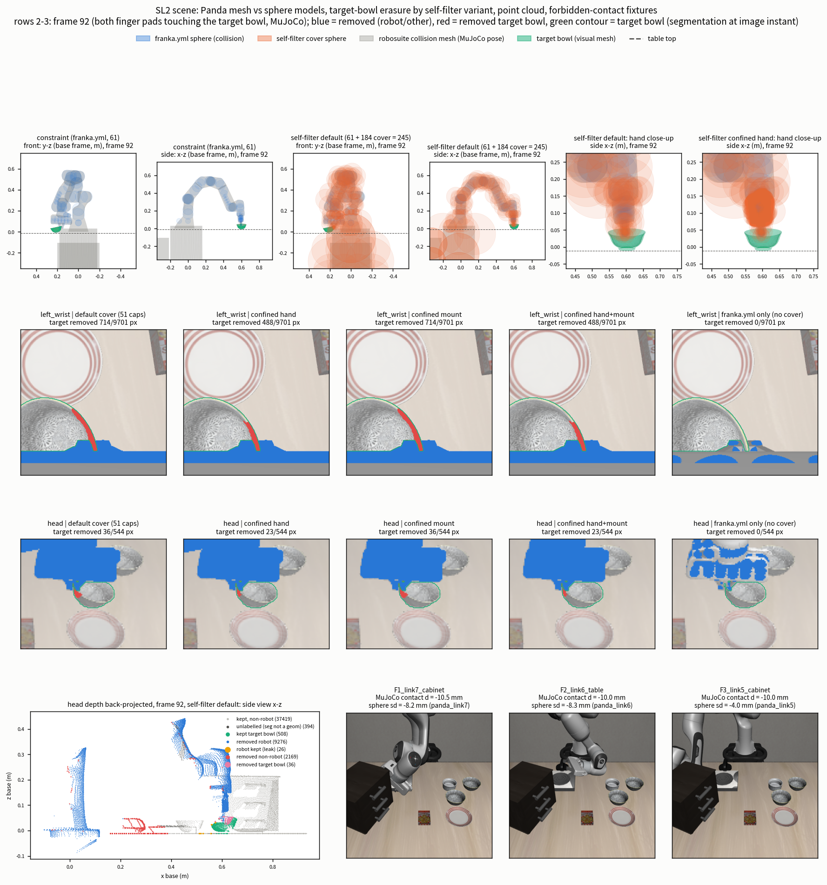

**graph** — FK 위치 오차(frame 별, log 축), robosuite collision mesh coverage, self-filter 의 물체별 제거율, wrist · head 에서 target bowl 제거 비율의 frame 별 추이(초록 띠 = finger pad 접촉, 노랑 띠 = hand 접촉, 점선 = bowl 의 lift), constraint sphere signed distance.

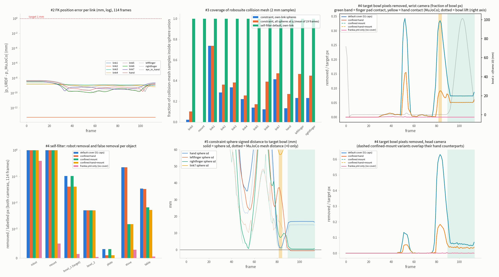

**table** — link 집합 대응 · sphere 출처와 수 · self-filter variant 비교 · contact × penetration confusion table · SL1 후속, FK, 회귀 요약.

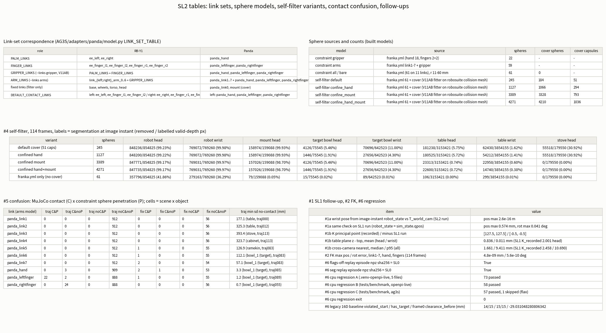

### 결과 — SL1 후속 2건 (구현 후 재측정)

**robot_state 가 image 순간이 되었는가.** adapter URDF 로 FK 한 wrist camera pose 와 기록된 `T_world_cam` 의 차이다.

| 비교 | 위치 최대 | 회전 최대 |
|---|---|---|
| SL2 run: FK(`robot_state`) vs `T_world_cam` | 2.6e-16 m | 6.4e-6 deg |
| SL1 run 에 같은 검사 (`robot_state` = `sim_state.qpos`, 1 substep 늦음) | 0.574 mm (median 0.408 mm) | 0.041 deg |

- 기록된 `robot_state` 와 `sim_state_image` 의 qpos 차이: head · left_wrist 모두 0.0 (최대 절대값). `sim_state_image` 와 `integratePos` 로 만든 qpos 의 차이도 0.0.
- `sim_state_image` 에서 re-render 한 RGB · depth 가 기록과 같은 frame 수: head 114/114, left_wrist 114/114 (RGB · depth 모두). `T_world_cam` · `T_world_base` 차이는 0.0 이하 수준(wrist 3.3e-16, base 0.0).
- 고른 후보: `integrated_back` 113 frame, `current`(현재 qpos) 1 frame (frame 0, 아직 아무것도 움직이기 전).
- 기록된 segmentation 은 여전히 `env.step` 반환 시점 render 라 image 순간과 다르다(SL1 차이 #4 그대로): image 순간 segmentation 과 같은 frame 은 head 4 개, left_wrist 1 개, 다른 pixel 수 합계는 head 8,686 · left_wrist 11,938. 아래 self-filter 측정은 image 순간 segmentation(`segP`)을 쓰고, 기록된 segmentation(`segRec`)으로 낸 값과 함께 확인했다(차이는 0.2 %p 안).

**pixel-centre K 로 SL1 #2 · #4 를 다시 쟀다.** 기록된 K 의 principal point 는 (127.5, 127.5), SL1 run 의 K 와의 차이는 (−0.5, −0.5), 초점거리 차이는 0 이다. 새 adapter 출력의 값이 SL1 의 `K_pixel_centre` 열(depth 에 오프라인으로 K 만 바꿔 적용한 값)과 같다.

| 측정 | SL1 `K_recorded` (128.0) | SL2 adapter 출력 (127.5) | SL1 `K_pixel_centre` 열 |
|---|---|---|---|
| head table 표면 거리 median / p95 | 2.00 / 2.85 | **0.90 / 1.28** | 0.90 / 1.28 |
| head bowl_1 (target) median / p95 | 1.20 / 2.56 | 0.54 / 1.17 | 0.54 / 1.17 |
| head robot median / p95 | 1.26 / 2.79 | 0.58 / 1.34 | 0.58 / 1.34 |
| head stove median / p95 | 2.39 / 2.83 | 1.02 / 1.35 | 1.02 / 1.35 |
| wrist table median / p95 | 0.25 / 0.51 | 0.25 / 0.49 | 0.25 / 0.49 |
| wrist bowl_1 (target) median / p95 | 0.33 / 0.99 | 0.22 / 0.56 | 0.23 / 0.56 |
| head table plane z − table top 평균 | +2.001 | +0.836 | +0.836 |
| head table plane tilt | 0.104 deg | 0.048 deg | 0.048 deg |
| cross-camera nearest (all) median / p95 | 2.46 / 10.69 | 1.66 / 9.41 | 1.66 / 9.41 |
| cross-camera nearest (all_covisible) median / p95 | 2.41 / 3.41 | 1.61 / 2.54 | 1.61 / 2.55 |

wrist 쪽은 camera 가 table 에 가까워 K 규약의 영향이 작다(table plane z − top 평균 +0.011 mm, SL1 표와 같다). 물체별 전체 값은 `SL2.verify.json` `n1b_pixel_centre_K_remeasure` 에 있다. 이로써 SL1 판정 2(K = 127.5) 와 4(`robot_state` = image 순간)는 구현되었고 측정되었다.

### 결과 — #2 FK 일치 (adapter URDF vs LIBERO MuJoCo)

adapter URDF 의 FK 를 같은 q 에서 robosuite MuJoCo body pose 와 비교했다(`robot0_base` frame). 비교 link 는 link1–7 · hand · leftfinger · rightfinger(+ camera frame `panda_eye_in_hand`).

| 비교 | 위치 최대 | 위치 p95 | 회전 최대 | 회전 p95 |
|---|---|---|---|---|
| trajectory 114 frame × 10 link (link1–7, hand, 두 finger) | 4.8e-9 mm | 4.2e-9 mm | 5.6e-10 deg | 5.6e-10 deg |
| 고정 q 4 개 × 12 frame (10 link + `panda_grip_site` + `panda_eye_in_hand`) | 5.1e-9 mm (`panda_grip_site`) | | 8.3e-10 deg (`panda_link6`) | |

목표(≤ 1 mm, ≤ 0.1°)를 float 정밀도까지 만족한다(link 별 표: `n2_fk`). **adapter URDF 의 kinematics 는 LIBERO 의 Panda 와 같다.** 이 값은 위의 hand · finger offset 보정 뒤의 결과이고, 보정 전 cuRobo URDF 의 오차는 impl.md 가 낸 값만 있다(독립 측정 아님).

### 결과 — #3 sphere 출처 · 수 · coverage

**sphere model 별 수.**

| model | 출처 | sphere 수 | 덮개 sphere / capsule |
|---|---|---:|---|
| constraint `gripper` | `franka.yml` (hand 18 + finger 2 + 2) | 22 | — |
| constraint `arms` (builder 기본) | `franka.yml` link1–7 + gripper | 59 | — |
| constraint `all` | `franka.yml` 전부 (11 link, 반지름 11–60 mm, role `collision`) | 61 | 0 |
| self-filter **default** | `franka.yml` 61 + V11AB fitter 덮개 | 245 | 184 / 51 |
| self-filter confined hand | default 에서 hand 를 confined 로 다시 맞춤 | 1,127 | 1,066 / 294 |
| self-filter confined mount | default 에서 mount 를 confined 로 다시 맞춤 | 3,389 | 3,328 / 793 |
| self-filter **confined hand+mount** (Panda 기본으로 채택, 아래 판정) | 둘 다 confined | **4,271** | 4,210 / 1,036 (link0 3,192, hand 911) |

model 의 반지름과 `franka.yml` 반지름의 차이는 최대 0.0 이다. commit 된 덮개 51 capsule 은 이 export 에서 다시 맞추면 동일하고(`committed_cover_refit_from_this_export_identical = true`), 덮개를 맞춘 geometry 의 digest 는 이번 export 의 digest 와 같다.

**constraint model(`franka.yml` sphere)이 robosuite collision mesh 표면을 얼마나 덮는가.** mesh 표면 표본점 중 그 link 자신의 sphere union 안에 든 비율, 밖인 점의 최대 거리, 그리고 전체 sphere union 으로 본 값(19 frame 평균; 이웃 link sphere 가 덮어 주는 몫 포함)이다.

| link | 표본 수 | own-link 안 비율 | 밖 최대 거리 (mm) | 전체 union, q 19 frame 평균 |
|---|---:|---:|---:|---:|
| `panda_link0` | 30,208 | 2.3 % | 99.6 | 10.3 % |
| mount | 931,688 | 0.0 % | 1,095 | 0.0 % |
| `panda_link1` | 33,291 | 73.8 % | 27.3 | 73.8 % |
| `panda_link2` | 29,419 | 28.6 % | 42.5 | 36.3 % |
| `panda_link3` | 24,141 | 33.7 % | 34.3 | 38.3 % |
| `panda_link4` | 24,454 | 22.3 % | 36.7 | 25.8 % |
| `panda_link5` | 33,798 | 13.9 % | 65.2 | 17.4 % |
| `panda_link6` | 17,593 | 12.3 % | 90.3 | 39.1 % |
| `panda_link7` | 8,459 | 41.5 % | 12.2 | 47.2 % |
| `panda_hand` | 12,752 | 13.4 % | 15.6 | 27.2 % |
| `panda_leftfinger` | 1,528 | 23.4 % | 14.2 | 46.6 % |
| `panda_rightfinger` | 1,528 | 23.3 % | 14.2 | 44.8 % |

`franka.yml` sphere 는 몸체의 **일부만** 덮는다(link 별 12–74 %). 이것이 constraint 용으로는 충분한 근사인지는 sphere 가 몸체 밖으로 나간 두께와 contact 측정(아래 #5)으로 본다. 한편 self-filter default 모델(덮개 포함)은 모든 link · mount 의 collision 표면 표본을 100 % 담는다(밖 최대 0.0). visual 표면 표본으로 보면 default 는 모든 link 에서 100 % 이고, confined hand 는 hand 에서 99.76 %(밖 최대 1.16 mm), confined mount 는 mount 의 visual 표면에서 57.8 %(밖 최대 92.7 mm)다. mount 는 collision 으로 맞췄기 때문에 visual 만 있는 표면은 덮이지 않는다.

**sphere union 이 collision hull 밖으로 나간 두께 (protrusion, p95 / 최대, mm).** 값이 클수록 depth 에서 robot 이 아닌 곳을 robot 으로 오인해 지울 위험이 크다.

| link | constraint (`franka.yml`) | self-filter default | confined (hand 는 confined hand, link0 는 confined mount) |
|---|---|---|---|
| `panda_link0` (+ mount) | 23.0 / 28.2 | **215.0 / 249.6** | 61.3 / 129.8 |
| `panda_link1` | 20.6 / 37.7 | 62.8 / 71.1 | 62.8 / 71.1 |
| `panda_link2` | 14.8 / 30.9 | 100.5 / 110.7 | 100.5 / 110.7 |
| `panda_link3` | 22.3 / 38.7 | 92.5 / 101.3 | 92.5 / 101.3 |
| `panda_link4` | 13.7 / 25.6 | 90.2 / 97.9 | 90.2 / 97.9 |
| `panda_link5` | 30.5 / 61.7 | 105.1 / 112.1 | 105.1 / 112.1 |
| `panda_link6` | 2.9 / 8.6 | 72.6 / 82.8 | 72.6 / 82.8 |
| `panda_link7` | 13.4 / 26.8 | 46.6 / 52.7 | 46.6 / 52.7 |
| `panda_hand` | 1.6 / 5.1 | **49.1 / 56.4** | 17.5 / 43.1 |
| `panda_leftfinger` | 3.5 / 5.4 | 22.7 / 24.8 | 22.7 / 24.8 |
| `panda_rightfinger` | 3.5 / 5.5 | 22.8 / 24.8 | 22.8 / 24.8 |

constraint sphere(`franka.yml`)는 hand · finger 에서 몸체 밖으로 거의 나가지 않는다(hand p95 1.6 mm). 반면 self-filter 덮개는 link 몸체보다 수 cm 크게 나간다. 이 차이가 constraint 와 self-filter 를 따로 두는 이유이고, 아래 #4 가 그 대가를 보여 준다.

### 결과 — #4 self-filter (SL1 depth 에 Panda self-filter model 적용)

SL1 의 metric depth(유효 범위 0.05–3.0 m, inflation 0, guard radius 0)에 `DepthRobotMask` 를 적용했다. segmentation 이 정답이다: "robot 제거율" = segmentation 이 robot 인 pixel 중 제거된 비율, "오제거" = robot 이 아닌 물체 pixel 중 제거된 비율. 비교한 variant 는 5 개다.

- **default** — `franka.yml` 61 + V11AB fitter 덮개 51 capsule(245 sphere)
- **confined hand** — hand 덮개만 confined(1,127)
- **confined mount** — mount 덮개만 confined(3,389)
- **confined hand+mount** — 둘 다(4,271)
- **`franka.yml` only** — 덮개 없음(61)

114 frame 합산(removed / labelled valid-depth pixel):

| variant | sphere | robot 제거율 head / wrist | mount head 제거율 | target bowl 오제거 head / wrist | table 오제거 head / wrist | stove 오제거 head / wrist |
|---|---:|---|---|---|---|---|
| default | 245 | 99.23 % / 99.98 % | 99.93 % | 5.46 % / 11.00 % | 5.75 % / 1.62 % | **30.92 % / 11.68 %** |
| confined hand | 1,127 | 99.22 % / 99.98 % | 99.93 % | **1.91 % / 4.30 %** | 5.72 % / 1.41 % | 30.92 % / 11.68 % |
| confined mount | 3,389 | 99.17 % / 99.97 % | 98.70 % | 5.46 % / 11.00 % | **0.74 % / 0.60 %** | **0.00 % / 0.33 %** |
| **confined hand+mount** | 4,271 | 99.17 % / 99.97 % | 98.70 % | **1.91 % / 4.30 %** | **0.72 % / 0.38 %** | **0.00 % / 0.33 %** |
| `franka.yml` only | 61 | **41.86 % / 36.29 %** | 0.05 % | 0.02 % / 0.01 % | 0.00 % / 0.01 % | 0.00 % / 0.06 % |

(pixel 수: head target bowl 75,545, stove 179,550, table 3,153,421; wrist target bowl 642,523, stove 150,097, table 3,854,155. default 의 head stove 는 55,518 pixel 이 제거됐다.)

**target bowl 이 지워지는 frame (target bowl pixel 중 제거된 비율).**

| variant | head 최대 (frame) | wrist 최대 (frame) | grasp 구간 frame 90–113 평균 head / wrist | 제거가 0 보다 큰 frame 수 head / wrist |
|---|---|---|---|---|
| default · confined mount | 62.98 % (83) | 34.24 % (52) | 6.72 % / 7.68 % | 57 / 85 |
| confined hand · confined hand+mount | 18.41 % (83) | 15.53 % (53) | 3.64 % / 5.32 % | 55 / 85 |
| `franka.yml` only | 0.40 % (89) | 0.24 % (41) | 0.04 % / 0.00 % | 14 / 42 |

bowl 이 통째로 지워진 frame 은 없다(최대 62.98 %). default 에서 wrist 의 제거는 frame 49–56(finger 가 bowl 에 접근해 pad 접촉(frame 54)이 일어나는 구간)에 몰리고(frame 51–53 에서 31–34 %), head 의 제거는 frame 82–84(hand 가 bowl 에 접촉하는 구간)에서 61–63 % 로 커진다. 제거된 target pixel 을 가장 가까운 sphere 로 귀속시키면 default 에서 wrist 70,696 pixel 중 `panda_hand` 덮개가 65,135, `panda_rightfinger` 덮개가 5,561 pixel 이고, confined hand 에서는 wrist 27,656 pixel 중 `panda_rightfinger` 덮개 22,973, `panda_hand` 덮개 4,269, `panda_leftfinger` 덮개 414 pixel 이다.

**robot 이 아닌 다른 물체의 오제거는 variant 와 무관하게 작다.** bowl_2 0.51 % (head) · 0.50 % (wrist), ramekin 0.28 % · 0.17 %, plate 0 % · 0.036 %(default) → 0.011 %(confined hand), cookies · cabinet 0 %. 이 비율은 `franka.yml` only 에서는 거의 0 이다. segmentation 이 geom 이 아닌 pixel(seg −1)은 위 비율에서 뺐다: head 49,962 pixel(valid 7,282,370 중), wrist 86,922 pixel(valid 6,858,240 중)이며, 이 중 제거된 pixel 은 default 21,354 / 20,094 → confined hand+mount 18,453 / 3,362 이다(base frame z median 은 head 0.016 m, wrist −0.012 m).

#### 왜 default 덮개가 stove 와 target bowl 을 지웠나

**stove — mount 덮개가 table 위로 뻗어 있었다.** robot 의 mount(pedestal)는 크고 둥근 collision 몸체다. V11AB 의 덮개 fitter 는 `franka.yml` sphere 가 덮지 못한 표면을 **몇 개의 큰 capsule** 로 한꺼번에 덮는다. capsule 은 반지름이 크고 양 끝이 반구라서, 그 끝 반구가 mount 몸체 밖으로 나간다. default 에서 `panda_link0`(+ mount) 의 sphere union 은 collision hull 밖으로 p95 215.0 mm, 최대 249.6 mm 나가 있다(위 protrusion 표). 이 부분이 base 옆의 table 과 stove 위까지 닿아서, camera 가 본 table · stove 의 depth 점이 "robot sphere 안"으로 판정되어 지워졌다(head 에서 stove 30.92 %, table 5.75 %). 구현 단계의 smoke 도 같은 방향이다(impl.md, 검증 수치 아님: pedestal 덮개 중 위쪽 capsule 이 base frame z +0.173 m, x +0.394 m 까지 닿고 table top 은 z −0.012 m). **원인 분리 실험이 이를 확인한다.** hand 만 confined 로 바꾼 variant 는 stove 오제거가 그대로 30.92 % 이고, mount 만 confined 로 바꾼 variant 는 0.00 % 로 떨어진다(table 도 5.75 % → 0.74 %). confined mount 는 mount 의 큰 capsule 을 collision hull 안쪽에 가두어 작은 capsule 로 다시 맞춘 것(덮개 capsule 전체가 51 → 793 개)이고 protrusion 은 p95 61.3 mm · 최대 129.8 mm 로 줄었다.

**target bowl — hand 덮개가 손가락 사이로 내려와 있었다.** 같은 fitter 가 hand body 의 덮이지 않은 표면(옆면 등)을 한 덩어리로 보고 큰 capsule 몇 개로 덮었다. 그 capsule 의 끝 반구는 palm 아래, 즉 **두 손가락 사이 — 파지할 bowl 의 rim 이 들어오는 자리** 까지 나온다(hand protrusion p95 49.1 mm · 최대 56.4 mm; impl.md smoke: 손가락 z 0.052–0.106 m 사이의 파지 자리에 덮개 끝 반구가 hand z 0.112–0.120 m 까지 내려온다, 검증 수치 아님). 그래서 손가락이 bowl 을 잡으러 내려오고 bowl 이 손가락 사이로 들어올 때 bowl 의 depth 점이 hand 덮개 안에 들어가 robot 으로 지워졌다. 실제로 제거된 wrist target pixel 의 92 %(65,135 / 70,696)가 `panda_hand` 덮개에 귀속된다. **hand 만 confined 로 바꾸면 이 오제거가 11.00 % → 4.30 %(wrist), 5.46 % → 1.91 %(head)로 줄고** hand protrusion 은 p95 17.5 mm · 최대 43.1 mm 가 된다. mount 만 바꾼 variant 는 target 오제거가 그대로(5.46 / 11.00 %)이므로, target 오제거의 원인은 hand 덮개이고 mount 덮개와는 무관하다.

**RB-Y1 T17 과의 유사성.** T17 은 RB-Y1 쪽 episode 로, 옛 sphere 모델에서 손목 부근 capsule 이 쥔 사과를 덮어 사과가 **17 frame 동안 통째로 지워졌다**(사과 retention 0.472, `AG3S_T0T6_LOG.md` §3 T28 Phase 1; 이후 T29 의 손가락 개도 parameter joint + 덮개 재설계로 0 frame 이 되었다). 이번 Panda default 도 같은 종류의 기하다: **덮개 capsule 이 몸체 표면을 덮는 데 그치지 않고, 몸체가 잡으려는 물체가 들어올 공간까지 부풀어 있다.** 다만 Panda 에서는 bowl 이 통째로 지워진 frame 이 없다(최대 62.98 %). 그리고 finger 개도 parameter 의 문제가 아니다 — 손가락을 포함한 모든 variant 가 같은 finger joint 대응을 쓰고, 덮개를 hand 에서만 바꿔도 값이 바뀐다.

**남는 오제거는 finger 접촉 구간이다.** confined hand 에서도 wrist 에서 4.30 % 가 남는다. 제거된 pixel 의 대부분(27,656 중 22,973)이 `panda_rightfinger` 덮개에 귀속되고, 최대 15.53 %(frame 53)는 pad 접촉(frame 54) 직전이다. 이 구간은 MuJoCo 가 finger–bowl 접촉으로 보고하는 곳이므로 finger 덮개 표면과 bowl 표면이 맞닿아 있다(해석. 덮개 반지름별 분해는 측정하지 않았다). 한편 `franka.yml` only 는 target 을 거의 지우지 않지만(0.02 % · 0.01 %) robot 을 head 41.86 %, wrist 36.29 % 밖에 지우지 못해, 지우지 못한 robot 점이 ESDF 에서 장애물이 된다. 덮개는 필요하다.

### 결과 — #5 contact 장면 (MuJoCo contact × constraint sphere 침투)

**어떻게 쟀나.** link 별 sphere 와 물체 collision geom(이번 scene 의 LIBERO 물체 collision geom 은 모두 box 이고 바닥 plane 은 뺐다) 사이의 signed distance `sphere_sd` 의 최솟값을 구하고, 같은 (scene × 물체) cell 에서 MuJoCo contact 가 보고되는지와 대조했다. `sphere_sd < 0` 을 침투(P)로 센다(trajectory 접촉 cell 의 sd 부호와 일치). cell = (scene × 물체). trajectory 는 114 frame 위의 912 cell(link 별), fixture 는 7 개 scene 위의 56 cell. 아래 표는 `arms` constraint model(link1–7 + gripper, 59 sphere)이고, `gripper`(22 sphere)는 hand · finger 행과 같다.

**trajectory 의 MuJoCo contact frame (target bowl 과 접촉, image 순간 상태 기준).**

| MuJoCo geom → link | contact frame |
|---|---|
| `gripper0_rightfinger` (finger pad) → `panda_rightfinger` | 54, 90, 113 |
| `gripper0_right_gripper` (hand) → `panda_hand` | 82, 83, 84 |
| `gripper0_finger_joint1_tip` → `panda_leftfinger` | 90–113 (24 frame) |
| `gripper0_finger_joint2_tip` → `panda_rightfinger` | 90, 92–113 (23 frame) |

target bowl 의 lift(frame 10 대비 z 상승): frame 88 −0.0007 mm, 89 0.35 mm, 90 1.29 mm, 92 6.16 mm, 95 34.9 mm, 100 89.6 mm, 105 93.3 mm, 113 13.6 mm. 즉 frame 90 에서 파지가 되고 lift 가 시작된다.

**link 별 confusion table (C = MuJoCo contact, P = sphere 침투).**

| link (arms model) | trajectory C&P | C&noP (miss) | noC&P (false alarm) | noC&noP | fixture C&P | C&noP | noC&P | noC&noP |
|---|---:|---:|---:|---:|---:|---:|---:|---:|
| `panda_link1` | 0 | 0 | 0 | 912 | 0 | 0 | 0 | 56 |
| `panda_link2` | 0 | 0 | 0 | 912 | 0 | 0 | 0 | 56 |
| `panda_link3` | 0 | 0 | 0 | 912 | 0 | 0 | 0 | 56 |
| `panda_link4` | 0 | 0 | 0 | 912 | 0 | 0 | 0 | 56 |
| `panda_link5` | 0 | 0 | 0 | 912 | 1 | 0 | 0 | 55 |
| `panda_link6` | 0 | 0 | 0 | 912 | 1 | 0 | 0 | 55 |
| `panda_link7` | 0 | 0 | 0 | 912 | 2 | 0 | 0 | 54 |
| `panda_hand` | 0 | 3 | 0 | 909 | 2 | 1 | 0 | 53 |
| `panda_leftfinger` | 22 | 2 | 0 | 888 | 1 | 0 | 0 | 55 |
| `panda_rightfinger` | 0 | 24 | 0 | 888 | 0 | 0 | 0 | 56 |

- **false alarm 은 없다**: 접촉이 없는데 sphere 가 침투한 cell 은 trajectory 에서 0 이다(`no_contact_penetrate_cells` 가 비어 있다).
- **trajectory 의 접촉은 gripper 와 target bowl 의 파지 접촉뿐이다**(arm link1–7 은 접촉 cell 0). 접촉 cell 에서 sphere signed distance 는 `panda_leftfinger` −0.60 ~ +0.86 mm(24 cell 중 22 가 침투), `panda_rightfinger` **+0.47 ~ +2.02 mm**(24 cell 전부 침투 없음), `panda_hand` **+1.08 ~ +1.40 mm**(3 cell, 침투 없음)다. 같은 cell 의 MuJoCo contact 깊이는 0.02–0.49 mm 로 얕다(`contact dist` −0.0185 ~ −0.49 mm). 즉 gripper sphere 는 접촉 지점에서 **mm 수준(0.5–2 mm)으로 몸체보다 안쪽**에 있다(sphere 가 몸체보다 작다는 §#3 protrusion 과 일치).
- **비접촉 frame 의 최소 clearance (`sphere_sd`, bowl 에 가장 가까운 frame)**: `panda_hand` 3.3 mm(frame 85), `panda_leftfinger` 1.2 mm(frame 89), `panda_rightfinger` 0.74 mm(frame 55), `panda_link7` 57.1 mm(frame 83), `panda_link6` 112.1 mm, `panda_link5` 126.9 mm, `panda_link4` 323.7 mm, `panda_link3` 393.4 mm, `panda_link2` 325.3 mm, `panda_link1` 177.1 mm.

**금지 접촉 fixture 7 개.** joint 값을 random 하게 60,000 개 뽑아(seed 20261012) link–물체 간 MuJoCo contact 의 깊이가 −30 ~ −2 mm 인 자세를 골라, 의도한 link–물체 쌍마다 한 자세를 정했다(scene frame 10). 후보 수와 선택된 fixture 는 아래와 같다(탐색 27.4 s).

| fixture | 의도한 쌍 | 조건에 맞은 후보 수 | MuJoCo contact 깊이 (mm) | 해당 link 의 `sphere_sd` (mm) | 결과 |
|---|---|---:|---:|---:|---|
| F1 | link7 – cabinet | 317 | −10.50 | −8.24 | C&P |
| F2 | link6 – table | 988 | −10.04 | −8.34 | C&P |
| F3 | link5 – cabinet | 215 | −10.05 | −3.96 | C&P |
| F4 | hand – plate | 64 | hand −4.31 / leftfinger −6.20 | **hand +0.36** / leftfinger −4.62 | **hand 는 miss (C&noP)**, leftfinger 는 C&P |
| F5 | hand – table | 1,389 | −9.87 | −4.87 | C&P |
| F6 | link7 – stove | 352 | −8.41 | −5.65 | C&P |
| F7 | hand – bowl_2 | 169 | −8.86 | −3.45 | C&P |

**F4 의 miss.** hand 와 plate 사이 MuJoCo contact 깊이가 −4.31 mm 인데 hand sphere 의 signed distance 는 +0.36 mm(침투 아님)다. hand 의 constraint sphere 가 그 접촉 지점에서 mesh 보다 안쪽에 있기 때문이다. 같은 scene 에서 leftfinger 는 contact −6.20 mm, sphere −4.62 mm 로 침투를 잡으므로 scene 전체는 구별되지만, 이 한 칸은 hand 단독으로는 놓친다. 그 밖의 fixture 는 모두 접촉한 link 의 sphere 가 침투(−3.45 ~ −8.34 mm)로 나타났다. 관절 설정으로 만든 정적 scene 이므로 이 결과는 "fixture 7 개에서" 그렇다는 것이다.

`mj_geomDistance` 는 음수 값이 MuJoCo contact 깊이와 크게 달라(F2 link6–table: contact −10.04 mm, geomDistance −162.94 mm) 침투 깊이로 쓰지 않았고, figure 는 양수 값만 그렸다.

### 결과 — #6 SL0 경로 보존 · 회귀

| 검사 | 결과 |
|---|---|
| flag 없는 replay = SL0 | episode npz SHA-256 `e8a15133b8e2ae4aa9c069532d6eca9eba96ed453b070f1b3523a8c48aaaa088` 이 SL0 · geometry replay · flag 없음 replay 에서 모두 같고, mp4 SHA-256 `9ce6114fb5d99dc57549b28c54a6e047d9b967f4b15b381584c88899e7036f8a` 도 같다. flag 없는 run 은 `_geom.npz` 를 만들지 않았다 |
| `run_cpu_regression.sh` A (SL0 5 파일, `.venv-openpi-live`) | **73 passed** (SL0 · SL1 과 같다) |
| 같은 script B (`tests/benchmark`, `.venv-openpi-live`) | 58 passed (SL1 44 + 새 py38 check 1 + SL2 13) |
| 같은 script C (`tests/benchmark`, `.venv-ag3s`) | 57 passed, 1 skipped (serve_policy test, flax 없음 — SL1 과 같다) |
| script exit status | 0 |
| 16D legacy ESDF 기준선 | violated start 14/15 · has_target 15/15 · frame0 clearance −29.031 mm — 기준선과 일치 |
| 16D cuRobo ESDF 기준선 | 이 STEP 에서는 돌리지 않았다 (CPU 전용 task) |

`AG3S/ag3s/**` · `AG3S/trajopt/**` 를 바꾸지 않았으므로 16D 기준선이 그대로인 것은 구조상 예상된 결과다.

### 이 STEP 에서 알게 된 것 (평이한 설명)

**(a) Panda kinematics 는 맞다. 어긋난 것은 hand 장착 offset 뿐이었다.** cuRobo 의 `franka_panda.urdf` 는 팔 관절이 LIBERO 와 같고 손 장착 offset 만 robosuite 와 달랐다(impl.md: hand 0.5 mm, finger 6.5 mm). 이를 고친 adapter URDF 는 114 frame 에서 link1–7, hand, finger 의 FK 가 MuJoCo 와 4.8e-9 mm 이내로 같다.

**(b) `franka.yml` sphere 는 constraint 용이지 self-filter 용이 아니다.** 몸체를 12–74 % 만 덮고(arm), hand 는 13.4 % 다. 그런데 몸체 밖으로는 거의 나가지 않는다(hand protrusion p95 1.6 mm). constraint 로 쓸 때는 "실제 몸체보다 크지 않은 sphere" 가 맞는 성질이고, self-filter 로 쓰면 robot 의 depth 점을 head 41.86 %, wrist 36.29 % 밖에 못 지운다. 그래서 V11AB 는 덮개를 self-filter model 에만 넣는다.

**(c) 덮개를 두 곳에서 가두면 오제거가 거의 사라지고 robot 제거율은 그대로다.** mount 덮개가 stove · table 을(30.92 % → 0 %, 5.75 % → 0.72 %), hand 덮개가 target bowl 을(11.00 % → 4.30 %, 5.46 % → 1.91 %) 지웠다. 두 원인을 따로 바꾼 variant 가 서로의 값에 영향을 주지 않아 원인이 분리된다. robot 제거율은 head 99.23 % → 99.17 %, wrist 99.98 % → 99.97 % 로 거의 같다. 대가는 sphere 수다(245 → 4,271).

**(d) constraint sphere 는 gripper 에서 mm 수준으로 안쪽이다.** 접촉 지점에서 right finger 는 +0.47–2.02 mm, hand 는 +1.08–1.40 mm 떨어져 있고, trajectory 에서 접촉을 침투로 잡는 것은 left finger 뿐이다(22/24). 그래서 이 sphere 를 "접촉 판정"에 쓰면 mm 수준의 miss 가 있다(trajectory 에서 hand 3, right finger 24, left finger 2 cell; fixture F4 의 hand). false alarm 은 없다. clearance constraint 에 연결했을 때 이 mm 수준의 gap 이 margin 으로 흡수되는지는 이 STEP 에서 측정하지 않았다.

**(e) arm link 의 coverage 는 낮지만(12–74 %) trajectory 에서는 문제가 드러나지 않았다.** trajectory 는 arm 이 장애물에 가까워지지 않는 장면이라(link5–7 의 최소 sphere signed distance 57–127 mm 이상) 이 결과가 arm 보호가 충분하다는 뜻은 아니다. fixture 에서는 arm link(link5–7)가 접촉한 4 cell 이 모두 침투로 잡혔다.

### 판정 (2026-10-12, 사용자)

| # | 판정 |
|---|---|
| 1 | **SL2 확정.** |
| 2 | **self-filter model 의 Panda 기본 = confined hand+mount cover.** 이것은 algorithm 변경이 아니라 **robot geometry 보정**이다. (sphere 수 4,271 대 245; runtime 은 SL-4 에서 측정하고, 필요하면 compact refit 한다.) 남는 한계: mount pixel 1.3 % 가 남고(head mount 제거율 98.70 %), wrist 의 target 오제거 4.30 % 가 남는다. |
| 3 | **constraint model = cuRobo `franka.yml` sphere 그대로**(V11AB main). gripper-only protection 이다: sphere 가 mm 수준(0.5–2 mm)으로 gripper 몸체 안쪽이고, arm coverage 의 빈틈은 기록으로 남긴다(위 coverage 표). whole-body 보호가 필요해지면 MJCF-fit variant 를 따로 만든다. MuJoCo contact 를 정답으로 쓰는 독립 evaluator 는 SL-7 에서 만든다. |
| 4 | **다음은 SL-3 (attention audit).** |

SL2 의 "되돌아올 지점" 중 "`franka.yml` sphere coverage 가 크게 다르면 MJCF fit variant" 는 coverage 가 낮았지만(arm 12–74 %), 판정 3 이 V11AB main 에는 하나만 두기로 하여 **variant 를 만들지 않았다.**

### 측정하지 않은 것

- cuRobo 16D baseline (`.venv-openpi-live`, GPU) — CPU 전용 task
- URDF 쪽(cuRobo `franka_description`)의 mesh 에 대한 sphere coverage — robosuite mesh 만 쟀다
- `sphere_sd` 는 물체 collision box 기준이다(이 scene 의 모든 LIBERO 물체 collision geom 이 box). 바닥 plane 은 제외했다. 다른 task 의 비-box 물체는 쟀다고 할 수 없다
- `mj_geomDistance` 의 음수 값은 침투 깊이로 쓰지 않았다(MuJoCo contact 깊이와 달라서)
- segmentation 이 geom 이 아닌 pixel(seg −1)은 물체별 비율에서 제외했다(head 49,962 · wrist 86,922 pixel; 개수는 위에 기록)
- confined 4,271 sphere 모델의 runtime (SL-4 에서 측정)
- 다른 task · episode, 다른 해상도 (replay 한 task 0 · episode 0 의 114 frame 만)
- constraint clearance margin 이 mm 수준 gap 을 흡수하는지(clearance constraint 에 연결하지 않았다)

### 열린 항목

| # | 내용 | 영향 / 다음 |
|---|---|---|
| 1 | ~~구현 보류 2건: (a) confined hand+mount cover 를 기본 덮개 JSON 으로 commit (지금 commit 된 것은 default 51 capsule 이다), (b) `robot_geometry.py` 가 `LD_LIBRARY_PATH` 를 정리해서 `env.sh` 아래에서도 실행되게 하기~~ | ~~**SL3 에서 구현** (판정 2)~~ **SL3 에서 구현·확인 완료**: 기본 덮개 = confined(1,036 capsule), CLI 가 기본 shell 에서 returncode 0 |
| 2 | confined 모델 sphere 4,271 의 runtime | SL-4 에서 측정, 느리면 compact refit |
| 3 | arm coverage 의 빈틈(12–74 %) · gripper 의 mm 수준 gap | 판정 3 의 한계. whole-body 가 필요하면 MJCF-fit variant. 독립 contact evaluator 는 SL-7 |
| 4 | 남는 한계: mount pixel 1.3 %, wrist target 오제거 4.30 %, 기타 물체 오제거(bowl_2 0.51 % 등) | SL-4 에서 ESDF 결과로 영향 확인 |
| 5 | V11AB 의 RB-Y1 hardcode 지점 (impl.md 의 표): `serve_safe.build_ag3s` 의 model 주입, `constraint_link_filter`, `DEFAULT_CONTACT_LINKS` · `ContactConfig`, `safe_policy` 의 grasp/hold link, `multiview` 가 `robot_state` 를 그대로 q 로 쓰는 부분(Panda wire 는 9-D = q7 + finger 2 라 `split_robot_state` 가 필요), `wire.py` 의 camera 이름과 16-D layout(`ChunkLayout.rby1`), 관절 한계 model. **특히 `--capsule-radius-scale 0.05`(V11AB 의 RB-Y1 gap capsule 용)는 `franka.yml` sphere(role `collision`, zero-length)에 그대로 넘기면 반지름이 5 % 가 되므로 Panda 에서는 넘기지 않거나 exact role 로 두는 결정이 필요하다.** `--finger-cover both` 는 RB-Y1 손가락 구조 전제라 Panda 에 이식하지 않았다 | SL-4/5 입력. 구현은 하지 않았다 |
| 6 | wrist 0.05 m 미만 pixel(전체의 8.2 %, SL1)과 head 3.0 m 초과 pixel 의 처리 | SL-3 · SL-4 (SL1 열린 항목 4) |
| 7 | ESDF box z 범위와 table 처리 | SL-4 (SL1 열린 항목 2) |

### 되돌아올 지점 (SL2)

| 전환 신호 | 돌아와서 할 일 |
|---|---|
| FK 불일치가 장착 offset 으로 설명되지 않으면 | cuRobo URDF 대신 robosuite MJCF 에서 URDF 를 생성 (이번에는 hand · finger offset 3 값으로 설명되어 해당 없음) |
| `franka.yml` sphere coverage 가 robosuite mesh 와 크게 다르면 | MJCF mesh fit sphere 로 constraint model 을 만드는 variant 를 별도 이름으로 비교 (coverage 는 낮았지만 판정 3 으로 V11AB main 에는 `franka.yml` 만 두기로 하여 보류) |
| self-filter 가 grasp 중 target 을 지우면 | RB-Y1 T17 과 같은 원인인지 확인, 덮개 반지름 · finger parameter 재검토 (이번에는 hand 덮개가 원인임을 variant 로 분리하여 confined hand 로 처리) |
| confined 4,271 sphere 가 SL-4 runtime 을 넘으면 | compact refit(sphere 수를 줄이는 재맞춤) 또는 덮개를 hand+mount 에 한정한 채 반지름 정책 재검토 |
| Manipulator side `left` 가 SL-3/SL-5 의 camera↔arm audit 와 다르면 | adapter 의 side 표만 변경 |
| SL-4 에서 mm 수준 gripper gap 이 clearance 판정을 흔들면 | gripper sphere 반지름 보정 또는 MJCF-fit variant |

---

## SL3 — V11AB attention read-out audit on pi05_libero (+ SL2 후속 2건) (2026-10-12)

> 2026-10-12 KST. 구현 commit `ce29b9be` · 검증 commit `ae5d74a3`. 사용자 확정 2026-10-12.
> 관련 commit: `41339944`(공용 GPU lock · pod 자원 규칙 적용), `309e4c6d`(LIBERO dev/test 분리 확정).
> 원본: [`handoff/SL3.task.md`](handoff/SL3.task.md) · [`handoff/SL3.impl.md`](handoff/SL3.impl.md) ·
> [`handoff/SL3.verify.json`](handoff/SL3.verify.json). raw 출력은 `outputs/verify/SL3/`.
> 이 절의 수치는 모두 `SL3.verify.json` 의 `numbers` 가 출처다. **측정은 전부 dev 데이터**(LIBERO Spatial task 0–9 × init state 0, 10 episode, 221 policy call)이고, 이 STEP 에서 layer/head 를 **선택하지 않았다**(V11AB 고정 cell 을 그대로 측정했다).

### 이 STEP 이 답하는 질문

V11AB 의 ATS(Attention-based Target Segmentation: VLA attention 과 depth 로 target 을 고르는 단계)는 attention 을 RB-Y1 checkpoint 에서 고른
**고정된 attention cell** — denoise step 0, aggregation `last`, layer 8, head 2(이하 L8H2) — 에서 읽는다. 이 cell 을 `pi05_libero` 에 그대로 적용하고
policy image 의 좌우 반전(SL1 #3)을 되돌렸을 때, attention 이 LIBERO Spatial 의 target object 에 모이는가?

```
policy image 224×224 (= OpenCV 256 image 의 좌우 반전 + resize)
  -> pi05 prefix: base_0_rgb 256 token | left_wrist_0_rgb 256 token | right_wrist_0_rgb 256 token (LIBERO 는 padding, mask False)
  -> V11AB AttentionSampler (denoise 0, agg last, L8, H2) -> [768] -> 16×16 grid × camera
  -> [SL3] un-mirror(grid 열 뒤집기) + 224->256 scale -> OpenCV pixel (head / left_wrist) -> SL-4 attention lifting
```

### 무엇을 만들었나

**SL2 후속 2건** (SL2 판정 2 에 따른 구현 보류분)

| # | 내용 |
|---|---|
| 1 | self-filter 기본 덮개를 **confined hand + mount cover**(`confined_hand_mount`)로 바꿨다. 생성 JSON 은 provenance · digest 를 포함하고 `robots/panda/description/` 에 있다. 이전 기본(unconfined cover)은 내용을 바꾸지 않고 이름만 바꿔 **비교용으로 남겼다**(`..._unconfined.json`). run manifest 의 `robot_model.self_filter_cover` 에 cover 이름 · capsule 수 · sphere 수 · digest 를 기록한다 |
| 2 | `robot_geometry.py` CLI 가 기본 shell(`env.sh`)에서 import 에 실패하던 문제(pod `LD_LIBRARY_PATH` 의 외부 torch lib)를 고쳤다. launcher 와 **같은 함수**(`client_env.client_environment`)로 환경을 고치고 자기 자신을 한 번 re-exec 한다. launcher 의 규칙도 이 함수 하나로 합쳤다(동작 변경 없음) |

**Panda attention binding** (AG3S core 는 한 줄도 바꾸지 않았다)

| 구성 | 내용 |
|---|---|
| `AG3S/adapters/panda/attention.py` | V11AB 의 `AttentionSampler` · `AGGREGATIONS` · cell 상수(step 0, `last`, L8, H2)를 **import 해서 그대로** 쓴다(값을 다시 적지 않음). token block 표(`base_0_rgb -> head`, `left_wrist_0_rgb -> left_wrist`, `right_wrist_0_rgb -> padding`)는 가정이 아니라 model input 에서 **읽어서**(`read_token_layout`: `embed_prefix` 순서, image 별 token 수, image mask, V11AB prefix pass 가 실제로 쓴 prefix mask) 대조한다 |
| mirror-undo + 224→256 mapping | policy patch `(r, c)` 는 OpenCV 행 `[16r, 16r+16)`, 열 `[16(15-c), 16(16-c))` 와 정확히 일치한다. 따라서 un-mirror 는 grid 의 열 뒤집기이고 224→256 scale 은 V11AB 자신의 bilinear resampling 이 흡수한다. 반전을 **풀지 않은** mapping(`unmirror=False`, "mirror left in")도 비교용으로 같은 함수에 있다 |
| BDDL target 파싱 (`task_target.py`) | LIBERO BDDL 의 goal predicate 중 첫 인자가 `obj_of_interest` 에 있는 것을 target 으로 읽고 segmentation geom id 와 잇는다. **LIBERO Spatial 10 task 모두 target = `akita_black_bowl_1`, destination = `plate_1`** 이다. py3.8 check 가 LIBERO 자체 parser 와 10 task 모두 일치하고, live env 의 `obj_of_interest` · object root body 와도 일치함을 확인했다 |
| `benchmark/runners/attention_audit.py` | source run 의 `policy_records` + geom npz 를 읽어 call 별 attention(V11AB cell + 전체 [layer, head] 진단 배열 float16)을 **새 run** 에 저장한다. source run 은 읽기만 한다. policy record ↔ episode 의 join(state · prompt · image bit 동일)을 call 마다 검사하고 하나라도 다르면 멈춘다 |

### 실행

| run | 값 |
|---|---|
| dev rollout | `/mnt/dev/AG3S_VLA-storage/results/benchmark/20261012T163617_ce29b9be5fcb_sl3-dev-pi05only-t0-9e0`. `launch_libero_pi05_only.py --task-ids 0..9 --episode-ids 0 --capture-geometry --capture-segmentation`. 실행 창 2026-10-12 16:36:15–16:43:28 KST |
| attention audit | `/mnt/dev/AG3S_VLA-storage/results/benchmark/20261012T202459_309e4c6da477_sl3-attention-audit-dev` (`attention_audit.py`, `.venv-openpi-live`). GPU lock 을 잡고 compute process 가 없음을 확인한 뒤 실행. 실행 창 20:24:58–20:26:15 KST |
| flags-off replay (SL0 경로 보존) | `/mnt/dev/AG3S_VLA-storage/results/benchmark/20261012T195406_309e4c6da477_sl3-replay-off-t0e0` |
| 채점 | segmentation 은 **image instant**(image 가 찍힌 순간)로 다시 render 한 mask(`segP`)를 기본으로 쓰고, `env.step` return 시점에 기록된 mask(`segRec`)와 비교했다(SL1 의 capture instant 차이 때문) |

### 결과 — Figure

세 figure 는 verifier 가 만들었다 (`outputs/verify/SL3/scripts/make_figures.py`, sidecar `.json` 동봉).

**실제 scene** — task 0–9 의 대표 call(approach 단계) 의 head · left_wrist OpenCV RGB 위에 V11AB cell attention(파랑)과 target `akita_black_bowl_1` 의 segmentation contour(주황)를 겹쳤다. 각 camera 마다 **un-mirror 와 mirror left in 을 위아래로 대조**했다.
head 는 un-mirror 쪽에서 attention 이 target 주변에 놓이고, mirror left in 에서는 좌우가 어긋난 곳에 놓여 mass 가 0 에 가깝다(t0 · t5 · t8 은 0.000).

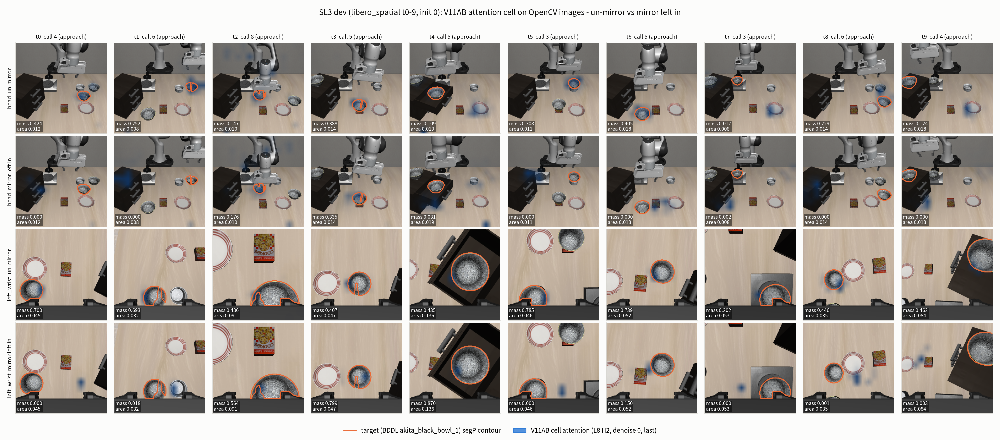

**graph** — (a, b) call 별 target mass 추이(배경 색 = phase, 점선 = target area, 즉 uniform baseline), (c, d) task 별 mass 대 area, (e) phase 별, (f, g) 전체 layer×head 진단 grid(주황 상자 = V11AB L8H2), (h) call 별 mapping 비교(대각선 위 = un-mirror 가 큼).

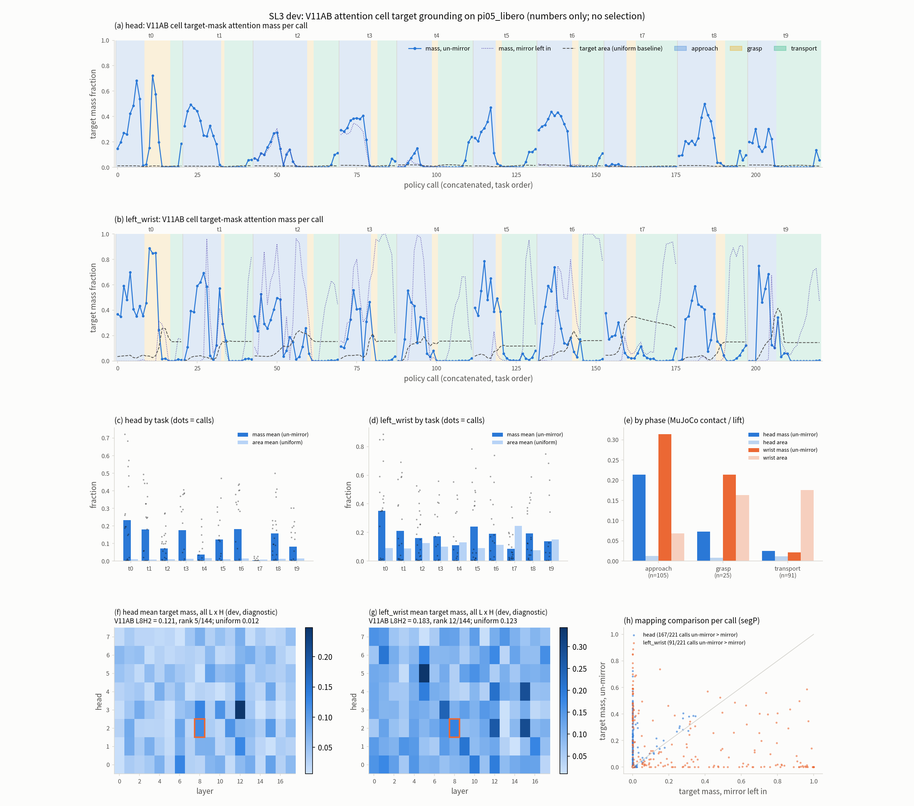

**table** — token layout · mapping 규약 · grounding 지표 · 진단 grid 순위 · 비용 · SL2 후속을 한 장에 모은 표.

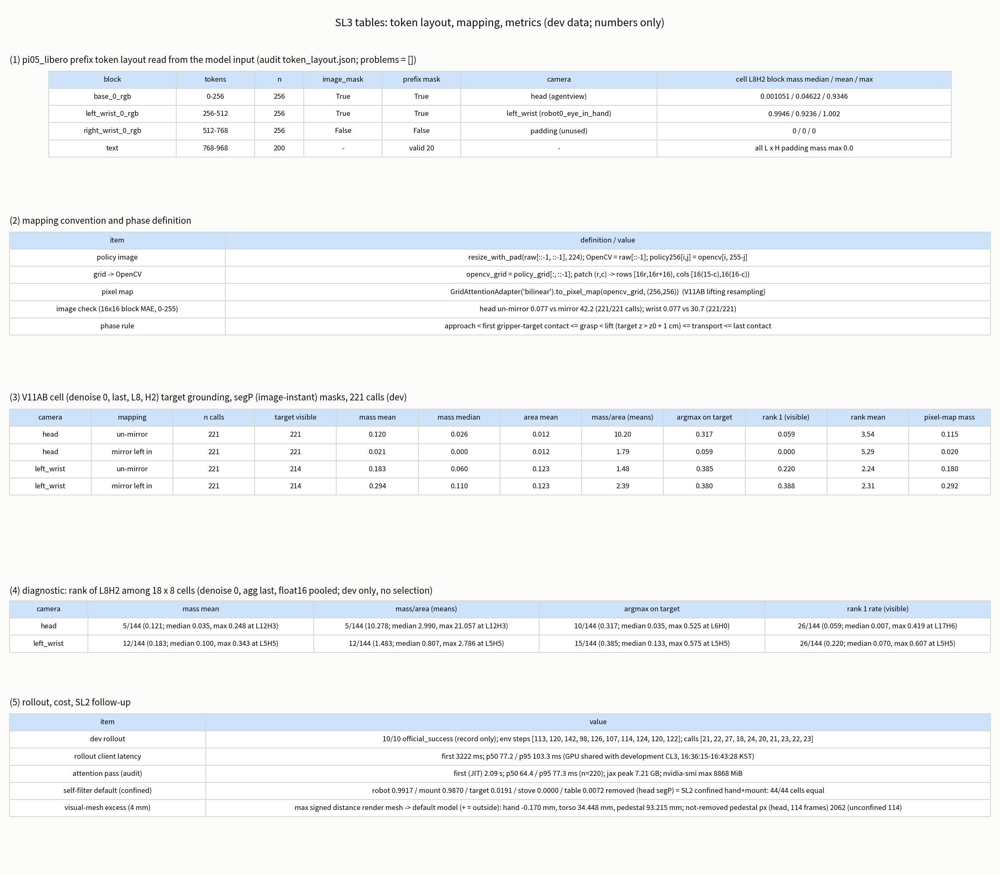

### 결과 — #1 SL2 후속: confined cover 기본값과 robot_geometry CLI

| 확인 | 결과 |
|---|---|
| `robot_geometry.py export` 를 기본 shell 에서 실행 | returncode 0 (시작 시 `LD_LIBRARY_PATH` 에 외부 torch lib 가 있었음). export 파일 SHA-256 이 SL2 export 와 같고 `geometry_digest` `ea38872f…` 가 같다 |
| manifest 의 cover 항목 (dry-run) | `confined_hand_mount`, capsule 1,036 · cover sphere 4,210 · self-filter sphere 4,271, file SHA-256 `b8ec2deb…` (비교용 unconfined SHA-256 `895b7dbf…`, 이전과 같음) |
| 무인자 builder 의 sphere 수 | 기본 4,271, `"unconfined"` 245 |
| SL2 측정과 일치 | 기본 = SL2 `confine_hand_mount` 와 44/44 cell 일치, unconfined = SL2 default 와 44/44 cell 일치 (6/6 row band 일치) |

**self-filter 제거율** (SL2 replay task 0 · episode 0, 114 frame, `segP`, 기본 confined 대 비교용 unconfined). 지운 pixel 비율이며 robot 은 높을수록, 나머지(target · stove · table)는 **낮을수록** 좋다.

| camera | 대상 (pixel 수) | confined (기본) | unconfined |
|---|---|---:|---:|
| head | robot (854,825) | 99.17 % | 99.23 % |
| head | mount (159,088) | 98.70 % | 99.93 % |
| head | target bowl (75,545) | 1.91 % | 5.46 % |
| head | stove (179,550) | 0.00 % | 30.92 % |
| head | table (3,153,421) | 0.72 % | 5.75 % |
| left_wrist | robot (769,260) | 99.97 % | 99.98 % |
| left_wrist | target bowl (642,523) | 4.30 % | 11.00 % |
| left_wrist | stove (150,097) | 0.33 % | 11.68 % |
| left_wrist | table (3,854,155) | 0.38 % | 1.62 % |

이 값은 SL2 의 confined hand+mount 결과와 같다(위 cell 비교). 대가는 sphere 수(245 → 4,271)이며 runtime 은 SL-4 에서 잰다.

### 결과 — #2 visual mesh 밖으로 나온 양 (confined cover 의 알려진 한계)

confined 규칙은 hand · mount capsule 을 body 의 **collision** 표면 안에 가둔다. 그래서 collision 표면은 덮지만 **visual(render) mesh** 는 그 밖으로 나올 수 있다. frame 0, 4 mm 표본에서 render mesh 표면의 sphere union 에 대한 최대 signed distance (양수 = sphere 밖):

| body | confined (기본) | unconfined | confined 에서 밖인 표본 / 전체 |
|---|---:|---:|---:|
| `gripper0_right_gripper` (hand) | −0.170 mm | −4.404 mm | 0 / 85,399 |
| `mount0_torso` | **+34.448 mm** | −122.468 mm | 773 / 4,056 |
| `mount0_pedestal` | **+93.215 mm** | −4.533 mm | 1,602,405 / 3,522,906 |

- hand 의 visual mesh 는 기본 cover 안에 들어간다. implementer 가 `SL3.impl.md` 에 적은 hand 0.880 mm 와 verifier 값(−0.170 mm)은 다르다. verifier 값을 정본으로 쓰며 차이의 원인은 조사하지 않았다.
- SL2 의 mount 제거율은 98.70 %(unconfined 99.93 %)였다. 제거되지 않고 남은 mount pixel 은 pedestal 에서만 나온다(같은 body 의 visual 초과와 일치). 수는 head 에서 head 에서 2,062 개(114 frame 합, 모두 `mount0_pedestal`)이고 sphere union 까지의 거리는 median 10.68 mm(min 0.38 mm, max 771.28 mm)이다. unconfined 에서는 114 개(median 661.76 mm)다. wrist 에는 mount 가 보이지 않는다(0 pixel).
- 남은 mount pixel 이 ESDF 에서 장애물이 되는지는 이 STEP 에서 재지 않았다(SL-4).

### 결과 — #3 dev rollout (기록만; 성공률 주장이 아니다)

task 0–9 × init state 0 각 1 episode. official success 는 `env.step()` 의 `done` 이다.

| task | 설명 (target 은 모두 `akita_black_bowl_1` → `plate_1`) | official_success | status | env step (wait 포함 / 제외) | policy call |
|---:|---|:---:|---|---:|---:|
| 0 | pick up the black bowl between the plate and the ramekin … | true | success | 113 / 103 | 21 |
| 1 | … black bowl next to the ramekin … | true | success | 120 / 110 | 22 |
| 2 | … black bowl from table center … | true | success | 142 / 132 | 27 |
| 3 | … black bowl on the cookie box … | true | success | 98 / 88 | 18 |
| 4 | … black bowl in the top drawer of the wooden cabinet … | true | success | 126 / 116 | 24 |
| 5 | … black bowl on the ramekin … | true | success | 107 / 97 | 20 |
| 6 | … black bowl next to the cookie box … | true | success | 114 / 104 | 21 |
| 7 | … black bowl on the stove … | true | success | 124 / 114 | 23 |
| 8 | … black bowl next to the plate … | true | success | 120 / 110 | 22 |
| 9 | … black bowl on the wooden cabinet … | true | success | 122 / 112 | 23 |

- 10/10 episode 가 `success`, policy call 합 221 = `policy_records` 221 개. task 0 의 npz 는 SL0 run 과 같다(`t0_npz_equal_to_SL0`).
- **이것은 dev 의 10 episode(task 당 init state 하나)이며 성공률이 아니다.** test(init state 5–49)는 쓰지 않았다.

### 결과 — #4 token layout (모델 input 에서 읽은 값)

| block | token 범위 | image_mask | prefix mask | camera | cell L8H2 block mass (median / mean / max) |
|---|---|---|---|---|---|
| `base_0_rgb` | 0–256 | True | True | head (agentview) | 0.00105 / 0.0462 / 0.935 |
| `left_wrist_0_rgb` | 256–512 | True | True | left_wrist (robot0_eye_in_hand) | 0.995 / 0.924 / 1.002 |
| `right_wrist_0_rgb` | 512–768 | **False** | False | padding (사용 안 함) | 0 / 0 / 0 |
| text | 768–968 | – | 유효 20 / 200 | – | – |

- `problems = []`: 읽어낸 layout 이 V11AB `CAMERA_BINDINGS` 와 camera 표에 모두 일치한다. prefix 길이 968.
- padding block 의 attention mass 는 **전체 18 × 8 [layer, head] 모든 call 에서 최대 0.0** 이다.
- V11AB 자신의 `AttentionPolicy` 와 대조한 2 call 은 bit 동일(max |Δ| 0.0). 저장한 float16 pooled 배열의 L8H2 와 float32 `cell_tokens` 의 차이는 최대 3.0e-8 이다.
- **block mass** = 한 cell 의 attention 이 image block 하나에 놓인 합. 이 cell 은 attention 을 **거의 전부 wrist image 에** 두고(wrist median 0.995), head block 은 median 0.00105 만 받는다. 이 값은 아래 "알게 된 것"에서 다시 다룬다.

### 결과 — #5 방향 대응: un-mirror 대 mirror left in

두 검사를 분리해서 읽는다.

**(a) image 검사 — un-mirror 가 기하학적으로 맞다.** policy image 를 OpenCV image 로 복원한 것과 16×16 block 단위로 비교한 MAE(0–255):

| camera | un-mirror | mirror left in | un-mirror 가 더 작은 call |
|---|---:|---:|---:|
| head | 0.077 | 42.20 | 221 / 221 |
| left_wrist | 0.077 | 30.72 | 221 / 221 |

**(b) attention 검사 — target mass 비교** (221 call, `segP`).

| camera | mapping | mass 평균 | mass / area (평균 비) | argmax 가 target 위 | call 별 un-mirror > mirror / < / 같음 |
|---|---|---:|---:|---:|---|
| head | un-mirror | **0.1202** | 10.20 | 0.317 | **167** / 54 / 0 |
| head | mirror left in | 0.0211 | 1.79 | 0.059 | |
| left_wrist | un-mirror | 0.1826 | 1.48 | 0.385 | 91 / **123** / 7 |
| left_wrist | mirror left in | **0.2939** | 2.39 | 0.380 | |

- head 는 un-mirror 가 맞다는 (a) 와 (b) 가 모두 같은 방향이다.
- **wrist 는 (a) 와 (b) 가 어긋난다.** image 로는 un-mirror 가 정확한데, target mass 평균은 mirror left in 이 높다(0.294 대 0.183). argmax 가 target 위인 비율은 거의 같다(0.385 대 0.380).
- phase 별로 보면 이 차이의 위치가 드러난다(wrist, mass 평균): approach 는 un-mirror 0.315 대 mirror 0.225, grasp 는 0.214 대 0.171 로 un-mirror 가 높고, **transport 에서만** un-mirror 0.022 대 mirror 0.407 로 뒤집힌다(transport 의 target area 평균은 0.176). 아래 phase 표 참고.
- ~~**미검증 가설 (lead 의 작업 가설)**: grasp 이후 bowl 이 wrist view 의 중앙에서 크게 보이므로, 좌우를 뒤집은 map 도 대칭성 때문에 target 과 겹친다. 이 가설은 이 STEP 에서 검증하지 않았다(per-phase · per-position 분해는 SL-4 로 예정). 위 transport 수치는 가설과 모순되지 않는 관찰일 뿐 증명이 아니다.~~ → **SL4 에서 질량 분해로 해소했다**(아래 [SL4 #4](#결과--4-wrist-mirror-진단--attention-mass-분해와-mirror-run)). transport 에서 policy 의 attention 은 target bowl 이 아니라 **destination plate** 로 옮겨 간다(head 0.578 · wrist 0.619). mirror left in 이 wrist transport 에서 높았던 것(target mass 0.407, plate mass 0.126)은 더 정확한 mapping 이어서가 아니라, plate 에 있던 attention 이 뒤집히며 면적이 큰 bowl(wrist image 면적 0.176, plate 0.049)에 우연히 걸린 결과로 읽는다. 겹친 위치 자체는 측정하지 않았다. un-mirror 는 확정이다.
- 따라서 **mapping 은 un-mirror 로 확정한다**(image 검사 기준). wrist 의 mass 점수만으로 mirror 를 택하지 않는다.

### 결과 — #6 V11AB cell 의 target grounding (L8H2, denoise 0, `last`; un-mirror; `segP`)

용어: **mass** = 그 camera 의 256 token attention 합을 1 로 정규화했을 때 target mask 가 덮는 patch 가중 합. **area** = 같은 patch 가중으로 센 target 의 면적 비율 = attention 이 균일하게 퍼졌을 때 기대되는 mass(**uniform baseline**). **mass/area** > 1 이면 chance 보다 target 에 모인다. **rank** = BDDL 물체 · fixture 중 target 보다 mass 가 큰 것의 수 + 1.

**전체**

| camera | n call (target 보임) | mass 평균 / median | area 평균 | mass/area (평균 비) | median mass/area | mass > area 인 call 비율 | argmax 가 target 위 | rank 1 비율 | rank 평균 (median) |
|---|---|---:|---:|---:|---:|---:|---:|---:|---|
| head | 221 (221) | 0.120 / 0.026 | 0.0118 | **10.20** | 3.13 | 0.548 | 0.317 | 0.059 | 3.54 (3) |
| left_wrist | 221 (214) | 0.183 / 0.060 | 0.123 | 1.48 | 0.53 | 0.444 | 0.385 (visible 0.397) | 0.220 | 2.24 (2) |

- 같은 camera 에서 평균 instance mass(head)는 `main_table` 0.425, `plate_1` 0.330, target `akita_black_bowl_1` 0.120, robot 0.025 순이다. 즉 head 의 attention 은 target 에 chance 의 약 10 배로 모이지만 **target 이 가장 많이 받는 물체는 아니다**(rank 1 은 call 의 5.9 %). `main_table` 은 면적이 크다.
- `segP` 와 `segRec` 의 차이는 작다: head mass 평균 절대차 0.00026, wrist 0.0016, rank 가 달라지는 call 은 head 0 · wrist 1. image instant 로 다시 render 한 RGB 는 모든 call frame 에서 기록된 RGB 와 같다.

**phase 별** — approach = 첫 gripper–target contact 이전, grasp = 첫 contact 부터 lift(target z > z0 + 1 cm)까지, transport = lift 부터 마지막 contact 까지(post_release 는 0 call). MuJoCo contact · target 높이로 정한 label 이며 subtask probe 는 쓰지 않았다.

| camera | phase (n) | mass 평균 | area 평균 | mass/area | argmax 가 target 위 | rank 평균 |
|---|---|---:|---:|---:|---:|---:|
| head | approach (105) | 0.214 | 0.0124 | **17.19** | 0.505 | 2.79 |
| head | grasp (25) | 0.0725 | 0.0081 | 8.99 | 0.080 | 4.24 |
| head | transport (91) | 0.0252 | 0.0120 | 2.09 | 0.165 | 4.21 |
| left_wrist | approach (105, 보임 98) | 0.315 | 0.0682 | 4.61 | 0.686 | 1.66 |
| left_wrist | grasp (25) | 0.214 | 0.163 | 1.31 | 0.240 | 2.00 |
| left_wrist | transport (91) | 0.0218 | 0.176 | 0.12 | 0.077 | 2.93 |

(참고: 같은 phase 의 mirror left in, wrist 는 approach 0.225 / grasp 0.171 / transport 0.407, head 는 0.0433 / 0.0023 / 0.0006.) grasp phase 는 task 당 0–8 call 로 짧다(t9 는 contact 와 lift 가 같은 frame 이라 0 call).

**task 별** (head · left_wrist, un-mirror). 한 task 는 episode 하나(call 18–27 개)이므로 call 들은 서로 독립이 아니다.

| task | head mass | head area | head mass/area | head argmax 가 target 위 | wrist mass | wrist area | wrist mass/area | wrist argmax 가 target 위 |
|---:|---:|---:|---:|---:|---:|---:|---:|---:|
| 0 | 0.233 | 0.0100 | 23.34 | 0.429 | 0.352 | 0.0899 | 3.92 | 0.667 |
| 1 | 0.179 | 0.0091 | 19.77 | 0.455 | 0.211 | 0.0873 | 2.41 | 0.318 |
| 2 | 0.0714 | 0.0101 | 7.10 | 0.296 | 0.160 | 0.1268 | 1.26 | 0.481 |
| 3 | 0.176 | 0.0131 | 13.47 | 0.556 | 0.173 | 0.1015 | 1.71 | 0.500 |
| 4 | 0.0372 | 0.0158 | 2.35 | 0.125 | 0.110 | 0.1312 | 0.84 | 0.208 |
| 5 | 0.123 | 0.0110 | 11.16 | 0.550 | 0.240 | 0.0901 | 2.67 | 0.450 |
| 6 | 0.183 | 0.0145 | 12.62 | 0.524 | 0.191 | 0.1139 | 1.68 | 0.381 |
| 7 | **0.0047** | 0.0076 | **0.62** | 0.000 | 0.0855 | 0.2468 | 0.35 | 0.174 |
| 8 | 0.158 | 0.0122 | 12.90 | 0.227 | 0.193 | 0.0760 | 2.54 | 0.545 |
| 9 | 0.0818 | 0.0149 | 5.49 | 0.130 | 0.139 | 0.1509 | 0.92 | 0.174 |

head 는 10 task 중 8 task 에서 mass/area > 5 이고, task 7(`stove` 위의 bowl)은 mass/area 0.62 로 chance 아래다. task 4(drawer 안)도 2.35 로 낮다. wrist 의 task 7 area 평균이 0.247 로 가장 큰데 mass 는 0.0855 이다.

### 결과 — #7 진단 grid (dev only; 선택하지 않았다)

V11AB L8H2 가 전체 18 layer × 8 head = 144 cell(denoise 0, aggregation `last`, float16 pooled) 중 어디에 놓이는지만 센다. **이 표로 layer/head 를 고르지 않는다.**

| camera | 지표 | V11AB L8H2 (순위 / 144) | 144 cell median | 최대 (위치) |
|---|---|---|---:|---|
| head | mass 평균 | 0.121 (**5**) | 0.0352 | 0.248 (L12H3) |
| head | mass/area | 10.28 (**5**) | 2.99 | 21.06 (L12H3) |
| head | argmax 가 target 위 | 0.317 (10) | 0.0351 | 0.525 (L6H0) |
| head | rank 1 비율 | 0.059 (26) | 0.0068 | 0.419 (L17H6) |
| left_wrist | mass 평균 | 0.183 (12) | 0.0998 | 0.343 (L5H5) |
| left_wrist | mass/area | 1.48 (12) | 0.807 | 2.79 (L5H5) |
| left_wrist | argmax 가 target 위 | 0.385 (15) | 0.133 | 0.575 (L5H5) |
| left_wrist | rank 1 비율 | 0.220 (26) | 0.0701 | 0.607 (L5H5) |

- uniform baseline: head 0.0118, wrist 0.123. V11AB cell 의 head mass/area 10.28 은 144 cell 의 median(2.99)보다 크다.
- 일부 cell 은 어떤 call 에서 block 합이 float16 에서 0 이 되어 유효 call 수가 31–221 이다(head 10 cell, wrist 8 cell). V11AB L8H2 는 221 call 모두 유효하다.
- float16 pooled 로 계산한 L8H2 head mass 0.1211 은 float32 `cell_tokens` 의 0.1202 와 float16 오차 안에서 같다.

### 결과 — #8 비용

| 항목 | 값 | 조건 |
|---|---|---|
| attention pass 첫 call (JIT) | 2.094 s | audit, **uncontended**(GPU lock) |
| attention pass 이후 (n = 220) | p50 64.36 ms / p95 77.29 ms / mean 65.44 ms / max 94.60 ms | audit, uncontended. 기본 설정(num_denoise 10, subtask feature, full grid 저장) |
| model load | 34.86 s | audit |
| JAX device memory | load 후 6.98 GB(6,983,379,712 B), peak 7.21 GB(7,212,886,784 B) | audit |
| `nvidia-smi` 이 process 의 최대 | 8,868 MiB | audit |
| rollout client 왕복 latency, 첫 call (JIT) | 3,222.2 ms | dev rollout, **GPU contended** |
| rollout client 왕복 (n = 220) | p50 77.18 ms / p95 103.31 ms / max 264.75 ms | dev rollout, **GPU contended** |
| rollout server policy infer, 첫 call | 2,022.5 ms | dev rollout, **GPU contended** |
| rollout server policy infer (n = 220) | p50 41.05 ms / p95 54.36 ms / max 153.28 ms | dev rollout, **GPU contended** |

- **rollout latency 는 development checkout 의 CL3 closed-loop run 과 GPU 를 함께 쓰던 2026-10-12 16:36:15–16:43:28 KST 구간에서 쟀다.** 경합 없는 steady-state 값이 아니므로 다른 STEP 의 latency 와 직접 비교하지 않는다. **audit latency 는 GPU lock 을 잡고 다른 compute process 가 없음을 확인한 뒤 쟀다(경합 없음).**
- rollout 중 GPU 최대 사용: 다른 process 두 개가 각각 18,060 · 18,058 MiB, 이 run 의 server(pid 596005)가 8,802 MiB, GPU 전체 합 최대 45,530 MiB.
- audit 의 attention pass 는 V11AB `AttentionSampler` 로 계산한 비용이다(기본 설정: num_denoise 10, subtask feature on, full grid 저장 on; `SL3.impl.md`). runtime budget 판정은 SL-4 이후.

### 결과 — #9 회귀

| 검사 | 결과 |
|---|---|
| legacy 16D ESDF 기준선 | violated start 14/15 · has_target 15/15 · frame0 clearance −29.031 mm — 기준값과 일치 |
| `scripts/testing/run_cpu_regression.sh` | A 73 passed (77 warnings) / B 78 passed / C 76 passed, 2 skipped / exit 0 |
| flags-off replay (SL0 경로) | episode npz 가 SL0 와 모든 key 에서 같다. jsonl: official_success true · status success · env step 113 · policy call 21 (replay 와 SL0 동일) |

### 이 STEP 에서 알게 된 것 (평이한 설명)

1. **V11AB 의 head attention 은 pi05_libero 에서도 target 근처에 모인다.** target mask 가 차지하는 면적(uniform baseline) 대비 약 10 배(mass/area 10.20)이고, 144 개 (layer, head) 중 mass 순위는 5 위다. 접근(approach) 단계에서 특히 높다(17.19; 위 graph (a)). 하지만 target 이 가장 많이 받는 물체는 아니다(rank 1 은 5.9 %; table · plate 가 더 받는다). grasp 이후에는 급격히 떨어진다(transport 2.09, median 비는 0.07 정도로 chance 이하). task 7 · 4 는 약하다.
2. **이 cell 은 attention 의 거의 전부를 wrist image 에 둔다.** head block mass 의 median 이 0.00105 이고 wrist block 은 0.995 다. V11AB 가 raw mass 에 threshold 를 걸어 pixel 을 고르는 구조라면 head pixel 은 threshold 를 통과하지 못할 수 있다. 이것은 가능성이며 **SL-4 에서 측정한다**(여기서는 정규화한 mass 비율만 재었다).
3. **mirror 는 풀어야 한다.** image 검사는 221/221 call 에서 un-mirror 를 지지한다. head 에서는 attention 검사도 같은 결론이다(167/221 call, mass 0.120 대 0.021). **wrist 에서는 mirror left in 의 target mass 평균이 더 높았다**(0.294 대 0.183). 이 불일치는 transport phase 에 집중돼 있고(0.407 대 0.022), approach · grasp 에서는 un-mirror 가 높다. ~~lead 의 **미검증 가설**: grasp 이후 bowl 이 wrist view 에서 중앙에 크게 보이므로 좌우를 뒤집은 map 도 대칭성으로 겹친다. 이 가설과 phase 별 원인 분해는 SL-4 에서 한다.~~ → SL4 #4 에서 분해했다: transport 에서 attention 이 destination plate 로 옮겨 가며, 가설의 "중앙의 bowl" 설명은 맞지 않았다.
4. confined cover 로 target · stove · table 오제거는 줄었지만(head target 5.46 → 1.91 %, stove 30.92 → 0 %) mount 의 **visual mesh** 일부(pedestal 93 mm, torso 34 mm)가 sphere union 밖에 남는다.

### 판정 (2026-10-12, 사용자)

| # | 판정 |
|---|---|
| 1 | **SL3 확정.** |
| 2 | **LIBERO dev/test 분리 = 안 A.** dev = init state 0–4, test = 5–49 (plan §6.0). 이 STEP 의 측정은 모두 dev 다. |
| 3 | **Panda 는 V11AB attention cell L8H2 를 그대로 쓴다**(recalibration 하지 않는다). SL-4 에서 target geometry 가 부족하다고 확인된 경우에만 **dev 전용 calibration variant** 를 별도 이름으로 만든다. 진단 grid 의 최대(L12H3)를 자동으로 채택하지 않는다. |
| 4 | **다음은 SL-4**: Panda 를 V11AB core 에 연결(ATS / LTE / ESDF). |

### 측정하지 않은 것

- SL0 run 에 대한 attention audit (dev t0e0 npz 가 SL0 와 같아 반복하지 않았다)
- 경합 없는 rollout latency (rollout 은 development CL3 와 GPU 를 공유하는 동안 쟀다)
- cuRobo 16D baseline (legacy baseline 만 실행)
- frame 0 외의 frame 에서의 visual mesh 초과 (rigid body 이므로 한 frame)
- Panda feature 에서의 subtask probe `kv_L4_v1` (SL-6)
- phase 가 아닌 **위치** 별(wrist 중앙 / 가장자리) 분해, mirror left in 의 wrist 우세 원인
- head 의 raw mass threshold 가 pixel 을 고르는지(SL-4)
- init state 1–4(dev 의 나머지)와 test init state

### 운영 기록 (shared pod)

| 사건 | 내용 |
|---|---|
| development checkout 과의 GPU 겹침 | dev rollout(2026-10-12 16:36:15–16:43:28 KST)이 development checkout 의 CL3 closed-loop run 과 GPU 를 동시에 썼다. 그래서 rollout latency 는 경합 하에서 잰 값으로 표시한다. 이후 attention audit 은 `/tmp/ag3s-vla-gpu-validation.lock` 을 `flock` 으로 잡고 `nvidia-smi` 로 다른 compute process 가 없음을 확인한 뒤 실행했다 |
| pod 메모리 | benchmark 쪽 CPU 측정 job 이 pod working set 을 64 GiB 위로 올려 lead 가 중단했다(lead 보고; 최대값은 verify.json 에 없다). verify.json 의 self-filter 측정(`selffilter_default`)은 row band 16 단위 처리와 RSS 기록(`selffilter_rss.csv`)으로 다시 실행된 기록이 남아 있다 |
| 규칙 채택 | 사용자가 development checkout 과 같은 공용 GPU lock · pod 자원 규칙을 이 checkout 에도 적용하기로 결정했다(commit `41339944`): GPU 작업은 lock 을 잡고 다른 compute process 확인 후 시작, 다른 checkout 과 동시 실행 금지, pod working set ≤ 64 GiB(하드 80 GiB), CPU worker 세션당 ≤ 2(pod ≤ 4), 측정 job 은 `nohup` 없이 실행, 긴 GPU 작업 전후 다른 세션에 알림 |

### 열린 항목

| # | 내용 | 영향 / 다음 |
|---|---|---|
| 1 | ~~**head block mass 가 매우 작다**(median 0.00105). V11AB 의 raw-mass threshold 가 head pixel 을 고르는지~~ | → SL4 #3 에서 측정: head 가 seed 를 만든다(접근 단계 seed 의 head-argmax 비율 0.520). 해소 |
| 2 | ~~wrist 에서 mirror left in 이 mass 가 높은 원인(가설: grasp 후 bowl 이 중앙에서 크다)~~ | → SL4 #4 에서 분해. 원인 = transport 의 attention 이 destination plate 로 이동. 해소 |
| 3 | ~~**SL-4 가 필요로 하는 AG3S core 주입 지점**(구현하지 않았다): `serve_safe.py:1037-1058` `attention_extractor` 의 camera alias 를 Panda(`cam_high -> head`, `cam_left_wrist -> left_wrist`, `cam_right_wrist` 버림)로 바꾸고 **`lift` 전에 grid 열 뒤집기**(`attention.unmirror_grid`)를 넣어야 한다. core `GridAttentionAdapter` / `lift` 에는 flip 옵션이 없다. 그 밖에 SL2 열린 항목 5 의 RB-Y1 hardcode 지점이 남아 있다~~ | → offline 은 SL4 profile(생성자 인자 · config dict)로 core 변경 없이 해결. **online server 주입은 SL-5**(최소 core 변경, 사용자 판정 2026-10-13) |
| 4 | subtask probe `kv_L4_v1` 은 RB-Y1 feature 로 학습됐다. 이번 phase label 은 MuJoCo contact · lift 이고 probe 는 쓰지 않았다. Panda `kv_feature` 는 저장돼 있다 | SL-6 audit |
| 5 | ~~confined 4,271 sphere self-filter 의 runtime, mount visual mesh 초과(pedestal 93 mm, torso 34 mm)가 ESDF 에 장애물로 남는지~~ | → SL4 #8 · #9 에서 측정(self-filter 포함 scene_reconstruction p50 38.8 ms; mount 잔여 점은 call 당 최대 7 개, gripper 에서 326 mm 이상). 해소 |
| 6 | wrist 0.05 m 미만 pixel(전체 8.2 %, SL1)과 head 3.0 m 초과 pixel 처리 | SL-4 (SL2 열린 항목 6 에서 이월; 이 STEP 에서 다루지 않았다) |
| 7 | segmentation 은 `env.step` return 시점 render 가 기본 기록이다. attention 채점은 image instant 로 다시 render 한 `segP` 를 썼다. 두 결과 차이는 작았다(위 #6) | SL-4 에서 ATS 가 어느 시점 mask 를 쓰는지 정한다 |
| 8 | dev 는 task 당 episode 1 개. call 들이 episode 안에서 상관돼 있어 신뢰구간을 말하지 않는다 | init state 1–4 로 확장 시 |

### 되돌아올 지점 (SL3)

| 전환 신호 | 돌아와서 할 일 |
|---|---|
| SL-4 에서 head target geometry 가 ESDF 에 부족하다고 확인(threshold 가 head pixel 을 못 고름 등) | **dev 전용 calibration variant** 를 별도 이름으로 선언하고 init state 0–4 에서만 고른다. 사용자 판정 필요. 진단 grid 최대(L12H3)를 자동 채택하지 않는다(test init state 5–49 와 분리) |
| SL-4 per-phase 분해에서 wrist 의 mirror 우세가 가설과 다르게 나옴 | SL1 의 orientation 측정 · policy transform 경로를 다시 대조한다(원인 확정 전 wrist attention 을 depth 에 쓰지 않는다) |
| subtask probe 가 Panda 에서 쓸 수 없음 | SL-6 에서 strong-rule / GT phase 등 계획의 대안과 함께 blocker 로 기록 |
| confined 4,271 sphere 가 SL-4 runtime 을 넘음 | compact refit 또는 덮개를 hand + mount 에 한정한 채 반지름 정책 재검토 (SL2 에서 이월) |


---

## SL4 — Panda 관측을 V11AB perception → ESDF 에 연결 (ATS · LTE · ESDF), offline (2026-10-12)

> 2026-10-12 ~ 10-13 KST. 구현 commit `46a08d6f`(2026-10-12 22:53 KST) · 검증 commit `c2ba3fea`(2026-10-13 00:21 KST). 사용자 확정 2026-10-13.
> 관련 commit: `d53d8e07`(GPU lock `flock` 예시 수정, 아래 "운영 기록"), `41a5b28a`(SL4b task 정의, 아래 "판정").
> 원본: [`handoff/SL4.task.md`](handoff/SL4.task.md) · [`handoff/SL4.impl.md`](handoff/SL4.impl.md) ·
> [`handoff/SL4.verify.json`](handoff/SL4.verify.json). raw 출력은 `outputs/verify/SL4/`.
> 이 절의 수치는 모두 `SL4.verify.json` 의 `numbers` 가 출처다. **측정은 전부 dev 데이터**(LIBERO Spatial task 0–9 × init state 0,
> 10 episode, 221 policy call; SL3 dev rollout + SL3 attention audit)이고 이 STEP 에서 **아무것도 선택하지 않았다**(cell · 규칙 · threshold 모두 V11AB 값 그대로).

### 이 STEP 이 답하는 질문

SL1–SL3 으로 Panda 의 camera(depth · K · `T_base_cam`), robot geometry(self-filter · constraint sphere), attention(L8H2 + un-mirror)이 각각 V11AB 형식으로 준비됐다.
SL4 는 이것들을 **V11AB 의 실제 perception 코드**(`AG3S.process_multi_debug`)에 넣는다. AG3S core 는 수정하지 않는다. 질문은 이것이다:

> V11AB perception 코드를 바꾸지 않고 입력만 Panda 로 바꿨을 때, LIBERO scene 에서 (1) target bowl 을 추출하는가(ATS),
> (2) target 만 제외한 layer 를 만들면서 다른 장애물은 보존하는가(LTE), (3) gripper 주변 거리장이 실제 거리와 mm 수준으로 맞는가(ESDF)?

```
recorded dev frame (wire npz: depth mm, K, T_base_cam, robot_state 9-D) + attention(L8H2, un-mirror)
  -> robot_state 를 q7 + finger 로 split -> AG3S.set_finger_joints -> CameraObservation x2 (head, left_wrist)
  -> AG3S(robot_model = Panda self-filter, constraint_robot_model = Panda gripper, attached_parent_links = Panda,
          config = V11AB flag 에서 유도 + Panda override 둘)
  -> process_multi_debug(phase="approach", active_manipulators=["left"])
  -> grounding(ATS) · target-free layer · CuroboEsdfField · CollisionConstraintSet
```

closed loop(TrajOpt, action 변환)은 SL-5 다. 이 STEP 은 **offline** 이다: 기록된 frame 을 다시 넣을 뿐 로봇은 움직이지 않는다.

### 무엇을 만들었나

**1. Panda AG3S profile** (`AG3S/adapters/panda/profile.py`; AG3S core 는 한 줄도 바꾸지 않았다)

config 를 손으로 다시 적지 않았다. launcher 스크립트(`scripts/benchmark/v11ab/start_server.sh`)의 V11AB flag 를 **serve_safe 자신의 parser · 검사**로 읽고,
`serve_safe.main` 의 `build_ag3s(...)` 호출식(AST)에서 keyword 를 만들어, `build_ag3s` 의 config 조립(유일하게 피할 수 없는 복사본)으로 config 를 만든다.
test 가 **실제 `build_ag3s`** 를 같은 keyword 로 돌려 AG3S 생성자에 넘어가는 config 와 field 별로 대조한다.
Panda 와 달라지는 것은 아래 **override** 뿐이다. `diff_against_v11ab()` 가 이 목록 밖의 차이를 `UNDECLARED` 로 잡는다.

| override | V11AB | Panda | 이유 |
|---|---|---|---|
| `contact.contact_links` (config) | `left: (ee_left, ee_finger_l1, ee_finger_l2)`, `right: (ee_right, ee_finger_r1, ee_finger_r2)` | `left: (panda_hand, panda_leftfinger, panda_rightfinger)` | RB-Y1 link 이름이 Panda 에 없다. Panda 한 팔 = left manipulator(SL2). LTE 가 target 접촉을 허용하는 link 가 palm + 두 finger 가 된다 |
| `esdf.bounds_lower` z (config) | `(-0.3, -0.9, 0.0)` (`default_bounds()`) | `(-0.3, -0.9, -0.10)`, x · y 와 `bounds_upper` 는 그대로 | V11AB box 의 바닥은 base z 0.0(RB-Y1 의 table 은 base 보다 훨씬 위). **LIBERO table 윗면은 base z −0.012 m**(SL1)여서 기본 box 가 table 을 잘라 낸다 |

config 밖의 **constructor 차이**(로봇 geometry 에서 오는 것):

| 무엇 | V11AB | Panda |
|---|---|---|
| self-filter model | RB-Y1 `build_robot_model` | `build_panda_self_filter_model()` (`confined_hand_mount` cover, 4,271 sphere) |
| constraint model | `build_constraint_robot_model(links="gripper", …)` | `build_panda_constraint_model(PANDA_GRIPPER_LINKS)` (22 sphere) |
| `attached_parent_links` | `("ee_left", "ee_right")` | `("panda_hand",)` |
| constraint sphere options(`capsule_radius_scale` 0.05 등) | 적용 | **적용 안 함**: `franka.yml` sphere 는 길이 0 capsule 이라 scale 0.05 가 반지름을 5 % 로 줄인다(SL2) |
| `finger_cover: both` | 적용 | **적용 안 함**: RB-Y1 finger body capsule 용이다(SL2) |

V11AB flag 에서 유도한 값은 task 표와 대조해 일치했다(`esdf.voxel_size` 0.02, `max_distance` 0.4, `fine_voxel_size` 0.005, `tsdf_voxel_size` 0.005, `exclude_support_surfaces` False, backend `curobo`,
`attached_sign_threshold_voxels` 1.5, `pointcloud.range_max` 2.0, `self_collision` False). client 의 phase flag 는 `approach` 이다(V11AB client 는 `--safe-phase approach` 를 보낸다).

**2. offline harness** (`benchmark/runners/perception_replay.py`, `.venv-openpi-live`, GPU)

SL3 dev rollout 의 policy-call frame 221 개를 V11AB 의 실제 perception 경로로 다시 넣는다: `wire_pack` → `wire.strip_request` → `wire.unpack_camera_observations` →
robot_state 9-D 를 q7 + finger 로 split → `set_finger_joints` → SL3 audit 의 call 별 L8H2 grid 를 un-mirror 해 `CameraObservation.attention` 에 부착 →
`process_multi_debug(phase="approach", active_manipulators=["left"])`. 입력 join 은 dev run ↔ audit run 의 episode npz · geom SHA-256 과 `obs_index == chunk_t` 가 맞아야 시작한다.
`--attention-mapping {unmirror,mirror}`(진단용), `--esdf-bounds {panda,v11ab}`(#7 용)를 둔다. 저장 항목: frame 별 grounding 결과(status, target 점, seed 와 camera provenance),
fused cloud 요약, ESDF 를 GT 점 · gripper sphere 중심에서 query 한 값(main layer 와 target-free layer), constraint 요약, stage 별 시간, GPU memory.

**3. scene GT 도구** (`benchmark/adapters/libero_panda/scene_export.py`(py3.8) · `benchmark/evaluators/libero_scene_gt.py`(3.11))

episode 마다 LIBERO env 를 다시 만들어 call frame 의 MuJoCo 상태를 복원하고, 물체(target, plate, bowl_2, cookies, ramekin, stove, cabinet, table)와 robot mount 의
**visual mesh 표면 sample**(4 mm, instance 당 최대 3,000 점)을 base frame 으로 내보낸다. 점–삼각형 **정확 거리**, collision primitive 포함 판정, 기록 depth 와 점의 camera z 차이(depth 잔차)를 제공한다.
**visible GT sample** = `|기록 depth − sample 의 camera z| ≤ 10 mm`(head 또는 left_wrist). 바닥면 · 가려진 면은 sample 에 들어 있어서 이 조건으로 거른다.
검증 쪽에서 독립 구현(KD-pruned)과 brute force 가 300 점에서 최대 차 0.0 으로 같음을 확인했다.

**4. test** — `tests/benchmark/test_panda_sl4.py` 추가(CPU). profile config 대 실제 `build_ag3s` config, diff 가 선언한 override 와 정확히 같음, robot_state split · finger 부호, attention 부착 방향, ESDF bound 적용, harness dry-run, py3.8 export.

### 실행

| run | 값 |
|---|---|
| source dev rollout / attention audit | `.../20261012T163617_ce29b9be5fcb_sl3-dev-pi05only-t0-9e0` / `.../20261012T202459_309e4c6da477_sl3-attention-audit-dev` (SL3, 읽기만) |
| scene GT | `outputs/verify/SL4/raw/scene` (`.venv-libero`, CPU) |
| 기본 run (un-mirror, Panda box) | `/mnt/dev/AG3S_VLA-storage/results/benchmark/20261012T225820_46a08d6ff644_sl4-perception-dev` — 실행 창 13:58:18–14:03:19 UTC, GPU lock 안 |
| mirror run (#4 진단) | `.../20261012T230325_46a08d6ff644_sl4-perception-dev-mirror` — `--attention-mapping mirror` |
| V11AB box run (#7) | `.../20261012T230818_46a08d6ff644_sl4-perception-dev-v11abbox` — `--esdf-bounds v11ab` |
| flags-off replay (SL0 경로 보존) | `.../20261012T232117_46a08d6ff644_sl4-replay-off-t0e0` |
| 기준선 | legacy 16D(`.venv-ag3s`, CPU), cuRobo 16D(`.venv-openpi-live`, GPU lock 안, compute process 없음 확인) |

세 run 모두 같은 frame 221 개에 대해 `gt_samples_equal_harness` · `obs_index_equal_sl3_phases` 가 true 다(GT sample 과 phase label 이 harness 와 같다). phase 는 SL3 와 같다: approach 105 · grasp 25 · transport 91 call(post_release 0).
**carry** = grasp + transport(116 call).

### 결과 — Figure

세 figure 는 verifier 가 만들었다 (`outputs/verify/SL4/scripts/make_figures.py`, sidecar `.json` 동봉).

**실제 scene** — 5 개 frame(t0 의 approach · grasp · transport, ATS 가 오선택한 t4 의 approach, t5 의 approach)을 행으로, 각 행은 (1) 위에서 본 배치도(xy slice box 점선, xz 절단선 빨강),
(2) 옆에서 본 배치도, (3–4) xy 평면의 **main layer** 와 **target-free layer** ESDF(검은 contour = ESDF 5 mm), (5–6) xz 단면의 main 과 target-free 이다. fused cloud 는 물체별 색,
ATS target 점은 검정, 22 gripper constraint sphere 는 흰 원, target-free ball 은 빨강 점선이다. t0 approach · grasp 행은 ATS 점이 target bowl 위에 있고 target-free layer 에서 그 bowl 만 지워진다(visible plate sample 1,994 중 erased 1 · 0, bowl_2 erased 0).
t0 transport 행(attach 없음)은 ATS 가 target 이 아닌 곳에 있고, t4 · t5 행은 ATS 점이 각각 plate · bowl_2 위에 있어 **target-free layer 에서 지워지는 것이 true target 이 아니라 그 물체다**(t4: visible plate sample 1,964 중 568 이 erased, t5: visible bowl_2 sample 2,141 중 1,747 이 erased).

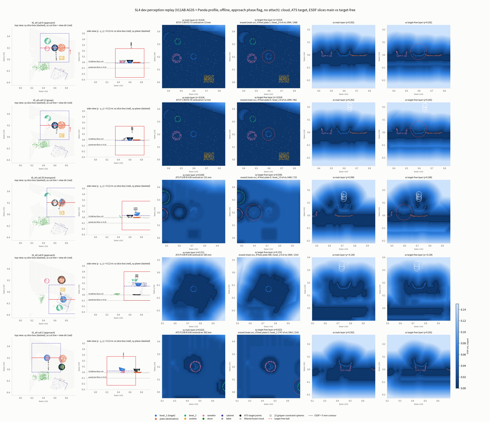

**graph** — (a) call 별 ATS precision · recall(+ mirror run 의 recall 선), (b) call 별 centroid 오차(log), (c) 물체별 visible GT 점의 occupied 비율(main · target-free), (d) phase 별 LTE,
(e) camera block 별 attention mass 분해(target · plate · gripper · other), (f) seed 의 head-argmax 비율, (g) ESDF box 효과, (h) gripper sphere 중심의 ESDF − 정확 거리, (i) stage 시간.

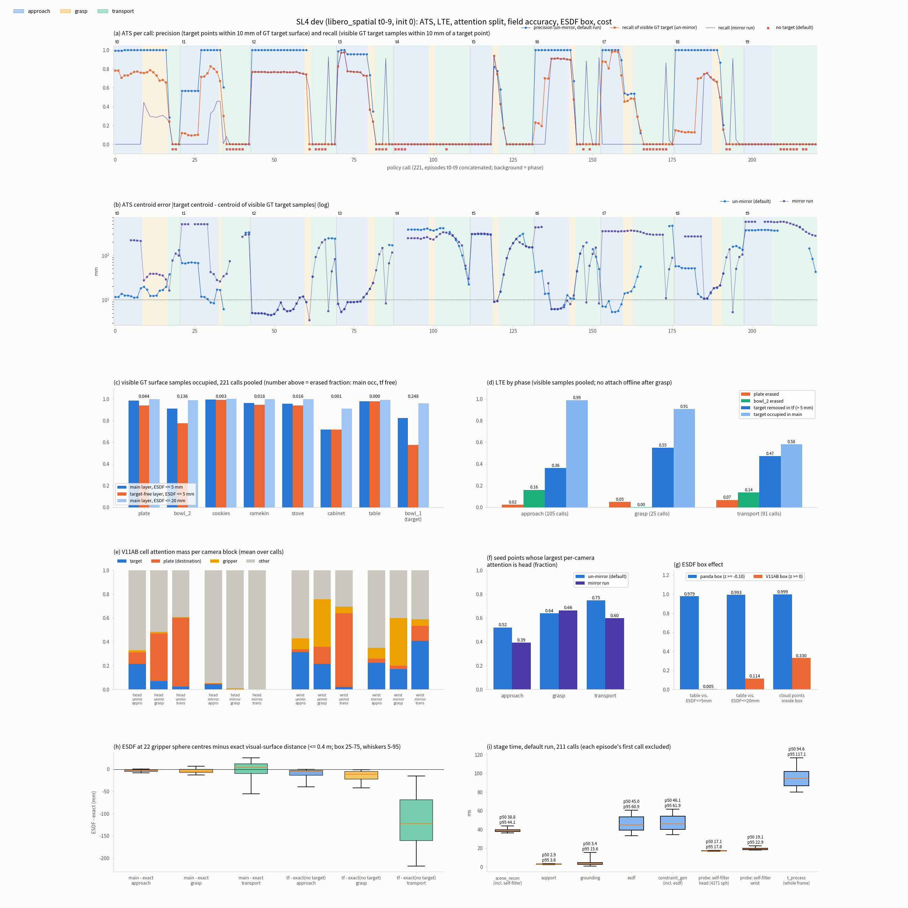

**table** — profile 대 V11AB 표, 기준선 · 회귀, ATS · mirror, attention mass, LTE, field · box · mount · cost 요약.

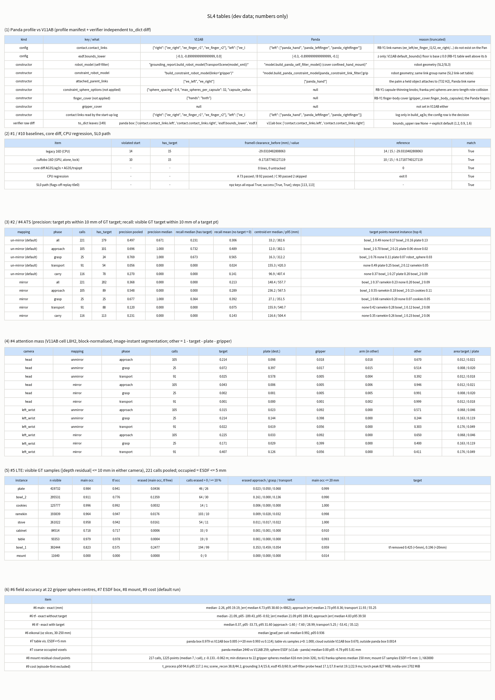

### 결과 — #1 V11AB 동일성

| 확인 | 결과 |
|---|---|
| core diff (`AG3S/ag3s/**` · `AG3S/trajopt/**`, 시작 HEAD `d1605030` 이후) | **0 줄**, untracked 0 |
| profile config 대 V11AB 차이 (profile 자체의 `diff_against_v11ab()`) | `contact.contact_links`, `esdf.bounds_lower`(z) 둘 — 선언한 override 와 정확히 같다 |
| 검증 쪽 독립 비교(`to_dict` 의 149 leaf) | Panda box: contact links + `bounds_lower` z(+ `bounds_upper` 의 `None` → 명시 기본값). V11AB box(`--esdf-bounds v11ab`): contact links 만 |
| 기준선: legacy 16D (15 frame, `.venv-ag3s`) | violated start 14/15 · has_target 15/15 · frame0 clearance −29.031 mm — **일치** |
| 기준선: cuRobo 16D (15 frame, `.venv-openpi-live`, GPU lock) | violated start 10/15 · has_target 15/15 · frame0 clearance −9.172 mm — **일치** |

**RB-Y1 기준선 둘이 그대로이므로** core 는 바뀌지 않았다는 독립 확인이다(task 의 중단 조건: 기준선이 어긋나면 즉시 중단 — 해당 없음).

### 결과 — #2 ATS: target 추출

용어: **precision** = ATS target 점 중 GT target(`akita_black_bowl_1`) 표면까지 정확 거리 ≤ 10 mm 인 비율. **recall** = visible GT target sample 중 10 mm 안에 ATS target 점이 있는 비율.
**centroid 오차** = |ATS target centroid − visible GT target sample 의 centroid|. `has_target` 은 ATS 가 target 점을 낸 call 이다. 실패 status: `no_seed`(seed 없음), `no_cluster`, `no_admissible`.

**phase 별** (un-mirror, 기본 run)

| phase | call | has_target | status | precision (pooled) | precision (call median) | recall (call median, target 있는 call) | recall (target 없음 = 0 평균) | centroid 오차 median / p95 (mm) |
|---|---:|---:|---|---:|---:|---:|---:|---:|
| all | 221 | 179 | ok 179, no_cluster 27, no_seed 11, no_admissible 4 | 0.497 | 0.671 | 0.231 | 0.306 | 33.2 / 382.6 |
| approach | 105 | 101 | ok 101, no_admissible 4 | 0.696 | 1.000 | 0.732 | 0.489 | 12.0 / 382.1 |
| grasp | 25 | 24 | ok 24, no_seed 1 | 0.769 | 1.000 | 0.673 | 0.565 | 16.3 / 312.2 |
| transport | 91 | 54 | ok 54, no_cluster 27, no_seed 10 | 0.056 | 0.000 | 0.000 | 0.024 | 155.3 / 420.3 |
| carry | 116 | 78 | ok 78, no_cluster 27, no_seed 11 | 0.270 | 0.000 | 0.000 | 0.141 | 96.9 / 407.4 |

- **접근(approach) 단계에서 ATS 는 대체로 target 을 잡았다**: 105 call 중 101 call 에서 target 을 냈고(실패 4 = `no_admissible`, 모두 t4), centroid 오차 median 12.0 mm, precision call median 1.000.
  단 p95 는 382.1 mm 로 **일부 task 에서 아예 다른 물체**를 골랐다(아래 task 별).
- transport 에서는 ATS 가 target 이 아닌 곳에 있다(precision 0.056). **이 구간은 attach 가 없는 offline 한계의 영향을 받는다**(아래 "알게 된 것" c).
- centroid 오차는 GT body 원점이 아니라 **visible 표면 sample 의 centroid** 와 비교한 값이다(GT body 원점은 bowl 바닥이라 표면 centroid 와 다르다; GT body 원점 기준 centroid 오차 median 은 approach 38.5 mm).
- ATS target centroid 가 직전 call 과 완전히 같은 call 이 target 이 있는 179 call 중 125 개다. 그 의미(target 유지 규칙인지)는 확인하지 않았다.

**task 별** (모든 phase, 한 task = episode 하나이므로 call 은 서로 독립이 아니다). 마지막 열은 ATS target 점의 **nearest-instance** 분포(0.05 이상만; `none` = 10 mm 안에 어느 물체도 없음).

| task | 설명 (target 은 모두 `akita_black_bowl_1`) | call | has_target | precision (pooled) | recall median | centroid 오차 median / p95 (mm) | target 점의 nearest-instance |
|---:|---|---:|---:|---:|---:|---:|---|
| 0 | between plate and ramekin | 21 | 19 | 0.909 | 0.750 | 12.6 / 46.7 | bowl_1 0.91, none 0.09 |
| 1 | next to ramekin | 22 | 16 | 0.739 | 0.209 | 41.7 / 325.2 | bowl_1 0.74, none 0.21 |
| 2 | table center | 27 | 22 | 0.818 | 0.765 | 6.1 / 240.8 | bowl_1 0.82, none 0.18 |
| 3 | on the cookie box | 18 | 14 | 0.771 | 0.765 | 9.1 / 169.7 | bowl_1 0.77, none 0.18 |
| 4 | in the top drawer of the cabinet | 24 | 19 | 0.000 | 0.000 | 376.9 / 407.3 | plate 1.00 |
| 5 | on the ramekin | 20 | 20 | 0.119 | 0.000 | 211.6 / 303.1 | bowl_2 0.49, none 0.23, ramekin 0.17, bowl_1 0.10 |
| 6 | next to the cookie box | 21 | 19 | 0.638 | 0.474 | 13.9 / 143.3 | bowl_1 0.64, none 0.22, plate 0.14 |
| 7 | on the stove | 23 | 15 | 0.621 | 0.485 | 14.0 / 462.3 | bowl_1 0.62, none 0.31 |
| 8 | next to the plate | 22 | 20 | 0.640 | 0.145 | 51.6 / 158.5 | bowl_1 0.64, none 0.36 |
| 9 | on the wooden cabinet | 23 | 15 | 0.000 | 0.000 | 371.3 / 393.3 | bowl_2 0.79, plate 0.12, stove 0.09 |

- **t4 · t5 · t9 에서 ATS 가 true target 이 아닌 물체를 골랐다.** t4(top drawer 안의 bowl): target 점의 nearest-instance 가 **plate 100 %**, precision 0.000(plate 는 destination 이다).
  t5(ramekin 위의 bowl): **bowl_2 0.49**, ramekin 0.17, true target(bowl_1) 0.10, precision 0.119. t9(cabinet 위의 bowl): **bowl_2 0.79**, plate 0.12, stove 0.09, bowl_1 은 0, precision 0.000.
- 나머지 7 task 는 target 점이 bowl_1 위에 놓인 비율이 0.62–0.91(t0 0.91 · t2 0.82 · t3 0.77 · t1 0.74 · t8 0.64 · t6 0.64 · t7 0.62)이다.

**phase 별 nearest-instance** (ATS target 점 pooled, 비율)

| phase | bowl_1 | bowl_2 | plate | ramekin | cookies | stove | table | robot_sphere | none |
|---|---|---|---|---|---|---|---|---|---|
| approach | 0.696 | 0.214 | 0.063 | 0.006 | 0.004 | 0.015 | 0 | 0.000 | 0.001 |
| grasp | 0.757 | 0 | 0.071 | 0.027 | 0.004 | 0.002 | 0 | 0.028 | 0.110 |
| transport | 0.053 | 0.125 | 0.250 | 0.054 | 0.006 | 0.019 | 0.004 | 0.004 | 0.485 |

### 결과 — #3 seed 를 만든 camera

**seed** = ATS 가 attention 상위(95 percentile) 점으로 고른 점이다. 점마다 per-camera attention 이 더 큰 camera 를 **argmax camera** 로 기록했다(core `_with_camera_provenance` 와 같은 규칙).
SL3 열린 항목 1(head block mass 가 매우 작은데 head pixel 이 seed 에 들어가는가)의 답이다.

| phase | seed 수 | argmax head / wrist | 관측한 camera: head 만 / wrist 만 / 둘 다 | head-argmax seed 가 하나라도 있는 call | head 가 과반인 call | call 별 head seed 비율 median | (mirror run) argmax head 비율 |
|---|---:|---|---|---:|---:|---:|---:|
| all | 19386 | 0.587 / 0.413 | 0.190 / 0.226 / 0.584 | 204 / 210 | 142 / 210 | 0.663 | 0.513 |
| approach | 12906 | 0.520 / 0.480 | 0.132 / 0.267 / 0.601 | 105 / 105 | 65 / 105 | 0.621 | 0.394 |
| grasp | 1670 | 0.640 / 0.360 | 0.346 / 0.210 / 0.444 | 23 / 24 | 16 / 24 | 0.609 | 0.664 |
| transport | 4810 | 0.749 / 0.251 | 0.294 / 0.122 / 0.584 | 76 / 81 | 61 / 81 | 0.791 | 0.598 |

- **head 가 seed 를 만든다.** 전체 seed 의 0.587 이 head-argmax 이고, seed 가 있는 210 call 중 204 call 에 head-argmax seed 가 있다. 접근 단계는 head 0.520 · wrist 0.480 으로 거의 반반이고 transport 로 갈수록 head 가 늘어난다(0.749).
  head block mass 가 작다는 SL3 의 우려는 **seed 구성에서는 문제가 되지 않았다**(fusion 에서 voxel 별 max, fused cloud 전체 percentile 정규화를 거치므로 block 합이 작아도 head 점이 상위에 들어간다는 구조적 설명은 이 STEP 에서 따로 검증하지 않았다).
- seed 점은 두 camera 가 모두 관측한 점이 0.584 로 가장 많다.
- ATS target 의 `seed_camera` 필드는 target 이 있는 179 call 중 head 23 · left_wrist 22 로 기록되고 134 call 은 빈 값이다(빈 값의 의미는 확인하지 않았다).

### 결과 — #4 wrist mirror 진단: attention mass 분해와 mirror run

SL3 #5 의 불일치(image 검사는 un-mirror 가 맞는데 wrist 의 target mass 평균은 mirror left in 이 높다)를 phase 별로 분해한다. **mass 분해** = call 평균. camera 의 256 token 합을 1 로 정규화했을 때 물체 mask 가 덮는 patch 가중 합이다
(`other` = 1 − target − destination − gripper; arm · fixture · 기타 물체 · rest 가 포함된다). 마지막 열은 같은 patch 가중으로 센 target / destination 의 면적 비율(uniform baseline)이다.

| camera | mapping | phase (call) | target | destination (plate) | gripper | other | area target / destination |
|---|---|---|---:|---:|---:|---:|---|
| head | unmirror | approach (105) | 0.214 | 0.098 | 0.018 | 0.670 | 0.0124 / 0.0208 |
| head | unmirror | grasp (25) | 0.072 | 0.397 | 0.017 | 0.514 | 0.0081 / 0.0198 |
| head | unmirror | transport (91) | 0.025 | 0.578 | 0.005 | 0.392 | 0.0120 / 0.0183 |
| head | mirror | approach (105) | 0.043 | 0.006 | 0.005 | 0.946 | 0.0124 / 0.0208 |
| head | mirror | grasp (25) | 0.002 | 0.001 | 0.005 | 0.991 | 0.0081 / 0.0198 |
| head | mirror | transport (91) | 0.001 | 0.000 | 0.001 | 0.999 | 0.0120 / 0.0183 |
| left_wrist | unmirror | approach (105) | 0.315 | 0.023 | 0.092 | 0.571 | 0.0682 / 0.0465 |
| left_wrist | unmirror | grasp (25) | 0.214 | 0.144 | 0.398 | 0.244 | 0.1634 / 0.1186 |
| left_wrist | unmirror | transport (91) | 0.022 | 0.619 | 0.056 | 0.303 | 0.1755 / 0.0488 |
| left_wrist | mirror | approach (105) | 0.225 | 0.033 | 0.092 | 0.650 | 0.0682 / 0.0465 |
| left_wrist | mirror | grasp (25) | 0.171 | 0.029 | 0.399 | 0.400 | 0.1634 / 0.1186 |
| left_wrist | mirror | transport (91) | 0.407 | 0.126 | 0.056 | 0.411 | 0.1755 / 0.0488 |

- **transport 에서 policy 의 attention 은 target bowl 을 떠나 destination plate 로 옮겨 간다.** un-mirror 로 head 는 plate 0.578 · target 0.025, wrist 는 plate 0.619 · target 0.022 다.
  grasp 에서 이미 옮겨 가는 중이다(head plate 0.397; wrist 는 gripper 0.398 · target 0.214 · plate 0.144).
- mirror left in 으로 바꾸면 head 는 전 phase 에서 target · plate mass 가 0 에 가까워진다(transport 0.001 · 0.000). 즉 head 는 **un-mirror 가 맞다**.
- wrist 는 approach · grasp 에서 un-mirror 가 target mass 가 높고(0.315 대 0.225, 0.214 대 0.171), transport 에서만 mirror 가 높다(0.407 대 0.022). 그 mirror 값의 내용은 plate 0.126(un-mirror 0.619)이다.
  **mirror left in 이 wrist transport 에서 높았던 것은 mapping 이 맞아서가 아니다.** attention 이 plate 에 있었는데 뒤집으면 plate(wrist image 면적 0.049)에서 빠져나와 면적이 큰 target bowl(0.176)에 걸린 것이다.

**mirror 로 harness 를 돌린 ATS** (같은 221 call, 다른 것은 mapping 뿐)

| phase | call | has_target | status | precision (pooled) | precision (call median) | recall (call median) | recall (target 없음 = 0 평균) | centroid 오차 median / p95 (mm) |
|---|---:|---:|---|---:|---:|---:|---:|---:|
| all | 221 | 202 | no_admissible 12, ok 202, no_cluster 5, no_seed 2 | 0.368 | 0.000 | 0.000 | 0.213 | 148.4 / 557.7 |
| approach | 105 | 89 | no_admissible 12, ok 89, no_cluster 3, no_seed 1 | 0.548 | 0.000 | 0.000 | 0.289 | 236.2 / 567.5 |
| grasp | 25 | 25 | ok 25 | 0.677 | 1.000 | 0.364 | 0.392 | 27.1 / 351.5 |
| transport | 91 | 88 | ok 88, no_cluster 2, no_seed 1 | 0.120 | 0.000 | 0.000 | 0.075 | 155.9 / 540.7 |
| carry | 116 | 113 | ok 113, no_cluster 2, no_seed 1 | 0.231 | 0.000 | 0.000 | 0.143 | 116.6 / 504.4 |

- 접근 단계에서 mirror 는 ATS 를 크게 해친다: precision(pooled) 0.696 → 0.548, recall median 0.732 → 0.000, centroid 오차 median **12.0 mm → 236.2 mm**. mirror 에서는 `no_admissible` 이 12 call 로 늘고 ATS 가 ramekin(nearest-instance 0.18) · cookies(0.11)를 target 으로 고르는 경우가 생긴다.
- **ATS 결과로도 un-mirror 가 확정**이다. 위 mirror 의 grasp precision(0.677)은 un-mirror(0.769)보다 낮고, transport 의 precision(0.120 대 0.056)은 높지만 둘 다 위 offline 한계 구간이다.
- mirror run 의 seed camera: 접근 단계 head-argmax 비율 0.394(un-mirror 0.520)로 head 의 기여가 줄어든다.

### 결과 — #5 장애물 보존과 LTE

용어: **occupied** = ESDF 값 ≤ 5 mm(20 mm 열은 따로 표시). **erased** = main layer 에서 occupied 이고 target-free layer 에서 > 5 mm. 대상은 **visible GT sample**(depth 잔차 ≤ 10 mm)이고 221 call 을 pooled 했다.
target-free layer 는 217 call 에 있다(approach 101 · grasp 25 · transport 91; 나머지 4 call 은 ATS 가 target 을 내지 못함).

| 물체 | visible 점 | main occupied (5 mm) | target-free occupied (5 mm) | main occupied (20 mm) | erased 비율 | erased: approach / grasp / transport | erased > 0 / ≥ 10 % 인 call |
|---|---:|---:|---:|---:|---:|---|---|
| plate | 419732 | 0.984 | 0.941 | 0.999 | 0.0436 | 0.023 / 0.050 / 0.068 | 46 / 26 |
| bowl_2 | 295531 | 0.911 | 0.776 | 0.990 | 0.1359 | 0.161 / 0.000 / 0.136 | 64 / 30 |
| cookies | 125777 | 0.996 | 0.992 | 1.000 | 0.0032 | 0.006 / 0.000 / 0.000 | 14 / 1 |
| ramekin | 193839 | 0.964 | 0.947 | 0.998 | 0.0176 | 0.009 / 0.028 / 0.032 | 103 / 10 |
| stove | 261022 | 0.958 | 0.942 | 1.000 | 0.0161 | 0.011 / 0.017 / 0.022 | 54 / 11 |
| cabinet | 84514 | 0.718 | 0.717 | 0.910 | 0.0006 | 0.001 / 0.001 / 0.000 | 33 / 0 |
| table | 93353 | 0.979 | 0.978 | 0.993 | 0.0004 | 0.001 / 0.000 / 0.000 | 19 / 0 |
| bowl_1 | 392444 | 0.823 | 0.575 | 0.959 | 0.2477 | 0.353 / 0.459 / 0.054 | 194 / 99 |
| mount | 11640 | 0.000 | 0.000 | 0.014 | 0.0000 | 0.000 / 0.000 / 0.000 | 0 / 0 |

- **비target 물체는 main layer 에서 거의 그대로 보존된다**: plate 0.984 · cookies 0.996 · table 0.979 · ramekin 0.964 · stove 0.958 · bowl_2 0.911(5 mm). 20 mm 로 보면 0.99 이상이다(cabinet 만 0.910).
  cabinet 의 main occupied 는 5 mm 에서 0.718 로 낮다(fine layer 구간에서는 0.992). 이 낮음의 원인은 분석하지 않았다.
- **target-free layer 에서 true target(bowl_1)은 부분적으로만 지워진다**: 5 mm 로 target-free 에서 제거된 비율 approach 0.364 · grasp 0.551 · transport 0.473(erased 만 세면 0.353 · 0.459 · 0.054). 이유는 둘이다 — ATS recall 이 완전하지 않고, **t4 · t5 · t9 에서는 다른 물체를 골랐다**. 두 이유의 몫은 분해하지 않았다.
- **오선택이 비target 물체를 지운다.** bowl_2 는 approach 에서 0.161 이 erased 이고 16 call 은 10 % 이상 지워진다(t5 · t9 가 bowl_2 를 target 으로 고른 것과 같은 방향이다; task 별로 분해하지는 않았다). plate 는 transport 0.068, 전체 26 call 에서 10 % 이상 지워진다(t4 의 plate 선택과 같은 방향).
  가장 큰 것은 **true target 이 target-free layer 에도 남는 것**이다(5 mm 로 approach 0.636, grasp 0.449, transport 0.527 가 target-free 에서도 occupied).
- cookies · ramekin · stove · table · cabinet 은 erased 비율이 0.032 이하다. mount 는 어느 layer 에도 occupied 가 아니다(0.000; 20 mm 0.014).

| phase | target visible 점 | main occupied (5 mm) | target-free occupied (5 mm) | target-free 에서 제거(5 mm) | target-free 에서 제거(20 mm) | erased | erased ≥ 10 % 인 call / call |
|---|---:|---:|---:|---:|---:|---:|---|
| approach | 201696 | 0.989 | 0.636 | 0.364 | 0.192 | 0.353 | 66 / 105 |
| grasp | 38729 | 0.909 | 0.449 | 0.551 | 0.257 | 0.459 | 23 / 25 |
| transport | 152019 | 0.581 | 0.527 | 0.473 | 0.184 | 0.054 | 10 / 91 |

transport 의 main layer 에서 target 이 0.581 만 occupied 인 것은 offline 한계 구간이라 원인을 분해하지 않았다.

### 결과 — #6 field 정확도: 22 gripper constraint sphere 중심의 ESDF 값

**err** = ESDF(sphere 중심) − 정확 거리(그 점에서 visual 표면까지의 최근접 거리, mount 제외, 정확 거리 ≤ 0.4 m, 중심이 collision primitive 안인 sphere 제외). 음수 = ESDF 가 실제보다 가깝다고 말함(안전 쪽).
`tf` 는 target-free layer 를 target 까지 뺀 정확 거리와 비교한 것이다. n 은 sphere × call 쌍 수다.

| layer | phase | n | err median (mm) | err p05 / p95 | \|err\| median | \|err\| p95 |
|---|---|---:|---:|---|---:|---:|
| main | all | 4862 | -2.26 | -34.35 / 19.19 | 4.73 | 38.60 |
| main | approach | 2310 | -2.67 | -8.36 / 0.48 | 2.73 | 8.36 |
| main | grasp | 550 | -3.91 | -13.01 / 6.62 | 4.74 | 13.38 |
| main | transport | 2002 | 4.12 | -55.25 / 25.57 | 11.93 | 55.25 |
| tf | all | 4862 | -21.09 | -189.43 / -0.92 | 21.09 | 189.43 |
| tf | approach | 2310 | -4.80 | -39.50 / -0.33 | 4.83 | 39.50 |
| tf | grasp | 550 | -11.38 | -41.71 / -1.18 | 11.38 | 41.71 |
| tf | transport | 2002 | -122.16 | -218.09 / -14.63 | 122.16 | 218.09 |

- **접근 단계에서 main layer 는 mm 수준으로 맞는다**: \|err\| median 2.73 mm, p95 8.36 mm(최대 23.4 mm), 오차는 일관되게 음수(median −2.67 mm)라 **안전 쪽 bias** 다. grasp 는 median 4.74 · p95 13.38 mm.
- **transport 에서는 오차가 커진다**(\|err\| median 11.93 · p95 55.25 mm, 부호도 양수로 바뀐다 median +4.12). 이 구간은 attach 가 없는 offline 구간이며 원인은 분해하지 않았다.
- approach 에서 coarse tier 의 \|err\| median 은 5.08 mm, fine tier 는 2.57 mm 로 fine layer 가 더 정확하다. transport 는 두 tier 모두 크다(12.12 · 11.90 mm).

| phase | tier | n | \|err\| median | \|err\| p95 |
|---|---|---:|---:|---:|
| approach | coarse | 287 | 5.08 | 11.45 |
| approach | fine | 2023 | 2.57 | 7.34 |
| grasp | coarse | 89 | 5.15 | 12.61 |
| grasp | fine | 461 | 4.68 | 13.69 |
| transport | coarse | 265 | 12.12 | 74.31 |
| transport | fine | 1737 | 11.90 | 51.21 |

정확 거리 구간별(\|err\| 의 n / median / p95, mm):

| phase | 0–30 mm | 30–100 mm | 100–400 mm |
|---|---|---|---|
| all | 472 / 9.34 / 24.73 | 2459 / 7.33 / 49.81 | 1931 / 2.67 / 9.30 |
| approach | 28 / 4.17 / 12.39 | 490 / 3.38 / 7.99 | 1792 / 2.57 / 8.36 |
| grasp | 81 / 6.07 / 17.66 | 393 / 4.75 / 13.37 | 76 / 4.05 / 7.68 |
| transport | 363 / 10.79 / 25.99 | 1576 / 12.22 / 58.56 | 63 / 12.90 / 92.14 |

- **target-free layer(`tf`)의 오차는 target 을 뺀 정확 거리와 비교하면 크다**(approach \|err\| median 4.83 · p95 39.50 mm, transport median −122.16 mm). 정확 거리에 **target 을 포함해** 비교하면 오차가 줄어든다(아래 표; transport median +5.25 mm).
  즉 tf layer 가 target bowl 을 아직 장애물로 갖고 있다는 뜻이다(위 #5: true target 이 tf 에 남는 것과 같은 현상).

| phase | n | tf − 정확 거리(target 포함) median (mm) | p05 / p95 |
|---|---:|---:|---|
| all | 4862 | 0.37 | -33.73 / 31.60 |
| approach | 2310 | -1.60 | -7.60 / 28.99 |
| grasp | 550 | 16.08 | -6.74 / 36.57 |
| transport | 2002 | 5.25 | -53.41 / 35.12 |

- eikonal 자가진단(`|grad ESDF|`, xz 단면; call 별 median 의 median): 0.992(p05 0.936), `|grad| > 1.1` 인 비율의 median 0.0005. xy 단면은 GT target 높이에서 자른 것이라 table 접촉면 근처의 0 gradient 가 섞여 이 지표로 쓰지 않았다.
- V11AB box 에서 돌린 run 의 값도 같은 수준이다(all, main \|err\| median 4.30 · p95 36.88 mm; approach \|err\| median 2.69 · p95 8.00 mm).

### 결과 — #7 ESDF box: z 하한 −0.10 m override 의 효과

같은 frame · 같은 ATS 로 두 box 만 바꿔 돌렸다(cloud 점 수와 call 별 `has_target` 은 둘이 같다).

| 지표 | Panda box (z ≥ −0.10) | V11AB box (z ≥ 0.0) |
|---|---:|---:|
| **table visible 점의 ESDF ≤ 5 mm 비율** | **0.979** | **0.005** |
| table visible 점의 ESDF ≤ 20 mm 비율 | 0.993 | 0.114 |
| main occupied coarse voxel 수 (call median) | 2,440 | 259 |
| fused cloud 점 중 box 밖 비율 | 0.0014 | 0.670 |

- table 점은 전부(1.000) base z < 0 에 있어 V11AB box 에서는 field 안에 표현되지 않는다. cloud 점의 0.670 이 box 밖(z < 0)이다.
- 그런데 gripper sphere 중심의 main ESDF 값 차이(V11AB box − Panda box)는 median 0.00 mm, p05 −4.79 · p95 +5.81 mm 로 작다(차이 > 1 mm 인 sphere 는 0.641 이지만 크기가 작다). 이 dev frame 에서 gripper 가 table 을 가장 가까운 장애물로 갖는 경우가 드물어 값이 거의 안 바뀐 것으로 보이나 분해하지는 않았다.
  **그래도 table 이 장애물로 field 에 없다는 점은 바뀌지 않는다**(위 0.005) — 이것이 override 가 필요한 이유다.

### 결과 — #8 mount 잔여

self-filter(confined hand + mount cover) 뒤에 남은 robot mount pedestal 점이 field 에 들어가는지 본다(SL3 열린 항목 5).

| 지표 | 값 |
|---|---|
| mount 잔여 cloud 점이 있는 call | 217 / 221 |
| mount 잔여 점 수 | 총 1,225, call 당 median 7(최대 7) |
| 잔여 점 → 22 gripper sphere 최소 거리 | median 616 mm(min 326 mm) |
| 잔여 점 → franka 61 sphere 전체 최소 거리 | median 150 mm(min 150 mm) |
| mount GT 표면 sample 중 main ESDF ≤ 5 mm | 1 / 663,000 (1 call; 그 점에서 gripper sphere 까지 336 mm) |
| 잔여 점 근처(10 mm 안) mount GT sample 의 ESDF | median 19.3 mm(164 call), ≤ 5 mm 인 call 1 |

mount 점이 field 에 남지만 call 당 최대 7 점이고 gripper sphere 에서 326 mm 이상 떨어져 있다. 잔여 점 자체의 ESDF 값은 재지 않았다(근처 GT sample 로만 봄).

### 결과 — #9 비용

각 episode 의 첫 call 은 제외했다(n = 211). 첫 call 은 JIT 때문에 6.73 s 였고, 각 episode 의 첫 call 에 3.80 s 까지 걸린 경우가 있다(원인은 확인하지 않았다).

| stage | p50 (ms) | p95 (ms) |
|---|---:|---:|
| scene_reconstruction (back-project · downsample · **self-filter 4,271 sphere** · fusion) | 38.8 | 44.1 |
| support_surface | 2.9 | 3.6 |
| attention_lifting | 0.007 | 0.010 |
| target_grounding (ATS) | 3.4 | 15.6 |
| esdf | 45.0 | 60.9 |
| constraint_generation (esdf 포함) | 46.1 | 61.9 |
| **t_process (frame 전체)** | **94.6** | **117.1** |
| (진단) self-filter mask 만: head / left_wrist | 17.1 / 19.1 | 17.8 / 22.9 |

- GPU: torch peak 0.867 GB(866,799,616 B), reserved 1.141 GB, `nvidia-smi` process 1,702 MiB. 진단용 self-filter mask 를 다시 만들어 frame 의 mask 와 비교한 것은 442 / 442 pixel 단위로 같다.
- **이 값은 perception 만이다**(policy 추론 · TrajOpt 제외). 250 ms policy 주기(lead 가 지정한 budget; `verify.json` 값이 아니다)에는 p95 117.1 ms 로 들어간다. policy 와 합친 online 비용은 SL-5 에서 잰다.
- harness 의 call 당 기록 오버헤드(npz · slice 저장)는 mean 1.09 s 이며 `t_process` 에 포함되지 않는다.

### 결과 — #10 회귀

| 검사 | 결과 |
|---|---|
| `scripts/testing/run_cpu_regression.sh` | A 73 passed / B 92 passed / C 90 passed, 2 skipped / exit 0 (SL3 은 A 73 · B 78 · C 76 + 2 skipped; B · C 의 증가는 SL4 test 추가) |
| flags-off replay (SL0 경로) | episode npz 가 SL0 와 모든 key 에서 같다. official_success true · status success · env step 113 · policy call 21 (replay 와 SL0 동일) |

### 이 STEP 에서 알게 된 것 (평이한 설명)

**(a) SL3 의 wrist mirror 수수께끼는 풀렸고, un-mirror 가 맞다.** SL3 에서 wrist 만 mirror left in 이 target mass 가 높게 나온 이유는 transport 에서 policy 의 attention 이
target bowl 이 아니라 **destination plate** 로 옮겨 가기 때문이다(un-mirror 의 plate mass: head 0.578, wrist 0.619; target 은 0.025 · 0.022). 옮겨 간 attention 을 좌우로 뒤집으면 plate 에서 빠져나와
(0.619 → 0.126) 면적이 큰 bowl 위에 걸릴 뿐(0.022 → 0.407)이라 mapping 이 맞아서가 아니다. 접근 단계에서는 mirror 가 ATS 를 실제로 해친다(centroid 오차 median 12.0 → 236.2 mm). SL3 의 가설("중앙의 bowl 이 대칭으로 겹친다")은 이 분해로 대체됐다.

**(b) ATS 는 일부 task 에서 다른 물체를 target 으로 고른다.** t4 는 plate(destination), t5 는 **같은 모양의 bowl_2**, t9 는 true bowl 위에 target 점이 하나도 없다(bowl_2 0.79). LIBERO Spatial 의 핵심 난점이
같은 모양 bowl 두 개를 **위치 관계**("between the plate and the ramekin", "on the ramekin" 등)로 구분하는 것인데, attention 이 그 구분을 못 하면 ATS 는 모양만 닮은 물체를 고른다.
**오선택의 비용은 대칭이 아니다**: 잘못 고른 물체가 target-free layer 에서 지워지고 true target 은 장애물로 남는다. LTE 는 target 만 면제하는 방식이라, 면제가 엉뚱한 곳에 적용되면 grasp 하려는 bowl 이
오히려 contact 금지 장애물이 된다. 이것이 V11AB 평가에 어떻게 반영될지는 closed loop(SL-5)에서 본다. 원인이 attention cell 인지 grounding 기하인지는 SL4b 가 분리한다.

**(c) offline 의 한계.** harness 에는 **grasp latch · attach** 가 없다. 그래서 grasp 이후에도 bowl 은 "쥐지 않은 target" 으로 처리되고(V11AB 였다면 gripper 에 attach 했을 것), **carry(grasp + transport) 구간의 숫자는 쥐지 않은 bowl 의 숫자**로 읽어야 한다.
또 fine window 는 `execution_path` 없이 `q_now` 로만 놓인다. Panda 에는 **phase · subtask probe 가 없다**(probe `kv_L4_v1` 은 RB-Y1 feature 로 학습). 그래서 subtask gate 는 켜져 있으되 label 이 없어 **inert**(ungated)이고, harness 는 V11AB client 처럼 `phase="approach"` 를 모든 frame 에 준다.

**(d) ESDF z 하한 override 는 필요하다.** V11AB 기본 box 에서는 table visible 점의 5 mm occupied 가 0.005 에 불과하고(Panda box 0.979), cloud 점의 0.670 이 box 밖이다. table 이 거리장에 없으면 table 과의 clearance 를 optimizer 가 볼 수 없다.
접근 단계의 gripper 근처 거리장은 이 override 와 별개로 mm 수준으로 맞는다(\|err\| median 2.73 mm).

**(e) 비용은 policy 주기에 들어간다.** perception 만 p50 94.6 ms · p95 117.1 ms(첫 call 제외)이고 가장 큰 stage 는 esdf(45.0 ms)와 self-filter 를 포함한 scene_reconstruction(38.8 ms)이다. 250 ms 주기(lead 지정)보다 작다.
policy 추론과의 합은 SL-5 에서 잰다.

그 밖에: **head 는 seed 를 만든다**(접근 단계 seed 의 head-argmax 0.520). SL3 의 head block mass 우려는 seed 구성에서는 문제가 아니었다. **mount 잔여** 는 call 당 최대 7 점이고 gripper 에서 326 mm 이상이다.

### 판정 (2026-10-13, 사용자)

| # | 판정 |
|---|---|
| 1 | **SL4 확정.** |
| 2 | **SL-4b 를 수행한다 — ATS 용 attention cell dev calibration 연구, 선택 규칙을 사전 등록**([`handoff/SL4b.task.md`](handoff/SL4b.task.md), commit `41a5b28a`). 아래 규칙 참고. test 데이터는 쓰지 않는다 |
| 3 | **SL-5 는 core 를 최소로 바꾼다**: server 에 robot model · contact link · bound 를 **주입**할 수 있게만 하고 RB-Y1 동작은 동일하게 유지한다(기준선으로 확인). 거기에 EE-delta ↔ joint 변환을 더한다 |
| 4 | **SL-6 의 Panda main phase source** 는 gripper-state strong rule 이거나 dev 데이터에서 pi05_libero feature 로 **새로 학습한 probe** 이다. GT phase 는 oracle 비교로만 쓴다. **SL-6 에서 결정** |

**SL4b 사전 등록 규칙** (`SL4b.task.md`; 결과를 보기 전에 고정, 바꾸지 않는다)

| 항목 | 정의 |
|---|---|
| 데이터 | dev 만: task 0–9 × init state 0–4(50 episode). init 0 은 SL3 run 재사용, init 1–4 는 새 rollout. **test(init 5–49)는 사용하지 않는다** |
| 평가 phase | approach + grasp(carry 는 attach 가 없는 offline 한계로 제외) |
| **1차 지표 `target_correct`** | 평가 phase call 중 ATS 가 target 을 냈고, target 점의 nearest-instance 다수결이 true target 이며, centroid 오차 ≤ 30 mm 인 call 의 비율 |
| 2차 지표 | pooled precision(10 mm), recall median, centroid 오차 median / p95, task 별 `target_correct` |
| 후보 | V11AB L8H2 + **선별 지표**(dev 50 episode attention 에서 approach + grasp call 의 head + wrist target mass 평균, un-mirror)의 상위 16 cell. 진단 grid 는 denoise 0, aggregation `last` |
| **채택 조건** | 후보 cell 이 L8H2 보다 1차 지표가 **≥ 10 %p 높고**, task 별로 **10 개 중 ≥ 6 개 task 에서 L8H2 이상**이면 "Panda calibrated cell" 후보로 사용자에게 제안한다. 여러 개면 1차 지표 최고, 동률이면 낮은 layer. 만족하는 cell 이 없으면 L8H2 유지 |
| 원인 분리 | L8H2 의 오선택 call 마다 attention argmax(head · wrist)가 true target 위에 있었는지 → attention 원인 / grounding 원인 |
| 참고(후보 아님) | **oracle**: GT target segmentation 으로 target pixel 만 attention = 1 로 둔 ATS 기하 상한. privileged input 이며 선택에 쓰지 않는다 |

채택 후보를 main 으로 쓸지 variant 로 둘지는 test 전에 사용자가 정한다. 규칙에 따라 판정 문장은 평가기 출력(사실)으로만 기록한다. **SL-4b 의 결과는 이 STEP 에 포함되지 않는다.**

### 측정하지 않은 것

- grasp 이후 attach / held-object 경로(offline harness 에 latch 가 없다; carry 구간은 쥐지 않은 bowl 의 숫자)
- `execution_path` 로 놓이는 fine window(harness 는 `q_now` 로만 놓았다)
- online `serve_safe` 경로(SL-5)
- init state 1–4(SL3 attention 이 init 0 에만 있다; SL4b 에서 만든다)
- mount 잔여 점 자체의 ESDF 값(그 근처 GT sample 로만 봄)
- cabinet 의 main layer 5 mm occupied 가 0.718 로 낮은 원인
- transport 의 main layer · field 오차가 커지는 원인 분해
- #5 의 erased 비율을 task 별로 분해한 것(오선택 task 와의 대응은 방향만 말했다)
- ATS target centroid 가 직전 call 과 같은 call 이 125 / 179 인 이유(target 유지 규칙인지)
- xy 단면의 eikonal 지표(GT target 높이에서 잘라 table 접촉면이 섞인다)

### 운영 기록

| 사건 | 내용 |
|---|---|
| GPU lock `flock` 형식 오류 | task 에 적힌 `flock -w 1800 9 CMD … 9>/tmp/ag3s-vla-gpu-validation.lock` 은 명령이 뒤에 붙으면 `9` 를 **파일 이름**으로 받아 cwd 에 `./9` 를 만들어 잠근다. 공용 lock 은 fd 9 로 열려 있기만 하고 **잡히지 않는다**(바깥 flock 아래에서 다른 `flock -n` 이 성공하는 것으로 재현). implementer 의 GPU smoke 두 번이 이 형식으로 돌아 공용 lock 을 잡지 않았다(시작 직전 compute process 는 비어 있었음). 실제로 lock 을 잡는 형식은 `( flock -w N 9 \|\| exit 1; CMD ) 9>/tmp/ag3s-vla-gpu-validation.lock` 또는 `flock -w N /tmp/ag3s-vla-gpu-validation.lock CMD` 이다. `d53d8e07` 이 규칙 예시를 고쳤다. 검증 run 은 모두 올바른 형식으로 lock 을 잡고 compute process 가 없음을 확인한 뒤 실행했다 |

### 열린 항목

| # | 내용 | 영향 / 다음 |
|---|---|---|
| 1 | **ATS 오선택**: t4(plate), t5(bowl_2), t9(true bowl 위 target 점 0). 원인이 attention cell 인지 grounding 기하인지 | SL-4b 가 dev 에서 분리하고 사전 등록 규칙으로 cell 후보를 평가한다 |
| 2 | **attach · latch · execution_path 없음**(offline). carry 구간 ATS · field 숫자는 쥐지 않은 bowl 의 숫자 | SL-5 online 에서 재측정 |
| 3 | **phase / subtask 신호가 Panda 에 없다**(subtask gate inert) | SL-6: gripper-state strong rule 또는 새 probe, GT phase 는 oracle 비교 |
| 4 | **core 주입**: offline 은 profile 로 해결. online `serve_safe` 는 robot model · contact link · bound 주입 길이가 없다 | SL-5 에서 최소 core 변경(RB-Y1 동작은 기준선으로 확인) |
| 5 | true target 이 target-free layer 에도 남는 비율(5 mm 로 approach 0.636) 중 recall 부족 몫과 오선택 몫 | SL-4b 후 task 별 분해 |
| 6 | cabinet 의 main layer 5 mm occupied 0.718, transport 의 field 오차 증가 | 원인 분석 미실시. closed loop 에서 문제가 되면 다룸 |
| 7 | dev 는 task 당 episode 하나. call 이 episode 안에서 상관돼 신뢰구간을 말하지 않는다 | SL4b 의 init state 1–4 로 확장 |
| 8 | Panda 에는 `constraint_sphere_options` · `finger_cover` 를 적용하지 않았다(RB-Y1 용 knob) | SL-5 이후 clearance 가 문제가 되면 재검토 |

### 되돌아올 지점 (SL4)

| 전환 신호 | 돌아와서 할 일 |
|---|---|
| SL-4b 에서 오선택의 원인이 attention cell 이 아니라 grounding(기하 · clustering)으로 나옴 | cell 교체로 해결되지 않는다. V11AB grounding 규칙 변경은 method variant 이므로 사용자 판정 |
| SL-4b 에서 채택 조건(≥ 10 %p, ≥ 6 / 10 task)을 넘는 cell 이 없음 | L8H2 유지, 오선택을 Panda 결과의 한계로 기록 |
| target ball 이 인접 장애물을 지우는 것이 closed loop 에서 확인됨 | V11AB `_target_ball` 반경 · 규칙이 Panda scene 스케일에 맞는지 확인(변경은 variant, 사용자 판정) |
| ESDF box 를 z 외에도 바꿔야 함 | 근거(측정)와 함께 사용자 판정 |
| 기준선이 어긋남 | 즉시 중단(core 가 바뀌지 않았어야 한다) |
