# AG3S T47~ — attention head 재선택 · HSR counterfactual · 명사 token query 기록

> **이 파일은 최신 정본이다 (2026-10-12 개편, 사용자 지시).** STEP 번호 **T47 이상**은 여기에 이어 쓴다.
> T46 까지의 기록은 [`AG3S_T0T6_LOG.md`](AG3S_T0T6_LOG.md) (이전 정본) 에 있다. 읽을 때는 **최신 → 오래된** 순서다.

**프로젝트 목적.** AG3S 에서 VLA 의 visual attention 을 활용하여 작업 대상(Target)과 장애물(Obstacle)을
구분하고, Target 을 충돌 대상에서 제외한 3D 환경 정보를 cuRobo 의 TSDF/ESDF 파이프라인으로 전달하는
전체 시스템을 구축한다. T47 이후는 그 중 **attention 으로 target 을 가리키는 입력 쪽**(어느 head 가
target 을 가리키는가, 명사 token query 가 더 나은가)과 **frozen VLA feature 위의 phase probe 가 무엇을
읽는가**(HSR counterfactual)를 다룬다.

> **계획서** — [`AG3S_REVIEW_PLAN.md`](AG3S_REVIEW_PLAN.md) (무엇을 왜 하는가),
> [`AG3S_CUROBO_LIVE_TEST_PLAN.md`](AG3S_CUROBO_LIVE_TEST_PLAN.md) (T0~T6 실행 계획, 이전 국면).
> T47 이후 연구 방향: `doc/reviews/AG3S_TWO_PAPER_REVIEW_20261012_KO.md`.

## 문서 상태 — 로그 두 파일 (최신 → 오래된)

| 순서 | 파일 | 상태 | 범위 | 언제 읽나 |
|---|---|---|---|---|
| 1 | [`AG3S_T47_LOG.md`](AG3S_T47_LOG.md) (이 파일) | **최신 · 이어 쓰는 정본** | T47 이후 모든 STEP (T47·T47b, T48a·T48b, T49 …) | 항상 먼저. 맨 위 표 (용어 · 진행 현황 · 물려받은 결정 · 재측정 대기) 로 현재 위치를 안다 |
| 2 | [`AG3S_T0T6_LOG.md`](AG3S_T0T6_LOG.md) | **이전 정본 · T46 까지** | 16D 모델 위의 T0→T46 실행 기록. T46 (V-T46 · CL3) 은 거기서 마무리한다 | T46 이전 결정 · 발견 ID 의 출처, 옛 STEP 의 원 측정을 찾을 때 |

- 새 STEP 의 판단 근거가 옛 로그에 있으면 그 줄을 **링크**하고 다시 옮겨 적지 않는다.
- 옛 로그의 수치와 이 로그의 수치가 다르면 **이 로그가 우선**하고 그 차이를 여기 적는다.

---

## 용어 (T47 이후)

새 용어는 여기 추가한다 (규칙 C). T46 이전의 용어는 [`AG3S_T0T6_LOG.md`](AG3S_T0T6_LOG.md) 의 "용어" 절에 있다.

**T47 · T47b (2026-10-12 추가)** — attention head 재선택 (localization head 기준) 과 그 보강 측정의 용어.

| 용어 | 뜻 |
|---|---|
| **localization head** | text (또는 query) 가 가리키는 이미지 영역에 attention 이 모이는 head. Kang et al. (arXiv 2503.06287) 이 label 없는 기준으로 고르는 대상. 우리 query 는 action token 이라 "target 에 모인다" 는 보장이 없어 GT class 로 분해해 확인한다 |
| **`S_cam` · `S_img` (image attention sum)** | `S_cam` = 한 camera 의 16×16 (256 token) attention 질량 합, `S_img` = 3 camera 768 image token 의 합. 정규화하지 않은 raw softmax mass 다. 이 값이 작은 head 는 이미지를 거의 보지 않는 head 로 보고 거른다 |
| **spatial entropy** | `ReLU(A − mean A)` 를 binarize → 8-connectivity 성분 → `P(C) = |C| / Σ|C|` → `H = −Σ P ln P` (nats). 한 덩어리면 0, 같은 크기 두 덩어리면 ln 2. attention 확률 자체의 Shannon entropy 와 다르다 |
| **τ (Kneedle knee)** | 오름차순 정렬한 `S` 곡선의 knee. `S ≥ τ` 인 cell 만 eligible. sample (frame, camera) 마다 그 sample 의 128 cell 로 계산 (primary). 대안: 이산 curvature, 전체 `S_img` 기준 |
| **eligible cell** | 그 sample 에서 `S ≥ τ` 인 cell. selection frequency 의 후보 |
| **selection frequency · 공통 / camera 별 top-k** | sample 마다 eligible 중 spatial entropy 가 가장 낮은 10 개를 고르고 cell 별로 고른 비율을 센 값. 비율 순위의 앞 k 개가 **고정 head set**. 공통 = 모든 camera 의 sample 을 합쳐 하나, camera 별 = camera 마다 하나. 후보 cell = L2–17 × 8 head = 128 (L0 · L1 제외) |
| **`raw_sum` · `mass_norm_joint` · `mass_norm_per_camera`** | head set 을 합치는 방식. `raw_sum` = 논문 그대로 smoothing 후 element-wise 합. `mass_norm_joint` = head 마다 3 camera 768 token 질량으로 나눈 뒤 합 (camera 간 비율 보존). `mass_norm_per_camera` = (head, camera) 마다 16×16 질량으로 나눔 (camera 간 비율 소멸) |
| **σ (smoothing)** | cell 별 Gaussian smoothing 의 표준편차, 16×16 grid 단위. σ=0 은 smoothing 없음. reflect 경계라 map 마다 질량이 보존된다 |
| **head-average** | L2–17 의 128 cell 평균 (σ 적용). mass 모드에서는 cell 마다 질량을 1 로 만든 뒤 평균 |
| **GT-oracle (T47)** | selection record 의 GT 로 `peak_on_target` (3 camera pooled) 순위를 매겨 고른 head set. 상한 참고용이고 채택 후보가 아니다. d0 · last 의 top-3 = L8H3 · L10H7 · L12H4 |
| **target mass · lift · IoU (2D 지표)** | target mass = attention 질량 중 target 칸의 몫. lift = target mass ÷ target 면적 몫 (1.0 이 uniform). IoU = 평균으로 binarize 한 map 대 GT target patch mask (patch coverage ≥ 0.5, 0.25 변형). `peak_on_target` 은 위 용어 표 |
| **class mass (분해)** | attention 질량을 GT class 로 쪼갠 몫: target · destination (crate) · other_object (나머지 과일) · robot_gripper · robot · support (table · shelf) · background |
| **held-out same-scene / new-scene** | held-out 4 record 를 selection 과의 관계로 가른 것. same-scene = selection 의 `long` · `t2` 와 같은 episode 1800 에서 출발 (`headfix` · `ep1800`, apple), new-scene = 다른 episode (`ep1850` banana · `ep1900` pear). 일반화 판단의 주 근거는 new-scene 이고 둘 다 pilot |
| **pre-registration (사전 고정)** | 결과를 열기 전에 primary 설정 (head set · k · σ · query · τ · 합산) 과 채택 판단의 근거를 고정해 두는 것. 고정 밖의 변형은 exploratory 로 보고만 한다 |
| **pre-grasp / post-grasp (phase group)** | pre-grasp = approach · pre_grasp · transit, post-grasp = 그 밖의 phase (grasp 이후). offline e2e 에는 grasp latch 가 없어 post-grasp frame 의 target 고정이 재현되지 않는다 |
| **`identity_correct`** | chosen cluster 의 label 이 있는 점 중 **엄격히 가장 많은 class 가 target** 인 frame. 동점 · target 없음 = 거짓. `on_target` (centroid 가 target 원점 10 cm 안) 이 놓치는 이웃 과일 오분리를 잡는다. `identity_failure` = `has_target ∧ ¬identity_correct` |
| **`nontarget_seed_loss`** | chosen cluster 에 든 GT non-target 점 수 (other_object · destination …). T44 의 `distractor_seeds_lost` (TSDF seed voxel 단위, voxel 다수결 label) 와 **정의가 다르다** — 숫자를 직접 비교하지 않는다 |
| **`target_residual` (T47b)** | GT target 의 관측 점 중 chosen cluster 에 못 든 수와 그 비율. (T45 의 "target 잔여" 는 target-free 층에 남은 target 표면이고 단위가 다르다) |
| **fixed-patch sink · broad single blob** | 진단용 읽기 이름. fixed-patch sink = frame 이 바뀌어도 argmax 가 늘 같은 patch (modal ≥ 0.8 이고 top-1 patch 몫 ≥ 0.3). broad single blob = 질량이 넓게 퍼져 평균 위 pixel 의 최대 component 가 grid 의 0.15 이상. threshold 는 읽기용이고 어느 선택에도 쓰지 않았다 |
| **`modal_fraction` · top-1 patch 몫 (sink 진단)** | modal_fraction = frame 별 argmax patch 중 가장 흔한 patch 의 비율. top-1 몫 = 최대 patch 값 ÷ `S_cam` |
| **B3 (raw amplitude 점검)** | lifting 에서 grounding 까지 raw (정규화 전) attention 에 절대값 비교를 하는 곳을 file:line 으로 찾아 ×k 배율 불변 여부를 판정하고 수치로 시험한 것 (24 지점). `decision_identical` = grounding 의 결정 (cloud · seed · peak · cluster · status · chosen) 이 같음, `bit_identical` = 그에 더해 정규화 값 · score · centroid 가 bit 단위로 같음 |
| **T47 · T47b · T49** | T47 = head 재선택 (label-free 기준) 의 2D · 3D 검증. T47b = 합산 방식 · label 기반 3D 지표 · raw amplitude · sink 진단. T49 = 명사 token query (D) 로 넘어가는 다음 STEP (~~아직 시작 전~~ → ~~진행 중 (2026-10-12, 진행 현황 표 참조)~~ → 완료 (아래 "T49" 절), `handoff/T49.task.md`) |

**T48a (2026-10-12 추가)** — HSR counterfactual 의 용어.

| 용어 | 뜻 |
|---|---|
| **HSR (Hidden-state Sub-task Recognition)** | 얼린 pi0.5 prefix 의 hidden state (KV cache V · layer 4 · head 0, `[text 평균 \| image 평균]` 512 차원 `kv_L4`) 위에 logistic regression `kv_L4_v1` 하나를 얹어 지금 하는 일을 `pick` / `place` / `home` 으로 읽는 구성 요소. label 은 `TargetConfirm` 의 subtask gate 로 들어간다 (위 SUBTASK 용어의 hidden-state probe 를 이 구성 요소의 이름으로 부른 것) |
| **weak decodability** | feature 에서 label 이 읽힌다 (held-out accuracy 가 높다). SUBTASK-b 의 val 0.9808 이 이것이다. 읽는 *이유* (작업 상태인지 시간 순서인지) 는 말하지 않는다 |
| **strong decodability** | 관련 입력이 바뀌면 출력이 올바르게 반응한다 (instruction 의 target 을 바꾸면, 물리 상태를 바꾸면). 검토 문서 §4 가 Bhardwaj et al. (arXiv:2608.13474) 의 구분으로 가져왔다. T48 이 처음 재기 시작했다 |
| **counterfactual (입력 변형)** | 한 frame 의 입력 셋 (prompt · 16D state · RGB 3 장) 중 일부만 바꾸고 나머지는 고정해 같은 probe 에 다시 넣는 것. 바뀐 입력과 예측 변화의 관계만 본다 |
| **C0 · C1 · C1p · C2g · C2s · C2i (T48a)** | C0 = 변형 없음 (재현 점검). C1 = prompt 의 target 명사를 같은 scene 의 distractor 과일로 교체 (정답 = instruction 기준 `pick`). C1p = 같은 target, 다른 phrasing (통제). C2g = used gripper 값 하나만 반대로. C2s = image A + state B (state 이식). C2i = image B + state A (image 이식). A = host frame, B = 같은 episode 의 다른 class frame |
| **wrong-object 정답 = instruction 기준 `pick`** | 지시된 물체가 아닌 것을 쥐고 있을 때의 정답을 사용자 판정으로 정한 것 (2026-10-12). 예: 사과를 쥔 frame + prompt "pear" → `pick` |
| **strong rule** | 실제 grasp latch (`grasp_latch.py`) — command · measured opening · latch · history 와 실행 feedback (`applied_gripper`, `blocked_gap`) 를 쓰는 상태 기계. T48a 는 이것을 측정하지 않았다 |
| **strong-rule proxy (offline)** | strong rule 을 offline 기록으로 흉내 낸 근사 — measured opening 과 이력만 쓰는 latch 상태 기계 (PRE → CLOSING → HELD → PLACED), 요청 단위. **strong rule 이 아니며** 그 결과를 strong rule 과의 비교로 읽지 않는다 |
| **simple rule** | SUBTASK-b 의 rule — 양 gripper 중 하나가 닫힘 문턱 아래면 `place`, 아니면 지금까지 닫힌 적이 있으면 `home`, 아니면 `pick`. prompt 를 보지 않는다 |
| **frame-index baseline** | train frame 의 frame index 별 다수 class 로 예측. T48a 의 ep1807 은 train 격자에 없는 frame index 를 가장 가까운 것으로 대신한다 (nearest fallback, 549 / 675 row) |
| **host frame A · partner frame B** | C2s · C2i 의 쌍. A 는 원래 frame, B 는 A 와 같은 episode 의 **다른 class** frame (seed 0 고정). C2s = image A + state B, C2i = image B + state A |
| **`to_pick` · `retain` · `changed` · `follow` (T48a 지표)** | `to_pick` = C1 에서 `pick` 으로 예측된 비율 (원래 class 별). `retain` = C1p 에서 같은 host frame 의 C0 예측이 유지된 비율. `changed` = C2g 에서 예측이 C0 예측과 달라진 비율. `follow` = C2s · C2i 에서 예측 class 가 state 쪽 class / image 쪽 class / 기타 인 비율 |
| **serving state bin · replica 불일치** | 서빙 tokenizer 가 16D state 를 `np.digitize` 로 256 bin 으로 만든 값 (model 이 실제로 본 prompt 의 `State:` 숫자). numpy replica 는 보고용이고, val 27 row (`ep_001648` 차원 13, 1 bin 차이) 에서 서빙 bin 과 달랐다 |
| **T48 · T48a · T48b** | T48 = HSR counterfactual. T48a = prompt · state · image 변형 (rendering 불필요, 기록 frame 만 사용). T48b = 물체의 유무를 바꾼 image (empty grasp · slip · phantom hold) 를 MuJoCo 로 다시 render 해 같은 팔 자세에서 probe 가 쥠 상태를 읽는지 가르는 다음 STEP (`handoff/T48b.task.md`; ~~진행 중~~ → 완료, 아래 "T48b" 절) |

**T48b (2026-10-12 추가)** — 물체의 유무를 바꾼 counterfactual 의 용어.

| 용어 | 뜻 |
|---|---|
| **re-render parity (E0)** | 기록된 qpos 를 MuJoCo 로 policy image 규약 (224×224, reflection off) 그대로 다시 그린 image 가 기록 RGB 와 같은가. `bit-identical` = 3 camera 의 모든 pixel 값이 같음 (MAD 0 · max abs 0). 편집 image 를 믿어도 되는지의 전제 |
| **E0 · E1 · E1s · E1z · E2 · E3** | E0 = 편집 없이 re-render 만 (parity 점검). 나머지는 대상 과일의 free joint 와 쓰는 손 finger joint 만 바꾸고 `mj_forward` 후 다시 그린 것. **E1 (empty grasp)** = 쥔 과일을 초기 table 위치로 옮기고 finger 를 "물체 없이 닫힌" 값 (state 0.457) 으로 둔다, 정답 `pick`. **E1s** = 과일만 옮기고 finger · state 는 그대로, 정답 `pick`. **E1z** (exploratory) = E1 과 같되 finger 를 joint 한계 (state 0, 완전히 닫힘) 로 둔다. **E2 (slip)** = 과일을 손 바로 아래 table 위에 놓고 finger · state 는 E1 과 같게, 정답 `pick`. **E3 (phantom hold)** = 파지 전 접근 frame 에서 과일을 finger 사이에 넣고 finger 를 과일 폭에 맞춘다, 정답 `place` (물리적으로 쥐어짐) |
| **물리 predicate (`held` · `reach` · `on_table` · `in_crate`)** | MuJoCo contact 로 정한 과일 상태. `held` = 한 손의 finger 두 개 모두와 접촉하고 table · crate 와 비접촉. `reach` host = 쓰는 손이 처음 닫히기 전 frame. 편집의 정답은 gripper 값이 아니라 이 predicate 로 정한다 |
| **E0 이중 채점 (`closed_loop_gt` · contact state)** | E0 정답을 두 기준으로 채점. `closed_loop_gt` = SUBTASK-b 정의 (gripper 가 닫혔으면 `held`), contact state = 위 물리 predicate (모호 frame 제외). long · t2 의 빈 손 닫힘 frame 에서 둘이 다르다 |
| **관통 제외 (penetration exclusion)** | 편집 뒤 대상 과일 또는 finger 가 낀 contact 의 최대 관통 깊이가 2.0 mm 를 넘는 편집은 제외. 기준은 편집하지 않은 기록 frame 의 최대 관통 (held-out 1.83 mm) 에 맞춰 결과 전에 고정 |
| **held-out primary · train_range secondary** | primary = ep1807 · long · t2 · headfix · ep1800 · ep1850 · ep1900 (VLA · probe 어느 학습에도 없는 7 run). secondary = ep0 · ep500 · ep1200 (VLA fine-tune episode, ep0 · ep1200 은 probe 학습 episode 이기도 함) — 편집 image 는 학습에 없었으나 장면은 익숙할 수 있어 분리 보고. long · t2 · headfix · ep1800 은 같은 scene (episode 1800) 이라 독립 표본 1 개로 센다 |

**T49 · T49b (2026-10-12 추가)** — 명사 token query 의 용어.

| 용어 | 뜻 |
|---|---|
| **명사 token query** | prefix 의 prompt 안 target 과일 명사 token (예 `▁apple`) 의 행 (query row) 이 image 768 열에 둔 attention 을 camera 별 16×16 map 으로 쓴 것. action (suffix) token query 와 달리 prefix pass 한 번으로 끝나고 denoise · noise seed 가 없다 (결정적). `basket` token 행은 같은 방식의 목적지 map |
| **image mass · BOS sink** | image mass = 명사 행 attention 중 image 768 열의 합 (나머지는 text 열, 그중 BOS 열이 큼). BOS 열에 몰리는 head 는 image 를 보지 않는 head 로 읽는다. layer 별 median 이 0.01 미만이면 "image 를 거의 보지 않음" 으로 표시 (표시만 하고 선택에서 제외하지 않음 — 결과 전 고정) |
| **cell 선택: GT primary · label-free secondary** | primary (`noun_gt`) = selection record 3 개 (long · t2 · ep1807) 에서 target map 의 lift 평균으로 18×8 cell 순위를 매기고 top-3 를 σ=1 raw 합. secondary (`noun_lf`) = 같은 명사 행에 T47 의 label-free 절차 (S_cam τ Kneedle + spatial entropy + selection frequency, k=3). 목적지 map (`basket_gt` · `basket_lf`) 도 같은 방식, crate coverage 기준 |
| **`noun_gt_k{k}_s{σ}`** | 명사 GT cell 의 top-k 를 σ 로 smoothing 후 합산한 source 이름 (primary = `k3_s1`) |
| **separation (분리)** | 같은 prefix pass 에서 target map 과 basket map 이 서로 다른 물체를 가리키는가. 3 camera joint argmax 가 target map 은 target body 위 (`target_peak_on_target`), basket map 은 crate 위 (`basket_peak_on_crate`) 에 있는 frame 의 비율이 `both_correct_rate`. 섞임 mass = target map 의 crate mass, basket map 의 target mass |
| **prompt swap (교체)** | 같은 frame (image · state 그대로) 에서 prompt 의 target 명사만 scene 의 다른 과일로 바꿔 map 이 새 과일로 옮겨가는가를 본다 (exploratory). `moved` = 원 prompt map 의 peak 가 원 target 위에 있고 동시에 교체 prompt map 의 peak 가 새 과일 위에 있음 (둘 다 ≥ 200 px 보이는 frame 에서) |
| **`lift_new_gain` · `map_corr`** | lift_new_gain = 교체 prompt 의 새 과일 lift − 원 prompt 의 새 과일 lift. map_corr = 두 map 의 Pearson 상관 (낮을수록 map 이 많이 바뀜) |
| **record-mean** | 지표를 record (episode) 안에서 frame 으로 pool 한 뒤 record 가중 없이 평균한 값. T49 · T49b 의 3D · 분리 · swap 표는 모두 이 집계다 (T47 의 pooled 값과 집계가 달라 같은 source 의 값이 조금 다르다) |
| **T49b (exploratory)** | 이미 추출한 명사 attention 위에서 σ ∈ {0, 1} × k ∈ {1, 2, 3} 과 label-free σ=0 을 3D e2e 로 다시 잰 보강 측정. 채택 근거가 아니다 |

**T50 (2026-10-12 추가)** — representation 분리 측정의 용어.

| 용어 | 뜻 |
|---|---|
| **`pi05_base`** | 우리 16D LoRA 학습의 초기 weight (로컬 12 GB). 같은 16D config 의 입력 변환 그대로 params 만 바꿔 같은 변형의 `kv_L4` feature 를 뽑아 LoRA 와 비교한다 |
| **`r` ratio (feature 민감도)** | frame 마다 `r = d(C0, C1) / d(C0, C1p)`. d = host frame 의 C0 feature 에 대한 상대 L2 (각 절반 안에서), C1 = 다른 과일 3 개를 지시한 prompt 의 평균, C1p = 같은 target 의 다른 phrasing 2 개의 평균. r < 1 이면 target 교체가 표현만 바꾼 것보다 feature 를 덜 움직인다. text 절반 (dim 0–255) · image 절반 (256–511) · full 을 따로 낸다 |
| **`d_adj`** | 같은 episode 의 다음 sampled frame (stride 6 = 0.4 s) 의 C0 와의 상대 L2. feature 가 시간에 따라 움직이는 기준선 |
| **counterfactual probe** | 같은 512D feature 위의 multinomial LogReg 를 원본 C0 행 + C1 행 (distractor 지시, 정답 `pick`) 1 : 1 로 학습한 것. **standard probe** = C0 행만 학습 (`kv_L4_v1` 과 같은 방식). 지표 `C0` = C0 정확도, `C1_instr` = 원래 place · home 인 host 의 C1 행 중 `pick` 으로 예측한 비율 |
| **`valcv` · `trainval`** | `valcv` (T50a primary) = val 50 episode 안의 episode 단위 5-fold 교차검증. `trainval` (T50b) = train split 200 episode 의 C0 + C1 로 학습해 val 50 episode 전체 평가 |
| **통제 (control)** | text 절반만 · image 절반만 · label 섞음 (C1 행의 label 을 무작위로). label 을 섞으면 C1_instr 가 올라가지 않아야 학습이 label 을 쓴 것이다 |
| **decision rule (사전 고정)** | LoRA 에서 ② 가 C0 ≥ 0.95 이고 C1_instr ≥ 0.80 이면 representation 에 있음 → 원인은 (a) probe 학습. 아니면 (b) representation 또는 (c) fine-tuning. base 에서 기준을 넘고 LoRA 에서 넘지 못하면 (c), 둘 다 넘지 못하면 fine-tuning 탓이 아니다. 0.95 · 0.80 은 episode 별 정확도의 median 에 적용 (lead 가 결과 전 고정) |
| **T50 · T50a · T50b** | T50 = HSR 의 instruction 둔감이 probe 학습 · representation · fine-tuning 중 어디서 오는지 가르는 STEP. T50a = LoRA feature 위 ① 민감도 · ② probe (CPU). T50b = base feature 를 GPU 로 뽑아 같은 표 (+ train split C1) |

**T46b · T46c (2026-10-12 추가)** — F1 을 켠 뒤 늘어난 close 이후 HOLD 의 진단과 F1 채택의 용어. (T46 의 F1 · F2 · C1a · CL3 · HOLD kind · `ball_owned` · SUBTASK-f 의 원 정의는 [`AG3S_T0T6_LOG.md`](AG3S_T0T6_LOG.md) 의 "용어" 절.)

| 용어 | 뜻 |
|---|---|
| **arm 이름 (C0 · C1a · C1aF1 · C1aF1F2)** | C0 = V11AB (기본 ball 제거, CL2 의 첫 arm). C1a = `ball_owned` (ball 안 seed 를 target 소유 / non-target 소유로 나눠 non-target 을 보존). C1aF1 = C1a + F1 (`--nontarget-evidence surface`, non-target 근거에서 target 자신의 표면 점을 뺌). C1aF1F2 = C1aF1 + F2 (`--owned-ambiguous remove`, ambiguous seed 도 제거). 같은 18 (episode, seed) 쌍 |
| **window (pre8 + close)** | grasp 직전 구간: close 가 시작된 chunk 이전 8 chunk 부터 close chunk 까지 (CL3 정의, 18 run 합쳐 162 chunk). **close 이후** = 그 뒤 모든 chunk |
| **phase (closing · lift · carry · placed)** | close 이후를 recorded `grasp.state` 로 나눈 것. closing = gripper 가 닫히는 중, lift = 쥐고 target 이 처음 높이 (z0 + 50 mm) 에 이르기 전, carry = 그 이후, **placed = 과일을 놓은 뒤** (release 이후의 place · home) |
| **seed · support mask** | seed = VLA attention 상위 5 % 점 (`seed_percentile` 95). support mask = 테이블 · 바닥 등 지지면으로 분류된 점의 mask. grounding 은 seed 에서 support mask 안의 것을 지운 뒤 clustering 한다 |
| **`no_seed` (grounding status)** | support mask 를 지운 뒤 남은 seed 가 0 개라 cluster 가 하나도 없는 상태 (`n_clusters = 0`). target 이 없는 것과 같은 결과지만 "gate 가 일부러 비운 것 (`subtask_gated`)" 이나 "후보가 있었으나 admissible 하지 않음 (`no_admissible`)" 과 구분된다 |
| **`geometry_certified` (인증 술어)** | server 가 chunk 의 기하를 믿어도 되는지 판정하는 술어: grounding 이 `ok` 이거나, `subtask_no_target` 예외 (gate 가 의도적으로 target 을 비웠음) 에 해당. False 이면 위반 행이 없어도 TO verdict 가 `violated` 로 내려가 chunk 가 HOLD (`uncertified` kind) 된다 |
| **certification gap (인증 공백)** | 인증 술어의 예외 목록 (`subtask_gated` · `no_admissible`) 에 `no_seed` 가 없어서, placed · home 에서 위반이 없는데도 HOLD 가 되는 규칙상 빈틈. SUBTASK-f (놓은 뒤 home 이면 `no_admissible` 도 인증, 2026-10-03) 가 `no_admissible` 만 추가하고 `no_seed` 를 남겼다 ([T0T6 SUBTASK 절 되돌아올 지점](AG3S_T0T6_LOG.md)) |
| **trailing HOLD** | episode 가 끝날 때까지 이어진 HOLD (한 번 걸리면 풀리지 않음) |
| **W1 (A12)** | placed · home 의 `no_seed` 를 SUBTASK-f 인증 조건 (gate on ∧ label home ∧ `placed_seen` ∧ valid ∧ carve 없음) 아래서 `no_admissible` 과 같이 인증하도록 인증 술어를 넓히는 수정안. 기본 off 의 flag. 위반 행이 있으면 HOLD 는 그대로다 (인증은 "설명 안 됨" 만 해소). T46b 에서는 기록 chunk 위 offline what-if 로만 계산했다 |
| **phase-gated F1** | F1 을 grasp 전 phase (pre-grasp · approach) 에만 적용하고 close 이후에는 끄는 변형안 |
| **첫 궤적 분기 (first divergence)** | 같은 (episode, seed) 의 두 arm 에서 실행 action 이 처음 1e-6 이상 달라지는 control step. 그 step 이 속한 server chunk 의 phase 를 본다 |
| **McNemar exact p** | 같은 pair 안에서 두 arm 의 이분 결과 (예: run 에 placed `no_seed` 가 있는가) 가 어긋난 pair 수 (한쪽만 · 반대쪽만) 로 계산하는 정확 검정의 p 값 |
| **extent method adoption (extent 방법 채택)** | develope_PLAN §0.10.1-3 의 "경계 보존 방법 하나" 로 F1 을 정한 것 (T46c, 사용자 판정). 같은 identity 에서 extent 처리만 바꾼 비교가 근거이고, 한계 L1–L9 를 함께 기록한다. "성공률을 올린다" 는 채택 근거가 아니다 |
| **L1–L9 (F1 한계)** | T46c §2 의 한계 표 번호. 각 한계는 논문 주장 범위의 제약을 짝으로 갖는다 |
| **PA-1 / DT-02 / DT-03 / DT-05A** | develope_PLAN 의 논문 설계 단위. PA-1 = 논문 설계와 evidence 선별, DT-02 = identity source 와 고정 identity 의 extent 비교 표, DT-03 = identity · extent · contact handling 의 핵심 contrast (closed-loop), DT-05A = field policy (no exemption · global exclusion · LTE) 별 contact · success · stop |

**T51 · T51b (2026-10-12 추가)** — attention head 선택 protocol (filter → calibration → bootstrap → k 선택 → held-out → ablation) 과 명사 query 추가의 용어.

| 용어 | 뜻 |
|---|---|
| **Ω (후보 집합)** | head 선택이 고르는 후보 cell 전체. T51 의 Ω = {action query × layer L2–17 × head 0–7}. action query = action token, denoise 0, aggregation `agg ∈ {last, mean, first}` → **384 cell** (L0 · L1 제외). T51b 는 Ω 에 명사 token 행 (`noun_target`) 을 넣는다: **명사만 (a) = 128 cell**, **action + 명사 (b) = 512 cell** |
| **P1–P6 (protocol 6 단계, 결과 전 사전 고정)** | P1 filter (label 없이 이상한 head 를 거름) → P2 calibration 점수 (3D `identity_correct` 비율로 cell 순위) → P3 안정성 (scene bootstrap) → P4 k 선택 (nested CV) → P5 held-out (calibration 에 쓰지 않은 record 평가) → P6 ablation (다른 선택 규칙과 비교) |
| **P1 filter rule — `low_mass` · `fixed_patch_sink` · `broad_map`** | (cell × camera 마다, 한 camera 라도 해당하면 그 cell 제외) **`low_mass`** = image mass 의 frame median < 0.01 (image 를 거의 보지 않는 head). **`fixed_patch_sink`** = 최빈 argmax patch 의 frame 비율 > 0.5 **이고** top-1 patch mass 몫 > 0.4 (frame 이 바뀌어도 늘 같은 patch 에 몰리는 head). **`broad_map`** = top-1 patch mass 몫 < 0.03 **이고** 평균 위 pixel 의 최대 component 면적 > grid 의 15 % (넓게 퍼진 map). T47 · T47b 의 sink · broad blob 진단 (위 "fixed-patch sink · broad single blob") 을 제외 규칙으로 바꾼 것이고, threshold 는 결과 전에 고정했고 다시 맞추지 않는다 |
| **2D → 3D 2 단계 선별 · forced cell** | 3D 계산 (MuJoCo replay, 비싸다) 은 P1 을 통과한 cell 중 **2D lift 상위 16 개** 와 **forced cell** (서빙 `last:L8H2` + T47 oracle top-3 `last:L8H3` · `last:L10H7` · `last:L12H4`) 에만 한다. P1 에 걸린 forced cell 은 3D 점수만 보고하고 순위 경쟁에는 넣지 않는다 |
| **scene · scene mean** | **scene** = 같은 초기 배치 (episode index) 에서 출발한 run 의 묶음. calibration 의 scene 은 5 개: 1800 (`long` · `t2`), 1807, 0, 500, 1200. **scene mean** = 같은 scene 의 run 을 먼저 평균한 뒤 scene 끼리 평균한 값 (P2 의 사전 고정 점 추정). run 이 많은 scene 이 가중을 더 받지 않는다 |
| **record-mean (T51 의 deviation)** | run (record) 6 개를 가중 없이 평균한 값. 사전 고정은 scene mean 이었으나 첫 구현이 이것으로 순위를 매겼다 (이 절 §4). 보고만 하고 판정에 쓰지 않는다 |
| **VLA 학습 episode (calibration 확장)** | `ep0` · `ep500` · `ep1200` 은 VLA fine-tune 에 쓰인 episode 의 기록이다 (사용자 판정으로 calibration 에 추가). held-out 은 그대로 VLA 학습에 없는 4 record 다 |
| **scene-level bootstrap** | scene 을 단위로 복원 추출한다 (같은 scene 의 run 은 함께 뽑힌다). B = 1000, seed 5103. scene 이 5 개라 서로 다른 resample 은 126 개뿐이라 모든 resample 을 세는 exact enumeration 값 (`exact_p_rank1`) 도 함께 낸다 |
| **P(rank1) · P(top3) · rank-1 tie rate** | resample 마다 P2 순위를 다시 매겼을 때 그 cell 이 1 위 / 상위 3 위 안인 비율. **rank-1 tie rate** = 1 위 점수가 동점이라 2D lift tie-break 가 순위를 정한 resample 의 비율. `stable_single_cell` = full-sample 1 위의 P(rank1) ≥ 0.5 (사전 고정, 되돌아올 지점의 기준) |
| **k 선택 (nested CV, leave-one-scene-out)** | k ∈ {1, 2, 3} (상위 k cell 의 raw 합) 을 scene 단위 교차검증으로 고른다. test scene 을 뺀 나머지로 순위를 매기고 top-k 합을 test scene 에서 잰다. 규칙: CV 평균이 가장 높은 k (best) 와의 쌍 차이 bootstrap 95 % CI 하한이 0 이하인 가장 작은 k 를 쓴다 (단순성 원칙). **nested** = 각 outer fold 의 k 를 그 안쪽 CV 로 정한다 (`k_inner`) |
| **held-out scene mean** | held-out 4 record (`headfix` · `ep1800` · `ep1850` · `ep1900`) 도 scene 으로 묶는다: scene1800 = `headfix` + `ep1800`, scene1850, scene1900 → **3 scene**. P5 · P6 의 판정 값 = scene 평균 (record 평균은 함께 보고) |
| **self label (grasp-event pseudo label)** | 사람 annotation 없이 얻는 target 위치 label. 한 손의 두 finger 가 처음 target 에 닿고 그 손이 이후 `held` 가 되는 시점 (`both_contact`) 의 fingertip pad 중점 (3D) 을 그 **이전 frame** 의 camera 로 투영해 16×16 label 과 3D ball (반지름 = 물체 반지름 + 2 cm) 을 만든다. 물체가 쥐기 전에 정지해 있다는 가정에 기댄다. 실물에서는 `grasp_latch` 의 HELD 가 같은 역할을 한다 (**이 STEP 은 sim 에서만 시험**) |
| **`proj_err_px` · `hit_pixel` · `hit_patch` · `target_disp_m`** | self label 의 sim 점검. `proj_err_px` = 투영점과 GT target pixel 중심의 거리 (480×640 px, target ≥ 200 px 일 때). `hit_pixel` = 투영점이 GT target pixel 위, `hit_patch` = 그 16×16 patch 의 GT target coverage > 0.05. `target_disp_m` = label frame 들과 grasp frame 사이 target 원점의 이동 최대 (1 cm 초과 frame 수 `n_frames_gt_tol` 를 함께 낸다) — "쥐기 전 정지" 가정의 직접 점검 |
| **`self_identity`** | self label 로 판정한 identity: chosen cluster 의 점 중 ball 안이 **엄격한 과반** 인 frame 의 비율 (grasp 이전 frame 만). GT `identity_correct` 와 정의가 다르다 |
| **annotation curve** | GT 로 고른 선택을 소량 사람 annotation 으로 재현하려면 frame 이 몇 개 필요한가: calibration frame n 개를 비복원으로 뽑아 순위를 다시 매기고, 전체 1 위와 같을 확률 (`P(same top-1)`) 과 1 위가 전체 상위 3 안일 확률 (`P(top-1 in reference)`) 을 낸다 (exploratory, frame 을 pool 해서 뽑는다) |
| **LIBERO task aggregation** | LIBERO 는 task (20 개) × episode (2 개) 다. 같은 task 의 두 episode 를 함께 묶어 점 추정과 bootstrap 을 한다 (scene 단위와 같은 원칙). primary 지표는 **agent view 2D lift** (3D `identity_correct` 불가) |
| **noun-only Ω (a) · combined Ω (b)** | (a) 후보가 명사 행 128 cell 뿐, (b) action 384 + 명사 128 = 512 cell. 같은 P1–P6 를 각각 돌려 어느 query 의 cell 이 뽑히는가를 본다. `p_rank1_sum_by_query_family` = P(rank1) 을 query family (action / noun) 별로 합친 값 |
| **scene-level paired difference (T51b (c))** | 두 선택 (예: 명사 best 와 action best) 의 held-out scene 평균 `identity_correct` 의 **scene 별 차를 평균** 한 값과 그 scene bootstrap 95 % CI (B = 1000, seed 5107 + 3^3 = 27 resample 전수). frame 단위 McNemar 는 frame 을 독립으로 세므로 **참고값** |
| **T51 · T51b** | T51 = head 선택 protocol 공식화 (RB-Y1 sim P1–P6 + self label + LIBERO 2D). T51b = 같은 protocol 에 명사 query 행을 추가해 action query 와 같은 기준으로 비교 |

**T46c-W1 · T46d · T46f (2026-10-13 추가)** — placed `no_seed` 인증 수정 (W1) 의 재현 검증, DX-04 (link 별 target 예외) 선행 확인, LTE 검증 블록 계획의 용어. (W1 · `no_seed` · `geometry_certified` 는 위 "T46b · T46c" 표, PA-1 · DT-02 · DT-05A 도 그 표.)

| 용어 | 뜻 |
|---|---|
| **authorized / non-authorized link (허용 / 비허용 link)** | authorized = target 에 닿는 것이 작업의 일부인 link: active hand 의 손바닥 `ee_<side>` (MJCF `EE_BODY_*`) 와 손가락 `ee_finger_<side>1/2`. non-authorized = 그 밖의 link: 손목 F/T 센서 `FT_SENSOR_<side>` · `link_*_arm_5` · `link_*_arm_6` · 반대 손 · 팔. 허용 여부는 link 의 축이고 target 영역 (어느 물체인가) 과 다른 축이다 |
| **field policy: no exemption · global exclusion · LTE** | query sphere 가 ESDF 에서 target 을 어떻게 읽는가의 세 방식 (develope_PLAN DX-04). **no exemption** = 모든 link 가 target 을 일반 obstacle 로 읽음 (full field, 권한 link margin 완화도 없음). **global exclusion** = 모든 link 가 target-free 합성 field 를 읽음 (CLI `--target-field-policy exclude-all`). **LTE (link-specific target exemption)** = authorized link 만 target-free field 를 읽고 나머지는 full field (`exclude-authorized`, 이 STEP 은 `--target-permission-strict` + `--nonauthorized-target-margin obstacle` 조합을 쓴다고 정함 — T46f §4). 현재 CLI 선택지는 `relax` / `exclude-authorized` / `exclude-all` 이고 no exemption 은 별도 선택지가 아니다. T46f 가 `none` 을 추가한다 (아래 "no exemption `none`") |
| **no exemption policy `none` (T46f 계획)** | `--target-field-policy none` — 모든 link 가 target 을 일반 obstacle 로 읽고 권한 link margin 완화도 하지 않는 정책. 아직 구현되지 않았다 (T46f A14, 계획) |
| **퇴화 (degenerate) 비교** | LTE 와 global exclusion 이 같은 판정을 내서 비교할 수 없는 상태. query set 의 모든 link 가 authorized 이면 두 정책이 같은 field 를 읽는다. 측정은 "target 근처 non-authorized 행 수 = 0" 으로 했다 |
| **near-target (criterion 2, T46d 사전 고정)** | link 의 sphere 표면에서 target 표면까지 거리가 50 mm 이하인 chunk 가 그 run 의 window 안에 하나라도 있으면 그 link 는 그 run 에서 target 에 접근한 것. 50 mm 는 target 의 full margin 이고, 측정 전에 고정했다 |
| **window (pre8close) · policy-active chunk** | pre8close = close 가 시작된 chunk 이전 8 chunk 부터 close chunk 까지 (T46b 의 window 와 같은 정의, 18 run × 9 = 162 chunk). policy-active = 그 chunk 의 target permission 정책이 `exclude_authorized` 이고 held 가 아니며 target 이 있고 target-free field 가 기록된 chunk. LTE 와 global 의 차이는 이 chunk 에서만 생길 수 있다 |
| **field-level re-query (LTE ≠ global chunk)** | 기록된 field (full / target-free 두 층) 를 plan 의 16 행 sphere 위치에서 다시 읽어 `d − r < m` 인 행을 위반으로 세는 offline 재계산. m ∈ {0, 10 mm (obstacle margin), 50 mm (target full margin)}. 한 chunk 에서 global (모두 target-free) 과 LTE (authorized 만 target-free) 의 위반 행 집합이 1 행이라도 다르면 그 chunk 는 **LTE ≠ global**. TrajOpt 를 다시 푼 것이 아니다 |
| **binding row · C2′** | binding row = 그 chunk 의 TO 에서 가장 제한적인 (최악) query 행의 link. C2′ = 이전 CL2 의 `--links arms` (양팔 14 link + 손가락, 422 구) arm ([이전 로그 정의](AG3S_T0T6_LOG.md)) |
| **sphere model 대 MJCF geom** | sphere model = URDF capsule 을 구로 덮은 constraint model (TrajOpt 가 보는 것). MJCF geom = MuJoCo 가 실제 접촉을 계산하는 collision geom. 두 모델이 어긋나면 constraint 가 실제 접촉과 다른 것을 막는다 (**형상 근사 오류**) |
| **FT sensor cover (`wrist_cover`, T46f 계획)** | 손목 F/T 센서 (MJCF `FT_SENSOR_*`, `link_*_arm_6` 의 자식 body) mesh 를 덮는 coverage 구의 role 이름 (예). 현재 URDF constraint model 에는 이 body 를 덮는 구가 없다. non-authorized 로 둔다 |
| **coverage audit** | 각 보정 link 의 MJCF geom 표면 점 중 구 밖 비율 · 밖 거리 (median / p95 / max) 로 형상 **누락** 을, 구가 geom 밖으로 나간 정도의 max 로 **과도한 팽창** 을, 비허용 구와 허용 (손바닥 · 손가락) 구 · MJCF 손 geom 의 **겹침** 을 재는 검사 (T46f §4). 선례: 이전 로그의 finger · palm coverage audit ([이전 로그](AG3S_T0T6_LOG.md)) |
| **diagnostic scene (진단 장면)** | 손의 target 접촉과 non-authorized link (FT sensor 등) 의 회피가 **동시에** 필요하도록 고른 배치. 기존 18 쌍은 일반 작업 성능 · 부작용 평가로 유지하고 이 장면을 따로 둔다 (T46f §5) |
| **S1 – S4 (diagnostic scene 선정 기준, 결과 전 고정)** | S1 = 실제 MuJoCo geom 기준 non-authorized 접촉 위험이 있음 (E0 rollout 의 FT sensor–target 최소 표면 거리 ≤ 50 mm 는 **후보 선별** 기준일 뿐 충돌 · 보호 효과의 증거가 아님). S2 = 접근 경로나 손목 자세를 바꾸면 작업 완료가 가능 (성공 시연 또는 IK / 계획 feasibility 1 개 이상). S3 = 초기 관통 (t = 0 접촉) 이나 구조적으로 성공 불가능한 배치 제외. S4 = 개발용 배치와 최종 평가용 배치를 episode id 로 사전 분리 (예: dev = train split, eval = held-out test split 1800–1999) |
| **visible observed surface oracle (T46e)** | 시뮬레이터의 GT 로 **카메라에 실제 보인 target 표면 점** (target geom id 의 visible pixel 의 depth 점) 에서 온 seed 만 target 으로 지우는 extent 상한. 전체 형상 (full mesh) oracle 이 아니다. 기본 off 이고 T46e 가 격리 worktree 에서 구현 (미적용) |
| **비허용 접촉 없는 작업 성공률 (T46f 주 지표)** | task success ∧ 실제 MuJoCo geom 기준 non-authorized link–target 접촉 0. HOLD · TO 실패가 늘어 접촉률이 낮아진 결과는 보호 효과로 읽지 않는다 |
| **T46c-W1 · T46d · T46f · T46e** | T46c-W1 = placed `no_seed` 인증 수정 (flag 기본 off) 의 검증. T46d = DX-04 선행 확인 (어떤 non-authorized link 를 넣어야 LTE 와 global 비교가 성립하는가, offline). T46e = visible observed surface oracle extent 구현 (`handoff/T46e.task.md`). T46f = LTE 검증 블록 (형상 보정 → 진단 장면 → 3 조건 closed-loop) 의 계획 (`handoff/T46f.task.md`) |

**T59 (2026-10-13 추가)** — phase 를 나누지 않은 grounding 대 현재 serving 의 offline 비교의 용어.

| 용어 | 뜻 |
|---|---|
| **U (phase 미분할 grounding)** | 매 frame `AG3S.reset()` 후 L8H2 attention 만으로 고른 cluster. TargetConfirm 의 latch · freeze · HSR gate · 시간 유지가 없다 (T54 `current` 조건의 L8H2 arm). 이 STEP 의 "phase 를 나누지 않았다" 의 뜻 |
| **S (현재 serving = phase 분할)** | T53 closed-loop 의 server chunk 가 그 frame 에 실제로 쓴 manipulated / attached 물체와 latch 상태 · HSR label. phase 신호 (latch · freeze · HSR gate) 를 쓰는 pipeline 의 기록 |
| **phase (T59)** | 물리 grasp 상태 `gt/<key>.grasp.npz` 의 `grasp_state`: `pre` · `held` · `post` · `placed`. 서버 grasp FSM 의 상태 (S_grasp_state) 와 이름은 같으나 다른 변수다 |
| **manipulated centroid · `last_seen_frame`** | serving 이 조작 대상으로 기록한 점군의 centroid 와 그 점군을 마지막으로 관측한 frame. attached · occluded 인 chunk 에서 centroid 는 `last_seen_frame` 의 geometry 에 머문다 |
| **S class · Sg · S (same frame)** | S class = manipulated centroid 에 가장 가까운 GT 물체의 class (target · other_object · destination(crate) · no_target). **Sg (주 정의)** = GT 위치를 centroid 를 관측한 frame (`last_seen_frame`) 로 잡음. **S (same frame, 사전 정의)** = GT 위치를 그 chunk 의 frame 으로 잡음. 주 정의는 결과를 본 뒤 사용자 판정으로 Sg 로 바꾸었다 |
| **U class** | U 의 chosen cluster 의 GT point label 에서 엄격히 가장 많은 class. `no_target` (grounding 실패 · 선택 없음) 도 class 의 하나로 센다 |
| **U ≠ target ∧ Sg = target** | 나누지 않으면 틀리고 나누면 맞는 frame 의 비율. 반대 방향 (U = target ∧ Sg ≠ target) 도 같은 표에 둔다. 정답은 GT 최근접으로 판정한 class 이지 contact · 성공이 아니다 |
| **분석 창 W1 · W2 (T59)** | 그래프 · 표에서 필요 없는 구간을 자르는 창. **W1 = place 직후 종료**: frame 0 부터 `min(첫 placed, S 의 HSR 확정 label 이 처음 home 인 frame)` (포함), 둘 다 없으면 episode 끝. **W2 = home 복귀 후 종료**: 첫 `placed` 이후 used arm 관절이 준비 자세에서 0.2 rad 안에 처음 들어온 frame 까지 (측정 완료, §12). T46c 의 W1 (placed `no_seed` 인증 수정) 과 이름만 같다 |
| **ready distance (T59)** | 준비 자세 `q_ready` (= `traj.npz` 의 `measured_qpos[0]`, control step 0 의 16D 상태) 와 그 frame 의 used arm 7 관절의 L2 거리 `‖q − q_ready‖₂` (rad). frame 의 q 는 기록 qpos (chunk 를 실행하기 전 상태). W2 의 끝을 정하는 물리 기준으로 0.2 rad 이하를 쓴다 (사용자 판정). SUBTASK-e 의 "왼팔이 준비 자세로 돌아온다" 와 같은 정의 |
| **no_target (release 뒤) (T59)** | S · Sg 의 class 규칙에서 serving chunk 에 manipulated 물체가 없는 frame 의 class. 그 중 `subtask.released` 가 그 episode 에서 그 frame 까지 한 번이라도 True 였던 frame 을 `released` 로 센다 (task 문서의 "B3 해제 뒤"). W2 의 placed 153 frame 중 119 frame 이 이것이고 S 의 exclusion 이 꺼져 있고 HSR 확정 label 은 `home` 이다. U 의 `no_target` (grounding 실패 · 선택 없음) 과 정의가 다르다 |
| **placed 의 "U class × S 상태" (T59)** | W2 의 placed 153 frame 에서 U 가 고른 class 를 같은 frame 의 S 상태 (manipulated 유무 · exclusion active · HSR 확정 label) 로 나눠 센 표 (§12.7) |
| **대표 episode (T59)** | 성공 episode 중 held frame 에서 U ≠ target 인 frame 수가 가장 많은 것 (동률이면 episode 번호가 작은 것). U 가 가장 많이 틀리는 episode 를 고른 규칙이라 평균의 대표가 아니다 |
| **T59** | T59 = 16D T53 기록 16 episode 에서 phase 별로 U 와 S 가 각각 무엇을 target 으로 쓰는지 센 offline 기술 통계 STEP (`handoff/T59.task.md`, 아래 "T59" 절) |

**T60 (2026-10-14 추가)** — 종료 구간 (완료 이후 frame) 을 평가 · 선택에서 빼는 술어의 용어.

| 용어 | 뜻 |
|---|---|
| **규칙 P · t_P (placement 완료)** | target 이 crate 안 (`analyze_t42` 중심 규칙) ∧ hand–target contact 없음 ∧ target 속도 ≤ 0.030 m/s 가 8 row 연속인 첫 시점. 그 뒤의 추론 · 행동 · 지표는 task 밖 (사용자 판정 2026-10-13) |
| **규칙 H · t_H (준비자세 복귀 완료)** | t_P 뒤 사용 팔 7 관절 max\|q − q0\| ≤ 0.35 rad ∧ TCP 오차 ≤ 0.12 m 가 8 row 연속인 첫 시점. q0 = episode 의 warm-up 후 row 0 자세. place → 준비자세 이동은 task 안 |
| **full · P · H 창** | full = 발표 정의 (horizon 전체, 성공은 마지막 row 기준). P · H = 각 완료 시점까지 (inference frame 은 `t_step ≤ t_end` 이면 유지). 완료하지 못한 run 은 full horizon 유지 |
| **endpoint mask · protocol `T60-v1`** | run 마다 저장한 `keep_rows_P/H` (control row) · `keep_frames_P/H` (inference frame). 원 기록을 지우지 않고 창을 적용한다 |
| **H 미도달 (placed, not returned)** | P 에는 도달했지만 H 에는 도달하지 못한 run. 사용자 판정으로 H 기준 실패, P 성공은 따로 보고 |
| **frame 단위 근사 (`endpoints_sampled`)** | inference 시점 (8 row 마다) 상태만 있는 step record 에서, 연속 두 표본이 술어를 만족하면 그 사이 8 row 가 유지된 것으로 보는 P · H. 142 run 에서 row 단위와 비교해 P frame 일치 0.9977 · H 1.0 |
| **T60** | T60 = 위 술어로 T44–T56 의 고정 후보를 재집계하고 head 선택을 다시 계산한 offline STEP (`handoff/T60.task.md`, 아래 "T60" 절) |
| **실행 구간 제안 (`pred8_ref_min`, T60b)** | 매 chunk 에서 실제로 실행되는 앞 8 step 의 정책 원래 출력 (`actions_reference`, TO 전) 이 준비자세에 가장 가까웠던 값 (max\|a − q0\|). 정책이 "지금 실행할 동작" 으로 복귀를 제안했는지 본다 |
| **(a) 복귀 미생성 · (b) 실행 차단 · (c) 다른 위치로 물러남 (T60b)** | H 미도달 run 의 사전 고정 분류. (b) = P 이후 HOLD ≥ 1 이거나 TO · 실행이 준비자세 제안을 0.05 rad 넘게 바꿈, (c) = (b) 아님 ∧ TCP 가 0.10 m 이상 움직이고 target 에서 0.10 m 이상 떨어짐, (a) = 그 밖 |
| **T60b · T60c** | T60b = H 미도달 27 run 의 기록 기반 진단, T60c = T51b 의 종료 창 재집계 (`handoff/T60.task.md`, 아래 각 절) |

**T52 · T53 · T54 · T54b (2026-10-14 추가)** — 장면 1800 실패 분해, 새 평가 data, grounding 비교 (명사 · 조합), 시간 유지 재생의 용어.

| 용어 | 뜻 |
|---|---|
| **오류 시작 단계 (error-start stage)** | grounding 의 세 단계 ① identity (2D: attention map 의 argmax 가 target 위인가) → ② seed (3D: 상위 attention 점, percentile 95) → ③ region growing (eps 0.03 m + DBSCAN → chosen cluster) 중 **처음으로 사전 고정 기준을 못 넘은 단계** (T52) |
| **seed precision · seed recall** | seed 점 중 GT target 인 비율 (precision) · target 관측 점 중 seed 인 비율 (recall). T52 의 ② 실패 기준은 precision < 0.5 (사전 고정) |
| **병합 (merged cluster)** | chosen cluster 가 GT 이웃 과일 점 ≥ 1 과 target 점 ≥ 1 을 함께 가진 경우. identity 를 항상 깨지는 않고 purity · 이웃 점 혼입을 깬다 |
| **attention split 비율 (split ratio)** | 15 mm 재군집 뒤 가장 질량이 큰 성분의 평균 attention ÷ 다른 성분의 최대. 이 비율이 2 이상이어야 split 이 받아들여진다 (`attention_split_ratio`, 기본 normalised) |
| **`TargetConfirm` · 유지된 geometry (kept geometry)** | 이전 frame 에서 확정한 target geometry 를 현재 frame 에 이어 쓰는 단계 (freeze · latch 포함). L8H2 의 2D peak 가 target 밖인 frame 에서도 3D 가 맞는 이유 (T52 §6) |
| **최종 실패 · 최종 성공 frame** | 단계 flag 와 무관하게 최종 `identity_correct` 가 거짓 · 참인 frame. T52 follow-up (A) 가 1 차 기준 (독립 flag) 의 한계를 보완하려고 도입 |
| **`headfix` · head 0 기록** | `headfix` = X2 수정 (2026-09-25) 후 재촬영한 장면 1800 기록 (`head_1` 0.7001). **head 0 기록** = X2 수정 전에 녹화해 `head_1` 이 0.0 이라 cam_high 가 벽을 보는 `ep1800` (`recordings/run_16d_ep1800`) 과 `long` (`20260924_long16d`) |
| **final test · dev** | final test = 설정 결정에 쓰이지 않은 평가 data (T53 16 episode). dev = 설정을 정하거나 구현을 점검한 data. 결과를 보고 정의를 바꾸면 그 수정안에 대해서는 final test 도 dev 가 된다 |
| **arm L8H2 · N · A · B** (T54) | L8H2 = 서빙 (lifting · seed · split · 선택 모두 L8H2). N = 명사 단독 (`noun_target:L10H7`, 전부 명사). **A = L8H2 가 후보를 만들고 split 도 L8H2, 선택 점수만 명사 map 질량.** B = seed 는 명사, split 비율은 L8H2 map, 선택은 명사. 보조 L12H4 · A-L12H4 · N-k3 · A-k3 |
| **`current` · `hold` · `hold_attach` 조건** | current = frame 마다 `AG3S.reset()` (history 없음, 주 조건). hold = 시간 순서 + `TargetConfirm`, 기록된 latch flag 만 주입 (attach 미재현). **hold_attach = hold 에 기록된 attach · detach 도 모든 arm 에 같은 순서로 주입** (T54b) |
| **`target_candidate_present` · 후보 생성 실패 · 선택 실패** | 선택 직전 후보 cluster 중 엄격한 다수 class 가 target 인 것이 있는가. 후보 생성 실패 = ¬present, 선택 실패 = present ∧ ¬`identity_correct` |
| **episode block bootstrap · moving-block** | episode block = 16 episode 를 복원 추출 (B 10000, seed 5407, percentile 95 %). moving-block = episode 안 target frame 을 5 frame 연속 block 으로 복원 추출 (민감도). frame 은 독립 표본이 아니다 |
| **T57 진입 기준** | A 를 closed-loop (T57) 에 보낼지 정하는 사전 고정 기준: identity ≥ −3 %p · coverage ≥ −5 %p · 개선 근거 하나 이상 · hold 같은 허용 하락 · 처리 시간 보고. −3 %p · −5 %p 는 실무 허용폭이고 통계 도출값이 아니다. 통과 문구는 "offline 개선이 관측돼 closed-loop 확인 대상으로 선정" 까지 |
| **재생 충실도 (fidelity)** | `hold_attach` 의 L8H2 arm 이 같은 frame 의 서빙 chunk 기록 (chosen target · manipulated identity · attached · frozen) 과 일치하는 정도. 같은 물체 = 둘 다 없음 또는 centroid 거리 ≤ 30 mm |
| **T52 · T53 · T54 · T54b** | T52 = 장면 1800 실패의 단계별 분해. T53 = 16 episode rollout + 추출. T54 = 명사 · 조합 grounding 비교 (offline). T54b = T54 의 유지 포함 재생을 attach 포함으로 수정 (각 절) |


**T46e (2026-10-14 추가)** — visible-target oracle extent 와 그 진단의 용어. (F1 · F1GT · C1a · CL3 · DT-02 는 위 "T46b · T46c" 표와 [`AG3S_T0T6_LOG.md`](AG3S_T0T6_LOG.md) 의 "용어" 절.)

| 용어 | 뜻 |
|---|---|
| **visible-target oracle extent (`oracle-visible`, ORV)** | 시뮬레이터의 GT segmentation 으로 **카메라에 실제로 보인 target 표면 점** 에서 온 seed 만 target-free 층에서 지우는 extent arm. 이웃 과일 · 지지면 · 로봇은 지우지 않는다. 서버 `--target-extent oracle-visible` + client `--safe-oracle-seg` (기본 off). DT-02 extent block 의 **비대상 보존을 중시하는 관측 기반 비교 기준선** 이고 충돌 행 수 · 성공률의 **상한이 아니다** (사용자 판정 B3) |
| **ORV · ORVgt · ORV_S (offline variant)** | ORV = oracle, 물체 선택은 pipeline identity (`--oracle-extent-identity pipeline`). ORVgt = 같은 oracle, 물체 선택만 GT. ORV_S = ORV 에 다른 arm 이 지우는 지지면 층 (공의 `z_min` 위 10 mm) 삭제를 더한 진단 variant (서버 option 아님, **채택 안 함**, 판정 B2) |
| **oracle memory · 띠 (band) 길** | oracle memory = 그 run 에서 받은 요청의 GT 라벨 pixel 을 back-projection 해 쌓은 물체별 표본. 띠 길 = target pixel 광선의 보인 면 뒤 30 mm 를 target 띠로 누적해 (5 mm 칸, 다른 물체 표본 5 mm 보호) 그림자 seed 를 지우는 경로. `d_t` · `d_o` = seed 에서 가장 가까운 target 표본 · 다른 물체 표본까지의 거리 (`d_t > d_o` 면 표면 길로 지우지 않는다) |
| **책임 voxel · `d_geom` · 오류 후보 (T46e-D)** | 책임 voxel = oracle 충돌 행의 구 중심에 가장 가까운, 그 행이 읽은 층에 남은 seed. `d_geom` = 그 voxel 중심에서 기록 qpos 장면의 실제 MuJoCo 형상 (과일은 `_vis` mesh 의 convex hull) 까지의 부호 거리 중 최소. **`d_geom ≤ 5 mm` 면 `preserved_<class>` (target 이면 `target_surface_kept`), 5 mm 초과면 `error_candidate`** — 측정 전 고정 (R0–R8, 2026-10-13 11:02 KST). 오류 후보는 "표현 · memory 오류의 후보" 이고 원인 확정이 아니다 |
| **신규 7 chunk · 악화 1 chunk** | held-out 162 chunk (CL3 grasp 직전 window) 중 off · F1 · F1GT 가 0 행인데 ORV 만 행이 생긴 7 chunk, 그리고 off 보다 행이 는 1 chunk (`C1a_ep110_s1101:18`). T46e-D 의 대상 8 chunk |
| **T46e · T46e-D · T46e-apply** | T46e = oracle extent 구현 (A13) 과 offline 검증 (V-T46e). T46e-D = 8 chunk · 지지면 층의 원인 진단 (측정만). T46e-apply = 메인 HEAD 위 patch 의 회귀 · 호환성 확인과 메인 적용 (`cf38c9db`) |

**T46f-A14 (2026-10-14 추가)** — 손목 · 손바닥 충돌 형상 보정과 그 독립 검증의 용어. (LTE · global exclusion · 비허용 link 는 위 "T46c-W1 · T46d · T46f" 표.)

| 용어 | 뜻 |
|---|---|
| **`--links gripper_wrist`** | 손 (손바닥 · 손가락) 에 양손 `link_*_arm_5` · `link_*_arm_6` · FT sensor (`FT_sensor_<S>`) 를 더한 TO 구 link 집합. 손목 link 의 구는 URDF capsule 이 아니라 MJCF collision mesh 겉면에서 다시 만든다 (손가락 · 손바닥 cover 와 같은 계산). 기본 `--links gripper` 는 그대로 |
| **wrist cover · keep-out · overflow · inset** | wrist cover = 손목 link 의 MJCF 겉면을 덮는 구. keep-out = 비허용 손목 구가 권한 손 (손바닥 + 손가락 sweep) 의 MJCF 껍질 안으로 들어가지 않게 반지름 상한을 두는 것. overflow = 구가 자기 mesh 밖으로 나가도 되는 최대 거리 (5 mm). inset = 표본을 구 경계 안쪽 0.5 mm 까지 담아야 덮인 것으로 세는 규칙 (arm_6 에만) |
| **palm cover (최종 형상에서 on)** | 권한 손바닥 (`ee_<side>`) 구를 MJCF 손바닥 겉면에 다시 만드는 옵션 (T45 A10, overflow 5 mm). T46f 의 최종 형상은 `--links gripper_wrist --palm-cover on`, **1,349 구** (기준 `gripper` · palm off 270 구) |
| **`--target-field-policy none` (예외 없음)** | 쥐기 전 target 을 모든 link 가 일반 obstacle 로 다루는 정책 (권한 link margin 완화 · target-free 층 조회 없음, 실행 중 verdict 의 허용 접촉도 없음). 쥔 뒤 규칙은 다른 정책과 같다. **평가용 허용 접촉 정의는 세 조건 공통** (사용자 판정 A5) |
| **`PROTECTED_LINKS`** | 어떤 정책에서도 권한 집합 · 쥔 물체 권한 사슬에 들지 않는 link (FT sensor 양쪽) |
| **실험 자세 점검 (A7, `wrist_pose_check`)** | CL3 54 run 의 planning 행 qpos 에서 (a) 비허용 구의 active hand MJCF 침범, (b) 비허용 구와 권한 구의 겹침, (c) target 이 손 5 mm 안일 때 비허용 구 안에 드는 target 표면 점 (가짜 제약 후보) 을 world frame 으로 잰 것 |
| **실행 경로 guard** | 검증 실행 앞에 cwd · HEAD · 실제 import 경로가 예상 worktree 와 다르면 멈추는 검사 (`scripts/setup/env.sh` 가 메인으로 `cd` 하고 `pyproject` 의 `pythonpath = ["."]` 가 cwd 코드를 import 하기 때문, 2026-10-14) |

**T55b · P / H add-on (2026-10-14 추가, 세션 B)**

| 용어 | 뜻 |
|---|---|
| **`reach` 검사** | `grasp_latch` 가 attach (HELD) 를 판단할 때 쓰는 grasp evidence 의 한 항목. grasp parent link 원점에서 AG3S manipulated object centroid 까지의 거리가 `reach_limit_mm` (120 mm) 이하인지 본다. centroid 가 손 안 물체가 아니면 실제로 쥐어도 실패한다 (T55b) |
| **P · H 보조 창** | T60 의 종료 술어로 자른 평가 구간. P = placement 완료 (target 이 crate 안 · 손 떨어짐 · 정지) 까지, H = P 이후 준비자세 복귀까지. 도달하지 못한 run 은 전체 구간. 이미 고정된 실험 (T54c · T55 · T56) 에서는 주 판정을 바꾸지 않는 보조 분석이다 |
| **HELD 중 task-aware 실행 gate** | T57 단계 2 의 실험 후보 (사용자 판정 2026-10-14). latch 가 HELD 인데 명사 probe 가 false 이면 기존 HOLD 경로에 `task_not_ready` 사유를 추가한다. 운반 · 놓기 단계 전환이나 placement 완료 인증이 아니다 |

---

**T46f-S2 · T46g · T60d (2026-10-14 추가, 세션 A)**

| 용어 | 뜻 |
|---|---|
| **checked distance (검사한 거리 계산)** | `mujoco.mj_geomDistance` 를 native CCD 를 끈 libccd 로 부르고, 값마다 \|from-to 간격 − \|d\|\| ≤ 1 mm 와 d ≥ bounding sphere 하한 − 1 mm 를 확인해 맞지 않으면 버리는 거리. native CCD 그대로 쓰면 작은 `FT_SENSOR` mesh 와 과일 사이에서 실제 > 55 mm 인데 0 (또는 음수) 이 나왔다 (T46d 의 오류 원인) |
| **S1 · S2 · S3 · S4 (T46f 진단 장면 기준)** | S1 = 정책 rollout 에서 비허용 link (FT sensor · arm · 그 밖의 로봇 geom) 와 target 의 최소 거리 ≤ 50 mm (후보 선별용, 보호 효과의 증거가 아님). S2 = 다른 접근으로 비허용 접촉 없이 쥘 수 있음 (demo 또는 IK). S3 = 시작 시점 관통 · 구조적 불가능 제외. S4 = dev (train split) 와 eval (test split 1800–1999) 분리 |
| **S1 창 (접근 + 파지)** | 사용 gripper 의 첫 닫힘 명령 (applied ctrl < 0.5) 전의 control row 전부 + 그 뒤 16 row |
| **변형 배치 N · C (T46f pilot)** | 규칙으로 target 의 xy 만 옮긴 배치. N = 가장 가까운 다른 과일 쪽으로 표면 간격 10 mm 까지, C = crate 쪽으로 표면 간격 20 mm 까지 (checked distance 로 이동량을 구함) |
| **class A (T46g, SL5b)** | attach 가 한 번도 되지 않은 실패 episode 중, 닫힘 호출에서 `reach` 만 실패하고 (대상이 가려진 상태), 마지막으로 보인 centroid 를 손과 함께 움직였다면 reach 가 통과하며, 그 뒤 쥔 물체 쪽 collision HOLD 가 이어진 경우 |
| **NR · R (T60d)** | NR = P (안정 placement) 에 도달했지만 H (준비자세 복귀) 에 도달하지 못한 run, R = H 에 도달한 run |

## 진행 현황 — T47 이후

| 게이트 | 무엇을 묻나 | 상태 |
|---|---|---|
| **T47 · T47b** attention head 재선택 (label-free: attention sum + spatial entropy, 고정 top-k) 과 보강 (합산 방식 · label 기반 3D 지표 · raw amplitude · sink 진단) | 16D · camera 3 대에서 다시 고른 head set 이 L8H2 보다 held-out 에서 target 을 더 잘 가리키는가 | **완료 (2026-10-12) — L8H2 유지 (사용자 판정).** 사전 고정 primary (L4H1 · L2H0 · L14H5, σ=1) 는 3D `on_target` 0 / 60 (L8H2 55 / 60), target mass 0.0134 (L8H2 0.1498). 선택된 head = sink 1 + broad blob 2. 합산 방식은 3D 를 거의 안 바꿈, `on_target` 이 놓치는 `identity_correct` 불일치와 σ=1 의 이웃 과일 흡수를 측정. held-out 은 pilot. 후속 T49 (명사 token query). 아래 "T47 · T47b" 절 |
| **T48a** HSR counterfactual (a): prompt target 교체 · state 이식 · image 이식 · gripper 반전 (rendering 불필요) | frozen VLA feature 위의 phase probe (`kv_L4_v1`) 가 instruction · state 문자열 · image 가 바뀌면 어떻게 반응하는가 (strong decodability) | **측정 완료 (2026-10-12).** C0 재현 (val 0.9804 대 0.9808). 사실 셋: (a) probe 는 image 를 따르고 state 문자열을 따르지 않는다 (C2s · C2i 에서 image 쪽 0.979, gripper 반전 시 예측 변화 0.005), (b) instruction 의 target 교체에 거의 반응하지 않는다 (C1 원래 place → `pick` 0.040 = C0 의 place → pick 오류율 0.040), (c) grasp state 를 읽는지 팔 자세 순서를 읽는지는 **미결**. strong-rule proxy 는 strong rule 이 아니다. **T48b 진행 (사용자 판정)**. 아래 "T48a" 절 |
| **T48b** HSR counterfactual (b): empty grasp · slip · phantom hold (물체의 유무를 바꾼 image 를 MuJoCo 로 re-render) | probe 가 "물체를 쥐고 있다" 를 읽는가, "팔이 이 자세에 있다" 를 읽는가 | ~~**진행 중 (2026-10-12)** — 16D policy image re-render parity 확인이 먼저. task: [`handoff/T48b.task.md`](handoff/T48b.task.md). 아직 기록할 측정 없음~~ → **측정 완료 (2026-10-12).** E0 re-render 가 기록 image 와 599/599 frame bit-identical (parity 통과). held-out primary (7 run) 의 편집 결과: empty grasp (E1) 에서 probe `pick` 1/13 (`place` 유지 12/13), E1s 4/13, slip (E2) 3/7, phantom hold (E3) `place` 97/99 (simple rule 99/99, offline proxy 0/99). **E1 · E2 는 2 run · 2 scene (ep1807 · ep1850) 에서 나온 pilot** (n = 13 · 7). "자세를 읽는가" 의 해석과 HSR 위치는 **판정 대기** (아래 "T48b" 절 §7). 실제 strong rule 은 측정 안 함. task: [`handoff/T48b.task.md`](handoff/T48b.task.md) |
| **T49** 명사 token query: prefix 의 target 명사 · "basket" token → image attention 으로 target · 목적지 map | action token query (L8H2) 대신 명사 token 을 query 로 쓰면 target · 목적지를 더 잘 가리키는가 | ~~**진행 중 (2026-10-12)** — 구현 단계 (`handoff/T49.impl.md` 있음), verify 대기. task: [`handoff/T49.task.md`](handoff/T49.task.md). 아직 기록할 측정 없음~~ → **측정 완료 (2026-10-12).** GPU extract 1040 frame 오류 0. held-out (4 record pilot, record-mean): 2D `peak_on_target` 1.000 (L8H2 0.693), 잡은 뒤 1.000 (L8H2 0.382), target ∧ 목적지 분리 `both_correct` 0.981, prompt 교체 시 map 이 새 과일로 옮겨간 frame 157/164. **그러나 3D `identity_correct` 0.800 (L8H2 0.900), purity 0.700 (0.933), non-target seed 손실 420.3 / frame (190.3).** 서빙 cell 은 L8H2 유지, 서빙 반영 없음. task: [`handoff/T49.task.md`](handoff/T49.task.md). 아래 "T49" 절 |
| **T49b** 명사 query 3D 열세 확인 (exploratory): σ ∈ {0, 1} × k ∈ {1, 2, 3} | 명사 query 의 3D 열세가 smoothing · 합산 설정 때문인가 | **측정 완료 (2026-10-12, 채택 근거 아님).** 모든 변형에서 `identity_correct` 0.800 – 0.850, purity 0.700 – 0.831 로 L8H2 (0.900 · 0.933) 에 못 미침. non-target seed 손실은 σ=0 에서 오히려 큼 (512.8 – 583.4 대 σ=1 394.5 – 420.3, L8H2 190.3). cell · k · σ 선택은 T51b 로. 아래 "T49b" 절 |
| **T50** HSR 의 instruction 둔감은 fine-tuning 탓인가 (T50a LoRA feature CPU + T50b `pi05_base` GPU) | probe 학습 · representation · fine-tuning 중 원인 분리 | **측정 완료 (2026-10-12).** 사전 고정 decision rule 의 출력: LoRA · base 모두 counterfactual probe 가 기준 (C0 ≥ 0.95 ∧ C1_instr ≥ 0.80, episode median) 미달 → **"fine-tuning 탓이 아니다"** (규칙이 정한 문구). feature 민감도 r (full, episode median) 은 LoRA 0.611 · base 0.999. 아래 "T50" 절 |
| **T51** attention head 선택 protocol 공식화 (RB-Y1 sim + 실물용 grasp-event label + LIBERO) | head · layer 를 하나로 고정하는 선택의 당위성 | ~~**진행 중 (2026-10-12)** — task: [`handoff/T51.task.md`](handoff/T51.task.md). 아직 기록할 측정 없음~~ → **측정 완료 (2026-10-12, 사용자 판정 대기).** calibration 6 record · 5 scene (ep0 · ep500 · ep1200 = VLA 학습 episode 추가), scene mean primary. P1 filter 가 L8H2 를 `low_mass` 로 제외 (cam_high mass median 0.006293 < 0.01). P2 GT 3D `identity_correct` 1 위 `last:L12H4` 0.691. **사전 고정 안정성 기준 (P(rank1) ≥ 0.5) 미충족: 0.429 → 단일 head 고정은 주장하지 않는다.** P4 는 단순성 규칙으로 k\* = 1 (CV 평균 최고는 k = 3). held-out (3 scene) 에서 `last:L12H4` · `last:L12H3` · `last:L8H2` 가 0.911 로 동률. self label 은 `self_identity` 1.0 으로 포화해 2D lift tie-break 가 선택을 정했다. LIBERO (2D lift, task 단위) 1 위 `mean:L12H3`. 집계 단위 deviation (record-mean → scene mean) 을 중간에 발견해 고침. 아래 "T51 · T51b" 절 |
| **T51b** head 선택 protocol 에 명사 query 행 추가 | action query 와 명사 query 를 같은 기준으로 비교 | ~~**진행 중 (2026-10-12)** — task: [`handoff/T51b.task.md`](handoff/T51b.task.md). 아직 기록할 측정 없음~~ → **측정 완료 (2026-10-12, 사용자 판정 대기).** (a) 명사만 Ω: GT 1 위 `noun_target:L10H7` P(rank1) 0.687 (상위 10 cell 의 점수 차 0.007 이내), self 1 위 `noun_target:L8H6` 0.529. (b) action + 명사 Ω: GT 1 위 `last:L12H4` P(rank1) 0.753 (action family 합 0.918), self 1 위 `noun_target:L8H6`. (c) held-out scene mean: 명사 best 0.867 대 action best 0.911, scene 단위 차 −0.044 (95 % CI [−0.133, 0.000], scene 3 개). 명사가 더 낫다는 증거는 없다. 아래 "T51 · T51b" 절 §12 |
| **T46b** F1 을 켠 뒤 늘어난 close 이후 uncertified HOLD 의 원인 (진단, CPU offline, T46 의 후속) | F1 이 grasp 이후 처리와 충돌해서 HOLD 가 늘었는가, 아니면 다른 원인인가 — F1 을 develope_PLAN §0.10.1-3 의 방법으로 채택할 수 있는가 | **측정 완료 (2026-10-12).** close 이후 uncertified HOLD 는 전부 **placed phase** (C1a 37 / 37 · C1aF1 130 / 130 · C1aF1F2 118 / 118 chunk) 이고, 실패 항목은 grounding `no_seed` (C1a 37 · C1aF1 129 · C1aF1F2 116 chunk, `n_clusters = 0`). 그 HOLD chunk 의 F1 기록은 0 / 130. 가설 (a) F1 이 grasp 이후 처리와 충돌 · (b) non-target 근거 감소 · (c) 분모 효과는 **반박**, (d) placed 뒤 `no_seed` 인증 공백은 **확인**. 같은 HOLD 가 F1 이 없는 CL2 에도 있다 (C0 73 · C1bp 70). F1 이 `no_seed` run 을 계통적으로 늘렸는지는 **모름** (3 / 0 / 1, p = 0.25). 아래 "T46b" 절 |
| **T46c** F1 채택 (한계 L1–L9 명시) · W1 (A12) 구현 · PA-1 ablation 초안 | F1 을 현재 extent 방법으로 채택하는가, close 이후 HOLD 를 어떻게 다루는가, ablation 을 어떻게 구성하는가 | **F1 채택 (사용자 판정, 2026-10-12) — 한계 L1–L9 를 함께 기록.** W1 구현은 ~~**진행 중 (결과 없음)**~~ → **완료 · 검증 PASS (아래 "T46c-W1" 행)**. PA-1 ablation 구성은 **사용자 판정 대기**. 아래 "T46c" 절 |
| **T46c-W1** placed `no_seed` 인증 수정 (flag 기본 off) 의 검증 (V-T46c, CPU offline) | W1 이 T46b 의 what-if 를 코드로 재현하는가, off 에서 기록과 같은가 | **측정 완료 (2026-10-12 23:40 KST, PASS).** 기준선 일치 (legacy 14 / 15 · 15 / 15 · −29.031048 mm, cuRobo 10 / 15 · 15 / 15 · −9.171877 mm). off (W0) 가 기록 reason · certified 와 3 arm × 1350 / 1350 chunk 에서 같다. W1 의 close 이후 HOLD (total / uncertified) 는 C1a 107 / 37 → 70 / 0, C1aF1 183 / 130 → 54 / 1, C1aF1F2 122 / 118 → 6 / 2. **per-chunk what-if 이고 closed-loop 효과는 측정하지 않았다.** 사용자 판정으로 모든 Ablation arm 에 켠다 (바로 위 T46c 행의 "W1 구현은 진행 중 (결과 없음)" 은 이 행으로 대체). 아래 "T46c-W1 · T46d · T46f" 절 |
| **T46d** DX-04 선행 확인: LTE 대 global exclusion 비교가 성립하는 최소 non-authorized link 집합 (CPU offline, 18 run × 3 arm) | 현재 gripper scope 에서 LTE 와 global exclusion 이 다른 판정을 내는가, 어떤 link 를 넣어야 비교가 성립하는가 | **측정 완료 (2026-10-13 00:17 KST), 사용자 판정 (2026-10-13).** 기록 문구 (사용자 지정): **현재 gripper scope 에서는 LTE 와 global exclusion 의 비교가 퇴화하며, `link_*_arm_5` 를 추가했을 때 나타난 차이는 형상 근사 오류의 영향을 받는다.** ("효과 없음" 이 아니다.) gripper scope 에서 target 근처 non-authorized 행 0 / 349,920 (C1aF1, pre8close). arm_5 sphere 는 18 / 18 run 에서 target 50 mm 안이지만 MJCF arm_5 geom 은 18 / 18 run 에서 100 mm cap 이상. 판정: **A (주장 축소) 가 아니라 B 를 확장해 진행, C (arm_5 근사 구 그대로) 제외.** 아래 절 |
| **T46f** LTE 검증 블록: 형상 보정 (A14) → 진단 장면 → oracle extent 로 no exemption · global exclusion · LTE → AG3S extent | 지정 link 에만 target 접촉을 허용하면 필요한 손의 접촉을 유지하면서 비허용 link 의 접촉을 줄이는가 (가설, 사전 고정) | ~~**계획 단계 (2026-10-13 01:23 KST). 측정 결과 없음.** 형상 보정 (A14) 이 진행 중이다.~~ → ~~**단계 1 구현 · 재-audit 진행, 독립 검증 전**~~ → **단계 1 (형상 보정) 독립 검증 완료 (2026-10-14): 형상 · 회귀 · 호환성 PASS. TO 상대 비용 기준 FAIL (chunk 별 시간비 median 2.65 > 2.0). 계산 비용 증가를 수용하여 실험용 적용 및 단계 2 진행 승인 (사용자 판정).** 최종 형상 `gripper_wrist + palm cover on` 1,349 구. 이번 replay 에서 시간 예산 종료와 제약 위반 상태의 건수가 증가하지 않았다. 단계 2 (진단 장면) 이후는 측정 없음. 사용자 판정 A1–A9 · TO 시간 기준은 아래 "물려받은 결정". LTE 의 우수성을 전제하지 않는다. 아래 "T46c-W1 · T46d · T46f" 절 |
| **T46e** visible-target oracle extent (기본 off) 구현 · offline 검증 · 8 chunk 원인 진단 (T46e-D) · 메인 적용 | 카메라에 보인 target 표면만 지우는 oracle 이 DT-02 의 관측 기반 비교 기준선이 되는가, oracle 만 행이 생긴 chunk 는 oracle 오류인가 | **메인 적용 (`cf38c9db`, 2026-10-13), 사용자 판정 B1–B5 (2026-10-13).** held-out 14 충돌 chunk 충돌 행 off 887 · F1 401 · F1GT 113 · ORV 216, 지운 seed 중 이웃 과일 ≤ 5 mm 2216 · 2216 · 2221 · 6. 신규 7 chunk 143 행 = 오류 후보 121 · robot 근접 20 · target 잔류 2 — **oracle 오류로 일괄 판정하지 않음 (B1)**, 지지면 층 일괄 삭제 (ORV_S) 채택 안 함 (B2). 기본 off 에서 CL3 1630 / 1630 층 bit-identical. closed-loop 는 돌리지 않았다. 아래 "T46e" 절 |
| **T59** 16D 에서 phase 별 attention 사용: phase 를 나누지 않은 grounding (U) 대 현재 serving (S) (offline, T53 기록 16 episode, CPU) | 16D 현재 serving 기록에서 phase 를 나누지 않은 grounding 은 쥐기 전 · 들고 가는 중 · 내려놓는 중에 각각 무엇을 target 으로 고르며, 같은 frame 에서 phase 를 나눈 serving 은 무엇을 쓰고 있었는가 | **측정 완료 (2026-10-13, 분석 창 W1 = place 직후 종료 · W2 = home 복귀 후 종료 둘 다).** W1 (606 frame): held 106 frame · 10 episode 에서 U 의 class 는 target 0.591 · other_object 0.354 · no_target 0.055 · destination 0 / 106, Sg (관측 frame GT) 는 target 0.862 (frame 합산 0.943). U ≠ target ∧ Sg = target 은 held 0.294 (34 / 106), pre 0.105 (48 / 477, CI 겹침). S class 의 주 정의는 **결과를 본 뒤 사용자 판정으로 Sg 로 바꿨고** 사전 정의 S (같은 frame GT) 는 held 에서 target 0.136 이라 표에 남겼다. 14D F11 (들고 가는 동안 crate) 은 이 기록에서 재현되지 않았다. **W2 (750 frame, W1 에 `placed` 144 frame 이 더해져 placed 153, pre · held · post 는 W1 과 같다):** 첫 placed 이후 ready distance 0.2 rad 안에 든 episode 는 7 / 9 (ep1866 · ep1839 는 끝까지 미도달, 최소 1.169 · 0.251 rad). **placed 153 frame 중 119 frame 에서 serving 은 HSR 이 home 으로 확정한 뒤 manipulated 가 없고 exclusion 이 꺼져 있으며** (나머지 34 frame 은 manipulated 있음 · exclusion active · HSR place), **같은 119 frame 에서 U 가 고른 class 는 target 81 · no_target 25 · other_object 7 · table 5 · destination 1.** **기술 통계: closed loop 에서 U 를 쓰면 실제 carving · 접촉이 어떻게 되는가, HSR 대 strong rule (T55) 은 측정하지 않았다.** 후속 (미분할 closed-loop arm, T55 대기) 은 절의 "되돌아올 지점" 에. 아래 "T59" 절 (W2 는 §12) |
| **T60** 종료 구간 (P · H) 술어와 T44–T56 고정 후보 재집계 · 선택 재계산 (offline, 새 rollout 없음, CPU) | 완료 이후 구간을 평가 · 선택에서 빼면 어떤 수치와 선택이 바뀌는가 | **측정 완료 (2026-10-14 00:34 KST), 판정 대기.** 142 closed-loop run (CL2 · CL3 · T53): P 도달 89 (발표 success 와 142 / 142 일치), H 도달 62 — **placed 27 run 은 준비자세로 돌아오지 않는다.** P 창에서 8 arm 의 success · `success_ct` 는 발표값 그대로, HOLD 는 크게 줄고 (CL3 C1a 119 → 82 · C1aF1 189 → 60 · C1aF1F2 124 → 8) uncertified HOLD 는 대부분 t_H 이후. H 창에서 CL2 C1bp 대 C2p `success_ct` p 0.0039 → 0.0625. T54: N · B identity 개선 +7.15 → +10.40 (P) / +9.80 (H) %p, A 진입은 창마다 뒤집힘 (경계). T47 공통 top-3 → L4H1 · L14H5 · L3H3, held-out `on_target` 0 → 43 / 60 (L8H2 55 / 60, 유지). T51 GT 선택 `last:L12H4` → `mean:L10H7` (P) · `mean:L12H4` (H), held-out 은 L8H2 (0.911) 를 넘지 않음, self label 선택 불변. T49 primary · T52 · pre-grasp 결과 불변. T54b – T56 · HSR demo 는 범위 밖. 아래 "T60" 절 |
| **T60b** 복귀 미도달 (P 도달 ∧ H 미도달) 27 run 의 기록 기반 진단 (offline, 새 rollout 없음) | 정책이 복귀를 만들지 않았나, HOLD · TO 로 실행이 막혔나, 다른 곳으로 물러났나 | **측정 완료 (2026-10-14).** 사전 고정 분류: (a) 복귀 미생성 26 · (c) 다른 위치로 물러남 1 (경계) · (b) 실행 차단 0. P 이후 HOLD 0, 정책 원래 출력의 실행 구간이 준비자세 (≤ 0.35 rad) 를 제안한 run 0 (가장 가까운 값 0.584–1.162 rad), TO 변경 ≤ 0.074 rad. 미도달은 episode 110 · 123 · 3 에 24 run 이 몰리고, 이 episode 들의 학습 데모는 모두 정확히 복귀한다. 아래 "T60b" 절 |
| **T60c** T51b (명사 · combined Ω) 의 종료 창 재집계 (offline) | 명사 query 를 넣은 head 선택도 종료 창에 따라 바뀌는가 | **측정 완료 (2026-10-14).** full 은 발표 T51b 와 같다. 명사 GT 선택 `noun_target:L10H7` 은 세 창 모두 같고 (T54 고정 명사 source 와 같은 cell) 1 위 확률만 0.687 → 0.409 / 0.407. self label 선택은 Ω · 창과 무관하게 불변. combined GT 선택은 P 에서만 `last:L8H7`. held-out 에서 어느 선택도 L8H2 (0.911) 를 넘지 않음. 아래 "T60c" 절 |
| **T52** 장면 1800 grounding 실패의 단계별 분해 (offline CPU, 4 record × 3 source) + follow-up | 명사 identity · 3D seed · 영역 확장 중 오류는 어디서 시작되는가 | **측정 완료 (2026-10-13).** scene1800 30 frame: 2D identity 실패 명사 0 (L8H2 7). 명사는 seed precision 이 낮고 (L8H6 중앙값 0.16) 이웃 바나나와 병합 (15 frame, 전부 `headfix`, purity 0.65 · 0.63, L8H2 병합 0 · purity 1.00). follow-up: **최종 실패만 보면 첫 단계는 거의 모두 seed** (L8H2 4 · L8H6 7 · L10H7 8 frame, region 0), 최종 성공도 seed 기준을 자주 넘지 못해 (L8H2 20 / 26 · L8H6 22 / 23) **seed precision 은 단독 예측 지표가 아님**. 병합 기전 = split 비율 ≥ 2 (L8H6 7 / 15 · L10H7 10 / 15 · L8H2 15 / 15). L8H2 의 2D 실패인데 3D 가 맞은 14 frame 중 13 은 `TargetConfirm` 유지. **`ep1800` 은 head 0 기록 (사용자 판정: dev 제외 + 과거 결과 표시, 재측정 대기 #32).** 아래 "T52" 절 |
| **T53** 새 평가 data: 한 번도 쓰지 않은 16 episode 의 rollout · 추출 | T54 – T56 의 final test 로 쓸 data 가 준비됐는가 | **측정 완료 (2026-10-13).** 16 episode 현재 서빙: **success 9 / 16, `success_ct` 7 / 16, HOLD 37 chunk (10 run)**, 비허용 접촉은 `hand-fruit_other` 4 run · 31 행 (전부 놓기 전). 추출 1200 frame 오류 0, check 문제 0, attention parity argmax 0.9959, noun parity bitwise 동일. **T57 의 현재 서빙 기준선.** T54 결과 후 N · B 에 대해서는 dev (사용자 판정). 아래 "T53" 절 |
| **T54** grounding 비교: L8H2 · 명사 단독 (N) · 명사 선택 + L8H2 seed (A) · 명사 seed + L8H2 split (B) (offline CPU, T53 16 episode) | 명사 identity + L8H2 seed 조합이 수정에 쓰지 않은 episode 에서 identity · purity · 이웃 혼입을 개선하는가 | **측정 완료 (2026-10-13).** 현재 frame (16 episode · 1178 frame) identity: L8H2 70.93 %, **N +7.15 %p (CI [+3.65, +11.11]), B +7.07 %p, A −3.08 %p (CI [−8.00, +0.85])**. **A 는 사전 고정 T57 진입 기준 (identity ≥ −3 %p · 개선 근거) 미충족 → 기각 (T57 진입 안 함).** N · B 는 identity · coverage · 이웃 혼입에서 개선 관측, N ≈ B. 유지 포함 (`hold`) 은 attach 미재현이라 N · B 가 L8H2 와 같고 post · placed identity 0 (→ T54b). 사용자 판정: N · B 를 후속 후보로 새 16 episode 에서 확인 (T54c, 이 로그 미기록). 아래 "T54" 절 |
| **T54b** T54 유지 포함 재생에 기록된 latch · attach 를 넣어 다시 (`hold_attach`, offline CPU) | N · B 의 개선이 시간 유지 · attach 가 있는 조건에서도 남는가, 재생이 서빙과 일치하는가 | **측정 완료 (2026-10-14).** L8H2 arm 이 서빙 기록과 일치 (identity 0.9992 · chosen · manipulated 같은 물체 1.0 · attached 1.0 · frozen 1.0). **N · B 는 L8H2 와 identity · purity 가 같다 (차이 0).** post · placed identity 0 은 서빙을 재생한 L8H2 에서도 0 (재생 결함이 아님). A 진입 표의 hold 행 충족 (identity −1.42 · coverage −1.72 %p), A 판정 불변. 한계: arm 별 latch 상태 기계 미재현. 아래 "T54b" 절 |
| **T54c** 명사 grounding (N · B) 후속 확인: 한 번도 쓰지 않은 새 16 episode (rollout + 추출 + offline 재생) | T53 을 본 뒤 후보가 된 N · B 의 현재 frame 개선이 새 data 에서도 관측되는가 | **측정 완료 (2026-10-14).** 현재 frame (16 episode · 1162 frame) identity: L8H2 63.80 %, **N +19.90 %p (CI [+10.75, +30.16])**, B +19.65 %p, A +2.90 %p. N · B 는 사전 고정 진입 표 (identity · coverage · 개선 근거 · hold · 시간 · T53 과 같은 방향) 를 모두 충족 → 규칙상 **N 을 T57 후보로 선정**. `hold_attach` 에서는 N − L8H2 = +0.84 %p (CI [−0.18, +2.50]). 서빙 rollout 기준선: success 12/16 · `success_ct` 12/16 · HOLD 150 chunk. 아래 "T54c" 절 |
| **T55** 작업 의도와 실제 grasp 상태의 분리: phase feature (HSR · 명사 token probe) 대 `grasp_latch` strong rule, 정답 = 물리 predicate (offline 재시뮬 + 재실행 grounding) | `task_ready = HELD ∧ feature` 가 wrong-object · empty · slip 을 task 성공으로 통과시키는 오류를 줄이면서 올바른 보유의 거부 · 지연을 허용폭 안에 두는가 | **측정 완료 (2026-10-14).** T53 16 episode (E0 16/16 bit-exact). 조건 합산 P_task: 명사 probe 결합 false pass −4.46 %p · false reject +1.53 %p · 지연 0 · 추가 미검출 0, HSR 결합 −1.19 · +0.76 · 0.1 · 0 (둘 다 사전 고정 허용폭 충족). instruction 변경의 wrong-object false pass: strong 216 → 명사 7 · HSR 212. 규칙 출력 → **명사 probe 결합 = T57 단계 2 후보, HSR = 보조 기록용.** 아래 "T55" 절 |
| **T55b** instruction 변경 시 strong rule 이 실제 보유를 HELD 로 인정하지 않는 원인 (재측정 대기 #48, 기존 T55 기록, CPU) | 바뀐 prompt 의 grounding 변화가 latch 의 HELD 판정에 어떤 경로로 영향을 주는가, gate (HELD ∧ probe) 를 얼마나 제한하는가 | **측정 완료 (2026-10-14).** HELD 를 놓친 117 frame 모두 manipulated object = 바뀐 명사의 과일, `reach` 162.5 – 741.8 mm (limit 120) 로 실패. 실제 손 안 과일까지는 50.7 – 72.7 mm (MuJoCo). P_task 양성 중 HELD 거짓은 natural 0 / 111 → 측정 data 에서 gate 의 P_task 결과를 제한하지 않음. SL5b (stale centroid) 와 같은 `reach` 검사를 지나지만 원인이 다르다. 수정안은 A 가 "centroid 출처" 로 묶어 판정. 아래 "T55b" 절 |
| **T46f-S2 · T46d 정정** T46f 단계 2 진단 장면 선정 (S1–S3 scan) · T46d FT 근접 수치 정정 | 기존 기록에서 손의 target 접촉과 비허용 link (FT sensor 등) 회피가 함께 필요한 배치가 있는가 | **측정 완료 (2026-10-14).** 178 run / 57 episode 에서 eval (test) S1 배치 0, dev 3 (모두 CL2 C2′ run). 실제 FT–target 접촉 0. T46d 의 FT ≤ 50 mm 는 거리 계산 오류 → 정정. 사용자 판정: 변형 배치 pilot 한 번 + CL4 에 ② global arm. 아래 "T46f-S2" 절 |
| **T46g** SL5b reach 진단 (benchmark 기록 · RB-Y1 기록, offline) | 가려진 target 의 오래된 centroid 로 reach 를 검사해 attach 가 거절되고 HOLD 로 이어지는가 | **진단 완료 (2026-10-14).** V11AB-B 실패 7 중 4, V11AB-A 실패 8 중 2 가 그 경로. RB-Y1 기록에서는 reach 단독 실패 0. 사용자 판정: T57 보다 먼저 최소 수정 (threshold 변경 아님), #48 과는 수정 분리. 아래 "T46g" 절 |
| **T60d** T60b 복귀 정체 후속 (기록 기반) | 놓은 뒤 복귀하지 않는 run 에서 정책 입력 · 제안은 무엇이 다른가 | **측정 완료 (2026-10-14, 기록만).** 정체 run 의 state 는 demo 의 release 단계에 가깝고 복귀 단계로 가지 않는다; 사용 팔 arm_5 가 demo 범위 밖. 사용자 판정: VLA 단독 4 run 확인 (우선순위 뒤). 아래 "T60d" 절 |

> T46 까지의 게이트 표는 [`AG3S_T0T6_LOG.md` 의 "진행 현황"](AG3S_T0T6_LOG.md#진행-현황--t0t6) 에 있다.

---

## 물려받은 결정 — T47 이후

**T46 이전 결정은 [`AG3S_T0T6_LOG.md`](AG3S_T0T6_LOG.md) 의 "물려받은 결정" 표를 본다.** 여기 있는 것은
T47 이후에 판정된 것이고, 다시 판정하지 않는다.

| 결정 | 무엇 | 모델 |
|---|---|---|
| T47 — 서빙 attention cell 은 L8H2 (`denoise 0 · agg last · L8 · h2`) 를 유지한다 | 사용자 판정 (2026-10-12). label-free 기준 (attention sum + spatial entropy) 으로 다시 고른 공통 top-3 가 held-out 에서 실패했다 (3D `on_target` 0 / 60 대 L8H2 55 / 60). 교체는 새 근거가 있는 별도 STEP 에서만 판정한다 | 16D (pilot 규모) |
| T47b — grounding 평가는 `on_target` 에 `identity_correct` (label 기반) 를 함께 본다 (**제안, 판정 대기**) | `on_target` 이 참이어도 chosen cluster 의 다수 label 이 target 이 아닌 frame 이 있다 (60 frame 중 6 – 13, 반대 방향 0) | 16D |
| T48 — HSR counterfactual 은 T48a (rendering 불필요) 먼저, wrong-object 의 정답은 instruction 기준 `pick`, T48b (empty grasp · slip) 는 T48a 결과 후 판정 → **진행** | 사용자 판정 (2026-10-12). 사과를 쥔 frame + prompt "pear" → `pick`. offline GPU feature 추출 (prefix pass, server 없음) 승인. T48b 는 16D policy image re-render parity 를 먼저 확인하고 GPU 추출은 T46 의 CL3 후 (`handoff/T48b.task.md`) | 16D |
| T48b 범위 — held-out 7 run 의 held frame 이 **primary**, VLA 학습 episode 의 recorded run (ep0 · ep500 · ep1200) 은 **secondary 로 분리 보고**, E1z 는 exploratory | 사용자 판정 (2026-10-12, T48b.impl.md 확인 후 · 결과 전). 같은 scene (episode 1800) 의 run 은 독립 표본으로 세지 않는다. 빈 손 닫힘 값 0.457 · 관통 제외 2.0 mm 는 impl.md 의 근거대로 고정. E0 는 `closed_loop_gt` 와 contact state 로 이중 채점 (`handoff/T48b.task.md` 사전 고정 보완) | 16D (pilot 규모) |
| T49 — 명사 token query 를 시험한다. cell 선택은 **GT primary + label-free secondary**, **prompt 교체 시험 포함** (exploratory). 서빙 cell (L8H2) 은 유지 | 사용자 판정 (2026-10-12, T47 결과 후). offline GPU prefix pass 승인. 서빙 반영 (`attention_policy.py` 의 source 교체) 은 이 STEP 에서 하지 않고, 결과 → 사용자 판정 → 별도 STEP (`handoff/T49.task.md`) | 16D (pilot 규모) |
| T49b — 명사 query 의 σ · k 변형은 **exploratory**, 채택 근거가 아니다. cell · k · σ 선택은 T51b (공식 protocol) 로 정한다 | 사용자 판정 (2026-10-12, T49 결과 후). 이미 추출된 data 로 CPU 만 사용 (`handoff/T49b.task.md`) | 16D (pilot 규모) |
| T50 — **T50a (CPU) + T50b (GPU, `pi05_base`) 를 모두 진행**한다. 판정 임계 (C0 ≥ 0.95 · C1_instr ≥ 0.80) 는 episode 별 정확도의 **median** 에 적용 | 사용자 판정 (2026-10-12) 으로 T50a + T50b 진행. median 적용은 lead 가 결과 전 고정 (`handoff/T50.task.md`) | 16D |
| T50 — decision rule 의 출력은 "fine-tuning 탓이 아니다" (LoRA · base 모두 기준 미달) | **사전 고정 규칙의 출력이다 (사용자 판정이 아니다).** 규칙을 어떻게 읽고 무엇을 하는지는 사용자 판정 대기 (T50 절 §7) | 16D |
| ~~(**제안, 판정 대기 — 미측정 해석 포함**)~~ → **사용자 판정 (2026-10-13) 으로 확정, 아래 T52 – T57 행.** HSR 을 phase source 의 **보조 구성 요소** 로 둔다 | 검토 문서 §6 의 채택 기준 ("HSR 이 strong rule 보다 실행상 도움이 없으면 보조 구성 요소로 남긴다"). T48a (C1 둔감), T48b (E1 `place` 유지 12/13), T50 (counterfactual probe 도 기준 미달) 은 이 방향과 같은 쪽이나, **실제 strong rule 과의 비교와 gate on/off 실행 이득은 측정하지 않았다** (미측정 해석) | 16D |
| ~~(**제안, 판정 대기 — 미측정 해석 포함**)~~ → **T54 에서 측정: A (L8H2 seed · split + 명사 선택) 는 진입 기준 미충족 · 기각, N · B (명사 seed) 는 현재 frame 에서 개선 관측, 후속 T54c (아래 T54 행).** **명사 query 로 identity · destination 을, L8H2 로 3D seed 를 얻는** 결합 | T49: 명사 query 가 2D peak · 분리 · prompt 교체에서 앞서고 L8H2 가 3D `identity_correct` · purity · non-target 손실에서 앞섰다. 그 결합이 실제로 3D 를 개선하는지는 **돌리지 않았다** (미측정 해석). 공식 비교는 T51b | 16D |
| T46c — **F1 (`--nontarget-evidence surface`) 을 develope_PLAN §0.10.1-3 의 현재 extent 방법으로 채택한다. 한계 L1–L9 는 명확하게 기록한다. F1 이 close 이후 HOLD 를 늘린 원인도 기록한다** | 사용자 판정 (2026-10-12): "권장하는 A 로 진행. 한계는 명확하게 작성하고 넘어갈 것. F1 이 grasp 이후 HOLD 를 늘린 원인을 작성할 것." 근거와 한계는 T46c 절 §1 · §2, 원인은 T46b · T46c §3 | 16D (pilot 규모, 18 쌍) |
| T46c — F2 (`--owned-ambiguous remove`) 는 채택하지 않고 대조 arm 으로만 남긴다 | **lead 의 정리 (T46c.task.md §1, 사용자 판정 문장에 직접 나오지 않음).** 이유: 이웃 과일 seed 를 지운다 (offline held-out 에서 잃은 이웃 seed 2,463) | 16D |
| T46c — close 이후 HOLD 의 고칠 곳은 F1 이 아니라 인증 규칙 (W1), W1 은 모든 arm 에 같이 적용한다 | **lead 의 설계 결정 (T46c.task.md §3 · §4).** W1 구현 (A12) 은 진행 중이고 결과가 없다. 사용자 판정이 아니다 | 16D |
| (**제안, 판정 대기**) PA-1 ablation 구성 — DT-02 extent (주) · identity · DT-05A contact handling | **lead 의 초안 (T46c.task.md §5).** 판정 필요: (a) visible-target oracle extent arm 을 만들지, (b) DT-05A 용 비권한 link 범위, (c) 표본 수 (18 쌍 유지 · 확대) | 16D |
| T51 — head · layer 를 하나로 고정해 쓰려면 선택의 당위성이 있어야 하고 실물 로봇 · LIBERO 에서도 같은 절차로 고를 수 있어야 한다. 범위는 **RB-Y1 sim protocol + 실물용 grasp-event self label 검증 + LIBERO**, primary 선택 지표는 **3D `identity_correct`**, 2D lift 는 depth 가 없는 플랫폼용 보조 지표 | 사용자 판정 (2026-10-12, `handoff/T51.task.md`) | 16D (+ `pi05_libero`) |
| T51 판정 보완 — **LIBERO L1 승인 (KNOWS 재현 확인 없이)**: 저장 frame 에 `pi05_libero` attention pass 를 한 번 돌린다 (새 rollout 없음). **RB-Y1 calibration 확장 승인**: `ep0` · `ep500` · `ep1200` (**VLA 학습에 쓰인 episode 의 기록**) 을 calibration 에 추가, 결과에 학습 episode 임을 명시. bootstrap 은 **scene 단위** | 사용자 판정 (2026-10-12, T51.impl.md 확인 후 · 결과 전). 근거: calibration 이 3 record (2.5 scene) 라 서로 다른 resample 이 10 개뿐이고 P4 inner CV 가 1 episode 로 학습 | 16D (calibration 6 record · 5 scene) |
| T51 집계 단위 — P2 점 추정은 **scene mean** (사전 고정). 첫 구현이 record 평균으로 순위를 매긴 것을 verifier 가 발견해 `--aggregate scene` 으로 고쳤고, **scene mean 결과가 primary**, record 평균은 "사전 고정과 다른 방식" 으로 보고만 한다. held-out 비교도 held-out scene mean, LIBERO 는 task 단위 | lead (2026-10-12, 결과 전 고정 · 수정). 사용자 판정이 아니다. 이 절 §4 | 16D |
| T51 — **서빙 반영은 이 STEP 에서 하지 않는다.** 선택 결과가 L8H2 와 다르더라도 교체는 별도 판정 | task 의 되돌아올 지점 (lead). 서빙 cell 은 T47 판정대로 L8H2 | 16D |
| T51 — 사전 고정 안정성 기준 (full-sample 1 위의 P(rank1) ≥ 0.5) 를 GT 선택이 **충족하지 못했으므로 (0.429) 단일 head 고정을 주장하지 않는다** | **사전 고정 규칙의 출력이다 (사용자 판정이 아니다).** task 의 되돌아올 지점이 정한 문구. 후속 (k > 1 · 명사 query) 은 T51b 와 판정 대기 항목 | 16D (5 scene) |
| T51b — action query 와 같은 protocol 을 명사 query 행에 돌려 비교한다 (offline GPU prefix pass, GPU lock) | 사용자 판정 (2026-10-12, T49 결과 후). T51 은 그대로 끝내고 추가 | 16D |
| T51b — **명사 단독 Ω 의 3D 강제 포함 cell = T49 primary 명사 cell L8H6 · L5H4 · L4H2** (합친 Ω 에서는 T51 의 forced 에 이 3 개를 더한다). **(c) 비교의 primary 통계 = scene 단위 paired 차이 + scene bootstrap 95 % CI**, frame 단위 McNemar 는 참고값 | lead (T51b.impl.md ★ 두 항목에 대한 판정, 결과 전 고정). 사용자 판정이 아니다. 구현이 이 forced 를 코드에 넣지 않은 일은 §12 에 기록 | 16D |
| T46c — **W1 (`--placed-no-seed-certify`) 을 Ablation 의 모든 arm 에 켠다. 코드의 기본값은 off 로 두고 실험 arm 에서 명시적으로 켠다** | 사용자 판정 (2026-10-12, 추천안 채택). **2026-10-04 판정 ("`no_seed` HOLD 는 그대로 둔다") 을 이번에 바꾼다.** 근거: 그 판정의 전환 신호 관측 (T46b) · V11AB (C0) 에도 같은 HOLD. 위 "close 이후 HOLD 의 고칠 곳은 F1 이 아니라 인증 규칙 (W1)" 행 (lead 의 설계 결정) 을 사용자 판정으로 확정한다 (`handoff/T46c.task.md` "사용자 판정" 절) | 16D (pilot 규모) |
| T46c — DX-04 선행 확인의 비허용 link 범위는 develope_PLAN §0.10.1-1 의 **최소 범위** (wrist 등) 부터, 표본은 **18 쌍 유지** (CL2 · CL3 와 같은 9 episode × 2 seed), 순서는 develope_PLAN §11 (DX-04 선행 확인 → DX-01 identity / extent 분리 + visible-target oracle → contact handling → Ablation closed-loop) | 사용자 판정 (2026-10-12, 추천안 채택). 근거 (task 문서 인용): develope_PLAN §0.4 "유리한 결과를 위해 표본을 늘리지 않는다". 범위는 T46d 에서 기록으로 고른다 | 16D |
| T46d — **기록 문구는 "현재 gripper scope 에서는 LTE 와 global exclusion 의 비교가 퇴화하며, `link_*_arm_5` 를 추가했을 때 나타난 차이는 형상 근사 오류의 영향을 받는다"** 이다. "효과 없음" 으로 쓰지 않는다 | 사용자 지정 (2026-10-13 KST, `handoff/T46d.task.md` "결과 기록과 사용자 판정") | 16D |
| T46d · T46f — **T46d 의 A (link-specific 효과 주장 축소) 가 아니라 B 를 확장해 진행한다: 형상 보정 (FT sensor coverage · arm_5 근사 보정) → 진단 장면 → oracle extent 3 조건 closed-loop. C (arm_5 근사 구 그대로) 는 제외한다. LTE 의 우수성을 전제하지 않는다** | 사용자 판정 (2026-10-13 KST, `handoff/T46f.task.md` 머리말). A · C 의 괄호 설명은 `T46f.task.md` 의 문구이고, B 는 "B 를 확장" 으로만 적혀 있어 내용은 T46f 의 단계 (아래 절) 로 읽는다 | 16D |
| T46f — 가설 · 주 지표 · 접촉 정의 · DT-02 와 DT-05A 블록 분리 · 진단 장면 기준 S1 – S4 · 단계 · 중단 기준 | **lead 의 사전 고정 (`handoff/T46f.task.md`).** 사용자 판정 문장에는 직접 나오지 않는다. FT sensor 비접촉을 이 작업의 요구사항으로 정의한 것도 lead 의 정의다 ("센서 보호") | 16D |
| T52 – T57 — **L8H2 유지, HSR 은 보조 구성 요소** (L12H4 가 우월하다거나 HSR 이 instruction 기반 단계 판단을 한다고 주장하지 않는다). 장면 1800 실패 원인을 먼저 분해한다. grounding 은 action 단독 (L8H2) / 명사 단독 / 명사 identity + L8H2 seed 를 비교하고 L12H4 결합은 추가 ablation 으로만 한다. 중심 거리만으로 성공을 판정하지 않는다. 수정에 쓰지 않은 장면 · episode 에서 검증하고 연속 frame 상관을 반영한 불확실성 (episode block bootstrap) 을 보고한다. offline 개선이 확인된 후보만 closed-loop | 사용자 판정 (2026-10-13, 계획서 판정 1 · 2 · 3 · 6 · 7, [`handoff/T52-T57.plan.task.md`](handoff/T52-T57.plan.task.md)). 위 두 "(제안)" 행 (HSR 보조 구성 요소 · 명사 identity + L8H2 seed 결합) 을 확정 · 측정 단계로 옮긴다. T55 · T56 항목은 각 STEP 이 기록한다 | 16D |
| T52 — 장면 1800 은 T52 진단에 쓰였으므로 T54 의 최종 판정에 넣지 않는다 | lead 의 사전 고정 (`T52.task.md` · `T54.task.md`). 사용자 판정 문장에 직접 나오지 않는다 | 16D |
| T53 — 16 episode 전부 final test, 설정은 기존 record 로만 정하고 test 결과를 보고 바꾸지 않는다 (바꾸면 그 수정안에 대해서는 dev). rollout 은 AG3S ON 현재 서빙 (C1a flag, `placed_no_seed_certify` off), policy seed = episode × 10 + 1 | lead 의 사전 고정 (`T53.task.md`). 사용자 판정의 "수정에 쓰지 않은 episode 에서 검증" 을 구체화한 것 | 16D |
| T54 — arm 정의 (A 주 · B 원인 확인용), 현재 frame 이 주 조건 · 유지 포함은 보조, T57 진입 기준 identity ≥ −3 %p · coverage ≥ −5 %p, 명사 head = `noun_target:L10H7` (GT 로 개발 data 에서 고른 고정 head, label-free 선택이라고 부르지 않는다) | 사용자 판정 (2026-10-13, task 작성 시). −3 %p · −5 %p 는 실무 허용폭이고 통계 도출값이 아니다 (`T54.task.md` 사전 고정 5) | 16D |
| T54 — **A 는 T57 진입 기준 미충족 (규칙의 출력) 이라 기각한다. N · B 는 후속 후보로 새 16 episode 에서 확인한다 (T54c). T53 16 episode 는 N · B 에 대해 이제 dev 다** | 사용자 판정 (2026-10-13, T54 결과 후). "N 이 채택된다" 는 뜻이 아니다 — T54c 의 사전 고정 기준 (`handoff/T54c.task.md`, 이 로그 미기록) 에서 정한다 | 16D (T53 16 episode) |
| T54b — 유지 포함 재생에 기록된 latch · attach 를 넣어 다시 돌린다 (현재 frame 결과는 바뀌지 않는다) | 사용자 판정 (2026-10-13, T54 결과 후) | 16D |
| **head 0 기록 (`ep1800` · `long`, X2 수정 전, `head_1` = 0.0) 은 T55 · T56 의 dev 에서 제외하고 과거 결과에 표시한다. 과거 STEP 은 다시 재지 않는다** (T54 dev parity 는 코드 재현 점검이라 그대로) | 사용자 판정 (2026-10-13). 재측정 대기 #32 | 16D |
| P · H 창 (T60 의 종료 구간 술어) 은 T54c · T55 · T56 의 **보조 분석** 으로 쓴다 | 사용자 판정 (2026-10-14) | 16D |
| T46e B1 — **oracle 만 행이 생긴 신규 7 chunk 를 oracle 오류로 일괄 판정하지 않는다.** off 의 0 행을 정답으로 놓고 oracle 을 평가할 수 없다 (off · F1 · F1GT 가 그 voxel 을 모두 지웠다). "7 chunk 모두 정상 이웃 보존" 도 과한 해석이다. 기록 문구: "기존 arm 이 삭제하던 비대상 관련 seed 를 oracle 이 보존하면서 추가 제약이 나타났다. 일부 seed 에는 실제 형상과의 거리 차이가 있으며, 그 발생 원인은 확정하지 못했다." "이웃을 남기는 모든 arm 에서 동일하게 발생한다" 는 주장하지 않는다 | 사용자 판정 (2026-10-13, T46e-D 결과 후). 5–8 mm 가 voxel 크기와 비슷하다는 것은 설명 후보일 뿐이고, 구–장애물 거리가 양수여도 safety margin 안이면 제약은 정상 (margin 밖이면 보수적 과대평가일 수 있다) | 16D |
| T46e B2 — **oracle 의 지지면 층 보존을 유지하고 ORV_S (지지면 층 일괄 삭제) 는 채택하지 않는다** | 사용자 판정 (2026-10-13). 그 높이 띠는 순수 table 층이 아니다 — ORV_S 가 추가로 지운 seed 는 모두 가장 가까운 class 가 이웃 과일. 일괄 삭제가 비대상 보존을 훼손한다는 사실만으로 제외에 충분 | 16D |
| T46e B3 — **oracle 은 주 진단 기준선, F1GT 는 보조. 충돌 수 · 성공률의 수학적 상한으로 부르지 않는다.** ep3_s32:27 의 target 잔류 (1 voxel · 2 행) 는 "관측 memory 와 현재 형상 간 불일치 가능성" 으로 기록하고 계약 위반으로 확정하지 않는다. 제거 반경 확대 · full-mesh GT 삭제 수정은 하지 않는다 | 사용자 판정 (2026-10-13) | 16D |
| T46e B5 — **AG3S 전체 identity 의 GT 교체 (DX-01 조건 A) 는 이번 범위에서 보류한다.** `identity_matches_gt` 로그는 GT 통제의 대체재가 아니다 — extent 비교에서 identity 불일치 chunk 는 별도로 처리하고, 조건 A 는 미완료로 남긴다 (재측정 대기 #41) | 사용자 판정 (2026-10-13) | 16D |
| T46e — **B1 · B2 때문에 메인 적용을 보류하지 않는다. 회귀 · 호환성 · 세션 조율 조건을 충족하면 적용한다** → `cf38c9db` (2026-10-13, T47 세션의 T53 추출 종료 알림 뒤, pathspec) | 사용자 판정 (2026-10-13) | 16D |
| T46f A1–A9 — FT coverage 의 잔여 누락은 수용 (FT 기준 1 % 는 "0.5 mm 넘게 밖인 표본 비율" 이고 전체 밖 비율과 다르다), arm_6 L 미달은 기준 유지 · inset 후 전체 재-audit, arm_6 보정 유지, overflow 5 mm 유지 (10 mm 전환은 별도 설계 변경 · 재-audit), `none` 의 verdict 적용은 동의하되 **평가용 허용 접촉 정의는 세 조건 공통**, global 에서도 실제 FT–target 접촉은 비허용, 비허용 근사 구가 활성 손 접촉 영역을 침범하는지 **실험 자세에서** 확인, 손 침범은 "0" 이 아니라 "수치 허용오차 (0.001 mm) 이내", 단계 2 진입은 재-audit · 독립 검증 PASS 뒤 | 사용자 판정 (2026-10-13, A14 구현 보고 후). `handoff/T46f.task.md` "사용자 판정" 절 | 16D |
| T46f — **TO 시간 합격 기준: 같은 chunk · 같은 하드웨어 · 같은 TO 설정에서 chunk 별 (보정 후 / 보정 전) 시간의 median ≤ 2.0** (초기화 · 컴파일 제외). SQP 반복 수 · 종료 사유는 기록만 (일치 요구 없음), timeout · 수렴 실패 비율을 함께 보고 뚜렷이 늘면 재판정 | 사용자 확정 (2026-10-13, V-T46f-A14 측정 전) | 16D |
| T46f — arm_6 R 정점 0.51 mm 는 중단 사유가 아니다 (표본 기준 판정 유지, 정점은 보조값). A7 실험 자세 점검은 **수정된 도구의 2 회차 채택** (왼손 손가락 대응 오류 수정, 기준 완화 아님, 1 회차 · 수정 내역 보존). **C3: T46f 전체와 CL4 모든 arm 에 palm cover on, 최종 형상 = `gripper_wrist + --palm-cover on` 1,349 구로 고정** | 사용자 판정 (2026-10-14, A14c 뒤) | 16D |
| T46f — **TO 상대 비용 FAIL (median 비 2.65) 을 그대로 기록하고 현재 형상으로 메인 적용 · 단계 2 진행.** 기준을 사후에 올려 PASS 로 바꾸지 않는다. overflow 10 mm 변경 · 손목 / palm 비용 분리 측정은 지금 필수 아님. 모든 비교 조건에 같은 최종 형상 · TO 설정. 보고 문구는 "이번 replay 에서 시간 예산 종료와 제약 위반 상태의 건수가 증가하지 않았다" — **"동기식이므로 해는 바뀌지 않는다" 는 쓰지 않는다** (solver 의 wall-clock 종료 조건은 남는다). 실물 실시간 실행 가능성은 미확인. CPU 부하는 측정 한계로 기록, 재측정은 진행 조건이 아니다 | 사용자 판정 (2026-10-14, V-T46f-A14 뒤) | 16D |
| (사용자 판정, 2026-10-14) T54c episode 는 보수적 목록 (slot 4 = 1844, slot 15 = 1903; 문서의 숫자가 episode 언급이 아니어도 제외) | 규칙 문구 그대로면 1812 · 1855 였다. data 를 열기 전에 정했다 | 아래 "T54c" 절 §1 |
| (규칙 출력 + 사용자 판정, 2026-10-14) **T54c 사전 고정 진입 표에서 N · B 가 모두 통과 → N 을 T57 (closed-loop) 후보로 선정.** T57 은 T54c 16 episode 를 재사용해 N arm 만 추가하고, 채택 조건은 P 까지의 `success_ct` 비열등 (허용 −1 run) + 비허용 접촉 run · HOLD chunk 비악화. 서빙 구현 (기본 off flag) 은 T46 세션에 위임 | "offline 개선이 새 data 에서 다시 관측돼 closed-loop 확인 대상으로 선정했다" 까지만 쓴다. `hold_attach` 차이 (+0.84 %p) 가 작아 closed-loop 효과는 열려 있다 | 아래 "T54c" 절 §5, `handoff/T57.task.md` |
| (사용자 판정, 2026-10-14) T60 종료 구간 (P · H) 은 진행 중인 T54c · T55 · T56 에서 **보조 분석** 으로만 쓰고, 새로 설계하는 실험 (T57 부터) 은 **P 까지가 주 작업 지표 + H 필수 보고** | 결과가 잘 나오는 창을 골라 주 판정으로 바꾸지 않는다 | `handoff/T52-T57.plan.task.md` 갱신 4 |
| (사용자 판정, 2026-10-14) benchmark 세션의 SL5b reach 인계 (가려진 target 의 마지막 centroid 기준 reach 실패 → attach 거절 → HOLD) 는 T46 세션 담당 | latch method 변경이다. T55 결과에 같은 현상이 보이면 T46 에 알린다 | `/mnt/dev/AG3S_VLA-benchmark/AG3S/ag3s/docs/handoff/SL5b-reach-to-development.md` |
| (사용자 판정, 2026-10-13 ~ 14) **T55 사전 고정:** 정답 = 물리 predicate (P_grasp · P_task 분리, wrong-object 를 빈손과 구분), dev 기준 = 비개입 재시뮬, perception = 재시뮬 관측의 재실행 grounding, 허용폭 = false reject +5 %p · 지연 +1 frame · 추가 미검출 0 (조건 합산, 자연 조건 초과는 함께 보고), slip ghost · park 둘 다 유지 | 결과를 본 뒤 조건별 필수 기준으로 바꾸지 않는다 | `handoff/T55.task.md` 사용자 판정 절들, `T55.prereg.json` |
| (규칙 출력 + 사용자 판정, 2026-10-14) **T55: 명사 token probe 결합을 T57 단계 2 (task gate) 후보로, HSR 은 보조 기록용.** 단계 1 (N grounding) 과 섞지 않고 별도 단계로 시험하며, 서빙 구현은 A 세션에 위임, task_ready 연결 위치는 구현 전 판정 | HSR 이 instruction 기반 단계 판단을 한다고 주장하지 않는다 (plan 판정 1) | 아래 "T55" 절 §5, `handoff/T57.task.md` 단계 2 |

---

## 재측정 대기 — T47 이후

각 항목의 번호는 이 파일 안의 번호이고, 괄호는 [`AG3S_T0T6_LOG.md`](AG3S_T0T6_LOG.md) "재측정 대기" 표에서 이 항목들이
원래 받았던 번호다 (그쪽에서는 옮겼다는 한 줄만 남겼다). T46 이전 항목은 그쪽 표를 본다.

| # | 무엇 | 값 | 상태 |
|---|---|---|---|
| 1 (T0T6 30) | (T47 · T47b 가 추가) **grasp latch 를 포함한 e2e** 에서의 head 비교, cuRobo ESDF backend e2e, T47b source 의 selection record 3D | offline e2e 는 CPU legacy ESDF 이고 grasp latch 가 없다 (`T47.verify.json not_measured`, `T47b.verify.json not_measured`). selection record 3D 는 T47 의 5 source 만 있다 | **측정 안 됨** |
| 2 (T0T6 31) | (T47 · T47b 가 추가) **held-out 의 일반화** — banana · pear 각 1 record 와 same-scene 2 record 뿐이다. `cam_right_wrist` 2D 는 4 record 모두 target < 200 px 라 제외 | record 를 늘리려면 GPU attention pass 가 필요하다 (사용자 승인 사항) | **측정 안 됨** |
| 3 (T0T6 32) | (T47b 가 추가) **σ=1 이 이웃 과일 흡수를 늘리는 경로**, 그리고 B3 수치 시험의 다른 source (L8H2 · oracle top-3 σ=1 에서만 시험) | `identity_correct` 54 → 49 (L8H2, σ=1) 는 측정했으나 smoothing 이 seed 를 번지게 하는지는 분리해 재지 않았다 | **원인 미확정** |
| 4 (T0T6 33) | (T48a 가 추가) **probe 가 "물체를 쥐고 있다" 를 읽는가, "팔이 이 자세에 있다" 를 읽는가** — 같은 팔 자세에서 물체의 유무만 바꾼 image 로 가른다 | T48a 의 C2 는 같은 episode 의 다른 frame 의 image 를 통째로 이식해 팔 자세와 물체 상태가 함께 바뀐다. dataset 은 scripted 라 둘이 같이 움직인다 (frame index 만으로 val 1.000) | ~~**T48b 로 진행 (사용자 판정, 2026-10-12)** — E0 re-render parity 먼저~~ → **T48b 측정 완료, 결론은 판정 대기.** E0 parity 통과, E1 · E2 · E3 측정 (E1 n = 13 · E2 n = 7 의 pilot). "자세를 읽는가" 의 해석은 T48b 절 §7 |
| 5 (T0T6 34) | (T48a 가 추가) **실제 strong rule (`grasp_latch.py` + 실행 feedback) 과의 비교** | T48a 는 offline strong-rule proxy 만 썼다 (`T48.verify.json not_measured`) | **측정 안 됨** |
| 6 (T0T6 35) | (T48a 가 추가) **batch 1 (서빙 batch size) 전체 extract · cuRobo 회귀 기준선 · extract 시작 시점의 pod working set** | extract 는 `--batch 4` (batch parity 는 첫 batch n = 4 에서만), cuRobo 변형은 돌리지 않았고, lead 요청이 extract 도중 도착해 시작 시점 working set 이 없다 (`T48.verify.json not_measured`) | **측정 안 됨** |
| 7 | (T48b 가 추가) **E1 · E2 의 표본 확대** — held-out 의 `held` host 16 개 중 편집이 남은 것은 E1 13 · E2 7 이고 2 run · 2 scene (ep1807 · ep1850) 에서 나왔다 | 관통 제외로 줄었다 (E2 는 16 → 7). 더 늘리려면 held 구간이 긴 run 의 recorded data 가 필요 | **측정 안 됨** |
| 8 | (T48b 가 추가) **E3 에서 probe 의 `place` 가 물체를 읽은 것인지 finger 닫힘을 읽은 것인지** | E3 는 과일과 finger 를 함께 바꾼다 (finger 를 과일 폭에 맞춤). simple rule (finger 값만 봄) 도 99/99 로 `place` 라 이 편집만으로는 가를 수 없다 (미측정 해석) | **원인 미확정** |
| 9 | (T49 · T49b 가 추가) **명사 query 의 3D `identity_correct` · purity · non-target 손실 열세의 원인**, 명사 map 과 L8H2 의 결합 (제안 (b)) | σ · k 변형 (T49b) 으로는 L8H2 수준에 못 미쳤다. 명사 map 으로 seed 를 고르는 경로와 L8H2 seed 의 결합은 돌리지 않았다 | **원인 미확정 · 결합 측정 안 됨** → T51b |
| 10 | (T49 가 추가) **grasp latch 를 포함한 e2e · cuRobo ESDF backend · held-out 4 record 보다 큰 표본** (T47 의 1 · 2 번과 같은 한계) | T49 e2e 는 legacy ESDF, grasp latch 없음, held-out 4 record × 15 frame. cuRobo 기준선은 GPU 미사용 지시로 돌리지 않음 (`T49.verify.json not_measured`) | **측정 안 됨** |
| 11 | (T50 이 추가) **base · LoRA 모두 `kv_L4` 위 counterfactual probe 가 기준 미달인 이유** — 다른 layer · 다른 feature · contrastive objective 에서는 어떤가 | T50 은 `kv_L4_v1` 의 feature 정의 (layer 4 · V · head 0, text · image 평균) 와 LogReg 만 시험했다 | **측정 안 됨** |
| 12 | (T50 이 추가) **실제 gate on / off 실행 이득과 실제 strong rule 비교** (HSR 위치 판정의 근거) | T48a · T48b · T50 모두 offline 이다 | **측정 안 됨** |
| 13 (T0T6 T46-1) | (T46b 가 닫음 · T46c 가 추가) **close 이후 uncertified HOLD 증가의 원인** — 이전 로그의 T46-1 ("원인 미측정") 에 대한 답 | T46b: placed phase 의 grounding `no_seed` 인증 공백 (C1a 37 · C1aF1 130 · C1aF1F2 118 중 `no_seed` 37 · 129 · 116). F1 이 직접 만든 것이 아니다. 이전 로그의 T46-1 행은 그대로 남아 있다 (이 STEP 에서 수정하지 않음) | **원인 확인 (d). `no_seed` 가 왜 생기는지는 미확정 (#14)** |
| 14 | (T46b 가 추가) **placed 뒤 attention 상위 5 % seed 가 전부 support mask 안에 놓이는 이유** | 그 chunk 에서 seed 가 전부 support mask 에 있음은 측정했다 (`no_seed` 129 chunk 모두 min 1.0). 왜 그렇게 되는지는 중단 기준에 따라 추적하지 않았다 | **원인 미확정** |
| 15 | (T46b 가 추가) **F1 이 placed `no_seed` run 을 계통적으로 늘리는가** | F1 만 3 · C1a 만 0 · 둘 다 1 (15 pair, McNemar exact p = 0.25). 연결은 궤적 분기를 통해서만 있고 (F1 기록 0 / 130), 표본이 작다 | **모름** |
| 16 | (T46b 가 추가) **W1 · phase-gated F1 의 closed-loop 효과, 그리고 placed HOLD 가 completion time · safe success 에 주는 영향** | W1 수치는 기록 chunk 위 per-chunk what-if 이고, HOLD 가 풀리면 이후 궤적이 달라진다. F1 의 `no_seed` run 4 개는 모두 task success 이고 `no_seed` 시작이 place 이후다. 홈 복귀까지의 시간은 재지 않았다 (`T46b.verify.json not_measured`) | **측정 안 됨** (W1 구현은 T46c A12 진행 중) |
| 17 | (T46c 가 추가) **F1 한계 L1–L9 를 줄이는 측정** — 표본 확대 · banana · 비구형 물체 · 실물 · 다른 checkpoint · real-time | T46c §2 의 한계 표. 이 중 F1 의 closed-loop 효과는 18 쌍 pilot 이다 | **측정 안 됨** |
| 18 | (T51 이 추가) **GT 선택의 안정성 — calibration scene 확대** | scene 5 개 (그중 3 개는 VLA 학습 episode) 에서 `last:L12H4` 의 scene 별 `identity_correct` 가 0.363 – 0.885 로 흩어진다. P(rank1) 0.429 < 0.5. 학습에 쓰이지 않은 scene 을 더한 calibration 은 하지 않았다 | **측정 안 됨** (원인은 scene 수 부족인지 head 간 실제 동률인지 미확정) |
| 19 | (T51 이 추가) **held-out 의 변별력** — 선택 `last:L12H4` · `last:L12H3` · serving `last:L8H2` 가 3 scene · 60 frame 에서 같은 frame 을 맞히고 같은 frame 을 틀린다 (0.911 동률) | 이 held-out 으로는 세 cell 을 가를 수 없다. 더 큰 held-out · 학습에 없는 물체 · 다른 scene 이 필요 (#2 와 같은 한계) | **측정 안 됨** |
| 20 | (T51 이 추가) **self label 이 cell 을 가르는가, 실물에서 되는가** | sim 에서 `self_identity` 가 상위 9 cell 모두 1.0 으로 포화해 선택은 2D lift tie-break 가 정했다. grasp event 가 없는 record 가 10 개 중 4 개, "쥐기 전 정지" 가정은 6 개 중 3 개 record 에서 1 cm 를 넘어 움직였다. 실물 (`grasp_latch` HELD) 은 시험하지 않았다 | **측정 안 됨** (포화의 원인은 미확정) |
| 21 | (T51 이 추가) **P1 `low_mass` 제외의 의미** — L8H2 가 cam_high 의 mass median 0.006293 으로 제외됐으나 held-out 에서 선택과 동률이고 LIBERO 에서도 2D lift 4 위 (제외 안 했을 때) | threshold (0.01) 는 사전 고정이라 다시 맞추지 않았다. `low_mass` 가 head 의 유용성을 반영하는지는 재지 않았다 | **측정 안 됨** |
| 22 | (T51 이 추가) **LIBERO 3D · KNOWS 재현** — LIBERO 는 agent view 2D lift 만 있고 3D `identity_correct` 가 없다. KNOWS 재현 (`--init zeros`) 은 사용자 판정으로 하지 않았다. wrist GT 는 저장되어 있지 않다 | RB-Y1 에서 2D lift 1 위 (`last:L12H3`) 는 3D 에서 6 위였다 (§6). 2D 만으로 고른 LIBERO 선택이 3D 에서도 같은지는 모른다 | **측정 안 됨** |
| 23 | (T51b 가 추가) **명사 대 action query 의 일반화 · 후보 구성 의존** — held-out 3 scene 의 scene 단위 차의 CI 가 0 에 닿는다. 합친 Ω 의 2D 상위 16 은 전부 명사 cell 이라 action cell 은 forced 3 개 (`last:L8H3` · `last:L10H7` · `last:L12H4`) 로만 3D 에 들어갔다 | (b) 의 P(rank1) 0.753 은 그 후보 구성 아래의 값이다. action 후보를 넓힌 합친 Ω 는 돌리지 않았다. LIBERO 의 명사 행은 범위 밖 | **측정 안 됨** |
| 24 | (T51 · T51b 가 추가) **grasp latch 를 포함한 e2e · cuRobo backend · 서빙 반영 후의 효과** | T51 의 3D 는 legacy ESDF offline replay (subtask gate off, grasp latch 없음). cuRobo 회귀 기준선은 GPU 미사용 지시로 돌리지 않았다 (`T51.verify.json not_measured`) | **측정 안 됨** |
| 25 | (T46c-W1 이 추가) **W1 의 closed-loop 효과** — HOLD 가 풀리면 이후 궤적이 달라진다. home 복귀 시간 · safe success · 새 위반 · 접촉 | replay 는 기록 chunk 의 per-chunk what-if 다 (`T46c.verify.json not_measured`). #16 (T46b 가 추가한 같은 항목) 의 구현 쪽 | **측정 안 됨** (모든 Ablation arm 에 W1 on 이므로 CL4 이후의 closed-loop 에서 처음 잰다) |
| 26 | (T46c-W1 이 추가) **"위반 행이 있으면 HOLD 유지" 의 기록 chunk 시험** | CL3 기록에는 그런 chunk 가 없다 (`not_measured`). 단위 test 로만 덮인다 | **측정 안 됨** (기록으로는) |
| 27 | (T46c-W1 이 추가) **V11AB (C0) 에서의 W1 what-if · 전체 pytest · `ta_offline` 의 TO 재풀이 variant (W0 / W1 / F1W1)** | certification replay 의 입력은 CL3 의 세 arm (C1a · C1aF1 · C1aF1F2) 이다. verifier 는 전체 pytest 와 TO 재풀이 variant 를 돌리지 않았다 (`not_measured`) | **측정 안 됨** |
| 28 | (T46d 가 추가) **형상을 보정한 뒤의 LTE 대 global exclusion 차이** — arm_5 에서 나타난 LTE ≠ global 의 크기가 형상 근사 오류를 뺀 뒤에도 남는가 | T46d 는 구 모델 위의 field-level re-query 만 했다. 보정 형상 (FT sensor cover · arm_5 보정) 은 T46f A14 가 만든다 | **측정 안 됨** (T46f 단계 1 이후) |
| 29 | (T46d 가 추가) **TrajOpt 재풀이 · closed-loop 에서의 TO 시간 · 성공 · 접촉** | LTE ≠ global 은 `d − r` 을 임계값과 비교한 field-level 재계산이고 TO verdict 는 재현하지 않았다. TO 시간은 구 수 선형 추정이다 (`T46d.verify.json not_measured`). 재계산 fidelity: 기록 clearance 와 재조회 `d_full` 의 차가 policy-active chunk 에서 최대 22.00 mm (C1aF1), 손가락 행은 closing chunk 에서 기록과 최대 26.3 mm 달랐다 (손가락 관절 경로를 재현하지 않음) | **측정 안 됨** |
| 30 | (T46d 가 추가) **MJCF 거리의 100 mm cap 이후 · `FT_SENSOR` / `EE_BODY` 의 0.0 mm 거리가 접촉 필터를 거친 겹침과 구별되지 않음 · held 구간 (lift / carry 대부분) 의 LTE ≠ global · cuRobo 회귀 기준선 (GPU 미사용)** | `mj_geomDistance` 의 distmax 100 mm 로 arm_5 / arm_6 거리는 "100 mm 이상" 으로만 안다 (`T46d.verify.json not_measured`) | ~~**측정 안 됨**~~ → **`FT_SENSOR` 0.0 mm 부분 해소 (2026-10-14):** 그 0.0 mm 는 겹침이 아니라 native CCD `mj_geomDistance` 의 오류 값이었다 (실제 > 55 mm). 아래 "T46f-S2 · T46d 정정" 절. 나머지 (100 mm cap · held 구간 · cuRobo 기준선) 는 그대로 |
| 31 | (T46f 가 추가) **T46f 의 모든 단계 결과** — 형상 보정 audit · 진단 장면 수 (S1 – S4 를 만족하는 dev / eval 배치) · 3 조건 closed-loop (oracle · AG3S extent) · 주 지표 | 계획 단계다. 결과 없음 | **측정 안 됨 (계획만)** |
| 32 (T52 · T53 · T54 가 추가) | **head 0 기록 (`ep1800` · `long`) 위에서 잰 과거 수치** — 두 기록은 X2 수정 (2026-09-25) 전에 녹화해 `head_1` = 0.0 이라 cam_high 가 벽을 본다 (기록 qpos 확인 15 / 15 · 50 / 50 frame, lead 의 확인; 나머지 T47 record 와 T53 16 episode 는 0.7001). [`AG3S_T0T6_LOG.md`](AG3S_T0T6_LOG.md) 의 X2 절 §6 이 "무효가 되는 기록 — grounding 수치는 다시 재야 한다" 고 적었지만 T47 selection (`long`) 과 held-out scene1800 (`ep1800`) 에 들어갔다. **영향받는 과거 수치 (사용자 지시 목록):** T47 selection (`long`) 의 head 선택, **held-out scene1800 이 들어간 T49b · T51 · T51b · T52** 의 수치. 같은 held-out 4 record 를 쓰는 T47 · T47b · T49 도 `ep1800` 을 포함한다 (영향 크기는 확인하지 않았다). **T51b 의 명사 열세 (scene 단위 −0.133) 는 `headfix` 에서 나왔다** (`T51b.verify.json` `per_record_gt_identity`: `headfix` 에서 action best 1.0 대 noun best 0.733, `ep1800` 에서는 둘 다 0.733). T52 에서는 scene1800 의 `ok` (L8H2 5 · L8H6 1 · L10H7 10 frame) 가 전부 `ep1800` 에서 나왔고 `ep1800` 의 cam_high target 가시 pixel 은 15 frame 모두 0 | **다시 재지 않았다 (사용자 판정: 과거 STEP 은 재측정하지 않고 표시만).** T55 · T56 dev 에서는 제외, T54 dev parity 는 유지 | **표시만 (재측정 안 함)** |
| 33 (T52 가 추가) | **병합 기전의 일반화 · 원인** — split 비율 ≥ 2 조건이 명사 병합을 남긴다는 측정은 `headfix` 15 frame 한 record 의 것이다. 명사 map 이 target 과 이웃에 퍼지는 이유, split 비율을 raw attention 으로 읽으면 병합이 사라지는지 (raw 비율 ≥ 2 는 두 명사 source 에서 15 / 15 frame) 는 시험하지 않았다 | `T52.verify.json not_measured` + 위 해석 (미측정 해석) | **원인 미확정 · 측정 안 됨** |
| 34 (T52 · T54 가 추가) | **병합 frame 이 T53 test 의 purity 에서 B 와 N 을 가르는가** — T54 에서 N 과 B 의 identity 가 78.08 · 78.00 % 로 사실상 같고 병합 frame 수를 세지 않았다 | `T54.verify.json numbers` 에 merged frame 수 없음 | **측정 안 됨** |
| 35 (T53 이 추가) | **success 9 / 16 · `success_ct` 7 / 16 의 분산** — policy seed 1 개 / episode, 16 episode. 같은 episode 의 seed 를 바꾼 재측정 없음 | T57 현재 서빙 기준선의 불확실성 | **측정 안 됨** |
| 36 (T54 가 추가) | **A 변형 (질량 합 대신 평균 attention 등) 과 A 선택 실패 증가의 원인** — chosen cluster 의 destination · support 점이 +2.13 · +10.21 점 늘었으나 (미측정 해석: 큰 cluster 에 유리한 질량 합) 변형을 시험하지 않았다. 시험하면 T53 은 그 변형에 대해 dev | `T54.verify.json numbers` | **원인 미확정 · 측정 안 됨** |
| 37 (T54 가 추가) | **처리 시간의 같은 장치 e2e** — T54 의 e2e 는 CPU replay 의 lift + ground 와 GPU 의 명사 prefix_ms 중앙값 (24.35 ms) 의 합이다. C2 의 p95 (875.40 ms) 는 L8H2 서빙 자체의 p95 825.95 ms 가 이미 chunk 간격 533.33 ms 를 넘기 때문에 충족되지 않는다 | `T54.verify.json not_measured` | **측정 안 됨** |
| 38 (T54b 가 추가) | **arm 별 서빙 latch 상태 기계 (`observe_grasp` · `revert_attach`) 재실행, L8H2 외 arm 의 서빙 일치도, N · B 가 시간 유지 조건에서 L8H2 와 같아지는 원인, `execution_path` · cuRobo field, `--attach-reach off`** | A-k3 의 attach 거절 2 건에서 서빙이라면 latch 가 CLOSING 으로 되돌아간다. 재생 궤적은 모든 arm 에서 L8H2 서빙 궤적이다 (`T54b.verify.json not_measured`) | **측정 안 됨** |
| 39 (T54b 가 추가) | **post · placed phase 의 identity 0 (8 arm 모두, 서빙을 재생한 L8H2 포함) 의 원인** — placed 401 frame 중 `subtask_gated` 276 · `no_admissible` 91 (replay 의 decision mode). 지표 정의 (chosen cluster 의 plurality 가 target) 의 문제인지 서빙의 의도된 동작인지 가르지 않았다 | 위 T54b 절 §6 (미측정 해석) | **원인 미확정** |
| ~~40~~ (T54 가 추가) | ~~**T54c (N · B 의 새 16 episode 확인) 의 결과**~~ | `handoff/T54c.task.md` · `T54c.verify.json` | **해소 (2026-10-14, 아래 "T54c" 절).** N +19.90 %p · 진입 표 충족 → T57 후보. closed-loop 확인은 T57 |
| 41 (T46e 가 추가) | **DX-01 조건 A — GT identity × 제안 extent (oracle identity) 비교** | T46e 는 oracle extent 의 물체 선택 (`--oracle-extent-identity gt`) 과 `identity_matches_gt` 기록까지만 넣었다. AG3S manipulated identity 전체의 GT 교체는 보류 (판정 B5) | **미완료** |
| 42 (T46e-D 가 추가) | **오류 후보 voxel 이 실제 형상에서 5–8 mm 떨어진 원인** — 신규 7 chunk 오류 후보 121 행. voxel 크기와 비슷하다는 것은 설명 후보다 | T46e-D 는 ESDF seed 만 기록에서 읽었다. TSDF 자체, 각 seed 를 만든 요청은 측정하지 않았다 (`T46e-D.verify.json not_measured`) | **원인 미확정** |
| 43 (T46e 가 추가) | **oracle extent 의 closed-loop (CL4, DT-02 extent block)** — offline 수치가 closed-loop 의 HOLD · 성공 · 접촉으로 어떻게 옮겨지는가, 서버 memory 가 실제 받은 요청으로 쌓일 때의 차이, oracle 지연 | T46e · T46e-D 는 기록 chunk 의 offline replay 다. CL4 는 보정 형상 (T46f 단계 1) 뒤로 미뤘다 | **측정 안 됨** |
| 44 (T46f 가 추가) | **최종 형상 (1,349 구) 의 실물 실시간 실행 가능성 · 비동기 TO 예산** — offline replay 의 wall 시간 median 92.8 ms · p90 175.1 ms (기준 31.3 · 61.6 ms) | V-T46f-A14 는 sim 기록 chunk 의 GPU 재풀이 (다른 세션의 CPU load1 median 27) 다. 실물 비동기 루프는 재지 않았다 | **측정 안 됨** |
| 45 (T46f 가 추가) | **TO 비용의 손목 (+883 구) · palm cover (+196 구) 분리, overflow 10 mm 대안** | 사용자 판정으로 지금 필수 아님 (병목이 구 수 비례 단계라는 근거로 충분) | **측정 안 됨 (보류)** |
| 46 (T46f 가 추가) | **최종 형상의 closed-loop (T46f 단계 2 – 5, CL4)** | 단계 1 은 offline 검증만 했다 | **측정 안 됨** |
| 47 (T55 가 추가) | **T55 의 T60 종료 구간 (P · H) 보조 분석** — 사용자 판정 (2026-10-14) 으로 기존 정의 · P · H 를 나란히 보고해야 한다 | `t55_windows.py` (add-on, B 로 인계) | **측정 안 됨 (진행 중 · 미기록)** → **해소 (2026-10-14, T55 절 §8 · T54c 절 §10)** |
| 48 (T55 가 추가) | **instruction 변경 시 strong rule 의 P_grasp 반응** — 바뀐 prompt 로 재-grounding 하면 실제 보유 333 frame 중 117 을 HELD 로 인정하지 않고 보유 시작 30 건 중 10 건을 놓쳤다 | `T55.verify.json` test.pooled_p_grasp · primary_reground | **원인 미측정** (미측정 해석: 조작 대상 식별이 prompt 를 따라 바뀌고 latch 가 그 대상에 묶임) → **원인 측정 (2026-10-14, "T55b" 절):** manipulated object = 바뀐 명사의 과일 → `reach` 실패 (117 / 117). latch 수정은 A 의 판정 대기 |
| 49 (T55 가 추가) | **slip 개입의 양성 frame 이 너무 짧다** — 개입이 보유 성립 2 frame 뒤라 strong rule 이 HELD 를 세우기 전에 개입된다 (FR 20/20, 두 결합 arm 차이 0) | `T55.prereg.json` (after_frames 2) | **설계 한계, 재측정 안 함** |

---

## 실행 기록

## T47 · T47b — label-free 기준으로 attention head 를 다시 고르면 L8H2 보다 나은가 (2026-10-12 KST)

**이 절이 답하는 물음 (목적).** AG3S 가 attention 을 쓰는 곳은 하나다 — 재구성한 3D cluster 중 어느 것이 **target** 인지 이름을 붙이는 일이다. 지금 그 attention 은 고정된 한 cell (`denoise 0 · agg last · layer 8 · head 2`, 이하 **L8H2**, `AG3S/trajopt/attention_policy.py:37-41`) 에서 온다. 이 cell 은 14D 모델 · `cam_high` 1 대 · 28 frame 에서 `peak_on_target` (attention 의 최대 칸이 대상 위에 떨어진 frame 수) 하나로 골랐고 (`T47.task.md` 의 서술, 2026-09-04 step-01), 지금 운영 조건 (16D 모델 · camera 3 대) 에서는 다시 고르지 않았다. T47 은 논문 Kang et al. (*Your Large Vision-Language Model Only Needs A Few Attention Heads For Visual Grounding*, arXiv 2503.06287) 의 **label 이 필요 없는 head 선택 절차** (image attention sum + spatial entropy → selection frequency → 고정 k=3 합산) 를 16D · camera 3 대에 옮겨, 그렇게 다시 고른 head set 이 L8H2 보다 held-out frame 에서 target 을 더 잘 가리키는지 2D 와 3D grounding 에서 잰다. T47b 는 T47 의 실패를 가르는 보강 측정이다 — (a) 같은 head set 의 **합산 방식** (raw 합 대 head 별 mass 정규화) 이 결과를 바꾸는지, (b) 10 cm centroid 기준 (`on_target`) 이 놓치는 이웃 과일 오분리를 GT label 로 재는 지표, (c) raw attention 크기에 절대값 threshold 를 거는 곳이 있는지, (d) 선택된 head 가 왜 실패했는지 (sink 진단).

**한 줄 결과 (before → after).**

- **사전 고정 primary 는 실패했다.** 공통 top-3 = **L4H1 · L2H0 · L14H5** (σ=1, k=3, denoise 0 · agg last, raw 합) 는 held-out 에서 target mass 0.0134 (σ=1) 이고 3D `on_target` **0 / 60** (σ=1, σ=0 모두) 이다. L8H2 는 55 / 60. → **사용자 판정: L8H2 유지, 서빙 cell 은 바꾸지 않는다.**
- **label-free 기준 (attention sum + spatial entropy) 은 action-token query 에서 target head 를 고르지 못했다** (pilot 규모, 사용자 판정으로 확정한 이 STEP 의 답). 선택된 세 head 는 (T47b #5) L4H1 · L2H0 = 어느 camera 에서도 `broad_single_blob` (넓게 퍼진 한 덩어리, top-1 patch 몫 ≈ 0.02), L14H5 = `cam_high` 에서 frame 의 95.8 % 가 같은 patch (r1, c11) 에 몰리는 **fixed-patch sink** (top-1 patch 가 `S_cam` 의 0.669).
- **합산 방식은 결과를 거의 바꾸지 않는다** (T47b B1). oracle top-3 의 `raw_sum` / `mass_norm_joint` / `mass_norm_per_camera` 는 3D `on_target` 55 / 54 / 55 (60 frame), `identity_correct` 49 / 48 / 48.
- **`on_target` 이 참이어도 cluster 가 target 이 아닌 frame 이 있다** (T47b B2). L8H2 (서빙 cell, σ 없음) 도 60 frame 중 `on_target` 55 대 `identity_correct` 54 이고, 이웃 과일이 섞이는 쪽은 **Gaussian smoothing σ=1** 이다: L8H2 에 σ=1 을 걸면 `identity_correct` 49 / 60, chosen cluster 에 든 non-target 점 195 → 2,678.
- **raw amplitude 의 절대값 threshold 는 default 경로에 `1e-12` degenerate guard 하나뿐** (T47b B3, 24 지점 점검). 같은 frame 에 attention 을 ×4 하면 60 / 60 bit-identical, ×3 이면 decision 은 60 / 60 같고 bit 는 0 / 60.

**읽는 법과 출처 규약.**

- 수치는 `T47.verify.json` · `T47b.verify.json` 의 `numbers` 에서만 왔다. 같은 파일 숫자의 덧셈 · 개수 세기는 "(산출)" 로 적었다. figure sidecar (`figures/t47/*.json`) 의 값은 verify.json 이 같은 값을 갖고 있을 때만 옮겼다. 논문의 수치는 이 로그가 측정한 것이 아니어서 옮기지 않았다.
- **해석의 출처를 가른다.** 사용자 판정은 "(사용자 판정)", lead 가 task 문서에 쓴 것은 "(lead)", 측정으로 확인하지 않은 해석은 "(미측정 해석)" 으로 적었다. 적은 해석은 모두 그렇게 표시했다.
- **시각.** pod 의 `date` 는 UTC 다. KST 는 run 디렉터리 이름의 `+0900` 접미사 또는 verify.json 의 UTC 필드에 +9 h 를 더해 환산했다 (파일 시각도 같다).
- **환경.** CPU 만 썼다 (T47 · T47b 모두 `.venv-ag3s`, legacy ESDF, MuJoCo osmesa; T47b verify.json `gpu_used: false`). 회귀 기준선은 둘 다 일치했다 — legacy 14 / 15 · 15 / 15 · frame0 `clearance_before` −29.031048 mm (T47 은 HEAD `bd778e5e` + T46 의 uncommitted 파일, T47b 는 HEAD `218229ac`). cuRobo 기준선은 GPU 를 쓰지 않아 돌리지 않았다.
- **HEAD 와 코드.** T47 은 select · gt · validate 를 HEAD `bd778e5e` 에서, e2e 는 다른 session 이 commit 한 `c906cda2` (T47 verify.json `code_state.head_change_note`: `common/workspace.py` 추가 변경 등, T47 study 가 import 하는 부분은 불변) 에서 돌렸다. T47b 는 HEAD `218229ac` 에서 돌렸고, `pipeline.py` · `config.py` · `curobo_builder.py` · `serve_safe.py` 의 md5 가 T47 e2e import 시점과 **같다** (T47b verify.json `code_state`). 즉 T46 option 은 기본값 (off) 이고 T47 과 T47b 의 3D 는 같은 코드 경로다.

### 1. 사용자 판정과 타임라인 (KST)

| # | 판정 · 사건 (2026-10-12) | 이 절에서 |
|---|---|---|
| 1 | **(사용자 판정)** 논문 Kang et al. 의 head 선택 절차 (A) 와 검증 방법론 (E) 을 먼저 적용한다. SAM 은 쓰지 않는다. entropy 실행 중 신뢰도 (B) · camera 가중 (C) · 명사 token query (D) · sampler loop 수정은 이 STEP 범위가 아니다 | §2 |
| 2 | **(사용자 판정)** 승인: MuJoCo replay (osmesa, CPU). "GPU 가 필요하면 사용해도 되지만 다른 agent 가 쓰는 중일 수 있으니 상대쪽을 종료시키지 않도록 주의" | 이 STEP 은 GPU 를 쓰지 않았다 |
| 3 | **(사용자 판정)** 사전 고정 (pre-registration) — verifier 결과를 lead 가 열기 전에 기록 | §3 |
| 4 | **(lead)** `ep1800` step record 를 storage 에서 찾아 held-out 에 포함. held-out 을 **same-scene** (`headfix` · `ep1800`, apple) 과 **new-scene** (`ep1850` banana · `ep1900` pear) 로 가른다 | §4 |
| 5 | **(사용자 판정, T47 verify.json 확인 후)** **L8H2 유지.** 후속: (1) 실패 원인의 정식 측정 → T47b #5, (2) 명사 token query (D) → `T49.task.md` | §9 |
| 6 | **(사용자 판정)** T47b 범위 변경: B1 의 비교 대상을 oracle top-3 · camera 별 top-3 · head-average 로 교체, sink 진단 (#5) 을 정식 기록 | §6 – §8 |
| 7 | **(lead 보정, T47b.impl.md 확인 후)** T47 의 e2e · class mass 는 σ=0 으로 돌았고 사전 고정은 σ=1 이었다 → T47b 가 σ=1 로 다시 쟀다 | §5 |

| 시각 (KST) | 무엇 | 출처 |
|---|---|---|
| 13:57 | 검토 문서 `doc/reviews/AG3S_TWO_PAPER_REVIEW_20261012_KO.md` 작성 (context) | 문서 머리 |
| 14:14:12 | T47 run 디렉터리 생성 `20261012T141412+0900_bd778e5e3453_d7a51b456f36` | 디렉터리 이름 |
| 14:14:56 – 14:15:16 | GT cache (8 파일) 생성 (gt stage 31.5 s) | T47b `m0_check.gt_cache_mtime_utc` · T47 `gt_stage_seconds_total` |
| 14:20:58 | 다른 session 이 `c906cda2` commit (T47 validate 와 e2e 사이) | T47 `code_state` |
| 15:53:26 | T47b 회귀 기준선 실행 (일치) | T47b `concurrency.baseline_launch` |
| 15:55:12 | T47b e2e (σ=1, 11 source) 시작 | `e2e_s1_launch` |
| 16:00:43 | T47b B3 수치 시험 시작 | `b3_launch` |
| 16:09:45 | T47b 종료 | `concurrency.end` |

### 2. 왜 이 STEP 인가

| | L8H2 를 고른 때 (step-01, 2026-09-04) | 지금 운영 |
|---|---|---|
| model | 14D | **16D** |
| camera | `cam_high` 1 대 | **3 대** (head + 양 wrist, multi-view max fusion) |
| frame | 28 (선택 = 평가가 같은 frame) | 여러 episode · 과일 |
| 기준 | `peak_on_target` 하나 (GT 필요) | — |

(표는 `T47.task.md` 에서 옮겼다. 28 frame 과 14D 는 옛 기록의 서술이며 이 STEP 의 측정이 아니다.)

- T1-a (attention 셀 선택은 16D 에서 성립하는가) 는 원인을 **배선** (offline 이 `zed_left` 에만 attention 을 붙임) 으로 닫았고 판정 8 로 배선을 고쳤다. **head 자체는 16D · 3 camera 에서 다시 고르지 않았다.**
- 논문 근거 (논문 서술, 이 로그의 측정이 아님): 모든 head 평균은 쓸 수 없고, label 없는 두 기준 ① image attention sum ② spatial entropy 와 여러 sample 에 걸친 **selection frequency** 로 고른 **고정 k=3 head 합산**이 1 head 보다 낫다.

**우리에게 맞춘 차이 (논문 그대로가 아닌 곳, `T47.task.md`).**

1. **query 가 다르다.** 논문은 마지막 *text* token, 우리는 *action* (suffix) token 이다. action token 의 attention 이 한 덩어리로 모이는 대상이 target 이 아니라 gripper · 목적지일 수 있다 → 그래서 GT 로 "무엇에 모였나" 를 class 별로 분해했다 (§5-2).
2. **camera 가 3 대.** 논문은 이미지 1 장이다. 기준을 camera 별 16×16 map 에 적용하고 "모든 camera 공통 head set" 과 "camera 별 head set" 을 둘 다 만들었다. 3 camera 를 이어 붙인 768 token 에 2D connectivity 를 적용하지 않는다.
3. attention 값은 renormalize 안 된 **raw softmax mass** 다 (`attention_policy.py:57-58`). npz 의 768 image token 합이 논문의 `S_img` 이다.
4. grid 는 16×16 (논문 LLaVA-1.5 는 24×24), Gaussian smoothing σ 는 grid 단위 {0, 1}.
5. 최종 판정은 **3D end-to-end** 다 — 2D 개선이 3D 개선을 보장하지 않는다.

### 3. 사전 고정 (pre-registration, 사용자 판정 2026-10-12)

verifier 결과를 lead 가 열기 전에 고정했다. 근거: `doc/reviews/AG3S_TWO_PAPER_REVIEW_20261012_KO.md` §3 (보강할 항목) · §6 ("k 나 threshold 를 held-out 에서 선택했다면 그 split 은 최종 test 가 아니다").

| 항목 | **primary (채택 판단 근거)** | exploratory (보고만) |
|---|---|---|
| head set | **모든 camera 공통 top-3** | camera 별 top-3 |
| k | **3** | 1, 2, 4, 5 |
| smoothing σ (grid 단위) | **1** | 0 |
| query | **denoise 0 · agg last** (서빙과 같음) | agg mean / first, denoise 4 / 9 |
| τ (attention sum 의 knee) | **camera 별 `S_cam` · Kneedle** | 전체 `S_img` 기준 |
| 합산 | **raw 합 (논문 재현)** | mass-normalized 변형은 T47b |

- held-out (same-scene 2 + new-scene 2 record) 은 **pilot** 이다 — object generalization 확정 근거가 아니다. frame 을 독립 trial 로 세지 않고 record (episode) 단위로 본다.
- attention source 는 별도 checkpoint 사본 · 고정 noise seed 0 에서 나온 것이다. 서빙 action 을 낸 forward 의 attention 이라고 주장하지 않는다.

### 4. 입력과 구현 (무엇을 어떻게 쟀나)

**입력 (7 record, 전부 기존 storage · 수정 없음).** attention npz 의 축 = `(frame, denoise[0,4,9], agg[mean,first,last], layer 18, head 8, camera 3, 16, 16)`.

| record | frame | episode | target | 역할 |
|---|---:|---:|---|---|
| `long` | 50 | 1800 | apple | selection |
| `t2` | 75 | 1800 | apple | selection |
| `ep1807` | 75 | 1807 | apple | selection |
| `headfix` | 15 | 1800 | apple | held-out **same-scene** |
| `ep1800` | 15 | 1800 | apple | held-out **same-scene** (step record 는 `recordings/run_16d_ep1800`, 디렉터리 이름만 `run_0000 → run_16d_ep1800` 로 바뀜) |
| `ep1850` | 15 | 1850 | banana | held-out **new-scene** |
| `ep1900` | 15 | 1900 | pear | held-out **new-scene** |

(`T47.verify.json` `gt_selfcheck`, held-out 4 record = 60 frame.) **독립성 주의:** same-scene held-out 2 개는 selection 의 `long` · `t2` 와 같은 초기 scene (episode 1800) 에서 출발한다. 일반화 판단의 주 근거는 new-scene 2 record 이고, 그 둘도 record 단위 pilot 이다.

**구현 (전부 새 파일, 기존 파일 무수정; `T47.impl.md` · `T47b.impl.md`).**

| 구성 | 정의 |
|---|---|
| `S_cam` · `S_img` | camera 별 16×16 attention 합 (`S_cam`) 과 3 camera 768 token 합 (`S_img`) |
| spatial entropy | `ReLU(A − mean A) > 0` → **8-connectivity** 성분 → `P(C) = |C|/Σ|C|` (pixel 수) → `H = −Σ P ln P` (nats). 성분 0 개 (상수 map) 는 NaN → 선택 불가 |
| τ | 오름차순 정렬 곡선의 knee. primary = **Kneedle**, variant = 이산 curvature. sample (frame, camera) 마다 그 sample 의 128 cell `S_cam` 으로 계산. eligible = `S ≥ τ` |
| selection frequency | sample 마다 (eligible ∧ entropy 유한) 중 entropy 최저 10 개를 고르고 cell 별 선택 비율. L0 · L1 제외 → cell = L2–17 × h0–7 = 128 |
| top-k 합산 | cell 별 Gaussian smoothing (`gaussian_filter`, reflect, map 마다 질량 보존) 후 element-wise raw 합 |
| GT | MuJoCo replay (osmesa) 로 frame × camera 별 body 의 16×16 patch coverage 를 한 번 만들어 cache (`gt_cache/*.npz`). class = target · destination · other_object · robot_gripper · robot · support · background |
| 2D 지표 | `target_mass` (attention 질량 중 target 칸의 몫), `lift` (= target mass ÷ target 면적 몫), `peak_on_target`, IoU (평균으로 binarize 한 map 대 GT target patch mask, coverage ≥ 0.5 와 ≥ 0.25). target 이 한 camera 에서 `< 200 px` 인 (frame, camera) 는 2D 에서 제외 |
| 3D 지표 | live 서빙 경로 (`wire.pack_request → unpack_camera_observations(attention=…) → AG3S.process_multi_debug`) 를 그대로 조립, attention source 만 바꿈. `has_target`, **`on_target`** (grounding centroid 가 GT target body 원점에서 0.10 m 안, T1-a `on_apple` 정의), **silent failure** (`has_target ∧ ¬on_target`), seed precision / recall (GT seg 기준), chosen cluster 의 target 점 비율 |

**GT replay 자가 점검** (`T47.verify.json` `gt_selfcheck`). replay RGB 대 기록 RGB: 7 record 의 pixel 평균 절대차 (0–255) 최대 0.2334, 채널 최대 차 > 16 인 pixel 비율 최대 0.00466. held-out 에서 target 이 ≥ 200 px 로 보이는 frame 수: `cam_left_wrist` 는 headfix 15 · ep1850 15 · ep1900 15 · ep1800 13, `cam_high` 는 11 · 9 · 12 · 0, **`cam_right_wrist` 는 4 record 모두 0** (60 frame 전부 제외). 그래서 held-out 2D 지표는 `cam_left_wrist` 와 `cam_high` 만 본다 (n = 90 / 180 sample 유지, 제외 90). 3D fusion 은 세 camera 를 다 쓴다.

**e2e 의 한계 (T47.impl.md).** offline e2e 에는 grasp latch 가 없다 — 파지 후 frame 의 target 고정 (TargetConfirm freeze) 이 재현되지 않는다. 그래서 3D 결과는 pre-grasp / post-grasp 로 나눠 읽고, post-grasp 실패 수를 서빙 성능으로 읽지 않는다.

### 5. T47 결과

#### 5-1. 선택 (select) — GT 없이 selection 3 record 200 frame

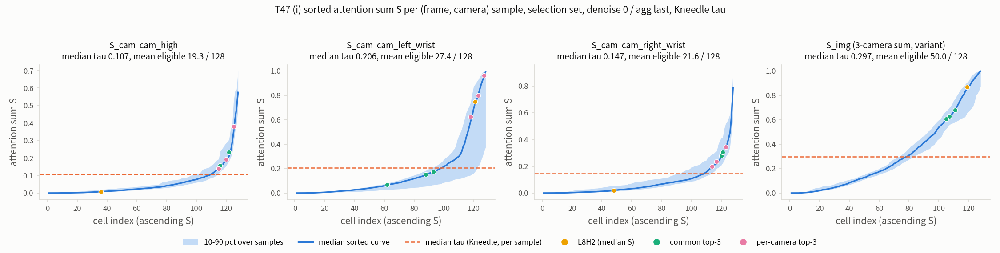

[`t47-sorted-S-tau.png`](figures/t47/t47-sorted-S-tau.png) — camera 별 정렬 `S_cam` 곡선과 knee τ (논문 Fig.3 대응). 3 camera 각각 200 sample, d0 · last.

| camera | τ (Kneedle) 평균 | τ 중앙 | eligible cell 평균 (/128) | knee 찾음 비율 |
|---|---:|---:|---:|---:|
| cam_high | 0.1106 | 0.1071 | 19.285 | 1.0 |
| cam_left_wrist | 0.1937 | 0.2062 | 27.43 | 1.0 |
| cam_right_wrist | 0.1492 | 0.1466 | 21.565 | 1.0 |
| (variant) 전체 `S_img` 기준 | 0.2847 | 0.2967 | 50.0 | 1.0 |

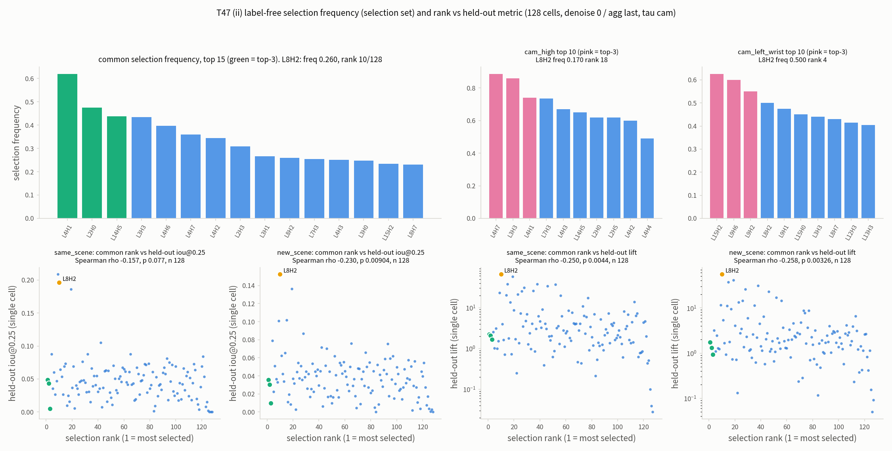

[`t47-selection-frequency-rank.png`](figures/t47/t47-selection-frequency-rank.png) — 공통 selection frequency 상위 cell 과 camera 별 상위 10 (논문 Fig.6 대응).

| 순위 | cell | 공통 selection frequency (600 sample = 200 frame × 3 camera) |
|---:|---|---:|
| 1 | **L4H1** | 0.6183 |
| 2 | **L2H0** | 0.4750 |
| 3 | **L14H5** | 0.4383 |
| 4 | L3H3 | 0.4333 |
| 5 | L4H6 | 0.3967 |
| 6 | L4H7 | 0.3600 |
| 7 | L4H2 | 0.3450 |
| 8 | L2H3 | 0.3083 |
| 9 | L3H1 | 0.2667 |
| 10 | **L8H2** | 0.2600 |

- 공통 top-3 (primary) = **L4H1 · L2H0 · L14H5**. 후보가 하나도 없는 sample 은 0 개. L8H2 의 공통 순위는 10 (0.26).
- camera 별 top-3: `cam_high` = L4H7 · L3H3 · L4H1 (L8H2 순위 18, 0.17), `cam_left_wrist` = L15H2 · L9H6 · L9H2 (L8H2 순위 4, 0.50), `cam_right_wrist` = L4H1 · L4H6 · L2H3 (L8H2 순위 19, 0.11).
- **selection 의 안정성.** record 하나를 빼고 다시 고른 (leave-one-record-out) 공통 top-3 가 전체 top-3 와 같은 집합인 횟수는 d0 · last 에서 **0 / 3** (각각 2 개만 겹침). agg 변형은 d0 · mean 3 / 3 (공통 top-3 = L4H2 · L4H1 · L2H0), d0 · first 1 / 3 (L4H1 · L2H0 · L5H2).
- τ 정의를 curvature 로 바꾸면 공통 top-3 = L4H1 · L14H5 · L3H3. 전체 `S_img` 기준 (exploratory) 의 공통 top-3 = **L4H1 · L4H6 · L8H2** (L8H2 포함).
- (산출) 같은 계산을 denoise 4 · 9 에도 해 두었고 (`selection` 의 9 setting) 공통 top-3 가 setting 마다 달랐다. 예: d4 · last = L4H1 · L14H5 · L4H6, d9 · last = L3H3 · L14H5 · L13H3.

**GT-oracle (상한 참고용, 채택 후보 아님).** selection record 의 GT 로 `peak_on_target` (3 camera pooled) 순위를 매긴 d0 · last 의 top-1 = L8H3, **top-3 = L8H3 · L10H7 · L12H4**. 이 세 head 는 L8H2 가 아니고, 공통 top-3 와도 겹치지 않는다.

#### 5-2. 2D 검증 (held-out) — 무엇에 모였나

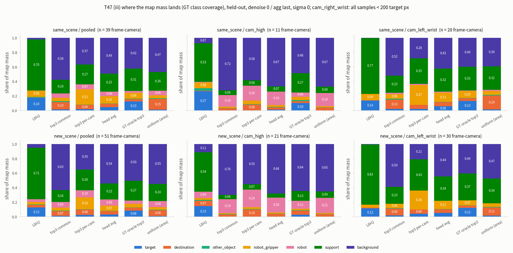

[`t47-class-mass.png`](figures/t47/t47-class-mass.png) — source 별 attention 질량의 class 분해 stacked bar (same-scene / new-scene × pooled / camera 별). **이 그림은 σ=0 으로 만들었다** (sidecar `sigma: 0`).

held-out 2D pooled (90 sample), d0 · last, `target_mass` · `lift` · `peak_on_target` · IoU@0.5 · IoU@0.25 (`T47.verify.json` `validate_2d`):

| source | target mass | lift | peak_on_target | IoU@0.5 | IoU@0.25 |
|---|---:|---:|---:|---:|---:|
| **L8H2 (서빙)** | **0.1498** | **59.60** | 0.689 | 0.091 | 0.173 |
| 공통 top-3, σ=1 (**primary**) | 0.0134 | 1.19 | 0.111 | 0.041 | 0.039 |
| 공통 top-3, σ=0 | 0.0143 | 1.44 | 0.022 | 0.041 | 0.048 |
| camera 별 top-3, σ=0 | 0.0225 | 4.06 | 0.011 | 0.024 | 0.035 |
| camera 별 top-3, σ=1 | 0.0260 | 3.04 | 0.089 | 0.039 | 0.046 |
| head-average (L2–17, σ=0) | 0.0400 | 6.25 | 0.322 | 0.039 | 0.046 |
| uniform (면적) | 0.0112 | 1.00 | 0.000 | 0.000 | 0.000 |
| GT-oracle top-3, σ=0 | 0.1021 | 22.78 | 0.878 | 0.050 | 0.062 |
| (exploratory) 전체 `S_img` 기준 공통 top-3, σ=1, k=3 | 0.0696 | 8.41 | 0.411 | 0.080 | 0.088 |

- 공통 top-3 (σ=1) 의 target mass 는 same-scene 0.0155 · new-scene 0.0118 이다 (pooled sample 기준). uniform 의 0.0112 에 가깝다.
- class 분해 (pooled, `class_mass`): L8H2 = target 0.150 · **support 0.705** · robot_gripper 0.056 · destination 0.021. 공통 top-3 (σ=1) = target 0.013 · destination 0.084 · robot_gripper 0.042 · robot 0.066 · support 0.179 · **background 0.609**. camera 별 top-3 (σ=0) = target 0.022 · **robot_gripper 0.184** · background 0.357. 즉 선택된 공통 top-3 는 gripper 나 목적지보다 **background 에** 질량이 갔고, camera 별 top-3 는 gripper 에 질량이 상대적으로 많이 갔다. (L8H2 의 질량이 support 에 0.705 있다는 점은 측정된 사실이다; 그 의미는 이 STEP 이 분석하지 않았다.)
- **rank 가 held-out 지표를 얼마나 예측하나** (Spearman ρ, 128 cell, selection frequency 대 held-out pooled, 공통 head set, `cam` τ, d0 · last, all held-out): `lift` ρ 0.233 (p 0.0081), `peak_on_target` 0.345 (p 0.0001), `target_mass` 0.210 (p 0.0174), IoU@0.5 0.142 (p 0.111), IoU@0.25 0.169 (p 0.0566). same-scene 과 new-scene 으로 가르면 `lift` 0.231 / 0.237, IoU@0.5 0.086 (p 0.336) / 0.202 (p 0.0225). 양의 상관이 있으나 약하다. 다중비교 보정은 하지 않았다.

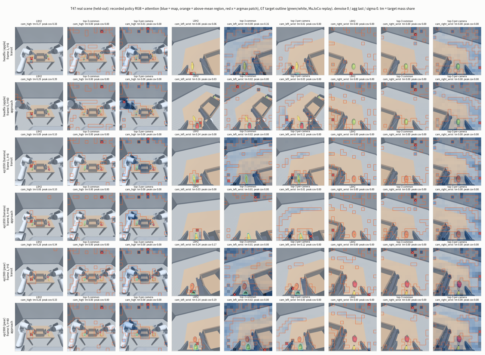

[`t47-scene-overlay.png`](figures/t47/t47-scene-overlay.png) — held-out frame (`headfix` frame 1 · 5, `ep1850` frame 1 · 6, `ep1900` frame 1 · 5; transit 과 approach) 의 camera 3 대 RGB 위에 L8H2 · 공통 top-3 · camera 별 top-3 와 GT target 윤곽을 겹친 실제 scene (σ=0). 예: `headfix` frame 1 `cam_high` 에서 L8H2 의 target mass 는 0.2712, 공통 top-3 는 0.0041.

#### 5-3. 3D end-to-end (held-out, σ=**0**) — T47 의 e2e 는 사전 고정과 다른 σ 로 돌았다

**편차 기록.** T47 의 e2e 와 위 class mass figure 는 σ=0 으로 돌았다 (`summary__heldout.json` `args.sigma = 0`, T47 CLI 기본값). 사전 고정 primary 는 σ=1 이었다. 이 편차는 lead 가 T47b.impl.md 확인 후 발견했고 σ=1 은 T47b 가 다시 쟀다 (§6). 아래 표는 **σ=0** 이다. 2D 의 `validate_2d` 는 σ=0, 1 둘 다 있다 (§5-2 표).

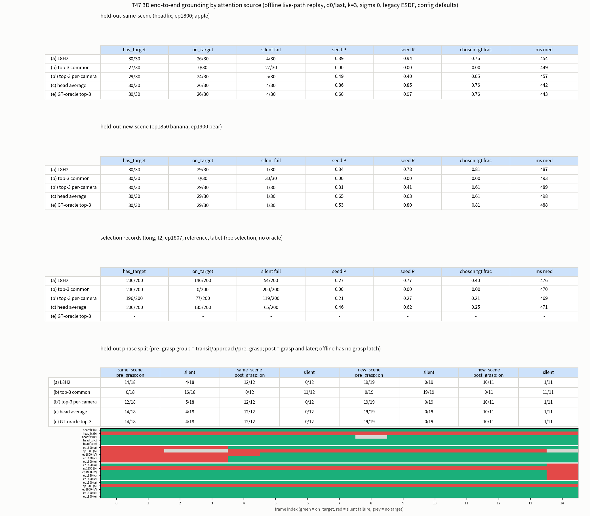

[`t47-e2e-table.png`](figures/t47/t47-e2e-table.png) — source × 지표 표 (σ=0).

| source (σ=0) | scene (n=30) | has_target | **on_target** | silent failure | seed precision | seed recall | chosen target 점 비율 |
|---|---|---:|---:|---:|---:|---:|---:|
| **L8H2** | same | 30 | **26** | 4 | 0.393 | 0.943 | 0.761 |
| | new | 30 | **29** | 1 | 0.339 | 0.785 | 0.808 |
| 공통 top-3 | same | 27 | **0** | 27 | 0.004 | 0.002 | 0.000 |
| | new | 30 | **0** | 30 | 0.000 | 0.000 | 0.000 |
| camera 별 top-3 | same | 29 | 24 | 5 | 0.490 | 0.405 | 0.650 |
| | new | 30 | 29 | 1 | 0.315 | 0.410 | 0.608 |
| head-average | same | 30 | 26 | 4 | 0.859 | 0.850 | 0.761 |
| | new | 30 | 29 | 1 | 0.653 | 0.631 | 0.608 |
| GT-oracle top-3 | same | 30 | 26 | 4 | 0.595 | 0.972 | 0.762 |
| | new | 30 | 29 | 1 | 0.529 | 0.802 | 0.808 |

- held-out 전체 (60 frame) `on_target`: L8H2 **55**, 공통 top-3 **0**, camera 별 53, head-average 55, GT-oracle 55. silent failure 는 5 · 57 · 6 · 5 · 5.
- **record 별 `on_target` (15 frame 중, held-out)**: L8H2 · head-average = ep1800 11 · ep1850 14 · ep1900 15 · headfix 15. camera 별 = 10 · 14 · 15 · 14. 공통 top-3 = 전부 0.
- L8H2 · head-average · GT-oracle 가 `on_target` 에서 같은 값인 것은 4 개 record 가 pilot 이라 변별력이 작다는 뜻이다 (record 단위 4 개). 차이가 나는 곳은 **seed precision / recall** 이다: held-out 전체에서 head-average 는 precision 0.756 · recall 0.740, L8H2 는 0.366 · 0.864 (`by_source.*.all_heldout`).
- phase: L8H2 same-scene 은 pre-grasp 14 / 18 · post-grasp 12 / 12, new-scene 은 19 / 19 · 10 / 11.
- **selection record 3D (200 frame, 참고값, GT-oracle 제외)** `on_target`: L8H2 146 (silent 54: pre-grasp 4 · post-grasp 50), 공통 top-3 **0** (silent 200), camera 별 77 (silent 119), head-average 135 (silent 65). 파지 후 frame (136) 에서 L8H2 86 · head-average 75 · camera 별 19 이다. offline e2e 에 grasp latch 가 없다는 점 (§4) 을 함께 읽는다.

**이 STEP 의 답 (사용자 판정, pilot 규모).** label-free 기준 (attention sum + spatial entropy, k=3 고정 합산) 은 action-token query 에서 target head 를 고르지 못했다. 사전 고정 primary 는 target mass 가 uniform 수준이고 3D `on_target` 이 0 이다. head 교체 (L8H2 → 다른 head) 는 하지 않는다.

### 6. T47b — σ=1 로 primary 를 다시 쟀다 (정식 값)

lead 보정 (§1 #7): T47b verifier 가 **공통 top-3 (raw 합) 를 σ=1 로 2D · 3D 다시 쟀다.** 이 값이 T47 primary 의 정식 값이고 σ=0 값과 나란히 둔다. L8H2 와 head-average 도 같은 σ 두 값으로 낸다. 검증으로 T47b 의 `--sigma 0` 실행이 T47 의 5 source × 60 frame 을 모든 필드에서 재현했다 (parity 60 / 60 × 5; 독립 재계산도 일치).

| source | σ | 2D target mass | 2D lift | 2D peak | IoU@0.5 | IoU@0.25 | 3D 같은 scene on / has / silent (n=30) | 3D new-scene on / has / silent (n=30) |
|---|---|---:|---:|---:|---:|---:|---|---|
| 공통 top-3 (primary) | **1** | 0.0134 | 1.19 | 0.111 | 0.041 | 0.039 | **0** / 8 / 8 | **0** / 28 / 28 |
| | 0 | 0.0143 | 1.44 | 0.022 | 0.041 | 0.048 | 0 / 27 / 27 | 0 / 30 / 30 |
| L8H2 | σ 없음 (서빙 raw cell) | 0.1498 | 59.60 | 0.689 | 0.091 | 0.173 | 26 / 30 / 4 | 29 / 30 / 1 |
| | 1 | 0.1015 | 20.07 | 0.722 | 0.076 | 0.094 | 26 / 30 / 4 | 29 / 30 / 1 |
| head-average | 1 | 0.0331 | 3.61 | 0.378 | 0.048 | 0.050 | 26 / 30 / 4 | 29 / 30 / 1 |
| | 0 | 0.0400 | 6.25 | 0.322 | 0.039 | 0.046 | 26 / 30 / 4 | 29 / 30 / 1 |

- 공통 top-3 의 `on_target` 은 σ=1 · σ=0 모두 **0** 이다. σ=1 에서는 has_target 자체가 줄었다 (same-scene 8 / 30; σ=0 에서는 27 / 30) — 그 이유는 측정하지 않았다.
- 같은 L8H2 에 σ=1 을 걸면 2D lift 59.60 → 20.07, 3D `on_target` 은 같지만 `identity_correct` 가 same-scene 26 → 23, new-scene 28 → 26 으로 줄었다 (§8).
- (T47b 의 `l8h2` 는 CLI 에서 언제나 unsmoothed cell 이다. σ=1 L8H2 는 verifier 가 `combine_heads(block, [(8, 2)], 1, raw_sum)` 로 같은 `run_b2_record` 경로에서 따로 돌렸고, σ=0 에서 CLI l8h2 row 를 `ep1850` 15 / 15 로 재현함으로 대조했다.)

### 7. T47b #5 — sink 진단: 선택된 head 가 어떤 head 인가

사용자 판정으로 정식 기록한다. 128 cell × camera 3 대 마다 d0 · last, 7 record 전 260 frame 에서 다섯 수치를 쟀다. 용어: **fixed-patch sink** = 입력이 바뀌어도 늘 같은 patch 에 질량이 몰리는 head. **broad single blob** = 질량이 넓게 퍼져 있어 평균 위 pixel 이 큰 한 덩어리를 이루는 head.

| | 정의 (frame 평균) |
|---|---|
| (a) `modal_fraction` | frame 별 argmax patch 중 가장 흔한 patch 의 frame 비율 |
| (b) `top1_share` | top-1 patch 값 ÷ `S_cam` |
| (c) component | 평균 binarize 후 8-connectivity component 수, 최대 component ÷ 256 (grid) |
| (d) entropy | spatial entropy (nats) |
| (e) `S_cam` | camera 질량 |

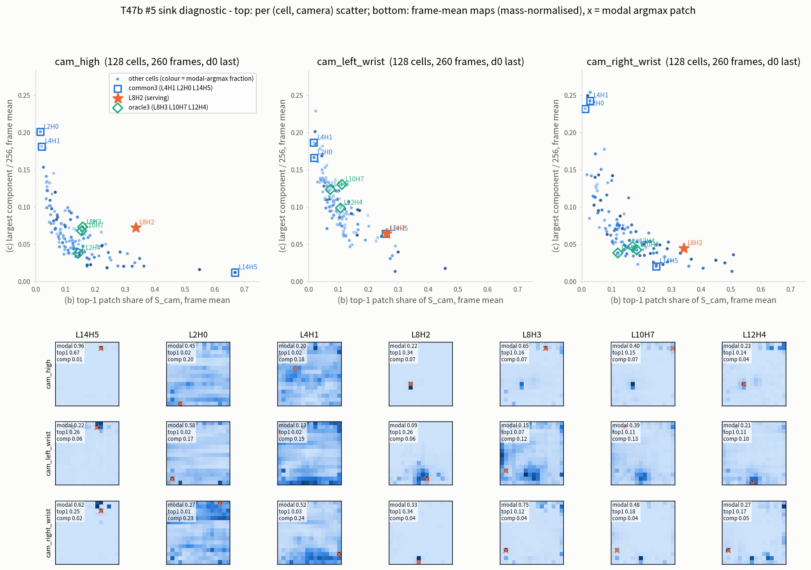

[`t47b-sink-scatter.png`](figures/t47/t47b-sink-scatter.png) — 위: camera 별 (b) top-1 patch 몫 대 (c) 최대 component 의 grid 몫 scatter (cell 마다 한 점, 공통 top-3 · L8H2 · oracle top-3 강조). 아래: 대표 head 의 frame 평균 map (x = 최빈 argmax patch).

선택된 head 와 비교 head 의 값 (`T47b.verify.json` `m5_sink.marked_cells`):

| cell | camera | (a) modal fraction | 최빈 patch (r, c) | (b) top-1 몫 | (c) 최대 component / 256 | (d) entropy | (e) `S_cam` | descriptive label |
|---|---|---:|---|---:|---:|---:|---:|---|
| L4H1 | cam_high | 0.200 | (6, 4) | 0.0203 | 0.181 | 1.425 | 0.137 | broad_single_blob |
| L4H1 | cam_left_wrist | 0.135 | (3, 0) | 0.0174 | 0.186 | 1.434 | 0.149 | broad_single_blob |
| L4H1 | cam_right_wrist | 0.515 | (13, 15) | 0.0279 | 0.243 | 0.989 | 0.344 | broad_single_blob |
| L2H0 | cam_high | 0.454 | (15, 3) | 0.0164 | 0.201 | 1.464 | 0.156 | broad_single_blob |
| L2H0 | cam_left_wrist | 0.585 | (14, 1) | 0.0184 | 0.166 | 1.706 | 0.174 | broad_single_blob |
| L2H0 | cam_right_wrist | 0.269 | (0, 13) | 0.0121 | 0.232 | 1.338 | 0.281 | broad_single_blob |
| **L14H5** | **cam_high** | **0.958** | **(1, 11)** | **0.669** | 0.012 | 1.486 | 0.245 | **fixed_patch_sink** |
| L14H5 | cam_left_wrist | 0.223 | (1, 10) | 0.259 | 0.064 | 1.636 | 0.105 | other |
| L14H5 | cam_right_wrist | 0.623 | (2, 11) | 0.250 | 0.020 | 1.358 | 0.329 | other |
| L8H2 (서빙) | cam_high | 0.215 | (10, 5) | 0.336 | 0.072 | 0.918 | 0.068 | other |
| L8H2 | cam_left_wrist | 0.092 | (14, 9) | 0.262 | 0.064 | 0.773 | 0.631 | other |
| L8H2 | cam_right_wrist | 0.331 | (15, 7) | 0.343 | 0.045 | 1.787 | 0.077 | other |

- **L14H5 `cam_high`** 는 frame 의 95.8 % 가 같은 patch (r1, c11) 에서 최대이고 top-1 patch 가 camera 질량의 0.669 를 가진다 (lead 의 빠른 점검 — 최빈 patch 96 %, top-1 0.67 — 을 verifier 가 독립 재계산으로 확인했고, 독립 재계산은 7 수치 모두 최대 절대차 0, 최빈 patch 384 / 384 일치).
- **L4H1 · L2H0** 는 세 camera 모두 top-1 patch 몫이 0.012 – 0.028 로 낮고, 최대 component 가 grid 의 0.166 – 0.243 을 차지한다 — 질량이 넓게 퍼진 한 덩어리다.
- oracle top-3 (L8H3 · L10H7 · L12H4) 는 세 head × 세 camera 모두 `other` (sink 도 broad blob 도 아님). L8H2 도 `other` 이고 그 (b) top-1 몫이 0.26 – 0.34 로 공통 top-3 의 L4H1 · L2H0 보다 크다.
- descriptive label 의 threshold (sink: modal ≥ 0.8 ∧ top-1 ≥ 0.3, blob: 최대 component ≥ grid 의 0.15) 는 implementer 가 읽기용으로 정했다. **무엇을 고르는 데도 쓰지 않았다.**
- 128 cell 의 camera 별 분포: modal fraction ≥ 0.8 인 cell 이 `cam_high` 12 · `cam_left_wrist` 12 · `cam_right_wrist` 23 개다. 값이 0 인 map (frame × cell × camera) 은 99,840 중 1,389 개.
- (미측정 해석) 두 기준 (attention sum, spatial entropy) 이 이 두 종류를 뽑는 이유는 측정하지 않았다. 측정된 것은 공통 top-3 가 "sink 1 + broad blob 2" 라는 사실과 그 head 들의 target mass 가 uniform 수준이라는 사실 (§5-2) 이다.

### 8. T47b B1 · B2 — 합산 방식과 label 기반 3D 지표

**B1 (합산 방식, σ=1, k=3, d0 · last).** 같은 head set 의 세 합산 — `raw_sum` (논문 합, T47 과 bit 단위 동일), `mass_norm_joint` (head 마다 3 camera 768 token 질량으로 나눔 — camera 간 비율 보존), `mass_norm_per_camera` (head · camera 마다 질량으로 나눔 — camera 간 비율 소멸) — 을 oracle top-3 (`mass_norm_joint` 의 사전 선언 secondary 가 이쪽으로 옮겨짐, 사용자 판정 §1 #6) · camera 별 top-3 · head-average 에 적용했다. 공통 top-3 는 `raw_sum` 1 줄만 둔다.

**B2 (label 기반 3D 지표).** chosen cluster = `ConstraintSet.target.point_indices` (indices 가 이 cloud 를 가리키지 않으면 5 mm proximity 로 대신). 점마다 GT label 은 세 camera GT depth 점 중 3 mm 안 최근접 점의 label (T47 e2e 의 labeller).

| 지표 | 정의 |
|---|---|
| **`identity_correct`** | chosen cluster 의 label 이 있는 점 중 **엄격히 가장 많은 class 가 target** 인가 (동점이면 거짓). centroid 가 아니라 label 을 본다 |
| `identity_failure` | `has_target ∧ ¬identity_correct` (silent failure 의 label 판) |
| `on_target_not_identity` | `on_target` 이 참인데 `identity_correct` 가 거짓인 frame 수 |
| **`nontarget_seed_loss`** | chosen cluster 에 든 GT non-target 점 수 (other_object · destination · robot · table …). T44 의 "distractor seed loss" 와 **같은 정의가 아니다** (T44 는 TSDF seed voxel · voxel 다수결 label, T47b 는 cloud 점 · 최근접 depth 점 label — 숫자를 직접 비교하지 않는다, T47b.impl.md 대조표) |
| **`target_residual`** | GT target 의 관측 점 중 chosen cluster 에 못 든 수와 그 비율 |

(verify.json 의 `nontarget_seed_loss_sum` · `target_residual_*` 는 구현 주 지표 층 (chosen cluster) 의 값이고 seed 층은 `seedlayer_*` 로 따로 있다.)

#### 8-1. 합산 방식 × source (held-out 60 frame 전체)

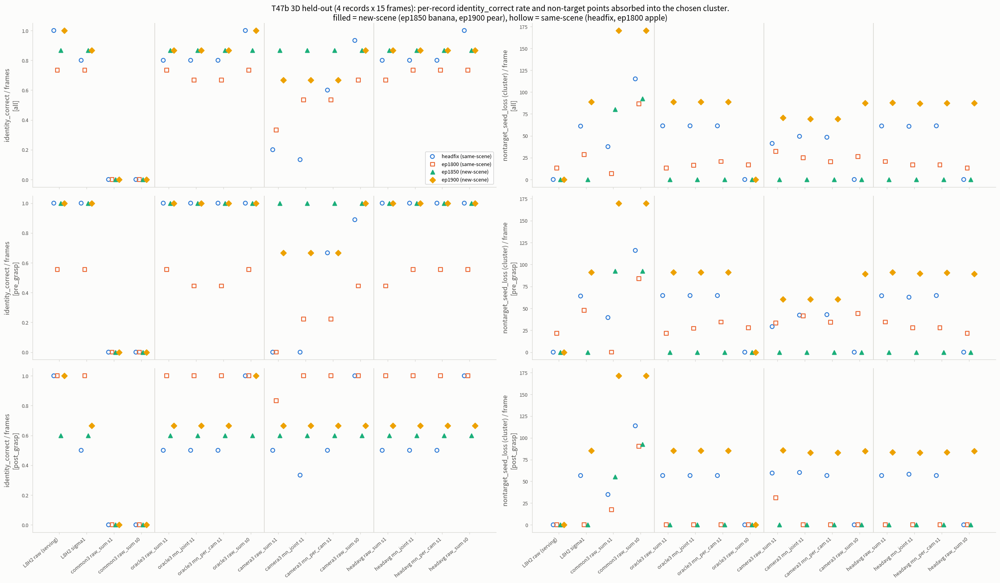

[`t47b-identity-nontarget.png`](figures/t47/t47b-identity-nontarget.png) — 왼쪽 열: record 별 `identity_correct` 비율, 오른쪽 열: record 별 chosen cluster 의 `nontarget_seed_loss` / frame. 행: 전체 · pre-grasp · post-grasp. 속이 빈 점 = same-scene (headfix · ep1800), 채운 점 = new-scene (ep1850 · ep1900). 한 점이 record 하나다 (frame 을 독립 trial 로 세지 않는다).

| source (σ) | has_target | **on_target** | **identity_correct** | silent failure | `on_target_not_identity` | non-target 점 (other_object / destination) | target 잔여 (잔여 ÷ 관측) |
|---|---:|---:|---:|---:|---:|---|---|
| **L8H2 (서빙, σ 없음)** | 60 | 55 | **54** | 5 | 1 | 195 (0 / 195) | 273 / 4609 = 0.0592 |
| L8H2, σ=1 | 60 | 55 | 49 | 5 | 6 | 2,678 (2,678 / 0) | 233 / 4609 = 0.0506 |
| 공통 top-3, σ=1 (raw) | 36 | 0 | 0 | 36 | 0 | 4,427 (4,323 / 104) | 4609 / 4609 = 1.000 |
| 공통 top-3, σ=0 (raw) | 57 | 0 | 0 | 57 | 0 | 6,967 (6,967 / 0) | 1.000 |
| oracle top-3, σ=1 · `raw_sum` | 60 | 55 | 49 | 5 | 6 | 2,449 (2,254 / 195) | 227 / 4609 = 0.0493 |
| oracle top-3, σ=1 · `mass_norm_joint` | 60 | 54 | 48 | 6 | 6 | 2,498 (2,254 / 244) | 308 / 4609 = 0.0668 |
| oracle top-3, σ=1 · `mass_norm_per_camera` | 60 | 55 | 48 | 5 | 7 | 2,563 (2,563 / 0) | 286 / 4609 = 0.0621 |
| oracle top-3, σ=0 · `raw_sum` | 60 | 55 | 54 | 5 | 1 | 251 (251 / 0) | 271 / 4609 = 0.0588 |
| camera 별 top-3, σ=1 · `raw_sum` | 47 | 41 | 31 | 6 | 10 | 2,162 (1,677 / 485) | 2046 / 4609 = 0.4439 |
| camera 별 top-3, σ=1 · `mass_norm_joint` | 52 | 46 | 33 | 6 | 13 | 2,155 (1,783 / 372) | 1995 / 4609 = 0.4328 |
| camera 별 top-3, σ=1 · `mass_norm_per_camera` | 52 | 47 | 40 | 5 | 7 | 2,074 (2,074 / 0) | 1214 / 4609 = 0.2634 |
| camera 별 top-3, σ=0 · `raw_sum` | 59 | 53 | 50 | 6 | 3 | 1,709 (1,313 / 396) | 525 / 4609 = 0.1139 |
| head-average, σ=1 · `raw_sum` | 60 | 55 | 48 | 5 | 7 | 2,547 (2,547 / 0) | 295 / 4609 = 0.0640 |
| head-average, σ=1 · `mass_norm_joint` | 60 | 55 | 49 | 5 | 6 | 2,470 (2,470 / 0) | 306 / 4609 = 0.0664 |
| head-average, σ=1 · `mass_norm_per_camera` | 60 | 55 | 49 | 5 | 6 | 2,487 (2,487 / 0) | 243 / 4609 = 0.0527 |
| head-average, σ=0 · `raw_sum` | 60 | 55 | 52 | 5 | 3 | 1,506 (1,311 / 195) | 331 / 4609 = 0.0718 |

(전부 `T47b.verify.json` `m3_m4_3d_heldout_full` `all|all` 의 합이다. 이 표의 모든 `identity_not_on_target` 은 0 이다.)

관찰된 사실:

- **합산 방식은 3D 결과를 거의 바꾸지 않는다.** oracle top-3 의 세 합산 사이에서 `on_target` 54 – 55, `identity_correct` 48 – 49, silent failure 5 – 6 이다. 2D 도 target mass 0.0603 – 0.0611, lift 8.74 – 8.92 로 같다. camera 별 top-3 의 `mass_norm_per_camera` 는 `identity_correct` 40 (raw 31) 으로 달랐으나 head-average 와 oracle 에서는 같은 방향의 개선이 없다.
- **합산 방식은 camera 선택은 바꾼다.** 같은 frame 에서 각 합산 방식의 "질량이 가장 큰 camera" 가 `raw_sum` 의 것과 같은 frame 비율 (record 별 최소 – 최대, σ=1): oracle top-3 의 `mass_norm_joint` 0.6 – 1.0, `mass_norm_per_camera` 0.133 – 0.733; camera 별 top-3 는 `mass_norm_joint` 1.0, `mass_norm_per_camera` 0.933 – 1.0; head-average 는 `mass_norm_joint` 0.267 – 0.6, `mass_norm_per_camera` 0 – 0.067. 즉 mass 정규화는 camera 선택을 실제로 바꾸지만 (특히 head-average), 이번 pilot 의 3D `on_target` · `identity_correct` 는 그에 따라 달라지지 않았다.
- head 하나가 `raw_sum` 을 지배하는 정도 (dominance 평균, record 별): 공통 top-3 0.357 – 0.378 (`headfix` 에서 세 head 의 합 몫 0.337 · 0.334 · 0.330), oracle top-3 0.437 – 0.464 (`headfix` 에서 head 별 몫 0.414 · 0.194 · 0.392). 질량이 0 인 head 는 없었다.
- **σ=1 smoothing 은 이웃 과일 흡수를 늘린다.** L8H2: `identity_correct` 54 → 49, other_object 점 0 → 2,678. oracle top-3: 54 → 49 (`raw_sum`), other_object 251 → 2,254. head-average: 52 → 48, other_object 1,311 → 2,547. 이 σ 의 효과는 사전 고정 primary 가 σ=1 이었다는 사실과 별개로 측정된 것이다 (primary 는 어느 σ 에서도 `on_target` 0 이다).
- (미측정 해석) σ=1 이 cluster 를 넓히는 경로 (smoothing 이 seed 를 이웃 과일 쪽으로 번지게 하는지) 는 이 STEP 이 분리해서 재지 않았다.

#### 8-2. `on_target` 은 참이고 `identity_correct` 는 거짓인 frame

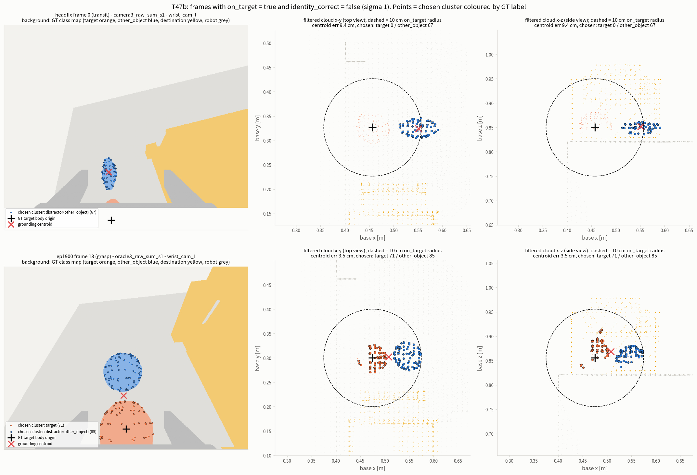

[`t47b-scene-identity.png`](figures/t47/t47b-scene-identity.png) — chosen cluster 의 점을 GT label 색으로 그린 실제 scene (왼쪽: wrist camera 의 GT class map 위 투영, 가운데: filtered cloud top view, 오른쪽: side view, 점선 = 10 cm `on_target` 반경). 두 사례 (σ=1):

| 사례 | centroid 오차 | chosen cluster (target / other_object) | 무엇이 보이나 |
|---|---:|---|---|
| `headfix` frame 0 (transit) · camera 별 top-3 · `raw_sum` | 0.094 m | **0 / 67** | cluster 가 전부 이웃 과일인데 centroid 가 target 원점 10 cm 안에 들어 `on_target` 이 참 |
| `ep1900` frame 13 (grasp) · oracle top-3 · `raw_sum` | 0.035 m | 71 / 85 | target 점도 있으나 이웃 과일 점이 더 많아 plurality 가 other_object |

(두 사례는 verifier 가 `on_target ∧ ¬identity_correct` frame 목록에서 고른 것이다. 목록의 범주는 `chosen_n=0` (`ep1850` frame 13 grasp, proximity 로 cloud 점 0 개) 과 "cluster plurality 가 other_object" 두 가지다.)

**`on_target` 과 `identity_correct` 가 갈린다.** `on_target_not_identity` 는 L8H2 σ=1 6 · oracle top-3 σ=1 6 – 7 · camera 별 top-3 σ=1 7 – 13 · head-average σ=1 6 – 7 (60 frame 기준) 이고, 그 반대 방향 (`identity_not_on_target`) 은 모든 source 에서 0 이다. centroid 10 cm 기준은 이웃 과일 오분리를 놓친다 (lead 의 가설 — 10 cm centroid 만으로 작은 이웃 과일 오분리를 가릴 수 없다 — 이 이번 pilot 에서 수치로 확인됐다).

### 9. T47b B3 — raw amplitude 에 절대값 threshold 가 있는가

attention 이 lifting 에서 grounding 까지 가는 경로에서 raw (정규화 전) 값을 읽는 곳을 file:line 으로 점검했다 (24 지점, `moved_or_missing` 0 — T46 이 줄을 옮기지 않았다).

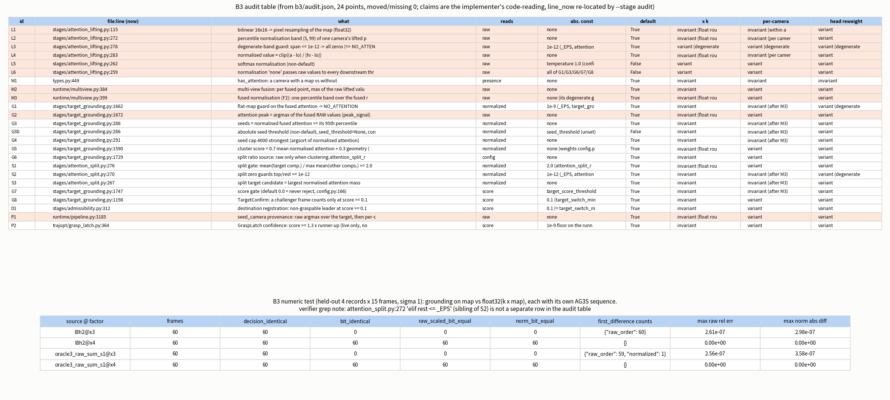

[`t47b-b3-audit-table.png`](figures/t47/t47b-b3-audit-table.png) — 24 지점 × (file:line · 읽는 값 · 절대 상수 · default 여부 · ×k · camera 별 · head 재가중 · 수치 시험).

- **raw 를 읽는 지점은 10 곳이다** (L1 · L2 · L3 · L4 · L5 · L6 · M2 · M3 · G2 · P1; M2 = `multiview.py:384` camera 간 raw max fusion, G2 = `target_grounding.py:1672` raw argmax peak). 그중 **default 로 켜진 절대 상수는 L3 하나**다 — `attention_lifting.py:278`, percentile 폭 `hi − lo ≤ 1e-12` (`_EPS`, `:33`), 상수 map 만 걸리는 degenerate guard. L5 (softmax temperature 1.0) 와 L6 (`normalization == "none"`) 은 default off 다.
- **절대 threshold 가 정규화된 값 · score 에 걸린 곳**: `target_switch_min_score` 0.1 (G8 `target_grounding.py:1198`, D1 `admissibility.py:312`), split ratio 2.0 (S1, 비율). 이들은 ×k 에 불변이지만 head 재가중으로 정규화 분포의 모양이 바뀌면 score 수준이 움직여 threshold 통과 여부가 달라질 수 있다 (`head 재가중` 열 = variant). **head set 을 바꿀 때 다시 볼 곳이다.**
- camera 간 상대 크기는 M2 → (M3, G2) 로 들어간다 — 그래서 `mass_norm_per_camera` 처럼 camera 간 비율을 바꾸는 합산은 camera 선택을 바꾼다 (§8-1 의 camera 선택 일치 비율).
- verifier 가 점검표에 없는 지점을 하나 더 찾았다: `attention_split.py:272` `elif rest <= _EPS` (별도 행으로 올리지 않음).

**수치 시험 (B3 numeric).** held-out 60 frame × source 2 (L8H2 · oracle top-3 σ=1 `raw_sum`), 같은 frame 에 attention 을 ×k 하고 grounding 출력을 비교:

| source · 배율 | frame | `decision_identical` | `bit_identical` | 처음 달라진 지점 |
|---|---:|---:|---:|---|
| L8H2 ×4 | 60 | **60** | **60** | — |
| L8H2 ×3 | 60 | **60** | 0 | `raw_order` 60 |
| oracle top-3 ×4 | 60 | **60** | **60** | — |
| oracle top-3 ×3 | 60 | **60** | 0 | `raw_order` 59 · `normalized` 1 |

- `decision_identical` = cloud · seed · peak · cluster 분할 · split 사유 · status · chosen 이 같음. `bit_identical` = 그에 더해 raw 를 `float32(k·raw)` 와 비교한 값 · 정규화 값 · score · centroid 가 bit 단위로 같음. ×4 는 float 에서 정확한 대조군 (2 의 거듭제곱) 이라 bit-identical 이어야 한다 — **60 / 60 으로 확인됐다.** ×3 은 decision 이 60 / 60 같다.
- (측정 사실 그대로) ×3 의 `bit_identical` 이 0 / 60 인데 `max_raw_rel_err` · `max_norm_abs_diff` 는 0.0 으로 기록돼 있다. 두 값이 어떻게 함께 나오는지는 verify.json 의 요약만으로는 알 수 없어 해석하지 않는다 (`first_difference` 가 `raw_order` 로 잡힌 것은 raw 값 비교의 첫 차이라는 뜻이다).
- 이 수치 시험은 **L8H2 와 oracle top-3 σ=1 에서만** 돌았다 (다른 source 는 미측정).

### 10. 측정의 한계

| 항목 | 내용 |
|---|---|
| held-out 은 pilot | 4 record (60 frame, 같은 scene 2 + 새 scene 2). same-scene 2 record 는 selection 의 `long` · `t2` 와 같은 episode (1800) 에서 출발한다. 새 scene 은 banana 1 · pear 1 뿐이다. frame 을 독립 trial 로 세지 않았으나 record 가 4 개라 record 단위 통계도 약하다 |
| 일부 camera · 일부 지표 | held-out 의 `cam_right_wrist` 는 target ≥ 200 px 가 0 frame 이라 2D 에서 제외, `ep1800` 의 `cam_high` 는 15 / 15 제외. 3D fusion 은 세 camera 를 모두 쓴다 |
| σ 편차 | T47 의 e2e 와 class mass figure 는 σ=0 (사전 고정은 σ=1). σ=1 은 T47b 가 2D · 3D 로 재측정 (§6). T47 의 σ=0 3D 값과 T47b 의 σ=1 값은 같은 표에 섞지 않았다 |
| grasp latch 없음 | offline e2e 에 TargetConfirm freeze · `GraspLatch` 가 없다. post-grasp frame 의 실패 수는 서빙 성능이 아니다 (selection record 3D 의 post-grasp 실패 50 / 136 등) |
| legacy ESDF | e2e 는 CPU legacy ESDF 다. `ball` 층 지표는 사후 계산이고 (`verify.json not_measured`) record 별로만 보고했다 |
| attention source | 별도 checkpoint 사본 · noise seed 0. 서빙 action 을 낸 forward 의 attention 이 아니다 |
| 미측정 | T47: `cam_right_wrist` · `ep1800 cam_high` 2D, grasp latch e2e, cuRobo ESDF e2e, selection record 에서 GT-oracle, `S_img` variant 의 e2e, d0 · last 밖 setting 과 σ=1 의 e2e. T47b: cuRobo 기준선, T47b source 의 selection record 3D, B3 수치 시험의 다른 source |
| p 값 | Spearman p 는 다중비교 보정 없음. 128 cell 은 독립이 아니다 (같은 layer 의 head 들) — 이 의존성은 측정하지 않았다 |
| 회귀 기준선 | legacy 일치 (T47 · T47b 모두). cuRobo 변형은 돌리지 않았다 |
| 논문 수치 | 논문의 점수 (cIoU 등) 는 이 로그가 측정한 것이 아니라서 옮기지 않았고, 우리 pilot 의 숫자와 직접 비교하지 않는다 |

### 11. 사용자 판정 · 되돌아올 지점 · 산출물

**사용자 판정 (2026-10-12, T47 verify.json 확인 후).**

- **L8H2 유지.** 사전 고정 primary (공통 top-3 = L4H1 · L2H0 · L14H5) 는 held-out 에서 target mass 0.012 – 0.017, 3D `on_target` 0 / 30 (same-scene · new-scene 모두, σ=0) 로 L8H2 (26 / 30 · 29 / 30) 보다 나빴다 → 채택하지 않는다. 서빙 cell 은 바꾸지 않는다 (`AG3S/trajopt/attention_policy.py` 무수정).
- 후속: (1) 실패 원인 (고정 patch sink · 넓게 퍼진 map 의 단일 성분) 의 정식 측정 → T47b #5 (이 절 §7), (2) 명사 token query (D) → `handoff/T49.task.md`.

**되돌아올 지점 (task 문서의 전환 신호와 측정 결과).**

| 신호 | 측정 결과 | 다음 |
|---|---|---|
| 선택된 head 가 gripper · 목적지에 모이면 label-free 기준만으로는 못 고른다 → (i) GT 지표를 섞는 supervised 선택 (sim 한정) 또는 (ii) 명사 token query | 공통 top-3 는 gripper · 목적지가 아니라 background 에 모였고 (§5-2) sink 1 + broad blob 2 였다 (§7). camera 별 top-3 는 gripper 몫이 상대적으로 컸다 | (ii) 는 T49 로 진행 중. (i) 는 이 STEP 에서 하지 않았다 |
| 2D 는 좋아지는데 3D 가 그대로면 병목은 head 가 아니라 3D 쪽 | 2D 가 좋아진 source 가 없다 (target mass · lift 는 L8H2 가 가장 높다). 3D 병목 후보로는 σ=1 의 이웃 과일 흡수 (§8-1) 가 측정됐다 | head 교체 보류 |
| held-out 이 작아 차이가 frame 몇 개 수준이면 record 추가를 제안 | L8H2 · head-average · oracle 이 `on_target` 에서 구분되지 않는다 (§5-3). 구분되는 지표는 seed precision / recall · `identity_correct` | record 를 늘리려면 GPU attention pass 가 필요하다 (사용자 승인 사항, 이 STEP 에서 하지 않음) |
| `identity_correct` 와 `on_target` 이 자주 갈리면 주 지표를 label 기반으로 바꾸는 것을 제안 | 갈린다 (§8-2, 60 frame 중 6 – 13 frame, 반대 방향 0) | **제안 (판정 대기):** 이후 grounding 평가의 주 지표에 `identity_correct` 를 함께 보고 |
| B3 에서 절대값 threshold 가 발견되면 head set 교체 전에 따로 판정 | default 경로의 raw 절대 상수는 degenerate guard 하나. score 에 걸린 0.1 은 head 재가중에 가변 (§9) | head set 을 바꾸는 STEP 에서 G8 · D1 의 0.1 을 다시 본다 |
| `mass_norm_joint` 가 `raw_sum` 보다 3D 에서 낫다면 합산 방식도 판정 대상 | 낫지 않았다 (§8-1) | 합산 방식은 판정 대상으로 올리지 않았다 |

**사용자 판정 대기.** 이 절 시점에 새로 사용자에게 물을 항목: (a) 이후 grounding 평가에서 `identity_correct` 를 주 지표 중 하나로 쓸 것인가 (위 표, 제안). 나머지 방향은 이미 판정됐다.

**산출물.**

- **측정**: `handoff/T47.verify.json` · `handoff/T47b.verify.json`. 원자료는 run 디렉터리 `/mnt/dev/AG3S_VLA-storage/results/development/20261012T141412+0900_bd778e5e3453_d7a51b456f36/verify/T47/` (gt_cache · select · validate · e2e) 와 `…/verify/T47b/` (check · sink · b2d · e2e · b3 · supp · indep).
- **figure** (각각 `.json` sidecar 있음): T47 [`scene`](figures/t47/t47-scene-overlay.png) · [`graph 1`](figures/t47/t47-sorted-S-tau.png) · [`graph 2`](figures/t47/t47-selection-frequency-rank.png) · [`graph 3`](figures/t47/t47-class-mass.png) · [`table`](figures/t47/t47-e2e-table.png), T47b [`scene`](figures/t47/t47b-scene-identity.png) · [`graph 1`](figures/t47/t47b-identity-nontarget.png) · [`graph 2`](figures/t47/t47b-sink-scatter.png) · [`table`](figures/t47/t47b-b3-audit-table.png). T47 figure 는 σ=0 (sidecar 의 `sigma`).
- **구현** (전부 새 파일, 기존 파일 무수정): `AG3S/ag3s/experiments/studies/t47_*.py` · `t47b_*.py`, `tests/ag3s/test_t47_head_selection.py` (45 passed) · `test_t47b_*.py` (33 passed). 문서: `handoff/T47.task.md` · `T47.impl.md` · `T47b.task.md` · `T47b.impl.md`.
- commit 은 하지 않았다.

---

## T48a — HSR counterfactual: phase probe 는 instruction · state 문자열 · image 가 바뀌면 어떻게 반응하는가 (2026-10-12 KST)

**이 절이 답하는 물음 (목적).** HSR (Hidden-state Sub-task Recognition) 은 얼린 pi0.5 의 prefix KV cache 에서 뽑은 feature `kv_L4` (layer 4 · **V** · KV head 0, 512 차원 = `[valid text token 평균 | image token 768 개 평균]`) 위에 logistic regression 하나 (`kv_L4_v1`) 를 얹어 지금 하는 일을 `pick` / `place` / `home` 으로 읽는 구성 요소다 (SUBTASK 절). 이 label 은 `TargetConfirm` 의 **subtask gate** 로 들어간다 — 확정 label 이 `place` · `home` 이면 새 target 채택을 막고, PLACED 뒤 `home` 이면 쥐고 있던 물체를 놓아 준다 (`T48.task.md` 가 가리키는 `target_grounding.py:945, 959-968, 1124-1135, 1204-1209`, `config.py:342-360` `subtask_gate=True`).

지금까지의 근거는 **weak decodability** (feature 에서 label 이 읽힌다) 하나였다. `paper/notes/SUBTASK_FACTS.md` §1 · §3 이 기록한 사실로, val accuracy 0.9808 이지만 **frame index 만으로도 val 1.000** (250 episode 중 248 이 같은 phase 순서의 scripted dataset) 이라 그 정확도가 *작업 상태* 를 읽은 것인지 *시간 · 팔 자세의 순서* 를 읽은 것인지 가를 수 없다. gripper 값을 가려도 0.9808 (mask (a)) 이고 단순 rule 은 0.9423 이었다. 다른 하나는 **strong decodability** (관련 입력이 바뀌면 올바르게 반응한다) 이다. 검토 문서 `doc/reviews/AG3S_TWO_PAPER_REVIEW_20261012_KO.md` §4 가 둘째 논문 (Bhardwaj et al., arXiv:2608.13474) 의 구분으로 가져온 것이고, 그 원문이 일반 probe 의 R² 0.95 에도 instruction target 을 바꾸면 출력이 거의 바뀌지 않았다고 보고한다고 적는다 (원문의 수치이며 이 로그가 측정한 것이 아니다). 여기에 우리 구성의 특수한 사정이 하나 더 있다 — **text 평균 안에 discretize 된 16D state 문자열 (gripper · joint 숫자) 이 들어 있어** probe 가 image 대신 state 문자열을 읽을 수 있다.

T48a 는 한 frame 의 입력 셋 (prompt · 16D state · RGB 3 장) 중 **하나만** 바꾼 변형 (counterfactual) 을 만들어 같은 probe 에 다시 넣고 예측이 어떻게 변하는지 잰다. rendering 이 필요 없고 (dataset 의 기록 frame 만 쓴다) GPU 는 offline prefix pass 에만 쓴다. empty grasp · slip (물체 없는 image 를 새로 만드는 것) 은 T48b 다.

**한 줄 결과 (before → after).**

- **before.** val accuracy 0.9808 (SUBTASK-b, 위 `SUBTASK_FACTS.md` 의 기록) 이고 frame-index baseline 도 1.000 이라 *무엇을 읽는지* 는 열려 있었다.
- **after — 측정된 사실 셋.** 아래 (a) (b) 는 이 STEP 이 처음 잰 것이고 (c) 는 **아직 정해지지 않았다**.
  - **(a) probe 의 예측은 image 를 따르고 state 문자열을 따르지 않았다.** image A + state B (C2s) 에서 예측 class 가 image 쪽인 비율 0.979 (2546/2601), state 쪽 0.012 (31/2601). image B + state A (C2i) 도 image 쪽 0.979 (2547/2601), state 쪽 0.013 (33/2601). used gripper 값 하나만 반대로 한 C2g 에서 예측이 C0 예측과 달라진 비율은 0.005 (14/2601). 완전 held-out ep1807 (75 frame, 1 episode) 도 같은 방향이다 (C2s image 쪽 72/75, C2i image 쪽 75/75, C2g 0/75). 같은 변형에서 simple rule 은 C2i 의 state 쪽이 0.942 (2451/2601) 이다.
  - **(b) probe 는 instruction 의 target 명사 교체에 거의 반응하지 않았다.** C1 (prompt 의 target 명사 → 같은 scene 의 distractor 과일) 에서 원래 place 인 frame 이 `pick` 으로 바뀐 비율 0.040 (95/2400), 원래 home 은 0/2403. 이 0.040 은 C0 (변형 없음) 에서 probe 가 이미 place → pick 으로 읽던 비율 32/800 = 0.040 (산출) 과 구분되지 않는다. 같은 target 에 phrasing 만 바꾼 C1p 에서는 예측이 5191/5202 (0.998) 유지된다. ep1807 에서도 place → pick 3/39, home → pick 0/129.
  - **(c) probe 가 "물체를 쥐고 있다" 는 작업 상태를 읽는지, "팔이 이 자세에 있다" 는 자세 순서를 읽는지는 이 측정으로 가려지지 않는다.** C2 의 image 이식은 같은 episode 의 다른 frame 의 image 를 통째로 옮기므로 image 안에 팔 자세와 물체 상태가 함께 따라온다. dataset 은 실패 · retry 가 없는 scripted 시연이라 둘이 항상 같이 움직인다. → **T48b** (같은 팔 자세에서 물체의 유무만 바꾼 image, 사용자 판정: 진행 — §9).
- **strong-rule proxy 는 실제 strong rule 이 아니다.** 비교에 쓴 proxy 는 실제 grasp latch (`grasp_latch.py`) 를 offline 으로 흉내 낸 것이고 (§3), 아래 표의 proxy 열을 "strong rule 과 비교한 결과" 로 읽지 않는다.
- **C0 재현.** 새로 뽑은 feature 의 val accuracy 0.9804 (2550/2601) 는 SUBTASK-b 의 0.9808 과 0.000385 차이로, 통과 기준 ±0.002 안이다 (§5-1).

**읽는 법과 출처 규약.**

- 수치는 `T48.verify.json` 의 `numbers` 에서만 왔다. 같은 파일 숫자의 덧셈 · 곱셈 · 비율은 "(산출)" 로 적었다. figure sidecar (`figures/t48/*.json`) 는 verify.json 이 같은 값을 갖고 있을 때만 옮겼다. `SUBTASK_FACTS.md` 와 검토 문서 (논문) 의 수치는 이 로그가 측정한 것이 아니므로 "이미 기록된 사실" 로 출처와 함께만 적었다.
- 해석의 출처를 가른다. 사용자 판정은 "(사용자 판정)", lead 가 task 문서에 쓴 것은 "(lead)", 측정으로 확인하지 않은 해석은 "(미측정 해석)" 으로 적었다.
- 시각은 KST. pod 의 `date` 는 UTC 이고 verify.json 의 UTC 필드에 +9 h 를 더했다.
- **frame 은 독립 trial 이 아니다.** val 은 50 episode × (stride 6 으로 뽑은) 약 52 frame 이다. 표는 frame 합산 (pooled k/n) 을 주로 적고, episode 단위 비율의 median · IQR 은 figure 표에 있다. 대부분의 값에서 episode median 이 pooled 와 같은 것은 episode 마다 비율이 거의 같기 때문이다 (예: probe C0 episode median 0.9808 = 51/52 (산출), IQR 폭 0).
- **환경.** GPU 는 offline feature 추출 한 번 (H200, `flock -n` 으로 `/tmp/ag3s-vla-gpu-validation.lock` 획득, rc 0) 에만 썼다. 회귀 기준선은 legacy 가 일치했다 (§5-3). HEAD `218229ac`, 코드는 새 파일 4 개 + test 뿐이고 기존 파일은 수정하지 않았다 (`T48.impl.md`). commit 은 하지 않았다.

### 1. 사용자 판정과 타임라인 (KST)

| # | 판정 · 사건 (2026-10-12) | 이 절에서 |
|---|---|---|
| 1 | **(사용자 판정)** 검토 문서 §4 · §6 의 실험 3 (HSR counterfactual) 을 T47 다음으로 한다. **T48a (rendering 불필요) 먼저**, empty grasp · slip (T48b) 은 결과를 본 뒤 판정한다 | §2 |
| 2 | **(사용자 판정)** 지시된 물체가 아닌 것을 쥐고 있을 때 (wrong-object) 의 정답은 **instruction 기준 `pick`** 이다 (예: 사과를 쥔 frame + prompt "pear" → `pick`) | §2 (C1) |
| 3 | **(사용자 판정)** VLA checkpoint 의 offline GPU feature 추출을 승인한다 (policy server 없음, prefix pass). GPU lock 과 `nvidia-smi` 를 확인하고 다른 process 는 건드리지 않는다 | §5, §6-7 |
| 4 | **(lead)** T46 session 의 CL3 일정과 겹치지 않게 조율한다 | §6-7 |
| 5 | **(사용자 판정, T48a 결과 후)** **T48b 진행.** 세부는 lead 의 `T48b.task.md` — 16D policy image re-render parity 를 먼저 확인하고 통과하지 못하면 거기서 멈춰 보고, GPU 추출은 T46 의 CL3 가 끝난 뒤에 한다 | §9 |

| 시각 (KST) | 무엇 | 출처 |
|---|---|---|
| 15:52:29 | 측정 run 디렉터리 `20261012T155229+0900_218229ac6464_2e66675de9ee` 생성 (verifier 구간 15:52 – 16:40) | 디렉터리 이름 · verify.json `time_kst` |
| 15:54:21 | GPU extract 시작 (`--batch 4`, 24084 prefix pass) | `runs[extract_gpu].start` (06:54:21Z) |
| 16:06:34 – 16:09:35 | GPU 사용 sampler 창 (10 sample, compute process 1 개 = 이 extract) | `cost.concurrent_gpu_state` |
| 16:09:47 | extract 종료 `rc=0` | `runs[extract_gpu].end_rc` (07:09:47Z) |
| 16:11 – 16:12 | figure 3 개 생성 | 파일 시각 (UTC 07:11 – 07:12) |

### 2. 변형 설계

dataset 의 모든 episode 는 target 1 + distractor 3 이고 모두 `place_one`, 성공, retry 0 이다. distractor 는 episode 내내 건드려지지 않는다고 본다 (`T48.task.md`). 그래서 prompt 를 distractor 로 바꾸면 그 instruction 기준 정답은 **모든 frame 에서 `pick`** 이다 (아직 안 잡았고 basket 에도 없다). 사용자 판정 #2 와 같다.

| ID | 바꾸는 것 | 고정 | 정답 | 무엇을 묻나 |
|---|---|---|---|---|
| **C0** | 없음 (원본) | — | dataset `phase_index` → class (pick 0–3 · place 4–8 · home 9–13, `kv_L4_v1.json`) | 재현 점검 |
| **C1** | prompt 의 target 명사 → 같은 scene 의 distractor 과일 3 개 각각 | image · state | **`pick` (모든 frame)** | language 민감도 — 원래 place · home frame 이 `pick` 으로 바뀌는가 |
| **C1p** | 같은 target, **다른 phrasing** (dataset 의 prompt template 3 개 중 나머지 2 개) | image · state | 원래 class | 통제 — 말만 바꿨을 때 흔들리지 않는가 |
| **C2g** | state 의 **used gripper 값 하나만** 반대로 (열림 1.0 ↔ 닫힘 0.6702, dataset train split 에서 정한 대표값) | image · prompt | 원래 class (image 가 보여 주는 실제 상태) | gripper 숫자에 끌려가는가 |
| **C2s** | **state 전체** 를 같은 episode 의 **다른 class frame** (B) 에서 이식 → image A + state B | image · prompt | A 의 class (image 쪽) | state 문자열이 phase 를 결정하는가 |
| **C2i** | **image 3 장** 을 같은 episode 의 다른 class frame (B) 에서 이식 → image B + state A | state · prompt | B 의 class (image 쪽) | image 가 phase 를 결정하는가 |

- 변형은 16D float **state 배열** 을 바꾸는 것이고 문자열을 직접 편집하지 않는다. state 문자열은 서빙과 같은 tokenizer 경로 (`np.digitize` 로 256 bin 화) 가 만든다.
- C2s 와 C2i 는 대칭이다. 같은 (host frame A, partner frame B) 쌍에서 둘 다 만든다. B 는 A 와 같은 episode 의 **다른 class** frame 이고 seed 0 으로 고정한다. 예측이 state 쪽 class 인지 image 쪽 class 인지 쌍마다 센다.
- 입력은 SUBTASK-b 의 val split 과 같다 (episode 1600–1796 중 4 번째마다 50 개, stride 6). 추가로 **ep1807 recorded run** (75 step, 유일한 완전 held-out) 에 같은 변형을 적용한다. 그 정답은 SUBTASK-b `closed_loop_gt` (held / in-crate / reach) 정의를 쓴다.

| 항목 | val | ep1807 |
|---|---:|---:|
| unit (episode · run) | 50 | 1 |
| frame 수 (pick / place / home) | 2601 (1000 / 800 / 801) | 75 (19 / 13 / 43) |
| 변형 row 수 C0 / C1 / C1p / C2g / C2s / C2i | 2601 / 7803 / 5202 / 2601 / 2601 / 2601 | 75 / 225 / 150 / 75 / 75 / 75 |
| 합계 (prefix pass) | 23409 | 675 (전체 24084) |
| C2s · C2i 쌍 수 | 2601 | 75 |

(전부 `T48.verify.json` `plan` · `sets.*.n_variants` · `independent_checks.swap_sanity`. 전체 24084 = `cost.n_inputs`.)

**정답 정의의 전제.** C1 의 "모든 frame `pick`" 은 distractor 가 episode 내내 건드려지지 않는다는 데 기댄다. `T48.impl.md` §2 는 metadata 의 initial → final pose 이동량으로 이를 확인했고 val distractor 중 이동량이 큰 것이 있다고 적는다. 그 수치는 `T48.verify.json` 에 없어 이 로그에 옮기지 않는다 (verifier 재측정 없음). 정답 pick 정의는 그대로 둔다.

### 3. 비교 대상 (baseline 셋)

같은 frame · 같은 입력 변형에 probe 와 나란히 적용한다.

| baseline | 정의 | 주의 |
|---|---|---|
| **simple rule** | SUBTASK-b `probe.py` 의 rule — 양 gripper 중 하나가 닫힘 문턱 아래 → `place`, 아니면 이 episode 에서 지금까지 닫힌 적이 있음 → `home`, 아니면 `pick` | prompt 를 보지 않는다 |
| **offline strong-rule proxy** | state 의 gripper 값 (측정 finger 개도) 을 요청 단위로 넣는 latch 상태 기계 (PRE → CLOSING → HELD → PLACED) 와 이력. 문턱은 `grasp_latch.py` `LatchConfig` 를 따른다 (`T48.impl.md` §5) | **strong rule 이 아니라 proxy 다.** 실제 strong rule (`grasp_latch.py`) 은 실행 feedback (`applied_gripper`, `blocked_gap`) 과 조작 대상 reach 를 쓰는데 offline 기록에는 없어 뺐다 |
| **frame-index** | train frame 의 frame index 별 다수 class | ep1807 은 stride-6 격자에 없는 frame index 가 많아 가장 가까운 train frame index 로 대신한다 (`frame_index_fallback_rows` 549, 전체 675 row 중 (산출)). SUBTASK-b 는 closed loop 에서 이 baseline 을 재지 않았다 |

**정의상 정해지는 칸 (해석하지 않는다).** simple rule · proxy · frame-index 는 prompt 를 보지 않으므로 C1 에서 자기 C0 예측을 그대로 낸다 — 그 실패는 rule 의 설계에서 온다. 또 rule · proxy 는 host frame A 의 이력을, frame-index 는 A 의 clock 을 쓰므로 C2s · C2i 에서 frame-index 는 정의상 C2s image 쪽 · C2i state 쪽과 같은 class 를 낸다. proxy 도 이력의 영향이 커서 같은 방향으로 기운다. 이 칸들은 probe 의 반응과 같은 의미의 측정이 아니다.

### 4. 구현 (전부 새 파일, 기존 파일 무수정; `T48.impl.md`)

| 파일 | 역할 |
|---|---|
| `AG3S/ag3s/experiments/studies/t48_hsr_core.py` | 변형 생성 (C1 · C1p · C2g · C2s · C2i), prompt template 추출, state 문자열 numpy replica, baseline 셋, 지표, `closed_loop_gt`. 순수 numpy |
| `.../t48_hsr_io.py` | dataset val · train · ep1807 reader, unit 구성, train 통계 (대표 gripper 값 · frame-index), video decode |
| `.../t48_hsr_features.py` | `FeatureExtractor` (GPU, **prefix-only**, 서빙의 `_input_transform` 을 그대로 사용), model 없이 서빙 input transform 을 조립하는 CPU 함수 |
| `.../t48_hsr_counterfactual.py` | CLI `--stage plan / extract / score` — SUBTASK-b data parity, token check, C0 gate, feature parity, 지표, predictions CSV |
| `tests/ag3s/test_t48_hsr_counterfactual.py` | 합성 데이터 손계산 test (변형 · baseline · 지표) + storage 의 SUBTASK-b feature 로 C0 재현 + GPU opt-in 1 |

test: 27 passed · 1 skipped (GPU opt-in) · 0 failed (`T48.verify.json` `numbers.pytest_t48`). extract 는 plan row 의 digest 가 같으면 이어 하고 다르면 덮어쓰지 않고 멈춘다. `--stage score` 는 C0 가 SUBTASK-b 를 재현하지 못하면 중단한다 (task 의 "되돌아올 지점").

### 5. 검증 — 변형이 정의대로 만들어졌고 C0 가 재현되는가

#### 5-1. C0 재현 (gate)

| 항목 | 값 |
|---|---|
| SUBTASK-b val accuracy (기준) | 0.980777 |
| 새 feature 의 val accuracy | **0.980392** (2550/2601) |
| 차이 · 허용 | 0.000385 ≤ 0.002 → `reproduced = true` |
| val confusion (행 = 원래 pick · place · home, 열 = 예측) | 새 [[982, 18, 0], [32, 768, 0], [0, 1, 800]] 대 SUBTASK-b [[983, 17, 0], [32, 768, 0], [0, 1, 800]] — pick → place 한 frame 차이 |
| feature 수치 parity (val 2601 frame, 새 대 SUBTASK-b 저장 feature) | rel L2 median 0.00241 · p99 0.00335 · max 0.00612, argmax 일치 2600/2601 |
| feature 수치 parity (ep1807 75 frame) | rel L2 median 0.00247 · max 0.00343, argmax 일치 75/75, accuracy 0.96 = 저장 feature 와 같음 |
| SUBTASK-b 저장 feature 로 독립 재계산 (verifier 의 별도 script) | probe 0.980777 · simple rule 0.942330 (SUBTASK-b 의 값과 같다) |
| ep1807 새 feature accuracy | 0.96 (72/75), confusion [[19, 0, 0], [1, 12, 0], [0, 2, 41]] |
| batch 4 대 batch 1 (첫 batch, n = 4) | rel L2 max 0.00289, max abs 0.00297 |

task 가 정한 통과 기준은 **C0 accuracy 의 재현** 이고 충족했다. 위 rel L2 가 어느 수준의 잡음인지는 이 STEP 에서 따로 판정하지 않았다 (task 는 feature parity 를 "있으면" 의 보조로 두었다).

#### 5-2. 독립 재계산과 변형 점검 (verifier)

| 점검 | 결과 |
|---|---|
| cache 의 feature 에서 probe 를 다시 계산해 CLI 의 예측과 비교 | 불일치 val 0/23409 · ep1807 0/675 |
| `metrics.json` 의 지표를 독립 script 로 다시 계산 | 1104 field 비교 · 차이 0 |
| 변형 state 문자열 (model 이 실제로 본 bin) — C2s = B 의 C0 | val 2601/2601 · ep1807 75/75 |
| C2i = A 의 C0 | val 2601/2601 · ep1807 75/75 |
| C1 · C1p 의 state bin 이 C0 와 같다 | val 7803/7803 · 5202/5202, ep1807 225/225 · 150/150 |
| C2g 가 바꾼 bin 수 | 모든 row 에서 정확히 1 개 (val 2601 · ep1807 75) |
| C2s feature 의 image 반쪽이 A 의 C0 에 더 가깝다 | val 2601/2601 · ep1807 75/75 |
| C2s feature 의 text 반쪽이 **B** 의 C0 에 더 가깝다 | val 33/2601 · ep1807 0/75 |
| C2i feature 의 image 반쪽이 B 의 C0 에 더 가깝다 | val 2601/2601 · ep1807 75/75 |
| C2i feature 의 text 반쪽이 A 의 C0 에 더 가깝다 | val 35/2601 · ep1807 0/75 |

앞 여섯 행은 "변형이 정의대로 만들어졌다" 의 확인이다. 마지막 네 행은 `kv_L4` 512 차원을 반으로 가른 거리 비교로, verifier 의 구성 점검이며 이 로그는 분류 이유의 근거로 쓰지 않았다. 다만 state 문자열을 B 로 바꿨는데도 text 반쪽이 B 쪽에 가까운 frame 이 33/2601 뿐이라는 것은, text token 의 V 값이 state 문자열보다 image 에 더 크게 좌우될 수 있음을 시사한다 (미측정 해석 — prefix 가 image · text 를 서로 attend 하기 때문일 수 있으나 여기서 분리해 재지 않았다).

**replica 불일치.** 보고용 numpy `discretize_state` replica 와 서빙 경로에서 decode 한 bin 이 val 의 27 row (전부 `ep_001648`, 차원 13, |bin 차이| 1) 에서 다르다. model 이 본 것은 서빙 bin 이고 replica 는 보고용이다. ep1807 은 0 이다 (`notes_facts`). 지표는 서빙 경로의 입력으로 만든 feature 를 쓰므로 이 불일치가 지표에 들어가지 않는다.

#### 5-3. 회귀 기준선

legacy 기준선 (`esdf_rollout`, `.venv-ag3s`) 은 일치했다 — violated 시작 14 / 15 · has_target 15 / 15 · frame0 `clearance_before` −29.031048 mm (skill 의 기준값과 같다). baseline 실행 시점의 1 분 load 평균은 9.95 였다 (`concurrent_load_1min`). cuRobo 변형은 GPU 사용을 이 STEP 의 단일 승인 extract 로 한정하기 위해 돌리지 않았다 (`not_measured`).

### 6. 결과 (val 50 episode · 2601 frame, ep1807 75 frame)

#### 6-1. variant × 방법 정답률

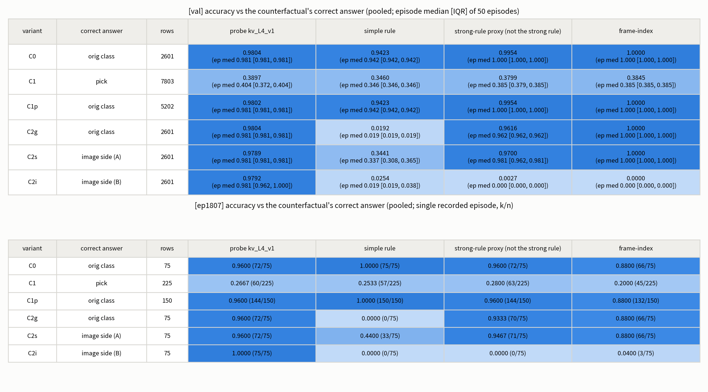

[`t48-accuracy-table.png`](figures/t48/t48-accuracy-table.png) — 위 val, 아래 ep1807. 각 칸이 pooled 정답률이고 val 칸에 episode median [IQR] 도 있다. C1 의 정답은 모두 `pick`, C2s · C2i 의 정답은 image 쪽 frame 의 class 다. 아래는 같은 값의 표다.

**val**

| variant | 정답 | rows | probe `kv_L4_v1` | simple rule | strong-rule proxy (실제 strong rule 아님) | frame-index |
|---|---|---:|---:|---:|---:|---:|
| C0 | 원래 class | 2601 | 0.9804 (2550/2601) | 0.9423 (2451/2601) | 0.9954 (2589/2601) | 1.0000 (2601/2601) |
| C1 | `pick` (전부) | 7803 | 0.3897 (3041/7803) | 0.3460 (2700/7803) | 0.3799 (2964/7803) | 0.3845 (3000/7803) |
| C1p | 원래 class | 5202 | 0.9802 (5099/5202) | 0.9423 (4902/5202) | 0.9954 (5178/5202) | 1.0000 (5202/5202) |
| C2g | 원래 class | 2601 | 0.9804 (2550/2601) | 0.0192 (50/2601) | 0.9616 (2501/2601) | 1.0000 (2601/2601) |
| C2s | image 쪽 (A) class | 2601 | 0.9789 (2546/2601) | 0.3441 (895/2601) | 0.9700 (2523/2601) | 1.0000 (2601/2601) |
| C2i | image 쪽 (B) class | 2601 | 0.9792 (2547/2601) | 0.0254 (66/2601) | 0.0027 (7/2601) | 0.0000 (0/2601) |

**ep1807** (1 episode — episode median · IQR 은 의미가 없어 k/n 만 적는다)

| variant | 정답 | rows | probe `kv_L4_v1` | simple rule | strong-rule proxy (실제 strong rule 아님) | frame-index |
|---|---|---:|---:|---:|---:|---:|
| C0 | 원래 class | 75 | 0.9600 (72/75) | 1.0000 (75/75) | 0.9600 (72/75) | 0.8800 (66/75) |
| C1 | `pick` (전부) | 225 | 0.2667 (60/225) | 0.2533 (57/225) | 0.2800 (63/225) | 0.2000 (45/225) |
| C1p | 원래 class | 150 | 0.9600 (144/150) | 1.0000 (150/150) | 0.9600 (144/150) | 0.8800 (132/150) |
| C2g | 원래 class | 75 | 0.9600 (72/75) | 0.0000 (0/75) | 0.9333 (70/75) | 0.8800 (66/75) |
| C2s | image 쪽 (A) class | 75 | 0.9600 (72/75) | 0.4400 (33/75) | 0.9467 (71/75) | 0.8800 (66/75) |
| C2i | image 쪽 (B) class | 75 | 1.0000 (75/75) | 0.0000 (0/75) | 0.0000 (0/75) | 0.0400 (3/75) |

C0 에서 simple rule 이 ep1807 에 1.0000 인 것은 SUBTASK-b 가 ep1807 의 정답을 gripper 로 정의했기 때문이다 (`SUBTASK_FACTS.md` §3). frame-index 의 ep1807 값은 위의 nearest fallback 을 쓴 확장 정의다.

#### 6-2. C1 — prompt 의 target 명사를 distractor 로 (language 민감도)

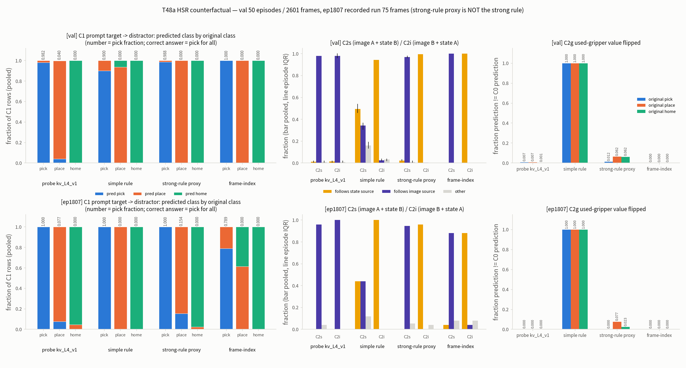

[`t48-c1-c2-graph.png`](figures/t48/t48-c1-c2-graph.png) — 위 행 val, 아래 행 ep1807. 왼쪽 = C1 의 원래 class 별 예측 class stacked bar, 가운데 = C2s · C2i 가 따른 쪽, 오른쪽 = C2g 로 예측이 C0 와 달라진 비율. 막대 위 숫자는 `pick` 으로 간 비율이고 정답은 모든 class 에서 `pick` 이다.

**val — 원래 class 별 `pick` 예측 비율 (정답은 전부 1.0)**

| 원래 class (rows) | probe `kv_L4_v1` | simple rule | strong-rule proxy (실제 strong rule 아님) | frame-index |
|---|---:|---:|---:|---:|
| pick (3000) | 2946/3000 (0.982) | 2700/3000 (0.900) | 2964/3000 (0.988) | 3000/3000 (1.000) |
| place (2400) | 95/2400 (0.040) | 0/2400 (0.000) | 0/2400 (0.000) | 0/2400 (0.000) |
| home (2403) | 0/2403 (0.000) | 0/2403 (0.000) | 0/2403 (0.000) | 0/2403 (0.000) |

**probe 의 C1 matrix 와 C0 confusion 의 3 배 비교 (산출).** C1 은 같은 frame 에 distractor 과일 3 종을 각각 넣으므로 C0 의 모든 row 가 3 배가 된다. 예측이 하나도 안 바뀌었다면 C1 matrix 는 C0 confusion 의 정확히 3 배다.

val

| 원래 class | C0 confusion (pick · place · home 예측) | C0 × 3 (산출) | C1 matrix (측정) |
|---|---|---|---|
| pick | [982, 18, 0] | [2946, 54, 0] | [2946, 54, 0] |
| place | [32, 768, 0] | [96, 2304, 0] | [95, 2303, 2] |
| home | [0, 1, 800] | [0, 3, 2400] | [0, 3, 2400] |

ep1807

| 원래 class | C0 confusion (pick · place · home 예측) | C0 × 3 (산출) | C1 matrix (측정) |
|---|---|---|---|
| pick | [19, 0, 0] | [57, 0, 0] | [57, 0, 0] |
| place | [1, 12, 0] | [3, 36, 0] | [3, 36, 0] |
| home | [0, 2, 41] | [0, 6, 123] | [0, 6, 123] |

- val 의 pick · home row 는 3 배와 정확히 같고 place row 는 한두 칸 (−1, −1, +2) 만 다르다. ep1807 은 세 row 모두 정확히 3 배다. 이것은 **집계 수준의 일치** 이고 frame 마다 예측이 같다는 것은 아니다 (C0 대 C1 의 frame 별 예측 비교는 verifier 가 따로 내지 않았다).
- C1 accuracy 는 `pick` 으로 간 비율이며 probe 0.3897 (3041/7803), distractor 별로는 apple 0.3875 · banana 0.3910 · orange 0.3885 · pear 0.3916 이다. episode 단위로 원래 place 의 `pick` 전환 비율은 median 0.0625 [0.0, 0.0625] (원래 place frame 이 episode 당 16 개 (산출) 이므로 episode 당 0 – 1 개), pick 의 유지는 median 1.0 [0.967, 1.0].
- 같은 정의로 simple rule · proxy · frame-index 는 place · home 에서 `pick` 전환이 0 이다 (위 표). 이들은 prompt 를 보지 않는다.
- (미측정 해석) probe 의 학습 prompt 는 12 개의 완전한 instruction 뿐이고 paraphrase 에 대한 강건성은 이전에 재지 않았다 (`SUBTASK_FACTS.md` §3). 그 사실과 위 결과가 어떻게 이어지는지는 이 STEP 이 가리지 않았다.

#### 6-3. C1p — 같은 target, 다른 phrasing (통제)

**val — 예측 유지 비율 (같은 host frame 의 C0 예측 대비)**

| 원래 class | probe `kv_L4_v1` | simple rule | strong-rule proxy (실제 strong rule 아님) | frame-index |
|---|---:|---:|---:|---:|
| pick | 1994/2000 (0.997) | 2000/2000 (1.000) | 2000/2000 (1.000) | 2000/2000 (1.000) |
| place | 1595/1600 (0.997) | 1600/1600 (1.000) | 1600/1600 (1.000) | 1600/1600 (1.000) |
| home | 1602/1602 (1.000) | 1602/1602 (1.000) | 1602/1602 (1.000) | 1602/1602 (1.000) |
| all | 5191/5202 (0.998) | 5202/5202 (1.000) | 5202/5202 (1.000) | 5202/5202 (1.000) |

probe 는 예측이 5191/5202 유지되고 (바뀐 11 frame), rule · proxy · frame-index 는 prompt 를 보지 않으므로 5202/5202 이다. ep1807 은 네 방법 모두 150/150.

#### 6-4. C2g — used gripper 값만 반대로

**val — 원래 class 별 예측이 C0 예측에서 바뀐 비율**

| 원래 class | probe `kv_L4_v1` | simple rule | strong-rule proxy (실제 strong rule 아님) | frame-index |
|---|---:|---:|---:|---:|
| pick | 7/1000 (0.007) | 1000/1000 (1.000) | 12/1000 (0.012) | 0/1000 (0.000) |
| place | 6/800 (0.007) | 800/800 (1.000) | 50/800 (0.062) | 0/800 (0.000) |
| home | 1/801 (0.001) | 801/801 (1.000) | 50/801 (0.062) | 0/801 (0.000) |
| all | 14/2601 (0.005) | 2601/2601 (1.000) | 112/2601 (0.043) | 0/2601 (0.000) |

- probe 는 모든 class 에서 0.001 – 0.007 이다 (전체 14/2601). C2g 입력의 원래 class × 예측 matrix 는 pick → place 11 · place → pick 38 · home → place 2 이고 (`C2g_matrix_origclass_x_pred`), 같은 칸의 C0 confusion 은 18 · 32 · 1 이다.
- simple rule 은 정의상 gripper 문턱을 넘기므로 전부 바뀐다. proxy 는 이력을 쓰므로 일부만 바뀐다 (전체 112/2601).
- ep1807 은 probe 0/75 · simple rule 75/75 · proxy 2/75 · frame-index 0/75.

#### 6-5. C2s · C2i — state 를 바꾸면 따라가는가, image 를 바꾸면 따라가는가

**val — 예측 class 가 state 쪽 / image 쪽 / 기타 인 비율**

| 방법 | 변형 | state 쪽 | image 쪽 | 기타 |
|---|---|---:|---:|---:|
| probe `kv_L4_v1` | C2s | 31/2601 (0.012) | 2546/2601 (0.979) | 24/2601 (0.009) |
| probe `kv_L4_v1` | C2i | 33/2601 (0.013) | 2547/2601 (0.979) | 21/2601 (0.008) |
| simple rule | C2s | 1288/2601 (0.495) | 895/2601 (0.344) | 418/2601 (0.161) |
| simple rule | C2i | 2451/2601 (0.942) | 66/2601 (0.025) | 84/2601 (0.032) |
| strong-rule proxy (실제 strong rule 아님) | C2s | 54/2601 (0.021) | 2523/2601 (0.970) | 24/2601 (0.009) |
| strong-rule proxy (실제 strong rule 아님) | C2i | 2589/2601 (0.995) | 7/2601 (0.003) | 5/2601 (0.002) |
| frame-index | C2s | 0/2601 (0.000) | 2601/2601 (1.000) | 0/2601 (0.000) |
| frame-index | C2i | 2601/2601 (1.000) | 0/2601 (0.000) | 0/2601 (0.000) |

(simple rule · proxy · frame-index 의 값은 위 §3 의 정의상 결과이므로 probe 의 반응과 같은 의미로 읽지 않는다.)

**probe — (image class, state class) 조합별.** C2s 는 (image A class, state B class), C2i 는 (image B class, state A class) 이다. 값은 `state / image / 기타` 비율이다.

| (image class, state class) | C2s rows | C2s: state / image / 기타 | C2i rows | C2i: state / image / 기타 |
|---|---:|---|---:|---|
| image `pick` · state `place` | 506 | 0.022 / 0.978 / 0.000 | 416 | 0.014 / 0.986 / 0.000 |
| image `pick` · state `home` | 494 | 0.000 / 0.984 / 0.016 | 405 | 0.000 / 0.983 / 0.017 |
| image `place` · state `pick` | 416 | 0.048 / 0.950 / 0.002 | 506 | 0.051 / 0.947 / 0.002 |
| image `place` · state `home` | 384 | 0.000 / 0.961 / 0.039 | 396 | 0.003 / 0.965 / 0.033 |
| image `home` · state `pick` | 405 | 0.000 / 1.000 / 0.000 | 494 | 0.000 / 1.000 / 0.000 |
| image `home` · state `place` | 396 | 0.000 / 1.000 / 0.000 | 384 | 0.000 / 1.000 / 0.000 |

- probe 의 state 쪽 비율이 가장 큰 조합은 image `place` · state `pick` 으로 C2s 0.048 · C2i 0.051 이고, 이 조합은 place ↔ pick 경계 frame 이 섞이는 쪽이다 (C0 confusion 의 pick ↔ place 오류와 같은 방향이다). image 가 `home` 인 두 조합은 양쪽에서 image 쪽 1.000 이다.
- 쌍 단위 (같은 (A, B) 에서 C2s 와 C2i 를 함께 본 결과, 산출 포함):

| 방법 | C2s 와 C2i 모두 image 쪽 | C2s image · C2i state | C2s state · C2i image | 둘 다 state 쪽 | 그 밖 (산출) | 쌍 수 |
|---|---:|---:|---:|---:|---:|---:|
| probe `kv_L4_v1` | 2492 | 33 | 31 | 0 | 45 | 2601 |
| simple rule | 0 | 887 | 62 | 1177 | 475 | 2601 |
| strong-rule proxy (실제 strong rule 아님) | 0 | 2518 | 7 | 47 | 29 | 2601 |
| frame-index | 0 | 2601 | 0 | 0 | 0 | 2601 |

probe 는 2601 쌍 중 2492 쌍에서 C2s · C2i 모두 image 쪽을 따랐고, 둘 다 state 쪽을 따른 쌍은 0 이다.

#### 6-6. ep1807 (완전 held-out, 1 episode · 75 frame)

| 항목 (ep1807, 75 frame) | probe `kv_L4_v1` | simple rule | strong-rule proxy (실제 strong rule 아님) | frame-index |
|---|---:|---:|---:|---:|
| C0 accuracy | 72/75 | 75/75 | 72/75 | 66/75 |
| C1: 원래 pick → pick | 57/57 | 57/57 | 57/57 | 45/57 |
| C1: 원래 place → pick | 3/39 | 0/39 | 6/39 | 0/39 |
| C1: 원래 home → pick | 0/129 | 0/129 | 0/129 | 0/129 |
| C1p: 예측 유지 | 150/150 | 150/150 | 150/150 | 150/150 |
| C2g: 예측이 바뀜 | 0/75 | 75/75 | 2/75 | 0/75 |
| C2s: state / image / 기타 | 0 / 72 / 3 | 33 / 33 / 9 | 0 / 71 / 4 | 3 / 66 / 6 |
| C2i: state / image / 기타 | 0 / 75 / 0 | 75 / 0 / 0 | 72 / 0 / 3 | 66 / 3 / 6 |

위 표는 1 episode 이므로 비율의 불확실성은 크다 (예: 75 frame 에서 1 frame = 0.013). 방향은 val 과 같지만 val 과 독립된 증거로 세지 않는다.

#### 6-7. 비용 (GPU, offline prefix pass)

| 항목 | 값 |
|---|---|
| batch · 입력 수 · 호출 수 | 4 · 24084 · 6022 |
| prefix pass + `kv_L4` reduction (입력당) | median **15.05 ms** · p90 15.12 ms (batch 4 호출 median 60.2 ms) |
| prefix 시간 합 · extract wall time | 363.4 s · **922.7 s** (≈ 15.4 분, 산출) |
| checkpoint load | 12.0 s |
| unit 당 wall (전형) · 첫 unit (JIT 포함) | 17.0 s · 46.3 s |
| GPU memory | JAX peak 7,600,011,264 byte · `nvidia-smi` process 8,808 MiB |
| pod working set (extract 중) | 41.7 – 43.3 GB (extract 시작 시점은 측정하지 못했다), 끝 39.0 GB |
| 다른 GPU compute process | extract 전 없음, sampler 10 회 모두 compute process 1 개 (이 extract) |

timing 은 prefix pass 와 `kv_L4` reduction 의 device 시간이며 input transform · video decode · warm-up/JIT 를 뺀다 (`cost.timing_note`). SUBTASK-b 의 prefix pass median 24.50 ms (H200 bf16, batch 1, `SUBTASK_FACTS.md` §3) 와는 batch 크기 (4 대 1) 가 달라 같은 조건의 비교가 아니다 — batch 1 전체 extract 는 재지 않았다.

#### 6-8. 실제 scene — C2s · C2i 쌍

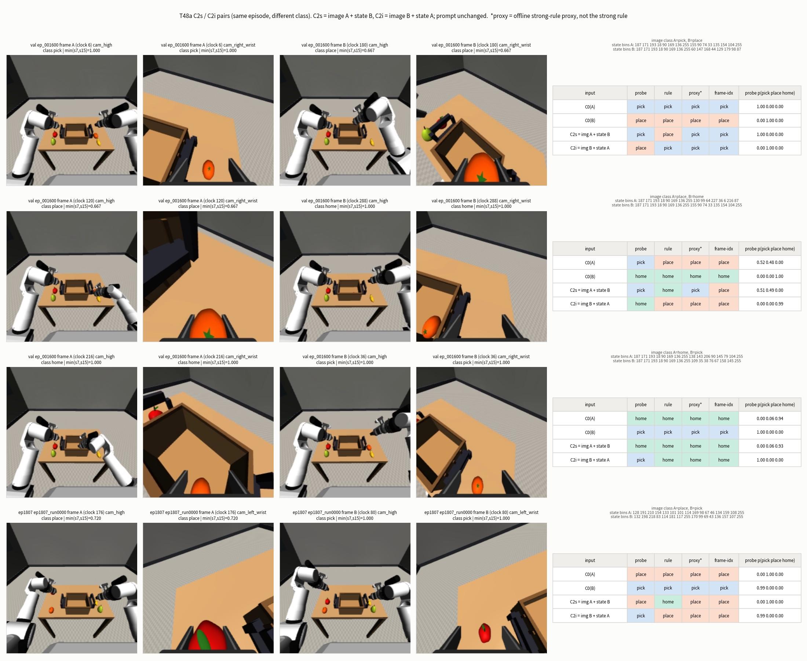

[`t48-scene-c2-pairs.png`](figures/t48/t48-scene-c2-pairs.png) — 네 쌍. 각 쌍의 왼쪽 두 열이 host frame A (cam_high · wrist 한 대), 가운데 두 열이 partner frame B, 오른쪽 표가 C0(A) · C0(B) · C2s (image A + state B) · C2i (image B + state A) 에 대한 probe · rule · proxy · frame-index 예측과 probe 확률이다. 선택 규칙은 sidecar `selection` 에 있다 — val ep_001600 에서 (image class, state class) = (pick, place) · (place, home) · (home, pick) 인 첫 C2s row 세 개와 ep1807 의 첫 (place, pick) row 이며 결과를 보고 고르지 않았다. 네 쌍 모두 probe 의 C2s 예측은 C0(A) 예측과, C2i 예측은 C0(B) 예측과 같다. 두 번째 쌍은 C0(A) 에서 이미 probe 가 정답 (place) 이 아닌 pick 으로 읽는 경계 frame 이다 (확률이 거의 반반).

### 7. 읽을 때의 한계

| 한계 | 내용 |
|---|---|
| **proxy ≠ strong rule** | proxy 는 offline 기록에 없는 실행 feedback 과 조작 대상 reach 를 뺀 근사다. 실제 strong rule 과의 비교는 하지 않았다 (§8) |
| **frame-index fallback** | ep1807 의 frame-index 는 549 / 675 row 에서 nearest 정의다. SUBTASK-b 가 이 baseline 을 closed loop 에서 재지 않았으므로 ep1807 의 frame-index 값은 확장 정의의 값이다 |
| **replica 불일치** | val 27 row (`ep_001648`, 1 bin 차이). 지표는 서빙 bin 으로 만든 feature 를 쓴다 (§5-2) |
| **C2 에서 baseline 의 의미** | rule · proxy · frame-index 는 host 의 이력 · clock 을 쓰므로 C2 의 결과가 정의에서 나온다 (§3) |
| **C1 정답 pick 의 전제** | distractor 가 거의 움직이지 않는다는 dataset 성질에 기댄다. 이동량의 수치는 verify.json 에 없다 (§2) |
| **일반화** | 완전 held-out 은 ep1807 한 episode 뿐이다. val 50 episode 는 probe 학습 split (episode 0–1599) 과 겹치지 않으나 (`SUBTASK_FACTS.md` §1) 모두 같은 scripted 시연이다 |
| **image 안의 정보** | C2 의 image 이식은 팔 자세와 물체 상태를 함께 옮긴다. image 를 따랐다는 것이 *무엇을* 읽는지는 말하지 않는다 (결과 (c)) |

### 8. 측정하지 않은 것 (`T48.verify.json` `not_measured`)

- 실제 strong rule (`grasp_latch.py` + 실행 feedback) 과의 비교. offline proxy 만.
- batch 1 (서빙 batch size) 전체 extract. extract 는 `--batch 4` 였고 batch parity 는 첫 batch (n = 4) 에서만 쟀다.
- extract 시작 시점의 pod working set (lead 요청이 extract 도중 도착).
- cuRobo 회귀 기준선 (GPU 를 단일 extract 로 한정).
- T48b (empty grasp · slip · phantom hold).

### 9. 되돌아올 지점과 다음 STEP

| task 의 신호 (`T48.task.md`) | 측정 결과 | 다음 |
|---|---|---|
| C1 에서 place · home frame 의 `pick` 전환이 거의 없으면 probe 는 instruction 을 반영하지 못한다. 그때 HSR 은 wrong-object 상황에서 strong rule 보다 나을 근거가 없고, 검토 문서 §6 기준대로 **보조 구성 요소** 로 두며, language 민감 probe 는 별도 판정한다 | 전환이 거의 없었다 (val place 0.040 · home 0.000, ep1807 3/39 · 0/129). 다만 strong rule 은 측정하지 않았고 proxy 도 같은 칸에서 0 이다 | 신호의 조건에 해당하는 값이다. HSR 의 위치를 보조 구성 요소로 정할지, language 민감 probe 를 따로 판정할지는 **사용자 판정 대기** — 이 STEP 은 정하지 않았다 |
| C2 에서 예측이 state 를 따르면 HSR 은 사실상 proprio rule 이다 → state token 을 뺀 변형을 후속으로 제안 | 따르지 않았다 (state 쪽 0.012 · 0.013) | 해당 없음. state token 을 뺀 변형은 제안하지 않는다 |
| C0 가 재현되지 않으면 T48 전체를 멈추고 feature 경로 차이를 찾는다 | 재현됐다 (0.9804 대 0.9808) | 해당 없음 |
| T48b (empty grasp · slip, 16D policy image re-render parity 필요) 는 T48a 결과를 보고 판정 | (c) 가 미결이다 | **T48b 진행 (사용자 판정).** 16D policy image re-render parity (E0: re-render 한 image 의 예측이 기록 image 의 예측과 같은가) 를 먼저 확인하고 통과하지 못하면 거기서 멈춰 보고한다. GPU 추출은 T46 의 CL3 가 끝난 뒤. 구체 설계는 `handoff/T48b.task.md` |

**산출물.**

- **측정**: `handoff/T48.verify.json`. 원자료는 run 디렉터리 `/mnt/dev/AG3S_VLA-storage/results/development/20261012T155229+0900_218229ac6464_2e66675de9ee/verify/T48/` (`plan` · `feat/full` · `extract` · `score` · `indep` · `c0_stored` · `cost` · `baseline`).
- **figure** (각각 `.json` sidecar 있음): [`scene`](figures/t48/t48-scene-c2-pairs.png) · [`graph`](figures/t48/t48-c1-c2-graph.png) · [`table`](figures/t48/t48-accuracy-table.png).
- **구현**: `AG3S/ag3s/experiments/studies/t48_hsr_*.py` (4 개) · `tests/ag3s/test_t48_hsr_counterfactual.py` (27 passed · 1 skipped). `handoff/T48.impl.md`.
- **task 문서**: `handoff/T48.task.md` (T48a) · `handoff/T48b.task.md` (다음 STEP).
- commit 은 하지 않았다.

---

## T48b — HSR counterfactual (b): 같은 팔 자세에서 물체의 유무만 바꾸면 phase probe 는 반응하는가 (2026-10-12 KST)

**이 절이 답하는 물음 (목적).** T48a 는 probe (`kv_L4_v1`, 위 "T48a" 절) 가 state 문자열이 아니라 image 를 따른다는 것까지 보였지만, image 안에서 **"물체를 쥐고 있다" 는 작업 상태** 를 읽는지 **"팔이 이 자세에 있다" 는 자세 순서** 를 읽는지는 가리지 못했다 (T48a 결과 (c)). 데이터가 실패 · retry 없는 scripted 시연이라 팔 자세와 쥠 상태가 항상 같이 움직이기 때문이다. T48b 는 기록된 16D step 의 qpos 에서 **대상 과일의 free joint 와 쓰는 손 finger joint 만** 바꾸고 MuJoCo (osmesa, CPU) 로 policy image 규약 그대로 다시 그려 (팔 자세는 그대로, 물체의 유무 · 위치만 다름) 같은 probe 에 넣는다. 편집의 종류는 용어 절 "T48b" 표 (E0 · E1 · E1s · E1z · E2 · E3) 에 풀어 두었다. 정답은 gripper 값이 아니라 **MuJoCo contact 로 정한 물리 predicate** 다.

**한 줄 결과 (before → after).**

- **before.** T48a 후: probe 는 image 를 따르나 무엇을 읽는지는 열려 있었다.
- **after — 측정된 사실.**
  - **re-render parity 통과.** E0 (편집 없이 re-render) 가 기록 image 와 **599 / 599 frame (held-out 260 + train_range 339) 에서 3 camera 모두 bit-identical** (MAD 0 · max abs 0, state 차이 0.0), probe 예측 일치 599 / 599 (통과 기준 ≥ 0.95).
  - **held-out primary 의 편집 결과** (frame 합산 k/n, "= target" 은 정답과 같은 예측). 정답이 `pick` 인 편집에서 probe 가 `pick` 으로 읽은 비율: **E1 (empty grasp) 1/13** (`place` 유지 12/13), **E1s 4/13**, **E2 (slip) 3/7**, E1z (exploratory) 5/13. 정답이 `place` 인 **E3 (phantom hold)** 에서 probe `place` **97/99**.
  - **simple rule 과 offline proxy** (proxy 는 strong rule 이 아니다): E1 에서 rule 0/13 · proxy 1/13, E3 에서 rule 99/99 · proxy 0/99. rule 은 finger 값 (state) 만 보고 proxy 는 host record 의 이력 (PRE → CLOSING → HELD) 을 쓰기 때문에 같은 편집에서 서로 반대 방향의 값이 나온다 (정의에서 오는 값이며 이 로그는 더 해석하지 않는다).
  - **규모.** E1 · E2 의 held-out 값은 **2 run · 2 scene (ep1807 · ep1850) 에서 나온 pilot** 이다 (E1 은 ep1807 11 + ep1850 2 frame, E2 는 5 + 2). E3 는 4 scene (ep1807 17 · scene ep1800 56 · ep1850 11 · ep1900 15 frame).
- **"자세를 읽는가" 의 해석은 하지 않았다.** task 의 되돌아올 지점이 "E1 · E2 에서 probe 가 `place` 를 유지하면 자세 순서를 읽는다" 로 적어 둔 조건에 해당하는 값은 §7 에 두고, HSR 의 위치는 판정 대기로 둔다.

**읽는 법과 출처 규약.**

- 수치는 `T48b.verify.json` 의 `numbers` 에서만 왔다. 같은 파일 숫자의 덧셈은 "(산출)" 로 적었다. 구현의 설계 값 (host 선택 규칙 · 편집 정의 · 렌더 자세 규칙) 은 `T48b.impl.md` 의 서술이며 그 수치는 verify.json 에 있는 것만 옮겼다.
- 해석의 출처를 가른다: 사용자 판정 "(사용자 판정)", lead 가 task 에 쓴 것 "(lead)", 측정으로 확인하지 않은 해석 "(미측정 해석)".
- **독립 단위.** frame 은 독립 trial 이 아니다. 표는 frame 합산 k/n 을 적고, scene (독립 단위) 별 probe 값은 figure 의 마커와 verify.json `probe_per_scene` 에 있다. long · t2 · headfix · ep1800 은 같은 scene (episode 1800) 이라 1 scene 이다.
- **환경.** CPU render (`.venv-ag3s`, osmesa, 1 thread) + GPU extract 1 회 (offline prefix pass, GPU lock 아래, 시작 전 compute process 0) + CPU score. 회귀 기준선은 render 앞과 score 앞 두 번 일치했다 — legacy 14 / 15 · has_target 15 / 15 · frame0 `clearance_before` −29.031048 mm. cuRobo 기준선은 이 STEP 에서 돌리지 않았다. HEAD `28b98160` (T48b 파일 3 개는 untracked, 새 파일뿐).

### 1. 사용자 판정과 타임라인 (KST)

| # | 판정 · 사건 (2026-10-12) | 이 절에서 |
|---|---|---|
| 1 | **(사용자 판정, T48a 결과 후)** T48b 진행. 16D policy image re-render parity (E0) 를 먼저 확인하고 통과하지 못하면 거기서 멈춰 보고. GPU 추출은 T46 의 CL3 가 끝난 뒤 | §3 |
| 2 | **(사용자 판정, T48b.impl.md 확인 후 · 결과 전)** held-out 7 run 의 `held` frame 이 **primary**, VLA 학습 episode 의 recorded run (ep0 · ep500 · ep1200) 은 **secondary 로 분리 보고** (편집 image 는 학습에 없으나 장면은 익숙할 수 있음을 명시). 같은 scene 의 run 은 독립 표본으로 세지 않는다. E1z 는 exploratory | §4 |
| 3 | **(lead)** 정답은 물리 predicate. 빈 손 닫힘 값 0.457 (기록된 빈 손 닫힘 22 개의 median) · 관통 제외 기준 2.0 mm (편집하지 않은 기록 frame 의 최대 1.83 mm) 고정. E0 는 `closed_loop_gt` 와 contact state 두 기준으로 채점 | §2, §3 |

| 시각 (KST) | 무엇 | 출처 |
|---|---|---|
| 17:03 – 17:10 | CPU render (`--stage render --extra-runs train_range`, rc 0, stage wall 443.5 s). 앞서 회귀 기준선 | `runs[render]` 08:03:03Z – 08:10:28Z · `cost_5.render_stage_wall_s` |
| 19:23:35 – 19:28:16 | GPU extract (`--stage extract --batch 4`, rc 0, wall 280.9 s, retry 0, nvidia-smi peak 8804 MiB) | `gpu_extract[0]` 10:23:35Z – 10:28:16Z |
| 21:00 – 21:20 | CPU score · figure (회귀 기준선 재확인 일치) | verify.json `time_kst` |

### 2. 설계와 구현 (새 파일만, `T48b.impl.md`)

| ID | host frame | 편집 | 정답 | 묻는 것 |
|---|---|---|---|---|
| **E0** | 사용 frame 전부 | 없음 (re-render 만) | 원래 정답 (이중 채점) | parity |
| **E1** | `held` (파지 후 · 놓기 전) | 과일 → 초기 table 위치, finger → 0.457, state 도 같게 | `pick` | 손은 닫혔고 팔은 운반 자세인데 물체가 없다 |
| **E1s** | `held` | 과일만 옮김, finger · state 그대로 | `pick` | E1 에서 finger image · state 효과를 뺀다 |
| **E1z** (exploratory) | `held` | E1 과 같되 finger → 0 (joint 한계) | `pick` | 기록된 빈 손 (0.457) 과 완전히 닫힌 손의 차이 |
| **E2** | `held` | 과일 → 손 바로 아래 table 위 (xy 그대로, z · 자세 = 초기), finger · state 는 E1 과 같게 | `pick` | 물체가 손 근처에 있으나 쥐어져 있지 않다 |
| **E3** | `reach` (쓰는 손이 처음 닫히기 전, 과일 `on_table`) | 과일 → finger 사이, finger → 과일 폭에 맞춤, state 도 맞춤 | `place` | 팔은 접근 자세인데 물체는 손 안에 있다 (E1 의 대칭) |

- **렌더 자세 규칙.** 기록의 qpos 는 마지막 `mj_step` 뒤 값이지만 camera 가 본 kinematics 는 그 step 앞의 것이라 `mj_integratePos(qpos, qvel, −dt)` 로 한 step 되돌려 그린다 (첫 record 는 예외). 이 규칙으로 parity 가 bit 단위로 맞았다 (`T48b.impl.md` §1; 규칙 없이는 움직이는 link 가장자리가 다르다고 impl 이 smoke 로 확인).
- **편집 지역성 (verifier 독립 점검, 10 run).** E1s 는 과일의 free joint 7 개만 바뀌고 state 는 그대로다. E1 · E1z · E3 는 과일 7 개 + 쓰는 손 finger joint 2 개가 바뀌고 state 는 쓰는 gripper 한 차원만 바뀐다. E2 는 과일의 z · 자세 5 개 + finger 가 바뀌고 xy 는 그대로다.
- **빈 손 닫힘 값 `g_empty` = 0.457** (n = 22 기록, p0 0.389 · p5 0.402 · p95 0.495 · p100 0.688). 기준 hold 값 (dataset 의 닫는 명령): apple 0.723 · banana 0.495 · orange 0.667 · pear 0.673.
- 테스트: `test_t48b_*` 43 passed · 0 failed (`numbers.pytest_t48b`).

### 3. 검증 — E0 re-render parity (통과 기준 = 예측 일치 ≥ 0.95, MAD 가 render 잡음 수준)

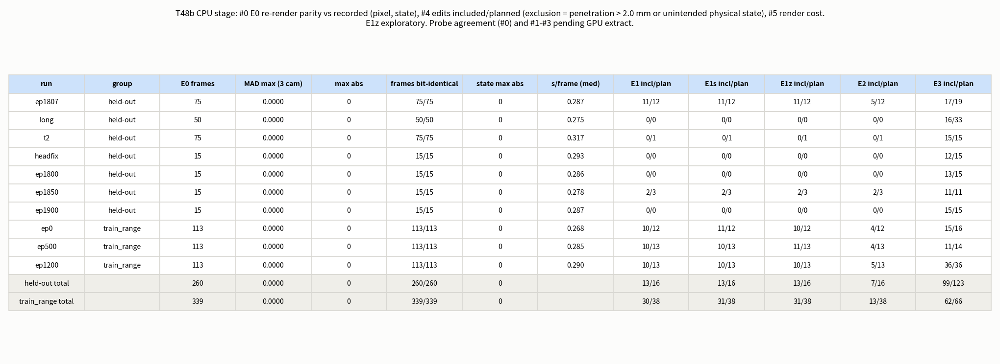

[`t48b-cpu-parity-exclusions-table.png`](figures/t48/t48b-cpu-parity-exclusions-table.png) — #0 pixel · state parity, #4 편집별 포함 / 계획 frame 수, render 비용.

| 점검 | held-out primary (7 run) | train_range secondary (3 run) |
|---|---|---|
| E0 frame 수 | 260 | 339 |
| 3 camera 모두 bit-identical | **260 / 260** | **339 / 339** |
| MAD 최대 · max abs · state max abs | 0.0 · 0 · 0.0 | 0.0 · 0 · 0.0 |
| probe 예측 일치 (re-render 대 기록 image) | **260 / 260** | **339 / 339** |
| probe 확률 변화 (599 frame) | median · p99 · max 모두 0.0 | |
| 같은 자세 재렌더가 동일 | 전 run 참 | |

- 일치율 1.0 (≥ 0.95), pixel gate (frame · camera MAD 최대 ≤ 1.0) 통과 → **E1 – E3 진행.** rule · proxy · frame-index 의 예측 일치도 599 / 599 이다.
- state 재구성 (`build_obs("rby1_16d")` 규칙) 과 기록 state 의 차이 최대 0.0 (전 frame).
- 독립 확인: 편집 · 확률을 verifier 가 따로 다시 계산했다 — probe 를 numpy 로 다시 적용한 argmax 불일치 0 / 1510 (확률 최대 차 5.0e-7), `metrics.json` 대 독립 재채점 124 / 124 field 일치.

**E0 이중 채점** (정답 기준을 가름; frame 합산 k/n). held-out primary 에서 `closed_loop_gt` 와 contact state 가 다른 (모호하지 않은) frame 은 39 개, 모호 frame 은 6 개다 (long · t2 의 빈 손으로 닫힌 frame 에서 `closed_loop_gt` 는 `held` 로 친다). train_range 는 1 개 · 5 개.

| 채점 | 대상 | probe | simple rule | offline proxy | frame-index |
|---|---|---:|---:|---:|---:|
| `closed_loop_gt` | held-out primary | 228 / 260 | 227 / 260 | 204 / 260 | 164 / 260 |
| | ep1807 만 | 72 / 75 | 75 / 75 | 72 / 75 | 66 / 75 |
| | train_range | 325 / 339 | 339 / 339 | 332 / 339 | 296 / 339 |
| contact state | held-out primary | 215 / 254 | 182 / 254 | 181 / 254 | 152 / 254 |
| | ep1807 만 | 72 / 74 | 74 / 74 | 72 / 74 | 65 / 74 |
| | train_range | 324 / 334 | 333 / 334 | 330 / 334 | 292 / 334 |

(frame-index baseline 은 채점 1510 row 중 1210 row 에서 nearest-`t_step` fallback 을 썼다 — T48a 의 ep1807 과 같은 정의.)

**편집 · 제외.** 관통 > 2.0 mm 인 편집은 제외했다. 제외 사유는 held-out 에서 전부 `penetration` 이다 (train_range 는 `penetration` 과 `finger_touch`: 쓰는 손 finger 가 과일에 닿은 채 `on_table` 로 판정).

| 편집 | held-out primary 계획 → 포함 (제외) | ep1807 만 | train_range 계획 → 포함 (제외) |
|---|---|---|---|
| E1 | 16 → 13 (3) | 12 → 11 | 38 → 30 (8) |
| E1s | 16 → 13 (3) | 12 → 11 | 38 → 31 (7) |
| E1z | 16 → 13 (3) | 12 → 11 | 38 → 31 (7) |
| E2 | 16 → **7** (9) | 12 → 5 | 38 → 13 (25) |
| E3 | 123 → 99 (24) | 19 → 17 | 66 → 62 (4) |

- 독립 scene 단위로 쓰면 held-out 의 **E1 · E1s · E1z 는 ep1807 11 + ep1850 2 (scene 2 개), E2 는 5 + 2, E3 는 ep1807 17 · scene ep1800 56 · ep1850 11 · ep1900 15** 이다. scene ep1800 (long + t2 + headfix + ep1800) 과 ep1900 에는 `held` host 가 없어 E1 · E2 가 0 이다.
- E1 에서 과일을 초기 table 위치로 옮긴 결과 host 기준 xy 50 mm 안에 놓인 포함 편집이 held-out 6 / 13, train_range 10 / 30 이다 (정의와 값은 `indep/e1_e2_fruit_xy.json`; 이 로그는 해석하지 않는다). train_range 의 기록된 관통 최대는 2.10 mm 로 (held-out 1.83 mm) 편집 제외 기준 2.0 mm 와 가깝다.

**비용 (#5).** re-render 는 frame 당 median 0.286 s (3 camera, 1 thread, osmesa; mean 0.348 · p95 0.603, n = 599), 편집 image 는 median 0.291 s (n = 312), E3 의 배치 계산 median 0.442 s (n = 189) — render 중 host load average 16.7 → 25.9 (다른 session 의 GPU closed-loop job 포함). prefix pass 는 input 당 median 14.98 ms (batch 4, 1510 input, 385 call, device 시간), JAX peak 7.6 GB, nvidia-smi peak 8804 MiB, load 10.9 s, extract wall 278.4 s.

### 4. 결과 — 편집 × 방법 (정답과 같은 예측 비율, frame 합산 k/n)

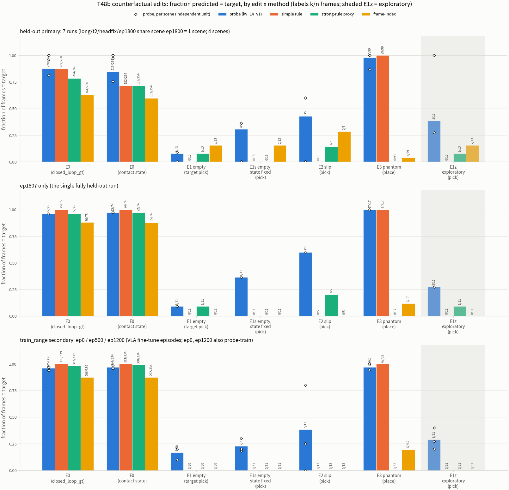

[`t48b-score-accuracy-bars.png`](figures/t48/t48b-score-accuracy-bars.png) — 세 panel (held-out primary / ep1807 만 / train_range secondary). 막대 = frame 합산, 마름모 = scene 별 probe 값 (독립 단위). E1z 는 음영 (exploratory). 표는 [`t48b-score-table.png`](figures/t48/t48b-score-table.png) (sidecar 에 같은 수치).

**held-out primary (정답과 같은 예측: E1 · E1s · E1z · E2 는 `pick`, E3 는 `place`)**

| 편집 (정답) | n | probe | simple rule | offline proxy | frame-index |
|---|---:|---:|---:|---:|---:|
| E1 empty grasp (`pick`) | 13 | **1 / 13** | 0 / 13 | 1 / 13 | 2 / 13 |
| E1s empty, state 고정 (`pick`) | 13 | **4 / 13** | 0 / 13 | 0 / 13 | 2 / 13 |
| E2 slip (`pick`) | 7 | **3 / 7** | 0 / 7 | 1 / 7 | 2 / 7 |
| E3 phantom hold (`place`) | 99 | **97 / 99** | 99 / 99 | 0 / 99 | 4 / 99 |
| E1z, finger 완전 닫힘 (exploratory) | 13 | 5 / 13 | 0 / 13 | 1 / 13 | 2 / 13 |

- probe 의 예측 분포 (`pick` / `place` / `home`): E1 [1, 12, 0], E1s [4, 9, 0], E2 [3, 4, 0], E1z [5, 8, 0], E3 [2, 97, 0]. 같은 host frame 의 E0 에서 probe 의 평균 확률은 E1 의 host 13 개에서 `place` 0.997 이고, E1 편집 뒤 평균은 `pick` 0.110 · `place` 0.877 · `home` 0.012 다. E1s 는 0.282 / 0.699 / 0.019, E2 는 0.375 / 0.609 / 0.017, E1z 는 0.392 / 0.552 / 0.056. E3 는 E0 에서 `pick` 0.995 이던 평균이 편집 뒤 `place` 0.962 로 바뀐다.
- E0 대비 예측이 바뀐 frame 수 (probe): E1 1 / 13, E1s 4 / 13, E2 3 / 7, E1z 5 / 13, E3 97 / 99. rule 은 E3 99 / 99 만 바뀌고 (E1 · E1s · E1z · E2 는 0), proxy 는 E1 1 · E1z 1 · E2 1 · E3 0.
- scene 별 probe (`pick` 으로 읽은 수): E1 ep1807 1 / 11 · ep1850 0 / 2, E1s 4 / 11 · 0 / 2, E2 3 / 5 · 0 / 2, E1z 3 / 11 · 2 / 2. E3 ep1807 17 / 17 · scene ep1800 56 / 56 · ep1850 11 / 11 · ep1900 13 / 15 (`place` 으로 읽은 수).

**ep1807 만 (유일하게 probe · VLA 어느 학습에도 없고 SUBTASK-b closed-loop 평가에 쓰인 run)**

| 편집 | n | probe | rule | proxy | frame-index |
|---|---:|---:|---:|---:|---:|
| E1 | 11 | 1 / 11 | 0 / 11 | 1 / 11 | 0 / 11 |
| E1s | 11 | 4 / 11 | 0 / 11 | 0 / 11 | 0 / 11 |
| E2 | 5 | 3 / 5 | 0 / 5 | 1 / 5 | 0 / 5 |
| E3 | 17 | 17 / 17 | 17 / 17 | 0 / 17 | 2 / 17 |
| E1z | 11 | 3 / 11 | 0 / 11 | 1 / 11 | 0 / 11 |

**train_range secondary (VLA fine-tune episode; ep0 · ep1200 은 probe 학습 episode 이기도 함 — 장면이 익숙할 수 있다)**

| 편집 | n | probe | rule | proxy | frame-index |
|---|---:|---:|---:|---:|---:|
| E1 | 30 | 5 / 30 | 0 / 30 | 0 / 30 | 0 / 30 |
| E1s | 31 | 7 / 31 | 0 / 31 | 0 / 31 | 0 / 31 |
| E2 | 13 | 5 / 13 | 0 / 13 | 0 / 13 | 0 / 13 |
| E3 | 62 | 60 / 62 | 62 / 62 | 0 / 62 | 12 / 62 |
| E1z | 31 | 9 / 31 | 0 / 31 | 0 / 31 | 0 / 31 |

- train_range 의 scene 별 probe: E1 ep0 1 / 10 · ep500 2 / 10 · ep1200 2 / 10, E2 0 / 4 · 1 / 4 · 4 / 5.
- 정의에서 정해지는 칸: E1s 는 state 가 그대로라 rule · proxy 예측이 정의상 E0 와 같다 (그래서 0 / 13). proxy 는 host record 의 원래 이력을 쓰므로 E3 에서 `place` 로 못 바뀐다 (0 / 99). 이 칸들은 probe 의 반응과 같은 의미의 측정이 아니다.

### 5. 실제 scene

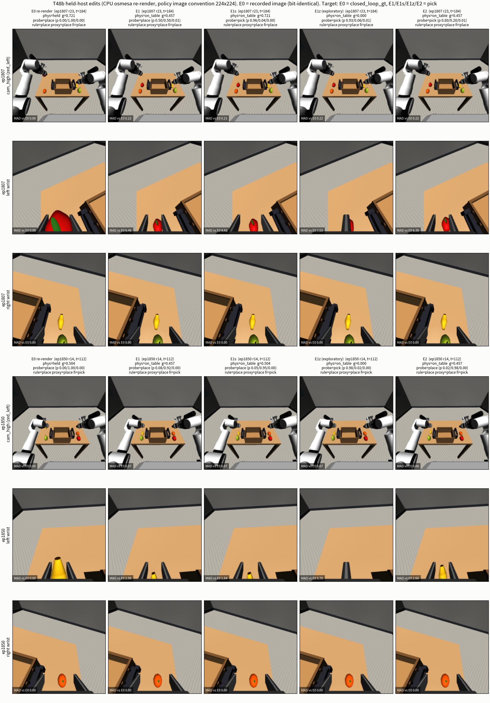

[`t48b-scene-held-edits.png`](figures/t48/t48b-scene-held-edits.png) — held-out 두 frame (ep1807 r23, ep1850 r14) 의 E0 (기록 image 와 bit-identical) · E1 · E1s · E1z · E2 를 3 camera 로 보이고 각 열 제목에 probe · rule · proxy · frame-index 예측과 probe 확률을 적었다. 이 두 frame 은 선택 기준이 sidecar 에 있고 결과로 고르지 않았다. 그림에서: ep1807 r23 은 E1s · E1z · E2 가 `pick` 으로, ep1850 r14 는 E1z 만 `pick` 으로 읽힌다 (같은 host frame 이라도 편집마다 예측이 갈린다). wrist camera 에서 E1 · E2 는 과일이 finger 사이에 없고 E1z 는 finger 가 붙어 있다.

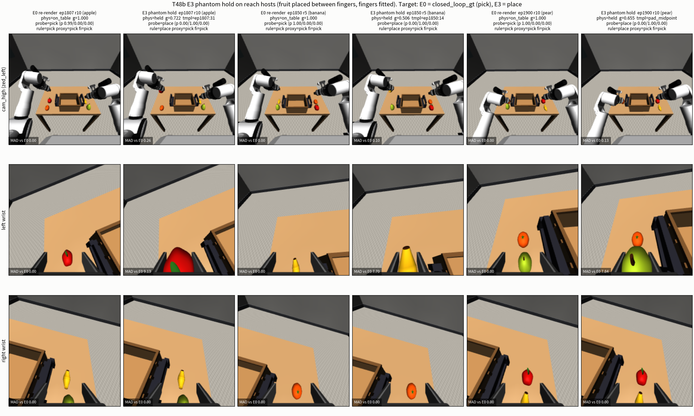

[`t48b-scene-e3-phantom.png`](figures/t48/t48b-scene-e3-phantom.png) — E3 (ep1807 r10 · ep1850 r5 · ep1900 r10 (template 가 없는 pear 의 `pad_midpoint` 배치)) 의 E0 대 E3 를 3 camera 와 예측으로. E3 는 접근 자세의 팔이 과일을 finger 사이에 쥐고 있는 image 다.

### 6. 읽을 때의 한계

| 한계 | 내용 |
|---|---|
| **E1 · E2 는 pilot** | held-out 에서 E1 13 · E2 7 frame, 2 scene. 관통 제외로 줄었다 (E2 16 → 7). 한 scene 안의 frame 은 독립 trial 이 아니다 |
| **E3 의 template** | 손 안의 과일 자세는 같은 과일 · 같은 손의 실제 `held` record 에서 잰 상대 자세를 옮긴 것이다. ep1807 · long · headfix · ep1800 의 template 은 `ep1807:31`. pear (ep1900) 는 template 이 없어 finger pad 중점 규칙을 쓴다 |
| **E3 에서 과일과 finger 가 함께 바뀐다** | 과일의 유무와 finger 닫힘을 분리해 재지 않았다 (재측정 대기 8) |
| **proxy ≠ strong rule** | 실제 strong rule (`grasp_latch.py` + 실행 feedback) 은 측정하지 않았다 |
| **secondary 의 장면 익숙함** | train_range 3 run 은 VLA fine-tune episode 이고 ep0 · ep1200 은 probe 학습 episode 이기도 하다. 편집 image 는 학습에 없으나 장면은 익숙할 수 있다 |
| **E0 정답 기준** | `closed_loop_gt` 와 contact state 가 다른 frame 이 있다 (held-out 39 frame). 편집 (E1 – E3) 의 정답은 contact state 계열의 물리 predicate 만 쓴다 |

### 7. 되돌아올 지점 · 판정 대기 제안

| task 의 신호 (`T48b.task.md`) | 측정 | 다음 |
|---|---|---|
| E0 parity 미달 → 이후 진행 없음 | 통과 (599 / 599 일치, bit-identical) | 해당 없음 |
| E1 · E2 에서 probe 가 `place` 를 유지하면 probe 는 자세 순서를 읽는다. 그러면 HSR 은 empty grasp · slip 에서 strong rule (measured opening) 보다 못하다 → 검토 문서 §6 대로 HSR 을 **보조 구성 요소** 로 둔다 | held-out 에서 E1 `place` 유지 12 / 13, E2 4 / 7 (n = 13 · 7, 2 scene) | 조건에 해당하는 값이다. 단 **strong rule 은 측정하지 않았다** (proxy 는 strong rule 이 아니다). 해석과 HSR 의 위치는 **판정 대기** (아래 제안 (a)) |
| E1 · E2 · E3 에서 probe 가 물체를 따라가면 image 의 쥠 상태를 읽는 것이다 → 실험 4 (phase source ablation) 의 HSR arm 근거 | E3 에서 `pick` → `place` 로 바뀐 frame 97 / 99 (rule 도 99 / 99), E1 은 대부분 `place` 유지 (12 / 13), E2 는 4 / 7 | 한 방향의 신호가 아니다. 판정 대기 |

**판정 대기 제안 (a) — HSR 을 보조 구성 요소로 둔다 (미측정 해석 포함).** 검토 문서 §6 의 채택 기준 ("HSR 이 strong rule 보다 실행상 도움이 없으면 HSR 은 보조 구성 요소로 남긴다") 을 쓰면, T48a (instruction 교체 반응 0.040), T48b (E1 `place` 유지 12 / 13), T50 (counterfactual probe 도 기준 미달, 아래 T50 절) 은 같은 쪽을 가리킨다. 그러나 이 기준의 전제인 **strong rule 과의 실행 비교와 gate on / off 이득은 어떤 STEP 에서도 측정하지 않았다 (미측정 해석).** 사용자 판정 전이므로 HSR 의 위치를 이 로그가 정하지 않는다.

**측정하지 않은 것 (`T48b.verify.json` `not_measured`).** cuRobo 회귀 기준선 (GPU, 이 STEP 에서 돌리지 않음). 그 밖에 이 절에서 밝힌 것: 실제 strong rule, E3 의 과일 · finger 분리, held-out E1 · E2 의 표본 확대.

**산출물.**

- **측정**: `handoff/T48b.verify.json`. 원자료는 run 디렉터리 `/mnt/dev/AG3S_VLA-storage/results/development/20261012T170147+0900_28b981600bf7_d97d2cd2e13a/verify/T48b/` (`plan` · `render` · `feat` · `extract` · `score` · `indep`).
- **figure** (각각 `.json` sidecar 있음): [`scene (held edits)`](figures/t48/t48b-scene-held-edits.png) · [`scene (E3)`](figures/t48/t48b-scene-e3-phantom.png) · [`graph`](figures/t48/t48b-score-accuracy-bars.png) · [`table (parity · 제외)`](figures/t48/t48b-cpu-parity-exclusions-table.png) · [`table (score)`](figures/t48/t48b-score-table.png).
- **구현**: `AG3S/ag3s/experiments/studies/t48b_{scene,metrics,hsr}.py` · `tests/ag3s/test_t48b_{scene,hsr_cli}.py` (43 passed). `handoff/T48b.impl.md`.
- commit 은 하지 않았다.

---

## T49 — 명사 token query: prompt 의 target 명사 · "basket" token 이 image 를 보는 attention 은 target · 목적지를 가리키는가 (2026-10-12 KST)

**이 절이 답하는 물음 (목적).** T47 은 논문 (Kang et al.) 의 label-free 기준을 **action (suffix) token query** 에 적용했고 실패했다 (선택된 head 가 fixed-patch sink 와 넓게 퍼진 map). 논문의 원래 query 는 **text** 이고 여러 물체를 다룰 때 **명사 token** 마다 map 을 따로 만든다. pi0.5 의 prefix 는 완전 bidirectional 이라 (image · text 모두 `ar_mask = False`) text 행이 image 열을 본다. T49 는 얼린 pi0.5 의 prefix pass **한 번** 에서 (denoise · noise seed 불필요, 결정적) target 과일 명사 token 과 `basket` token 의 행이 image 768 열에 둔 attention 을 꺼내 camera 별 16×16 map 으로 만들고, (1) target 을 더 잘 가리키는가, (2) target 과 목적지를 서로 다른 단어로 따로 얻을 수 있는가 (separation), (3) prompt 의 명사를 바꾸면 map 이 따라 움직이는가 (prompt swap), (4) 3D 파이프라인에 넣으면 L8H2 보다 나은가를 잰다. query 의 성격이 다르다: action query 는 policy 가 "어디로 움직이려 하는가" 를 보고 (잡은 뒤 basket 으로 옮겨갈 수 있다), 명사 query 는 "이 단어가 무엇을 가리키는가" 를 본다.

**한 줄 결과 (before → after).**

- **before.** 서빙 query (L8H2, action token) 는 held-out 에서 `peak_on_target` 0.693 이고 잡은 뒤 (post-grasp) 에는 0.382 로 떨어진다. 목적지는 규칙 (잡을 수 없음 + 3 frame 우위) 으로만 판정했다.
- **after — 2D · 분리 · prompt 교체는 명사 query 가 앞선다** (held-out 4 record pilot, record-mean).
  - 명사 GT cell (primary, `noun_gt_k3_s1` = L8H6 · L5H4 · L4H2, σ=1) `peak_on_target` **1.000** (pre-grasp 1.000 · post-grasp 1.000), target mass 0.236. 같은 cell 을 σ=0 으로 합산하면 target mass 0.528 · lift 93.9. L8H2 는 0.693 (post-grasp 0.382), target mass 0.147.
  - **분리**: target map 의 peak 가 target 위 · basket map 의 peak 가 crate 위인 frame 비율 `both_correct` **0.981** (target map 의 crate 위 peak 0.000, basket map 의 target 위 peak 0.000). label 없이 고른 secondary 는 0.914.
  - **prompt 교체**: 새로 지명한 과일 위로 map peak 가 옮겨간 (`moved`) frame 이 held-out **157 / 164** (pre-grasp 98 / 98, post-grasp 59 / 66).
- **after — 그러나 3D 는 명사 primary 가 L8H2 보다 낮다** (held-out 60 frame, record-mean): `identity_correct` **0.800 대 0.900**, chosen cluster purity **0.700 대 0.933**, non-target seed 손실 **420.3 대 190.3** point / frame. `on_target` 은 0.900 대 0.917.
- **비용**: 명사 prefix pass 의 device 시간 median 26.5 ms (1025 frame). 같은 frame 에서 전처리 포함 49.2 ms 대 L8H2 의 prefix + suffix 10 회 107.5 ms.
- 서빙 cell 은 L8H2 를 유지한다 (T47 판정). 서빙 반영은 이 STEP 에서 하지 않았다.

**읽는 법과 출처 규약.**

- 수치는 `T49.verify.json` 의 `numbers` 에서만 왔다. 같은 파일 숫자의 덧셈 · 개수 세기는 "(산출)". 모든 집계는 verify.json `_scope` 의 **record-mean** (record 안에서 frame pool → record 가중 없는 평균) 이라 T47 의 pooled 값과 같은 source 도 조금 다르다 (L8H2 의 target mass · lift · peak: T47 pooled 0.1498 · 59.60 · 0.689 대 T49 record-mean 0.1465 · 55.19 · 0.693).
- 해석의 출처를 가른다: "(사용자 판정)" · "(lead)" · "(미측정 해석)".
- **held-out 은 pilot** 이다 (same-scene `headfix` · `ep1800`, new-scene `ep1850` · `ep1900`; record 당 15 frame, 같은 scene 의 두 record 는 독립 표본이 아니다). `noun_gt` · `basket_gt` 는 selection record (`long` · `t2` · `ep1807`) 의 GT 로 고른 cell 이라 **held-out 에서만 채점**하고 e2e 는 selection record 에서 거절한다.
- **환경.** GPU 는 offline prefix pass (checkpoint `…/29999`, 16D LoRA) 한 번에만 썼다 (GPU lock 아래, 시작 전 nvidia-smi memory 0 MiB). 나머지는 CPU (`.venv-ag3s`, legacy ESDF). 회귀 기준선: legacy 14 / 15 · has_target 15 / 15 · frame0 `clearance_before` −29.031048 mm 일치 (분석 시 load 1 분 평균 12.34 → 10.74). cuRobo 기준선은 돌리지 않았다. 분석 HEAD `ec2e79fe`, extract HEAD `28b98160` (T49 파일은 untracked).

### 1. 사용자 판정과 타임라인 (KST)

| # | 판정 · 사건 (2026-10-12) | 이 절에서 |
|---|---|---|
| 1 | **(사용자 판정, T47 결과 후)** 명사 token query (D) 를 시험한다. 서빙 cell L8H2 는 유지 (T47 판정) | 전체 |
| 2 | **(사용자 판정)** cell 선택 = **GT 기반 primary + label-free secondary** (결과 보기 전 고정) | §2 |
| 3 | **(사용자 판정)** **prompt 교체 시험 포함** (exploratory) | §8 |
| 4 | **(사용자 판정)** VLA checkpoint 의 offline GPU prefix pass 승인. GPU 를 동시에 쓸 수 있으면 동시 실행 — 단 **(lead 판정) T46 의 CL3 와는 겹치지 않는다** (CL3 의 TO 가 wall-clock 마감에서 멈추므로 GPU 를 나눠 쓰면 refined action 이 바뀌어 paired 비교가 무너진다). 그래서 GPU 추출은 CL3 종료 후 | §9 |
| 5 | **(lead, T49.impl.md 확인 후 · 결과 전)** 명사 행 image mass 의 record 통합 median < 0.01 인 layer 는 "image 를 거의 보지 않음" 으로 **표시만** 하고 primary GT top-3 선택에서 제외하지 않는다 | §3 |
| 6 | **(사용자 판정, T49 결과 후)** T49b exploratory 진행 (§T49b), T51b 로 명사 행을 공식 protocol 에 추가 | T49b 절 |

| 시각 (KST) | 무엇 | 출처 |
|---|---|---|
| 19:18:17 – 19:19:15 | GPU smoke (`--records ep1850 --no-swaps --cost-frames 4`, rc 0, wall 57.8 s) | `gpu_extract[0]` 10:18:17Z – 10:19:15Z |
| 19:19:18 – 19:23:34 | GPU full extract (1040 frame = 7 record × 4 variant, rc 0, wall 255.9 s, retry 0, nvidia-smi peak 8806 MiB) | `gpu_extract[1]` 10:19:18Z – 10:23:34Z |
| (이후) | CPU select 11 s · validate 8 s · swap 13 s · e2e (4 source) 173 s | `n8_cost.cpu_stage_wall_s` |

### 2. 사전 고정과 구현 (새 파일만, `T49.impl.md`)

| 항목 | **primary** | secondary / exploratory |
|---|---|---|
| query 행 | prompt 의 target 과일 명사 1 token (target map) · `basket` 1 token (목적지 map). `last_text` (마지막 text token) 행은 기록만 하고 판정에 쓰지 않음 | — |
| cell 선택 | **GT 기반**: selection record 3 개에서 target map 의 lift 평균으로 18×8 = 144 cell 의 순위를 매기고 top-3 를 σ=1 raw 합 | **secondary**: 같은 명사 행에 T47 의 label-free 절차 (S_cam τ Kneedle + spatial entropy + selection frequency, L0 · L1 제외, k = 3) |
| 목적지 map cell | target 과 같은 방식으로 따로 (crate coverage 기준 lift) | target 의 GT cell 을 그대로 쓴 변형 (`basket_samecells`) |
| 평가 | held-out 4 record (pilot) | k = 1..5, σ = 0 |
| 비교 기준 | L8H2 (action query, 서빙) · T47 oracle top-3 (action, L8H3 · L10H7 · L12H4) | head-average (명사 행, L2–17) |

- **추출** (GPU): `pi05_attention._prefix` 를 복제한 jitted 함수가 probs 를 jit 안에서 `[18 layer, 8 head, 3 query row, 768]` 로 잘라 host 로 보낸다 (전체 `[18,1,1,8,968,968]` 는 device 밖으로 안 나간다). 명사 위치는 `obs.tokenized_prompt` 안에서 piece id 매칭으로 찾는다 (index 하드코딩 없음, 0 개 · 2 개 이상이면 오류). **1040 frame 에서 오류 0** (`extract_frames_not_ok` 0).
- **e2e**: T47b 의 `run_b2_record` (live 서빙 경로 `wire.pack_request → process_multi_debug` 를 조립한 것 + label 기반 3D 지표) 를 쓴다. attention source 만 바뀐다. 3D 는 legacy ESDF, grasp latch 없음 (T47 과 같은 한계).
- 테스트: `.venv-ag3s` 30 passed · 3 skipped (jax · sentencepiece 없는 venv 의 3 test).
- **L8H2 의 e2e row 일치 점검**: T49 의 L8H2 row 는 T47 row 와 field 불일치 0, T47b row 와는 2 (모두 ep1850 frame 13 · 14 의 `chosen_cluster_purity` NaN 대 NaN 비교, 다른 field 는 일치).

### 3. 명사 행의 mass 배분 (#1) — 이 query 는 image 를 보는가

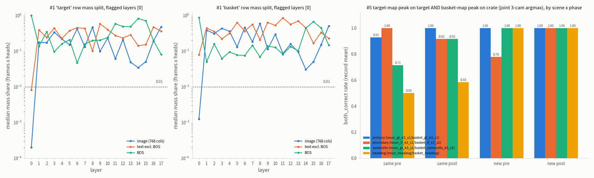

[`t49-separation-mass.png`](figures/t49/t49-separation-mass.png) — 왼쪽 두 panel = target · basket 행의 layer 별 median mass 배분 (image · text 제외 BOS · BOS, 로그 축, 0.01 점선), 오른쪽 = §6 의 분리 (scene × phase). 아래는 같은 수치 (7 record, 260 frame, (frame, head) median; `image + text` 의 최대 편차 0.0031 · 0.0028 · 0.0029).

| layer | target 행 image | target 행 BOS | basket 행 image | basket 행 BOS | last_text 행 image |
|---:|---:|---:|---:|---:|---:|
| L0 | **0.0002** | 0.9805 | **0.0013** | 0.8691 | **0.0004** |
| L1 | 0.174 | 0.1357 | 0.3833 | 0.0498 | 0.1144 |
| L2 | 0.1715 | 0.3428 | 0.3064 | 0.1572 | 0.0941 |
| L3 | 0.3356 | 0.0952 | 0.432 | 0.0614 | 0.0647 |
| L4 | 0.2159 | 0.1597 | 0.3559 | 0.0935 | 0.0601 |
| L5 | 0.1498 | 0.2051 | 0.1306 | 0.0774 | 0.0929 |
| L6 | 0.418 | 0.0469 | 0.4583 | 0.0747 | 0.1083 |
| L7 | 0.1308 | 0.1548 | 0.1822 | 0.1445 | 0.0703 |
| L8 | 0.4611 | 0.1982 | 0.5873 | 0.0684 | 0.127 |
| L9 | 0.0979 | 0.1997 | 0.1128 | 0.1367 | 0.0258 |
| L10 | 0.2294 | 0.2388 | 0.2923 | 0.126 | 0.1475 |
| L11 | 0.0609 | 0.5742 | 0.0847 | 0.0806 | 0.1042 |
| L12 | 0.207 | 0.4873 | 0.1567 | 0.1328 | 0.0595 |
| L13 | 0.0486 | 0.4814 | 0.094 | 0.1008 | 0.0427 |
| L14 | 0.0343 | 0.8086 | 0.0302 | 0.4355 | 0.2175 |
| L15 | 0.0501 | 0.7031 | 0.0498 | 0.6621 | 0.0786 |
| L16 | 0.1904 | 0.1948 | 0.148 | 0.4424 | 0.1702 |
| L17 | 0.4767 | 0.0806 | 0.4999 | 0.146 | **0.0012** |

- **image mass < 0.01 로 표시된 layer**: target · basket 행 = **L0 만**, `last_text` 행 = L0 · L17. 나머지 layer 는 image 에 0.03 – 0.59 를 둔다. 모든 layer 에서 `image + text ≈ 1` 이라 slicing 이 맞다 (사전에 둔 확인 기준 ≈ 1e-2 이하).
- 선택된 cell 은 layer median 보다 훨씬 image 를 본다: 명사 GT cell L8H6 0.9716 · L5H4 0.9948 · L4H2 0.9618, label-free L4H7 0.8436 · L4H6 0.9204, basket GT L8H6 0.9975 · L4H2 0.9531 · L8H0 0.7658 (cell 별 median image mass).
- (미측정 해석) 명사 행이 layer 에 따라 BOS (L0 · L14 · L15 에서 큼) 나 text 에 질량을 두는 것은 head 마다 역할이 다르다는 뜻일 수 있다. 이 STEP 은 그 이유를 분리해 재지 않았다.

### 4. cell 선택 (#2)

selection record 3 개 (long · t2 · ep1807) 만 쓴다. `n` = 선택에 쓰인 (frame, camera) sample 수.

| query 행 | 방식 | top-3 (layer 번호는 L, head 번호는 H) | 비고 |
|---|---|---|---|
| target 명사 | **GT primary** (n = 219) | **L8H6 · L5H4 · L4H2** | lift 86.86 · 86.33 · 84.36, `peak_on_target` 1.000 · 0.995 · 0.995 |
| | label-free secondary (τ = camera 별 Kneedle) | L4H7 · L4H6 · L8H6 | selection frequency 0.490 · 0.485 · 0.403 |
| | (변형) label-free, τ = 전체 `S_img` | L6H7 · L8H6 · L4H6 | frequency 0.667 · 0.613 · 0.458 |
| basket | **GT primary** (n = 550, crate 기준) | **L8H6 · L4H2 · L8H0** | lift 10.02 · 8.17 · 8.165, peak on crate 0.980 · 0.913 · 0.913 |
| | label-free secondary | L4H7 · L8H2 · L8H0 | frequency 0.600 · 0.512 · 0.497 |
| | (변형) label-free, τ = `S_img` | L8H6 · L4H2 · L3H4 | |
| (참고) `last_text` 행, target | GT | L8H7 · L12H2 · L10H2 | lift 31.26 · 30.04 · 29.32. 판정에 쓰지 않음 |
| (참고) `last_text` 행, destination | GT | L3H6 · L0H4 · L0H6 | lift 2.12 · 1.93 · 1.87. 판정에 쓰지 않음 |

- record 별 GT top-3 (target): long = L8H6 · L8H0 · L4H2, t2 = L4H2 · L5H4 · L8H0, ep1807 = L8H6 · L5H4 · L4H2. record 하나를 빼고 다시 고른 top-3 가 전체 top-3 와 겹친 cell 수 (3 이면 같은 집합): GT target **3 · 3 · 3**, label-free target 2 · 2 · 2, GT basket 2 · 2 · 3, label-free basket 3 · 2 · 2. (T47 의 action query 공통 top-3 는 같은 지표가 0 / 3 이었다.)
- 서빙 L8H2 (L8, head 2) 는 명사 target GT top-3 에 들지 않고 basket label-free top-3 에 든다. T47 의 action oracle top-3 = L8H3 · L10H7 · L12H4, 명사 GT cell 은 L8H6 · L5H4 · L4H2 로 겹치지 않는다.
- 명사 label-free 절차의 top-3 는 GT primary 와 L8H6 하나만 겹친다 (target).

### 5. 2D 검증 (#3 · #4) — held-out, record-mean

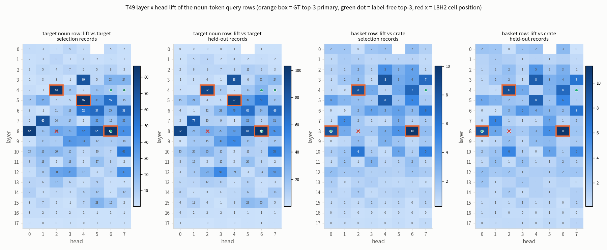

[`t49-lift-heatmaps.png`](figures/t49/t49-lift-heatmaps.png) — 18 × 8 cell 의 lift (target · basket, selection record 와 held-out). 상자 = GT top-3, 점 = label-free top-3, x = L8H2. 정의와 수치는 sidecar.

**target map** (target body 기준, 모든 phase; same-scene · new-scene 은 record 2 개씩의 평균)

| source | target mass | lift | `peak_on_target` | IoU@0.25 | IoU@0.5 | same-scene mass · lift | new-scene mass · lift |
|---|---:|---:|---:|---:|---:|---|---|
| **명사 GT k3 σ1 (primary)** | 0.2359 | 28.42 | **1.000** | 0.181 | 0.165 | 0.267 · 31.15 | 0.205 · 25.68 |
| 명사 GT k3 σ0 | **0.5281** | **93.94** | 1.000 | 0.652 | 0.481 | 0.573 · 98.32 | 0.483 · 89.56 |
| 명사 label-free k3 σ1 (secondary) | 0.1649 | 17.39 | 0.9375 | 0.124 | 0.114 | 0.174 · 18.66 | 0.156 · 16.12 |
| 명사 head-average (L2–17) | 0.2346 | 35.60 | 0.9375 | 0.099 | 0.092 | 0.262 · 42.59 | 0.208 · 28.61 |
| **L8H2 (action, 서빙)** | 0.1465 | 55.19 | 0.693 | 0.169 | 0.092 | 0.167 · 56.25 | 0.126 · 54.14 |
| T47 oracle top-3 σ1 (action) | 0.0644 | 8.78 | 0.746 | 0.058 | 0.052 | 0.076 · 10.52 | 0.053 · 7.03 |
| T47 oracle top-3 σ0 (action) | 0.1057 | 22.07 | 0.880 | 0.061 | 0.050 | 0.129 · 28.01 | 0.083 · 16.13 |

- **phase 별** (target mass · lift · `peak_on_target`): 명사 GT σ1 pre-grasp 0.175 · 33.68 · 1.000, post-grasp 0.370 · 18.75 · **1.000**. L8H2 pre-grasp 0.182 · 74.47 · 0.839, post-grasp 0.076 · 15.06 · **0.382**. 명사 GT σ0 pre 0.481 · 116.8, post 0.650 · 49.20. T47 oracle σ1 pre `peak` 0.770, post 0.697.
- **lift 는 L8H2 가 명사 σ1 primary 보다 크다 (55.2 대 28.4)** 이고 target mass 와 `peak_on_target` 은 명사가 앞선다. 명사 σ0 는 셋 모두 앞선다. 지표마다 앞서는 쪽이 다르다 — 어느 쪽으로 읽을지는 §7 의 3D 와 함께 본다.
- **class mass 분해** (all phases, same-scene / new-scene):

| source | target | destination | other_object | robot_gripper | robot | support | background |
|---|---|---|---|---|---|---|---|
| 명사 GT σ1 | 0.267 / 0.205 | 0.030 / 0.065 | 0.019 / 0.018 | 0.170 / 0.105 | 0.011 / 0.050 | 0.458 / 0.456 | 0.046 / 0.102 |
| 명사 GT σ0 | 0.573 / 0.483 | 0.007 / 0.029 | 0.015 / 0.012 | 0.161 / 0.065 | 0.002 / 0.033 | 0.231 / 0.330 | 0.011 / 0.048 |
| L8H2 | 0.167 / 0.126 | 0.004 / 0.035 | 0.008 / 0.006 | 0.079 / 0.035 | 0.003 / 0.038 | 0.723 / 0.711 | 0.016 / 0.050 |

**목적지 map** (crate 기준; 아래 "crate mass" = crate 칸의 attention 질량 몫, verify.json 의 `target_mass` 필드가 이 표에서는 crate 를 뜻한다)

| source | crate mass | lift | peak on crate | IoU@0.25 | IoU@0.5 |
|---|---:|---:|---:|---:|---:|
| **basket GT k3 σ1 (primary)** | **0.6052** | 7.20 | **0.958** | 0.499 | 0.451 |
| basket GT k3 σ0 | 0.7173 | 9.39 | 0.956 | 0.455 | 0.418 |
| basket 같은 cell (target 의 GT cell) σ1 | 0.6151 | 7.31 | 0.975 | 0.509 | 0.457 |
| basket label-free σ1 | 0.2886 | 3.37 | 0.719 | 0.272 | 0.235 |
| basket head-average | 0.2802 | 4.13 | 0.367 | 0.231 | 0.205 |
| L8H2 (action) | 0.1751 | 2.41 | 0.222 | 0.128 | 0.120 |
| T47 oracle σ1 (action) | 0.1150 | 1.23 | 0.072 | 0.109 | 0.099 |
| (참고) target 명사 map 을 crate 로 채점 | 0.0982 | 1.46 | 0.028 | 0.125 | 0.097 |

- basket map 을 **target** 으로 채점하면 (섞임) target mass 0.0237 · lift 2.31 · peak 0.048 이다 (pre-grasp peak 0.000).
- 목적지 class mass (basket GT σ1): destination 0.653 (same) / 0.557 (new), target 0.014 / 0.012.
- L8H2 의 목적지 질량은 같은 지표에서 crate mass 0.175, peak 0.222 로, post-grasp 에서 높다 (crate mass pre 0.117 → post 0.275).

### 6. 분리 (#5) — target 과 목적지를 한 번의 prefix pass 에서 따로 얻는가

(§3 그림의 오른쪽 panel.) peak 는 3 camera joint argmax, 적중은 patch coverage > 0.05. 4 record 의 record-mean.

| 쌍 | target peak ∈ target | basket peak ∈ crate | **both_correct** | target peak ∈ crate | basket peak ∈ target | 같은 patch | target map 의 target mass · crate mass | basket map 의 crate mass · target mass |
|---|---:|---:|---:|---:|---:|---:|---|---|
| **primary** (`noun_gt` / `basket_gt` k3 σ1) | 1.000 | 0.983 | **0.981** | 0.000 | 0.000 | 0.000 | 0.275 · 0.035 | 0.553 · 0.007 |
| secondary (label-free) | 1.000 | 0.917 | 0.914 | 0.000 | 0.000 | 0.000 | 0.161 · 0.099 | 0.251 · 0.014 |
| basket 에 target 의 cell 사용 | 1.000 | 0.917 | 0.904 | 0.000 | 0.000 | 0.000 | 0.275 · 0.035 | 0.511 · 0.004 |
| head-average | 1.000 | 0.767 | 0.769 | 0.000 | 0.077 | 0.067 | 0.191 · 0.095 | 0.252 · 0.032 |

- primary 의 `both_correct`: scene 별 same-scene 0.962 (pre-grasp 0.929 · post-grasp 1.000), new-scene 1.000. phase 별 pre-grasp 0.964 · post-grasp 1.000.
- record · phase 별 개수 (primary): both_correct / both_visible = ep1800 pre 6 / 7 · post 6 / 6, headfix 9 / 9 · 6 / 6, ep1850 10 / 10 · 5 / 5, ep1900 9 / 9 · 6 / 6 → 합 57 / 58 (산출; 60 frame 중 ep1800 의 pre-grasp 2 frame 은 target 이 가려져 eligible 이 아님). 이 표의 mass 열은 분리 집계의 frame 단위 값이라 §5 표의 camera-sample 집계 값과 다르다 (미측정 해석 — 집계 단위 차이로 읽었으나 verify.json 이 이 차이를 직접 서술하지 않는다).
- L8H2 대응 값은 없다 — action query 에는 basket map 이 없다 (`not_measured`).

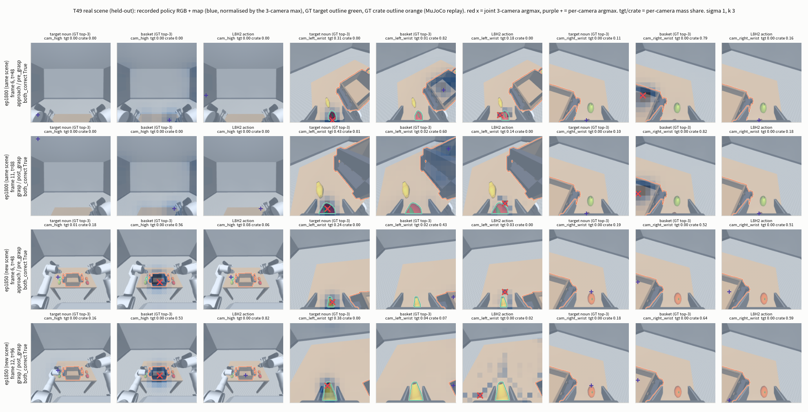

[`t49-scene-overlay.png`](figures/t49/t49-scene-overlay.png) — held-out 4 frame (ep1800 frame 6 · 11, ep1850 frame 6 · 12; pre-grasp 와 post-grasp 각 2) 의 3 camera 위에 target 명사 map · basket map · L8H2 map (파랑, 3 camera 최대로 정규화) 과 GT target 윤곽 (초록) · crate 윤곽 (주황) 을 겹쳤다. 빨간 x = joint 3-camera argmax. 열 제목에 per-camera target · crate mass 몫. 선택 규칙은 sidecar (σ=1, k=3, cell 은 §4). 이 그림에서 명사 target map 은 `cam_left_wrist` 의 과일 윤곽 안에, basket map 은 crate 윤곽 안에 놓이고, 같은 frame 의 L8H2 map 은 post-grasp 의 ep1850 frame 12 `cam_left_wrist` 에서 과일 밖의 pixel 들에 흩어진다.

### 7. 3D end-to-end (#6) — held-out 60 frame, record-mean

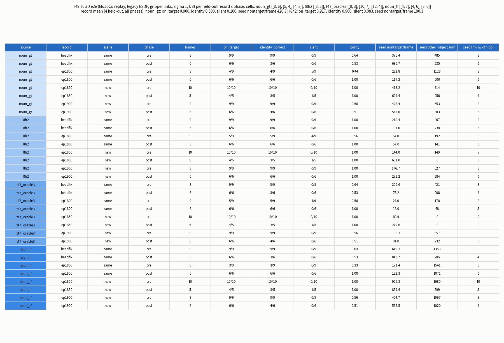

[`t49-e2e-table.png`](figures/t49/t49-e2e-table.png) — source × 지표 표 (같은 수치의 scene · phase 분해 포함).

| source (σ=1) | `on_target` | `identity_correct` | silent failure | chosen cluster purity | non-target seed 손실 (point / frame) | target 잔여 비율 |
|---|---:|---:|---:|---:|---:|---:|
| **명사 GT k3 (primary)** | 0.900 | **0.800** | 0.100 | **0.700** | **420.3** | 0.0031 |
| 명사 label-free k3 (secondary) | 0.883 | 0.783 | 0.117 | 0.684 | 579.3 | 0.0051 |
| **L8H2 (서빙, σ 없음)** | 0.917 | **0.900** | 0.083 | **0.933** | **190.3** | 0.0926 |
| T47 oracle top-3 (action) | 0.917 | 0.817 | 0.083 | 0.717 | 114.7 | 0.0828 |

- **scene · phase 로 나눈 `identity_correct` · purity · non-target 손실** — 명사 GT: same-scene 0.733 · 0.629 · 342.5, new-scene 0.867 · 0.772 · 498.1, pre-grasp 0.861 · 0.661 · 374.0, post-grasp 0.692 · 0.760 · 496.3. L8H2: same 0.867 · 0.867 · 119.9, new 0.933 · 1.000 · 260.6, pre 0.889 · 0.889 · 148.3, post 0.900 · 1.000 · 273.5.
- non-target seed 손실의 class 별 합 (4 record 평균의 합; 명사 GT 대 L8H2): destination 4052.5 대 1944.3, other_object 1118.5 대 499.5, table 1133.5 대 410.3. L8H2 는 target 잔여 비율이 크다 (0.0926 대 0.0031).
- **pooled (60 frame, T47 style)**: `on_target` 명사 GT 54 · 명사 label-free 53 · L8H2 55 · oracle 55, silent failure 6 · 7 · 5 · 5. seed precision / recall: 명사 GT 0.173 / 0.995, L8H2 0.366 / 0.864, oracle 0.520 / 0.917. chosen target 점 비율 0.565 · 0.785 · 0.614 (명사 GT · L8H2 · oracle), centroid 오차 median 0.0346 · 0.0169 · 0.0345 m. 한 frame 의 e2e 시간 median 456 · 441 · 440 ms (명사 GT · L8H2 · oracle).
- record 단위 pilot (4 record × 15 frame) 이므로 `identity_correct` 0.800 과 0.900 의 차이를 크게 읽지 않는다. 그러나 purity (0.700 대 0.933) 와 non-target 손실 (420 대 190) 은 같은 방향으로 갈린다.
- **task 의 되돌아올 지점**: "2D 는 좋은데 3D 가 L8H2 와 같으면 head 처럼 3D 집계가 흡수하는 것이다. 이득은 목적지 분리 · 결정성 · 비용 쪽에서만 주장한다." 측정된 3D 는 같지 않고 **낮다** (identity · purity · non-target 손실). 그래서 3D 에서의 이득은 주장하지 않고, 이득의 후보는 분리 · 결정성 · 비용 쪽에 둔다. 원인은 T49b 에서 σ · k 로 확인했으나 닫히지 않았다.

### 8. prompt 교체 (#7, exploratory) — map 은 instruction 을 따라 움직이는가

같은 frame (image · state 그대로) 에서 target 명사만 scene 의 다른 과일로 바꾼 prompt 로 다시 뽑았다 (record 당 3 개, 7 record × 3 = 21 variant). held-out 4 record 의 12 variant (180 frame 중 두 과일이 모두 ≥ 200 px 보이는 164 frame 이 eligible, 산출 180 = 4 × 3 × 15). 선택 record 는 cell 선택에 쓰였으므로 판단 근거로 쓰지 않는다.

| source (held-out, record-mean) | 새 과일 위 peak (교체 prompt) | 새 과일 위 peak (원 prompt) | 원 target 위 peak (교체 prompt) | **moved** | pooled moved | 새 과일 lift 교체 / 원 | lift_new_gain | map_corr |
|---|---:|---:|---:|---:|---|---|---:|---:|
| **명사 GT k3 σ1** | 0.959 | 0.017 | 0.104 | **0.958** | **157 / 164** | 29.47 / 5.86 | 23.61 | 0.210 |
| 명사 head-average | 0.939 | 0.022 | 0.125 | 0.939 | 153 / 164 | 51.13 / 4.09 | 47.03 | 0.369 |
| 명사 label-free σ1 | 0.757 | 0.011 | 0.305 | 0.755 | 121 / 164 | 18.75 / 7.27 | 11.48 | 0.696 |

- 명사 GT 의 `moved`: same-scene 0.927 · new-scene 0.989. pre-grasp 98 / 98, post-grasp 59 / 66 (same-scene post-grasp 0.828, new-scene post-grasp 0.967).
- 같은 교체에서 **basket map 은 흔들리지 않는다**: basket GT map 의 원 prompt 대 교체 prompt 상관 0.989 (held-out), crate lift 7.20 → 7.23.
- 참고 (selection record 포함, cell 이 그 record 로 골라진 것이라 판단 근거 아님): 명사 GT `moved` 0.896 (455 / 501).
- **되돌아올 지점 점검**: "prompt 교체에서 map 이 옮겨가지 않으면 명사 map 은 instruction 이 아니라 장면의 현저한 물체를 따른다 → wrong-object 진단에는 쓸 수 없다." 측정은 옮겨갔다 (157 / 164). 다만 이것은 (wrong-object 정의 · 사용자 판정을 거친) 별도의 wrong-object 진단 STEP 이 아니다.

### 9. 비용 (#8)

| 항목 | 값 |
|---|---|
| 명사 prefix pass (device, embed_prefix + 18 layer + jit 안 slice) | median **26.52 ms** · p90 26.93 ms (1025 frame) |
| 같은 frame (`long` 앞 8 frame) 전처리 포함 | 명사 49.21 ms 대 L8H2 의 prefix + suffix 10 회 **107.5 ms** (median) |
| model load · compile | 27.8 s · 1.61 s |
| memory | JAX peak 7.60 GB, nvidia-smi peak 8806 MiB |
| 추출 wall | smoke 57.8 s, full 255.9 s |

(L8H2 와의 memory 비교는 별도 process 로 재지 않았다 — `not_measured`.)

### 10. 읽을 때의 한계

| 한계 | 내용 |
|---|---|
| **pilot** | held-out 4 record × 15 frame, 같은 scene 의 두 record 는 독립 아님. 모든 비율의 단위가 크다 |
| **GT 로 고른 cell** | primary cell 은 selection record 3 개의 GT lift 로 골랐다 (label 이 필요). label-free 로 고른 secondary 는 record-mean 전체 기준 2D · 3D 지표 모두 primary 보다 나쁘다 (2D target mass 0.165 대 0.236, 3D non-target 손실 579.3 대 420.3) |
| **primary 는 σ=1** | 사전 고정이 σ=1 이다. σ=0 합산은 exploratory (target mass 0.528 · lift 93.9) 이고 3D 는 T49b 에서 잰다 |
| **3D 는 legacy ESDF · grasp latch 없음** | cuRobo ESDF backend e2e 와 latch 포함 e2e 는 측정하지 않았다 (재측정 대기 10) |
| **L8H2 와 명사의 집계가 다른 값을 줄 수 있다** | T47 pooled 와 T49 record-mean (§ 읽는 법) |

### 11. 되돌아올 지점 · 판정 대기 제안

| task 의 신호 (`T49.task.md`) | 측정 | 다음 |
|---|---|---|
| #1 에서 명사 행의 image mass 가 거의 없으면 명사 query 는 쓸 수 없다 | image mass < 0.01 은 L0 하나 (target · basket 행), 선택된 cell 의 image mass 는 0.77 – 0.99 | 해당 없음 |
| 2D 는 좋은데 3D 가 L8H2 와 같으면 이득은 분리 · 결정성 · 비용 쪽에서만 | 3D 는 L8H2 보다 낮다 (identity 0.800 대 0.900 · purity 0.700 대 0.933 · non-target 손실 420 대 190) | 3D 이득은 주장하지 않는다. T49b (σ · k) 후 T51b 로 |
| prompt 교체에서 map 이 옮겨가지 않으면 wrong-object 진단에 쓸 수 없다 | 옮겨갔다 (157 / 164) | wrong-object 진단 후보 (검토 문서 §3 후속 후보) 는 별도 판정 |
| 서빙 반영 (`attention_policy.py` source 교체) 은 별도 STEP | 하지 않았다 | 결과 보고 → 사용자 판정 → 별도 STEP (T46 session 에 먼저 알린다) |

**판정 대기 제안 (b) — 명사 query 로 identity · destination, L8H2 로 3D seed 를 얻는 결합 (미측정 해석 포함).** 측정된 비대칭은 이렇다. 명사 query 는 prompt 가 가리키는 물체 (2D `peak_on_target` 1.000, post-grasp 에서도), 목적지 (`both_correct` 0.981), instruction 교체 (157 / 164) 를 따라가고, L8H2 는 3D 에서 `identity_correct` · purity · non-target 손실이 낫다. 이 두 장점을 합치면 (예: 명사 map 으로 어느 물체인지, L8H2 로 3D seed 를) 좋아질 수 있다고 **볼 수 있으나, 그 결합을 어떤 방식으로도 돌리지 않았다 (미측정 해석).** 어떤 경로로 결합하는지도 정해지지 않았다. 공식 비교는 T51b (명사 행을 T51 의 protocol 에 추가) 의 몫이고, 사용자 판정 전이므로 이 로그는 결합을 채택하지 않는다.

**측정하지 않은 것 (`T49.verify.json` `not_measured`).** cuRobo 회귀 기준선 (GPU 미사용 지시) · 명사 prefix 의 GPU memory 를 L8H2 serving 과 별도 process 로 잰 값 · selection record 의 e2e 3D · separation 의 L8H2 대응 (action query 에 basket map 이 없음).

**산출물.**

- **측정**: `handoff/T49.verify.json`. 원자료는 run 디렉터리 `/mnt/dev/AG3S_VLA-storage/results/development/20261012T190547+0900_28b981600bf7_c39a577332fe/verify/T49/` (`extract` · `select` · `validate` · `swap` · `e2e`). T47 의 GT cache 는 읽기 전용 입력.
- **figure** (각각 `.json` sidecar 있음): [`scene`](figures/t49/t49-scene-overlay.png) · [`lift heatmap`](figures/t49/t49-lift-heatmaps.png) · [`mass · 분리`](figures/t49/t49-separation-mass.png) · [`3D 표`](figures/t49/t49-e2e-table.png).
- **구현**: `AG3S/ag3s/experiments/studies/t49_noun_query{,_core,_extract}.py` · `tests/ag3s/test_t49_noun_query.py`. `handoff/T49.impl.md`.
- commit 은 하지 않았다.

---

## T49b — 명사 query 의 3D 약점 확인: smoothing (σ) 과 cell 수 (k) 변형 (exploratory, 2026-10-12 KST)

**이 절이 답하는 물음 (목적).** T49 에서 명사 query 는 2D · 분리 · prompt 교체에서 L8H2 보다 앞섰지만 3D 의 `identity_correct` · purity · non-target 손실은 L8H2 보다 나빴다. 의심한 원인은 사전 고정한 **σ=1 smoothing 과 top-3 raw 합산** 이다 (T47b 에서 σ=1 이 L8H2 의 3D identity 를 떨어뜨린 전례: held-out 60 frame 의 `identity_correct` 54 → 49, 위 "T47 · T47b" 절 §8). T49b 는 이미 추출된 명사 attention 위에서 **σ ∈ {0, 1} × k ∈ {1, 2, 3}** 과 label-free top-3 σ=0 을 3D e2e 로 다시 잰다. k=1 은 GT 순위 1 위 L8H6 단독이다. **이 STEP 은 exploratory 이고 채택 근거가 아니다** (사용자 판정, T49 결과 후): 명사 query 의 cell · k · σ 선택은 T51b (공식 protocol) 로 정한다.

**한 줄 결과 (before → after).**

- **before.** T49 primary (`noun_gt_k3_s1`): `identity_correct` 0.800, purity 0.700, non-target 손실 420.3 (L8H2 0.900 · 0.933 · 190.3).
- **after.** **어떤 σ · k 변형도 L8H2 의 3D 수준에 못 미쳤다.** σ=0 이 identity 를 0.800 → 0.850, purity 를 0.700 → 0.831 로 올렸고 (k 와 무관), k 는 identity · purity 를 바꾸지 않았다 (σ 가 같으면 0.850 / 0.800 으로 같음). 대신 **non-target 손실은 σ=0 에서 오히려 커졌다** (512.8 → 583.4, k 가 커질수록 증가; σ=1 은 394.5 → 420.3). L8H2 는 0.900 · 0.933 · 190.3. label-free top-3 σ=0 은 0.800 · 0.700 · 675.6.
- 2D 는 σ=0 에서 target mass 0.47 – 0.59, lift 89 – 98.5 로 σ=1 (0.20 – 0.27, 25 – 31) 보다 높다. 3D 와 2D 가 같은 방향으로 움직이지 않았다.

**읽는 법과 출처 규약.** 수치는 `T49b.verify.json` 의 `numbers` 에서만 왔다. 모두 **exploratory** 이며 해석은 "(미측정 해석)". 집계는 T49 와 같은 record-mean (held-out 4 record × 15 frame, 추출 오류 frame 0). 같은 입력 (T49 의 select · extract) 을 읽기 전용으로 쓰고 `verify/T49b/variants/<name>/e2e/` 에만 썼다 (T49 e2e 출력의 sha1 은 전후 동일). 3D 는 CPU, legacy ESDF, grasp latch 없음. 회귀 기준선 일치 (legacy 14 / 15 · 15 / 15 · −29.031048 mm), cuRobo 기준선은 돌리지 않았다. 검증: 6 개 e2e run 의 L8H2 row 와 `gt_k3_s1` 의 명사 row 가 T49 e2e row 와 field 단위 일치 (불일치 0, 비교한 field 4260 개 / 60 frame, `_ms` 제외), 2D 재계산이 T49 validate 와 최대 절대차 0.0. HEAD `ed47b976` (e2e 는 `de2042e9` 에서 시작해 중간 docs-only commit 만 바뀜, .py 변경 없음).

### 1. 3D 결과 (held-out, record-mean, 모든 phase)

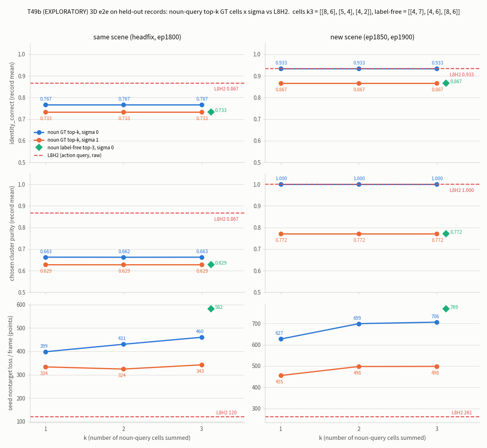

[`t49b-sigma-k-3d.png`](figures/t49/t49b-sigma-k-3d.png) — σ × k 별 `identity_correct` · purity 와 L8H2 기준선. 전 변형 표는 [`t49b-variants-table.png`](figures/t49/t49b-variants-table.png).

| source | `on_target` | `identity_correct` | silent | chosen cluster purity | non-target seed 손실 (point / frame) | `on_target` ∧ ¬`identity` (record 평균 frame 수) |
|---|---:|---:|---:|---:|---:|---:|
| 명사 GT k1 σ0 (L8H6 단독) | 0.917 | 0.850 | 0.083 | 0.831 | 512.8 | 1.00 |
| 명사 GT k2 σ0 | 0.917 | 0.850 | 0.083 | 0.831 | 564.9 | 1.00 |
| 명사 GT k3 σ0 | 0.917 | 0.850 | 0.083 | 0.831 | 583.4 | 1.00 |
| 명사 GT k1 σ1 | 0.900 | 0.800 | 0.100 | 0.700 | 394.5 | 1.50 |
| 명사 GT k2 σ1 | 0.900 | 0.800 | 0.100 | 0.700 | 411.0 | 1.50 |
| 명사 GT k3 σ1 (T49 primary) | 0.900 | 0.800 | 0.100 | 0.700 | 420.3 | 1.50 |
| 명사 label-free k3 σ0 | 0.900 | 0.800 | 0.100 | 0.700 | 675.6 | 1.50 |
| **L8H2 (σ 없음)** | 0.917 | **0.900** | 0.083 | **0.933** | **190.3** | 0.25 |

- 합산 개수 (산출, 4 record × 15 frame = 60): `identity_correct` σ0 변형 51 / 60, σ1 변형 48 / 60, L8H2 54 / 60. `on_target` 55 · 54 · 55. record 별로 보면 명사 변형은 모두 `headfix` 에서 `identity_correct` 12 / 15 (L8H2 15 / 15) 이고, σ1 변형과 label-free 는 `ep1900` 에서 13 / 15 (σ0 변형과 L8H2 15 / 15). 차이가 나는 record 가 둘뿐이라 4 record pilot 이다.
- **scene · phase 별** (identity · purity · non-target 손실):

| source | same-scene | new-scene | pre-grasp | post-grasp |
|---|---|---|---|---|
| 명사 GT k1 σ0 | 0.767 · 0.663 · 398.7 | 0.933 · 1.000 · 626.9 | 0.889 · 0.798 · 442.8 | 0.775 · 0.881 · 629.9 |
| 명사 GT k2 σ0 | 0.767 · 0.662 · 430.6 | 0.933 · 1.000 · 699.2 | 0.889 · 0.798 · 551.9 | 0.775 · 0.881 · 585.9 |
| 명사 GT k3 σ0 | 0.767 · 0.663 · 460.5 | 0.933 · 1.000 · 706.2 | 0.889 · 0.798 · 579.1 | 0.775 · 0.881 · 591.0 |
| 명사 GT k1 σ1 | 0.733 · 0.629 · 333.8 | 0.867 · 0.772 · 455.2 | 0.861 · 0.661 · 335.1 | 0.692 · 0.760 · 493.3 |
| 명사 GT k2 σ1 | 0.733 · 0.629 · 324.5 | 0.867 · 0.772 · 497.6 | 0.861 · 0.661 · 358.1 | 0.692 · 0.760 · 496.8 |
| 명사 GT k3 σ1 | 0.733 · 0.629 · 342.5 | 0.867 · 0.772 · 498.1 | 0.861 · 0.661 · 374.0 | 0.692 · 0.760 · 496.3 |
| 명사 label-free k3 σ0 | 0.733 · 0.629 · 582.2 | 0.867 · 0.772 · 768.9 | 0.861 · 0.661 · 659.7 | 0.692 · 0.760 · 697.6 |
| L8H2 | 0.867 · 0.867 · 119.9 | 0.933 · 1.000 · 260.6 | 0.889 · 0.889 · 148.3 | 0.900 · 1.000 · 273.5 |

### 2. 2D (같은 변형, held-out, T49 validate 에서 읽음)

| source | same-scene target mass · lift · peak | new-scene target mass · lift · peak |
|---|---|---|
| 명사 GT k1 σ0 | 0.587 · 98.5 · 1.000 | 0.494 · 98.5 · 1.000 |
| 명사 GT k2 σ0 | 0.571 · 98.3 · 1.000 | 0.470 · 89.1 · 1.000 |
| 명사 GT k3 σ0 | 0.573 · 98.3 · 1.000 | 0.483 · 89.6 · 1.000 |
| 명사 GT k1 σ1 | 0.269 · 31.0 · 1.000 | 0.207 · 27.8 · 1.000 |
| 명사 GT k2 σ1 | 0.265 · 31.2 · 1.000 | 0.198 · 25.4 · 1.000 |
| 명사 GT k3 σ1 | 0.267 · 31.1 · 1.000 | 0.204 · 25.7 · 1.000 |
| 명사 label-free k3 σ0 | 0.353 · 51.2 · 1.000 | 0.333 · 43.1 · 0.854 |
| L8H2 | 0.167 · 56.3 · 0.731 | 0.126 · 54.1 · 0.655 |

(scene × phase 별 2D 는 `numbers.2d_vs_target_scene_phase_recomputed` 와 위 그림 sidecar. 표본 수는 same-scene 39 · new-scene 51 (frame, camera) sample.)

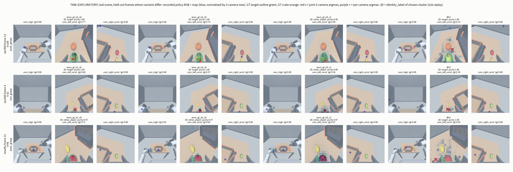

[`t49b-scene-variants.png`](figures/t49/t49b-scene-variants.png) — ep1900 frame 13 (post-grasp) 에서 변형 별 map 과 그 frame 의 3D 결과 (`on_target` · `identity_correct` · purity · non-target 손실). 정의는 sidecar.

### 3. 이 STEP 이 닫은 것과 닫지 못한 것

- 사전 질문 "명사 query 의 3D 열세는 smoothing · 합산 설정 때문인가? σ=0 이나 k=1 에서 L8H2 와의 차이가 줄어드는가?" 에 대한 측정: σ=0 에서 identity · purity 는 올랐으나 (0.800 → 0.850, 0.700 → 0.831) L8H2 (0.900 · 0.933) 에 못 미쳤고, non-target 손실은 σ=0 에서 커졌다 (512.8 – 583.4 대 σ=1 의 394.5 – 420.3, L8H2 190.3). k=1 도 같다. **σ · k 만으로는 3D 열세가 닫히지 않았다.**
- 원인은 확정하지 못했다 (재측정 대기 9). (미측정 해석) 명사 map 이 target 과 목적지 · 주변을 넓게 덮는 것 (T49 의 class mass: support 0.46, destination 0.03 – 0.06) 과 3D lifting 이 그 map 을 seed 로 쓰는 방식의 상호작용일 수 있으나, 이 STEP 은 분리해 재지 않았다.
- `noun_lf` 는 σ=0 · k=3 한 변형만 돌렸다 (k 1 · 2 와 σ=1 은 task 범위 밖, `not_measured`). selection record 의 3D 는 CLI 가 `noun_gt` 를 selection record 에서 거절해 측정하지 않았다. swap · separation 은 다시 재지 않았다.
- **채택 근거가 아니다.** 4 record 의 pilot 이고 변형은 held-out 에서 비교한 것이므로, 최종 설정은 T51b 의 calibration → held-out 분리 아래서 다시 정해야 한다.

**산출물.** `handoff/T49b.verify.json`, 원자료 `/mnt/dev/AG3S_VLA-storage/results/development/20261012T190547+0900_28b981600bf7_c39a577332fe/verify/T49b/` (`variants/<name>/e2e` · `analysis`). figure: [`graph`](figures/t49/t49b-sigma-k-3d.png) · [`scene`](figures/t49/t49b-scene-variants.png) · [`table`](figures/t49/t49b-variants-table.png). 코드 변경 없음 (T49 의 `--k` · `--sigma` 를 wrapper 로 호출). commit 은 하지 않았다.

---

## T50 — HSR 의 instruction 둔감은 fine-tuning 탓인가: probe 학습 · representation · fine-tuning 의 분리 (2026-10-12 KST)

**이 절이 답하는 물음 (목적).** T48a 에서 phase probe (`kv_L4_v1`) 는 image 를 따랐으나 instruction 의 target 교체에는 거의 반응하지 않았다 (C1 에서 원래 place 인 frame 이 `pick` 으로 바뀐 비율 0.040, home 0.000). 사용자 질문: **이것이 우리 fine-tuning (16D LoRA) 때문인가?** 원인 후보는 셋이다 — **(a) probe 학습**: probe 는 prompt 와 장면이 항상 맞는 frame 으로만 학습돼 언어를 쓸 이유가 없다 (fine-tuning 탓 아님). **(b) representation**: L4 V feature 에 "지시된 물체의 진행 상태" 가 선형으로 들어 있지 않다. **(c) fine-tuning data**: 2000 episode 가 모두 성공한 scripted 시연 (target 1 + distractor 3) 이라 언어는 처음에 과일을 고를 때만 필요하다. `pi05_base` (우리 LoRA 학습의 초기 weight) 가 로컬에 있어 **같은 feature 정의 · 같은 입력 변형을 base 와 LoRA 에 똑같이 적용해 비교**할 수 있다. ① feature 가 prompt 교체에 얼마나 움직이나 (`r` ratio), ② counterfactual 변형 (C1, 정답 `pick`) 을 학습에 넣은 probe 가 선형으로 "instruction 기준 phase" 를 읽을 수 있나를 잰다.

**한 줄 결과 (before → after).**

- **before.** probe 가 instruction 에 둔감한 것은 확인됐으나 원인 후보 셋은 가려지지 않았다.
- **after — 사전 고정 decision rule 의 출력.** LoRA 와 base 모두 counterfactual probe 가 기준 (**C0 ≥ 0.95 이고 C1_instr ≥ 0.80**, episode 별 정확도의 median) 에 미달했다. LoRA: C0 0.781 · C1_instr 0.672 (valcv), 0.827 · 0.745 (trainval). base: 0.673 · 0.698 (valcv), 0.769 · 0.656 (trainval). 규칙이 정한 문구는 "**둘 다 넘지 못하면 fine-tuning 탓이 아니다**" 이다. 이 문구가 이 STEP 의 규칙 출력이고 사용자 판정이 아니다.
- **① 민감도 r (full, episode median)**: LoRA **0.611**, base **0.999** (text 절반 0.585 / 0.791, image 절반 1.177 / 1.407). r < 1 은 target 교체가 표현만 바꾼 것보다 feature 를 덜 움직인다는 뜻이다. LoRA 가 base 보다 낮다 (이 값의 의미는 (미측정 해석), 규칙은 ② 로 판정).
- **통제**: C1 의 label 을 섞으면 C1_instr 가 0.03 으로 올라가지 않는다 (학습이 label 을 쓴다). counterfactual probe 는 C1_instr 를 올렸으나 (standard 0.02 → 0.66 – 0.71, LoRA) C0 를 0.98 에서 0.77 – 0.83 으로 낮췄다.
- base 위 **표준 probe** (원본 data 로만 학습) 의 C1 반응은 LoRA 와 같은 수준이다: place → `pick` 0.047 (base) 대 0.040 (LoRA), home → `pick` 0.002 대 0.000.

**읽는 법과 출처 규약.**

- 수치는 `T50.verify.json` 의 `numbers` (T50a = 최상위, T50b = `numbers.T50b`) 에서만 왔다. 같은 파일 숫자의 나눗셈 · 덧셈은 "(산출)". 새 probe 는 sklearn 이 없어 numpy / scipy 로 다시 쓴 LogReg 이며 (SUBTASK-b 의 `kv_L4_v1` 을 재현함은 `T50.impl.md` §1, 그 수치는 verify.json 의 `numbers` 에 없어 옮기지 않았다), verifier 가 probe metric 을 독립 재계산해 **base 108 / 108 · LoRA 108 / 108 field 가 1e-9 안에서 일치**, `r` frame 값의 최대 절대차 ≤ 5e-6.
- **집계.** 판정에 쓰는 값은 episode (50 개) 별 정확도의 **median** (lead 가 결과 전 고정). frame 합산 (pooled) 은 함께 보고만 한다. frame 은 독립 trial 이 아니다.
- **환경.** T50a = CPU (T48 의 LoRA feature cache 읽기 전용). T50b = GPU offline prefix pass 2 회 (base: val 6 family + train C0 · C1, LoRA: train C0 · C1; GPU lock 아래, 각각 시작 전 memory 0 MiB) + CPU 분석. 회귀 기준선: T50a 와 T50b 시점 모두 legacy 14 / 15 · 15 / 15 · −29.031048 mm 일치 (T50a 시점 다른 session 의 CL3 server 가 돌고 있어 load 약 24 – 27). cuRobo 기준선은 돌리지 않았다.

### 1. 사용자 판정과 타임라인 (KST)

| # | 판정 · 사건 (2026-10-12) | 이 절에서 |
|---|---|---|
| 1 | **(사용자 판정)** T50a (CPU, 바로) + T50b (GPU, T46 CL3 종료 후) 진행. offline GPU prefix pass 승인 (`pi05_base` 와 16D LoRA checkpoint) | 전체 |
| 2 | **(lead, T50.impl.md 확인 후 · 결과 전 고정)** 판정 임계 (0.95 · 0.80) 는 episode 별 정확도의 median 에 적용한다 | §3 |

| 시각 (KST) | 무엇 | 출처 |
|---|---|---|
| 17:20 – 17:35 | T50a (CPU): sensitivity · probe (valcv) · figure. 앞서 회귀 기준선 | `time_kst` · `runs` |
| 19:37:44 – 20:24:53 | T50b GPU: base extract (`--sets val train`, 65013 input, rc 0, wall 2829.7 s) | `gpu_extract[0]` 10:37:44Z – 11:24:53Z |
| 20:26:15 – 21:00:21 | T50b GPU: LoRA train extract (`--sets train`, 41604 input, rc 0, wall 2045.3 s) | `gpu_extract[1]` 11:26:15Z – 12:00:21Z |
| 21:02 – 21:30 | T50b CPU 분석 (base ① · ② valcv · trainval, LoRA ② trainval, compare) · figure | `time_kst` |

### 2. ① feature 민감도 — prompt 교체는 feature 를 얼마나 움직이는가

val 50 episode · 2601 frame. `r = d(C0, C1) / d(C0, C1p)` (C1 = distractor 3 개 prompt 평균, C1p = 같은 target 의 다른 phrasing 2 개 평균), d = host C0 feature 에 대한 상대 L2 (절반 안에서). 기준선 `d_adj` = 같은 episode 의 다음 sampled frame (stride 6 = 0.4 s) 과의 C0 거리. episode median (괄호 = q25 – q75).

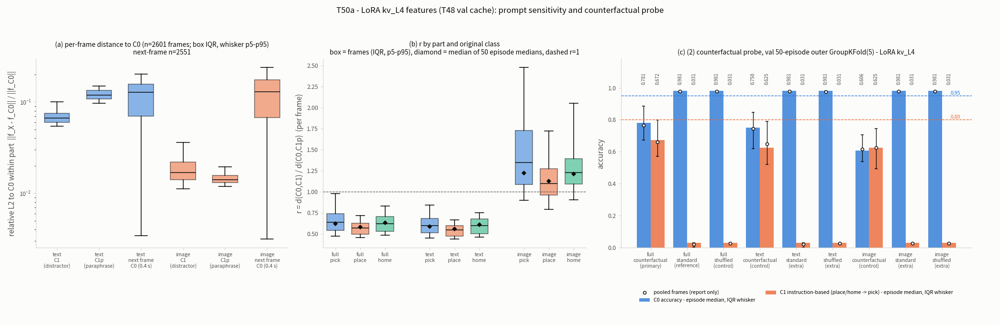

[`t50a-sensitivity-probe-graph.png`](figures/t50/t50a-sensitivity-probe-graph.png) — LoRA 의 r (frame 분포 · episode 분포) 과 probe 정확도. base 와 LoRA 의 나란한 비교는 [`t50b-base-vs-lora-graph.png`](figures/t50/t50b-base-vs-lora-graph.png).

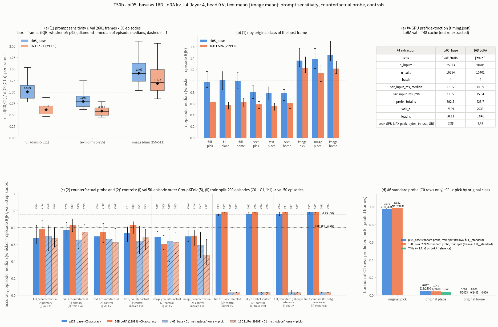

| 모델 · 절반 | r (all) | d_c1 | d_c1p | d_adj |
|---|---|---:|---:|---:|
| **LoRA full** | **0.611** (0.523 – 0.662) | 0.0409 | 0.0662 | 0.1309 |
| LoRA text 절반 | 0.585 (0.496 – 0.627) | 0.0662 | 0.1125 | 0.1282 |
| LoRA image 절반 | 1.177 (1.055 – 1.314) | 0.0158 | 0.0141 | 0.1310 |
| **base full** | **0.999** (0.870 – 1.155) | 0.1071 | 0.1125 | 0.1000 |
| base text 절반 | 0.791 (0.676 – 0.896) | 0.1441 | 0.1939 | 0.1452 |
| base image 절반 | 1.407 (1.276 – 1.602) | 0.0915 | 0.0672 | 0.0779 |

- 원래 class 별 r (full, episode median): LoRA pick 0.622 · place 0.582 · home 0.633, base pick 0.980 · place 1.006 · home 0.998. frame 합산 median: LoRA full 0.603 · text 0.574 · image 1.208, base full 1.000 · text 0.788 · image 1.401.
- (산출) target 교체의 feature 이동 `d_c1` 은 인접 frame 이동 `d_adj` 의 LoRA full 0.0409 / 0.1309 = 0.31, base full 0.1071 / 0.1000 = 1.07 배다. LoRA image 절반은 0.0158 / 0.1310 = 0.12 배다.
- (미측정 해석) LoRA fine-tuning 이 prompt 교체에 대한 feature 반응을 줄였다고 읽을 수 있으나, 이 STEP 의 판정 규칙은 ② 에 건 것이다. r 의 감소가 읽기 가능성 (②) 에는 영향이 없었다는 것이 아래 §3 이다.

### 3. ② counterfactual probe 와 decision rule

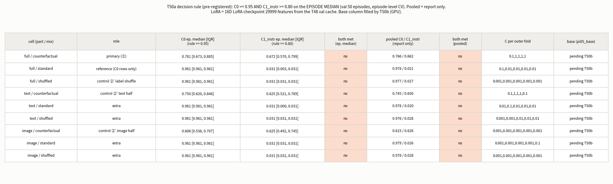

[`t50a-decision-rule-table.png`](figures/t50/t50a-decision-rule-table.png) (LoRA valcv) · [`t50b-decision-rule-table.png`](figures/t50/t50b-decision-rule-table.png) (base 대 LoRA, valcv · trainval). `valcv` = val 50 episode 의 episode 단위 5-fold CV (T50a primary), `trainval` = train 200 episode 의 C0 + C1 로 학습해 val 50 episode 평가 (T50b). 모든 probe 는 같은 512D feature, multinomial LogReg (C 는 inner GroupKFold 로 선택, 모든 fold 수렴).

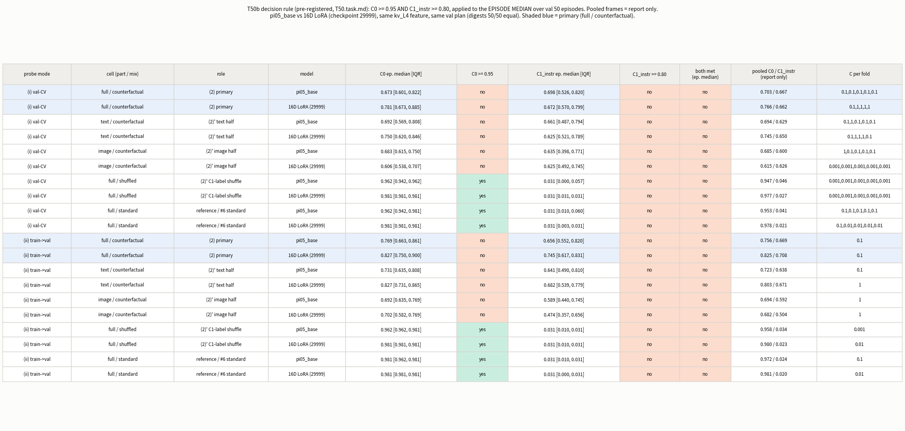

**사전 고정 규칙 (`T50.task.md`).**

1. LoRA 에서 ② 가 C0 ≥ 0.95 이고 C1 instruction-기준 ≥ 0.80 이면 "representation 에 있음 → 원인은 (a) probe 학습".
2. 아니면 (b) 또는 (c). **(b) 와 (c) 의 구분은 base 결과로 한다**: base 에서 기준을 넘고 LoRA 에서 넘지 못하면 (c) fine-tuning 탓. **둘 다 넘지 못하면 fine-tuning 탓이 아니다.**

**episode median 값 (판정에 쓰는 값)**: counterfactual probe (primary, `full__counterfactual`) 의 C0 / C1_instr.

| 모델 | ② (i) valcv C0 · C1_instr | ② (ii) trainval C0 · C1_instr | 기준 (≥ 0.95 ∧ ≥ 0.80) |
|---|---|---|---|
| **LoRA** | 0.781 · 0.672 | 0.827 · 0.745 | 미달 (둘 다) |
| **base** | 0.673 · 0.698 | 0.769 · 0.656 | 미달 (둘 다) |

frame 합산 (보고만): LoRA valcv 0.766 · 0.662, trainval 0.825 · 0.708. base valcv 0.703 · 0.667, trainval 0.756 · 0.669.

**통제와 참고 cell (episode median, C0 · C1_instr).** 정의: `text` · `image` = 그 절반만, `shuffled` = C1 행 label 무작위, `standard` = C0 행만으로 학습.

| cell | LoRA valcv | base valcv | LoRA trainval | base trainval |
|---|---|---|---|---|
| counterfactual, full (primary) | 0.781 · 0.672 | 0.673 · 0.698 | 0.827 · 0.745 | 0.769 · 0.656 |
| counterfactual, text 절반 | 0.750 · 0.625 | 0.692 · 0.661 | 0.827 · 0.682 | 0.731 · 0.641 |
| counterfactual, image 절반 | 0.606 · 0.625 | 0.683 · 0.635 | 0.702 · 0.474 | 0.692 · 0.589 |
| shuffled label, full | 0.981 · 0.031 | 0.962 · 0.031 | 0.981 · 0.031 | 0.962 · 0.031 |
| standard, full (`kv_L4_v1` 과 같은 방식) | 0.981 · 0.031 | 0.962 · 0.031 | 0.981 · 0.031 | 0.981 · 0.031 |

- standard probe 의 C0 는 base · LoRA 모두 기준을 넘는다 (episode median 0.962 – 0.981; frame 합산 base 0.953 / 0.972, LoRA 0.978 / 0.981). 즉 **base feature 도 phase 를 읽는다** — task 의 "base 가 16D 입력 변환과 맞지 않아 feature 가 무의미" 되돌아올 지점에는 해당하지 않는다.
- 같은 probe 를 counterfactual 로 학습하면 C1_instr 는 올라가지만 (LoRA valcv frame 합산: standard 0.021 → counterfactual 0.662, `pick` 예측 비율 place 0.637 · home 0.687) C0 가 같이 떨어진다 (0.978 → 0.766). label 을 섞은 통제는 C1_instr 0.027 로, label 이 학습에 쓰였음을 확인한다.
- (미측정 해석) 이 512D · 이 층 · 이 선형 probe 위에서 C0 와 C1 을 동시에 만족하는 해가 학습되지 않았다. VLA 의 다른 layer 나 다른 objective (예: contrastive) 에서는 어떤지 이 STEP 은 시험하지 않았다 (재측정 대기 11).

**규칙의 출력.**

| 질문 | 측정 | 규칙의 출력 |
|---|---|---|
| LoRA 에서 ② 가 C0 ≥ 0.95 ∧ C1_instr ≥ 0.80 인가 | 아니다 (valcv · trainval 모두) | (a) "representation 에 있음 → probe 학습" 은 **확인되지 않았다** |
| base 에서 기준을 넘고 LoRA 에서 넘지 못하는가 | 아니다 (base 도 둘 다 미달) | (c) **해당 없음.** **"둘 다 넘지 못하면 fine-tuning 탓이 아니다"** |

**따라서 사전 고정 규칙에 따른 이 STEP 의 결론은 "instruction 둔감은 fine-tuning 탓이 아니다" 이다.** 규칙이 (b) 와 (c) 를 base 의 통과 여부로 가르므로, 규칙으로 남는 후보는 (b) representation (이 feature 에서 선형으로 읽히지 않음) 이다 — 이것은 규칙에서 나온 소거이고 **(b) 를 직접 확인한 측정은 아니다 (미측정 해석).** 사용자 판정 전이므로 다음 STEP (probe 를 counterfactual-aware 로 다시 학습할지, 다른 layer 를 볼지) 은 이 로그가 정하지 않는다.

### 4. base 위 표준 probe 의 T48a C1 반응 (#6)

| `pick` 으로 예측된 비율 (val C1 행, 원래 class 별, pooled) | place (n = 2400) | home (n = 2403) |
|---|---:|---:|
| base 위 표준 probe (train 200 episode C0 로 학습, `trainval` standard) | 0.0471 (113 / 2400) | 0.0017 (4 / 2403) |
| LoRA 위 표준 probe (같은 조건) | 0.0400 (96 / 2400) | 0.0000 (0 / 2403) |
| (참고) T48a 의 `kv_L4_v1` (LoRA, 원 probe) | 0.0396 (95 / 2400) | 0.0000 (0 / 2403) |

### 5. 실제 scene — C1 에서 feature 반응이 큰 frame · 작은 frame

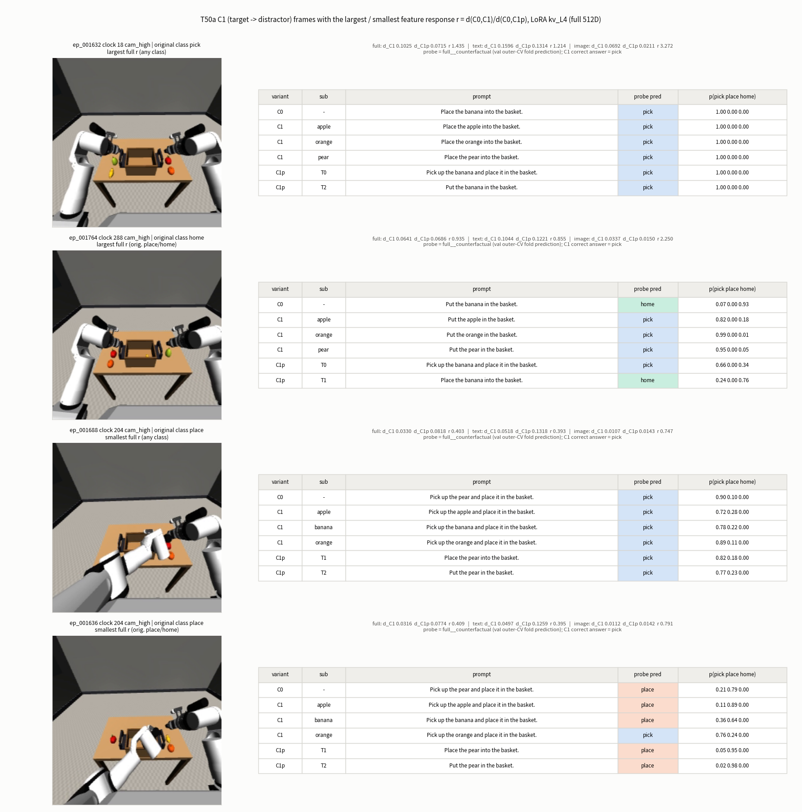

[`t50a-scene-c1-response.png`](figures/t50/t50a-scene-c1-response.png) — LoRA feature 에서 full `r` 이 가장 큰 frame 과 가장 작은 frame (전체 · 원래 place / home 중, episode 마다 하나), 그 frame 의 image 와 C0 · C1 · C1p 의 prompt, probe 예측 · 확률. 선택 규칙은 sidecar (`selection_rule`: full__r 로 정렬, 가장 큰 / 작은 것). **T50b (base) 의 scene figure 는 만들지 않았다** (`not_measured`).

### 6. 비용 (T50b #4)

| 항목 | base | LoRA (train) |
|---|---|---|
| 추출 input · call (batch 4) | 65013 · 16254 | 41604 · 10401 |
| unit · variant (val / train) | val 50 · 23409, train 200 · 41604 | train 200 · 41604 (LoRA val 은 T48 cache 재사용) |
| prefix pass (device) input 당 median · p90 | **13.72 ms** · 13.77 ms | 14.99 ms · 15.04 ms |
| prefix 합 · load · wall | 892.5 s · 58.1 s · 2824 s | 623.7 s · 9.85 s · 2039 s |
| JAX peak · nvidia-smi peak | 7.38 GB · 8820 MiB | 7.47 GB · 8804 MiB |
| batch parity (n = 4) rel L2 max | 0.0065 | 0.0025 |
| state bin replica 불일치 row (val / train) | 27 / 4 | — / 4 |

- 비교의 전제: val plan digest 가 base 와 LoRA 에서 **50 / 50 같다** (같은 입력 변형을 비교한다).

### 7. 읽을 때의 한계 · 측정하지 않은 것 · 판정 대기

| 한계 | 내용 |
|---|---|
| **feature 정의는 하나** | `kv_L4_v1` 의 정의 (layer 4 · V · head 0, text · image 평균 512D) 와 LogReg 만 시험했다. 다른 layer · head · pooling · objective 는 측정하지 않았다 |
| **probe 학습 data** | `valcv` 의 학습은 val 40 episode 라 `kv_L4_v1` (train 200 episode) 과 같은 probe 가 아니다. `trainval` 은 train 200 episode 를 쓴다. 두 방식 모두 같은 결론 (미달) |
| **C1 정답 pick 의 전제** | T48a 와 같다 — distractor 가 episode 내내 건드려지지 않는다는 dataset 성질에 기댄다 |
| **fine-tuning 의 다른 요인** | base 대 LoRA 의 차이는 SigLIP fine-tune 과 gemma_2b LoRA adapter 의 합이다 (`T50.impl.md` §3 의 서술). 어느 쪽이 r 의 변화를 만들었는지는 가르지 않았다 |
| **본 측정이 아닌 smoke** | impl 의 smoke 수치는 이 로그에 쓰지 않았다 |

**측정하지 않은 것 (`T50.verify.json` `not_measured`).** cuRobo 회귀 기준선 · T50b 의 scene figure (실제 image + prompt, T50a 의 scene figure 가 LoRA 만 다룸).

**판정 대기.** (1) decision rule 의 출력 ("fine-tuning 탓이 아니다") 을 받아들이고 후속을 정할지 — 후속 후보는 task 의 되돌아올 지점 (a) 에 적힌 "probe 를 counterfactual-aware 로 다시 학습" (Bhardwaj et al. 의 contrastive objective 와 비교) 이나, 이번 결과는 (a) 가 아니라 규칙상 소거로 (b) 쪽이다. (2) HSR 의 위치 (T48b 절 제안 (a)). 둘 다 사용자 판정 전이다.

**산출물.**

- **측정**: `handoff/T50.verify.json`. 원자료는 run 디렉터리 `/mnt/dev/AG3S_VLA-storage/results/development/20261012T172032+0900_28b981600bf7_2d9c4266f2e1/verify/T50/` (`lora` · `base` · `compare/compare_full.{json,csv}` · `T50b`).
- **figure** (각각 `.json` sidecar 있음): [`scene`](figures/t50/t50a-scene-c1-response.png) · [`graph (T50a)`](figures/t50/t50a-sensitivity-probe-graph.png) · [`graph (T50b)`](figures/t50/t50b-base-vs-lora-graph.png) · [`table (T50a)`](figures/t50/t50a-decision-rule-table.png) · [`table (T50b)`](figures/t50/t50b-decision-rule-table.png).
- **구현**: `AG3S/ag3s/experiments/studies/t50_{core,extract,hsr_rep}.py` · `tests/ag3s/test_t50_hsr_rep.py` (T50a 시점 19 passed · 1 skipped). `handoff/T50.impl.md`.
- commit 은 하지 않았다.


---

## T46b — F1 을 켠 뒤 늘어난 close 이후 HOLD 는 어디서 왔는가 (진단, 2026-10-12 KST)

**이 절이 답하는 물음 (목적).** T46 의 closed-loop 비교 (CL3) 에서 F1 (non-target 근거에서 target 자신의 표면 점을 빼는 extent 후보) 은 grasp 직전 HOLD run 을 12 → 6 으로 줄였지만, **close 이후** HOLD 는 107 → 183 chunk 로 늘었고 그중 `uncertified` (기하를 인증하지 못해 막은 HOLD) 가 37 → 130 이었다. develope_PLAN §0.10.1 은 "target identity 와 extent 를 분리하고 필요한 target 접촉은 허용하되 인접 장애물 경계를 보존하는 3D 방법 **하나**" 를 집중 개발하라고 하고, §1.2 DC-1 · DC-4 는 그 방법이 잘못된 접촉 허용 · 차단을 줄이면서 task 와 forbidden contact 의 trade-off 를 해치지 않을 것을 요구한다. 늘어난 stop 은 safe success 와 completion time 을 해친다. 그래서 이 STEP 은 **F1 을 그 방법으로 채택할 수 있는가** 에 답하는 데 필요한 진단만 한다 (코드 수정 없음, 새 closed-loop 없음).

**한 줄 결과 (before → after).**

- **before.** close 이후 uncertified HOLD 가 F1 때문에 늘었는지, F1 과 무관한 규칙의 문제인지 가려져 있지 않았다 (이전 로그 T46-1 "원인 미측정").
- **after.** 늘어난 uncertified HOLD 는 **전부 placed phase (과일을 놓은 뒤)** 에 있다 — closing · lift · carry 에서는 세 arm 모두 0 이다 (C1a 37 · C1aF1 130 · C1aF1F2 118 chunk 가 모두 placed). 실패한 인증 항목은 grounding `no_seed` (`n_clusters = 0`) 이고, 그 chunk 에서 **F1 기록은 0 / 130** 이다.
- **원인은 F1 이 아니라 인증 규칙의 공백이다.** placed · home 에서 `no_seed` 는 인증 예외 목록에 없어서, 위반 행이 0 이어도 chunk 가 HOLD 된다. **같은 HOLD 가 F1 이 없는 CL2 에도 있다** (C0 73 · C1bp 70 chunk).
- **F1 의 역할은 간접이다.** F1 은 grasp 직전 field 를 바꿔 18 쌍 중 12 쌍의 궤적을 grasp 직전 window 에서 처음 갈라놓았다. 궤적이 다르면 놓은 뒤 attention 도 달라지고, placed `no_seed` 가 생긴 run 은 F1 만 3 · C1a 만 0 · 둘 다 1 이다 (15 pair, McNemar exact p = 0.25) — **F1 이 계통적으로 늘린다고 말할 수 없다 (모름).**
- **가설 판정.** (a) F1 이 grasp 이후 처리와 충돌 = 반박, (b) F1 이 non-target 근거를 줄여 인증 실패 = 반박, (c) 분모 효과 = 반박, (d) placed 뒤 `no_seed` 인증 공백 = **확인**, (d′) F1 이 `no_seed` 를 계통적으로 늘림 = **모름**.
- **offline what-if (closed-loop 아님).** `no_seed` 를 SUBTASK-f 조건 아래서 인증하면 (W1) 기록 chunk 중 execute 로 바뀌는 것이 37 / 129 / 116 개이고, close 이후 uncertified HOLD 는 0 / 1 / 2 chunk 로 줄어든다. phase-gated F1 (close 이후 F1 off) 은 그 uncertified chunk 130 개 중 0 개에만 F1 기록이 있어 이 HOLD 에 효과가 없다.

**읽는 법과 출처 규약.**

- 수치는 [`T46b.verify.json`](handoff/T46b.verify.json) 의 `numbers` · `hypotheses` · `not_measured` 에서만 왔다. CL3 의 pair 통계 · 성공 지표 · 시간 지표는 [`T46-CL3.verify.json`](handoff/T46-CL3.verify.json), offline 충돌 행 · seed 손실은 [`T46.verify.json`](handoff/T46.verify.json) 에서 왔고 그 자리에 적었다. 같은 파일 숫자의 덧셈 · 뺄셈은 "(산출)" 로 적었다.
- **해석의 출처를 가른다.** 사용자 판정은 "(사용자 판정)", lead 가 task 문서에 쓴 것은 "(lead)", 측정으로 확인하지 않은 해석은 "(미측정 해석)" 이다.
- **arm 과 지표.** C0 · C1a · C1aF1 · C1aF1F2 는 용어 절. `HOLD` · `uncertified` 의 정의는 [이전 로그 용어](AG3S_T0T6_LOG.md). phase 는 recorded `grasp.state` 로 정했다 (`design.phase_definition`). HOLD 는 client 가 planning row 의 control row 를 모두 실행하지 않은 chunk 다.
- **환경.** CPU offline, `.venv-ag3s` (legacy ESDF), CL3 run 의 snapshot `218229ac` 코드를 PYTHONPATH 에 올려 읽기 전용으로 분석했다. 회귀 기준선 (legacy): start_violated 14 / 15 · has_target 15 / 15 · frame0 clearance −29.031048 mm 일치. cuRobo 기준선은 GPU 가 없어 **돌리지 않았다**. snapshot 의 6 파일은 당시 HEAD `ec2e79fe` 와 같다 (`code_state.snapshot_vs_head_identical_files`); 아래 file:line 은 그 코드 기준이다 (지금 working tree 는 다른 session 이 수정 중이라 줄 번호가 달라질 수 있다).

### 1. 사용자 판정과 타임라인 (KST)

KST 는 pod 에 tzdata 가 없어 UTC 에 +9 h 를 더해 환산했다 (run 디렉터리 이름의 `+0900` 은 그대로 읽음; 파일 시각은 mtime, commit 시각은 `git log`).

| # | 판정 · 사건 (2026-10-12) | 이 절에서 |
|---|---|---|
| 1 | **(사용자 판정)** "추천 단계로 진행. **develope_PLAN.md 가 진행 방향이므로 방향성을 잃지 않도록.**" — F1 의 close 이후 HOLD 원인만 진단하고 원인 추적을 넓히지 않는다 | 전체 |
| 2 | **(lead, 측정 전 고정 · [`T46b.task.md`](handoff/T46b.task.md))** 중단 기준: CPU offline, verifier 한 번, 새 closed-loop 없음. 원인이 (a)–(c) 로 설명되지 않으면 추가 추적 없이 "모름" 으로 닫고 사용자 판정 (F1 을 grasp 직전 효과로만 주장, limitation 기록) | §6 |

| 시각 (KST) | 무엇 | 출처 |
|---|---|---|
| 22:05 | T46b task 작성 (lead) | `T46b.task.md` mtime 13:05Z |
| 22:07:12 | verifier run 시작 | run 디렉터리 `20261012T220712+0900_de2042e9be89_ead5f3483344` |
| 22:16 | figure 3 종 생성 | `t46b-*.png` mtime 13:16Z |
| 22:17 | `T46b.verify.json` 작성 | mtime 13:17Z |
| 22:19:42 | T46b 진단 commit `ed47b976` | `git log` |

### 2. 어디서 늘었나 — phase × HOLD kind (§1 of task)

CL3 의 18 쌍 × 3 arm 의 recorded chunk (4050 server chunk) 를 phase 별로 나눴다. 칸의 값은 HOLD chunk / 그 phase 의 chunk 수 (괄호 = kind). 위반 행이 있어서 막은 것은 `collision`, 인증이 없어서 막은 것은 `uncertified`.

| phase | 도달 run (C1a · C1aF1 · C1aF1F2) | C1a | C1aF1 | C1aF1F2 |
|---|---|---|---|---|
| pre-grasp (window 이전) | 18 · 18 · 18 | 0 / 134 | 0 / 133 | 0 / 133 |
| **window (pre8 + close)** | 18 · 18 · 18 | 12 / 162 (collision 12) | **6 / 162** (collision 6) | **2 / 162** (collision 2) |
| closing | 3 · 5 · 6 | 50 / 77 (collision) | 50 / 100 (collision) | 1 / 82 (collision) |
| lift | 18 · 18 · 18 | 0 / 77 | 0 / 113 | 0 / 105 |
| carry | 16 · 16 · 16 | 2 / 211 (collision) | 3 / 201 (collision) | 3 / 222 (collision) |
| **placed (놓은 뒤)** | 16 · 15 · 15 | 55 / 689 (collision 18 · **uncertified 37**) | **130 / 641** (**uncertified 130**) | **118 / 646** (**uncertified 118**) |
| **close 이후 합** | | **107** (uncertified 37) | **183** (uncertified 130) | **122** (uncertified 118) |

(출처: `numbers.phase_table`, `numbers.after_close_hold`. closing 은 도달 run 수가 arm 마다 다르다 (3 · 5 · 6).)

- close 이후 HOLD 중 `uncertified` 가 아닌 것 (= collision) 은 C1a 70 · C1aF1 53 · C1aF1F2 4 chunk 다 (산출: 107 − 37, 183 − 130, 122 − 118). **F1 은 close 이후 collision HOLD 를 오히려 줄였고 (70 → 53), 늘어난 것은 placed 의 uncertified 뿐이다.**
- closing · lift · carry 의 uncertified 는 세 arm 모두 **0** 이다 (`numbers.phase_table` 의 `uncertified_by_grounding` 이 비어 있음).

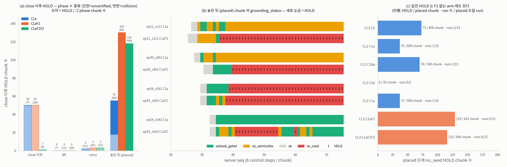

[`t46b-graph.png`](figures/t46/t46b-graph.png) (sidecar [`.json`](figures/t46/t46b-graph.json)) — (a) close 이후 HOLD 를 phase × kind 로 쌓은 막대 (진한 색 = uncertified, 연한 색 = collision; 라벨 = HOLD / 그 phase chunk). placed 에서만 uncertified 막대가 솟는다. (b) 같은 (episode, seed) 의 C1a 와 C1aF1 의 placed chunk 별 `grounding_status` 띠 (세로 눈금 = HOLD). F1 쪽 띠가 `no_seed` (빨강) 로 이어지고 HOLD 가 끝까지 찍힌 run 이 보인다. (c) placed `no_seed` HOLD chunk 수를 CL2 의 arm (F1 없음) 과 CL3 의 arm 에 걸쳐 놓은 막대 (§6).

### 3. 직접 원인 — 인증 규칙의 공백 (certification gap)

**placed · home 에서 `no_seed` 가 일어나는 경로 (file:line, snapshot `218229ac` = 당시 HEAD 와 같은 파일).**

| 단계 | 일어나는 일 | 위치 |
|---|---|---|
| 1 | grounding 이 attention 상위 5 % 를 seed 로 뽑고 `~exclude_mask` 를 곱한다. `exclude_mask` 는 pipeline 이 support mask 로 넘긴다. 남은 seed 가 0 이면 곧바로 `NO_SEED` 를 돌려준다 (admissibility · subtask gate 판정 이전) | `AG3S/ag3s/stages/target_grounding.py:1679-1686` (gate 는 `:1124-1136`), `AG3S/ag3s/runtime/pipeline.py:1513-1519` |
| 2 | 놓은 뒤 home 에서 server 는 subtask 인증 `subtask_no_target` 을 쓴다. 이 술어는 grounding 이 `subtask_gated` 이거나, `no_admissible` 이면서 (gate on ∧ label home ∧ `placed_seen`) 일 때만 참이다. **`no_seed` 는 목록에 없다** | `AG3S/ag3s/types.py:1069-1113` (`_placed_home` gate: `:1061-1066`) |
| 3 | 인증 술어 `geometry_certified = status ok ∨ subtask_no_target` 가 거짓이면 reason `uncertified` | `AG3S/trajopt/safe_policy.py:1853-1866`, reason 기록 `:1513-1517` · `:1583` |
| 4 | safe status 이면서 인증이 요구되고 인증이 없으면 TO verdict 를 `violated` 로 강등 → HOLD | `AG3S/trajopt/sqp.py:922` |

- **인증 술어를 chunk 마다 다시 계산한 결과가 기록된 reason 과 일치한다**: 세 arm 모두 **1350 / 1350** chunk (`numbers.certification_replay`). 즉 위 술어 서술이 실제 판정과 같다.
- **seed 를 offline 으로 다시 뽑은 결과도 일치한다**: placed chunk 에서 "남은 seed = 0 이면 `no_seed`" 의 예측이 기록과 C1a 689 / 689 · C1aF1 641 / 641 · C1aF1F2 646 / 646 이다 (`numbers.offline_seed_requery`). `no_seed` chunk 에서 attention 상위 5 % seed 중 support mask 안에 있는 비율은 **전부 1.0** (최솟값 1.0; 37 · 129 · 116 chunk). destination AABB 안의 seed 비율 중앙값은 `no_seed` chunk 에서 0.0, 그 밖의 placed chunk 에서 0.093 · 0.148 · 0.151 이다.
- 그 HOLD chunk 의 증거 필드: `n_clusters` 0 (C1a 37 · C1aF1 129 · C1aF1F2 116), 위반 행 > 0 인 chunk **0**, `has_target` true **0**, TO status 는 전부 `violated` (강등), 그 chunk 의 subtask gate · label · `placed_seen` 는 `home | True | True` (C1aF1 129 chunk; 나머지 1 chunk 는 label `pick` · grounding `no_admissible`, C1aF1F2 는 2 chunk).
- **위반 행이 없는데 막혔다.** 이 chunk 들은 collision 이 아니라 "설명되지 않음" 으로 막힌 것이다. 인증은 collision 이 아니라 "target 이 없는 이유" 를 요구한다.

**같은 seq 에서 C1a 는 통과하고 F1 은 막힌 chunk.** 93 chunk (`numbers.paired_C1a_execute_vs_C1aF1_uncertified_same_seq`): ep11_s111 40 · ep30_s301 36 · ep54_s542 15 · ep104_s1042 1 · ep54_s541 1, phase 는 모두 placed. 그 chunk 에서 C1a 의 grounding 은 `subtask_gated` 19 · `no_admissible` 74 (둘 다 인증 예외 목록에 있다), C1aF1 은 `no_seed` 92 · `no_admissible` 1 이다. 같은 episode · 같은 seq 라도 attention 이 어디에 떨어지느냐에 따라 예외 목록 안 / 밖으로 갈린다.

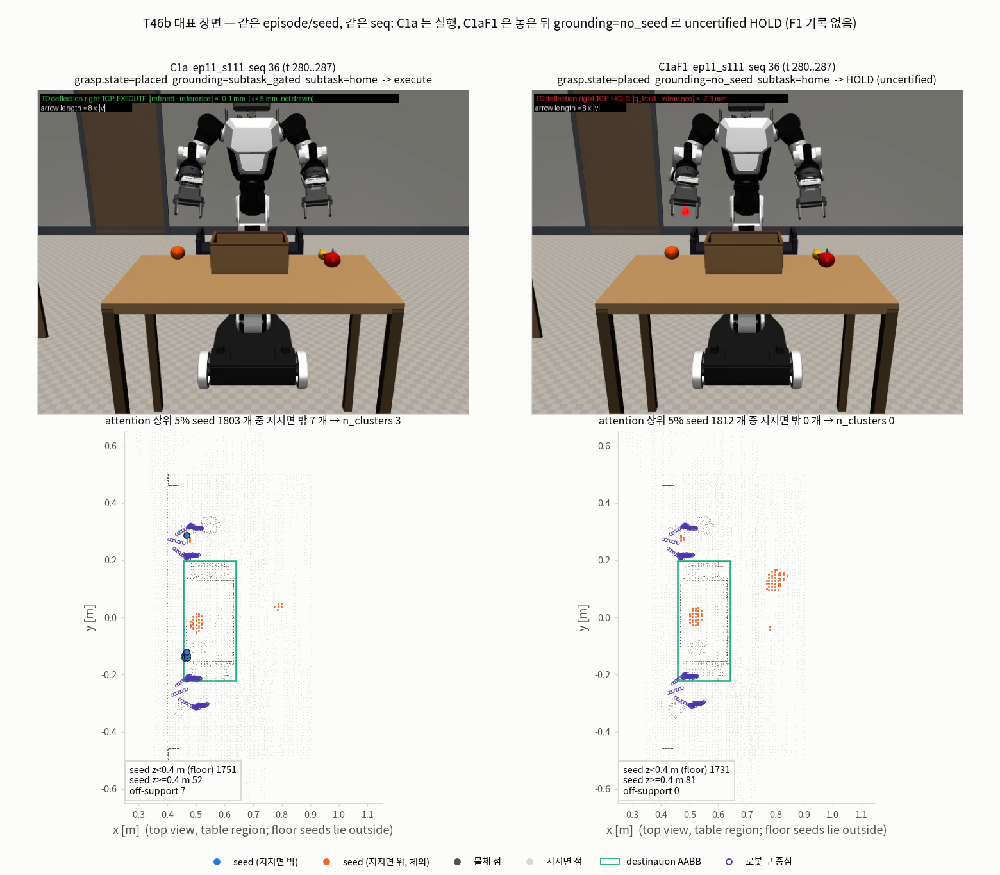

[`t46b-scene.png`](figures/t46/t46b-scene.png) (sidecar [`.json`](figures/t46/t46b-scene.json)) — ep11_s111, seq 36 (control step t = 280–287, video frame 284), grasp.state 는 `placed`, subtask label 은 `home`. 위쪽은 같은 시각의 MuJoCo 장면, 아래쪽은 table 영역 top view 에 attention 상위 5 % seed 를 올린 것 (파랑 = support 밖 seed, 주황 = support 위라 제외된 seed, 초록 사각형 = destination AABB, 보라 원 = 로봇 구 중심).

| 같은 seq 36 (ep11_s111) | C1a | C1aF1 |
|---|---|---|
| attention 상위 5 % seed | 1803 | 1812 |
| 그중 support 밖 seed | **7** | **0** |
| `n_clusters` | 3 | **0** |
| grounding_status | `subtask_gated` | **`no_seed`** |
| subtask label · `placed_seen` | home · True | home · True |
| 서버 판정 | execute (TO `optimal`) | **HOLD** (`uncertified` + `budget_only`, TO `violated`) |
| 이 chunk 의 F1 기록 | 없음 | **없음** |

(출처: `numbers.representative_scene`. 이 장면은 boundary · contact 장면이 아니다 — F1 의 경계 효과가 아니라 HOLD 의 원인을 보인다. develope_PLAN Figure 3 의 경계 장면은 CL3 의 [`t46-cl3-scene.png`](figures/t46/t46-cl3-scene.png), 이 STEP 의 장면은 §7 참조.)

### 4. F1 과의 연결 — 직접이 아니라 간접이다

**F1 은 그 HOLD chunk 에서 돌지 않았다.**

| phase (C1aF1) | chunk | F1 기록 있음 | F1 적용 | F1 이 뺀 점 (합) |
|---|---|---|---|---|
| pre-grasp | 133 | 133 | 76 | 16 (2 chunk) |
| window | 162 | 162 | 108 | 444 (76 chunk) |
| closing | 100 | 100 | 99 | 1148 (93 chunk) |
| lift | 113 | 71 | 71 | 1391 (63 chunk) |
| carry | 201 | 1 | 1 | 0 |
| **placed** | 641 | 92 | 41 | 4 (4 chunk) |
| **placed 중 uncertified HOLD 130 chunk** | 130 | **0** | **0** | — |

(출처: `numbers.f1_activity_by_phase`, `numbers.uncertified_hold_evidence`. F1 이 close 이후 closing · lift 에서는 동작했지만 그 phase 의 uncertified 는 0 이다. 같은 HOLD chunk 에 F1 기록이 없는 것은 C1aF1F2 도 같다: 0 / 118.)

**F1 이 바꾼 것은 grasp 직전이다.**

| 지표 | C1aF1 | C1aF1F2 |
|---|---|---|
| C1a 와 실행 action 이 끝까지 같은 pair | 6 | 0 |
| 첫 궤적 분기가 있는 pair | **12** | **18** |
| 그 분기가 window 안 · pre-grasp | 12 · 0 | 17 · 1 |
| 분기 chunk 에서 F1 적용 · 뺀 점 > 0 | 12 · 12 | 12 · 12 |

(출처: `numbers.divergence_summary`. 분기 pair 수는 [CL3 verify](handoff/T46-CL3.verify.json) 의 `executed_actions_identity` (C1a 대 C1aF1 같음 6 / 18, C1aF1F2 같음 0 / 18) 와 일치한다.)

- 궤적이 갈라지면 놓은 뒤 자세와 attention 도 달라진다. 그 결과 placed `no_seed` 가 생긴 run 은 **F1 만 3, C1a 만 0, 둘 다 1** (placed 에 둘 다 도달한 15 pair, McNemar exact p = 0.25; C1aF1F2 도 3 · 0 · 1, p = 0.25). run 수로는 C1a 1 → C1aF1 4 · C1aF1F2 4 (산출).
- **이 연결은 궤적 분기를 통한 간접이다.** F1 기록 0 / 130 이므로 F1 이 `no_seed` 를 직접 만든 증거는 없다. 계통적으로 늘린다는 증거도 없다 (p = 0.25, 표본 15 pair) — **모름**.
- `no_seed` 가 시작된 시점은 모두 place 이후다:

| run | arm | 첫 `no_seed` seq · t | place_t | `no_seed` 연속 chunk | episode 끝까지 | task success |
|---|---|---|---|---|---|---|
| ep11_s111 | C1aF1 · C1aF1F2 | 36 · 280 | 184 | 40 | 예 (trailing HOLD 40) | 예 |
| ep30_s301 | C1aF1 · C1aF1F2 | 40 · 312 | 224 | 36 | 예 (36) | 예 |
| ep54_s541 | C1a | 39 · 304 | 224 | 37 | 예 (37) | 예 |
| ep54_s541 | C1aF1 · C1aF1F2 | 38 · 296 | 216 | 38 | 예 (38) | 예 |
| ep54_s542 | C1aF1 | 41 · 320 | 240 | 14 + 1 | 아니오 (풀림) | 예 |
| ep54_s542 | C1aF1F2 | 41 · 320 | 240 | 1 + 1 | 아니오 (풀림) | 예 |

(출처: `numbers.no_seed_onset_vs_place`. **정정 메모:** T46c task 문서 §3 은 "두 run (ep11_s111 · ep30_s301) 이 episode 끝까지 HOLD" 라고 쓰지만 verify.json 은 C1aF1 의 끝까지 HOLD 가 세 run (ep11_s111 · ep30_s301 · ep54_s541) 이다. ep54_s541 은 C1a 도 같은 모양이라, **F1 이 새로 만든** 끝까지 HOLD 는 앞의 두 run 이다 (산출: C1a 에서는 ep11_s111 · ep30_s301 이 `no_seed` 를 겪지 않음 — 위 F1 만 3 중 두 개).)

### 5. 가설 판정 (측정 전 고정한 후보 → 측정 결과)

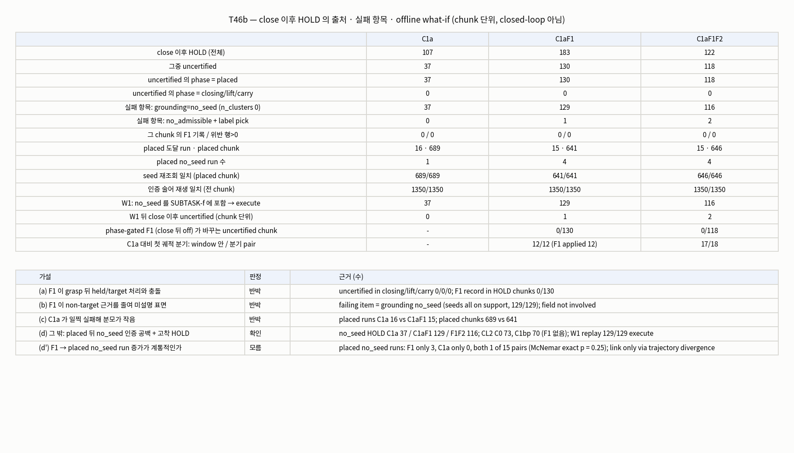

[`t46b-table.png`](figures/t46/t46b-table.png) (sidecar [`.json`](figures/t46/t46b-table.json)) — 위 표의 수치와 가설 판정을 한 장에 모았다.

| 가설 (task 문서가 측정 전 세운 후보) | 판정 | 근거 (`T46b.verify.json`) |
|---|---|---|
| **(a)** close 이후 target 이 held object 가 되는데 F1 이 grasp 이후에도 동작해 held / target 표면 처리와 충돌한다 | **반박** | uncertified HOLD 가 closing · lift · carry 에서 0 · 0 · 0. 그 HOLD chunk 의 F1 기록 0 / 130, `has_target` true 0 / 130. F1 은 closing 99 chunk · lift 71 chunk 에서 동작했지만 uncertified 를 만들지 않았다 |
| **(b)** F1 이 non-target 근거를 줄여 "설명되지 않은 표면" 이 늘어 인증이 실패한다 | **반박** | 실패 항목은 grounding `no_seed` (129 chunk) 와 `no_admissible` + label `pick` (1 chunk). `n_clusters` 0 이 129 chunk, 위반 행 > 0 인 chunk 0. `no_seed` 129 chunk 모두 상위 5 % seed 가 전부 support mask 안 (최솟값 1.0) — field 는 관여하지 않았다 |
| **(c)** 같은 run 이 C1a 에서는 더 일찍 실패해 close 이후에 도달하지 않는다 (분모 효과) | **반박** | placed 도달 run C1a 16 · C1aF1 15 · C1aF1F2 15, placed chunk 689 · 641 · 646. 분모는 C1a 가 오히려 같거나 크다. placed chunk 당 `no_seed` HOLD 는 37 / 689 · 129 / 641 · 116 / 646 |
| **(d)** 그 밖: placed 뒤 `no_seed` 인증 공백 + 고착 HOLD | **확인** | `no_seed` HOLD C1a 37 · C1aF1 129 · C1aF1F2 116. CL2 (F1 없음) 에도 C0 73 · C1bp 70. 인증 술어 재생이 1350 / 1350 일치. W1 가정 시 129 / 129 chunk 가 execute |
| **(d′)** F1 이 placed `no_seed` run 을 계통적으로 늘린다 | **모름** | F1 만 3 · C1a 만 0 · 둘 다 1 (15 pair), McNemar exact p = 0.25. 연결은 궤적 분기 (§4) 를 통해서만 있다 |

### 6. 같은 HOLD 가 F1 이 없는 arm 에도 있다 (CL2 base rate) · offline what-if

**CL2 (F1 없음) 의 placed `no_seed`.** 같은 18 쌍 harness 의 이전 closed-loop (CL2, 별도 run · snapshot `f14ae3e6`) 에서 읽었다. CL3 의 C1a 는 CL2 의 C1a 와 18 / 18 쌍에서 실행 action 이 같다 (`CL3 verify` `executed_actions_identity`).

| arm | placed 도달 run | placed chunk | placed HOLD | placed `no_seed` | 그중 HOLD | `no_seed` 가 있는 run (chunk) |
|---|---|---|---|---|---|---|
| **CL2 C0 (V11AB)** | 14 | 608 | 73 | 78 | **73** | ep11_s112 (37) · ep30_s301 (36) · ep3_s32 (5) |
| CL2 C1a | 16 | 689 | 55 | 37 | 37 | ep54_s541 (37) |
| CL2 C1bp | 13 | 540 | 70 | 70 | **70** | ep11_s112 (35) · ep54_s541 (1) · ep54_s542 (34) |
| CL2 C2p | 2 | 35 | 0 | 0 | 0 | — |
| CL3 C1aF1 | 15 | 641 | 130 | 129 | 129 | 4 run (§4 표) |
| CL3 C1aF1F2 | 15 | 646 | 118 | 116 | 116 | 4 run |

(출처: `numbers.cl2_base_rate_placed_no_seed`, `hypotheses.d_other_post_place_no_seed_certification_gap`. CL2 의 C1bp · C2p 는 같은 CL2 의 다른 arm 이고 정의는 [이전 로그 T44e-CL2 절](AG3S_T0T6_LOG.md) 에 있다. CL2 의 uncertified HOLD 총합은 C0 73 · C1a 37 · C1bp 70 · C2p 0 chunk, 전체 HOLD 는 101 · 119 · 87 · 40.)

- **V11AB (C0) 에도 이 HOLD 가 73 chunk 있다.** 인증 공백은 F1 이전부터 있던 규칙의 문제다. F1 arm 의 129 chunk 가 가장 크기는 하지만 run 수가 3 – 4 개 단위라 크기 차이를 F1 탓으로 읽을 수 없다 (§4 의 p = 0.25).
- 이 공백은 이미 한 번 마주쳤고 남겨둔 것이다: SUBTASK-f (2026-10-03) 가 `no_admissible` 만 인증하고 `no_seed` 는 "사용자 판정 — 그대로 둔다" 로 남겼다. 그때 적은 **되돌아올 신호가 "`no_seed` 가 다른 run 에서도 놓은 뒤 길게 이어질 때"** 였고 ([이전 로그 SUBTASK 절 되돌아올 지점](AG3S_T0T6_LOG.md)), 이 STEP 이 그 신호를 충족했다 (§8).

**phase-gated F1 (close 이후 F1 off) — offline.** 기록 chunk 에서 "그 chunk 가 F1 기록을 가진 uncertified HOLD" 를 센다 (그 chunk 만 바뀔 수 있다): C1aF1 **0 / 130**, C1aF1F2 **0 / 118**. 즉 이 변형은 close 이후 uncertified HOLD 를 한 chunk 도 바꾸지 못한다. 궤적을 통한 closed-loop 효과는 offline 으로 계산할 수 없다 (`design.phase_gated_F1_offline`). closing · lift 에서 F1 이 동작한 chunk 가 있으므로 (99 · 71) F1 을 끄면 그 구간의 collision 처리 효과를 포기한다 — 그 크기는 재지 않았다.

**W1 offline what-if (closed-loop 아님).** `no_seed` chunk 의 grounding_status 를 `no_admissible` 로 바꿔 (= SUBTASK-f 조건: gate on ∧ label home ∧ `placed_seen` ∧ valid ∧ carve 없음) 인증을 다시 계산하고, 다른 hold-action reason 이 기록에 없을 때 execute 로 센 값이다 (`design.W1_what_if`).

| | C1a | C1aF1 | C1aF1F2 |
|---|---|---|---|
| `no_seed` 인데 W1 인증 → execute 로 바뀌는 chunk | 37 | 129 | 116 |
| 그 chunk 의 phase | placed 37 / 37 | placed 129 / 129 | placed 116 / 116 |
| close 이후 HOLD 합 (W1 가정) | 70 | 54 | 6 |
| 그중 uncertified (W1 가정) | **0** | **1** | **2** |
| (기록 그대로) close 이후 HOLD 합 · uncertified | 107 · 37 | 183 · 130 | 122 · 118 |

(출처: `numbers.W1_execute_chunks`, `numbers.certification_replay`, `numbers.after_close_hold_under_W1_per_chunk`. 남는 uncertified chunk 수 1 · 2 는 실패 항목 `no_admissible` + label `pick` 의 chunk 수 (C1aF1 1 · C1aF1F2 2) 와 같다. label 이 `pick` 이라 SUBTASK-f 조건에 맞지 않는다 (산출: 개수 일치로 읽음).) 이 값은 **기록된 chunk 를 per-chunk 로 다시 판정한 것**이다. HOLD 가 execute 로 바뀌면 이후 궤적이 달라지므로 실제 closed-loop 의 HOLD 수가 아니다.

### 7. develope_PLAN 의 어느 표 · 그림이 이 결과를 쓰는가

| 계획서 단위 | 이 STEP 이 주는 것 | 주의 |
|---|---|---|
| **Ablation DT-02 (extent block)** · DT-03 (closed-loop 핵심 contrast) 의 contact handling 행 | grasp 직전 HOLD chunk C1a 12 · C1aF1 6 · C1aF1F2 2 (출처 `T46-CL3.verify.json numbers.arms.*.t7_pre_grasp.hold_chunks_pre8_close`) | close 이후 uncertified HOLD (37 · 130 · 118) 는 **F1 의 경계 효과와 같은 열에 넣지 않는다** — 별도 열 (원인이 인증 규칙) 로 분리하고, W1 이 끝나면 모든 arm 에 같이 적용한 뒤 다시 잰다 (T46c §4) |
| **Figure 3 B (같은 identity 의 ball / 제안 extent / 관측 oracle)** | 경계 장면은 CL3 의 [`t46-cl3-scene.png`](figures/t46/t46-cl3-scene.png) (pre-grasp contact 장면). [`t46b-scene.png`](figures/t46/t46b-scene.png) 는 verifier 가 "post-place, boundary · contact 장면 아님" 이라고 표시한 **HOLD 원인 장면** (`paper_mapping_numbers.figure3_candidate_scene`) | 이 장면을 Figure 3 의 경계 보존 근거로 쓰지 않는다. 한계 L8 (close 이후 HOLD) 의 설명 · supplementary 후보다 |

### 8. 읽을 때의 한계 · 측정하지 않은 것 · 중단 기준 · 되돌아올 지점

| 한계 | 내용 |
|---|---|
| **진단은 offline 이다** | W1 · phase-gated F1 의 수치는 기록 chunk 위 per-chunk what-if 다. closed-loop 효과는 측정하지 않았다 (중단 기준: 새 closed-loop 없음) |
| **표본이 작다** | 18 쌍, placed `no_seed` run 은 arm 당 1 – 4 개. (d′) 의 p = 0.25 는 "F1 이 늘린다 / 늘리지 않는다" 를 가르지 못한다 |
| **`manipulated_link_margin` 은 기록에 없다** | 인증 술어 재생은 그 값을 `None` 으로 가정했고 1350 / 1350 일치했다 |
| **왜 attention 이 support 에 몰리는지는 추적하지 않았다** | 중단 기준에 따라 실패한 인증 항목 (`no_seed`) 까지만 측정했다 (`not_measured`) |
| **HOLD 가 task 결과에 주는 영향** | F1 의 `no_seed` run 4 개는 모두 task success 이고 `no_seed` 가 place 이후에 시작됐다. 홈으로 돌아오는 시간 · safe success 영향은 재지 않았다 (`not_measured`) |
| **grasp 직전 HOLD 감소의 유의성은 집계 기준에 민감하다** | CL3 의 C1a vs C1aF1 의 grasp 직전 HOLD (12 → 6, paired 6 / 0, p = 0.03125, 18 pair) 는 foreign GPU 겹침이 있던 두 pair (ep12_s121 · ep30_s301; 겹친 run 은 보충 재실행으로 executed_actions 가 원본과 같음을 확인 — CL3 verdict) 를 뺀 16 pair 에서 11 → 6, paired 5 / 0, p = 0.0625 다 (`T46-CL3.verify.json numbers.pair_hold.no_overlap`). 이 STEP 의 진단 자체는 server 기록 chunk 를 쓰므로 겹침의 영향을 받지 않는다고 확인하지는 않았다 (미측정) |

**측정하지 않은 것 (`T46b.verify.json not_measured`).** W1 · phase-gated F1 의 closed-loop 효과 (per-chunk what-if 만) · placed 뒤 attention 이 support 에 몰리는 이유 · `manipulated_link_margin` · cuRobo 회귀 기준선 (GPU) · HOLD 의 completion time / safe success 영향.

**되돌아올 지점.**

| 안 고른 것 | 왜 | 되돌아올 신호 |
|---|---|---|
| **phase-gated F1** (close 이후 F1 off) | 0 / 130 · 0 / 118 chunk 만 건드려 HOLD 에 효과가 없다 | closing · lift 의 F1 동작이 collision HOLD 를 만들거나 held object 처리를 해치는 측정이 나올 때 |
| `no_seed` HOLD 를 그대로 둔다 (SUBTASK-f 의 이전 사용자 판정) | 그때는 1 run 의 현상이었다 | **신호 충족:** 다른 run 에서도 놓은 뒤 길게 이어짐 — C1aF1 4 run (끝까지 3), CL2 C0 3 run · C1bp 3 run. T46c 의 W1 (A12) 이 이 판정을 바꾸는 구현이다 (T46c §4 · §6) |
| 원인 추적을 더 넓힘 (attention 이 support 에 몰리는 이유) | 중단 기준 | W1 이 막는 `no_seed` 외에 같은 모양의 HOLD 가 다른 phase 에서 나타날 때 |

**산출물.**

- **측정**: [`handoff/T46b.verify.json`](handoff/T46b.verify.json). 원자료는 run 디렉터리 `/mnt/dev/AG3S_VLA-storage/results/development/20261012T220712+0900_de2042e9be89_ead5f3483344/verify/T46b/` (`raw/diagnosis.json` · `raw/chunks.jsonl` · `raw/cl2_base_rate.json` · `baseline/legacy_base.json`). 입력 CL3 run 은 `.../20261012T155130+0900_218229ac6464_5fb5ff542c33/verify/T46/CL3/` (읽기 전용).
- **figure** (각각 `.json` sidecar 있음): [`scene`](figures/t46/t46b-scene.png) · [`graph`](figures/t46/t46b-graph.png) · [`table`](figures/t46/t46b-table.png).
- **스크립트** (verify.json `code_state.scripts_md5`): `build_verify.py` · `cl2_base_rate.py` · `diagnose.py` · `extract_chunks.py` · `fig_t46b.py`. 코드 수정 없음.
- 요청 문서: [`handoff/T46b.task.md`](handoff/T46b.task.md). commit `ed47b976`.


---

## T46c — F1 채택 (한계 L1–L9 를 함께 기록) · close 이후 HOLD 원인 · W1 구현 (~~진행 중~~ → 완료, 아래 "T46c-W1 · T46d · T46f" 절) · PA-1 ablation 초안 (2026-10-12 KST)

**이 절이 답하는 물음 (목적).** T46b 의 진단 뒤에 정할 것이 셋이다. (1) F1 (non-target 근거에서 target 자신의 표면 점을 빼는 surface 근거) 을 develope_PLAN §0.10.1-3 의 **"경계 보존 방법 하나"** 로 현재 범위에서 채택할 것인가. (2) 채택하면서 close 이후 HOLD 증가를 어떻게 기록할 것인가. (3) 그 방법을 논문의 ablation 에 어떻게 넣을 것인가. 이 절은 (1) 과 (2) 의 판정을 기록하고, 그 판정이 요구한 구현 (W1) 이 **진행 중임** 과 (3) 의 초안이 **판정 대기임** 을 적는다. **W1 의 결과는 아직 없다.**

**한 줄 결과 (before → after).**

- **before.** F1 은 grasp 직전 경계 효과를 보였지만 (HOLD run 12 → 6, 이웃 과일 접촉 run 4 → 1) 성공률은 같았고 (task 14 → 13) close 이후 HOLD 가 107 → 183 chunk 로 늘어, 채택 여부와 논문 주장 범위가 정해지지 않았다.
- **after (사용자 판정, 2026-10-12).** **F1 을 현재 extent 방법으로 채택한다.** "권장하는 A 로 진행. **한계는 명확하게 작성하고 넘어갈 것.** F1 이 grasp 이후 HOLD 를 늘린 원인을 작성할 것." 한계 9 개 (L1–L9) 는 §3 에 논문 주장 범위의 제약과 함께 적었다. 채택 근거는 성공률이 아니라 **같은 identity 에서 extent 처리만 바꿨을 때 grasp 직전 충돌 행 887 → 401 (offline), HOLD run 12 → 6 (closed-loop), 잃은 이웃 과일 seed 0 → 0** 이다.
- **close 이후 HOLD 의 원인** 은 F1 이 아니라 placed 뒤 `no_seed` 인증 공백이다 (T46b). 늘어난 uncertified HOLD 130 chunk 에서 F1 기록은 0 이고, F1 이 없는 V11AB (C0) 에도 73 chunk 가 있다.
- **고칠 곳은 인증 규칙이다 (lead).** W1 (placed · home 의 `no_seed` 를 인증) 을 ~~구현 중이다. **결과 없음.**~~ → **구현 · offline 재현 완료 (2026-10-12 23:40 KST, 아래 "T46c-W1 · T46d · T46f" 절 §2).**
- **PA-1 ablation 구성** (extent 를 주 block 으로) 은 **판정 대기** 다.

**읽는 법과 출처 규약.**

- 수치는 [`T46.verify.json`](handoff/T46.verify.json) (offline) · [`T46-CL3.verify.json`](handoff/T46-CL3.verify.json) (closed-loop) · [`T46b.verify.json`](handoff/T46b.verify.json) (HOLD 진단) 의 `numbers` 에서 왔다. **세 파일 어디에도 없는 내용은 "(task 문서)" 로 표시했다** — 그것은 lead 가 [`T46c.task.md`](handoff/T46c.task.md) 에 쓴 서술이고 verifier 가 재지 않았다. 이 절의 한계 표 (§3) 의 "논문 표현에 주는 제약" 열은 전부 lead 의 문장이다.
- 판정의 출처: **(사용자 판정)** = 위 인용, **(lead)** = task 문서의 결정 · 초안, **(산출)** = 같은 파일 숫자의 뺄셈 · 나눗셈.
- **C0 비교의 한계.** C0 (V11AB) 수치는 CL2 (같은 18 쌍 harness 의 이전 run) 에서 왔고, C1a · C1aF1 은 CL3 다. CL3 의 C1a 와 CL2 의 C1a 는 18 / 18 쌍에서 실행 action 이 같아 (`CL3 verify` `executed_actions_identity`) CL2 의 C0 를 같은 기준으로 놓았지만, C0 와 F1 은 같은 run 이 아니다.

### 1. 사용자 판정과 타임라인 (KST)

| # | 판정 · 사건 (2026-10-12) | 이 절에서 |
|---|---|---|
| 1 | **(사용자 판정)** "권장하는 A 로 진행. 한계는 명확하게 작성하고 넘어갈 것. F1 이 grasp 이후 HOLD 를 늘린 원인을 작성할 것." | §2 · §3 · §4 |
| 2 | **(lead)** F2 (`--owned-ambiguous remove`) 는 채택하지 않고 대조 arm 으로만 남긴다 — 이웃 과일 seed 를 지워 §0.10 의 "인접 장애물 보존" 목적과 어긋난다 | §2 |
| 3 | **(lead)** W1 (A12) 구현 → offline 재현 (verifier) → 사용자 보고. 병행: 이 기록. PA-1 판정 뒤 ablation closed-loop task | §5 · §6 |

| 시각 (KST) | 무엇 | 출처 |
|---|---|---|
| 23:02 | T46c task 작성 (lead) | `T46c.task.md` mtime 14:02Z |
| 23:03:13 | T46c task commit `6d134a69` | `git log` |

(pod 에 tzdata 가 없어 UTC + 9 h 로 환산했다.)

### 2. F1 채택의 근거 — 같은 identity 에서 extent 처리만 바꾼 비교 (before → after)

**offline (grasp 직전 window, held-out 162 chunk, CL2 C1a 의 기록 chunk 를 재분류).** 대조는 C1a (`ball_owned`) 하나이고 C0 는 이 offline 에 없다. 숫자 앞의 `off` 는 F1 · F2 를 끈 기록과 bit 단위로 같다 (162 / 162 chunk, 최대 차이 0.0 mm).

| 지표 | C1a (`off`) | **C1a + F1** | (참고) F2 | (참고) F1 + F2 | (상한) F1GT |
|---|---|---|---|---|---|
| 충돌 행 (grasp 직전 162 chunk) | 887 | **401** | 136 | 107 | 113 |
| 충돌 행이 남은 chunk (14 개 중) | 14 | **8** | 8 | 6 | 6 |
| 충돌 행 0 이 된 chunk | 0 | **6** | 6 | 8 | 8 |
| 충돌 행 0 이 된 recorded HOLD chunk (12 개 중) | 0 | **5** | 4 | 6 | 6 |
| 새로 충돌이 생긴 chunk | — | **0** | 0 | 0 | 0 |
| **잃은 이웃 과일 seed (전 chunk)** | 0 | **0** | **2463** | 2463 | 48 |

(출처: `T46.verify.json numbers.3_4_5_heldout.variants`. F1GT = GT target 점을 non-target 근거에서 빼는 상한 대조로, GT 는 대조 · 평가에만 쓴다. F2 는 이웃 과일 seed 2463 개를 잃어 채택하지 않는다.)

**closed-loop (CL3, 18 쌍).** 18 쌍 = 9 episode × 2 seed (산출: `per_run` key). 각 칸은 run 수 (또는 chunk 수), 괄호는 C1a 대 C1aF1 의 paired 결과 (한쪽만 / 반대쪽만, McNemar exact p).

| 지표 | V11AB (C0, CL2) | C1a | **C1a + F1** | 비교 (C1a 대 F1) |
|---|---|---|---|---|
| grasp 직전 (window) HOLD run | 1 | 12 | **6** | 6 / 0, **p = 0.031** |
| grasp 직전 HOLD chunk | 1 | 12 | **6** | |
| pre-release 새 접촉 run (hand–이웃 과일 · 비손 link–target · 비손 link–이웃 과일) | 4 | 4 | **1** | 3 / 0, p = 0.25 |
| task success | 14 | 14 | 13 | 1 / 0, p = 1.0 |
| CT success (task + 접촉 없음) | 12 | 11 | 12 | 1 / 2, p = 1.0 |
| grasp (final) | 16 | 17 | 16 | 1 / 0, p = 1.0 |
| HOLD 전체 chunk | 101 | 119 | 189 | |
| 그중 uncertified | 73 | 37 | 130 | (원인은 §4) |

(출처: `T46-CL3.verify.json numbers.pairs` · `numbers.pair_hold` · `numbers.arms.*` · `numbers.reproducibility_vs_CL2` (C0 열). `pre_release_new_contact` 의 class 정의는 CL3 verify `definitions`. window HOLD 는 C1aF1F2 가 2 chunk 다.)

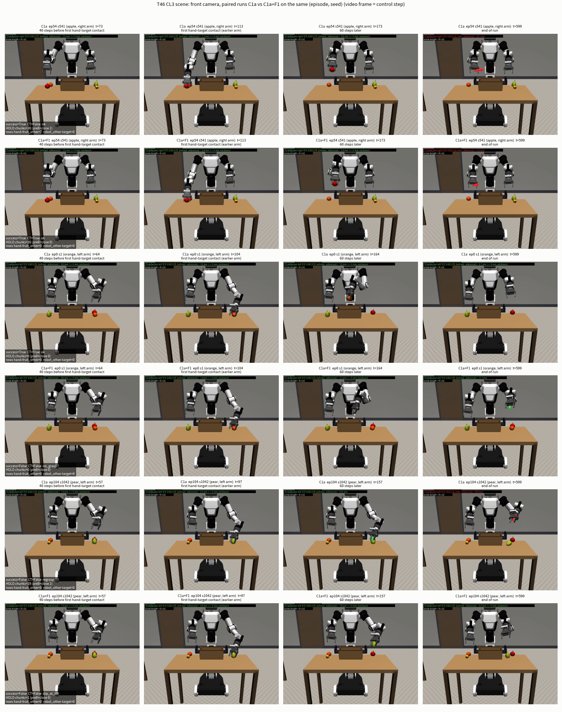

[`t46-cl3-scene.png`](figures/t46/t46-cl3-scene.png) — 이 채택의 경계 효과를 보이는 CL3 의 pre-grasp 장면 (CL3 verifier 가 만든 그림, 상세는 [이전 로그 T46 절](AG3S_T0T6_LOG.md)). [`t46-cl3-graph.png`](figures/t46/t46-cl3-graph.png) · [`t46-cl3-table.png`](figures/t46/t46-cl3-table.png) 는 같은 비교의 그래프 · 표다.

**이 표를 읽는 법 — 채택이 주장하는 것과 주장하지 않는 것.**

- 주장하는 것: F1 은 같은 identity · 같은 controller 에서 extent 처리만 바꿨을 때 **grasp 직전 충돌 행 · HOLD · 이웃 과일 접촉을 줄이고 이웃 seed 를 잃지 않는다**. 이는 §0.10.1-3 의 "잘못된 접촉 차단을 줄이면서 인접 장애물 경계를 보존한다" 와 같은 방향이다 (DC-1).
- **주장하지 않는 것: 성공률 향상.** task success 는 14 → 13 으로 같은 수준이다 (유의하지 않음, §3 L1).
- **추가 관찰 (scribe 정리, 위 표의 수치에서).** V11AB (C0) 의 grasp 직전 HOLD 는 1 chunk 라 F1 의 6 chunk 보다 적다. F1 의 12 → 6 은 `ball_owned` (C1a) 가 늘린 grasp 직전 HOLD 를 **일부** 되돌린 것이지 C0 보다 줄인 것이 아니다. 같은 표에서 이웃 과일 접촉 run 은 C0 4 · C1a 4 · F1 1 이다. "F1 이 V11AB 보다 grasp 직전 HOLD 를 줄인다" 는 주장은 이 근거로는 성립하지 않는다 (이 trade-off 의 해석은 DC-4 의 몫이고 아직 정하지 않았다).
- 12 → 6 의 p = 0.031 은 18 pair 의 값이고, foreign GPU 겹침 pair 를 뺀 16 pair 에서는 11 → 6, paired 5 / 0, p = 0.0625 다 (`numbers.pair_hold.no_overlap`). 유의성은 집계 기준에 민감하다.

### 3. F1 의 한계 L1–L9 (채택과 함께 기록, 논문 주장 범위를 정한다)

(사용자 지시: "한계는 명확하게 작성하고 넘어갈 것.") **"논문 표현에 주는 제약" 열은 lead 의 문장이다 (task 문서 §2).** "근거" 열은 verify.json 의 수치이고, 그렇지 않은 것은 "(task 문서)" 로 표시했다.

| # | 한계 | 근거 | 논문 표현에 주는 제약 (lead) |
|---|---|---|---|
| **L1** | **task success 를 개선하지 못했다** | task success 14 → 13, CT success 11 → 12, grasp 17 → 16 (C1a 대 F1, 18 쌍, 모두 McNemar p = 1.0) | "성공률 향상" 을 주장하지 않는다. grasp 직전 불필요한 정지 · 이웃 접촉 감소로만 쓴다 |
| **L2** | **표본이 작다** | 18 쌍 = 9 episode × 2 seed (`per_run` key 에서 산출). train split · 이웃 과일 < 0.10 m 장면 · apple / orange / pear · banana 0 은 (task 문서); banana 는 CL3 verify `not_measured` 에 "no passed episode in LB2" | 효과 크기와 p 값을 같이 쓰고 일반화를 주장하지 않는다. 주 평가 (SafeLIBERO) 결과 전에는 보조 근거 |
| **L3** | **표면 구 맞춤이 물러나면 F1 이 동작하지 않는다** | CL3 에서 F1 이 적용된 chunk 396 / 559, 적용되지 않은 163 chunk 의 이유는 모두 `no_surface_fit` (163 / 559 = 29.2 %, 산출). offline 에서는 충돌 chunk 14 개 중 6 개, 전체 162 chunk 중 54 개가 fit 물러남. 그 6 개는 target 점에 이웃 과일 점이 섞인 경우다 (task 문서) | 이웃과 맞붙은 · 점이 섞인 경우의 경계 오류는 남는다 (F3 = target 점 오염 · identity / split 쪽 과제) |
| **L4** | **잔여를 다 지우지 못한다** | offline 충돌 행 887 → 401, GT 상한 (F1GT) 113 | "잔여 제거" 가 아니라 "감소" 로 쓴다 |
| **L5** | **구형 가정** | F1 은 ball 이 맞춘 표면 구 + 껍질 10 mm (task 문서; 껍질 기본값은 [이전 로그 용어](AG3S_T0T6_LOG.md)) | 비구형 물체 (banana · 상자 · 길쭉한 물체) 는 검증하지 않았다 |
| **L6** | **설계에 GT 를 본 chunk 가 있다** | 구현자가 D-TF (target-free 층의 target 잔여) 17 chunk 의 GT 라벨을 보고 설계했다 (task 문서). 판정은 held-out 162 chunk 로만 했다 | design set 수치는 근거로 쓰지 않는다 |
| **L7** | **비권한 link (C2′) 문제를 풀지 못한다** | C2′ (= C1b′ + `--links arms` + `--nonauthorized-target-margin obstacle`, [이전 로그 정의](AG3S_T0T6_LOG.md)) window 206 chunk 의 단일 chunk 재풀이 (closed-loop 아님) 에서 row 7 중앙값 69.70 → 68.45 mm (task 문서는 이를 손가락–target 거리로 부른다), 짝지은 차의 중앙 0.0 mm, status `violated` 34 → 28 | DX-04 (link 별 예외) 의 근거로 쓰지 않는다 |
| **L8** | **close 이후 HOLD 가 늘었다 (간접 영향)** | close 이후 HOLD 107 → 183 chunk, uncertified 37 → 130 (§4) | W1 적용 전 수치를 그대로 쓰면 safe success · stop 에 불리하게 보인다. W1 은 모든 arm 에 같이 적용한다 |
| **L9** | **시뮬레이션 · 단일 checkpoint · 실시간 아님** | RB-Y1 MuJoCo · 16D LoRA 30k (task 문서). 시간: TO solve p90 599.9 (C1a) · 586.0 (F1) ms, client round trip 중앙값 1053.2 · 1057.8 ms · p90 1674.8 · 1662.8 ms (chunk 1332 개씩, 18 run) — F1 이 시간을 늘리지 않았다 | 실물 · 다른 checkpoint · real-time 을 주장하지 않는다 |

(출처: L1 `T46-CL3.verify.json numbers.pairs` · L3 `numbers.arms.C1aF1.t8_t46` 와 `T46.verify.json numbers.3_4_5_heldout` · L4 `T46.verify.json` · L7 `numbers.6_c2p_row7` · L8 `numbers.after_close_hold` (`T46b.verify.json`) · L9 `T46-CL3.verify.json numbers.arms.*.t5_timing`. F1 의 offline 추가 비용은 evidence 단계 p90 증가 0.20 ms (`T46.verify.json numbers.7_build_ms`, 36 frame).)

### 4. F1 이 grasp 이후 HOLD 를 늘린 원인 (`T46b.verify.json`, 사용자 지시 "원인을 작성할 것")

자세한 근거는 위 "T46b" 절의 §2 – §6. 여기서는 사용자 지시에 맞춰 원인을 한 곳에 모은다.

1. **늘어난 곳.** 늘어난 uncertified HOLD 는 전부 **과일을 놓은 뒤 (placed phase, subtask label `home`)** 다. closing · lift · carry 에서는 0 이다 (C1a 37 · C1aF1 130 · C1aF1F2 118 chunk 가 모두 placed).
2. **직접 원인 — 인증 규칙의 공백 (F1 이전부터 있었다).**
   - 놓은 뒤 VLA attention 상위 5 % seed 가 모두 support mask 안에 있어 (`no_seed` chunk 마다 최솟값 1.0) support mask 로 지우면 seed 가 0 → grounding `no_seed` (`AG3S/ag3s/stages/target_grounding.py:1679-1686`, `AG3S/ag3s/runtime/pipeline.py:1513-1519`).
   - placed · home 의 인증 `subtask_no_target` (`AG3S/ag3s/types.py:1069-1113`) 은 `subtask_gated` 와 `no_admissible` 만 인증하고 **`no_seed` 는 목록에 없다**.
   - 그래서 위반 행이 0 인데도 "기하 인증 없음" 으로 TO verdict 가 `violated` 로 강등되고 (`AG3S/trajopt/sqp.py:922`) HOLD 가 난다. episode 끝까지 HOLD 가 이어진 run 은 C1aF1 에서 3 개 (ep11_s111 · ep30_s301 · ep54_s541) 이고 그중 ep54_s541 은 C1a 도 같다 (T46b §4 의 정정 메모).
   - 같은 HOLD 가 F1 이 없는 CL2 에도 있다: C0 73 · C1a 37 · C1bp 70 chunk.
3. **F1 의 역할 — 간접.**
   - 그 HOLD chunk 130 개에서 F1 경로는 한 번도 돌지 않았다 (F1 기록 0 / 130).
   - F1 은 grasp 직전 field 를 바꿔 (점 1–12 개 제외 — task 문서; verify.json 은 window 의 뺀 점 합 444) 18 쌍 중 12 쌍의 궤적이 grasp 직전 window 에서 처음 갈라졌다.
   - 궤적이 달라지면 놓은 뒤 자세 · attention 도 달라지고, 그중 `no_seed` 가 생긴 run 은 F1 만 3 · C1a 만 0 · 둘 다 1 이었다 (15 pair, p = 0.25) — **F1 이 계통적으로 늘린다고 말할 수 없다.**
4. **고칠 곳.** F1 이 아니라 인증 규칙. **phase-gated F1 (close 이후 F1 off) 은 0 / 130 chunk 만 바꿔 효과가 없다.**

| 원인 후보 | 판정 | 요약 |
|---|---|---|
| (a) F1 이 grasp 이후 held / target 처리와 충돌 | 반박 | uncertified 는 closing · lift · carry 에서 0 |
| (b) F1 이 non-target 근거를 줄여 설명되지 않은 표면이 늘어남 | 반박 | 실패 항목은 `no_seed` (seed 가 전부 support 안) |
| (c) C1a 가 일찍 실패해 분모가 작음 | 반박 | placed 도달 run 16 대 15, chunk 689 대 641 |
| (d) placed 뒤 `no_seed` 인증 공백 | **확인** | CL2 C0 73 · C1bp 70 (F1 없음) |
| (d′) F1 이 `no_seed` 를 계통적으로 늘림 | 모름 | 3 / 0 / 1, p = 0.25 |

### 5. W1 (A12) — placed `no_seed` 인증 공백의 구현 (~~**진행 중, 결과 없음**~~ → **완료, 2026-10-12 23:40 KST 갱신: 아래 "T46c-W1 · T46d · T46f" 절 §2**)

**목적 (lead).** F1 채택과 함께 close 이후 HOLD 증가를 인증 규칙 쪽에서 해소하고, 모든 arm 에 같은 수정을 적용해 비교 대상에서 뺀다.

| 항목 | 내용 (task 문서 §4, lead) |
|---|---|
| **무엇** | placed · home 의 `no_seed` 를 기존 SUBTASK-f 인증 조건 (gate on ∧ label home ∧ `placed_seen` ∧ valid ∧ carve 없음) 아래서 `no_admissible` 과 같이 인증한다. 위치: `AG3S/ag3s/types.py:1069-1113` (`subtask_no_target`) 와 그 소비자. 기준 술어는 `T46b.verify.json` 의 `certification_replay` |
| **flag** | 기본 off (예: `--placed-no-seed-certify` / config 필드). off 에서 bit-identical. 켜도 placed 이전 phase · label `pick` 의 동작은 바뀌지 않음을 test 로 확인 |
| **안전 조건 (test)** | `no_seed` 라도 위반 행이 있으면 HOLD 유지 (인증은 "설명 안 됨" 만 해소, collision 은 그대로). `placed_seen` 이 없거나 label 이 `pick` 이면 인증하지 않음 |
| **offline 재현 목표** | CL3 기록 chunk 에서 variant `W1` · `F1W1` 로 T46b 의 W1 수치가 재현되는지: execute 로 바뀌는 chunk 37 / 129 / 116, close 이후 uncertified 0 / 1 / 2 chunk (C1a · C1aF1 · C1aF1F2). 이 목표 수치는 `T46b.verify.json` (`W1_execute_chunks` · `after_close_hold_under_W1_per_chunk`) 에서 왔다 |
| **손대지 않을 것** | F1 · F2 · ball_owned · coarse · permission 로직, T47 session 파일 |
| **절차** | implementer 구현 + 단위 test + 전체 pytest (GPU 는 공용 lock) → `T46c.impl.md` → verifier 의 offline 재현 → 사용자 보고 |

- ~~**상태.** 이 기록을 쓰는 시점에 `T46c.impl.md` · `T46c.verify.json` 이 없다.~~ (2026-10-12 23:40 KST 이후 둘 다 있다.) ~~**W1 수치는 아직 측정된 것이 없으며** 위 목표 수치는 T46b 의 per-chunk what-if 다 (closed-loop 아님).~~ → 위 목표 수치는 V-T46c 가 재현했다 (아래 절 §2). 그 수치는 여전히 per-chunk what-if 이며 closed-loop 이 아니다.
- ~~**주의 (lead 확인 필요).** W1 은 SUBTASK 절 되돌아올 지점 표의 "`no_seed` HOLD 를 인증 — **사용자 판정: 그대로 둔다**" 를 바꾸는 구현이다 ([이전 로그](AG3S_T0T6_LOG.md)). 그 표가 적은 전환 신호 (`no_seed` 가 다른 run 에서도 놓은 뒤 길게 이어짐) 는 T46b 에서 충족됐다. 사용자 문장 "권장하는 A 로 진행" 이 W1 구현을 명시적으로 포함하는지는 이 로그에 근거가 없어 **적지 않는다** — T46c task 문서는 W1 을 지시했으나 "이전 판정을 번복한다" 는 사용자 확인은 기록돼 있지 않다.~~ → **해소: 사용자 판정 (2026-10-12, 추천안 채택) 이 2026-10-04 판정을 바꾸는 것을 명시했다 (아래 절 §1).**

### 6. PA-1 — Ablation 구성 초안 (~~**판정 대기**~~ → 일부 판정됨: (b) 최소 범위 · (c) 18 쌍 유지 · W1 모든 arm on, 아래 절 §1. lead 초안)

develope_PLAN DX-01 (identity / extent 분리) · DX-04 (contact handling) · DT-02 · DT-05A 에 맞춘 초안이다. 모든 arm 에 W1 을 같이 적용한다 (공통 인증 수정은 비교 대상이 아니다).

| block | 고정 | 바꾸는 것 (arm) | 측정 | 비고 |
|---|---|---|---|---|
| **DT-02 extent (주)** | identity = ATS, LTE, controller | ball (C0) · `ball_owned` (C1a) · **`ball_owned` + F1 (제안)** · visible-target oracle | extent leakage (이웃 seed 손실) · retention (target 잔여) · grasp 직전 HOLD · task / safe success · forbidden contact | oracle arm 은 새 구현 필요 (GT 관측 mask) — 범위 판정 필요 |
| DT-02 identity | extent = 제안 | ATS · geometry / proximity rule · oracle identity | identity error · false exemption · 실행 | geometry rule arm 의 구현 상태 확인 필요 |
| **DT-05A contact handling** | identity · extent = 제안 | no exemption · global exclusion · LTE | 비권한 link–target contact · grasp · stop | **선행 조건 (DX-04):** query set 에 비권한 link 가 있어야 한다. `--links gripper` 는 퇴화 (task 문서), `--links arms` (C2′) 는 "1 / 18" (task 문서; 이유를 적지 않았다 — 이전 로그의 CL2 C2′ task success 1 / 18 과 같은 수로 보인다). 범위 판정 필요 |
| 공통 | 같은 18 쌍 (또는 확대), 같은 snapshot · W1 on | — | episode 단위 paired 비교 · CI | 주 평가 SafeLIBERO 는 benchmark branch (별도) |

**지금까지 이 초안의 DT-02 extent 열에 이미 들어갈 수 있는 값** (ball · `ball_owned` · F1 은 §2 의 표, oracle 은 없음):

| arm | extent leakage (이웃 seed 손실, offline) | grasp 직전 HOLD run (closed-loop) | task success | 출처 |
|---|---|---|---|---|
| ball (C0) | 측정 안 됨 (offline 대조 없음) | 1 | 14 | `T46-CL3.verify.json` (CL2 열) |
| `ball_owned` (C1a) | 0 | 12 | 14 | `T46.verify.json` · `T46-CL3.verify.json` |
| `ball_owned` + F1 | 0 | 6 | 13 | 같음 |
| visible-target oracle | 구현 없음 | 구현 없음 | 구현 없음 | — |

**판정이 필요한 것 (lead, task 문서 §5).** (a) visible-target oracle extent arm 을 만들지 (GT 관측 mask 신규 구현), (b) DT-05A 를 위한 비권한 link 범위 (wrist 만 추가 등 §0.10.1-1 의 "최소 범위"), (c) 표본 수 (18 쌍 유지 · 확대).

### 7. 되돌아올 지점 · 판정 대기

| 안 고른 것 | 왜 | 되돌아올 신호 |
|---|---|---|
| F1 을 "grasp 직전 효과로만 주장" 하고 채택하지 않음 (T46b 중단 기준의 대안) | 사용자가 채택 (A) 을 택했다 | F1 의 한계 L3 · L5 · L7 이 주 평가 (SafeLIBERO) 에서 지배적인 실패 원인으로 나타날 때 |
| F2 채택 | 이웃 과일 seed 2463 개 손실 | 이웃 과일 보존이 문제가 되지 않는 장면에서 F2 의 추가 감소 (충돌 행 401 → 107, F1 + F2) 가 실행 이득으로 이어진다는 측정이 나올 때 |
| phase-gated F1 | 0 / 130 chunk 만 바꾼다 | T46b §8 |

~~**판정 대기.** (1) PA-1 의 (a) – (c) (§6). (2) W1 이 SUBTASK 절의 이전 사용자 판정을 바꾸는 점을 사용자가 확인했는지 (§5 주의). (3) W1 구현 · offline 재현 뒤 close 이후 HOLD 를 모든 arm 에 W1 을 켠 상태로 다시 잴 것인가 (closed-loop 은 새 task).~~ → **2026-10-12 갱신:** (1) (b) 비허용 link 범위는 최소 범위부터 (T46d 에서 기록으로 선택), (c) 표본은 18 쌍 유지로 판정. (a) visible-target oracle extent arm 은 `T46e.task.md` 가 "계획서상 필요" 로 적고 구현을 지시했다 (구현 완료 · 미적용, 검증 없음). (2) 해소 (위). (3) W1 on 으로 다시 재는 closed-loop 은 Ablation 단계 (T46f 단계 4 이후) 의 몫이다.

**산출물.**

- **측정 (이 절이 인용)**: `handoff/T46.verify.json` · `handoff/T46-CL3.verify.json` · `handoff/T46b.verify.json`. ~~**T46c 자체의 verify.json 은 아직 없다** (W1 결과 없음).~~ → [`handoff/T46c.verify.json`](handoff/T46c.verify.json) 이 2026-10-12 23:40 KST 에 생겼다 (아래 절).
- **figure**: 새로 만든 것 없음 — [`t46-cl3-*`](figures/t46/) (CL3) · [`t46b-*`](figures/t46/) (T46b) 를 링크했다.
- 요청 문서: [`handoff/T46c.task.md`](handoff/T46c.task.md) (commit `6d134a69`). commit 은 하지 않았다.


## T51 · T51b — attention head 를 하나로 고정해 써도 되는가: 사전 고정한 선택 protocol 과 명사 query 비교 (2026-10-12 KST)

**이 절이 답하는 물음 (목적).** AG3S 는 attention 이 가리키는 3D cluster 에 target 이름을 붙이는데, 그 attention 은 지금 고정된 cell 하나 (`denoise 0 · agg last · layer 8 · head 2`, 이하 **L8H2**) 에서 온다. 이 cell 은 14D 모델 · `cam_high` 1 대 · 28 frame 에서 `peak_on_target` 하나로 골랐고 (T47 절 서술), 절차로 설명되지 않는다. T47 은 논문 (Kang et al., arXiv 2503.06287) 의 label-free 기준이 action-token query 에서 sink head 와 넓게 퍼진 map 을 고른다는 것을 보였다. 리뷰어가 납득하려면 **"이 규칙을 따르면 어느 모델 · 로봇에서도 같은 방식으로 cell 이 정해지고, 그 선택이 얼마나 안정적인지 수치로 말할 수 있다"** 가 필요하다. T51 은 그 규칙을 **결과를 보기 전에 고정**한 protocol (P1 filter → P2 calibration → P3 bootstrap 안정성 → P4 k 선택 → P5 held-out → P6 ablation) 로 만들어 RB-Y1 sim 에서 돌리고, 실물용 label 없는 대안 (grasp-event self label) 과 다른 모델 (LIBERO `pi05_libero`) 에서도 돌려 본다. T51b 는 T49 의 명사 token query 행을 같은 후보 집합 Ω 에 넣어 **action query 와 명사 query 를 같은 기준으로** 비교한다.

**한 줄 결과 (before → after).**

- **before.** 서빙 cell L8H2 는 절차 없이 골라졌고, 시험한 label-free 대안 (T47) 은 실패했다. "하나로 고정" 에 데이터의 근거가 없었다.
- **after (RB-Y1, scene mean primary).** 사전 고정 절차의 출력은 **GT 3D `identity_correct` 1 위 `last:L12H4` (scene mean 0.691, 95 % CI [0.515, 0.840])** 이다. 그러나 **bootstrap 에서 1 위가 되는 확률 P(rank1) 은 0.429 로 사전 고정 기준 (≥ 0.5) 에 못 미쳤다.** 규칙대로 **"단일 head 고정" 은 주장하지 않는다.** P4 는 단순성 규칙으로 k\* = 1 을 냈으나 CV 평균이 가장 높은 것은 k = 3 이다 (차이 CI 가 0 을 포함).
- **held-out (3 scene · 60 frame).** 선택 `last:L12H4`, self label 로 고른 `last:L12H3`, 서빙 `last:L8H2` 가 **모두 scene mean 0.911 로 동률**이고 frame 단위로도 같은 frame 을 맞힌다. 논문 label-free top-3 는 0.000, head 평균 0.867, 무작위 cell 20 개의 median 은 0.756. 이 held-out 은 세 cell 을 가르지 못한다.
- **P1 은 L8H2 를 제외한다** (`low_mass`, cam_high 의 image mass median 0.006293 < 0.01). 그런데 held-out 에서 선택과 동률이다. threshold 는 다시 맞추지 않고 측정된 대로 기록한다.
- **self label** (사람 annotation 없음): 선택 cell 은 GT 와 다르다 (`last:L12H3` 대 `last:L12H4`, 상위 3 의 겹침 1) 그러나 `self_identity` 가 상위 9 cell 모두 1.0 으로 **포화**해 선택을 2D lift tie-break 가 정했다. held-out 의 GT `identity_correct` 차이는 4 / 4 record 에서 0.
- **LIBERO** (2D lift primary, task 단위, `pi05_libero`): 1 위 `mean:L12H3`, task bootstrap P(rank1) 1.0. 3D 지표는 없다.
- **T51b.** 명사만: GT 1 위 `noun_target:L10H7` (P(rank1) 0.687), 합친 Ω: GT 1 위 `last:L12H4` (P(rank1) 0.753, action family 합 0.918). held-out scene mean 은 **명사 best 0.867 대 action best 0.911 (scene 단위 차 −0.044, 95 % CI [−0.133, 0.000])**. 명사가 더 낫다는 증거는 없다.
- **서빙 반영 없음.** 서빙 cell 은 L8H2 그대로다.

**정직하게 먼저 적어 둘 것 (결과를 읽기 전에).**

| # | 무엇 | 어디 |
|---|---|---|
| 1 | **집계 단위 deviation.** 사전 고정은 scene mean 인데 첫 구현은 record 평균으로 순위를 매겼다. 실행 중 verifier 가 발견했고 `--aggregate scene` 으로 고쳐 **scene 단위로 전 단계를 다시 돌렸다.** 이 절의 primary 는 scene mean 이다. record 평균 결과는 "사전 고정과 다른 방식" 으로 따로 보고한다 | §4 |
| 2 | **안정성 기준 미충족.** GT 선택의 P(rank1) = 0.429 < 0.5. 되돌아올 지점에 따라 단일 head 고정을 주장하지 않는다 | §7 |
| 3 | **L8H2 는 P1 low_mass 로 제외됐지만 held-out 에서 선택과 같다.** threshold 를 다시 맞추지 않았다 | §5 · §9 |
| 4 | **self label 포화.** rank-1 tie rate 1.0 이라 self 선택은 2D lift tie-break 로 정해졌다. "self 와 GT 의 선택이 (부분) 일치한다" 를 self label 의 검증으로 읽지 않는다 | §10 |
| 5 | **T51b 의 forced cell 구현 불일치.** lead 가 고정한 명사 forced cell 3 개가 코드의 forced 목록에 없었다. 이 3 개가 이미 모든 선별에 들어 있어 결과는 바뀌지 않았다 | §12 |
| 6 | **LIBERO 는 2D primary 만.** 3D `identity_correct` 가 불가능하고 KNOWS 재현은 하지 않았다 | §11 |

**읽는 법과 출처 규약.**

- 수치는 `T51.verify.json` · `T51b.verify.json` 의 `numbers` 에서만 왔다. **T51 은 `numbers.scene_mean_primary` 블록이 PRIMARY** 이고, 그 밖의 블록 (`p3_bootstrap` · `p4_ksel_record_mean_code_deviation` · `p5_heldout_record_mean_selection` · `p6_ablation_heldout` · `self_label` · `annotate_curve_gt_exploratory`) 은 record 평균 chain (사전 고정과 다른 방식) 이다. 해당 표에 "record-mean" 이라 적었다. 같은 파일 숫자의 나눗셈 · 덧셈은 "(산출)", 해석은 "(미측정 해석)" 이다.
- **frame 은 독립 trial 이 아니다.** 판정은 scene 단위 (calibration 5 scene, held-out 3 scene) 로 한다. frame 단위 값은 참고다.
- **calibration 의 `ep0` · `ep500` · `ep1200` 은 VLA 학습에 쓰인 episode 의 기록이다** (사용자 판정으로 추가). held-out 4 record 는 VLA 학습에 없다.
- 회귀 기준선: legacy `esdf_rollout` (`run_16d_ep1800`) 이 start 시점과 scene 재실행 시점 모두 `violated_start` 14 / 15 · `has_target` 15 / 15 · frame 0 clearance_before −29.031048 mm 로 일치. cuRobo 기준선은 GPU 미사용 지시로 돌리지 않았다.

### 1. 사용자 판정과 사전 고정 (타임라인 · KST)

| # | 판정 · 사건 (2026-10-12) | 이 절에서 |
|---|---|---|
| 1 | **(사용자 판정)** head · layer 를 하나로 고정해 쓰려면 선택의 당위성이 있어야 하고 실물 · LIBERO 에서도 같은 절차로 고를 수 있어야 한다. 범위 = RB-Y1 sim protocol + 실물용 grasp-event self label + LIBERO. **primary = 3D `identity_correct`**, 2D lift 는 depth 없는 플랫폼용 보조 | 전체 |
| 2 | **(사용자 판정, T51.impl.md 확인 후 · 결과 전)** LIBERO L1 승인 — **KNOWS 재현 확인 없이** 저장 frame 에 `pi05_libero` attention pass 를 한 번 돌린다 (새 rollout 없음). primary = 2D lift. **calibration 확장 승인** — VLA 학습 episode `ep0` · `ep500` · `ep1200` 추가 (결과에 학습 episode 임을 명시). bootstrap 은 scene 단위 | §3 · §11 |
| 3 | **(lead, 결과 전 고정)** P2 점 추정은 scene mean, LIBERO 는 task 단위 | §4 |
| 4 | **(lead, verifier 발견 후 수정)** 첫 구현이 record 평균이었음 → `--aggregate scene` 추가, scene mean 이 primary. held-out 비교도 held-out scene mean | §4 |
| 5 | **(사용자 판정, T49 결과 후)** T51b 추가. offline GPU prefix pass (GPU lock) 승인 | §12 |
| 6 | **(lead, T51b.impl.md ★ 판정, 결과 전)** 명사 forced cell = T49 primary 명사 cell L8H6 · L5H4 · L4H2. (c) 의 primary 통계 = scene 단위 paired 차이 + scene bootstrap CI, McNemar 는 참고 | §12 |

| 시각 (KST) | 무엇 | 출처 |
|---|---|---|
| 19:28:18 – 19:29:01 | GPU: RB-Y1 extra attention parity (`ep1807` 첫 4 frame, rc 0, wall 43.9 s, 시작 전 memory 0 MiB) | `gpu_extract[0]` 10:28:18Z – 10:29:01Z |
| 19:29:03 – 19:32:35 | GPU: `ep0` · `ep500` · `ep1200` attention extract (rc 0, wall 211.9 s) | `gpu_extract[1]` |
| 19:32:40 – 19:37:43 | GPU: LIBERO `pi05_libero` attention pass (40 episode, rc 0, wall 302.9 s) | `gpu_extract[2]` |
| (그 뒤, CPU) | `gt_extra` → P1–P6 (record 평균 chain) → verifier 가 집계 단위 deviation 발견 → scene 평균으로 전 단계 재실행 → T51b 추출 · P1–P6 · (c) | `runs` |

### 2. Protocol (사전 고정)

후보 Ω = {query × layer L2–17 × head 0–7}. T51 의 query = action token (denoise 0, agg ∈ {last, mean, first}) → 384 cell. 모든 threshold (0.01 · 0.5 · 0.4 · 0.03 · 15 % · 상위 16 · k ∈ {1, 2, 3}) 는 lead 가 결과를 보기 전에 정했다. T47b 에서 관찰한 sink (L14H5) 와 넓은 map (L4H1 · L2H0) 을 걸러내는 최소 조건이다. **"이 값들로 L8H2 가 제외되는지는 결과에서 보고만 한다. 값을 다시 맞추지 않는다"** 가 task 에 적혀 있었다.

| 단계 | 정의 | label |
|---|---|---|
| **P1 filter** | calibration 전체에서 cell × camera 마다 계산. 제외: `low_mass` (image mass median < 0.01) · `fixed_patch_sink` (최빈 argmax patch 비율 > 0.5 이고 top-1 patch 몫 > 0.4) · `broad_map` (top-1 몫 < 0.03 이고 최대 component > grid 15 %). 한 camera 라도 해당하면 cell 제외 | 아니오 |
| **P2 calibration 점수** | cell 마다 primary **3D `identity_correct` 비율** (T47b 정의, raw · σ=0, scene mean). 3D 는 비싸서 **2D lift 상위 16 + forced (L8H2 + T47 oracle 3)** 에만 | 예 (GT 또는 self label) |
| **P3 안정성** | scene bootstrap B = 1000: cell 별 P(rank1) · P(top3) · 점수 95 % CI. 기준 P(rank1) ≥ 0.5 | 예 |
| **P4 k 선택** | k ∈ {1, 2, 3} (상위 cell raw 합) 을 leave-one-scene-out nested CV 로. 차이가 CI 안이면 더 작은 k | 예 |
| **P5 held-out** | calibration 에 쓰지 않은 record: same-scene `headfix` · `ep1800`, new-scene `ep1850` · `ep1900` (T47 과 같은 split). 항상 GT `identity_correct` 로 채점 | 예 |
| **P6 ablation** | 같은 held-out: 논문 label-free top-3 (σ=0 · σ=1) · head 평균 · 무작위 cell 20 개 (P1 통과 cell, seed 5106) · GT-oracle (T47 top-3) · 서빙 L8H2 · restricted oracle (후보 중 held-out 최고 단일 cell, 상한 참고) | 예 |

- **"단일 head 고정 여부" 는 P4 와 P3 의 안정성으로 정해진다** — 고정이 데이터의 결론이 되게 한다는 것이 task 의 원칙이다.
- 누수 방지: P4 의 모든 training set 마다 그 set 만으로 2D → 3D 선별을 다시 한다 (scene fold 5 + 안쪽 10 = 15 개, `candidates_3d` 는 그 합집합). 구현 단위 시험 (63 test) 이 test scene 점수를 바꿔도 fold 선택이 불변임을 확인했다 (`pytest_t51` 63 passed, 24.0 s).

### 3. calibration 확장과 GPU 추출 (RB-Y1)

| record | scene | frame | target | VLA 학습 episode | 비고 |
|---|---|---:|---|---|---|
| `long` | scene1800 | 50 | — | 아니오 | T47 selection record |
| `t2` | scene1800 | 75 | — | 아니오 | `long` 과 같은 scene |
| `ep1807` | scene1807 | 75 | — | 아니오 | |
| **`ep0`** | scene0 | 113 | orange | **예** | 추가. target ≥ 200 px 인 frame: cam_high 97 · left wrist 113 · right wrist 85 |
| **`ep500`** | scene500 | 113 | banana | **예** | 추가. 24 · 25 · 111 |
| **`ep1200`** | scene1200 | 113 | pear | **예** | 추가. 94 · 23 · 113 |
| held-out `headfix` · `ep1800` · `ep1850` · `ep1900` | scene1800 · scene1800 · scene1850 · scene1900 | 각 15 | | 아니오 | P5 · P6 |

- 추가 3 run 의 attention 은 T47 asset 을 만든 producer (`pi05_attention`) 를 수정 없이 subprocess 로 돌려 같은 축 · 같은 checkpoint 에서 뽑았다. 이 환경이 T47 asset 을 재현하는지 `ep1807` 첫 4 frame 으로 확인했다: **bit 동일은 아니다** (`bitwise_equal` false, max |Δ| 0.003906, mean |Δ| 1e-06, argmax patch 일치 0.995885 (d0 0.995563), 서빙 cell 의 Pearson r 0.999998). float16 저장과 GPU reduction 순서가 원인일 수 있으나 분리하지 않았다 (미측정 해석).
- GT cache (CPU, MuJoCo osmesa) 는 T47 의 `extract_gt` 를 그대로 불러 만들었다. 3 run 의 render 대 기록 RGB: `rgb_mad_max` 0.009619 · 0.015745 · 0.195871 (`ep0` · `ep500` · `ep1200`), `rgb_frac_gt16_max` 0.00012 · 0.000199 · 0.003647.
- GPU: 시작 전 compute process 없음 (memory 0 MiB), nvidia-smi peak 8802 MiB (RB-Y1), 8804 MiB (LIBERO).
- T51 실행 중 다른 세션이 T46c 관련 파일 5 개 (`config.py` · `pipeline.py` · `types.py` · `wire.py` · `serve_safe.py`) 를 바꿨다. verifier 가 같은 입력으로 재측정해 **108 / 108 row 가 같음** (`ag3s_ms` 제외) 을 확인했다.
- (`numbers.check` 는 GPU 추출 전 snapshot 이다: `all_ok` false, "no attention npz". 이후 `check` 는 rc 0.)

### 4. 집계 단위 deviation — 실행 중 발견 (정직한 기록 1)

**사전 고정.** P2 의 점 추정은 **scene mean** (같은 scene 의 run 을 먼저 평균 → scene 끼리 평균). `long` · `t2` 는 같은 scene 이라 한 scene 으로 센다.

**발견.** T51 verifier 가 보고했다: 처음 구현은 P2 · P3 · P4 의 순위를 **record 6 개의 가중 없는 평균** 으로 매겼다. 그래서 scene1800 (`long` · `t2`) 이 6 개 중 2 개의 가중을 받았다. P3 의 scene bootstrap 도 resample 안에서는 record 평균이었다. 이 구현의 GT 1 위는 `mean:L12H4`, 사전 고정 (scene mean) 의 1 위는 `last:L12H4` 로 달랐다.

**수정.** lead 가 `--aggregate scene` (P2 · P3 · P4 · P5 · P6 전부 scene mean, held-out 은 held-out scene mean) 을 요청했다. 구현은 기본값 `record` 를 유지해 (진행 중이던 verifier stage 를 깨지 않기 위해) `--aggregate scene` 을 더했고, 출력은 `__scene` 이름으로 따로 썼다. **verifier 가 scene 단위로 P2 · P3 · P4 · P5 · P6 을 전부 다시 돌렸고, 이 절의 primary 는 그 결과다.** 3D row cache 는 집계와 무관해 공유했다.

**검증.** scene mean 의 P2 · P3 를 코드 출력과 verifier 의 독립 스크립트로 각각 구해 대조했다: **순위 동일, 최대 절대차 0.0** (P2 · P(rank1) · P(top3) · CI), 서로 다른 resample 126 개 동일. 재실행 중 감시한 파일의 md5 는 변하지 않았다. scene mean 의 2D → 3D 후보 선별 (GT · self top-16) 은 record 평균과 같았다 (`gt_top16_identical` · `self_top16_identical` true).

**두 집계가 가른 것 (GT label).**

| 단계 | record-mean chain (사전 고정과 다른 방식) | **scene mean (primary)** |
|---|---|---|
| P2 3D 1 위 | `mean:L12H4` 0.6819 (`last:L12H4` 0.6766 이 2 위) | **`last:L12H4` 0.6913** (`mean:L12H4` 0.6909 가 2 위) |
| P3 1 위 확률 | `mean:L12H4` P(rank1) 0.388 · P(top3) 0.826 (record 단위 resample 은 0.372, 6 단위 · 462 개) | `last:L12H4` P(rank1) **0.429** · P(top3) 0.879 |
| P4 CV 평균 k = 1 / 2 / 3, 선택 | 0.586 / 0.596 / 0.537, k\* = 1 `mean:L12H4` (best k = 2) | 0.586 / 0.596 / 0.647, k\* = 1 `last:L12H4` (best k = 3) |
| P5 held-out | record mean 0.900 (선택 · L8H2 · `last:L12H3` 모두) | held-out scene mean 0.911 (record mean 0.900) |

- 두 집계의 선택은 같은 head (L12H4) 의 `mean` 과 `last` aggregation 이고 점수 차는 작다 (scene mean 기준 0.6913 대 0.6909). 그러나 **두 chain 어느 쪽도 P(rank1) ≥ 0.5 를 넘지 못한다.**
- P4 의 15 fold 에서 record 평균과 scene 평균의 fold 순위를 비교하면 top-3 의 순서가 다른 fold 가 8 개, top-1 이 다른 fold 가 3 개다.
- 같은 이름에 `__scene` 이 붙지 않은 figure ([`t51-bootstrap-rank1.png`](figures/t51/t51-bootstrap-rank1.png) · [`t51-ablation-heldout.png`](figures/t51/t51-ablation-heldout.png) · [`t51-protocol-table.png`](figures/t51/t51-protocol-table.png)) 는 **record-mean chain 의 증거로 보존**했고 primary 가 아니다. primary 는 `__scene` 이 붙은 아래 figure 들이다.

### 5. P1 filter — 무엇이 걸러졌나 (label 없음)

calibration 6 record 539 frame 전부, cell × camera.

| query | eligible | 제외 (한 camera 라도): `low_mass` | `fixed_patch_sink` | `broad_map` |
|---|---:|---:|---:|---:|
| last | 81 | 37 | 3 | 8 |
| mean | 87 | 29 | 3 | 11 |
| first | 74 | 43 | 10 | 8 |
| **합 (384 cell)** | **242** | 사유 집합별 cell 수: `low_mass` 만 99 · `broad_map` 만 26 · `fixed_patch_sink` + `low_mass` 9 · `fixed_patch_sink` 만 7 · `broad_map` + `low_mass` 1 | | |

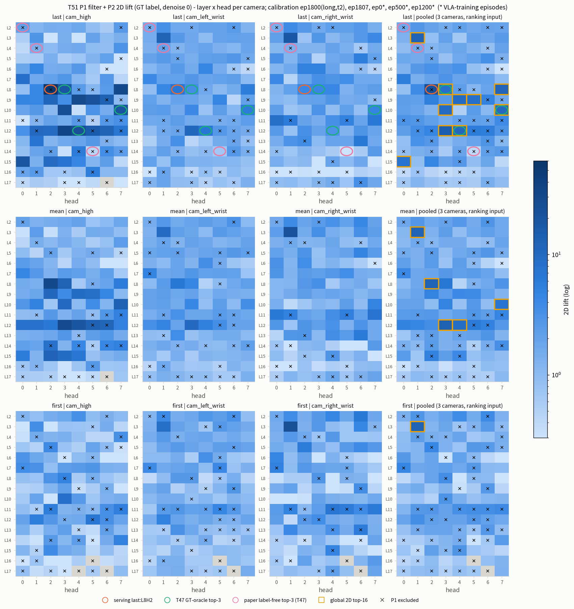

[`t51-filter-2d-heatmap.png`](figures/t51/t51-filter-2d-heatmap.png) ([sidecar](figures/t51/t51-filter-2d-heatmap.json)) — layer × head, query · camera 별 2D lift (GT label, scene mean of record means). × = P1 제외, 네모 = 전역 2D 상위 16.

**표시한 cell 의 판정.**

| cell | 판정 | 이유 · 통계 |
|---|---|---|
| **`last:L8H2` (서빙)** | **제외** | cam_high `low_mass`: mass median **0.006293** (< 0.01). left wrist 0.015043, right wrist 0.081629 는 통과. 다른 두 통계는 규칙 안 (modal_fraction 0.165 – 0.315, top-1 몫 0.165 – 0.225, 최대 component 7.8 – 9.3 %) |
| T47 label-free top-3 `last:L4H1` · `last:L2H0` | 제외 | 3 camera 모두 `broad_map` (top-1 몫 0.012 – 0.025, 최대 component 15.8 – 23.5 %) |
| `last:L14H5` | 제외 | cam_high `fixed_patch_sink` (modal_fraction 0.931354, top-1 몫 0.583195) |
| T47 oracle top-3 `last:L8H3` · `last:L10H7` · `last:L12H4` | 통과 | |

- **L8H2 의 제외는 사전 고정 규칙의 출력이다.** 2D lift 로는 L8H2 가 통과한 1 위 `last:L12H3` 보다 높다 (record 평균 2D lift 27.95 대 19.83). 즉 이 규칙은 "image 질량이 작은 head" 를 거르는데 그 head 가 target 위에 몰려 있다 (미측정 해석: image 질량의 절대량이 작아도 그 질량이 target 에 몰릴 수 있다). threshold 는 바꾸지 않았다.
- 제외된 L8H2 는 **forced cell 이라 3D 점수만 보고하고 순위 경쟁에는 넣지 않았다** (§6).

### 6. P2 calibration 점수 — 2D 와 3D

**2D lift (GT label, scene mean 선별).** 통과한 cell 의 2D lift 1 위는 `last:L12H3` (scene mean 15.22). 2D → 3D 후보는 GT 20 개, self 23 개. 선별 집합은 record 평균과 같다.

**3D `identity_correct` (GT label, scene mean, primary).** 표는 상위 cell 의 scene mean 과 scene 별 값이다.

| cell | scene mean | scene1800 (`long`+`t2`) | scene1807 | scene0\* | scene500\* | scene1200\* |
|---|---:|---:|---:|---:|---:|---:|
| **`last:L12H4`** | **0.6913** | 0.6033 | 0.8267 | 0.8850 | 0.7788 | 0.3628 |
| `mean:L12H4` | 0.6909 | 0.6367 | 0.8267 | 0.8850 | 0.7434 | 0.3628 |
| `last:L10H7` | 0.6069 | 0.6167 | 0.4000 | 0.8850 | 0.7611 | 0.3717 |
| `mean:L10H7` | 0.6055 | 0.6500 | 0.3333 | 0.8850 | 0.7965 | 0.3628 |
| `last:L8H3` | 0.5905 | 0.5833 | 0.3867 | 0.8761 | 0.7522 | 0.3540 |
| `last:L12H3` (2D 1 위) | 0.5772 | 0.6500 | 0.2800 | 0.8850 | 0.6991 | 0.3717 |
| `mean:L12H3` | 0.5683 | 0.6500 | 0.2800 | 0.8496 | 0.6903 | 0.3717 |
| `last:L8H2` (forced · P1 제외 · 순위 밖) | 0.5858 | — | — | — | — | — |

(\* = VLA 학습 episode.) 순위 밖 L8H2 의 0.5858 은 순위 5 위 `last:L8H3` (0.5905) 와 6 위 `last:L12H3` (0.5772) 사이다 (산출 비교).

- **2D lift 1 위 (`last:L12H3`) 는 3D 에서 6 위다.** 2D 와 3D 의 순위가 다르다. 이것이 primary 를 3D 로 정한 이유의 직접 증거이고, 2D 만 있는 플랫폼 (LIBERO, §11) 의 선택은 이 한계를 가진다.
- scene 별 값이 크게 흩어진다: `last:L12H4` 는 scene0 0.8850 에서 scene1200 0.3628 까지. scene1200 (pear) 은 상위 cell 대부분이 0.35 – 0.37 이다. 이 scene 만 낮은 이유는 측정하지 않았다 (이 값이 P3 의 불안정을 만든다, §7).

### 7. P3 안정성 — 사전 고정 기준 미충족 (정직한 기록 2)

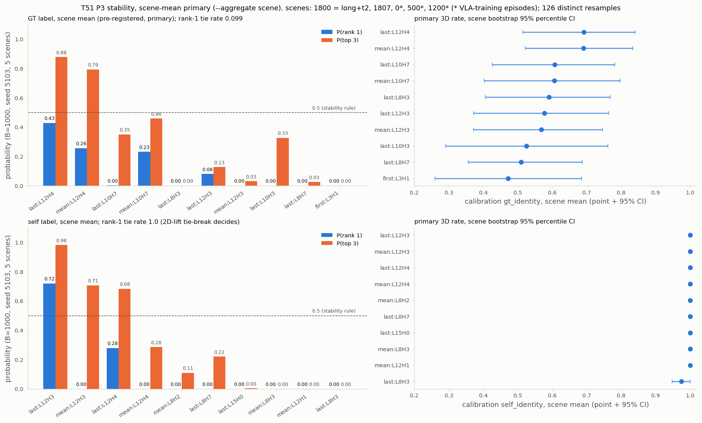

[`t51-bootstrap-rank1__scene.png`](figures/t51/t51-bootstrap-rank1__scene.png) ([sidecar](figures/t51/t51-bootstrap-rank1__scene.json)) — scene bootstrap (B = 1000, seed 5103, 5 scene, 서로 다른 resample 126 개) 의 cell 별 P(rank1) (파랑) · P(top3) (주황) 과 primary 점수 95 % CI. 점선 = 0.5 안정성 기준. 위 = GT label, 아래 = self label.

| cell (GT, scene mean) | P(rank1) | exact P(rank1) | P(top3) | 점수 95 % CI |
|---|---:|---:|---:|---|
| **`last:L12H4`** | **0.429** | 0.4355 | 0.879 | [0.515, 0.840] |
| `mean:L12H4` | 0.256 | 0.2368 | 0.794 | [0.522, 0.833] |
| `mean:L10H7` | 0.232 | 0.2483 | 0.459 | [0.403, 0.797] |
| `last:L12H3` | 0.080 | 0.0774 | 0.127 | [0.372, 0.764] |
| `last:L10H7` | 0.002 | 0.0016 | 0.350 | [0.426, 0.782] |

- **full-sample 1 위의 P(rank1) = 0.429 < 0.5 → `stable_single_cell` = false.** rank-1 tie rate 0.099 (동점이 순위를 정한 resample 비율). 1 위 확률이 `last:L12H4` · `mean:L12H4` · `mean:L10H7` 세 cell 에 나뉜다.
- **사전 고정 되돌아올 지점의 적용: "선택이 불안정하면 단일 head 고정을 주장하지 않는다. k > 1 또는 명사 query 를 Ω 에 넣어 다시 돌린다."** → 단일 head 고정은 주장하지 않는다. k > 1 은 §8, 명사 query 는 §12.
- 읽을 때의 한계: scene 이 5 개이고 그중 3 개가 VLA 학습 episode 라서 이 값은 "이 5 scene 을 다시 뽑았을 때" 의 변동이다. 새 scene 의 변동은 아니다 (§13).
- (미측정 해석) 1 위 cell 들이 같은 head L12H4 의 aggregation 이라 head 단위로는 `last` · `mean` 합 P(rank1) 가 0.685 로 높지만 (산출 0.429 + 0.256), 이 합은 사전 고정 기준이 아니다.

### 8. P4 k 선택

| k | CV 평균 (scene 5 fold) | 95 % CI |
|---|---:|---|
| 1 | 0.586 | [0.405, 0.772] |
| 2 | 0.596 | [0.412, 0.786] |
| 3 | **0.647** (best) | [0.481, 0.812] |

- best = k 3. 단순성 규칙: k = 1 대 best 의 쌍 차이 0.061, 95 % CI [−0.119, 0.296] 이 0 을 포함 → **k\* = 1, 선택 `last:L12H4`.** nested CV 평균 0.586, 안쪽 fold 의 k 는 [1, 1, 1, 1, 2] (scene1800 · 1807 · 0 · 500 · 1200 순).
- **읽는 법.** k = 1 은 "k = 3 이 더 낫지 않다" 는 증거가 아니라 **"차이가 5 scene 으로는 구별되지 않아 단순한 쪽을 택하는" 규칙의 출력** 이다. 코드가 내는 `single_head_fixed: true` 는 k\* = 1 이라는 뜻일 뿐, §7 의 안정성 기준을 충족했다는 뜻이 아니다.
- self label (§10): k 별 CV 평균이 모두 1.0 → k\* = 1, `last:L12H3`.

### 9. P5 held-out · P6 ablation (정직한 기록 3 포함)

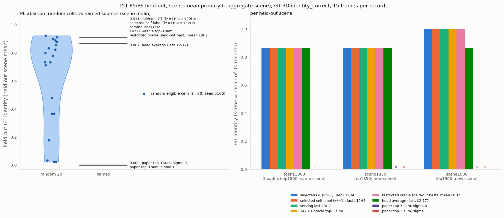

[`t51-ablation-heldout__scene.png`](figures/t51/t51-ablation-heldout__scene.png) ([sidecar](figures/t51/t51-ablation-heldout__scene.json)) — 왼쪽: 무작위 eligible cell 20 개 (seed 5106) 의 held-out GT `identity_correct` 분포 위에 이름 붙은 선택들. 오른쪽: held-out scene 별 값. held-out = 4 record · 3 scene · record 당 15 frame.

| source | held-out scene mean | scene1800 (`headfix`+`ep1800`) | scene1850 | scene1900 | record mean |
|---|---:|---:|---:|---:|---:|
| **선택 GT (k\* = 1) `last:L12H4`** | **0.911** | 0.867 | 0.867 | 1.000 | 0.900 |
| 선택 self label `last:L12H3` | 0.911 | 0.867 | 0.867 | 1.000 | 0.900 |
| **서빙 `last:L8H2`** | **0.911** | 0.867 | 0.867 | 1.000 | 0.900 |
| T47 GT-oracle top-3 합 | 0.911 | | | | 0.900 |
| restricted oracle (`mean:L8H2`, held-out 최고) | 0.911 | | | | |
| head 평균 (last, L2–17) | 0.867 | | | | 0.867 |
| 논문 label-free top-3, σ=0 · σ=1 | 0.000 · 0.000 | | | | 0.000 · 0.000 |
| 무작위 cell 20 개 | median 0.756 (p05 0.022, p95 0.912) | | | | median 0.733 |

- record 별 (세 선택 공통): `headfix` 1.000 · `ep1850` 0.867 · `ep1900` 1.000 · `ep1800` 0.733.
- **세 선택은 frame 단위로도 같다.** 4 record 모두에서 모든 frame (15 / 15) 의 identity 판정이 세 source 에서 일치한다. 서빙 L8H2 의 row 는 T47b σ=0 의 `l8h2` row 와 4 record 모두 15 / 15 같다 (T51 replay loop 가 T47b 와 갈라지지 않았음).
- 선택이 무작위 cell 20 개 중 `share_at_or_above_selected` 0.10 (2 개, 0.9111 · 0.9222) 만 같거나 높다 — 무작위에서 좋은 cell 이 거의 없지는 않다. 논문 top-3 은 σ 와 무관하게 0.000.

**L8H2 는 P1 에서 제외됐는데 held-out 에서 선택과 같다 (정직한 기록 3).** 사전 고정 규칙은 L8H2 를 low_mass 로 제외했고, 그 cell 은 calibration 3D 에서 순위 5 · 6 위 사이 (0.5858), held-out 에서는 선택과 모든 frame 에서 동률이다. 규칙이 그 cell 을 거른 것이 틀렸다고도 맞았다고도 이 측정은 말하지 못한다 — held-out 이 세 cell 을 가르지 못하기 때문이다 (재측정 대기 #19). **threshold 를 다시 맞추지 않았고 그 선택을 제안하지도 않는다.**

### 10. 자기 label (grasp-event pseudo label) — 실물 적용 가능성의 sim 검증 (정직한 기록 4)

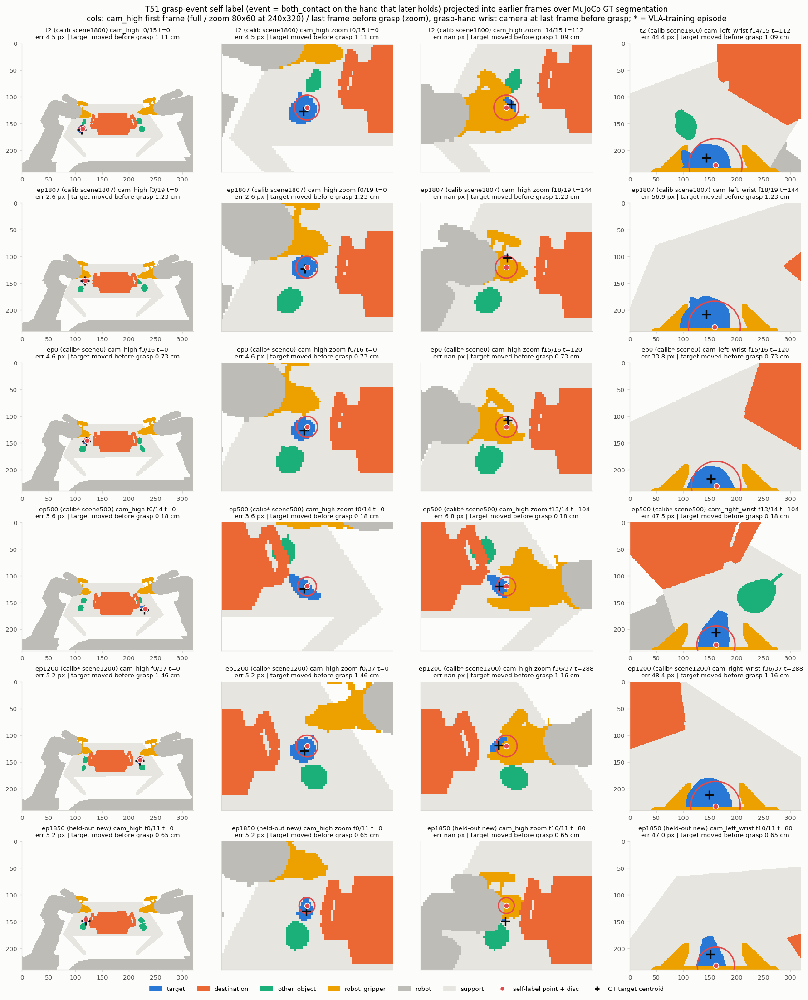

[`t51-selflabel-scene.png`](figures/t51/t51-selflabel-scene.png) ([sidecar](figures/t51/t51-selflabel-scene.json)) — 6 record (행: `t2` · `ep1807` · `ep0`\* · `ep500`\* · `ep1200`\* · `ep1850`) 의 grasp event 에서 구한 fingertip pad 중점 (붉은 점 + 반지름 disc) 을 이전 frame 의 camera 로 투영해 MuJoCo GT segmentation 위에 겹쳤다. 열: cam_high 첫 frame (전체) · 같은 frame (80×60 확대) · grasp 직전 frame (확대) · grasp 손의 wrist camera. 검은 + = GT target centroid, 색 = GT class (파랑 target, 주황 destination, 초록 other_object, 노랑 robot_gripper).

**event 와 투영 오차 (GT 점검, 6 record).**

| record | 손 · 시각 | label frame | r_obj (m) | 쥐기 전 target 이동 max · 1 cm 초과 frame | cam_high proj 오차 median (px) · hit_patch | 손 wrist camera 오차 median (px) |
|---|---|---:|---:|---|---|---:|
| `t2` | 왼 · t = 120 | 15 | 0.0314 | **1.11 cm · 15 / 15** | 4.65 · 0.933 | 19.97 |
| `ep1807` | 왼 · t = 152 | 19 | 0.0309 | **1.24 cm · 19 / 19** | 2.31 · 0.895 | 9.28 |
| `ep1850` (held-out) | 왼 · t = 88 | 11 | 0.0222 | 0.65 cm · 0 | 5.11 · 0.818 | 11.75 |
| `ep0`\* | 왼 · t = 128 | 16 | 0.0297 | 0.73 cm · 0 | 4.56 · 0.813 | 12.52 |
| `ep500`\* | 오른 · t = 112 | 14 | 0.0236 | 0.18 cm · 0 | 3.66 · 1.000 | 21.56 |
| `ep1200`\* | 오른 · t = 296 | 37 | 0.0301 | **1.47 cm · 37 / 37** | 5.33 · 0.865 | 13.09 |

- **grasp event 가 검출되지 않은 record 가 10 개 중 4 개** (`long` · `headfix` · `ep1800` · `ep1900`) 다. 그 record 는 self label 이 없다 (원인은 확인하지 않았다).
- **"쥐기 전 정지" 가정은 6 개 중 3 개 record 에서 깨진다.** target 이 label frame 과 grasp frame 사이에 1 cm 넘게 움직였다 (`t2` · `ep1807` · `ep1200`, 그 record 의 모든 label frame). 그런데 cam_high 의 투영 오차 median 은 2.3 – 5.3 px 로 가정이 깨진 record 와 안 깨진 record 가 비슷하다. wrist camera 의 오차 (9.3 – 21.6 px) 는 disc 가 크고 gripper 가 가려서 (그림의 4 열) cam_high 보다 크다 (원인은 미측정 해석).
- 그림의 `ep1850` grasp 직전 frame 에서 투영점이 gripper 위에 놓이고 target 은 가려진다 — 이 label 은 occlusion 을 모른다 (실물과 같은 조건).

**P2 · P3 · P4 에서 self label 로 고른 결과 (scene mean).**

| | GT label | self label |
|---|---|---|
| P2 1 위 | `last:L12H4` | `last:L12H3` |
| P2 상위 3 | `last:L12H4` · `mean:L12H4` · `last:L10H7` | `last:L12H3` · `mean:L12H3` · `last:L12H4` (겹침 1) |
| P3 1 위 확률 | `last:L12H4` 0.429, rank-1 tie rate 0.099 | `last:L12H3` 0.720, **rank-1 tie rate 1.0** |
| 교차 확률 | self label bootstrap 이 GT 1 위 `last:L12H4` 를 1 위로 뽑는 확률 **0.279** (self 1 위 자신은 0.720) | GT label bootstrap 이 self 1 위 `last:L12H3` 를 1 위로 뽑는 확률 **0.080** (GT 1 위 자신은 0.429) |
| P4 | k\* = 1 `last:L12H4` | k\* = 1 `last:L12H3` (같은 k, 다른 cell) |
| held-out GT `identity_correct` | 0.911 | 0.911 (record 별 차이 4 / 4 에서 0.0) |

- **포화 (정직한 기록 4).** `self_identity` 의 scene mean 이 상위 **9 cell 모두 1.0** (95 % CI [1.0, 1.0], 10 번째 `last:L8H3` 0.974) 이고 **rank-1 tie rate 가 1.0** 이다. 즉 모든 bootstrap resample 에서 1 위가 동점이라 **2D lift tie-break 가 순위를 정했다.** 실제로 self 의 상위 9 cell 은 2D lift 내림차순 (35.14, 29.70, 29.61, 24.78, 23.58, 23.32, 19.96, 13.17, 11.42) 이다. GT 의 2D lift 1 위도 `last:L12H3` 이다. 따라서 self 의 P(rank1) 0.720 은 **3D 지표가 cell 을 가른 확률이 아니라 2D tie-break 의 안정성** 이고, "self label 이 GT 와 같은 cell 을 골랐다" 는 성립하지 않았으며 (1 위가 다르다) "다른 cell 을 골랐다" 도 self label 의 결함이라고 읽지 않는다.
- 포화가 frame 부분집합 때문인지 보려고 같은 frame (self label 이 있는 grasp 이전 frame) 에서 GT `identity_correct` 를 재면 상위 3 GT cell (`mean:L12H4` · `last:L12H4` · `mean:L10H7`) 이 모두 1.0 이다 (record-mean chain 의 전체 frame 값은 0.682 · 0.677 · 0.613). **grasp 이전 frame 에서는 GT 로 재도 cell 을 가를 수 없다** (미측정 해석: 오분리가 grasp 이후 phase 에서 생긴다. phase 별로 쪼개 측정하지 않았다).
- **되돌아올 지점의 적용: "자기 label 의 결과가 GT 와 다르면 실물 적용에는 소량 사람 annotation 이 필요하다고 명시한다."** P2 1 위가 다르므로 명시한다. 단 위 포화 때문에 이것이 self label 의 부정확을 뜻하는지 지표의 해상도 한계를 뜻하는지는 가려지지 않는다.
- 실물 (`grasp_latch` 의 HELD) 의 label 은 시험하지 않았다. sim 의 `both_contact` 물리 predicate 만 썼다.

**annotation curve (GT, exploratory — 필요 frame 수 추정).** calibration frame (539 개 pool) 에서 n 개를 비복원으로 뽑아 (B = 1000) 순위를 다시 매긴다. 기준 상위 3 = `last:L12H4` · `mean:L12H4` · `last:L10H7`.

| n frame | P(same top-1) | P(top-1 이 기준 상위 3 안) |
|---:|---:|---:|
| 5 | 0.269 | 0.282 |
| 10 | 0.467 | 0.532 |
| 20 | 0.670 | 0.827 |
| 40 | 0.685 | 0.962 |
| 80 | 0.615 | 0.991 |
| 120 | 0.550 | 0.998 |
| 539 (전부) | 0.000 | 1.000 |

- frame 을 pool 해서 순위를 매기므로 (record · scene 가중이 달라짐) n = 539 에서 `P(same top-1)` 이 0.000 이다 (미측정 해석: scene mean 기준 1 위와 pool 평균 1 위가 달라서일 수 있다). **이 열은 해석에 쓰지 않는다.** `P(top-1 in reference)` 는 약 40 frame 에서 0.962 가 된다 — frame 이 같은 scene 에서 오는 상관을 무시한 값이라 scene 수가 아니라 frame 수의 효과를 과대평가할 수 있다 (미측정 해석).

### 11. LIBERO — 2D primary, task 단위 (정직한 기록 6)

**L0 조사.** KNOWS P0b 수집물 (`datasets/workspace/knows_p0b/`, 40 episode · 1,479 step) 에는 frame · state · GT segmentation · depth 는 있으나 **cell 별 attention 이 저장되어 있지 않았다.** 사용자 판정 (L1 승인, KNOWS 재현 확인 없이) 으로 저장 frame 에 `pi05_libero` attention pass 를 이 checkout 의 `.venv-openpi-live` 에서 한 번 돌렸다 (40 episode · 1,479 step, extract 240.8 s). **GT 가 agent view 의 segmentation 뿐이라 primary 는 2D lift (agent view) 이고 3D `identity_correct` 는 불가능하다.** KNOWS 재현 (`--init zeros`) 은 하지 않았다.

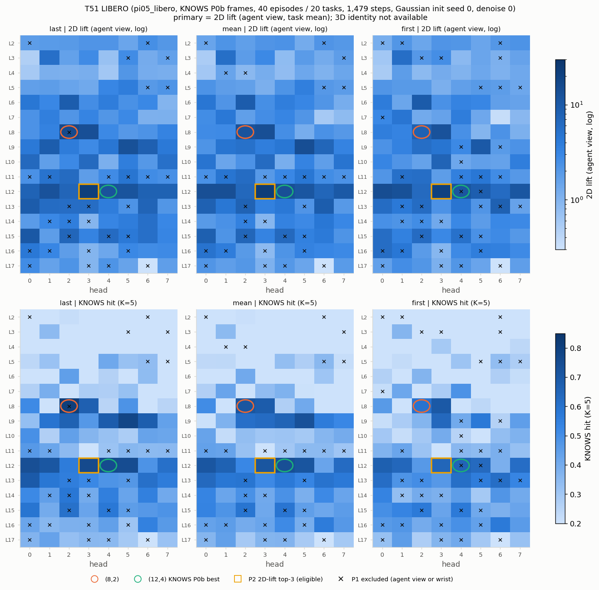

[`t51-libero-heatmap.png`](figures/t51/t51-libero-heatmap.png) ([sidecar](figures/t51/t51-libero-heatmap.json)) — LIBERO agent view 2D lift 의 layer × head (query 별). 집계 방식과 무관한 heatmap 이다.

- **P1.** eligible cell 287 개. 제외 사유 (cell × camera 수): agent view `low_mass` 81 · `fixed_patch_sink` 5 · `broad_map` 4, wrist `low_mass` 31 · `fixed_patch_sink` 10 · `broad_map` 4.
- **P2 · P3 (task 단위, 20 task × 2 episode).**

| 순위 (eligible) | cell | 2D lift (task mean) | 95 % CI | `peak_on_target` | KNOWS hit |
|---:|---|---:|---|---:|---:|
| 1 | **`mean:L12H3`** | **23.35** | [17.69, 28.50] | 0.756 | 0.711 |
| 2 | `last:L12H3` | 22.23 | [16.91, 26.98] | 0.751 | 0.760 |
| 3 | `first:L12H3` | 20.21 | [15.53, 24.68] | 0.614 | 0.648 |
| 4 | `first:L12H0` | 14.51 | [11.30, 17.58] | 0.552 | 0.670 |

- task bootstrap: `mean:L12H3` P(rank1) **1.0** (`stable_single_cell` true), `last:L12H3` · `first:L12H3` 도 P(top3) 1.0. task 평균과 episode 평균은 같다 (상위 20 의 순서 동일, 최대 절대차 7.1e-15).
- **LIBERO 에서도 L12H3 이 1 위** — RB-Y1 의 2D lift 1 위도 `last:L12H3` 이다. **head index 가 두 모델에서 같은 것은 관측이고** (미측정 해석: 같은 base weight 에서 fine-tune 된 영향일 수 있다 — 시험하지 않았다), 3D 로는 확인할 수 없다. §6 에서 RB-Y1 의 2D 1 위가 3D 에서 6 위였다는 점이 이 선택의 한계다.
- **L8H2 (LIBERO).** `last:L8H2` 는 P1 로 제외됐지만 (eligible 아님) 2D lift 15.83 으로 **전체 cell 중 4 위**, KNOWS hit 0.809 로 전체 cell 중 1 위다. `mean:L8H2` 는 eligible 이고 lift 12.20 (eligible 중 16 위). `mean:L12H4` 는 13.40 (eligible 중 10 위, KNOWS hit 0.739). RB-Y1 과 같이 **P1 이 제외한 L8H2 가 다른 지표에서는 상위** 에 있다. threshold 는 바꾸지 않았다.
- KNOWS 재현 확인을 하지 않았으므로 이 추출이 KNOWS 의 attention 과 같다는 점검은 없다 (사용자 판정). 이 점검 대신 RB-Y1 에서 같은 sampler 가 T47 asset 을 재현한 parity (§3, argmax 0.995885) 가 있다.

### 12. T51b — 명사 query 행을 같은 protocol 에 추가

**설정.** 명사 행 = T49 `target` query (prompt 의 target 명사 token 이 image 를 보는 attention, prefix 1 회, denoise 없음, raw σ=0). T47 record 의 명사 행은 T49 run 에서, 추가 3 run 은 새로 추출했다 (GPU lock). 같은 P1–P6 · 같은 threshold · scene 집계로 (a) 명사 128 cell, (b) action 384 + 명사 128 = 512 cell 을 돌린다. 3D row 는 T51 의 action row 를 읽기만 하고 명사 row 는 새로 replay 했다 (row 출처 집계: 명사 Ω 는 GT 108 · self 120 row 모두 `t51b`, 합친 Ω 는 GT 24 row 가 T51 cache · 108 row 가 `t51b`, self 30 row 가 T51 cache · 108 row 가 `t51b`).

**추출 검증.** `ep0` · `ep500` · `ep1200` 모두 113 / 113 frame 에서 명사가 정확히 1 회 매칭되어 오류 0, `check` 통과. `ep1807` 첫 4 frame 을 T49 의 `orig` 추출과 비교하면 **bit 동일** (max |Δ| 0.0, argmax 일치 1.0, Pearson r 1.0, t_step · token index 같음). prefix 시간 median 24.19 ms, GPU peak 7,527,781,120 byte. 시작 전 GPU compute process 없음.

**forced cell 구현 불일치 (정직한 기록 5).**

- lead 판정 (결과 전 고정): 명사 단독 Ω 의 3D 강제 포함 = **`noun_target:L8H6` · `L5H4` · `L4H2`** (T49 primary 명사 cell), 합친 Ω 에서는 T51 forced 에 이 3 개를 더한다.
- 구현은 T51 의 규칙 그대로 forced = [`last:L8H2` + T47 oracle 3] ∩ Ω 만 썼다. **명사 cell 3 개는 forced 목록에 넣지 않았다.** (a) 에서는 forced 가 Ω 안에 하나도 없어 실효 forced 가 비었다. (코드 규칙과 lead 판정의 차이가 verifier 에 의해 확인되었다.)
- verifier 가 영향을 점검했다: 세 cell 은 (a) · (b) × GT · self 네 경우 모두 **P1 eligible, 전역 2D 상위 16 안, 15 개 fold 모두의 순위 집합 안** 에 있다. 즉 forced 로 넣었어도 3D 후보 집합이 바뀌지 않는다 → **결과는 바뀌지 않았다.** 코드는 고치지 않았다.
- verifier 가 P2 3D · bootstrap 을 독립 재계산해 코드 값과 최대 절대차 1.1e-16 으로 일치시켰다 (명사 · 합친 Ω, GT).

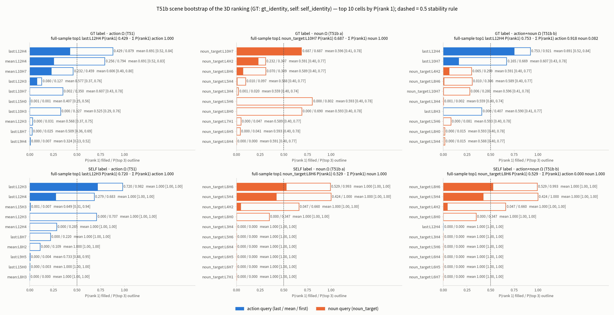

[`t51b-bootstrap-rank1-by-query.png`](figures/t51/t51b-bootstrap-rank1-by-query.png) ([sidecar](figures/t51/t51b-bootstrap-rank1-by-query.json)) — 위 = GT label, 아래 = self label. 열: action Ω (T51) · (a) 명사 Ω · (b) action + 명사 Ω. 채움 = P(rank1), 윤곽 = P(top3), 파랑 = action query, 주황 = 명사 query. 점선 = 0.5.

**(a) 명사만 Ω.**

- **P1**: eligible 83 / 128. 제외 45 (cell 수, 한 camera 라도): `low_mass` 43, `fixed_patch_sink` 4, `broad_map` 0. lead 의 세 cell 은 모두 eligible.
- **P2 3D (GT, scene mean)**: 1 위 `noun_target:L10H7` 0.5957. 이어 `L8H0` · `L5H6` · `L6H5` 0.5931, `L6H4` 0.5913, `L4H2` 0.5911, `L8H6` 0.5891. **상위 10 cell 의 점수가 0.589 – 0.596 안에 있다 (차 0.007).** 비교: action 의 상위 점수는 0.691 (§6).
- **P3 (GT)**: `noun_target:L10H7` P(rank1) **0.687** (P(top3) 0.687, CI [0.406, 0.779], rank-1 tie rate 0.313, `stable_single_cell` true). 이어 `L4H2` 0.232 · `L8H6` 0.070 · `L5H4` 0.010. **P(rank1) 은 0.5 를 넘지만 점수가 거의 같은 cell 사이의 동점이 순위를 정하는 구조다** (tie rate 0.313, 미측정 해석: 어느 명사 cell 을 골라도 3D 에서는 구별되지 않는다).
- **P4 (GT)**: CV 평균 k = 1 · 2 · 3 = 0.5911 · 0.5911 · 0.5931 (best k = 3, 차 CI 가 0 을 포함) → k\* = 1 `noun_target:L10H7`.
- **self label**: 1 위 `noun_target:L8H6` P(rank1) 0.529 (rank-1 tie rate 1.0 — T51 과 같은 포화), `L5H4` 0.424, `L4H2` 0.047. k\* = 1 `noun_target:L8H6`.
- **P5 · P6 (held-out scene mean, GT 채점)**: 선택 GT `noun_target:L10H7` **0.867** (scene1800 0.733, scene1850 0.867, scene1900 1.000; record mean 0.833), 선택 self `noun_target:L8H6` 0.878 (scene1800 0.767; record mean 0.850), T49 primary 세 cell (`L8H6` · `L5H4` · `L4H2`) 각각 0.878, 서빙 `last:L8H2` 0.911. 무작위 명사 cell 20 개의 median 0.661, 선택 이상인 비율 0.40. restricted oracle `noun_target:L8H7` 0.878. (T49 절의 명사 수치는 k = 3 · σ = 1 합이라 이 단일 cell raw 값과 같은 source 가 아니다.)

**(b) action + 명사 합친 Ω.**

- **P1**: eligible 325 / 512 (last 81 · mean 87 · first 74 · 명사 83).
- **후보 구성.** 전역 2D lift 상위 16 은 **전부 명사 cell 이다 (명사 16 · action 0).** action cell 이 3D 후보로 들어간 것은 forced (`last:L8H3` · `last:L10H7` · `last:L12H4`, L8H2 는 P1 로 제외) 뿐이다. 3D 후보는 GT 22 개 · self 23 개다. 따라서 T51 의 action 단독 순위에서 2 · 3 위였던 `mean:L12H4` · `mean:L10H7` 와 2D 1 위 `last:L12H3` 는 이 순위 집합에 없다.
- **P2 3D (GT)**: 1 위 `last:L12H4` 0.6913, 이어 `last:L10H7` 0.6069, `noun_target:L10H7` 0.5957, `noun_target:L8H0` · `L5H6` · `L6H5` 0.5931 ….
- **P3 (GT)**: `last:L12H4` P(rank1) **0.753** (P(top3) 0.921, rank-1 tie rate 0.076, `stable_single_cell` true). **query family 별 P(rank1) 합 = action 0.918 · noun 0.082.** 이어 `last:L10H7` 0.165, `noun_target:L4H2` 0.065.
- **(미측정 해석) 0.429 (action 단독) 에서 0.753 으로 올라간 것은 같은 실험의 결과로 비교하기 어렵다.** action 단독에서 P(rank1) 을 나눠 가졌던 `mean:L12H4` (0.256) · `mean:L10H7` (0.232) 가 이 순위 집합에 없다. 합친 Ω 의 action 후보를 넓힌 실험은 하지 않았다.
- **P4 (GT)**: CV 평균 k = 1 · 2 · 3 = 0.606 · 0.588 · 0.466 → best = k 1, k\* = 1 `last:L12H4`.
- **self label**: 1 위 `noun_target:L8H6` P(rank1) 0.529 (family 합 noun 1.0 · action 0.0, tie rate 1.0). 고른 것이 명사 cell 인 것은 self 의 2D lift tie-break 가 명사 cell (lift 94.5 등) 을 앞세운 결과다 (자기 label 의 3D 점수는 상위 cell 모두 1.0).
- **P6 (GT 선택 `last:L12H4`, held-out scene mean 0.911)**: 무작위 20 개 (합친 Ω) median 0.639 (p05 0.032, p95 0.879), 선택 이상 비율 0.0, restricted oracle `last:L8H2` 0.911.

**(c) action 최선 대 명사 최선의 held-out 비교 (primary = scene 단위 paired 차이).**

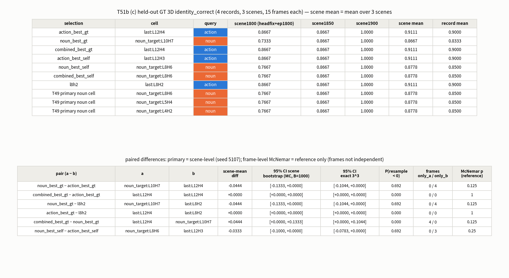

[`t51b-heldout-compare-table.png`](figures/t51/t51b-heldout-compare-table.png) ([sidecar](figures/t51/t51b-heldout-compare-table.json)) — 위: 선택별 held-out scene 별 `identity_correct` · scene mean · record mean. 아래: scene 단위 paired 차이 (seed 5107, B = 1000 과 3^3 = 27 resample 전수) 와 frame 단위 McNemar (참고).

| 선택 | cell | scene1800 | scene1850 | scene1900 | **scene mean** | record mean |
|---|---|---:|---:|---:|---:|---:|
| action best (GT) | `last:L12H4` | 0.867 | 0.867 | 1.000 | **0.911** | 0.900 |
| **명사 best (GT)** | `noun_target:L10H7` | **0.733** | 0.867 | 1.000 | **0.867** | 0.833 |
| 합친 best (GT) | `last:L12H4` | 0.867 | 0.867 | 1.000 | 0.911 | 0.900 |
| action best (self) | `last:L12H3` | 0.867 | 0.867 | 1.000 | 0.911 | 0.900 |
| 명사 best (self) = 합친 best (self) | `noun_target:L8H6` | 0.767 | 0.867 | 1.000 | 0.878 | 0.850 |
| 서빙 | `last:L8H2` | 0.867 | 0.867 | 1.000 | 0.911 | 0.900 |

| 쌍 (a − b) | scene 별 차 (1800 · 1850 · 1900) | scene mean 차 | 95 % CI (scene bootstrap MC) | 95 % CI (전수 27) | frame only_a / only_b | McNemar p (참고) |
|---|---|---:|---|---|---|---:|
| 명사 best − action best (GT) | −0.133 · 0 · 0 | **−0.044** | [−0.133, 0.000] | [−0.104, 0.000] | 0 / 4 | 0.125 |
| 합친 best − action best (GT) | 0 · 0 · 0 | 0.000 | [0, 0] | [0, 0] | 0 / 0 | 1 |
| 명사 best − 서빙 L8H2 | −0.133 · 0 · 0 | −0.044 | [−0.133, 0.000] | [−0.104, 0.000] | 0 / 4 | 0.125 |
| action best − 서빙 L8H2 | 0 · 0 · 0 | 0.000 | [0, 0] | [0, 0] | 0 / 0 | 1 |
| 명사 best − action best (self) | −0.100 · 0 · 0 | −0.033 | [−0.100, 0.000] | [−0.078, 0.000] | 0 / 3 | 0.25 |

- **차이는 scene1800 한 곳에서만 난다** (`headfix`: 명사 best 0.733 대 action best 1.000, `ep1800` 은 둘 다 0.733). scene1850 · scene1900 은 같다. scene 이 3 개라 bootstrap CI 의 상한이 0 에 걸리고 (MC resample 의 69.2 % 가 음수, 양수는 0 %), 전수 27 resample 에서 서로 다른 값은 4 개뿐이다.
- 따라서 **명사 query 가 action query 보다 3D target 을 더 잘 고른다는 증거는 없다.** 방향은 명사 ≤ action 이지만 유의하다고도 하지 않는다 (scene 3 개, frame 60 개). frame 단위 McNemar 는 frame 을 독립으로 세므로 참고다.
- 이 결과는 T49 의 3D 열세 (명사 query 의 `identity_correct` · purity · non-target 손실이 L8H2 보다 낮음) 와 같은 방향이고, 같은 source 가 아니라 크기를 직접 비교하지 않는다.
- (미측정 해석) T49 의 제안 (b) — 명사 query 로 identity · destination 을, L8H2 로 3D seed 를 얻는 결합 — 은 이 STEP 에서도 측정하지 않았다. T51b 의 "합친 Ω" 는 한 cell 을 고르는 것이지 두 query 를 결합하는 것이 아니다.

### 13. 읽을 때의 한계 · 측정하지 않은 것 · 되돌아올 지점 · 판정 대기

| 한계 | 내용 |
|---|---|
| **calibration scene 5 개** | 그중 3 개 (`ep0` · `ep500` · `ep1200`) 는 VLA 학습 episode 의 기록이다. P3 의 변동은 "이 5 scene 을 다시 뽑을 때" 의 변동이고 새 scene 의 일반화가 아니다. 서로 다른 resample 이 126 개뿐이다 |
| **held-out 3 scene · 60 frame** | 세 선택이 frame 단위로 동률이라 변별력이 없다 (#19). held-out 은 물체 종류 3 (apple · banana · pear) 정도로 좁다 |
| **3D 는 legacy ESDF offline replay** | subtask gate off, grasp latch 없음. cuRobo ESDF · closed-loop 효과는 측정하지 않았다 (#24) |
| **self label 은 sim 만** | `both_contact` 물리 predicate. 포화 · 쥐기 전 이동 (6 중 3) · event 없는 record (10 중 4) (#20) |
| **LIBERO 는 2D 만** | 3D · wrist · KNOWS 재현 없음 (#22) |
| **T51b 의 후보 구성** | 합친 Ω 의 2D 상위 16 이 모두 명사. action 후보는 forced 3 개 (#23) |
| **집계 단위 deviation** | 수정되었고 scene 로 재측정했다. record-mean chain 은 보고만 한다 (§4) |

**측정하지 않은 것 (`not_measured`).** T51: cuRobo 회귀 기준선 (GPU 미사용) · LIBERO KNOWS 재현 (`--init zeros`, protocol 밖) · 명사 행은 T51b 로 분리. T51b: T51b 용 MuJoCo scene figure (T51 의 scene figure 가 같은 held-out record 를 다룬다) · LIBERO 의 명사 행 (범위 밖) · record-aggregate (`__scene` 이 아닌) T51b 출력 · cuRobo 기준선.

**되돌아올 지점 (task 가 미리 정한 전환 신호의 적용).**

| 신호 | 결과 | 취한 행동 |
|---|---|---|
| 선택이 불안정 (1 위 확률 < 0.5) | 해당 (0.429) | 단일 head 고정을 주장하지 않는다. k > 1 은 P4 에서 CV 최고가 k = 3 (0.647) 이나 차 CI 가 0 을 포함해 단순성 규칙으로 k = 1. 명사 query 를 Ω 에 넣은 T51b 의 합친 Ω 는 P(rank1) 0.753 이나 후보 구성에 의존 (§12) |
| self label 결과가 GT 와 다름 | 해당 (P2 1 위 다름) | 실물 적용에는 소량 사람 annotation 이 필요하다고 명시한다. 필요 frame 수는 annotation curve (exploratory, 40 frame 에서 P(top-1 in reference) 0.962). 단 self 지표 포화 때문에 이 결론의 강도는 약하다 (§10) |
| LIBERO 수집물 없음 | 해당 (attention 없음) | 사용자 L1 승인 후 `pi05_libero` pass 수행 (§11) |
| 서빙 반영 | 하지 않음 | 별도 판정 |

**판정 대기 (제안, 미측정 해석 포함).**

1. **서빙 cell 을 어떻게 할 것인가.** 이 STEP 은 L8H2 를 유지한다. P1 이 L8H2 를 제외했지만 held-out 에서 `last:L12H4` · `last:L12H3` 와 frame 단위로 동률이어서, 이 측정만으로 교체나 유지의 근거는 확정되지 않는다.
2. **논문에서 이 protocol 을 어떻게 기술할 것인가 (제안).** 근거가 있는 주장은 "사전 고정한 절차로 cell 을 고르고 선택의 안정성을 수치로 보고한다" 까지다. "단일 head 가 최적이다" · "self label 이 GT 를 대체한다" · "명사 query 가 낫다" 는 이 측정이 받치지 않는다.
3. **후속 측정 (제안).** (i) 학습에 쓰이지 않은 scene 을 calibration 에 더해 P3 를 다시 (#18), (ii) 더 큰 held-out (#19), (iii) self label 을 phase 별 · 실물 `grasp_latch` 로 (#20), (iv) 합친 Ω 에서 action 후보를 넓힌 재실행 (#23).

**산출물.**

- **측정 (이 절이 인용)**: [`handoff/T51.verify.json`](handoff/T51.verify.json) (`numbers.scene_mean_primary` 가 primary) · [`handoff/T51b.verify.json`](handoff/T51b.verify.json). 원자료 run: `/mnt/dev/AG3S_VLA-storage/results/development/20261012T180318+0900_28b981600bf7_852011fdcae0/verify/{T51,T51b}/`.
- **figure** (각각 `.json` sidecar 있음, 위에서 링크): primary — [`t51-bootstrap-rank1__scene`](figures/t51/t51-bootstrap-rank1__scene.png) · [`t51-ablation-heldout__scene`](figures/t51/t51-ablation-heldout__scene.png) · [`t51-protocol-table__scene`](figures/t51/t51-protocol-table__scene.png) · [`t51-filter-2d-heatmap`](figures/t51/t51-filter-2d-heatmap.png) · [`t51-selflabel-scene`](figures/t51/t51-selflabel-scene.png) · [`t51-libero-heatmap`](figures/t51/t51-libero-heatmap.png) · [`t51b-bootstrap-rank1-by-query`](figures/t51/t51b-bootstrap-rank1-by-query.png) · [`t51b-heldout-compare-table`](figures/t51/t51b-heldout-compare-table.png). record-mean chain (deviation 증거로 보존) — [`t51-bootstrap-rank1`](figures/t51/t51-bootstrap-rank1.png) · [`t51-ablation-heldout`](figures/t51/t51-ablation-heldout.png) · [`t51-protocol-table`](figures/t51/t51-protocol-table.png).

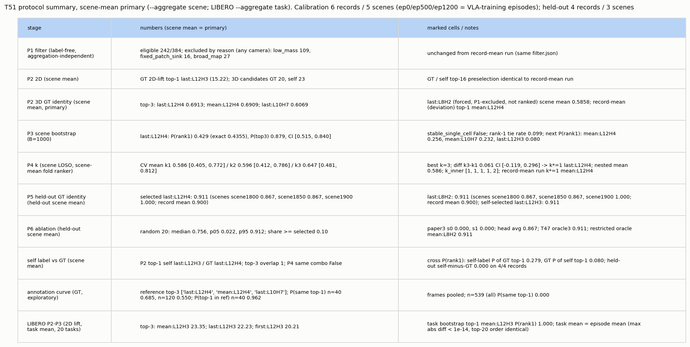

[`t51-protocol-table__scene.png`](figures/t51/t51-protocol-table__scene.png) ([sidecar](figures/t51/t51-protocol-table__scene.json)) — P1–P6 · self label · annotation curve · LIBERO 의 단계별 결과 요약.

- **구현**: `AG3S/ag3s/experiments/studies/t51_{protocol,records,extract,selflabel,replay,study,libero}.py` · `t51b_{noun_extract,study}.py` · `tests/ag3s/test_t51*.py` · `test_t51b_*.py`. [`handoff/T51.impl.md`](handoff/T51.impl.md) · [`handoff/T51b.impl.md`](handoff/T51b.impl.md). commit 은 하지 않았다 (T51 · T51b 파일은 untracked).


---

## T46c-W1 · T46d · T46f — W1 의 재현 검증, DX-04 (link 별 target 예외) 선행 확인, LTE 검증 블록 계획 (2026-10-12 ~ 2026-10-13 KST)

> 이 절은 위 "T46c" 절의 **갱신**이다 (그 절의 W1 "진행 중, 결과 없음" 을 이 절 §2 가 닫는다). 이전 서술은 지우지 않고 취소선으로 표시했다.
> 시각은 pod 에 tzdata 가 없어 UTC 에 +9 h 를 더해 환산한 KST 다 (파일 mtime · `git log`; run 디렉터리 이름의 `+0900` 은 그대로 읽음).

**이 절이 답하는 물음 (목적).** develope_PLAN 은 P0-B ("대상 identity, 경계 추정, 접촉 처리 중 무엇이 실행을 개선하는가") 의 접촉 처리 쪽을 DX-04 (link-specific exemption: 허용 link 에만 target 접촉을 허용하는 LTE 가 target 을 전역으로 지우는 방식보다 필요한 접촉과 금지 접촉을 더 잘 구분하는가) 로 묻고, 결과를 **DT-05A** (세 field policy 별 pair 의 contact · success · stop 표) 와 **DF-04B** (같은 ESDF slice 에서 link 별 distance · gradient 와 실제 contact 그림) 에 싣는다. 이 주장 (DC-3: link-specific exemption 이 필요한 접촉과 금지 접촉을 더 잘 구분한다, DC-4: 전체 시스템이 task completion 과 forbidden contact 의 trade-off 를 개선한다) 이 성립하려면 먼저 (i) F1 채택 뒤 늘어난 close 이후 HOLD 가 비교를 오염시키지 않아야 하고 (T46c-W1), (ii) query set 에 허용 link 와 비허용 link 가 함께 있어야 한다 (T46d). 이 절은 (i) 의 재현 검증, (ii) 의 선행 확인 결과와 사용자 판정, 그리고 그 판정이 정한 다음 블록 (T46f) 의 **계획**을 기록한다.

**한 줄 결과 (before → after).**

- **W1 (T46c, 결과 있음).** before: F1 을 켠 C1a + F1 은 close 이후 HOLD 가 183 chunk (uncertified 130) 였고 그 원인은 placed `no_seed` 의 인증 공백이었다 (T46b). after: 인증 술어를 넓힌 W1 을 off 로 두면 3 arm 모두 기록과 **1350 / 1350** chunk 에서 같고, W1 을 켜면 close 이후 HOLD (total / uncertified) 가 C1a 107 / 37 → **70 / 0**, C1a + F1 183 / 130 → **54 / 1**, C1a + F1 + F2 122 / 118 → **6 / 2** 로 줄어든다 (T46b 의 what-if 와 같은 값). **per-chunk what-if 이고 closed-loop 효과는 아니다.** 사용자 판정으로 W1 은 모든 Ablation arm 에 켠다.
- **DX-04 선행 확인 (T46d, 결과 있음).** 현재 gripper scope (손바닥 2 + 손가락 4, 270 구) 에서는 non-authorized 행이 target 50 mm 안에 한 번도 오지 않아 LTE 와 global exclusion 이 **퇴화** 한다 (target 근처 non-authorized 행 0 / 349,920, LTE ≠ global chunk 0 / 162). `link_*_arm_5` 를 더하면 두 정책이 갈리는 chunk 가 생기지만 (C1a + F1, 162 chunk 중 89), 그 arm_5 구는 **실제 MJCF 접촉 geom 이 target 에서 100 mm cap 이상 떨어져 있는 18 / 18 run 에서도** target 50 mm 안에 놓인다. 기록 문구 (사용자 지정): **현재 gripper scope 에서는 LTE 와 global exclusion 의 비교가 퇴화하며, `link_*_arm_5` 를 추가했을 때 나타난 차이는 형상 근사 오류의 영향을 받는다.** "효과 없음" 이 아니다.
- **T46f (계획, 결과 없음).** 사용자 판정으로 link-specific 효과 주장을 줄이지 않고 **형상 보정 → 진단 장면 → oracle extent 3 조건 closed-loop** 으로 확장한다. LTE 의 우수성은 전제하지 않는다.

**이 절이 주장하지 않는 것.**

- **LTE 가 global exclusion 보다 낫다** 는 주장. T46d 는 비교가 성립하는 조건을 찾는 선행 확인이고 효과를 재지 않았다.
- **arm_5 에서 나타난 LTE ≠ global chunk 수가 LTE 의 효과다** 라는 주장. 그 차이는 형상 근사 오류의 영향을 받는다 (사용자 지정 문구).
- **LTE ≠ global chunk 수는 contribution 의 근거가 아니다.** 메커니즘 설명용 **보조 지표**일 뿐이다 (T46f §1, lead). 주 지표는 비허용 접촉 없는 작업 성공률이다.
- **정지 (HOLD · TO 실패) 가 늘어 접촉률이 낮아진 결과는 보호 효과가 아니다.** 보호 효과로 해석하지 않는다 (T46f §1).
- **W1 이 task success · completion time 을 개선한다** 는 주장. closed-loop 으로 재지 않았다.

**읽는 법과 출처 규약.**

- 수치는 [`T46c.verify.json`](handoff/T46c.verify.json) (W1) · [`T46d.verify.json`](handoff/T46d.verify.json) (DX-04 선행 확인) 의 `numbers` 에서 왔다. 이전 STEP 의 수치는 [`T46b.verify.json`](handoff/T46b.verify.json) · [`T46-CL3.verify.json`](handoff/T46-CL3.verify.json) 이고 그 자리에 적었다. 같은 파일 숫자의 덧셈 · 뺄셈은 "(산출)" 로 적었다. **T46f 는 계획이라 verify.json 이 없다**; 그 절의 서술은 전부 lead 의 [`T46f.task.md`](handoff/T46f.task.md) 이고 "(lead)" 로 표시했다.
- 판정의 출처: **(사용자 판정)** · **(lead)** · **(산출)** 은 위와 같다. 측정으로 확인하지 않은 해석은 "(미측정 해석)" 이다.
- 이 STEP 의 측정 입력은 모두 **읽기 전용** 이고 코드 수정은 없었다 (T46d). T46c 의 코드 변경은 implementer 의 W1 구현이다 ([`T46c.impl.md`](handoff/T46c.impl.md)).

### 1. 사용자 판정과 타임라인 (KST)

| # | 판정 · 사건 | 이 절에서 |
|---|---|---|
| 1 | **(사용자 판정, 2026-10-12, 추천안 채택)** W1 을 Ablation 의 **모든 arm 에 켠다** — 2026-10-04 판정 ("남은 `no_seed` HOLD 는 그대로 둔다") 을 이번에 바꾼다. 근거: 그 판정의 전환 신호 관측 (T46b), V11AB 에도 같은 HOLD. W1 의 기본값은 off 로 두고 실험 arm 에서 명시적으로 켠다 | §2 |
| 2 | **(사용자 판정, 2026-10-12, 추천안 채택)** DX-04 선행 확인의 비허용 link 범위는 develope_PLAN §0.10.1-1 대로 **최소 범위** (wrist 등) 부터 — T46d 에서 기록으로 고른다 | §3 |
| 3 | **(사용자 판정, 2026-10-12, 추천안 채택)** 표본은 **18 쌍 유지** (CL2 · CL3 와 같은 9 episode × 2 seed) | §4 |
| 4 | **(사용자 판정, 2026-10-12, 추천안 채택)** 순서는 develope_PLAN §11: DX-04 선행 확인 (T46d) → DX-01 identity / extent 분리 + visible-target oracle (T46e 이후) → contact handling → Ablation closed-loop | §4 |
| 5 | **(사용자 지정, 2026-10-13)** T46d 의 기록 문구: "현재 gripper scope 에서는 LTE 와 global exclusion 의 비교가 퇴화하며, `link_*_arm_5` 를 추가했을 때 나타난 차이는 형상 근사 오류의 영향을 받는다." ("효과 없음" 으로 기록하지 않는다) | §3 |
| 6 | **(사용자 판정, 2026-10-13)** A (link-specific 효과 주장 축소) 가 아니라 **B 를 확장해 진행** (형상 보정 → 진단 장면 → oracle extent 3 조건 closed-loop). **C (arm_5 근사 구 그대로) 는 제외.** LTE 의 우수성을 전제하지 않는다 | §4 |

| 시각 (KST) | 무엇 | 출처 |
|---|---|---|
| 2026-10-12 23:02 | T46c task 작성 (lead) | `T46c.task.md` |
| 23:32 | W1 구현 보고 `T46c.impl.md` (implementer) | mtime 14:32Z |
| 23:35:15 | V-T46c verifier run 시작 | run 디렉터리 `20261012T233515+0900_972f28056cd8_318f98f36f37` |
| 23:36 | 사용자 판정 (위 1 – 4) 과 T46d task 를 task 문서에 기록 | commit `39246257` 14:36:40Z |
| 23:39 | `t46c-table.png` 생성 | mtime 14:39Z |
| 23:39:20 | V-T46d verifier run 시작 | run 디렉터리 `20261012T233920+0900_392462577320_70c141f47dbe` |
| 23:40 | **`T46c.verify.json` 작성 (PASS)** | mtime 14:40Z |
| 23:41:40 | T46d 판정 기준 (`thresholds_fixed_before_measuring.json`) 을 측정 전에 고정 | `T46d.verify.json definitions.written_utc` 14:41:40Z. 그 전에는 legacy 기준선과 구 모델 확인만 돌았다 |
| 23:41:51 | W1 코드 · test · replay harness commit | commit `6dfaf7bb` 14:41:51Z |
| 23:42:37 | T46e task (visible-target oracle extent 구현 지시) commit | commit `15314ba3` 14:42:37Z |
| 2026-10-13 00:06 – 00:16 | `t46d-scene` · `t46d-graph` · `t46d-table` figure 생성 | mtime 15:06Z · 15:15Z · 15:16Z |
| 00:17 | **`T46d.verify.json` 작성** | mtime 15:17Z |
| 00:19:35 | T46d 결과 commit | commit `e7157636` 15:19:35Z |
| 01:23 – 01:24 | 사용자 지정 기록 문구 · 판정을 `T46d.task.md` 에 기록, **T46f task 작성** (lead) | `T46f.task.md` mtime 16:23Z, commit `ab9b3fba` 16:24:23Z |

### 2. T46c — W1 (placed `no_seed` 인증) 의 재현 검증 (V-T46c: PASS)

**무엇을 검증했나.** W1 (`--placed-no-seed-certify`, 기본 off) 은 인증 술어 `subtask_no_target` 에 한 갈래를 더한다: gate on ∧ label `home` ∧ `placed_seen` ∧ validity `valid` ∧ carve 없음 ∧ grounding `no_seed` 이면 인증한다 (구현: `AG3S/ag3s/types.py` 의 `subtask_no_target`, `AG3S/trajopt/safe_policy.py`, CLI `AG3S/trajopt/serve_safe.py`; 상세 [`T46c.impl.md`](handoff/T46c.impl.md)). 다른 조건 — 위반 행이 있음, `placed_seen` 없음, label `pick` / `place` — 은 그대로 HOLD 다. 인증은 "AG3S 가 장면을 다 설명했는가" 라는 질문만 바꾸고 field 는 그대로 모든 물체를 full clearance 로 잡는다. 검증 기준 (verifier, 측정 전):

| 기준 | 내용 | 결과 |
|---|---|---|
| 1 | 회귀 기준선 일치 (legacy · cuRobo) | PASS |
| 2 | off (W0) 가 CL3 기록의 reason · `geometry_certified` 와 chunk 단위로 같은가 (3 arm × 1350 chunk) | PASS |
| 3 | W1 이 T46b 의 what-if (execute 전환 37 / 129 / 116, close 이후 HOLD) 를 재현하는가 | PASS |
| 4 | 새 test · 기존 SUBTASK test 통과 | PASS |

**기준 1 — 회귀 기준선.**

| backend | start-violated | has_target | frame 0 clearance_before | 기대값과 |
|---|---|---|---|---|
| legacy (CPU, `.venv-ag3s`) | 14 / 15 | 15 / 15 | −29.031048 mm | 일치 |
| cuRobo (GPU, `.venv-openpi-live`) | 10 / 15 | 15 / 15 | −9.171877 mm | 일치 |

(출처: `numbers.criterion_1_baselines`, `baseline_check.matched = true`. 부기: legacy 의 final status 는 feasible 15, cuRobo 는 feasible 14 · violated 1 이고 verifier 는 이것을 기준선이 아니라고 적었다 (SQP wall-clock). legacy 실행 중 다른 session 때문에 machine load average 가 약 14 였다.)

**기준 2 · 3 — off bit-identical, W1 offline 재현 (before → after).** 입력은 CL3 의 기록 chunk (arm 당 1350 chunk, [`T46-CL3`](handoff/T46-CL3.verify.json) 의 18 쌍). **C1a · C1a + F1 · C1a + F1 + F2 의 세 arm 이 입력이다.** V11AB (C0) 는 CL2 의 run 이라 이 replay 에 들어 있지 않다 (재측정 대기 #27).

| 기록 arm | off (W0) 가 기록 reason 과 같음 | off (W0) 가 기록 `certified` 와 같음 | close 이후 HOLD, 기록 그대로 (total / uncertified) | **W1: execute 로 바뀌는 chunk** | **W1: close 이후 HOLD (total / uncertified)** |
|---|---|---|---|---|---|
| C1a | 1350 / 1350 | 1350 / 1350 | 107 / 37 | **37** | **70 / 0** |
| C1a + F1 | 1350 / 1350 | 1350 / 1350 | 183 / 130 | **129** | **54 / 1** |
| C1a + F1 + F2 | 1350 / 1350 | 1350 / 1350 | 122 / 118 | **116** | **6 / 2** |

(출처: `numbers.criterion_2_off_bit_identical`, `numbers.criterion_3_W1`. 기록 그대로의 값은 `W0_after_close_hold` 와 `recorded_after_close_hold` 가 같다. T46b 의 what-if 와 대조하면 전환 37 / 129 / 116 · HOLD 70 / 54 / 6 · uncertified 0 / 1 / 2 가 모두 같다.)

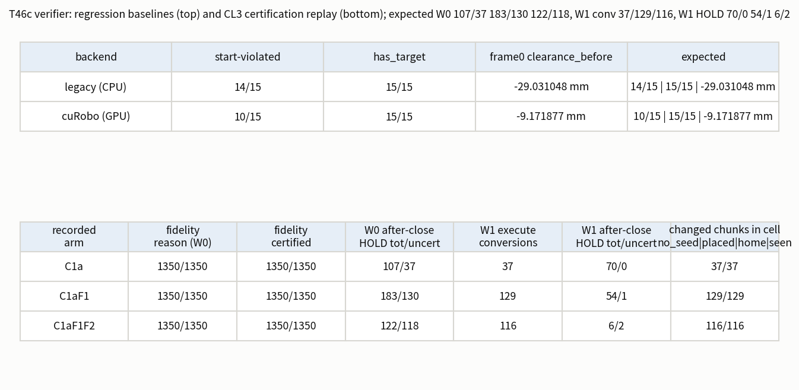

[`t46c-table.png`](figures/t46/t46c-table.png) (sidecar [`.json`](figures/t46/t46c-table.json)) — 위: 두 backend 의 기준선. 아래: arm 별 off fidelity · W1 전환 · close 이후 HOLD · 바뀐 칸.

- **바뀐 chunk 는 전부 한 칸이다:** `grounding = no_seed` · `phase = placed` · `label = home` · `placed_seen = True` 에서 C1a 37 / 37 · C1a + F1 129 / 129 · C1a + F1 + F2 116 / 116 chunk 이고, `no_seed` · placed · home 이 아닌 칸에서 인증이 바뀐 chunk 는 없다 (`conversions_by_cell`, `flipped`). 인증이 바뀌었는데 다른 사유로 HOLD 가 남은 chunk 와 인증이 바뀐 chunk 가 기록에서 실행이었던 경우는 세 arm 모두 0 이다 (`certified_but_still_hold`, `certified_recorded_execute`).
- **전환된 run (chunk 수):** C1a `ep54_s541` 37 · C1a + F1 `ep11_s111` 40 · `ep30_s301` 36 · `ep54_s541` 38 · `ep54_s542` 15 · C1a + F1 + F2 `ep11_s111` 40 · `ep30_s301` 36 · `ep54_s541` 38 · `ep54_s542` 2 (`conversion_runs`). 이 run 들은 T46b §4 에서 placed `no_seed` 가 episode 끝까지 이어졌거나 풀린 run 과 같다.
- **W1 후에 남는 uncertified 1 · 2 chunk** 는 T46b 가 `no_admissible` + label `pick` chunk 수 (C1a + F1 1, C1a + F1 + F2 2) 와 같다고 정리했다 (개수 일치로 읽음). T46c verify 는 그 chunk 의 칸을 따로 분해하지 않았다.

**기준 4 — test.** W1 test (`tests/trajopt/test_t46c_placed_no_seed_certify.py`) 는 passed 67 · failed 0 · skipped 0. 기존 SUBTASK suite 5 개 파일은 passed 316 · failed 0 · skipped 1 (`numbers.criterion_4_tests`). 구현자는 전체 pytest 도 돌렸으나 그 결과는 `T46c.impl.md` 에만 있고 verifier 는 재지 않았다 (`not_measured`, #27). 측정은 working tree (HEAD `972f2805` 에 미커밋 변경) 위에서 했고 verify.json 의 md5 (`config.py` · `types.py` · `safe_policy.py` · `certification_replay.py`) 는 이 로그를 쓰는 시점의 working tree 와 같다.

**before → after 요약 (C0 = V11AB · C1a · C1a + F1).**

| 지표 | V11AB (C0) | C1a | C1a + F1 | 출처 |
|---|---|---|---|---|
| close 이후 uncertified HOLD, 기록 그대로 (W0) (uncertified 는 placed phase 에서만 발생) | 73 chunk (CL2 의 uncertified HOLD 총합) | 37 | 130 | T46b §6 (C0), `T46c.verify.json` (C1a · F1) |
| **close 이후 HOLD (total / uncertified), W1 what-if** | **측정 안 됨** (replay 입력에 없음) | **70 / 0** | **54 / 1** | `numbers.criterion_3_W1` |

(C0 의 73 은 T46b 가 CL2 의 placed `no_seed` HOLD chunk 로 센 값이고, C0 의 close 이후 total 은 이 로그에 없다.)

**읽는 법 — W1 이 주장하는 것과 주장하지 않는 것.**

- 주장하는 것: 인증 술어를 `no_seed` 까지 넓히면 기록된 chunk 의 인증이 T46b 가 예측한 칸에서만, 예측한 수만큼 바뀐다. off 일 때는 기록과 chunk 단위로 같다.
- **주장하지 않는 것:** (1) closed-loop 에서 HOLD 가 풀린 뒤의 궤적 · home 복귀 시간 · safe success (#25). (2) "위반 행이 있으면 HOLD 를 유지한다" 의 **기록 chunk 시험** — CL3 의 `no_seed` chunk 는 전부 `uncertified` 하나로 멈춰 있어 이 갈래를 밟는 chunk 가 없다 (`not_measured`, #26). 이 안전 조건은 단위 test 가 맡는다. (3) "F1 이 close 이후 HOLD 를 늘린다 / 늘리지 않는다" 의 판정 — 원인은 T46b 의 결론 (인증 공백) 이고 W1 은 그 공백을 메운 것이다. F1 이 placed `no_seed` run 을 계통적으로 늘리는지는 여전히 모른다 (#15).
- **알려진 위험 (구현자, [`T46c.impl.md`](handoff/T46c.impl.md) "판정이 필요한 것" 2).** `no_seed` 는 `no_admissible` 보다 근거가 약하다. `no_admissible` 은 "cluster 를 보고 잡을 것이 없다고 판단했다" 이고, `no_seed` 는 "attention 이 지지면만 본다" 이며 지지면 밖 물체를 하나도 보지 않았다는 뜻이 아니다. 완화 근거: target 이 없어 carve 가 없고, field 는 모든 관측 물체를 full clearance 로 잡아 위반 행이 있으면 HOLD 이며, `validity` 가 `valid` 일 때만 열린다 (구현자의 서술이고 verifier 가 이 경로를 closed-loop 로 시험하지 않았다).
- **되돌아올 지점.** 코드 기본값은 off 로 둔다 (사용자 판정). W1 on 에서 새 위반 · 접촉이 home 경로에서 나타나는 closed-loop 측정이 나오면 인증 범위를 다시 판정한다.

### 3. T46d — DX-04 선행 확인: LTE 대 global exclusion 비교는 어디서 성립하는가

**무엇을 쟀나 (lead 의 task, verifier 측정, CPU offline, 코드 수정 없음).** 입력은 CL3 의 C1a + F1 · C1a (둘 다 gripper scope 로 서빙, 각 18 run) 와 CL2 C2′ (arms scope 로 서빙, 18 run). 구 모델은 `--capsule-radius-scale 0.05` 등 서버와 같은 flag 로 지은 constraint model (gripper 270 구, arms 422 구) 이고, 실제 접촉 판정은 MJCF collision geom 의 MuJoCo 거리와 replay contact 로 했다. 판정 기준은 측정 전에 고정했다 (2026-10-12 23:41:40 KST, §1 표). 중단 기준 (lead): 한 번의 offline 실행, 새 closed-loop 없음, 어떤 최소 집합도 criterion 2 를 만족하지 않으면 "DX-04 비교 불성립" 으로 닫고 사용자 판정에 올린다. 회귀 기준선: legacy 14 / 15 · 15 / 15 · −29.031048 mm 일치 (`numbers.baseline_legacy`). **cuRobo 기준선은 GPU 를 쓰지 않아 돌리지 않았다** (#30).

**3.1 gripper scope 에서는 비교가 퇴화한다.** policy-active chunk 에서 target 표면 50 mm 안에 든 non-authorized query 행 수가 0 이다.

| arm (gripper scope 로 서빙) | window | policy-active chunk | non-authorized 행 평가 수 | **target 50 mm 안 non-authorized 행** | **LTE ≠ global chunk (m = 10 mm)** | non-authorized 행의 target 최소 거리 (min / median, plan 16 행) |
|---|---|---|---|---|---|---|
| C1a + F1 | pre8close | 162 | 349,920 | **0** | **0** | 475.67 / 508.34 mm |
| C1a + F1 | lift | 2 | 4,320 | 0 | 0 | 505.18 / 508.19 mm |
| C1a + F1 | carry | 63 | 136,080 | 0 | 0 | 247.87 / 338.78 mm |
| C1a | pre8close | 162 | 349,920 | 0 | 0 | 474.73 / 508.10 mm |
| C1a | carry | 102 | 220,320 | 0 | 0 | 180.64 / 386.96 mm |
| CL2 C2′ 기록 (같은 gripper scope 정의로 평가) | pre8close | 162 | 349,920 | 0 | 0 | 476.84 / 510.12 mm |

(출처: `numbers.item1_degeneracy_gripper_scope`, `numbers.windows_chunks`. 같은 표의 m = 0 · 50 mm 에서도 LTE ≠ global chunk 는 모두 0 이다. C1a 의 lift 는 1 chunk 이고 C2′ 의 lift 는 policy-active chunk 가 0 이라 평가 대상이 없다.) 반대로 **authorized 행은 target 근처에 있다**: C1a + F1 pre8close 에서 authorized 행 349,920 개 중 172,801 개가 plan 16 행 기준 target 50 mm 안이다. 즉 이 scope 에서 target 근처에 오는 것은 전부 손이라 LTE 와 global exclusion 이 같은 field 를 읽는다. 이것이 **퇴화** 다.

**3.2 어떤 non-authorized link 가 target 에 접근하는가 — arms scope 구 모델 (pre8close, executed rows, run 당 최소 거리).** criterion 2 = window 안 chunk 중 하나라도 구 표면–target 표면 거리 ≤ 50 mm 인 run.

| link (used = 실행에 쓴 쪽 팔) | C1a + F1 criterion 2 run | C1a | C2′ | C1a + F1 의 run 최소 거리 (median, 범위) |
|---|---|---|---|---|
| **`link_*_arm_5`** | **18 / 18** | **18 / 18** | **18 / 18** | **−2.16 mm (−12.41 – 1.57)** |
| `link_*_arm_6` | 0 / 18 | 0 / 18 | 0 / 18 | 130.23 mm (122.35 – 134.81) |
| `link_*_arm_4` | 0 / 18 | 0 / 18 | 0 / 18 | 206.51 mm (193.14 – 214.83) |
| `link_*_arm_3` · 반대 팔 · 반대 손 | 0 / 18 | 0 / 18 | 0 / 18 | (그래프 (a) 참조) |

(출처: `numbers.item2_approach_sphere_model`, `verdict`. 음수는 구 표면이 target hull 안으로 들어간 것이다. C2′ 의 arm_5 run 최소 거리는 median 16.45 mm (10.86 – 38.86): arms scope 로 서빙한 C2′ 는 arm_5 구가 constraint 에 들어 있어 target 에서 떨어져 있었던 것으로 읽힌다 (미측정 해석). arm_5 구가 target 50 mm 안이었던 chunk 는 C1a + F1 90 (1449 행) · C1a 91 (1482 행) · C2′ 125 (1798 행). 같은 arm_5 구가 이웃 과일 50 mm 안에 든 run 은 C1a + F1 17 · C1a 17 · C2′ 9 / 18.)

**3.3 그 접근은 실제 접촉 geom 에서도 일어나는가 — 아니다 (형상 근사 오류).** 같은 run · window 의 MuJoCo MJCF geom 과 replay contact (C1a + F1, 18 run, 1296 control step):

| 항목 | 값 | 출처 |
|---|---|---|
| MJCF `link_<used>_arm_5` geom 의 run 최소 target 거리 | **18 / 18 run 모두 100 mm cap 이상** (`mj_geomDistance` distmax 100 mm, 그래서 "100 mm 이상" 으로만 안다), C1a 도 18 / 18 | `item2_approach_mjcf`, `item2_arm5_geometry`, `verdict_facts.mjcf_arm_5_runs_beyond_100mm_C1aF1 = 18` |
| replay contact: 손 이외 로봇 ↔ target | **0 / 1296 step**, 해당 run 0 (C1a 도 0 / 1296) | `replay_contacts.robot_other-target_steps` |
| replay contact: 손 ↔ target | 321 step | 같음 |
| MJCF `FT_SENSOR` (`link_*_arm_6` 의 자식) 의 run 최소 target 거리 ≤ 50 mm | ~~**3 / 18 run (C1a + F1), 4 / 18 (C1a)**, median 72.77 / 68.08 mm~~ → **정정 (2026-10-14): 거리 계산 오류. 결과를 검사한 계산으로 0 / 18 (C1a + F1, 접근 + 파지 창)** — 아래 "T46f-S2 · T46d 정정" 절 | `tgt_run_min_mm.A_FT_SENSOR` (원 수치, 보존) · `T46f-S2.verify.json` `T46d_recheck_CL3_C1aF1` |
| 같은 run 의 URDF `link_*_arm_6` 구 최소 target 거리 | ≥ 122 mm (C1a + F1: 122.35 mm) | §3.2 |
| URDF `link_*_arm_5` capsule | 반지름 75 mm · 길이 250 mm, 먼 끝이 joint 에서 225 mm. `--capsule-radius-scale 0.05` 로 지은 구의 effective 반지름 14.39 mm (arm_6 구는 5.25 – 5.35 mm) | `item2_arm5_geometry` |
| target 50 mm 안에 든 arm_5 구 (36 CL3 run 의 가장 가까운 executed step) | **87 개**. joint 에서 169.4 – 225.0 mm 떨어져 있고, **가장 가까운 authorized 손 구의 중심에서 11.0 – 47.5 mm** | 같음 |

해석 (사용자 지정 문구에 맞춰): URDF 의 긴 arm_5 capsule 의 먼 끝 구가 손 영역 안에 놓여 있고, 그 구가 target 에 접근하는 것은 실제 arm_5 geom 의 접근이 아니라 **근사의 산물** 이다. 반대로 실제 MJCF 에서 target 에 가까워진 비허용 body 는 URDF 구가 덮지 않는 `FT_SENSOR` (3 – 4 / 18 run) 였다. 이 두 사실이 T46f 의 형상 보정 (FT sensor cover 추가 · arm_5 근사 보정) 의 근거다.

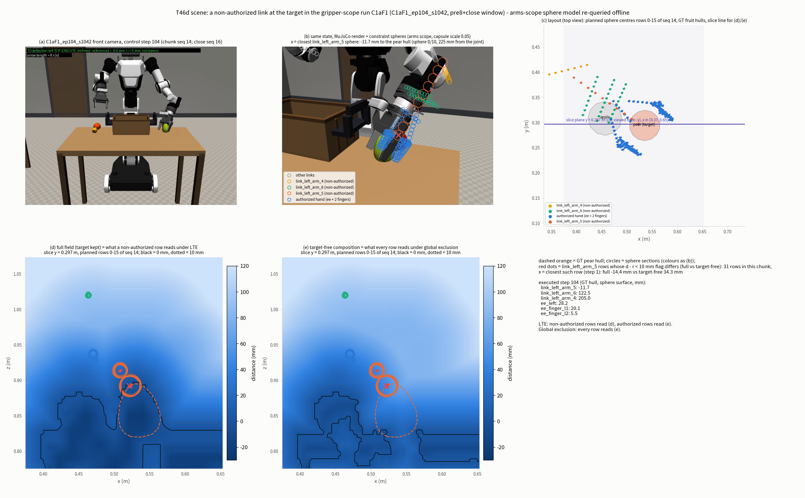

[`t46d-scene.png`](figures/t46/t46d-scene.png) (sidecar [`.json`](figures/t46/t46d-scene.json)) — `C1aF1_ep104_s1042`, chunk seq 14, control step 104 (close seq 16, 쓴 팔 left, target pear). (a) front camera, (b) 같은 상태의 MuJoCo render 에 arms scope 구를 겹침 (주황 = arm_5, 초록 = arm_6, 노랑 = arm_4, 파랑 = 허용 손 구), (c) 배치도 (top view, plan 16 행의 구 중심, GT hull, 단면선 y = 0.297 m), (d) 단면에서 full field (LTE 에서 non-authorized 행이 읽는 것), (e) 같은 단면의 target-free field (global exclusion 에서 모든 행이 읽는 것). executed step 104 의 구 표면–GT hull 거리: `link_left_arm_5` −11.72 mm, `link_left_arm_6` 122.49 mm, `link_left_arm_4` 204.98 mm, `ee_left` 28.22 mm, `ee_finger_l1` 20.11 mm, `ee_finger_l2` 5.50 mm. 이 chunk 에서 m = 10 mm 에 LTE 와 global 이 갈리는 arm_5 행은 31 개이고, 가장 가까운 행의 full field 는 −14.39 mm, target-free field 는 34.26 mm, GT target 거리는 −13.62 mm 다. **이 장면은 gripper scope 로 서빙한 run 을 arms scope 구 모델로 다시 읽은 것이라 서버는 이 arm_5 구를 constraint 로 쓰지 않았다.**

**3.4 후보 집합과 비용, 그리고 세 정책의 offline 차이.** 후보 = gripper scope 에 non-authorized link 를 (양 팔 모두) 더한 것. TO 시간은 구 수에 선형이라고 가정한 **추정** 이다 (CL2 C1b′ 270 구 median 160.34 ms, C2′ 422 구 median 402.87 ms 사이에서 보간, 재풀이 없음). LTE ≠ global 은 pre8close 162 chunk 중 chunk 수이고 field-level re-query 다 (용어). C2′ binding = C2′ 의 chunk 에서 그 link 집합이 최악 행이었던 chunk 수 (pre8close 162 chunk / 전체 1350 chunk).

| 후보 | 더한 구 (양 팔) | 구 합계 | ESDF 행 / chunk (gripper 대비) | TO solve ms (**추정**) | criterion 2 run (C1a + F1 / C1a / C2′) | LTE ≠ global chunk, C1a + F1 (m = 0 / 10 / 50 mm) | C1a | C2′ | C2′ binding (pre8close / 전체) |
|---|---|---|---|---|---|---|---|---|---|
| `--links gripper` | 0 | 270 | 4320 (1.00×) | 160 (C1b′ 실측 median) | 0 / 0 / 0 (반대 손) | 0 / 0 / 0 | 0 / 0 / 0 | 0 / 0 / 0 | — |
| + `link_*_arm_6` | 58 | 328 | 5248 (1.21×) | 253 | 0 / 0 / 0 | 0 / 0 / 0 | 0 / 0 / 0 | 0 / 0 / 0 | 0 / 1 |
| **+ `link_*_arm_5`** | **20** | **290** | **4640 (1.07×)** | **192** | **18 / 18 / 18** | **78 / 89 / 84** | **77 / 81 / 83** | **0 / 4 / 82** | **52 / 86** |
| + `link_*_arm_5–6` | 78 | 348 | 5568 (1.29×) | 285 | 18 / 18 / 18 | 같음 | 같음 | 같음 | 52 / 87 |
| + `link_*_arm_4–6` | 94 | 364 | 5824 (1.35×) | 310 | 18 / 18 / 18 | 같음 | 같음 | 같음 | 52 / 87 |
| + `link_*_arm_3–6` | 112 | 382 | 6112 (1.41×) | 339 | 18 / 18 / 18 | 같음 | 같음 | 같음 | 52 / 87 |
| `--links arms` (C2′) | 152 | 422 | 6752 (1.56×) | 403 | 18 / 18 / 18 | 같음 | 같음 | 같음 | 52 / 87 |

(출처: `numbers.item3_candidates`, `numbers.item3_to_time_basis`. "같음" = arm_5 를 포함하는 집합은 arm_5 를 넘어 더해도 숫자가 바뀌지 않는다 — 비교가 갈리는 것은 전부 arm_5 구에서만 나온다: C1a + F1 의 m = 10 mm 위반 행 차이 1048 행 전부가 `A_arm_5` 이다 (`flip_rows_by_link_m10`).) C2′ 의 pre8close binding link 는 `ee_finger_r2` 60 · `ee_finger_l1` 45 · `link_right_arm_5` 43 · `link_left_arm_5` 9 · `ee_right` 4 · `ee_finger_r1` 1 chunk (합 162, `numbers.item3_C2p_binding_by_link_pre8close`) — **arm_5 가 최악 행인 chunk 는 52 / 162 이고 손 link 가 110 / 162 이다** (산출).

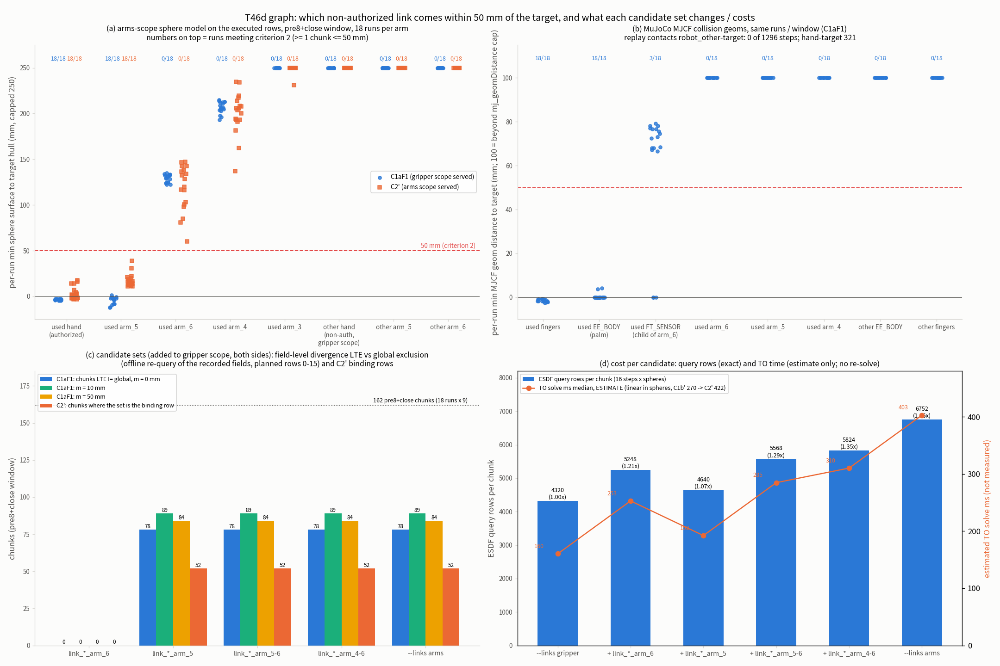

[`t46d-graph.png`](figures/t46/t46d-graph.png) (sidecar [`.json`](figures/t46/t46d-graph.json)) — (a) arms scope 구 모델의 link 별 run 최소 거리 (50 mm 점선, 위 숫자 = criterion 2 를 만족한 run 수). (b) 같은 run 의 MJCF geom 최소 거리 (100 mm cap), replay contact 가 위 제목에 있다. (c) 후보 집합별 LTE ≠ global chunk 와 C2′ binding chunk. (d) 후보별 ESDF query 행 (정확) 과 TO 시간 (추정).

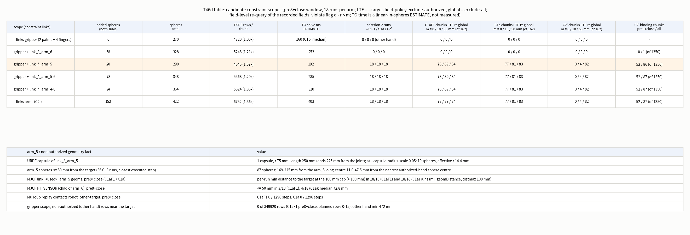

[`t46d-table.png`](figures/t46/t46d-table.png) (sidecar [`.json`](figures/t46/t46d-table.json)) — 위 후보 표 (§3.4) 와 arm_5 형상 사실 (§3.3) 을 한 장에 모았다.

**3.5 verifier 의 결론과 사용자 판정이 읽은 것.**

- **verifier (사전 고정 기준 2 기준).** "기준 2 를 만족하는 비권한 link: `link_<used>_arm_5` (sphere model) 18 / 18 run (C1a + F1 · C1a · C2′ 각각); arm_6 / arm_4 / arm_3 / 반대팔 / 반대손 0 / 18. gripper scope 비권한 행 target 50 mm 이내 0. 최소 집합 = gripper + `link_*_arm_5` (290 구, 4640 행 / chunk). **측정 정의상 성립.**" (`verdict`, 원문 요약). 비교가 갈리는 chunk 는 C1a + F1 에서 pre8close 162 chunk 중 89 (m = 10 mm, 18 run 모두) 였다.
- **사용자 지정 기록 문구.** "현재 gripper scope 에서는 LTE 와 global exclusion 의 비교가 퇴화하며, `link_*_arm_5` 를 추가했을 때 나타난 차이는 형상 근사 오류의 영향을 받는다." 위 §3.3 이 이 문구의 근거다: arm_5 구가 target 에 접근하는 18 / 18 run 에서 실제 arm_5 geom 은 100 mm cap 이상이고 손 이외 로봇 ↔ target 접촉은 0 / 1296 step 이며, 접근하는 구는 authorized 손 구 중심에서 11.0 – 47.5 mm 에 있다. **verifier 의 "성립" 은 사전 고정한 측정 정의 (구 표면 ≤ 50 mm) 에서의 말이고, 그 접근이 실제 접촉 위험인지는 구 모델의 형상에 달려 있다.**
- **이 결과를 "효과 없음" 으로 기록하지 않는다 (사용자).** 무엇이 측정됐는가: (a) gripper scope 에서 비교가 퇴화함, (b) arm_5 를 더하면 두 정책이 갈리는 chunk 가 생김, (c) 그 갈림이 근사 오류의 영향을 받음. 무엇이 측정되지 않았는가: 형상을 바로잡은 뒤 갈림이 남는가 (#28), 갈림이 closed-loop 의 접촉 · 성공 차이로 이어지는가 (#29).
- **판정 (사용자, 2026-10-13).** A (link-specific 효과 주장 축소) 가 아니라 **B 를 확장해 진행** (형상 보정 → 진단 장면 → oracle extent 3 조건 closed-loop), **C (arm_5 근사 구 그대로) 는 제외**. 이유는 위 해석 (C 는 근사 오류를 그대로 비교에 넣는다 — 이 문장은 scribe 의 정리이고 사용자 문장에는 이유가 적혀 있지 않다). 상세 계획은 §4.

**3.6 읽을 때의 한계 · 측정하지 않은 것 (`T46d.verify.json not_measured`, `fidelity`).**

| 한계 | 내용 |
|---|---|
| **field-level 재계산이다** | LTE ≠ global 은 `d − r` 을 임계값 (m = 0 · 10 · 50 mm) 과 비교한 재조회이고 서빙 설정의 per-row margin (support 0 · obstacle 10 mm · non-authorized target 50 mm 또는 obstacle) 과 TO verdict 는 재현하지 않았다. `--nonauthorized-target-margin` 이 full (기본 50 mm) 인가 obstacle 인가에 따라 LTE arm 의 arm_5 행이 달라진다: C2′ 의 LTE ≠ global chunk 는 m = 10 mm 에서 4, m = 50 mm 에서 82 |
| **재조회 fidelity** | 기록 clearance 와 재조회 `d_full` 의 차가 policy-active chunk 에서 최대 22.00 mm (C1a + F1, 559 chunk 중 0.5 mm 초과 60 chunk), C2′ 는 최대 66.08 mm (1303 chunk 중 190). plan 16 행의 손가락 관절 경로를 재현하지 않아 (planning row 값으로 고정) closing chunk 의 손가락 행이 기록과 최대 26.3 mm 어긋난다. 팔 · 손바닥 행은 정확하다 |
| **구 모델 구성** | 구 위치 재현은 기록과 최대 0.21 mm (C1a) 차이. arm_5 구 87 개는 36 CL3 run 의 가장 가까운 step 에서 센 값 |
| **MJCF 거리의 cap** | 100 mm 에서 잘려 arm_5 · arm_6 의 실제 거리는 "100 mm 이상" 으로만 안다. `FT_SENSOR` · `EE_BODY` 의 0.0 mm 거리는 접촉 필터를 거친 겹침과 구별하지 못했다 (#30) |
| **held 구간** | lift · carry 는 대부분 held (policy 가 active 가 아님) 라 LTE ≠ global 을 평가한 chunk 가 적다 (C1a + F1 lift 2 · carry 63 chunk) |
| **TO 시간은 추정이다** | 구 수 선형 보간이고 실측이 아니다 |
| **표본** | 18 run × 3 arm. no exemption 은 "모든 행이 full field 를 읽는다" 로만 평가했고 서빙된 `relax` 정책은 재현하지 않았다 |

**구현 요구 (`implementation_needs`).** 최소 집합 (gripper + arm_5, 290 구) 은 기존 flag 로 표현할 수 있다: `--links arms --exclude-links link_{left,right}_arm_{0,1,2,3,4,6}` (12 개 이름). 서버는 이를 "arms minus ..." 로 표시하고 진단용 EXCLUDING 경고를 낸다. 이름 붙은 `--links` 값 (예: gripper + arm_5) 은 없다 (`LINK_GROUPS` 는 gripper / arms / all). `--target-field-policy` 의 선택지는 `relax` / `exclude-authorized` / `exclude-all` 이고 **no exemption 은 별도 선택지가 아니다** (`relax` 는 권한 link margin 을 완화한다).

### 4. T46f — LTE 검증 블록 (계획, **결과 없음**)

> 이 절의 모든 서술은 [`T46f.task.md`](handoff/T46f.task.md) (lead, 2026-10-13 01:23 KST) 의 **사전 고정** 이다. 측정된 것이 없으므로 verify.json 이 없고 이 절에 결과 수치는 없다. 상태: 단계 1 (형상 보정, A14) 이 진행 중이다.

**검증할 가설 (사전 고정).** "지정된 link 에만 target 접촉 예외를 적용하면, 필요한 손의 접촉을 유지하면서 비허용 link 의 접촉을 줄일 수 있다."

| 항목 | 정의 |
|---|---|
| **주 지표** | **비허용 접촉 없는 작업 성공률** = task success ∧ 실제 MuJoCo geom 기준 non-authorized link–target 접촉 0 |
| 함께 보고 | 일반 task success · 실제 geom 기준 non-authorized 접촉 발생률 · 접촉 지속 시간 (step) · non-authorized link–target 최소 표면 거리 · 정지 (HOLD) · TO 실패율 · 작업 완료 시간 · **실측** TO 계산 시간 · 같은 episode · seed 의 실패 → 성공 / 성공 → 실패 쌍 수 (McNemar) |
| 보조 지표 | LTE ≠ global chunk 수 — **메커니즘 설명용이고 contribution 의 근거가 아니다** |
| 해석 규칙 | HOLD · TO 실패가 늘어 접촉률이 낮아진 결과는 보호 효과로 해석하지 않는다. 정확한 형상과 oracle extent 에서도 LTE 가 주 지표를 개선하지 못하면 그대로 보고하고 가설을 재검토한다. **사후 기준 변경 금지** |
| 전제 | **LTE 의 우수성을 전제하지 않는다** (사용자 판정) |

**접촉 허용의 정의 (lead, §2).**

| 구분 | link / 접촉면 | target 에 대한 제약 |
|---|---|---|
| authorized | active hand 의 손바닥 `ee_<side>` (MJCF `EE_BODY_*`) 와 손가락 `ee_finger_<side>1/2` | LTE 에서 target-free 층을 읽음 (접촉 허용) |
| non-authorized | **`FT_SENSOR_<side>`** (손목 F/T 센서), `link_*_arm_5` · `link_*_arm_6`, 반대 손 · 팔 | target 을 일반 obstacle 로 (`nonauthorized_target_margin` = obstacle) |

- **FT sensor 비접촉은 이 작업의 요구사항으로 정의한다** (센서 보호; lead 의 정의). 실제 접촉 판정은 MuJoCo `FT_SENSOR_*` geom 과 target geom 의 contact 다.
- target 영역 = target 과일. oracle 단계에서는 T46e 의 **visible observed surface oracle** — 카메라에 실제 보인 target 표면 점에서 온 seed — 를 쓴다. 전체 형상 (full mesh) oracle 이 아니다. 접촉 허용 link 집합과 target 영역은 서로 다른 축이다.

**블록 분리 — DT-02 와 DT-05A 를 섞지 않는다 (lead, §3).**

| 블록 | 질문 | 바꾸는 것 | 고정 |
|---|---|---|---|
| **DT-02 extent (T46e · CL4)** | 같은 identity · 같은 예외 정책에서 extent 처리의 효과 | ball · ball_owned · + F1 · oracle | 예외 정책 = LTE, 형상 = 보정 형상 |
| **DT-05A link 예외 (T46f)** | 같은 extent 에서 예외 정책의 효과 | ① 예외 없음 · ② global exclusion · ③ LTE | extent = 1차 oracle (visible observed surface), 2차 AG3S (ball_owned + F1) |

공통: 같은 보정 형상 · 초기 상태 · seed · TO 예산 · W1 on · snapshot. CL4 (DT-02 closed-loop) 는 단계 1 의 형상 보정이 끝난 뒤 보정 형상으로 실행한다 (두 블록이 같은 형상을 쓰게). 정책 구현: ① = `--target-field-policy none` (새로 추가, 모든 link 가 target 을 일반 obstacle 로, 권한 link margin 완화도 없음), ② = `exclude_all`, ③ = `exclude_authorized` + `--target-permission-strict` + `--nonauthorized-target-margin obstacle`. 정책 외 조건은 동일하다.

**단계 (lead, §4 – §6).**

| 단계 | 내용 | 상태 |
|---|---|---|
| **1. 충돌 형상 보정 (A14, implementer)** | (1) **FT sensor cover (`wrist_cover`) 구 추가** — 기존 coverage 코드 (`gripper_cover.link_surface` · `finger_body_spheres` · `_body_capsules`) 를 MJCF `FT_SENSOR_*` mesh 에 재사용, non-authorized. (2) **arm_5 근사 구 보정** — MJCF 실제 arm_5 geom 기반 coverage 구로 교체하거나 손 영역과 겹치는 구를 제거. 보정하지 못하면 그 구에 의존한 보호 효과를 주장하지 않는다. (3) **coverage audit** (필수): 구 밖 비율 · 밖 거리 (median / p95 / max) = 형상 누락, 구가 geom 밖으로 나간 정도의 max = 과도한 팽창, 비허용 구와 허용 구 · MJCF 손 geom 의 겹침. (4) 새 link 집합 (예: `--links gripper_wrist` = gripper + 보정 arm_5 · arm_6 · FT sensor) 을 세 조건 · CL4 모든 arm 이 같이 쓴다 (LTE 에만 coverage 추가 금지). (5) `--target-field-policy none` 추가. (6) 기본값은 모두 기존 그대로 (off bit-identical), 격리 worktree 에서 | **진행 중 (결과 없음)** |
| **2. 진단 장면 (A15 / V)** | 기존 18 쌍은 일반 작업 성능 · 부작용 평가로 유지. 별도로 **손의 target 접촉과 FT sensor 회피가 동시에 필요한 진단 장면** 을 만든다 (아래 S1 – S4) | 대기 |
| 3. 소규모 진단 (dev) | 회피 가능성 확인: ③ 에서 성공하는 경로가 존재하는가, 측정 장치가 정상인가 | 대기 |
| 4. oracle extent 로 ① · ② · ③ | 진단 장면 (dev → eval) + 기존 18 쌍 | 대기 (T46e 의 검증 · 적용이 선행) |
| 5. AG3S extent (ball_owned + F1) 로 반복 | 단계 4 에서 효과가 확인되면 같은 비교를 반복 | 대기 |

**진단 장면 선정 기준 S1 – S4 (방법별 결과를 보기 전에 고정, lead §5).**

| 기준 | 내용 |
|---|---|
| S1 | 실제 MuJoCo geom 기준 non-authorized (FT sensor · arm) 접촉 위험이 존재. 정책 rollout (E0: VLA 단독) 에서 FT sensor–target 최소 표면 거리 ≤ 50 mm 는 **후보 선별 기준일 뿐 충돌 · 보호 효과의 증거가 아니다** |
| S2 | 접근 경로나 손목 자세를 바꾸면 작업 완료가 가능 — 같은 배치에서 다른 손목 yaw / 접근 방향의 성공 시연 (데이터셋 demo 또는 IK / 계획 feasibility) 이 1 개 이상 |
| S3 | 초기 관통 (t = 0 접촉) 이나 구조적으로 성공 불가능한 배치 제외 |
| S4 | 개발용 배치와 최종 평가용 배치를 episode id 로 사전 분리 (예: dev = train split, eval = held-out test split 1800 – 1999) |

후보 생성 방법 (사전 고정): E0 rollout 과 기존 기록에서 S1 을 만족하는 배치를 찾고, 부족하면 target 을 crate 벽 · 이웃 과일 사이 등 손목이 낮게 들어가야 하는 위치로 옮긴 변형 배치를 규칙으로 생성한다.

**진행 · 중단 기준 (측정 전 고정, lead §8).**

- 단계 1 의 audit 에서 FT sensor 형상 누락 (구 밖 표면 비율) 이나 손 영역 침범이 남으면 단계 2 로 넘어가지 않는다.
- 단계 2 에서 S1 – S3 를 만족하는 eval 배치가 사전 정한 최소 수 (예: 10) 에 못 미치면 사용자에게 보고하고 장면 생성 규칙을 판정받는다.
- 단계 4 전에 비교 조건 · 장면 수 · 예상 GPU 시간 · 진행 / 중단 기준을 정리해 **사용자 확인 후** 실행한다.

**의존성 (lead §9).** T46e (oracle extent) 는 격리 worktree 에서 구현 완료 · 미적용이다. 단계 4 의 oracle 은 T46e 를 쓰므로 T46e 의 검증 · 적용이 선행한다. T47 session 의 측정 보호를 위해 메인 tree 의 pipeline · config · curobo_builder 변경 전에 알린다.

**develope_PLAN 과의 연결.**

| 계획서 단위 | 이 절이 주는 것 | 주의 |
|---|---|---|
| **DX-04 선행 확인 (§11 순서 1)** | T46d: gripper scope 퇴화, 비교는 arm_5 에서만 갈리나 그 구가 형상 근사 오류의 영향을 받음 → link-specific 효과 주장을 줄이지 않고 형상을 보정한 뒤 다시 확인 (사용자 판정). 계획서의 선택지 중 "관련 비허용 link 를 모든 조건에 동일하게 추가" 쪽 | 계획서의 다른 선택지 ("link-specific 효과 주장 축소") 는 고르지 않았다 |
| **DT-05A (세 field policy 의 pair 별 contact · success · stop)** | T46f 단계 4 – 5 가 채운다. **지금은 비어 있다** | DX-04 판정: "No exemption 이 멈춘다는 관찰만으로 LTE 전체 효과를 결론내리지 않는다" (develope_PLAN) |
| **DF-04B (같은 ESDF slice 의 link 별 distance · gradient 와 실제 contact)** | [`t46d-scene.png`](figures/t46/t46d-scene.png) 는 full field 와 target-free field 의 같은 단면을 보이는 **후보 장면** 이다. 단 서버가 그 arm_5 구를 constraint 로 쓰지 않은 run 의 offline 재조회이고 형상 근사 오류의 영향을 받는다 | 보정 형상 · 진단 장면 뒤에 새로 만든다. 지금 장면을 DF-04B 로 쓰지 않는다 |
| **DC-3** (link-specific exemption 이 필요한 접촉과 금지 접촉을 더 잘 구분한다) | 근거 없음 (측정 안 됨). T46f 가 가설을 사전 고정했다 | 효과가 확인된 link · phase · scene 만 서술한다 (계획서의 판정 규칙) |
| **DC-4** (task completion 과 forbidden contact 의 trade-off 를 개선한다) | 주 지표 (비허용 접촉 없는 작업 성공률) 와 정지 · 시간을 함께 보고하는 것으로 구조화 | 충돌만 줄고 성공 손실이 크면 trade-off 와 실패 조건을 명시한다 |
| **DT-02 extent block** (T46c §6 의 초안) | W1 on 을 공통 조건으로 확정 (사용자). 비허용 link 범위는 T46f 의 보정 형상이 정한다 | oracle arm 은 T46e 의 검증 · 적용 뒤 |

### 5. 되돌아올 지점 · 판정 대기

| 안 고른 것 | 왜 | 되돌아올 신호 |
|---|---|---|
| **A: link-specific 효과 주장 축소** (T46d 가 올린 선택지) | 사용자가 B 확장을 택했다 | 단계 1 audit 에서 FT sensor 형상 누락 · 손 영역 침범이 남음, 또는 단계 2 에서 S1 – S3 를 만족하는 eval 배치가 최소 수 (예: 10) 에 못 미치고 장면 생성 규칙도 성립하지 않음 (T46f §8) |
| **C: arm_5 근사 구를 그대로 비교** | 사용자가 제외했다 | 형상을 보정하지 못하는 구가 남으면 그 구에 의존한 보호 효과를 주장하지 않는다 (T46f §4-2) |
| W1 기본 on | 기본값은 off (사용자 판정) | 실험 arm 이 아니라 서버 기본값에서 `no_seed` HOLD 가 문제가 되는 측정 |
| W1 을 `place` label 로 넓힘 | CL3 의 placed `no_seed` 는 전부 `home` 이었다 (구현자, `T46c.impl.md`) | `place` 칸에서 같은 HOLD 가 관찰될 때 |
| 표본 확대 | 사용자가 18 쌍 유지를 택했다 (develope_PLAN §0.4) | 사용자가 새로 판정할 때만 |

**판정 대기.** (1) T46f 단계 4 전의 비교 조건 · 장면 수 · 예상 GPU 시간 · 진행 / 중단 기준 확인 (단계 4 직전, lead 가 정리해 올림). (2) T46e (visible observed surface oracle) 의 검증 · 적용 시점. (3) T46f 단계 2 의 S1 – S3 만족 eval 배치 최소 수 (예: 10) 가 사전 정한 값으로 확정되는가.

**산출물.**

- **측정**: [`handoff/T46c.verify.json`](handoff/T46c.verify.json) (원자료 `/mnt/dev/AG3S_VLA-storage/results/development/20261012T233515+0900_972f28056cd8_318f98f36f37/verify/T46c/`), [`handoff/T46d.verify.json`](handoff/T46d.verify.json) (원자료 `.../20261012T233920+0900_392462577320_70c141f47dbe/verify/T46d/`, 입력 CL3 · CL2 · CL-A 는 읽기 전용).
- **figure** (각각 `.json` sidecar 있음): [`t46c-table`](figures/t46/t46c-table.png) · [`t46d-scene`](figures/t46/t46d-scene.png) · [`t46d-graph`](figures/t46/t46d-graph.png) · [`t46d-table`](figures/t46/t46d-table.png). T46f 는 figure 가 없다 (계획).
- **구현** (T46c-W1): `AG3S/ag3s/config.py` · `AG3S/ag3s/runtime/pipeline.py` · `AG3S/ag3s/types.py` · `AG3S/trajopt/safe_policy.py` · `serve_safe.py` · `wire.py` · `experiments/certification_replay.py` · `experiments/ta_offline.py` · `tests/trajopt/test_t46c_placed_no_seed_certify.py` (commit `6dfaf7bb`). 상세 [`handoff/T46c.impl.md`](handoff/T46c.impl.md).
- 요청 문서: [`handoff/T46c.task.md`](handoff/T46c.task.md) · [`handoff/T46d.task.md`](handoff/T46d.task.md) · [`handoff/T46e.task.md`](handoff/T46e.task.md) · [`handoff/T46f.task.md`](handoff/T46f.task.md). commit 은 하지 않았다.


---

## T59 — 16D 에서 phase 별 attention 사용: phase 를 나누지 않은 grounding (U) 대 현재 serving (S) (offline, T53 기록 16 episode, 2026-10-13 KST)

> 측정 run `20261013T211142+0900_cf38c9dbca7b_c658029a568a` (2026-10-13 21:11 KST 시작), 기록 2026-10-13 KST. 수치는 모두 [`T59.verify.json`](handoff/T59.verify.json) 의 `numbers` · `definitions` · `runs` 에서 왔다 (W1 은 `numbers.W1`, W2 는 `numbers.W2`, 대표 episode 의 frame 별 표는 `numbers.representative_frame_table_ep1839`. 원자료는 같은 run 의 `verify/T59/`, frame 별 표 `t59_frames.jsonl`). 요청 문서는 [`handoff/T59.task.md`](handoff/T59.task.md). 이 STEP 은 **기술 통계**이고 통과 기준이 없다.
> **분석 창이 둘이다 (사용자 판정, 2026-10-13 두 번째): W1 = place 직후 종료, W2 = home 복귀 후 종료. 둘 다 측정을 마쳤다.** §1 – §11 의 모든 수치는 W1 (`numbers.W1`; W2 세션에서 verifier 가 갱신 전 `numbers` 와 같음을 assert 했다) 이다. **W2 의 결과는 §12 "W2 — home 복귀 후 종료"** 에 있다. W2 는 W1 과 pre · held · post 가 같고 `placed` 만 9 에서 153 frame 으로 늘어난다.
> (이 절의 "W1 · W2" 는 **분석 창** 이름이다. T46c 의 W1 = placed `no_seed` 인증 수정 (위 T46c 절) 과 무관하다.)
> 이 파일에 T53 · T54 절이 아직 없어, 입력 기록은 [`T53.verify.json`](handoff/T53.verify.json) · [`T53.impl.md`](handoff/T53.impl.md) · [`T54.verify.json`](handoff/T54.verify.json) 로 링크한다.

**이 절이 답하는 물음 (목적).** develope_PLAN §0.10 의 방향은 "경계를 보존하는 방법 하나 + ablation + closed-loop" 이고, 그 중 phase (쥐기 전 · 들고 가는 중 · 내려놓는 중) 를 신호로 쓰는 TargetConfirm (latch · freeze · HSR gate) 이 필요한가는 근거가 14D 시기 기록 하나였다. 이 STEP 은 **16D 의 T53 closed-loop 기록 16 episode** 를 offline 으로 다시 읽어, "phase 를 나누지 않은 grounding (현재 frame 의 L8H2 attention 만) 이 phase 별로 무엇을 target 으로 고르는가" 와 "같은 frame 에서 phase 를 나눈 현재 serving 은 무엇을 쓰고 있었는가" 를 나란히 놓는다. 새 rollout · GPU · 서버는 쓰지 않았다.

```
카메라 depth → 로봇 마스크 → [attention lifting → target grounding → TargetConfirm(latch · freeze · HSR gate)] → TSDF/ESDF
                                         └─ U: 여기까지만 (현재 frame)      └─ S: serving 이 실제로 쓴 것
```

**한 줄 결과 (W1 창 안, 16 episode, 기술 통계).**

- **들고 가는 중 (`held`, 106 frame · 10 episode).** U 가 고른 cluster 의 class 는 target 0.591 (95 % CI [0.39, 0.76], frame 합산 0.651 = 69 / 106), other_object 0.354 ([0.18, 0.56], 31 frame), no_target 0.055 (6 frame), **destination (crate) 0 / 106**. 같은 frame 에서 serving 이 쓴 물체 (Sg) 는 target 0.862 ([0.63, 1.00], frame 합산 0.943 = 100 / 106).
- **쥐기 전 (`pre`, 477 frame · 16 episode).** U target 0.825 ([0.69, 0.93], 403 / 477), Sg target 0.895 ([0.75, 1.00], 430 / 477).
- **"U ≠ target 이면서 Sg = target" (나누지 않으면 틀리고 나누면 맞는 frame).** held 0.294 ([0.15, 0.46], 34 / 106), pre 0.105 ([0.05, 0.17], 48 / 477). 반대 방향 (U = target 이면서 Sg ≠ target) 은 held 0.023 (3 / 106), pre 0.035 (21 / 477, 한 episode 에서만 나옴).
- **정직한 기록.** S 의 class 정의는 **결과를 본 뒤 사용자 판정으로 바꾸었다** (아래 "사용자 판정과 타임라인"). 원래 사전 정의 S (같은 frame GT) 의 값은 표에 남긴다: held 에서 S target 0.136, other_object 0.864 로 Sg 와 정반대다.

**이 절이 주장하지 않는 것.**

- **나누지 않으면 실제 접촉 · 성공이 나빠진다** 는 주장. closed loop 에서 latch · freeze 를 끈 arm 을 돌리지 않았다. 이 STEP 은 "U 가 틀린 frame 이 있다" 까지만 말하고 그것이 접촉 · 성공 · carving 양으로 이어지는지는 측정하지 않았다.
- **HSR 이 strong rule (실제 grasp latch) 보다 낫거나 못하다** 는 주장. 그 비교는 T55 의 결과를 쓴다 (사용자 판정 2). 이 STEP 의 phase 는 물리 상태 (`grasp_state`) 이고 HSR 은 S 쪽 설명 변수로만 보고했다.
- **S (serving) 가 옳다** 는 주장. S 는 serving 이 쓴 물체의 class 이고, 그 물체가 target 인 것과 serving 이 옳게 carving 한 것은 다른 이야기다. 정답은 GT 물체 위치와의 최근접으로 판정했을 뿐이다.
- **U 의 cluster 로 지은 가상 field 의 오염량.** U 는 점 · 위치만 표시했고 field 를 새로 짓지 않았다.
- **post · placed 의 해석.** post 14 frame (2 episode), placed 9 frame (성공 episode 마다 1 frame) 으로 표본이 너무 작다 (post 에서 bootstrap 10000 draw 중 1148 에서 그 phase 가 비었다).

### 1. 사용자 판정과 타임라인 (KST)

**사용자 판정 (2026-10-13, 결과 전, `T59.task.md`).**

1. 16D 재관측은 T53 기록 **offline** (새 rollout · GPU 없음).
2. HSR 실험 (HSR 대 grasp_latch, 물리 predicate 정답) 은 **T55 결과를 쓴다.** 이 STEP 에서 하지 않는다.
3. phase 를 나누지 않았을 때의 실험은 **offline 먼저.** closed loop 은 하지 않는다.
4. 그래프는 **place 이후 · home 으로 돌아온 이후를 자르고** 보인다.

**사용자 판정 (2026-10-13, 결과 확인 후) — S class 의 주 정의를 바꾼다.**

- **주 정의 = Sg** (manipulated centroid 를 **관측한 frame** (`manipulated.last_seen_frame`) 의 GT 위치에 가장 가까운 물체). 이유: attached · occluded chunk 에서 기록된 manipulated centroid 는 **마지막으로 관측된 geometry** 에 머문다. held 에서 서버 기록의 `manipulated.state` 는 occluded 104 / visible 2 frame 이고, centroid 에서 **같은 frame GT** 의 가장 가까운 물체까지의 거리 median 은 **95.3 mm** (p95 101.9 mm), **관측 frame GT** 로는 **16.3 mm** (p95 29.4 mm) 이다 (`numbers.W1.S_nearest_distance`).
- **task 의 원래 정의 S (같은 frame GT) 는 결과를 본 뒤 바꾼 사전 정의**다. 사전 정의를 숨기지 않고 모든 표에 S (same frame) 로 남긴다. **timeline 의 발표용 버전에서는 S (same frame) 행을 뺀다** (사용자 판정). 현재 링크된 [`t59-timeline-ep1839.png`](figures/t59/t59-timeline-ep1839.png) 는 두 행을 모두 갖고 있다 (점검용).
- T59 를 이 로그에 지금 기록한다. commit 은 별도 승인을 받는다.

**결과 전에 고정한 것 (task).** 분석 창, 대표 episode 선택 규칙, class 정의 (S same-frame), 성공 / 실패 분리, bootstrap 설정. 결과 전에 고정하지 않고 **verifier 가 render 전에 고정한 것**: 씬 figure 의 frame 선택 규칙 (`definitions.scene_frame_rule`). 그 외 **결과 뒤에 추가한 것**: Sg 정의 (위), 창을 자르지 않은 exploratory 표 (아래 §8).

**타임라인.**

| 시각 (KST) | 일 |
|---|---|
| 2026-10-13 (결과 전) | task 작성 · 사용자 판정 1–4 · STEP 번호 T59 를 dev-70 (T58) · development 세션에 알려 충돌 없음 확인 |
| 2026-10-13 21:11 | verifier run 시작 (`verify/T59/`). regression baseline (legacy) 이 먼저: `start_violated` 14 / 15, `has_target` 15 / 15, frame 0 clearance −29.031048 mm — 기대값과 일치. cuRobo 는 task 지시대로 돌리지 않음 |
| 2026-10-13 (결과 후) | 사용자가 S 의 주 정의를 Sg 로 바꾸라고 판정, 이 로그에 기록하라고 지시 |

### 2. 입력 · 정의 · 정렬 점검

입력은 새로 만든 것이 아니라 이미 있는 두 기록이다.

| 조건 | 무엇 | 출처 |
|---|---|---|
| **U (phase 미분할 grounding)** | 매 frame `AG3S.reset()` 후 L8H2 attention 만으로 고른 cluster. TargetConfirm 의 latch · freeze · HSR gate · 시간 유지가 **없다** | T54 `current` 조건, arm L8H2 (서빙 `last:L8H2`), C1a build kwargs |
| **S (현재 serving = phase 분할)** | T53 closed-loop 의 server chunk 가 그 frame 에 실제로 쓴 manipulated / attached 물체, latch 상태, HSR label | T53 server chunk `summary_json` |

| 정의 | 내용 (`definitions`) |
|---|---|
| **phase** | T53 `gt/<key>.grasp.npz` 의 `grasp_state`: `pre` · `held` · `post` · `placed` (`held_other_hand` 는 0 frame). 물리 상태이고 latch 상태가 아니다 |
| **U class** | chosen cluster 의 GT point label 에서 **엄격히 가장 많은** class (target · other_object · destination · table · robot …). label 없는 점은 무시, `grounding_status != ok` 이거나 `chosen_n == 0` 이면 `no_target` (class 의 하나로 센다). 동률 `tie` 는 0 frame |
| **S class (Sg, 주 정의)** | S 의 manipulated centroid 에 가장 가까운 GT 물체 (apple · banana · orange · pear · crate, body origin 을 robot base frame 으로) — 단 GT 위치는 **centroid 를 관측한 frame (`last_seen_frame`)** 의 것. target 이면 target, crate → destination, 다른 과일 → other_object, manipulated 없음 → no_target |
| **S class (S same frame, 사전 정의)** | 같은 최근접 규칙, GT 위치는 **그 chunk 의 frame** 의 것 |
| **창 W1 (사용자 판정 4, place 직후 종료)** | frame 0 부터 `min(첫 placed frame, S 의 HSR 확정 label 이 처음 `home` 인 frame)` 까지 (포함). 둘 다 없으면 episode 끝. 사전 고정 |
| **HSR 확정 label** | `subtask.label` (`SubtaskDebounce`: argmax 가 같은 값 3 번 연속일 때 확정) |
| **집계** | episode 평균 = 그 phase 의 frame 이 1 개 이상인 episode 들의 episode 별 비율의 평균 (동일 가중). frame 합산 = frame 수 합. CI = episode bootstrap (복원 추출, B 10000, seed 5407, percentile 2.5 / 97.5), 한 episode 집합 안의 모든 양에 같은 draw |

**정렬 점검 (조용히 버리지 않는다).** 1200 행 (16 episode × 75 frame) 이 모두 정렬되었고 정렬 불일치로 제외한 행은 **0** 이다 (`numbers.W1.n_excluded_alignment = 0`). 같은 frame 의 U class 와 T54 행의 `identity_label` 이 어긋난 frame 은 0, 성공 판정과 placed 존재가 어긋난 episode 는 없다. GT 과일 위치는 T53 의 GT 와 최대 절대 차이 0.0 m 로 같다. 대응 규칙은 T54 `t_step` = 8 × frame = T53 gt `t_step` 이고, server chunk 의 `t_step` 은 요청 순번 (frame + 1) 이라 `chunk_index − episode 첫 chunk_index` 로 맞췄다 (`definitions.alignment`).

**창.** 606 / 1200 frame 이 창 안이다 (성공 episode 283, 실패 episode 323). phase 별로 pre 477 · held 106 · placed 9 · post 14 이고, 창 밖까지 합치면 pre 608 · held 113 · placed 401 · post 78 이다.

| 창의 끝 | episode (target, 창 frame 수) |
|---|---|
| 첫 `placed` (성공 9) | ep1809 (banana, 31) · ep1842 (pear, 33) · ep1860 (orange, 28) · ep1845 (pear, 32) · ep1862 (apple, 30) · ep1815 (apple, 31) · ep1866 (orange, 32) · ep1804 (apple, 34) · ep1839 (orange, 32) |
| HSR 확정 `home` (실패 5) | ep1840 (banana, 38) · ep1848 (orange, 33) · ep1849 (banana, 35) · ep1853 (pear, 38) · ep1822 (banana, 29) |
| episode 끝 (실패 2, placed · home 모두 없음) | ep1843 (apple, 75) · ep1851 (orange, 75) |

잘린 frame 수는 episode 별로 `numbers.W1.window_per_episode.n_cut` 에 있다. 성공 episode 는 placed 이후 41 – 47 frame 이 잘렸고, 실패 episode 에서 **home 으로 잘리면서 사라진 held frame** 은 ep1853 에서 1, ep1822 에서 6 이다 (그 전에 post 가 ep1849 40 · ep1822 24, pre 가 ep1840 37 · ep1848 42 · ep1853 36 · ep1822 16 frame 잘림).

### 3. 측정 1 · 2 — phase 별 class 비율 (U 대 S)

figure: [`t59-phase-class-bars.png`](figures/t59/t59-phase-class-bars.png) (phase × {U, S same frame, Sg}, stacked = episode 평균, 아래 점 = CI) · 표 [`t59-table-measures.png`](figures/t59/t59-table-measures.png) · sidecar 는 같은 이름의 `.json`.

칸 = **episode 평균 [95 % CI] / frame 합산 (frame 수)**. destination · table · no_target 중 0 인 칸은 생략했다 (표 figure 와 `numbers.W1.main_16_episodes` 에 있다).

| phase (frame / episode) | 조건 | target | other_object | destination | no_target |
|---|---|---|---|---|---|
| pre (477 / 16) | **U** | 0.825 [0.69, 0.93] / 0.845 (403) | 0.145 [0.05, 0.28] / 0.124 (59) | 0 (0) | 0.024 [0.00, 0.05] / 0.023 (11); table 0.007 (4) |
| | **Sg (주)** | 0.895 [0.75, 1.00] / 0.901 (430) | 0.104 [0.00, 0.25] / 0.096 (46) | 0 (0) | 0.002 (1) |
| | S same frame (사전 정의) | 0.895 [0.75, 1.00] / 0.901 (430) | 0.104 [0.00, 0.25] / 0.096 (46) | 0 (0) | 0.002 (1) |
| **held (106 / 10)** | **U** | 0.591 [0.39, 0.76] / 0.651 (69) | 0.354 [0.18, 0.56] / 0.292 (31) | **0 (0)** | 0.055 [0.00, 0.12] / 0.057 (6) |
| | **Sg (주)** | **0.862 [0.63, 1.00] / 0.943 (100)** | 0.138 [0.00, 0.37] / 0.057 (6) | 0 (0) | 0 (0) |
| | S same frame (사전 정의) | 0.136 [0.09, 0.17] / 0.151 (16) | 0.864 [0.83, 0.91] / 0.849 (90) | 0 (0) | 0 (0) |
| post (14 / 2, 해석 금지) | U | 0.500 [0.00, 1.00] / 0.071 (1) | 0.462 [0.00, 0.92] / 0.857 (12) | 0 (0) | 0.038 / 0.071 (1) |
| | Sg | 0 (0) | 1.000 / 1.000 (14) | 0 (0) | 0 (0) |
| | S same frame | 0 (0) | 1.000 / 1.000 (14) | 0 (0) | 0 (0) |
| placed (9 / 9, 해석 금지) | U | 0.444 [0.12, 0.78] / 0.444 (4) | 0.444 [0.12, 0.78] / 0.444 (4) | 0.111 / 0.111 (1) | 0 (0) |
| | Sg | 0.889 [0.67, 1.00] / 0.889 (8) | 0.111 / 0.111 (1) | 0 (0) | 0 (0) |
| | S same frame | 0 (0) | 1.000 / 1.000 (9) | 0 (0) | 0 (0) |

읽는 법 (측정이 보이는 것).

- **pre**: U 와 S 모두 target 이 다수다. S 의 두 정의는 같다 (centroid 가 이 phase 에서는 갱신되고 있다. 같은 frame 거리 median 16.8 mm 대 관측 frame 16.3 mm).
- **held**: U 의 target 비율은 pre 보다 낮다 (0.591 대 0.825, 두 CI 가 일부 겹친다). U 가 target 을 못 고른 frame 은 other_object 31 · no_target 6 이고 crate (destination) 는 0 이다 (**0 frame 인 칸의 CI [0, 0] 은 표본 부족의 표시가 아니라 자명한 퇴화**다).
- **S 의 두 정의는 held 에서 정반대다.** 같은 frame GT 로 최근접을 잡으면 other_object 0.864, 관측 frame GT 로 잡으면 target 0.862. 이것이 주 정의를 바꾼 이유이고, 두 값은 모두 같은 서버 기록에서 나왔다. 같은 frame 정의에서 최근접과 2 위 물체의 거리 차 (margin) 의 held median 은 0.148 m 라 대부분의 frame 에서 최근접이 분명하다. 다만 margin 이 가장 작은 held frame 은 2.0 mm 라 모호한 frame 도 있다 (`numbers.W1.S_nearest_distance.same_frame_margin_to_second`).
- **post · placed** 는 위 한계 때문에 해석하지 않는다. placed 에서 Sg 의 거리 median 은 16.3 mm 이다 (같은 frame 은 96.5 mm).

### 4. 측정 3 — U ≠ target 이면서 Sg = target (그리고 반대)

표: [`t59-table-measures.png`](figures/t59/t59-table-measures.png) 의 둘째 표. 칸 = episode 평균 [CI] / frame 합산 (frame 수).

| phase | S 정의 | U≠target ∧ S=target | U=target ∧ S≠target | 둘 다 target | 둘 다 target 아님 |
|---|---|---|---|---|---|
| pre (477) | Sg · same frame (같은 값) | 0.105 [0.05, 0.17] / 0.101 (48) | 0.035 [0.00, 0.10] / 0.044 (21) | 0.790 [0.64, 0.91] / 0.801 (382) | 0.071 [0.00, 0.20] / 0.055 (26) |
| **held (106)** | **Sg (주)** | **0.294 [0.15, 0.46] / 0.321 (34)** | 0.023 [0.00, 0.08] / 0.028 (3) | 0.568 [0.38, 0.74] / 0.623 (66) | 0.115 [0.00, 0.33] / 0.028 (3) |
| | S same frame (사전 정의) | 0.075 [0.02, 0.13] / 0.085 (9) | 0.530 [0.36, 0.67] / 0.585 (62) | 0.061 [0.02, 0.11] / 0.066 (7) | 0.334 [0.19, 0.52] / 0.264 (28) |
| post (14) | Sg | 0 (0) | 0.500 / 0.071 (1) | 0 (0) | 0.500 / 0.929 (13) |
| placed (9) | Sg | 0.444 [0.12, 0.78] / 0.444 (4) | 0 (0) | 0.444 [0.12, 0.78] / 0.444 (4) | 0.111 / 0.111 (1) |

- held 에서 **U 가 틀리고 Sg 가 맞는 frame** 은 34 / 106 이고 9 episode 에 걸쳐 있다 (`numbers.W1.main_16_episodes.m3b_cross_U_vs_S_at_geometry_frame.held.U_not_target__S_target.n_episodes_with_class = 9`, held 가 있는 10 episode 중). 반대 방향은 3 frame 으로 한 episode 에서만 나왔다.
- pre 에서도 U ≠ target ∧ Sg = target 이 48 / 477 frame, 10 episode 에서 나온다. **즉 "U 가 target 을 놓치는 것" 은 held 에만 있는 현상이 아니다.** 점 추정은 held 쪽이 크지만 (0.294 대 0.105) 두 CI ([0.15, 0.46] 대 [0.05, 0.17]) 가 겹치므로 **이 비교로 held 가 pre 보다 크다고 확정하지 않는다.**
- 같은 frame 정의 (사전) 로 읽으면 held 에서 "U = target ∧ S ≠ target" 이 0.530 (62 frame) 이 된다. 이 값은 S 의 centroid 가 마지막 관측 geometry 에 머문 것의 영향이고, Sg 로 읽으면 3 frame 이다.

### 5. 측정 4 — S 의 latch · HSR 확정 label 이 물리 phase 와 어떻게 겹치는가

표: [`t59-table-latch-window.png`](figures/t59/t59-table-latch-window.png). 칸 = frame 수 (창 안). 이 표는 phase 가 아닌 S 의 상태 변수를 phase 로 나눠 센 것이다. (`grasp_state` 는 위 phase 와 이름이 같으나 phase 는 물리 상태 `gt/<key>.grasp.npz`, 여기 S_grasp_state 는 서버 chunk 의 grasp FSM 이다.)

| phase (frame) | S grasp FSM 상태 | `decision.latched` | `grasp_active` | attached | manipulated 상태 | HSR 확정 label | HSR p 평균 (pick / place / home) |
|---|---|---|---|---|---|---|---|
| pre (477) | latched 269 · closing 149 · searching 32 · placed 14 · held 13 | True 402 · False 75 | False 315 · True 162 | False 464 · True 13 | visible 412 · occluded 64 · None 1 | pick 381 · place 60 · None 32 · home 4 | 0.823 / 0.150 / 0.027 |
| **held (106)** | held 106 | **False 106** | True 106 | True 106 | **occluded 104 · visible 2** | pick 19 · place 87 | 0.021 / 0.979 / 0.0004 |
| post (14) | latched 4 · closing 9 · held 1 | True 13 · False 1 | False 4 · True 10 | False 13 · True 1 | visible 11 · occluded 3 | place 13 · home 1 | 0.010 / 0.805 / 0.185 |
| placed (9) | held 9 | False 9 | True 9 | True 9 | occluded 9 | place 9 | 0.0004 / 0.972 / 0.028 |

- 서버의 grasp FSM 은 물리 `held` 106 frame 모두에서 `held` 이고 attached 이다. 반대로 pre 에서도 FSM 이 `held` 13 · attached 13 frame, `placed` 14 frame 이다 (물리 phase 와 FSM 의 상태가 pre 에서 어긋나는 frame 이 있다). 이 어긋남의 원인은 측정하지 않았다.
- HSR 의 확정 label 은 held 106 frame 중 `pick` 19 · `place` 87 이다. 확정 전 argmax 는 `place` 104 · `pick` 2 이다 (`numbers.W1.m4_latch_hsr_by_phase.S_hsr_argmax`). 즉 확정 label 이 argmax 보다 늦게 `place` 로 바뀐다 (debounce 3 번 연속의 결과이고, ep1839 에서 그림으로 보인다, §7).
- pre 에서 HSR 확정 label 이 `place` 인 frame 이 60, `home` 이 4 다. 이 frame 들이 어느 episode · 어느 시점인지는 이 STEP 에서 따로 분해하지 않았다.

### 6. 측정 5 — 성공 9 / 실패 7 episode

표: [`t59-table-measures.png`](figures/t59/t59-table-measures.png) 의 셋째 표. 칸 = episode 평균 [CI] / frame 합산 (frame 수).

| 집단 | phase (frame / episode) | U target | Sg target | S same frame target | U≠target ∧ Sg=target |
|---|---|---|---|---|---|
| 성공 | pre (168 / 9) | 0.929 [0.86, 0.98] / 0.929 (156) | 1.000 (168) | 1.000 (168) | 0.071 [0.02, 0.14] (12) |
| 성공 | **held (105 / 9)** | **0.657 [0.50, 0.79] / 0.657 (69)** | **0.957 [0.87, 1.00] / 0.952 (100)** | 0.151 / 0.152 (16) | **0.326 [0.19, 0.49] (34)** |
| 성공 | post (1 / 1) · placed (9 / 9) | post 1.000 (1) · placed 0.444 (4) | post 0 (0) · placed 0.889 (8) | post 0 · placed 0 | 해석 금지 |
| 실패 | pre (309 / 7) | 0.691 [0.44, 0.88] / 0.799 (247) | 0.759 [0.47, 1.00] / 0.848 (262) | 0.759 / 0.848 (262) | 0.148 [0.05, 0.26] / 0.117 (36) |
| 실패 | held (1 / 1) · post (13 / 1) | held 0 (U 는 other_object) · post 0 (U other_object 12, no_target 1) | 0 · 0 | 0 · 0 | 0 · 0 |

- 실패 7 episode 는 창 안의 frame 이 pre 에 거의 몰려 있다 (309 frame). held 1 frame, post 13 frame (한 episode) 으로 **실패 episode 에서는 "들고 가는 중" 이 거의 측정되지 않았다.** held 에서 U ≠ target ∧ Sg = target 인 34 frame 은 모두 성공 episode 에서 나왔다.
- 실패 episode 의 pre 에서는 U target 이 episode 평균 0.691 로 성공 episode (0.929) 보다 낮고, Sg target 도 0.759 로 낮다. 같은 pre 에서 U = target ∧ Sg ≠ target 21 frame 은 실패 episode 의 한 episode 에서만 나왔다.

### 7. 대표 episode ep1839 — timeline 과 실제 scene

**선택 규칙 (결과 전 고정).** 성공 episode 중 `held` frame 에서 U ≠ target 인 frame 수가 가장 많은 것, 동률이면 episode 번호가 작은 것. ep1839 가 9 / 14 held frame 으로 1 위, ep1809 가 8 / 10 으로 2 위, ep1842 · ep1860 이 4 (각 12 · 11 held frame) 다 (후보 9 개 전체는 `numbers.W1.representative.candidates`). 대표 episode 는 **U 가 가장 많이 틀리는 episode 로 고른 것**이라 평균의 대표가 아니다.

figure: [`t59-timeline-ep1839.png`](figures/t59/t59-timeline-ep1839.png) — 위에서부터 물리 phase 띠 · S latch 띠 · S HSR p(pick / place / home) 곡선 · S HSR 확정 label 띠 · **U class 띠** · S class (같은 frame GT) 띠 · S class (geometry frame GT) 띠. target = orange, 오른팔, 창 = frame 0–31 (32 frame, 끝 = 첫 placed). HSR 확정 `home` 은 frame 34 라 placed (31) 가 더 이르다.

- frame 별 표 ([`numbers.representative_frame_table_ep1839.W1`](handoff/T59.verify.json), 연속 구간 `segments`, frame 0 – 31) 에서 읽은 값. 물리 phase 는 pre 0 – 16 · held 17 – 30 · placed 31, S 의 grasp FSM 은 `closing` 16 · `held+att` 17 – 31 이고, **HSR 확정 label 은 pick 2 – 18 · place 19 – 31** 이다. 즉 확정 label 이 `place` 로 바뀌는 frame (19) 은 물리 held 의 시작 (17) 보다 2 frame 늦다 (위 §5 의 argmax 대 확정 label 차이). p(pick) 이 내려가고 p(place) 가 올라오기 시작하는 frame 은 그림에서만 보이고 verify.json 에 frame 별 확률이 없어 번호를 적지 않는다. (처음 초안이 그림에서 읽어 적은 "2 – 3 frame 늦다" 는 verify.json 값으로 2 frame 이다.)
- **U class 구간.** target 0 – 14 · **other_object 15 – 24** · target 25 – 29 · other_object 30 · target 31. frame 15 · 16 은 물리 phase 가 아직 pre, 17 – 24 는 held 이고 30 도 held 다. 그림에서 읽은 값과 같았다. ▼ 표시는 held 이면서 U ≠ target 인 frame 17 – 24 (8 frame) 와 30 (1 frame), 합쳐 9 frame 이다 (`numbers.W1.representative.candidates` 의 9 / 14 와 같다).
- S (같은 frame GT) 는 target 0 – 19 · other_object 20 – 31 이라 held 가 시작된 뒤 3 frame 이 지나 other_object 로 바뀐다. S (geometry frame GT, Sg) 는 0 – 31 전체가 target 이다 (이 episode 의 S 두 정의 차이).

figure: [`t59-scene-ep1839.png`](figures/t59/t59-scene-ep1839.png) — 기록 qpos 의 MuJoCo replay (zed_left, wrist_cam_r) · 위에서 본 cloud 에 U cluster 점 (점선 원) 과 S manipulated 점 (○), centroid (★) · 같은 chunk 의 **기록된 serving** `esdf_distance` 의 xy 단면 · target-free 층 (`esdf_free_distance`) 의 같은 단면 (기록이 있는 chunk 만) · 단면 위치 배치도. **U 의 cluster 로 field 를 새로 지은 것이 아니다.** U 의 점과 footprint 는 "지어지지 않은 가상" 으로만 표시했다. 선택한 3 frame (규칙 `definitions.scene_frame_rule`: pre 는 창 안 pre 의 하위 중앙값, held 는 U ≠ target 인 첫 · 마지막 held frame):

| frame | phase | U class (chosen 점 수) | Sg (관측 frame) | S same frame | 단면에서 U 점의 field 값 |
|---|---|---|---|---|---|
| 8 | pre | target (94) | target (관측 frame 8) | target (orange, 15.0 mm) | serving field `esdf_distance` 에서 min −5.0 mm · median 0.0 mm; target-free 층 `esdf_free_distance` 에서 min 5.0 mm · median 24.0 mm |
| 17 | held | other_object (105) | target (관측 frame 16) | target (orange, 16.5 mm) | `esdf_distance` 에서 min −5.0 mm · median 0.0 mm. target-free 층 기록 없음 (target-free 층 0 개, exclusion source = attached) |
| 30 | held | other_object (39) | target (관측 frame 16) | other_object (apple, 90.5 mm) | `esdf_distance` 에서 min −7.1 mm · median 0.0 mm. target-free 층 기록 없음 |

- frame 8 의 U cluster 는 target (orange) 이고 serving 의 target-free 층에서는 그 점들의 clearance median 이 24.0 mm 로 올라간다 (target 이 지워진 층). 이것은 S 가 target 을 지운 결과를 한 frame 에서 보인 것이다.
- held 의 frame 17 · 30 에서 U 가 고른 cluster 는 other_object (점 105 · 39) 이고, serving 의 manipulated 는 관측 frame 16 에서 target 이다. U 점의 serving field 값 median 0.0 mm 는 그 점이 serving field 의 0 m 등고선 위에 있다는 뜻이다. 그 점이 위험했는지는 재지 않았다.
- frame 30 에서 S (같은 frame GT) 는 other_object (apple, 90.5 mm) 인데 Sg 는 target 이다 (§3 의 두 정의 차이가 한 frame 에서 보이는 예).

### 8. 창 밖 frame 과 GT 가시성 — 보조 표 (exploratory, 결과 뒤 추가)

task 의 주 표는 창 안이다. 창을 자르지 않은 전체 frame 의 U class 는 `numbers.W1.exploratory_no_window_cut`, GT target 이 3 camera 중 하나에서 200 px 이상 보이는 frame 만의 값은 `numbers.W1.supplementary_gt_target_visible_only` 에 있다.

| 구간 | frame / episode | U target (episode 평균) | U other_object | U destination | Sg target |
|---|---|---|---|---|---|
| pre, 창 안 | 477 / 16 | 0.825 | 0.145 | 0 | 0.895 |
| pre, 창 자르지 않음 | 608 / 16 | 0.838 | 0.141 | 0.001 (1) | 0.882 |
| held, 창 안 | 106 / 10 | 0.591 | 0.354 | 0 | 0.862 |
| held, 창 자르지 않음 | 113 / 12 | 0.534 | 0.378 | 0 (0) | 0.885 |
| post, 창 자르지 않음 | 78 / 3 | 0.416 | 0.438 | 0 | 0.125 |
| placed, 창 자르지 않음 | 401 / 9 | 0.597 | 0.050 | 0.010 (4) | 0.070 (placed 에서는 Sg 의 no_target 이 0.915 = 367 / 401) |

- 창을 자르지 않은 held 의 U ≠ target ∧ Sg = target 은 0.370 (38 frame), pre 는 0.089 (64 frame) 이다 (`numbers.W1.main_16_episodes.m3b_cross_U_vs_S_at_geometry_frame`).
- GT target 이 보이는 frame 만 (594 frame, 창 안) 으로 줄이면 pre 는 469 frame · U target 0.835, held 는 106 frame (줄지 않음) · U target 0.591 이다.
- **창이 held 의 U target 에 미치는 영향.** 창을 자르면 held 가 113 에서 106 frame, 12 에서 10 episode 가 되고 U target 이 0.534 에서 0.591 로 올라간다. 잘린 held frame 은 ep1853 의 1 frame 과 ep1822 의 6 frame 이다 (HSR 확정 `home` 이후). 이 차이는 창 규칙의 결과이고 주 표는 사전 고정한 창을 쓴다.

### 9. 이전 근거와의 관계 — 14D 의 F11 · F17 과 T54 의 phase 별 L8H2 identity

**(a) 14D 시기 근거 (F11 · F17).** F11 (쥔 물체가 attention target 이 아니라 목적지 쪽이다) 과 F17 (조작 대상을 에피소드 상태로 잠그지 않는다) 의 근거 그림은 14D 시기 기록 하나이다 ([`archive/14d-era-20260923/figures/target-latch-evidence.png`](archive/14d-era-20260923/figures/target-latch-evidence.png), 정의와 출처는 [`AG3S_T0T6_LOG.md`](AG3S_T0T6_LOG.md) 의 F11 · F17). 그 그림 (a) 는 한 run (`run_0004`) 에서 "손이 사과를 쥐고 있는 구간" 의 grounding 이 고른 물체가 crate 였다고 읽었다. 이 STEP 은 그 값을 옮겨 적지 않고 읽은 그림만 요약한다.

| | 14D 그림 (a) (run 하나) | 16D T59 (U = 현재 frame L8H2, 16 episode) |
|---|---|---|
| 들고 가는 구간에서 고른 것 | crate (그림에서 읽은 구간) | **destination (crate) 0 / 106 frame** (창 안). 창을 자르지 않아도 0 / 113 |
| target 을 고른 몫 | — | 0.591 (frame 합산 0.651, 69 / 106) |
| 그 밖 | — | other_object 0.354 (31 frame), no_target 0.055 (6 frame) |

- 16D T59 에서는 U 가 held 에서 **crate 를 고른 frame 이 없다.** "들고 가는 동안 attention target 이 crate" 라는 F11 의 모양은 이 16D · L8H2 · T53 기록에서는 **재현되지 않았다.**
- 동시에 U 가 held 에서 target 을 일관되게 고르는 것도 아니다. 못 고른 몫은 다른 과일 (other_object) 과 no_target 이다. **U ≠ target 의 방향이 14D 와 다르다** (crate 가 아니라 다른 과일).
- 비교의 한계: 14D 는 **한 run, 14D 모델** 이고 이 STEP 은 **16 episode, 16D 모델** 이다. 14D 시기의 grounding 구성은 여기서 다시 확인하지 않았다. 따라서 "latch 가 필요하다 / 필요 없다" 를 이 비교에서 읽지 않는다. 읽을 수 있는 것은 "F11 의 crate 쏠림이 16D 현재 기록에서는 나오지 않았다" 와 "나누지 않은 U 가 held 에서 target 을 놓친 frame 이 있다 (34 / 106, Sg 기준)" 의 두 가지다.

**(b) T54 의 phase 별 L8H2 current identity.** T54 ([`T54.verify.json`](handoff/T54.verify.json) `numbers.current.phase`) 의 L8H2 `identity` (episode 평균) 는 pre 0.847 (594 frame · 16 episode), held 0.534 (113 · 12), post 0.425 (70 · 3), placed 0.597 (401 · 9) 이다. T59 의 U target 비율과 다음 차이로 달라진다 (**새 로그가 우선**).

| | T54 (L8H2 current, identity) | T59 U target (창 안, 주 표) | T59 U target (창 자르지 않음) |
|---|---|---|---|
| pre | 0.847 (594 frame) | 0.825 (477) | 0.838 (608) |
| held | 0.534 (113 · 12 episode) | 0.591 (106 · 10 episode) | **0.534 (113 · 12 episode)** |
| post | 0.425 (70 · 3) | 0.500 (14 · 2) | 0.416 (78 · 3) |
| placed | 0.597 (401 · 9) | 0.444 (9 · 9) | 0.597 (401 · 9) |

- **창 · 분모의 차이.** T54 의 분모는 GT target 이 3 camera 중 한 곳에서 200 px 이상 보이는 frame (`has_target`) 이고 창을 자르지 않는다. T59 주 표의 분모는 창 안의 모든 frame 이고 `no_target` 도 class 의 하나로 센다. T59 의 창을 자르지 않은 held · placed 값은 T54 와 같다 (0.534 · 0.597). pre · post 는 조금 다르다 (pre 608 대 594 frame, post 78 대 70 frame). 분모 정의가 다른 것과 같은 방향이나 frame 별로 분해해 확인하지는 않았다. **같은 frame 에서 T59 의 U class 와 T54 의 `identity_label` 이 어긋난 것은 0** 이다 (§2).
- T54 의 held 0.534 와 T59 주 표의 held 0.591 의 차이는 **창의 효과**이다 (home 으로 잘린 7 held frame, §8).

### 10. 읽을 때의 한계 · 측정하지 않은 것

- **closed-loop 효과를 재지 않았다.** U 는 offline 에서 매 frame 새로 만든 grounding 이고 S 의 기록은 phase 를 나눈 서버가 실제로 쓴 값이다. latch · freeze 를 끈 arm 을 돌리지 않았으므로 U ≠ target 이 실제 접촉 · carving · 성공에 어떻게 이어지는지는 말하지 않는다.
- **U 의 cluster 로 가상 field 를 짓지 않았다.** "잘못 carving 했을 양" 은 측정하지 않았다 (되돌아올 지점).
- **HSR 대 strong rule 은 이 STEP 이 아니다 (T55).** HSR label 은 phase 정답이 아니라 S 의 설명 변수이다.
- **Sg 는 centroid 를 관측한 frame 의 GT 최근접이다.** serving 이 실제로 target 을 올바르게 tracking 했는지는 centroid 와 물체의 거리 (held 관측 frame median 16.3 mm, p95 29.4 mm, 최대 29.9 mm) 로 간접 확인한 것이다. 보이지 않는 동안의 centroid 가 마지막 관측에 머문다는 것이 정의의 전제이고, 그 전제가 closed loop 에서 문제가 되는지는 측정하지 않았다.
- **표본.** held 106 frame · 10 episode, 실패 episode 의 held 는 1 frame 이다. post 14 · placed 9 는 해석하지 않는다. 대표 episode 는 U 가 가장 많이 틀린 것을 고른 규칙의 결과이다 (§7).
- **16D · T53 기록 16 episode 한 번의 시행** (T53 의 seed · 배치). L8H2 는 T47 판정으로 유지된 서빙 cell 이고 다른 head · 명사 query (T54 의 N · A · B arm) 의 phase 별 U 는 이 STEP 이 아니다.

### 11. 되돌아올 지점 · 판정 대기

| 안 하고 둔 것 | 왜 | 되돌아올 신호 |
|---|---|---|
| 16D closed loop 에서 latch · freeze 를 끈 미분할 arm | 사용자 판정 3 (offline 먼저, closed loop 은 보류) | held 의 U ≠ target 이 크고 (이 STEP: Sg 기준 34 / 106) 그것이 실제 접촉 · 성공에 이어지는지 확인이 필요해질 때 |
| HSR 대 strong rule 비교 | 사용자 판정 2 (T55 결과를 쓴다) | T55 결과가 나올 때 |
| U 의 cluster 로 가상 field 를 지어 "잘못 carving 했을 양" 재기 | 이번에는 표시만 (task) | 위 closed loop 판단 전에 양으로 먼저 보고 싶을 때 |
| 발표용 timeline 에서 S (same frame) 행 제거 | 사용자 판정 (결과 후) | 발표 figure 를 만드는 시점 (verifier 의 figure 재생성). 현재 링크된 그림은 점검용이라 두 행을 갖고 있다 |

### 12. W2 — home 복귀 후 종료

> 수치는 [`T59.verify.json`](handoff/T59.verify.json) `numbers.W2` (창 · 거리 · 측정 1 – 4 · placed 표) 와 `numbers.representative_frame_table_ep1839.W2` (ep1839 의 frame 별 연속 구간) 에서 왔다. W1 의 값은 `numbers.W1` 에 그대로 있고 W2 세션에서 verifier 가 W1 재계산이 갱신 전 값과 같음을 assert 했다 (`numbers.W2.W1_recompute_equals_t59_stats_json` 의 main · m4 · m5 · frames_in_window 모두 true).

**12.1 창의 정의 (사용자 판정, 2026-10-13 두 번째, 결과 전 고정, [`T59.task.md`](handoff/T59.task.md) 끝 절).**

- 사용자 판정의 이유: "home 이후에도 inference 가 계속 돌아 값이 이상할 수 있다." 그래서 기록을 두 창으로 끊어 각각 잰다. W1 (place 직후 종료, §2) 은 그대로 둔다.
- **W2 끝 = 첫 `placed` 이후, used arm 의 7 관절이 준비 자세 (ready pose) 에서 0.2 rad 안에 처음 들어온 frame (포함).** 준비 자세 `q_ready` 는 control step 0 의 관절값 (`traj.npz` 의 `measured_qpos[0]`, SUBTASK-e 정의), 거리는 `‖q − q_ready‖₂` (used arm 관절만, 기록 qpos 로 계산). 이 거리를 이 로그에서 **ready distance** 라 부른다. 기록 qpos 와 `traj` 의 `inference_states` 는 최대 절대 차이 0.0 rad 로 같다 (`numbers.W2.window_summary.rec_qpos_vs_inference_states_max_abs_rad`).
- **HSR 확정 label 로 W2 를 끊지 않는다.** HSR 을 평가하는 측정이 HSR 로 창을 정하면 순환이기 때문이다 (사용자 판정). 그래서 W2 의 끝은 물리량 (관절 거리) 으로 정한다.
- `placed` 가 없는 episode (실패 7) 는 "place 이후" 구간이 없어 W1 과 같은 끝을 쓴다. 이 7 episode 중 5 개의 끝은 여전히 S 의 HSR 확정 `home` frame 이고 (W1 규칙을 그대로 옮긴 것이다) 2 개는 episode 끝이다.
- `placed` 는 있는데 0.2 rad 안에 끝까지 들어오지 않은 episode 는 episode 끝 (frame 74) 까지가 창이다. 그 수와 최소 거리는 12.3.
- 구현 세부 (`deviations`): "0.2 rad 안" 은 distance ≤ 0.2 rad 로 구현했고, 탐색은 첫 `placed` frame 부터 (포함) 시작한다. 첫 `placed` frame 에서 이미 0.2 rad 안인 episode 는 없다. frame q 는 그 frame 의 기록 qpos (chunk 를 실행하기 전 상태) 이고 `q_ready` 는 step 0 *뒤* 의 상태라 frame 0 의 거리는 0 이 아니라 0.0004 – 0.0032 rad 이다.

**12.2 창의 크기.** W2 는 750 / 1200 frame 이다 (성공 episode 427 · 실패 episode 323). W1 (606 frame) 보다 144 frame 많고 늘어난 144 frame 은 **모두 `placed`** 이다. phase 별로 pre 477 · held 106 · post 14 · placed 153 이고 (W1 은 placed 9), **pre · held · post 의 frame 은 W1 과 같다.** 그래서 pre · held · post 의 모든 측정값 (측정 1 – 4) 은 W1 과 같다 (`numbers.W1` 과 `numbers.W2` 의 해당 phase 값을 대조했다). 새로 얻는 것은 `placed` 153 frame 의 값이다.

**12.3 episode 별 W2 끝 frame.** 거리는 ready distance (rad) 이다. 표: [`t59-table-W2.png`](figures/t59/t59-table-W2.png) 의 넷째 표.

성공 9 episode (첫 `placed` 가 있는 episode).

| episode (target, arm) | 첫 `placed` | W2 끝 frame | 끝의 이유 | 첫 placed → W2 끝 (frame 수) | **W2 끝 frame 의 거리 (rad)** | 첫 placed 이후 episode 끝까지의 최소 거리 (rad, 그 frame) | placed frame 수 | 그 중 manipulated 없음 (release 뒤) |
|---|---|---|---|---|---|---|---|---|
| ep1809 (banana, left) | 30 | 39 | 0.2 rad 안 도달 | 9 | 0.101 | 0.100 (frame 40) | 10 | 5 |
| ep1842 (pear, right) | 32 | 39 | 0.2 rad 안 도달 | 7 | 0.104 | 0.074 (frame 66) | 8 | 5 |
| ep1860 (orange, left) | 27 | 34 | 0.2 rad 안 도달 | 7 | 0.095 | 0.094 (frame 35) | 8 | 4 |
| ep1845 (pear, left) | 31 | 39 | 0.2 rad 안 도달 | 8 | 0.073 | 0.067 (frame 40) | 9 | 5 |
| ep1862 (apple, right) | 29 | 39 | 0.2 rad 안 도달 | 10 | 0.147 | 0.130 (frame 45) | 11 | 8 |
| ep1815 (apple, right) | 30 | 38 | 0.2 rad 안 도달 | 8 | 0.108 | 0.089 (frame 49) | 9 | 6 |
| ep1866 (orange, right) | 31 | 74 | **미도달 → episode 끝** | 43 | **0.2 안에 든 적 없음** | 1.169 (frame 74) | 44 | 38 |
| ep1804 (apple, right) | 33 | 42 | 0.2 rad 안 도달 | 9 | 0.046 | 0.046 (frame 42) | 10 | 7 |
| ep1839 (orange, right) | 31 | 74 | **미도달 → episode 끝** | 43 | **0.2 안에 든 적 없음** | 0.251 (frame 46) | 44 | 41 |

- **0.2 rad 안에 들어온 episode 는 7 / 9** 이고 W2 끝은 첫 `placed` 로부터 7 – 10 frame 뒤다 (W2 끝 frame 의 거리 0.046 – 0.147 rad).
- **끝까지 0.2 rad 안에 들어오지 못한 episode 는 2 / 9: ep1866 · ep1839 (대표 episode).** 이 둘의 W2 는 episode 끝까지 (frame 74, 첫 `placed` 이후 43 frame, placed 44 frame) 이다. 최소 거리는 **ep1866 이 1.169 rad (episode 끝 frame 74 에서 최소)**, **ep1839 가 0.251 rad (frame 46 에서 최소, frame 74 에서는 0.302 rad)** 이다. 0.2 rad 기준을 ep1839 는 0.051 rad 차이로 넘지 못했고 ep1866 은 크게 못 미친다. 같은 규칙을 600 control step 의 `measured_qpos` 에 적용한 보조 계산도 두 episode 모두 0.2 rad 안에 들지 않는다 (최소 ep1866 1.153 rad, ep1839 0.248 rad).
- 표의 "최소 거리" 열은 첫 `placed` 이후 episode 끝까지의 최소이므로, 도달한 episode 에서는 W2 끝 (처음 0.2 이하가 된 frame) 이후의 frame 에서 더 작아질 수 있다.
- 이 두 episode 가 placed 153 frame 중 88 frame (44 + 44) 을 차지한다. 아래 episode 평균은 episode 에 같은 가중을 주고, frame 합산은 이 두 episode 의 긴 구간이 크게 반영된다.

실패 7 episode (`placed` 없음, W2 끝 = W1 끝).

| episode (target, arm) | W2 끝 frame | 끝의 이유 | W2 frame 수 |
|---|---|---|---|
| ep1840 (banana, right) | 37 | W1 끝 = S 의 HSR 확정 `home` | 38 |
| ep1843 (apple, right) | 74 | W1 끝 = episode 끝 (placed · home 없음) | 75 |
| ep1848 (orange, left) | 32 | W1 끝 = S 의 HSR 확정 `home` | 33 |
| ep1849 (banana, right) | 34 | W1 끝 = S 의 HSR 확정 `home` | 35 |
| ep1851 (orange, left) | 74 | W1 끝 = episode 끝 (placed · home 없음) | 75 |
| ep1853 (pear, left) | 37 | W1 끝 = S 의 HSR 확정 `home` | 38 |
| ep1822 (banana, right) | 28 | W1 끝 = S 의 HSR 확정 `home` | 29 |

**12.4 측정 1 · 2 — phase 별 class 비율 (U · Sg · S, placed 추가).** figure: [`t59-phase-class-bars-W2.png`](figures/t59/t59-phase-class-bars-W2.png) (phase × {U, Sg, S} 의 stacked bar. `post` 는 표본이 작아 그림에서 뺐다, sidecar `excluded_phase_post`) · 표 [`t59-table-W2.png`](figures/t59/t59-table-W2.png) 의 첫째 표 · sidecar 는 같은 이름 `.json`. 발표판 [`t59-ppt-phase-bars-W2.png`](figures/ppt-1013/t59-ppt-phase-bars-W2.png). 칸 = **episode 평균 [95 % CI] / frame 합산 (frame 수)**, §3 과 같은 형식이다. S = 같은 frame GT (사전 정의), Sg = 관측 frame GT (주 정의). 0 인 칸은 생략했다.

| phase (frame / episode) | 조건 | target | other_object | destination | table | no_target |
|---|---|---|---|---|---|---|
| pre (477 / 16), W1 과 같음 | U | 0.825 [0.69, 0.93] / 0.845 (403) | 0.145 [0.05, 0.28] / 0.124 (59) | 0 (0) | 0.007 / 0.008 (4) | 0.024 [0.00, 0.05] / 0.023 (11) |
| | Sg | 0.895 [0.75, 1.00] / 0.901 (430) | 0.104 [0.00, 0.25] / 0.096 (46) | 0 (0) | | 0.002 / 0.002 (1) |
| held (106 / 10), W1 과 같음 | U | 0.591 [0.39, 0.76] / 0.651 (69) | 0.354 [0.18, 0.56] / 0.292 (31) | 0 (0) | | 0.055 [0.00, 0.12] / 0.057 (6) |
| | Sg | 0.862 [0.63, 1.00] / 0.943 (100) | 0.138 [0.00, 0.37] / 0.057 (6) | 0 (0) | | 0 (0) |
| | S | 0.136 [0.09, 0.17] / 0.151 (16) | 0.864 [0.83, 0.91] / 0.849 (90) | 0 (0) | | 0 (0) |
| post (14 / 2), W1 과 같음, 해석 금지 | U | 0.500 [0.00, 1.00] / 0.071 (1) | 0.462 [0.00, 0.92] / 0.857 (12) | 0 (0) | | 0.038 / 0.071 (1) |
| | Sg · S | 0 (0) | 1.000 / 1.000 (14) | 0 (0) | | 0 (0) |
| **placed (153 / 9), W2 에서 새로 늘어남** | **U** | **0.526 [0.26, 0.79] / 0.654 (100)** | 0.178 [0.06, 0.31] / 0.111 (17) | 0.030 [0.00, 0.08] / 0.026 (4) | 0.057 [0.00, 0.16] / 0.033 (5) | 0.209 [0.09, 0.34] / 0.176 (27) |
| | **Sg (주)** | 0.310 [0.19, 0.42] / 0.183 (28) | 0.015 [0.00, 0.05] / 0.039 (6) | 0 (0) | | **0.674 [0.58, 0.77] / 0.778 (119)** |
| | S (사전 정의) | 0 (0) | 0.326 [0.23, 0.42] / 0.222 (34) | 0 (0) | | **0.674 [0.58, 0.77] / 0.778 (119)** |

- **placed 의 S · Sg 는 153 frame 중 119 frame (0.778) 이 `no_target`** 이다. 이 119 frame 은 서버 chunk 에 manipulated 물체가 없는 frame 이라 class 규칙 (manipulated 없음 → no_target) 이 no_target 으로 센 것이고, 119 frame 모두 release 뒤이다 (`S_no_target_breakdown`: released 119, 그 밖의 kind 0; pre 에도 released 가 1 frame 있다). 이 소절에서 "`no_target` (release 뒤)" 라 부른 칸이 이것이다. 나머지 34 frame 은 manipulated 가 있고 (S_manipulated_state 는 모두 occluded) Sg 로 target 28 · other_object 6, S 로 other_object 34 이다.
- **placed 에서 U 가 고른 class 는 target 이 가장 많다 (0.526, 100 / 153 frame)** 이나 other_object 17 · no_target 27 · table 5 · destination (crate) 4 frame 도 있다. U 가 crate 를 고른 frame 은 W1 의 held (0 / 106) 와 달리 placed 에서 4 frame (2 episode) 나온다.
- 같은 frame 에서 S 와 Sg 의 target 은 다르다 (Sg 28 대 S 0). 거리 median 은 Sg 0.016 m (관측 frame GT), S 0.096 m (같은 frame GT) 로 held 와 같은 모양이다 (`numbers.W2.S_nearest_distance`, placed 의 manipulated 있는 34 frame).
- placed 의 frame 은 길이가 다른 episode (8 – 44 frame) 에서 왔고 episode 평균과 frame 합산이 다르다 (U target 0.526 대 0.654). ep1839 의 U target 29 / 44 와 ep1866 의 42 / 44 를 더하면 100 frame 중 71 frame 이다.

**12.5 측정 3 — U ≠ target ∧ S = target (placed).** 칸 = episode 평균 [CI] / frame 합산 (frame 수). pre · held · post 는 §4 와 같다. 표: [`t59-table-W2.png`](figures/t59/t59-table-W2.png) 의 둘째 표.

| phase (frame) | S 정의 | U≠target ∧ S=target | U=target ∧ S≠target | 둘 다 target | 둘 다 target 아님 |
|---|---|---|---|---|---|
| **placed (153)** | **Sg (주)** | 0.155 [0.06, 0.25] / 0.085 (13) | **0.371 [0.16, 0.58] / 0.556 (85)** | 0.155 [0.04, 0.30] / 0.098 (15) | 0.318 [0.14, 0.50] / 0.261 (40) |
| | S (사전 정의) | 0 (0) | 0.526 [0.26, 0.79] / 0.654 (100) | 0 (0) | 0.474 [0.21, 0.74] / 0.346 (53) |

- Sg 로 읽은 "U = target ∧ Sg ≠ target" 85 frame 은 **U = target 이고 Sg 가 no_target (release 뒤) 인 frame 81 + Sg 가 other_object 인 frame 4** 로 이루어진다 (`numbers.W2.placed_phase_table.U_class_x_Sg_class`). 즉 이 칸의 대부분은 "S 가 target 을 지닌 채 틀렸다" 가 아니라 "S 에 조작 물체가 이미 없는데 U 는 target 을 골랐다" 이다. 이 칸이 held 의 같은 이름 칸 (0.023, 3 frame) 과 의미가 다르다.
- 반대 방향 U ≠ target ∧ Sg = target 은 13 frame (5 episode), 이 중 U class 는 other_object 10 · no_target 2 · destination 1 이다.

**12.6 측정 4 — placed 의 S 상태 (latch · HSR · exclusion).** §5 의 표에 placed (153 frame) 행을 W1 의 placed (9 frame) 와 나란히 놓는다 (이 표는 figure 가 아니라 `numbers.W2.m4_latch_hsr_by_phase` 의 값이다).

| placed 구간 | S grasp FSM | `decision.latched` | `grasp_active` | attached | manipulated 상태 | HSR 확정 label | exclusion active | HSR p 평균 (pick / place / home) |
|---|---|---|---|---|---|---|---|---|
| W1 (9 frame) | held 9 | False 9 | True 9 | True 9 | occluded 9 | place 9 | (표시 없음, §5) | 0.0004 / 0.972 / 0.028 |
| **W2 (153 frame)** | held 16 · placed 137 | False 152 · None 1 | True 16 · False 137 | True 16 · False 137 | occluded 34 · **None 119** | place 34 · **home 119** | True 34 · **False 119** | 0.002 / 0.101 / 0.897 |

- **S 의 세 상태 (manipulated 유무 · exclusion active · HSR 확정 label) 는 placed 153 frame 에서 두 조합으로만 나타난다.** (manipulated 있음 · exclusion active · HSR `place`) 34 frame, **(manipulated 없음 · exclusion off · HSR `home`) 119 frame** 이다 (`numbers.W2.placed_phase_table.S_state_totals`). 세 변수가 어긋난 frame 은 없다.
- **즉 placed 에서 serving 은 HSR 이 home 으로 확정한 뒤 (release 뒤) manipulated 가 없고 exclusion 이 꺼져 있다.** 그 119 frame 의 exclusion 은 꺼져 있다 (`S_exclusion_active` False 119).
- S 의 `grounding_status` 는 placed 에서 ok 34 · subtask_gated 94 · no_admissible 24 · no_seed 1 이다 (`numbers.W2.m4_latch_hsr_by_phase.S_grounding_status`). 서버의 grasp FSM 이 `held` 인 frame (16) 이 manipulated 가 있는 frame (34) 보다 적다. 이 차이의 원인은 측정하지 않았다.
- HSR 확정 label 이 `home` 인 119 frame 중 W1 의 placed (9 frame) 에 속한 것은 없다 (W1 의 placed 9 frame 은 모두 `place`). 확정 전 argmax 는 placed 에서 place 15 · home 138 이다.

**12.7 placed 153 frame 의 "U class × S 상태" (U 가 고른 class 를 같은 frame 의 S 상태로 나눠 센 것).** 표: [`t59-table-W2.png`](figures/t59/t59-table-W2.png) 의 셋째 표. 칸 = frame 수.

| U class | manipulated 없음 · exclusion off · HSR `home` (release 뒤) | manipulated 있음 · exclusion active · HSR `place` | 합계 |
|---|---|---|---|
| target | **81** | 19 | 100 |
| other_object | 7 | 10 | 17 |
| no_target | 25 | 2 | 27 |
| table | 5 | 0 | 5 |
| destination (crate) | 1 | 3 | 4 |
| **합계** | **119** | **34** | **153** |

- **release 뒤 119 frame 에서 U 가 고른 class 는 target 81 (0.681) · no_target 25 · other_object 7 · table 5 · destination 1** 이다. 같은 frame 에서 serving 은 manipulated 를 갖지 않고 exclusion 이 꺼져 있다. 즉 U 는 target 을 고르는데 serving 의 exclusion 이 꺼져 있는 frame 이 81 개이다. (U 가 target 을 고른다는 것은 U 의 cluster 가 target 물체의 점이 다수라는 뜻이고, 그 점이 collision 대상에서 제외되어야 하는지는 이 STEP 이 판정하지 않는다.)
- 나머지 34 frame (manipulated 있음) 에서는 U 가 target 19 · other_object 10 · destination 3 · no_target 2 이다.
- 이 119 frame 의 episode 분포 (`placed_phase_table.per_episode` 의 S 상태): ep1839 41 · ep1866 38 이 79 frame 이고 나머지 7 episode 가 40 frame (4 – 8 frame 씩) 이다.

**12.8 대표 episode ep1839 의 W2 timeline.** figure: [`t59-timeline-ep1839-W2.png`](figures/t59/t59-timeline-ep1839-W2.png) (위에서부터 물리 phase · S latch · S HSR p · S HSR 확정 label · U class · Sg class · S class · ready distance 곡선과 0.2 rad 선, 점선 = W1 끝). 발표판 [`t59-ppt-timeline-ep1839-W2.png`](figures/ppt-1013/t59-ppt-timeline-ep1839-W2.png). 연속 구간은 `numbers.representative_frame_table_ep1839.W2.segments` (frame 0 – 74, 75 frame, W2 끝 = episode 끝 = frame 74).

| 띠 | 연속 구간 (frame, 포함) |
|---|---|
| 물리 phase | pre 0 – 16 · held 17 – 30 · **placed 31 – 74** |
| S latch | searching 0 – 1 · latched 2 – 15 · closing 16 · held+att 17 – 31 · **placed 32 – 74** |
| S HSR 확정 label | None 0 – 1 · pick 2 – 18 · place 19 – 33 · **home 34 – 74** |
| U class | target 0 – 14 · other_object 15 – 24 · target 25 – 29 · other_object 30 · target 31 – 40 · other_object 41 – 43 · target 44 – 46 · no_target 47 – 54 · target 55 · no_target 56 · target 57 · no_target 58 – 60 · target 61 – 74 |
| Sg class | target 0 – 33 · **no_target 34 – 74** |
| S class (같은 frame GT) | target 0 – 19 · other_object 20 – 33 · **no_target 34 – 74** |

- **frame 34 에서 HSR 확정 label 이 `home` 이 되고 같은 frame 에서 Sg · S 가 `no_target` (release 뒤) 이 된다.** ready distance 는 frame 31 의 0.909 rad 에서 frame 46 의 0.251 rad 까지 내려간 뒤 0.251 – 0.302 rad 에 머문다 (frame 47 – 74, frame 74 에서 0.302 rad). 0.2 rad 선 (그림의 점선) 아래로 내려간 frame 이 없다.
- W2 에서 ep1839 의 placed 는 44 frame (31 – 74) 이고 U class 는 target 29 · no_target 12 · other_object 3 이다. **HSR `home` 구간 (frame 34 – 74, 41 frame) 의 U class 는 target 26 · no_target 12 · other_object 3** 이다. 같은 구간에서 Sg · S 는 전부 `no_target` 이다.
- U 가 `no_target` 인 frame 은 47 – 54 · 56 · 58 – 60 (12 frame) 이다 (no_target 은 U 의 grounding 이 ok 가 아니거나 chosen 점이 없을 때). 그 이유는 이 STEP 에서 측정하지 않았다.

**12.9 W2 가 말하는 것과 말하지 않는 것.**

- **말하는 것 (기술 통계).** (1) place 이후 used arm 이 준비 자세로 돌아오는 데 걸린 frame 수는 7 episode 에서 7 – 10 frame 이고 2 episode (ep1866 · ep1839) 는 episode 끝까지 0.2 rad 안에 들지 않았다. (2) placed 153 frame 중 119 frame 에서 serving 은 HSR 이 home 으로 확정한 뒤 manipulated 가 없고 exclusion 이 꺼져 있다. (3) 그 119 frame 에서 같은 frame 의 U 는 target 81 · no_target 25 · other_object 7 · table 5 · destination 1 을 골랐다. (4) placed 에서 U 가 crate 를 고른 frame 은 4 frame 으로 W1 held 의 0 과 다르다.
- **말하지 않는 것 (측정하지 않았다).**
  - **closed loop 에서 U 를 쓰면 실제 carving · 접촉이 어떻게 되는가.** 이 표는 같은 frame 에서 U 가 고른 class 를 센 것이고 U 의 cluster 로 field 를 짓지 않았다. release 뒤 119 frame 에서 U 가 target 을 골랐다는 것이 접촉 · 성공 · carving 양에 영향을 준다는 뜻이 아니다.
  - **HSR 대 strong rule (실제 grasp latch) 의 비교는 T55 의 결과를 쓴다** (사용자 판정 2). W2 의 HSR 확정 label 은 S 의 설명 변수로만 보고했고 phase 정답이 아니다.
  - 0.2 rad 기준이 "home 에 돌아왔다" 의 적절한 정의인가는 사용자 판정으로 정한 값이고, 다른 기준 (예: 0.1 rad, 0.3 rad) 에서 W2 끝이 어떻게 달라지는지는 재지 않았다. ep1839 의 최소 거리는 0.251 rad 이다.
  - ep1839 · ep1866 의 used arm 이 준비 자세로 돌아가지 않은 이유 (rollout 이 episode 끝 전에 정지하는지, 다른 자세로 가는지) 는 이 STEP 이 아니다.
  - 실패 7 episode 의 placed · post 는 없다 (post 는 W1 과 같은 14 frame).

**산출물.**

- **측정**: [`handoff/T59.verify.json`](handoff/T59.verify.json) (원자료 `/mnt/dev/AG3S_VLA-storage/results/development/20261013T211142+0900_cf38c9dbca7b_c658029a568a/verify/T59/`, `t59_frames.jsonl` 이 frame 별 표, W2 창은 `t59_w2_window.json`). repo 코드는 verifier 가 수정하지 않았다 (HEAD `cf38c9dbca7b` 시작 · 끝 동일, W2 세션도 같다). W2 세션에도 regression baseline (legacy) 이 먼저 돌았고 기대값과 일치했다 (`start_violated` 14 / 15, `has_target` 15 / 15, frame 0 clearance −29.031048 mm).
- **figure W1** (각각 `.json` sidecar 있음, 위 절에 링크): [`t59-timeline-ep1839`](figures/t59/t59-timeline-ep1839.png) · [`t59-phase-class-bars`](figures/t59/t59-phase-class-bars.png) · [`t59-scene-ep1839`](figures/t59/t59-scene-ep1839.png) · [`t59-table-measures`](figures/t59/t59-table-measures.png) · [`t59-table-latch-window`](figures/t59/t59-table-latch-window.png). 발표판 [`t59-ppt-timeline-ep1839`](figures/ppt-1013/t59-ppt-timeline-ep1839.png) · [`t59-ppt-phase-bars`](figures/ppt-1013/t59-ppt-phase-bars.png).
- **figure W2** (새 이름, W1 파일을 덮어쓰지 않았다): [`t59-timeline-ep1839-W2`](figures/t59/t59-timeline-ep1839-W2.png) · [`t59-phase-class-bars-W2`](figures/t59/t59-phase-class-bars-W2.png) · [`t59-table-W2`](figures/t59/t59-table-W2.png) · 발표판 [`t59-ppt-timeline-ep1839-W2`](figures/ppt-1013/t59-ppt-timeline-ep1839-W2.png) · [`t59-ppt-phase-bars-W2`](figures/ppt-1013/t59-ppt-phase-bars-W2.png). (verifier 가 W2 표를 처음 한 번 그렸다가 패널이 겹쳐 지우고 같은 이름으로 다시 썼다 — `deviations`.)
- 입력: T53 기록 (`.../20261013T100210+0900_4a540f1a18d7_cb037c425d2f`), T54 기록 (`.../20261013T135232+0900_cf38c9dbca7b_611265305126`) 은 읽기 전용이다.
- 요청 문서: [`handoff/T59.task.md`](handoff/T59.task.md). commit 은 하지 않았다.

---

## T60 — 종료 구간 (P · H) 술어와 T44–T56 의 고정 후보 재집계 · 선택 재계산 (offline, 새 rollout 없음, 2026-10-13 ~ 14 KST)

> 측정 run `20261013T223348+0900_cf38c9dbca7b_8aef81831126` (2026-10-13 22:33 KST 시작, 2026-10-14 00:34 KST 끝), 기록 2026-10-14 KST. 수치는 모두 [`T60.verify.json`](handoff/T60.verify.json) 의 `numbers` (`step1` · `step2` · `step3`) 에서 왔다. 요청 문서: [`handoff/T60.task.md`](handoff/T60.task.md).
> 근거 문서 [`doc/reviews/TERMINATION_SCOPE_AUDIT_20261013_KO.md`](../../../doc/reviews/TERMINATION_SCOPE_AUDIT_20261013_KO.md) 의 "무엇부터 다시 해야 하는가" 1–3 을 수행했다. 감사 문서의 잠정 절단 (T53 첫 physical `placed`, 401 frame) 은 그대로 보존한다. 이 절의 수치는 그와 별개인 정식 술어의 값이다.
> 이 STEP 은 사용자 지시로 **sub-agent 없이 한 세션이** 구현 · 측정 · 기록을 맡았다. 기존 코드 · 기록은 고치지 않았다 (새 파일 `AG3S/ag3s/experiments/studies/t60_*.py` · `tests/ag3s/test_t60_termination.py` 만).

**이 절이 답하는 물음 (목적).** 완료 이후 구간 (놓은 뒤, 준비자세로 돌아온 뒤) 을 평가 · 선택에서 빼면 T44–T56 의 어떤 수치와 어떤 선택이 바뀌는가. develope_PLAN §0.10 의 closed-loop 지표 (success · safe success · HOLD) 와 attention head 선택이 종료 정의에 얼마나 민감한지 정한다.

**한 줄 결과.**

- **success · safe success (`success_ct`) 는 P 에서 그대로다.** 8 arm (CL2 4 · CL3 3 · T53 1) 모두 P 창의 값이 발표값과 같다. P 이후 hand–target 재접촉 · crate 이탈은 89 placed run 에서 0 이다 — 이 기록들에서 "완료 뒤 재파지가 성공 판정을 바꾼다" 는 일은 없었다.
- **H 에서는 success 가 내려간다.** placed 89 run 중 **27 run 이 준비자세로 돌아오지 않는다** (H 도달 62). 팔이 crate 위에 머문다 (최소 관절 오차 0.617 rad 이상). 이 때문에 CL2 C1bp 대 C2p 의 `success_ct` 차이는 full 9 대 0 (McNemar p 0.0039) → H 5 대 0 (p 0.0625) 이 된다.
- **uncertified HOLD 의 대부분은 준비자세 복귀가 끝난 뒤다.** CL3 C1aF1 의 uncertified HOLD 130 chunk 중 126 이 t_H 이후 (P 창 안 1, H 창 안 4). 그래서 HOLD chunk 수는 P 창에서 C1a 82 · C1aF1 60 · C1aF1F2 8 로, full (119 · 189 · 124) 에서 보이던 "F1 이 HOLD 를 늘린다" 의 순서가 뒤집힌다.
- **T54 의 N · B 개선은 창과 무관하게 남고 더 커진다** (identity − L8H2: full +7.15 / P +10.40 / H +9.80 %p, CI 하한 > +5 %p). **A 의 T57 진입 판정은 창마다 뒤집힌다** (full 탈락 · P 탈락 · H 통과) — 셋 다 허용폭 경계에 있다.
- **attention head 선택은 바뀐다.** T47 의 label-free 공통 top-3 = L4H1 · L2H0 · L14H5 → **L4H1 · L14H5 · L3H3** (P · H 같음), 그 held-out 3D `on_target` = **0 / 60 → 43 / 60** (σ 0; σ 1 에서 38 / 60). L8H2 는 55 / 60 그대로라 **"L8H2 유지" 결론은 바뀌지 않는다.** T51 의 GT label 선택은 `last:L12H4` → P `mean:L10H7` · H `mean:L12H4` 로 창마다 다르고, held-out 에서 셋 다 L8H2 (0.911) 를 넘지 못한다. self label 선택 (`last:L12H3`) 과 T49 의 primary (GT) 명사 cell 은 바뀌지 않는다.

**이 절이 주장하지 않는 것.**

- P · H 의 허용범위가 "옳다" 는 주장. 사용자가 정한 값이고, 그 근처 grid (81 조합) 에서 분류가 안정적이라는 것까지만 보였다.
- H 미도달 27 run 의 **원인.** 정책이 복귀하지 않는 이유는 진단하지 않았다.
- 바뀐 head 선택이 closed loop 에서 낫다는 주장. held-out offline 지표만 쟀다.
- T54b · T54c · T55 · T56 · T48a val · T48b · T50 의 재집계 (§7 범위 밖).

### 1. 사용자 판정과 타임라인 (KST)

**사용자 판정 (2026-10-13, arm 별 결과를 열기 전, `T60.task.md`).**

| # | 질문 | 판정 |
|---|---|---|
| 1 | P (안정 placement) 의 유지시간 | **8 row (0.53 s, 한 chunk)** |
| 2 | H (준비자세 복귀) 의 허용범위 | **사용 팔 7 관절 max\|q − q0\| ≤ 0.35 rad ∧ TCP ≤ 0.12 m, P 이후 8 row 유지** |
| 3 | 놓은 뒤 돌아오지 않은 run 의 H 판정 | **H 기준 실패, P 성공은 따로 보고** |
| 4 | 범위 | **2 + 3 단계** (고정 후보 재집계 + 선택 · 학습 목적함수 재계산) |

**타임라인.**

| 시각 (KST) | 일 |
|---|---|
| 2026-10-13 22:33 | run 시작. 술어 구현 · unit test 6 / 6. 142 run 의 t_P · t_H 와 허용범위 grid (arm 별 집계는 열지 않음) |
| 2026-10-13 (결과 전) | STEP 번호 T60 을 다른 세션 (dev-70 · dev-82 · 9f · 50) 에 알려 충돌 없음 확인. 사용자 판정 1–4 |
| 2026-10-13 22:50 – 23:00 | 2 단계: closed-loop 재집계 · T54 재평가 (full 은 발표값 assert) |
| 2026-10-13 22:54 – 2026-10-14 00:34 | 3 단계: frame 근사 검증 → record endpoint → T47 · T49 · T48a → T51 full / P / H scene chain |
| 2026-10-14 00:12 | T51 P ablation 이 `paper3_s1` 의 stale row (원래 T47 집합으로 계산된 cache) 를 읽은 것을 발견 → P · H 의 해당 row 삭제 후 재계산 (§6) |
| 2026-10-13 (측정 중) | regression baseline (legacy): 위반으로 시작 14 / 15 · `has_target` 15 / 15 · frame 0 clearance −29.031048280806342 mm — 기준과 같다 |

### 2. 술어 — 무엇을 "완료" 로 보는가

| 정의 | 내용 |
|---|---|
| **row 규약** | control row 하나 = 15 Hz policy step. row k 의 술어는 row k 시작 상태 · row k 동안의 contact · row k 평균 target 속도로 정하고, row k 가 끝날 때 알 수 있다. inference frame 은 `t_step ≤ t_end` 이면 유지 (완료 확인 관측은 남기고 완료 뒤의 새 추론은 뺀다) |
| **P (placement 완료)** | `in_crate` (`analyze_t42` 중심 규칙: crate local \|x\| < 0.077, \|y\| < 0.137, −0.052 < z < 0.075) ∧ hand–target contact 없음 ∧ target 속도 ≤ 0.030 m/s (수집기 `TARGET_LINEAR_SPEED_TOLERANCE_MPS`) 가 8 row 연속인 첫 시점 = t_P |
| **H (준비자세 복귀 완료)** | t_P 뒤에 사용 팔 max\|q − q0\| ≤ 0.35 rad ∧ TCP ≤ 0.12 m 가 8 row 연속인 첫 시점 = t_H. q0 · TCP0 = 그 episode 의 warm-up 후 row 0 (데이터 수집기의 `rest_ctrl` 와 같은 episode 별 준비자세). P 이전에는 H 를 보지 않으므로 t = 0 에 끝나지 않는다 |
| **미완료 run** | P (또는 H) 가 없으면 full horizon 을 유지. 실패 run 을 버리지 않는다. 같은 술어를 모든 arm 에 적용 |
| **endpoint mask** | run 마다 `keep_rows_P/H` (600 row) · `keep_frames_P/H` (75 frame) 와 protocol `T60-v1` 을 저장 (run 의 `verify/T60/step1/masks/`). 원 기록은 지우지 않는다 |

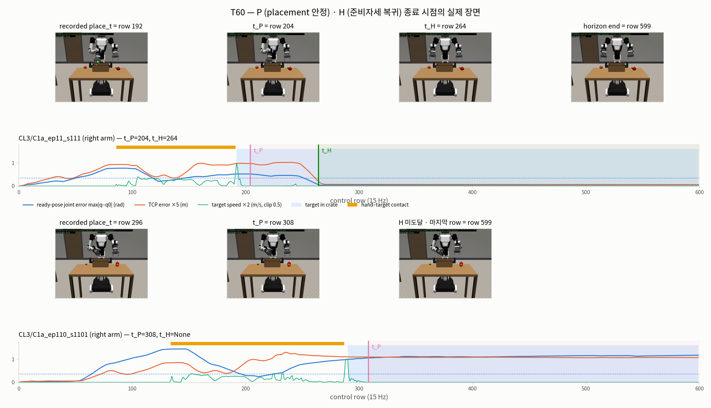

*실제 장면 (기록 영상 `third_person_front.mp4`, frame k = control row k).* 위: CL3 C1a ep11 s111 — t_P = 204 에서 과일이 crate 안에 멈추고, t_H = 264 에 오른팔이 준비자세로 돌아온다. 그 뒤 336 row 는 정지 상태다. 아래: CL3 C1a ep110 s1101 — t_P = 308 이후 팔이 crate 위에 머물러 (관절 오차 ≈ 1.1 rad) H 에 도달하지 않는다. 그래프의 파랑 = 준비자세 관절 오차, 주황 = TCP 오차 ×5, 초록 = target 속도 ×2, 하늘색 띠 = in crate, 노란 띠 = hand–target contact.

### 3. 1 단계 — 142 run 의 t_P · t_H (CL2 72 · CL3 54 · T53 16)

| 기록 | runs | 발표 success | P 도달 | P = success | H 도달 | P 이후 제거 frame | H 이후 제거 frame |
|---|---:|---:|---:|---:|---:|---:|---:|
| CL2 | 72 | 40 | 40 | 72 / 72 | 26 | 1603 / 5400 | 976 |
| CL3 | 54 | 40 | 40 | 54 / 54 | 28 | 1648 / 4050 | 1057 |
| T53 | 16 | 9 | 9 | 16 / 16 | 8 | **362** / 1200 (잠정 proxy 401) | 280 |
| 전체 | 142 | 89 | 89 | 142 / 142 | 62 | 3613 / 10650 | 2313 |

- t_P − 기록 `place_t` (마지막 in-crate streak 의 시작 chunk) = 4 – 62 row (중앙값 26). t_H − t_P = 8 – 109 row (중앙값 56, 62 run).
- P 이후 hand–target contact 가 있는 run 0, crate 밖으로 나간 run 0. replay qpos 불일치 0 row.
- **허용범위 grid** (dwell_p 1 / 8 / 23 · q 0.25 / 0.35 / 0.50 rad · TCP 0.08 / 0.12 / 0.16 m · dwell_h 1 / 8 / 15 = 81 조합): H 분류가 바뀌는 조합 0. P 는 dwell 23 row (수집기 `TARGET_SETTLE_SECS` 1.5 s) 에서만 1 run 이 빠진다 (늦게 놓아 horizon 안에 1.5 s 를 못 채움).

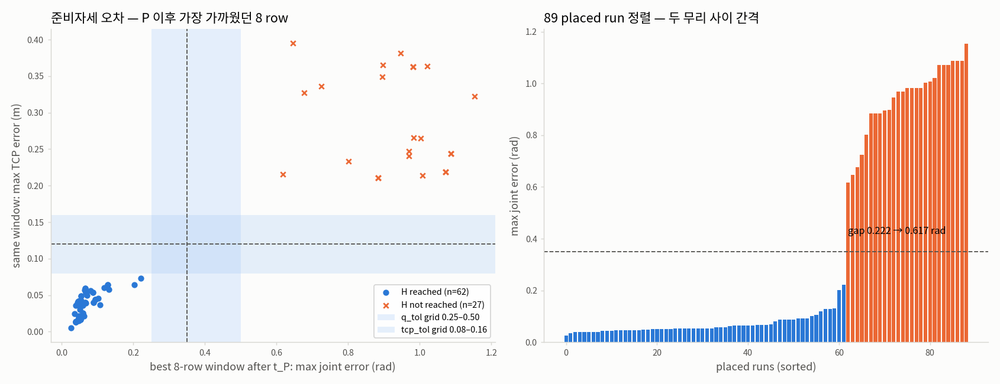

*placed 89 run 의 "P 이후 가장 가까웠던 8 row" 의 준비자세 오차.* 두 무리 사이가 비어 있다: H 도달 run 은 관절 ≤ 0.222 rad · TCP ≤ 0.073 m, 미도달 run 은 관절 ≥ 0.617 rad · TCP ≥ 0.210 m. 허용범위 (점선) 는 그 빈 곳에 있다.

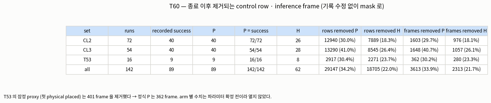

### 4. 2 단계 — 고정 후보의 closed-loop 지표 (CL2 · CL3 · T53)

정의 (`T60.verify.json` `step2`, 코드 `t60_closed_loop.py`).

| 창 | success | safe success (`success_ct`) | 비허용 contact 를 세는 row |
|---|---|---|---|
| **full** (발표 정의) | grasp ∧ 마지막 planning row 에서 crate 안 | success ∧ `success_rel` ∧ 비허용 contact 없음 | t ≤ Z4 `release_t` (마지막 hand–target contact + 1), 미release 는 전체 |
| **P** | grasp ∧ P 도달 | success_P ∧ 비허용 contact 없음 | t ≤ t_P (미도달은 전체) |
| **H** | success_P ∧ H 도달 | success_H ∧ 비허용 contact 없음 | t ≤ t_H (place → 준비자세 포함, 미도달은 전체) |

비허용 contact = V11 CT 집합 {hand–fruit_other, robot_other–target, robot_other–fruit_other}. HOLD chunk 는 시작 t ≤ t_end 이면 창 안이다. **full 창은 발표 `agg.json` 의 run flag (success · success_ct · success_ct_fruit · pre_release_new_contact · n_hold_chunks) 와 arm 합계를 전부 재현한 뒤 (assert) P · H 를 계산했다.**

| 기록 · arm (runs) | success full / P / H | `success_ct` full / P / H | HOLD chunk full / P / H | 완료 시간 중앙값 P / H (s) |
|---|---|---|---|---|
| CL2 C0 (18) | 14 / 14 / 9 | 12 / 12 / 9 | 101 / 28 / 30 | 17.4 / 19.4 |
| CL2 C1a (18) | 14 / 14 / 10 | 11 / 11 / 8 | 119 / 82 / 83 | 17.1 / 18.8 |
| CL2 C1bp (18) | 11 / 11 / 7 | 9 / 9 / 5 | 87 / 17 / 19 | 17.2 / 19.9 |
| CL2 C2p (18) | 1 / 1 / 0 | 0 / 0 / 0 | 40 / 40 / 40 | 39.1 / — |
| CL3 C1a (18) | 14 / 14 / 10 | 11 / 11 / 8 | 119 / 82 / 83 | 17.1 / 18.8 |
| CL3 C1aF1 (18) | 13 / 13 / 9 | 12 / 12 / 9 | 189 / 60 / 63 | 17.1 / 19.9 |
| CL3 C1aF1F2 (18) | 13 / 13 / 9 | 12 / 12 / 9 | 124 / 8 / 11 | 16.3 / 19.9 |
| T53 C1a (16) | 9 / 9 / 8 | 7 / 7 / 6 | 37 / 35 / 36 | 18.1 / 21.0 |

짝 비교 (`success_ct`, A_total 대 B_total, McNemar exact p).

| 짝 | full | P | H |
|---|---|---|---|
| CL2 C0 대 C1a | 12 대 11, p 1.0 | 같음 | 9 대 8, p 1.0 |
| CL2 C1a 대 C1bp | 11 대 9, p 0.6875 | 같음 | 8 대 5, p 0.25 |
| CL2 C1bp 대 C2p | 9 대 0, p 0.0039 | 같음 | **5 대 0, p 0.0625** |
| CL2 C0 대 C2p | 12 대 0, p 0.0005 | 같음 | 9 대 0, p 0.0039 |
| CL3 C1a 대 C1aF1 | 11 대 12, p 1.0 | 같음 | 8 대 9, p 1.0 |
| CL3 C1aF1 대 C1aF1F2 | 12 대 12, p 1.0 | 같음 | 9 대 9, p 1.0 |

- **pre8 + close (파지 직전) HOLD** 33 chunk (CL3 20 · T53 13, CL2 0) 는 전부 t_P 이전이다. T44–T46 의 파지 직전 결과 (T46 F1 / F2 의 HOLD 12 → 6 포함) 는 종료 정의에 영향을 받지 않는다.
- 비허용 contact row 는 P · H 창에서 일부 늘어난다 (예: CL2 C0 hand–fruit_other 33 → 64 row). P 에 도달하지 못한 run 은 full horizon 을 세는데, 발표 정의는 `release_t` 까지만 셌기 때문이다. success_ct 의 run 수는 P 에서 바뀌지 않았다.

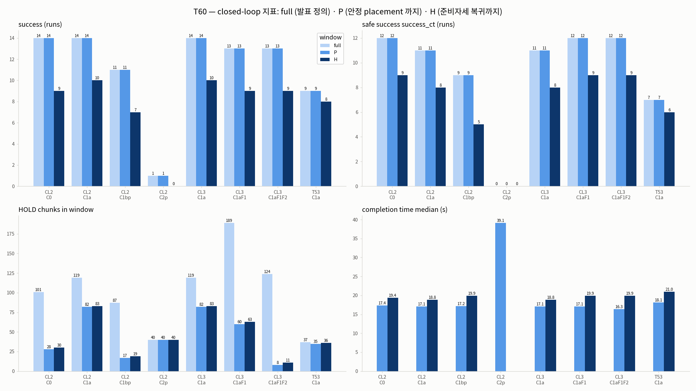

**HOLD 가 어디서 나는가 — T46b · W1 (A12, placed `no_seed` 인증 수정) 과의 관계.**

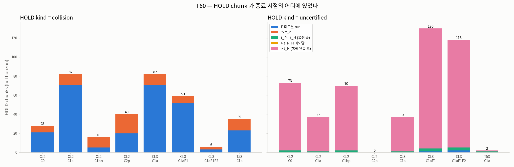

| arm | uncertified HOLD (full) | ≤ t_P | t_P – t_H (복귀 중) | > t_H (복귀 완료 후) | P 미도달 run |
|---|---:|---:|---:|---:|---:|
| CL2 C0 | 73 | 0 | 2 | 71 | 0 |
| CL2 C1bp | 70 | 0 | 2 | 68 | 0 |
| CL3 C1a | 37 | 0 | 1 | 36 | 0 |
| CL3 C1aF1 | 130 | 0 | 3 | 126 | 1 |
| CL3 C1aF1F2 | 118 | 0 | 3 | 113 | 2 |
| T53 C1a | 2 | 0 | 1 | 1 | 0 |

- T46b 가 "F1 을 켠 뒤 close 이후 HOLD 가 늘었다" 고 본 uncertified HOLD 는 **준비자세 복귀를 마친 뒤의 정지 상태** 에서 난 것이다. P 창 안에는 uncertified HOLD 가 C1aF1 1 · C1aF1F2 2 만 있다.
- 그래서 W1 은 규칙 P 에서는 주 작업 평가 밖이고, 규칙 H 에서도 복귀 중 HOLD (arm 당 1–3 chunk) 만 대상이다. **W1 코드가 틀렸다는 뜻은 아니다** (T46c-W1 의 재현 검증은 그대로).
- 감사 문서가 예로 든 C1aF1 ep11 s111 (기록 `place_t` 184, `no_seed` onset t 280) 은 이 표의 "> t_H" 에 들어간다.

### 5. 2 단계 — T54 (current / hold, 8 고정 arm) 재평가

T54 의 행 · GT · bootstrap (B 10000, seed 5407) · `t54_stats.analyze` / `entry_criteria` 를 그대로 쓰고 frame 만 mask 로 걸렀다. **full 은 발표 평균 (identity · no_target · purity · coverage, 8 arm, current · hold) 을 1e-6 안에서 재현했다.**

| 창 | target frame | L8H2 identity | N − L8H2 [95 % CI] | B − L8H2 [95 % CI] | A − L8H2 [95 % CI] |
|---|---:|---:|---|---|---|
| full | 1178 | 0.7093 | +7.15 %p [+3.65, +11.11] | +7.07 %p [+3.70, +11.25] | −3.08 %p [−8.00, +0.85] |
| P | 816 | 0.7558 | +10.40 %p [+5.64, +15.80] | +10.16 %p [+6.01, +14.68] | −1.72 %p [−6.48, +2.05] |
| H | 898 | 0.7490 | +9.80 %p [+5.30, +14.94] | +9.46 %p [+5.49, +13.63] | −2.71 %p [−7.86, +1.57] |

**A 의 T57 진입 판정 (기계적 비교, 허용폭은 실용값).**

| 창 | identity (≥ −3 %p) | coverage (≥ −5 %p) | 개선 관측 (identity · purity ↑ 또는 neighbour ↓) | hold (identity · coverage ≥ 허용폭) | 전체 |
|---|---|---|---|---|---|
| full | 탈락 (−3.08) | 통과 (−3.16) | 탈락 (neighbour +0.128) | 통과 (−1.42 · −1.40) | **탈락** |
| P | 통과 (−1.72) | 통과 (−1.85) | 탈락 (neighbour +0.569) | **탈락 (−3.12 · −3.09)** | **탈락** |
| H | 통과 (−2.71) | 통과 (−2.84) | **통과 (neighbour −0.114)** | 통과 (−2.36 · −2.34) | **통과** |

- 판정이 창마다 다른 이유는 모든 행이 허용폭 바로 옆에 있기 때문이다. **어느 창으로도 "A 가 기준을 통과했다" 고 말할 근거로는 약하다** (identity 차이의 CI 가 세 창 모두 0 과 −3 %p 를 함께 포함한다).
- hold 조건의 L8H2 identity 는 full 0.4367 → P 0.6032 · H 0.5511 이다. **T54 hold 재생의 attach 누락 (`T54b` 가 다루는 제한) 은 절단으로 해결되지 않는다** — 놓은 뒤의 빈손 frame 이 빠져 값만 올라간다.
- 잠정 proxy (감사 문서) 와의 차이: proxy 는 A −1.68 %p · N +9.88 %p 였고 정식 P 는 −1.72 · +10.40 이다. 정식 P 가 frame 을 덜 지운다 (401 → 362, 안정 dwell · contact · 속도 조건 때문).

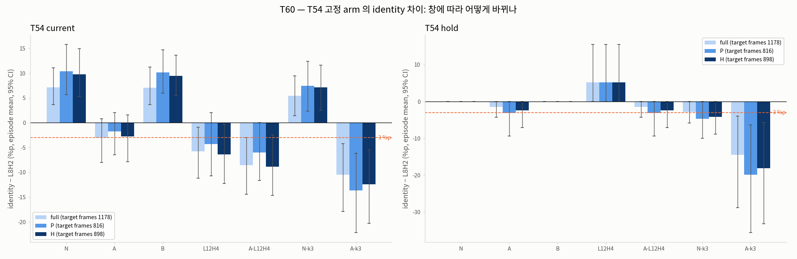

### 6. 3 단계 — 선택 · 목적함수 재계산 (T47 · T49 · T51 · T48a · T52)

**frame 단위 근사의 충실도 (먼저 확인).** head 선택 record 는 inference 시점 (8 row 마다) 의 `qpos` · `qvel` 만 있다. 두 표본 f, f+1 이 모두 술어를 만족하면 그 사이 8 row 가 유지된 것으로 보고 t̂ = t_f + 7 로 둔다 (`endpoints_sampled`). row 단위 정답이 있는 142 run 에서: P frame 일치 0.9977 (127 run 완전 일치, 나머지는 1–3 frame **더 일찍** 자름), H frame 일치 1.0, 완료 여부 불일치 0.

**record 별 endpoint** (MuJoCo `mj_forward` 로 frame 마다 target · crate · contact · TCP).

| record | 역할 | frame | P 이후 제거 | H 이후 제거 |
|---|---|---:|---:|---:|
| `long` · `t2` | T47 selection | 50 · 75 | 0 (placement 없음) | 0 |
| `ep1807` | T47 selection | 75 | 38 | 33 |
| `ep0` · `ep500` · `ep1200` | T51 calibration (VLA 학습 episode) | 113 · 113 · 113 | 82 · 80 · 60 | 73 · 72 · 52 |
| `headfix` · `ep1800` · `ep1850` · `ep1900` | held-out | 15 each | 0 | 0 |

**held-out 4 record 는 15 frame (8 s) 이라 placement 전에 끝난다** → T47 · T49 · T51 의 held-out 평가와 **T52 (held-out 만 사용) 는 종료 정의의 영향을 받지 않는다.** 감사 문서의 "T52 집계 재계산 필요" 는 해당 없음으로 확인했다.

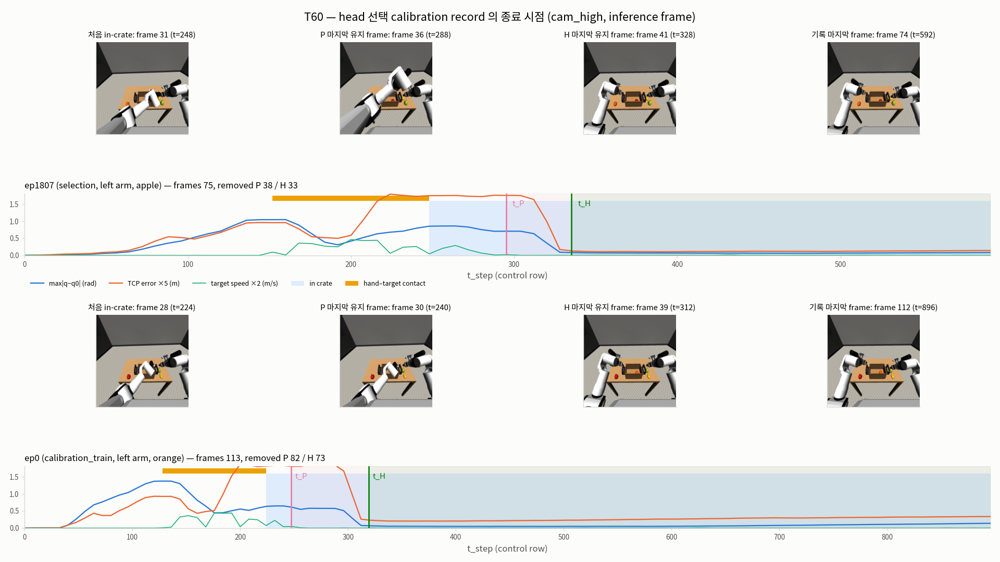

*선택 record 의 실제 장면 (cam_high).* ep1807 은 t 295 에 놓고 t 335 에 돌아온 뒤 75 frame 중 33 frame 을 정지 상태로 보낸다. ep0 는 113 frame 중 73 frame 이 준비자세에 머문 상태다 — head 선택 점수의 절반 이상이 이런 frame 에서 왔다.

**T47 label-free 선택 (attention sum + spatial entropy).** `record_statistics` · `select_from_stats` 를 그대로 쓰고 selection record 의 frame 만 걸렀다. full 은 발표 `selection.json` 의 모든 setting top-k 와 같다 (assert).

| | full (발표) | P | H |
|---|---|---|---|
| 공통 top-3 (d0 · last · cam τ, 사전 고정 primary) | L4H1 · L2H0 · L14H5 | **L4H1 · L14H5 · L3H3** | 같음 (P) |
| GT-oracle top-3 (selection record 의 peak_on_target) | L8H3 · L10H7 · L12H4 | **L10H7 · L12H4 · L8H7** | 같음 (P) |
| 공통 top-3 의 held-out 3D `on_target` (σ 0) | **0 / 60** | **43 / 60** | 43 / 60 |
| 같은 집합, σ 1 | (T47b: 0 / 60) | 38 / 60 | — |
| L8H2 · head-average · GT-oracle | 55 · 55 · 55 / 60 | 55 · 55 · 55 / 60 | 같음 |

- 공통 top-3 집합이 바뀐 setting (9 setting × cam / img τ = 18 중 5): d0 last cam, d4 last cam · img, d9 first cam, d9 last cam.
- **T47 의 "label-free primary 는 held-out 에서 0 / 60" 은 완료 이후 frame 의 영향을 크게 받은 값이다.** 정식 창에서 다시 고른 집합은 43 / 60 까지 올라가지만 여전히 L8H2 (55 / 60) 보다 낮으므로 **"L8H2 유지" (T47 사용자 판정) 는 그대로다.** 새 집합의 T47b label 기반 3D 지표 (`identity_correct` · purity) 는 재지 않았다.

**T49 명사 query 의 cell 선택.** full 은 발표 `select.json` 과 완전히 같다.

| query | GT top-3 (primary) full → P / H | label-free top-3 (secondary) full → P / H |
|---|---|---|
| target 명사 | L8H6 · L5H4 · L4H2 → **변화 없음** | L4H7 · L4H6 · L8H6 → L4H7 · L4H6 · **L7H7** |
| "basket" | L8H6 · L4H2 · L8H0 → **변화 없음** | L4H7 · L8H2 · L8H0 → L4H7 · **L4H6** · L8H2 |

primary 는 그대로라 T49 · T49b 의 held-out 결론은 유지된다. 바뀐 secondary 집합의 held-out 평가는 하지 않았다.

**T51 head 선택 protocol (scene 평균 chain, 사전 고정 그대로).** full 은 발표 scene chain 의 모든 json 과 1e-9 안에서 같다 (ksel 의 `replayed_for_ksel` 목록만 cache 때문에 다름). P · H 는 각자 다시 만든 T47 출력 (`--t47-dir`) 을 읽는다 — forced 후보 (L8H2 + T47 GT-oracle top-3) 가 바뀌기 때문이다.

| | full (발표) | P | H |
|---|---|---|---|
| calibration frame (long · t2 · ep1807 · ep0 · ep500 · ep1200) | 50 · 75 · 75 · 113 · 113 · 113 | 50 · 75 · 37 · 31 · 33 · 53 | 50 · 75 · 42 · 40 · 41 · 61 |
| P1 통과 cell | 242 | 225 | 225 |
| P2 3D 1 위 (GT, scene 평균 identity) | `last:L12H4` 0.691 | `mean:L10H7` 0.652 | `mean:L12H4` 0.628 |
| P3 bootstrap 1 위 확률 · 안정 판정 | 0.429 · 불안정 | 0.701 · 안정 | 0.613 · 안정 |
| P4 선택 (GT label) | `last:L12H4` (k 1) | **`mean:L10H7`** (k 1) | **`mean:L12H4`** (k 1) |
| P4 선택 (self label) | `last:L12H3` | 같음 | 같음 |
| P5 held-out identity (scene 평균): GT 선택 · self 선택 · L8H2 | 0.911 · 0.911 · 0.911 | **0.900** · 0.911 · 0.911 | 0.911 · 0.911 · 0.911 |
| P6 paper top-3 (σ 0 · σ 1) | 0.000 · 0.000 | 0.700 · 0.644 | 0.700 · 0.644 |
| P6 random 20 조합 중앙값 · head-average · T47 oracle | 0.756 · 0.867 · 0.911 | 0.706 · 0.867 · 0.911 | 0.711 · 0.867 · 0.911 |

- **GT 로 고른 cell 은 창마다 바뀐다** (상위 cell 의 3D 점수 차가 0.01–0.04). held-out 에서 어느 것도 L8H2 를 넘지 않는다. P · H 에서 bootstrap 이 "안정" 으로 바뀐 것은 완료 이후 frame 이 GT 순위를 흐리고 있었다는 뜻이다.
- **self label (grasp event 자기 label) 은 event 이전 frame 만 쓰므로 영향이 없다** — T51 의 실물용 self label 경로는 종료 정의에 강건하다.
- **정직한 기록 — stale cache.** T51 의 row cache 는 source id 로 저장되는데, 특수 source `paper3_s1` 은 이름만 같고 내용 (T47 paper top-3) 은 `--t47-dir` 에서 온다. 처음 P ablation 은 원래 T47 집합으로 만든 row 를 읽어 0.000 을 냈다. P · H 의 해당 row 를 지우고 다시 돌려 0.644 를 얻었다 (위 표가 정정 값). 같은 주의를 `t60_t51.py` docstring 에 적었다.

**T48a 의 closed-loop ep1807 보조 평가 (HSR probe).** full 은 발표 수치 (C0 72 / 75, C1 → pick 60 / 225: pick 57 / 57 · place 3 / 39 · home 0 / 129) 를 재현한다.

| 창 | host frame (pick · place · home) | C0 정답 | C1 → pick 전체 | place frame 에서 C1 → pick |
|---|---|---|---|---|
| full | 75 (19 · 13 · 43) | 72 / 75 | 60 / 225 | 3 / 39 |
| P | 37 (19 · 13 · 5) | 34 / 37 | 60 / 111 | 3 / 39 |
| H | 42 (19 · 13 · 10) | 39 / 42 | 60 / 126 | 3 / 39 |

C1 의 전체 비율 변화는 home frame 이 빠진 구성 효과다. **판단 근거였던 place frame 의 반응 (3 / 39) 은 그대로다** — T48a 의 "instruction 교체에 거의 반응하지 않는다" 는 바뀌지 않는다.


### 7. 감사 표의 STEP 별 판정 (이 STEP 의 측정으로 닫힌 것 · 남은 것)

| STEP | 감사 문서의 요구 | T60 의 결과 |
|---|---|---|
| T44 I0–I2 · 단위 / 회귀 | 다시 할 필요 없음 | 회귀 baseline 일치 |
| T44 E2 · T46 F1 / F2 (pre-grasp) | cutoff 보다 앞인지 확인 | pre8 + close HOLD 33 chunk 전부 t_P 이전 → **유지** |
| T44d CL · T44e CL2 · T46 CL3 | 새 종료 술어로 재집계 | **완료.** P: success · success_ct 변화 없음, HOLD 크게 감소. H: success 감소 (복귀 미도달 27 run) |
| T46b · T46c-W1 | placement / home 시점과 HOLD onset 교차표 | **완료.** uncertified HOLD 는 대부분 t_H 이후 |
| T47 · T47b | calibration 재절단 · 후보가 바뀌면 replay | **완료.** 공통 top-3 · oracle 이 바뀜, held-out 0 → 43 / 60 (σ 0). L8H2 유지 |
| T48a ep1807 | tail 포함 요약 재계산 | **완료.** place 반응 3 / 39 그대로 |
| T48a val · T48b · T50 (HSR demo) | 새 window 로 평가 | **하지 않음** — dataset 에 frame 별 물체 상태가 없어 물리 술어를 계산할 수 없다 (재시뮬레이션 필요) |
| T49 · T49b | 저장 map 으로 재평가 | **완료 (선택).** primary (GT) 불변, secondary label-free 1 cell 씩 변경 |
| T51 · T51b | P1 · calibration · k 선택 · 평가 재실행 | **T51 완료.** GT 선택 창마다 변경, held-out 은 L8H2 를 못 넘음. **T51b (명사 Ω) 는 하지 않음** |
| T52 | 집계 재계산 | **해당 없음** (held-out 15 frame 만 사용) |
| T53 | 성공 · 접촉 · HOLD · 시간 갱신 | **완료** (§3 · §4) |
| T54 | 고정 후보 재평가 | **완료.** N · B 개선 강화, A 진입은 경계 |
| T54b · T54c · T55 · T56 | dev / test window 통일 | **하지 않음** — 다른 세션 (dev-82) 진행 중. mask 와 술어를 전달했다 (2026-10-13) |

### 8. 읽을 때의 한계

- **표본이 작다.** closed-loop 은 arm 당 18 (T53 16) run, head 선택의 calibration 은 5 scene, held-out 은 4 record · 60 frame 이다.
- **frame 단위 근사.** head 선택 record 의 P 는 row 단위보다 0–3 frame 일찍 자른다 (142 run 검증). 속도는 순간 `qvel`, contact 는 순간 MuJoCo contact 다.
- **허용범위는 사용자 판정이다.** grid 안에서 분류가 안정적이라는 것까지만 보였다. 준비자세의 정의는 episode 의 초기 자세 하나뿐이다.
- **H 에 도달하지 못한 27 run 은 정책 행동이다.** P 이후에도 기록이 이어지는데 돌아오지 않았다. 원인은 진단하지 않았다.
- **이미 개발에 쓴 T53 · selection record 는 새 후보의 독립 test 가 아니다.** 새로 고른 cell (T47 · T51) 의 평가는 같은 held-out 4 record 다.

### 9. 판정 대기 · 되돌아올 지점

**판정 대기 (사용자).**

1. **기본 보고 창을 무엇으로 할 것인가** — P (placement 까지) / H (준비자세 복귀까지) / 둘 다. develope_PLAN 의 "Release 뒤 평가에는 retreat / terminal hold 까지 포함" (§ 평가 규칙) 과 맞추려면 H 가 가깝고, H 는 terminal hold 를 빼는 점이 다르다. **develope_PLAN 은 다른 세션이 수정 중이라 고치지 않았다.**
2. **H 미도달 27 run 을 어떻게 다룰 것인가** — 정책의 복귀 실패로 진단할지, task 정의에서 복귀를 뺄지.
3. **T51 의 GT 선택이 창마다 다르다** — head 선택을 하나로 고정한다면 self label 경로 (`last:L12H3`, 창과 무관) 를 쓸지, L8H2 를 유지할지.
4. **T54b · T54c · T55 · T56 에 이 mask 를 적용할지** (dev-82 세션의 사전 고정 task).

**→ 판정됨 (사용자, 2026-10-14; 전문은 [`handoff/T60.task.md`](handoff/T60.task.md) "사용자 판정 2").** ① 기본 창 = **P 주 작업 지표 + H 필수 보고** (develope_PLAN 평가 규칙에 반영). ② 복귀 미도달 → 기록 기반 진단 (아래 **T60b**). ③ L8H2 를 관행적으로 유지하지 않고 **사전 고정 알고리즘으로 head 를 골라 실행 중 고정**, L8H2 는 기준선으로 보존 (2026-10-14 후속 판정으로 [`handoff/T61.task.md`](handoff/T61.task.md) 사전 고정: 새 held-out 16 episode, calibration 에서 `long` 제외 (입력 배선), 강제 후보 없음, 명사 query 포함 · query 별 고정 배분, 선택 단위 = query · denoise · aggregation · layer · head, k 는 CV one-SE 규칙, bootstrap 은 보고만). ④ 이미 고정된 실험은 **기존 주 판정 유지 + P · H 보조** (T52-T57 세션에 전달). ⑤ T51b 재집계 진행 (아래 **T60c**), HSR demo 재시뮬 보류. ⑥ commit 은 공유 로그 작업 종료 후 T60 범위만 분리.

**되돌아올 지점.**

- 허용범위를 다시 볼 신호: 새 기록에서 placed run 의 준비자세 오차가 0.25 – 0.50 rad 사이에 들어오면 grid 결과가 달라진다.
- T48a val · T48b · T50: T48b 의 재렌더 경로로 demo 의 물체 상태를 재구성하면 같은 술어를 적용할 수 있다.
- T59 의 분석 창은 이 술어와 다르다: W1 은 첫 placed 또는 HSR `home` 확정 label 을 끝으로 쓰고 (감사 문서 기준으로 `home` label 은 실제 도착 확인이 아니다), W2 의 ready distance 는 관절 L2 0.2 rad 다 (H 는 관절 max 0.35 rad ∧ TCP 0.12 m, 8 row 유지). 이 STEP 범위 (T44–T56) 밖이라 고치지 않았다.
- runtime 종료 감지기 (감사 문서 4 단계): `t60_termination.endpoints` 를 client 에 넣으면 같은 술어로 rollout 을 끝낼 수 있다. 새 rollout 이 필요하다.

### 10. 산출물

- **측정**: [`handoff/T60.verify.json`](handoff/T60.verify.json) (원자료 `/mnt/dev/AG3S_VLA-storage/results/development/20261013T223348+0900_cf38c9dbca7b_8aef81831126/verify/T60/`: `step1/` timestamps · masks, `step2/` closed_loop · t54, `step3/` records · T47_P/H · T47_P_s1 · T49_* · T51_full/P/H · logs, `baseline/legacy.json`)
- **figure** (각각 `.json` sidecar): [`t60-endpoint-scene`](figures/t60/t60-endpoint-scene.png) · [`t60-ready-gap`](figures/t60/t60-ready-gap.png) · [`t60-removed-table`](figures/t60/t60-removed-table.png) · [`t60-closed-loop`](figures/t60/t60-closed-loop.png) · [`t60-hold-position`](figures/t60/t60-hold-position.png) · [`t60-t54-identity`](figures/t60/t60-t54-identity.png) · [`t60-records-scene`](figures/t60/t60-records-scene.png) · [`t60-selection-graphs`](figures/t60/t60-selection-graphs.png) · [`t60-selection-table`](figures/t60/t60-selection-table.png)
- **코드 (새 파일)**: `AG3S/ag3s/experiments/studies/t60_termination.py` (술어) · `t60_timestamps.py` · `t60_closed_loop.py` · `t60_t54.py` · `t60_sampled_check.py` · `t60_records.py` · `t60_t47.py` · `t60_t47_run.py` · `t60_t49.py` · `t60_t51.py` · `t60_t48a.py` · `t60_figures.py` · `t60_figures2.py` · `t60_figures3.py` · `t60_build_verify.py`, `tests/ag3s/test_t60_termination.py` (6 / 6)
- 입력 (읽기 전용): CL2 · CL3 · T53 · T54 · T47 · T49 · T51 · T48 run. commit 은 하지 않았다.

## T52 — 장면 1800 의 grounding 실패는 identity 판정 · 3D seed · 영역 확장 중 어디서 시작되는가 (offline, CPU, 2026-10-13 KST)

> 측정 run `20261013T094624+0900_693dcedeaadc_a2c23cf2a275` (2026-10-13 09:46 KST 시작), 기록 2026-10-14 KST. 수치는 모두 [`T52.verify.json`](handoff/T52.verify.json) 의 `numbers` (1 차) 와 `followup.numbers` (follow-up) 에서 왔다. 요청 문서: [`handoff/T52.task.md`](handoff/T52.task.md), 계획 · 사용자 판정: [`handoff/T52-T57.plan.task.md`](handoff/T52-T57.plan.task.md).
> 새 코드 없음 (분석 script 는 run dir 에 두었고 repo 코드는 verifier 가 고치지 않았다). 입력은 T49 · T49b · T51 · T51b 의 저장 row 와 T47 GT cache 이고 읽기만 했다.
> **이 절의 장면 1800 수치 중 `ep1800` record 가 만든 것은 head 0 기록 위에서 잰 값이다 (§7). 과거 결과로 표시하고 다시 재지 않았다.**

**이 절이 답하는 물음 (목적).** T49b · T51b 에서 명사 query 의 열세는 장면 1800 (held-out `headfix` · `ep1800`) 에 몰려 있었다 (T51b (c): held-out scene 단위 명사 최선 − action 최선 = −0.044 중 scene1800 이 −0.133). 사용자는 명사로 identity 를 판정하고 L8H2 로 3D seed 를 얻는 조합을 비교하기 **전에**, 실패가 어느 단계에서 시작되는지 분해하라고 했다 (사용자 판정 2026-10-13, 계획서 판정 2). grounding 파이프라인의 세 단계는 다음과 같다.

```
attention map (명사 / L8H2) → ① identity (2D): 어느 물체를 가리키는가
   → ② seed (3D): 상위 attention 점 (percentile 95, ≤ 4000)
   → ③ region growing (eps 0.03 m) + DBSCAN → chosen cluster → identity_correct · purity
```

**한 줄 결과 (before → after).**

- **before:** "명사 query 가 장면 1800 에서 3D 로 지는 이유" 는 T49b · T51b 가 증상 (`identity_correct` · purity 열세) 만 보였고 원인 단계가 없었다.
- **after:** 명사 query 의 **2D identity 실패는 scene1800 30 frame 에서 0** 이다 (L8H2 는 7 frame). 그러나 명사 query 는 seed precision 이 낮고 (L8H6 중앙값 0.16) **이웃 바나나와 cluster 가 병합** 된다 (L8H6 · L10H7 모두 `headfix` 15 / 15 frame, apple–banana GT mesh 간격 중앙값 18.4 mm < eps 30 mm). purity 중앙값은 0.65 · 0.63, L8H2 는 병합 0 · purity 1.00. **병합이 남는 기전은 attention split 비율 (≥ 2) 조건이다**: 병합 frame 에서 비율 통과가 L8H6 7 / 15 · L10H7 10 / 15, L8H2 15 / 15. **최종 실패 frame 만 보면 오류의 첫 단계는 거의 모두 seed 다** (scene1800 L8H2 4 · L8H6 7 · L10H7 8 frame 중 region 단계가 처음인 것은 0).
- **L8H2 의 2D peak 가 target 밖인데 3D 가 맞은 14 frame 은 현재 frame attention 이 아니라 이전 frame 에서 확정한 geometry (`TargetConfirm`) 를 유지한 덕이다 (13 / 14)** — attention source 의 효과와 temporal latch 의 효과를 나눠 평가해야 한다는 근거 (T54 의 `current` · `hold` 조건).

**이 절이 주장하지 않는 것.**

- 명사 query 가 L8H2 보다 낫거나 못하다는 일반 주장 (scene 3 개 · record 4 개 · frame 15 개씩의 pilot 이고 frame 은 독립 표본이 아니다).
- 병합 기전이 장면 1800 밖에서도 같다는 주장 (병합 frame 은 `headfix` 15 frame 에서만 나왔다).
- "명사 map 이 두 과일에 퍼진다" 의 원인 (attention 이 퍼지는 이유는 측정하지 않았다).

### 1. 사전 고정과 타임라인

**사전 고정 (결과를 열기 전, `T52.task.md` · `T52.verify.json numbers.definitions`).**

| 항목 | 정의 |
|---|---|
| visible camera | GT target pixel ≥ 200 (480×640 GT render, T47 keep rule). 보이는 camera 가 없으면 ① 은 정의되지 않아 따로 센다 |
| ① identity 실패 | 보이는 camera 가 1 대 이상이고, 보이는 모든 camera 에서 raw argmax patch 가 target 위가 아님 (target coverage of argmax patch > 0.05) |
| ② seed 실패 | seed precision (GT target seed ÷ 전체 seed) < 0.5. seed 가 없으면 실패 |
| ③ region 실패 | ② 를 통과했고 (chosen cluster purity < 0.8 또는 병합). 병합 = chosen cluster 가 GT 이웃 과일 점 ≥ 1 과 target 점 ≥ 1 을 함께 가짐 |
| 오류 시작 단계 | identity → seed → region 순서에서 처음 실패한 단계 |
| 불확실성 | record 안 moving-block bootstrap (block 5 frame, B 10000, seed 5205), scene = record 합. block 길이는 결과 전에 정했다 |
| source | `l8h2` = action npz d0 · last · L8H2 raw (서빙 cell), `noun_L8H6` = T49 명사 GT cell (k1 σ0), `noun_L10H7` = T51b 선택 (`noun_best_gt`) |
| 대상 | held-out 4 record × 15 frame. `headfix` · `ep1800` = scene1800, `ep1850` = scene1850, `ep1900` = scene1900 (대조) |

**타임라인 (KST).**

| 시각 | 일 |
|---|---|
| 2026-10-13 09:46 | run 시작 (HEAD `693dcede`). legacy 회귀 기준선 일치: 위반으로 시작 14 / 15 · `has_target` 15 / 15 · frame 0 clearance −29.031048280806342 mm |
| 같은 run | 4 record × 3 source 재생 (서빙 경로, CPU, worker 2). 이전 row 와 비교: T49b `gt_k1_s0` (명사 · L8H2) · T51b (L10H7) · T51 (`last:L8H2`) 각각 840 field **mismatch 0** |
| 1 차 결과 후 | lead 가 follow-up 을 요청: (A) 최종 실패 frame 만의 조건부 분해 (1 차 기준은 최종 성공 frame 도 seed 실패로 세는 한계가 있었다), (B) scene1800 병합 기전, (C) L8H2 의 2D 실패 frame 에서 3D 가 맞은 이유. **follow-up 은 1 차 결과를 본 뒤의 보완 측정이고 사전 고정이 아니다.** HEAD `ae6f2345`. 기준선 재실행 일치, 재생 row 대 T52 row 0 / 900 field mismatch |
| 2026-10-13 오후 | 사용자가 아래 figure 의 ep1800 f2 cam_high 가 정면을 본다고 질문 → head 0 기록 발견 (§7) |

### 2. 1 차 결과 — frame 별 오류 시작 단계

(frame 수. `[ ]` = moving-block bootstrap 95 % CI. frame 은 독립 표본이 아니다.)

| scene (frame) | source | ① identity | ② seed | ③ region growing | no_cluster | ok (최종 오류 없음) | 보이는 camera 없음 |
|---|---|---:|---:|---:|---:|---:|---:|
| scene1800 (30) | L8H2 | 7 [0, 11] | 16 [12, 23] | 0 [0, 0] | 0 [0, 0] | 5 [2, 12] | 2 [0, 3.0] |
| scene1800 (30) | 명사 L8H6 (k1 σ0, T49 GT cell) | 0 [0, 0] | 27 [24, 30] | 0 [0, 0] | 0 [0, 0] | 1 [0, 3] | 2 [0, 3.0] |
| scene1800 (30) | 명사 L10H7 (T51b 선택) | 0 [0, 0] | 12 [3, 17] | 6 [3, 14] | 0 [0, 0] | 10 [5, 15] | 2 [0, 3.0] |
| scene1850 (15) | L8H2 | 7 [3, 13] | 6 [2, 9] | 0 [0, 0] | 0 [0, 0] | 2 [0, 5] | 0 [0, 0] |
| scene1850 (15) | 명사 L8H6 (k1 σ0, T49 GT cell) | 0 [0, 0] | 15 [15, 15] | 0 [0, 0] | 0 [0, 0] | 0 [0, 0] | 0 [0, 0] |
| scene1850 (15) | 명사 L10H7 (T51b 선택) | 3 [0, 7] | 0 [0, 0] | 0 [0, 0] | 0 [0, 0] | 12 [8, 15] | 0 [0, 0] |
| scene1900 (15) | L8H2 | 2 [0, 4] | 12 [10, 15] | 0 [0, 0] | 0 [0, 0] | 1 [0, 3] | 0 [0, 0] |
| scene1900 (15) | 명사 L8H6 (k1 σ0, T49 GT cell) | 0 [0, 0] | 15 [15, 15] | 0 [0, 0] | 0 [0, 0] | 0 [0, 0] | 0 [0, 0] |
| scene1900 (15) | 명사 L10H7 (T51b 선택) | 0 [0, 0] | 5 [0, 6] | 0 [0, 0] | 0 [0, 0] | 10 [9, 15] | 0 [0, 0] |


*scene × source 별 오류 시작 단계 stacked bar.* [`t52-error-start-stage.json`](figures/t52/t52-error-start-stage.json)

**읽는 법과 측정된 사실.**

- scene1800 에서 명사 query 두 source 의 ① identity 실패는 **0 frame** 이다. L8H2 는 7 frame (CI [0, 11]). 즉 2D 에서 target 을 못 가리키는 쪽은 L8H2 다.
- 명사 L8H6 은 scene1800 30 frame 중 27 이 ② seed 에서 걸린다 (CI [24, 30]). seed precision 중앙값이 0.16 이다. L10H7 은 ② 12 · ③ 6 · ok 10 이다.
- ③ region 단계가 처음인 frame 은 L10H7 의 6 frame (모두 `headfix`) 뿐이다.
- L8H2 의 ② 16 은 최종 성공 frame 을 포함한다 (§4 follow-up). 1 차 표만으로 "seed 가 실패 원인" 이라고 읽을 수 없다.
- **record 별로 쪼개면 `ok` 는 전부 `ep1800` 에서 나온다** (headfix 0 · ep1800 L8H2 5 · L8H6 1 · L10H7 10). `ep1800` 은 head 0 기록이다 (§7).

| record | L8H2 | 명사 L8H6 | 명사 L10H7 |
|---|---|---|---|
| headfix | 4 / 11 / 0 / 0 / 0 / 0 | 0 / 15 / 0 / 0 / 0 / 0 | 0 / 9 / 6 / 0 / 0 / 0 |
| ep1800 | 3 / 5 / 0 / 0 / 5 / 2 | 0 / 12 / 0 / 0 / 1 / 2 | 0 / 3 / 0 / 0 / 10 / 2 |

*(identity / seed / region_growing / no_cluster / ok / 보이는 camera 없음 순서의 frame 수.)*

### 3. 단계별 지표

| scene | source | 2D: 보이는 camera 중 argmax 가 target 인 비율 | 3D `identity_correct` | seed precision (중앙값) | seed recall | 이웃 과일 seed (중앙값, 점) | purity | coverage | 합쳐진 frame | min target–이웃 mesh 거리 (mm, 중앙값) |
|---|---|---:|---:|---:|---:|---:|---:|---:|---:|---:|
| scene1800 | L8H2 | 0.75 (28 frame) | 26 / 30 | 0.35 | 1.00 | 30.5 | 1.00 | 1.00 | 0 | 22.2 |
| scene1800 | 명사 L8H6 (k1 σ0, T49 GT cell) | 1.00 (28 frame) | 23 / 30 | 0.16 | 1.00 | 30 | 0.65 | 0.98 | 15 | 22.2 |
| scene1800 | 명사 L10H7 (T51b 선택) | 1.00 (28 frame) | 22 / 30 | 0.53 | 1.00 | 29 | 0.63 | 0.93 | 15 | 22.2 |
| scene1850 | L8H2 | 0.53 (15 frame) | 13 / 15 | 0.34 | 0.88 | 0 | 1.00 | 1.00 | 0 | 15.6 |
| scene1850 | 명사 L8H6 (k1 σ0, T49 GT cell) | 1.00 (15 frame) | 13 / 15 | 0.08 | 1.00 | 30 | 1.00 | 1.00 | 0 | 15.6 |
| scene1850 | 명사 L10H7 (T51b 선택) | 0.80 (15 frame) | 13 / 15 | 0.69 | 0.85 | 0 | 1.00 | 1.00 | 0 | 15.6 |
| scene1900 | L8H2 | 0.87 (15 frame) | 15 / 15 | 0.37 | 1.00 | 54 | 1.00 | 0.94 | 0 | 14.2 |
| scene1900 | 명사 L8H6 (k1 σ0, T49 GT cell) | 1.00 (15 frame) | 15 / 15 | 0.18 | 1.00 | 68 | 1.00 | 0.94 | 0 | 14.2 |
| scene1900 | 명사 L10H7 (T51b 선택) | 1.00 (15 frame) | 15 / 15 | 0.56 | 0.98 | 48 | 1.00 | 0.94 | 0 | 14.2 |

(중앙값은 scene 안 frame 의 중앙값이다. "합쳐진 frame" = chosen cluster 가 GT 이웃 과일 점과 target 점을 함께 가진 frame. min target–이웃 거리는 GT visual mesh 기준 `min_neighbour_mesh_dist_m` 의 scene 중앙값이고, scene1800 의 22.2 mm 는 `headfix` (18.3 – 18.5 mm) 와 `ep1800` (26.0 – 27.8 mm) 15 frame 씩을 합친 값이다.)


*단계별 지표 표.* [`t52-stage-metrics-table.json`](figures/t52/t52-stage-metrics-table.json)

**scene1800 의 특징 (`numbers.scene_characteristics`).**

| 항목 | 값 |
|---|---|
| 배치 (`headfix` frame 0, base frame) | apple (0.457, 0.327, 0.850) · banana (0.550, 0.325, 0.843) · orange (0.462, −0.299) · pear (0.555, −0.304) · crate (0.500, 0.002). target = apple, prompt "Place the apple into the basket." |
| 가장 가까운 이웃 | banana (두 record 모두). apple–banana GT visual mesh 거리: `headfix` 15 frame 에서 18.3 – 18.5 mm (중앙값 18.4 mm), `ep1800` 에서 26.0 – 27.8 mm. collision geom 거리는 `headfix` 21.8 – 22.0 mm · `ep1800` 28.1 – 29.9 mm |
| camera 별 target 가시 pixel (`headfix`) | cam_high 547 px (frame 0) → 62 – 93 px (grasp 구간 frame 11 – 14). cam_left_wrist 249 → 14,132 px. cam_right_wrist 는 15 frame 모두 0 |
| camera 별 target 가시 pixel (`ep1800`) | **cam_high 는 15 frame 모두 0 px** (§7), cam_left_wrist 22 → 10,459 px. 보이는 camera 가 없는 frame 이 2 개 (frame 0 · 1) |
| phase (`headfix`) | transit 3 · approach 4 · pre_grasp 2 · grasp 6 (pre-grasp 9 · post-grasp 6) |


*실제 장면 (scene1800).* 행마다 (frame, source) 하나, 열은 cam_high · cam_left_wrist · cam_right_wrist 의 map 과 GT label 윤곽, 오른쪽 열은 base frame 위에서 본 seed (검은 점) · chosen cluster (빨간 윤곽) · label 색 (target 초록, neighbour fruit 주황, crate 파랑). 각 행의 값은 sidecar 에 있다.

| frame | source | seed precision | seed 수 | purity | cluster 안 이웃 점 | 병합 | `identity_correct` |
|---|---|---:|---:|---:|---:|---|---|
| `headfix` f4 (pre-grasp) | L8H2 | 0.35 | 338 | 1.00 | 0 | 아니오 | 예 |
| `headfix` f4 | 명사 L8H6 | 0.16 | 745 | 0.65 | 63 | 예 | 예 |
| `headfix` f4 | 명사 L10H7 | 0.68 | 171 | 0.62 | 62 | 예 | 예 |
| `headfix` f12 (post-grasp) | L8H2 | 0.28 | 156 | 1.00 | 0 | 아니오 | 예 |
| `headfix` f12 | 명사 L8H6 | 0.04 | 927 | 0.47 | 54 | 예 | 아니오 |
| `headfix` f12 | 명사 L10H7 | 0.34 | 145 | 0.44 | 58 | 예 | 아니오 |
| `ep1800` f2 (pre-grasp, cam_high 0 px) | L8H2 | 0.19 | 104 | 0.00 | 0 | 아니오 | 아니오 |
| `ep1800` f2 | 명사 L8H6 | 0.15 | 137 | 0.00 | 0 | 아니오 | 아니오 |
| `ep1800` f2 | 명사 L10H7 | 0.25 | 79 | 0.00 | 0 | 아니오 | 아니오 |

마지막 세 행 `ep1800` f2 의 cam_high 는 target 이 없는 방 안쪽을 본다 (0 px). [`t52-scene1800-stages.json`](figures/t52/t52-scene1800-stages.json)

### 4. follow-up (A) — 최종 실패 frame 만의 조건부 분해

1 차 기준 (독립 flag) 은 최종 성공 frame 도 seed precision < 0.5 이면 seed 단계로 센다. follow-up (A) 는 **최종 결과 (`identity_correct`) 가 틀린 frame 만** 따로 세어 첫 단계를 보고, 최종 성공 frame 이 단계 flag 를 얼마나 켜는지도 센다.

| scene | source | 최종 실패 frame | 오류 시작: identity / seed / region · no_cluster | 최종 성공 frame | 성공인데 seed precision < 0.5 | 성공인데 2D identity 실패 |
|---|---|---:|---|---:|---|---|
| scene1800 | L8H2 | 4 (보이는 camera 없음 2) | 0 / 4 / 0 | 26 | 20 / 26 (CI 0.57–0.87) | 7 / 26 |
| scene1800 | 명사 L8H6 (k1 σ0, T49 GT cell) | 7 (보이는 camera 없음 2) | 0 / 7 / 0 | 23 | 22 / 23 (CI 0.86–1.00) | 0 / 23 |
| scene1800 | 명사 L10H7 (T51b 선택) | 8 (보이는 camera 없음 2) | 0 / 8 / 0 | 22 | 6 / 22 (CI 0.07–0.44) | 0 / 22 |
| scene1850 | L8H2 | 2 (보이는 camera 없음 0) | 2 / 0 / 0 | 13 | 10 / 13 (CI 0.47–1.00) | 5 / 13 |
| scene1850 | 명사 L8H6 (k1 σ0, T49 GT cell) | 2 (보이는 camera 없음 0) | 0 / 2 / 0 | 13 | 13 / 13 (CI 1.00–1.00) | 0 / 13 |
| scene1850 | 명사 L10H7 (T51b 선택) | 2 (보이는 camera 없음 0) | 1 / 0 / 0 | 13 | 2 / 13 (CI 0.00–0.42) | 2 / 13 |
| scene1900 | L8H2 | 0 (보이는 camera 없음 0) | 0 / 0 / 0 | 15 | 14 / 15 (CI 0.80–1.00) | 2 / 15 |
| scene1900 | 명사 L8H6 (k1 σ0, T49 GT cell) | 0 (보이는 camera 없음 0) | 0 / 0 / 0 | 15 | 15 / 15 (CI 1.00–1.00) | 0 / 15 |
| scene1900 | 명사 L10H7 (T51b 선택) | 0 (보이는 camera 없음 0) | 0 / 0 / 0 | 15 | 5 / 15 (CI 0.00–0.40) | 0 / 15 |


*(a) 최종 실패의 오류 시작 단계와 성공 frame 의 flag, (b) 최종 성공인데 seed · identity 기준을 넘지 못한 비율 (block bootstrap CI), (c) headfix 15 frame 의 attention split 비율, (d) 병합 기전 표.* [`t52-followup-conditional-merge.json`](figures/t52/t52-followup-conditional-merge.json)

- **최종 실패만 보면 오류의 첫 단계는 거의 모두 seed 다.** scene1800: L8H2 4 · L8H6 7 · L10H7 8 frame 이 모두 seed 가 처음 (그중 2 frame 은 보이는 camera 가 없다). region 단계가 처음인 실패는 0 이다. 단 scene1800 의 모든 최종 실패에서 region flag 도 켜져 있다 (독립 flag 라서 순서만 seed 가 앞).
- **최종 성공 frame 도 seed 기준 (precision < 0.5) 을 자주 넘지 못한다:** L8H2 20 / 26, L8H6 22 / 23 (scene1800). → **seed precision < 0.5 는 최종 실패를 예측하는 단독 지표가 아니다.** 반대로 L10H7 은 성공 frame 의 6 / 22 만 걸린다.

### 5. follow-up (B) — scene1800 의 병합 기전

병합 frame = 선택된 geometry 가 GT 기준 target 점과 이웃 과일 점을 함께 가진 frame. scene1800 30 frame 중 L8H6 · L10H7 은 **각각 15 frame 이 병합** (모두 `headfix`), L8H2 는 0 frame 이다. 병합 frame 중 최종 `identity_correct` 는 L8H6 12 · L10H7 11 이다. 즉 병합은 identity 를 항상 깨는 것이 아니라 purity · 이웃 점 혼입을 깬다.

| 단계 (`headfix` frame 0 – 14) | L8H2 | 명사 L8H6 | 명사 L10H7 |
|---|---|---|---|
| 병합 frame (scene1800 30 중) | 0 | 15 | 15 |
| split trigger 발동 · 15 mm 재군집에서 성분 ≥ 2 (병합 frame 중) | 15 / 15 · 15 / 15 | 15 / 15 · 15 / 15 | 15 / 15 · 15 / 15 |
| **split attention 비율 ≥ 2 통과** (pipeline, normalised) | **15 / 15** | **7 / 15** | **10 / 15** |
| split 비율 중앙값 (최소 – 최대) | 4.49 (2.02 – 12.87) | 1.91 (1.36 – 42.67) | 2.29 (0.78 – 5.76) |
| 병합 기전 label (verifier; L8H2 는 명사 병합 frame 15 개에서 본 label) | split 전 parent cluster 에 바나나 점 15 / 15 frame, split 이 받아들여짐 15 / 15. `split_fired_on_parent_with_neighbour` 9 · `kept_geometry_from_split_anchor` 6 | `current_cluster_ratio_below_2` 6 · `kept_geometry_this_frame_split_accepted` 7 · `kept_geometry_this_frame_not_split` 2 | 2 · 10 · 3 |
| 병합 cluster 의 membership | — | 현재 frame cluster 6 · 유지된 geometry (proximity) 9 | 현재 frame cluster 2 · 유지된 geometry 13 |
| GT 비율 target ÷ 바나나 평균 attention (normalised · raw, 중앙값) | — | 1.91 · 10.80 | 2.26 · 36.01 |
| split 전 바나나 seed 점 (frame 당 중앙값, 범위) | 51 (29 – 59) | — | — |

- split trigger 와 15 mm 재군집은 세 source 모두 15 / 15 에서 동작했다. 차이는 **attention 비율 ≥ 2 조건** 이다.
- **(미측정 해석) 명사 map 은 target 과 이웃 바나나에 비교적 고르게 퍼져 split 비율 조건을 못 넘고, 병합 cluster 가 남는다.** 지지하는 측정: 비율 중앙값 1.91 · 2.29 대 L8H2 4.49 (같은 식, 같은 frame). 왜 퍼지는지는 측정하지 않았다.
- 같은 비율을 raw attention 으로 읽으면 두 명사 source 모두 GT 비율 ≥ 2 가 15 / 15 frame 이다 (`gt_ratio_raw_ge2` L8H6 15 · L10H7 15). pipeline 의 `attention_split_ratio_source` 는 `normalized` 로 측정했다. raw 로 바꾸는 시험은 하지 않았다.
- L8H2 도 split 전 cluster 에는 바나나가 15 / 15 frame 섞여 있다. split 이 그것을 분리했다.

### 6. follow-up (C) — L8H2 의 2D peak 가 target 밖인데 3D 가 맞은 frame

보이는 camera 모두에서 L8H2 의 raw argmax 가 target 밖인데 최종 `identity_correct` 인 frame 은 **14 개** (scene1800 7 · scene1850 5 · scene1900 2, 대부분 grasp 구간: grasp 12 · approach 1 · pre_grasp 1).

| 측정 | 값 |
|---|---|
| L8H2 argmax 의 GT class (보이는 camera 별) | support 14 · background 1 |
| 3D attention peak 가 놓인 물체 | **14 / 14 가 support** |
| 같은 frame 에서 명사 argmax 가 target 위 (보이는 camera 중 하나 이상) | L8H6 14 / 14 · L10H7 12 / 14 |
| chosen geometry 의 출처 | **`kept_geometry` 13 · 현재 frame cluster 1** (이전 frame 에서 `TargetConfirm` 이 확정한 geometry) |
| 그 frame 의 seed precision | 중앙값 0.24 (사분위 0.09 – 0.33, 최소 0.0 – 최대 0.90) |
| 현재 frame 의 score 1 위 cluster 가 target 점을 가짐 | 11 / 14 |

→ **L8H2 가 맞은 14 frame 중 13 은 현재 frame 의 attention 이 아니라 시간 유지 (`TargetConfirm`) 로 맞았다.** T54 가 "현재 frame 만" 과 "시간 유지 포함" 을 나눠 평가한 이유다.

### 7. 새 발견 — `ep1800` · `long` 은 head 가 0 인 기록이다 (사용자 판정: dev 제외 + 과거 결과 표시)

위 figure (scene1800-stages) 의 `ep1800` f2 cam_high 가 target 없이 방 안쪽을 보는 것을 사용자가 질문해, 기록 qpos 를 직접 확인했다 (lead 의 확인, [`handoff/T52-T57.plan.task.md`](handoff/T52-T57.plan.task.md) "새 발견" 절).

- `ep1800` (`recordings/run_16d_ep1800`) 과 `long` (`20260924_long16d`) 은 **X2 수정 전 (2026-09-25 이전) 에 녹화** 했다. **`head_1` = 0.0** 이라 cam_high 가 벽을 본다. 기록 qpos 확인: **15 / 15 · 50 / 50 frame** (lead 의 확인이고 이 STEP 의 `verify.json numbers` 에는 없다). 나머지 T47 record 와 T53 16 episode 의 `head_1` 은 0.7001 이다 (같은 출처).
- 이 STEP 의 `verify.json` 이 독립으로 보이는 것: `ep1800` 의 cam_high target 가시 pixel 이 **15 frame 모두 0** (`headfix` 는 547 – 543 px → 62 – 93 px).
- [`AG3S_T0T6_LOG.md`](AG3S_T0T6_LOG.md) "X2 — head cam 이 벽을 보고 있었다" 의 §6 ("무효가 되는 기록", 1673 줄 부근) 은 이 두 기록 위에서 잰 grounding 수치를 **"다시 재야 한다"** 고 적었다. 그런데도 T47 selection (`long`) 과 held-out scene1800 (`ep1800`) 에 들어갔다.
- **사용자 판정 (2026-10-13):** T55 · T56 의 dev 에서 두 기록을 뺀다. T54 dev parity 는 코드 재현 점검이라 그대로 둔다. **과거 STEP 은 다시 재지 않고** 영향받는 수치에 표시한다 (아래 "재측정 대기" #32).
- **이 STEP 에서 영향받는 수치:** scene1800 의 `ep1800` 절반 (15 frame) 이 들어간 모든 scene 단위 수치. 위 §2 의 record 별 표가 `headfix` 와 `ep1800` 의 몫을 나눈다. 병합 기전 (§5) 과 `headfix` 열은 영향 없다 (`headfix` 는 0.7001 기록).
- **다른 STEP 의 영향 (표시만, 재측정 안 함):** T47 selection (`long`), held-out scene1800 이 들어간 T49b · T51 · T51b 수치. **T51b 의 명사 열세 (scene 단위 −0.133) 는 `ep1800` 이 아니라 `headfix` 에서 나왔다** — 근거 [`T51b.verify.json`](handoff/T51b.verify.json) `c_heldout_compare.per_record_gt_identity`: GT identity 가 `headfix` 에서 action best 1.0 대 noun best 0.733 이고 `ep1800` 에서는 두 값이 0.733 으로 같다.

### 8. 한계 · 측정하지 않은 것 · 되돌아올 지점

- **표본.** 4 record × 15 frame, scene 3 개. frame 은 독립이 아니고 CI 는 record 안 moving-block 이다. 병합 기전은 `headfix` 한 record 에서만 관측됐다.
- **follow-up 의 정의는 사후 보완이다.** 1 차 고정 기준의 한계를 본 뒤 lead 가 추가했다.
- **측정하지 않은 것** (`T52.verify.json not_measured`): cuRobo 회귀 기준선 (GPU 미사용), region 단계의 growth-only 대 DBSCAN split 분리 (`grow_region` 집합이 저장되지 않았다), T49 primary k3 σ1 source (task 가 k1 σ0 를 지정).
- **되돌아올 지점.** 병합이 `headfix` 밖에서도 나오는지, split 비율을 raw 로 읽으면 병합이 사라지는지는 T54 · T54c 의 새 episode 에서 병합 frame 수를 직접 세면 가른다 (T54 `numbers` 에는 병합 frame 수가 없다).

### 9. 산출물

- **측정**: [`handoff/T52.verify.json`](handoff/T52.verify.json) (원자료 `/mnt/dev/AG3S_VLA-storage/results/development/20261013T094624+0900_693dcedeaadc_a2c23cf2a275/verify/T52/`: `raw/replay` · `followup/`).
- **figure** (각각 `.json` sidecar): [`t52-error-start-stage`](figures/t52/t52-error-start-stage.png) · [`t52-stage-metrics-table`](figures/t52/t52-stage-metrics-table.png) · [`t52-scene1800-stages`](figures/t52/t52-scene1800-stages.png) · [`t52-followup-conditional-merge`](figures/t52/t52-followup-conditional-merge.png)
- 코드 변경 없음. commit 하지 않았다.

## T53 — 한 번도 쓰지 않은 16 episode 의 rollout 기록과 attention · noun · feature · GT 추출 (2026-10-13 KST)

> rollout run `20261013T100210+0900_4a540f1a18d7_cb037c425d2f` (2026-10-13 10:02 KST 시작), 추출은 같은 run 의 `verify/T53/`, 기록 2026-10-14 KST. 수치는 모두 [`T53.verify.json`](handoff/T53.verify.json) 의 `numbers` (rollout) 와 `extraction` (추출) 에서 왔다. 요청 문서: [`handoff/T53.task.md`](handoff/T53.task.md), 구현: [`handoff/T53.impl.md`](handoff/T53.impl.md) (`t53_records.py` · `t53_extract.py`).
> 이 STEP 은 **평가 data 를 만든다.** 방법을 비교하지 않는다. rollout 은 AG3S ON 의 **현재 서빙 설정 (L8H2 · C1a flag set)** 이고, 아래 success · 접촉 수치가 **T57 의 현재 서빙 기준선** 이다.

**이 절이 답하는 물음 (목적).** 사용자는 "수정에 쓰지 않은 장면 · episode 에서 검증하고, 연속 frame 의 상관을 반영한 불확실성을 보고하라" 고 판정했다 (2026-10-13, 계획서 판정 6). T54 – T56 의 최종 판정에 쓸, 설정 결정에 한 번도 쓰이지 않은 16 episode 의 평가 data 가 준비되었는가.

**한 줄 결과 (before → after).**

- **before:** head 선택 · 진단 · 설정 결정에 쓰지 않은 test data 가 없었다 (기존 record 는 T47 · T51 · T52 에 이미 쓰였다).
- **after:** 16 episode 전부 완료 (600 step · planning row 75 · step npz 75 / run). **success 9 / 16, `success_ct` (접촉 조건을 지킨 success) 7 / 16, HOLD 37 chunk (10 run).** 비허용 접촉은 전부 `hand-fruit_other` · 놓기 전이다 (31 행 · 4 run). 추출 1200 frame 에서 오류 0, check 문제 0. **이 16 episode 는 T54 의 test 로 쓰였고 (N · B 의 최종 판정은 새 episode 의 T54c 로 넘어갔으므로) 이후 이 data 는 N · B 에 대해 dev 다 (사용자 판정 2026-10-13, §6).**

**이 절이 주장하지 않는 것.** success 9 / 16 의 신뢰구간 (16 episode, 분산 미측정), 다른 설정 (F1 · W1 등) 과의 비교, 실물 일반화.

### 1. 사전 고정과 타임라인

**사전 고정 (`T53.task.md`, lead).**

| 항목 | 값 |
|---|---|
| episode (test split, 미사용) | 1840 · 1809 · 1842 · 1843 · 1860 · 1845 · 1862 · 1815 · 1848 · 1849 · 1866 · 1851 · 1804 · 1853 · 1822 · 1839 (layout slot 0 – 15, 과일 4 종 · 양팔) |
| 역할 | **16 개 전부 final test.** 설정은 기존 record 로만 정하고 test 결과를 보고 바꾸지 않는다 |
| 기록 조건 | AG3S ON 현재 서빙 (L8H2 · C1a flag set, CL3 의 `start_server.sh` 와 같음), `clustering.placed_no_seed_certify` = off, policy seed = `episode × 10 + 1` (사전 고정, `seeds.json`), 600 step |
| 동시성 | server 2 개 (port 8290 · 8291), `/tmp/ag3s-vla-gpu-validation.lock` 을 잡는다 |
| 추출 | action attention (T47 형식) · 명사 attention (T49 형식) · phase feature `kv_L4` + 명사 token feature (T55 용) · GT cache (class · body coverage, 물리 grasp 상태) |

**타임라인 (KST).**

| 시각 | 일 |
|---|---|
| 2026-10-13 10:02 | run 시작. snapshot = HEAD `4a540f1a` (회귀 기준선 legacy · cuRobo 모두 일치: legacy 14 / 15 · 15 / 15 · −29.031048280806342 mm, cuRobo 10 / 15 · 15 / 15 · −9.171877401271193 mm). 대상 6 파일의 md5 는 시작 = 끝 |
| 10:07:46 – 10:56:41 | GPU lock 보유 (2,935 s). server 8290 10:08:48 – 10:54:25, 8291 10:11:04 – 10:56:40. 다른 session 의 GPU process 는 rollout 동안 0 |
| 2026-10-13 (시각 미기록) | 추출 (attention → noun → feat → gt → grasp → check). executor = ag3s-verifier (part 2), 코드 HEAD `39dfb5dc` (직전 commit 이 문서만 바꿨다). 끝난 뒤 T46 session 에 알렸다 (T46e 메인 tree 적용 대기 중이었다, 계획서 갱신) |

### 2. rollout 결과 — 16 episode 의 현재 서빙 기준선

| 지표 | 값 |
|---|---|
| episode 수 · 완료 | 16 · 16 (check mode full 16, replay qpos 불일치 0 행) |
| **task success** | **9 / 16** (`success_rel` 9) |
| **`success_ct`** | **7 / 16** (`success_ct_fruit` 7) |
| grasp 최종 · 첫 grasp 성공 · robust grasp | 11 · 10 · 9 (regrasp run 1 · slip run 2) |
| place | 9 |
| failure mode | `ok` 9 · `no_grasp` 5 · `slip_at_lift` 1 · `regrasp` 1 |
| **HOLD chunk** | **37 (10 run), run 당 최대 15.** kind 별 `collision` 35 · `uncertified` 2. 끝까지 HOLD 인 run 0 |
| 통신 실패 chunk | 0 |
| 비허용 접촉 | **`hand-fruit_other` 4 run · 31 행 (substep 755), 전부 놓기 전** — ep1862 · ep1849 · ep1804 · ep1822. `robot_other-target` 0 · `robot_other-fruit_other` 0 (`robot_other` class 0) |
| hand–target 접촉 | 16 run 모두 (1473 행) |
| run 당 wall time | 중앙값 280.5 s (p90 299.5, 최대 301.0, 합 4521 s) |
| server 시간 (chunk 1184 개, 첫 chunk 제외) | TO 중앙값 191.4 ms (p90 634.6) · AG3S 중앙값 297.9 ms (p90 453.7) · client round trip 중앙값 1169.5 ms (p90 1718.3). **round trip 이 nominal chunk 간격 533 ms 를 넘은 chunk 가 1184 / 1184** (sim 이라 실시간 제약은 없다) |

| slot | episode | target · 팔 | seed | success | `success_ct` | failure mode | release row | HOLD chunk (kind) | pre-release `hand-fruit_other` 행 | wall (s) | pre · held · placed · post (frame) | target ≥ 200 px 가시 frame (high · L wrist · R wrist) |
|---:|---|---|---:|---|---|---|---:|---|---:|---:|---|---|
| 0 | 1840 | banana · right | 18401 | X | X | no_grasp | — | 5 (collision 5) | 0 | 301.0 | 75 · 0 · 0 · 0 | 49 · 0 · 66 |
| 1 | 1809 | banana · left | 18091 | O | O | ok | 240 | 0 (—) | 0 | 280.0 | 20 · 10 · 45 · 0 | 15 · 75 · 46 |
| 2 | 1842 | pear · right | 18421 | O | O | ok | 252 | 1 (collision 1) | 0 | 266.0 | 20 · 12 · 43 · 0 | 51 · 43 · 73 |
| 3 | 1843 | apple · right | 18431 | X | X | no_grasp | — | 15 (collision 15) | 0 | 281.0 | 75 · 0 · 0 · 0 | 75 · 0 · 74 |
| 4 | 1860 | orange · left | 18601 | O | O | ok | 215 | 2 (collision 2) | 0 | 278.0 | 16 · 11 · 48 · 0 | 9 · 33 · 48 |
| 5 | 1845 | pear · left | 18451 | O | O | ok | 245 | 0 (—) | 0 | 275.0 | 20 · 11 · 44 · 0 | 55 · 75 · 44 |
| 6 | 1862 | apple · right | 18621 | O | X | ok | 228 | 1 (collision 1) | 11 | 292.0 | 18 · 11 · 46 · 0 | 54 · 0 · 75 |
| 7 | 1815 | apple · right | 18151 | O | O | ok | 235 | 3 (collision 1, uncertified 2) | 0 | 298.0 | 19 · 11 · 45 · 0 | 54 · 45 · 75 |
| 8 | 1848 | orange · left | 18481 | X | X | no_grasp | — | 0 (—) | 0 | 301.0 | 75 · 0 · 0 · 0 | 59 · 27 · 0 |
| 9 | 1849 | banana · right | 18491 | X | X | slip_at_lift | 478 | 1 (collision 1) | 13 | 281.0 | 21 · 1 · 0 · 53 | 45 · 0 · 69 |
| 10 | 1866 | orange · right | 18661 | O | O | ok | 240 | 1 (collision 1) | 0 | 289.0 | 17 · 13 · 44 · 1 | 21 · 45 · 72 |
| 11 | 1851 | orange · left | 18511 | X | X | no_grasp | — | 2 (collision 2) | 0 | 277.0 | 75 · 0 · 0 · 0 | 58 · 46 · 0 |
| 12 | 1804 | apple · right | 18041 | O | X | ok | 261 | 6 (collision 6) | 5 | 271.0 | 21 · 12 · 42 · 0 | 43 · 42 · 75 |
| 13 | 1853 | pear · left | 18531 | X | X | no_grasp | — | 0 (—) | 0 | 278.0 | 74 · 1 · 0 · 0 | 37 · 52 · 0 |
| 14 | 1822 | banana · right | 18221 | X | X | regrasp | 408 | 0 (—) | 2 | 291.0 | 45 · 6 · 0 · 24 | 56 · 0 · 47 |
| 15 | 1839 | orange · right | 18391 | O | O | ok | 245 | 0 (—) | 0 | 262.0 | 17 · 14 · 44 · 0 | 54 · 0 · 71 |


*16 episode 의 결과 표.* [`t53-rollouts-table.json`](figures/t53/t53-rollouts-table.json)


*실제 장면: layout slot 순서의 초기 배치 (`third_person_front.mp4` 첫 frame).* 제목의 S · CT 는 success · `success_ct`. 과일 4 종 · 양팔이 slot 에 하나씩 배치된다. [`t53-initial-layout.json`](figures/t53/t53-initial-layout.json)


*episode 별 HOLD chunk (kind 별) 와 놓기 전 비허용 접촉 행.* [`t53-hold-contacts.json`](figures/t53/t53-hold-contacts.json)

**측정된 사실.**

- success 9 / 16 중 7 은 `success_ct` 도 만족한다. 만족하지 못한 두 run (ep1862 · ep1804) 은 놓기 전 `hand-fruit_other` 접촉이 11 · 5 행 있었다.
- `no_grasp` 5 run (ep1840 · 1843 · 1848 · 1851 · 1853) 중 4 run 은 pre 가 75 frame 전부이고 ep1853 은 pre 74 · held 1 이다. 그중 ep1843 은 HOLD 가 15 chunk (kind 전부 `collision`) 이고, ep1848 · ep1853 은 HOLD 0 이다.
- 놓기 전 접촉 4 run 중 2 run (ep1849 slip · ep1822 regrasp) 은 task 실패다.
- 1840 · 1809 는 verifier 의 check script 경로 오류 (`RUN_D/ag3s/*.npz` 를 재귀 없이 셈) 로 같은 seed 로 한 번씩 더 돌았다. **두 번째가 기록이고 첫 번째는 `runs/C1a/R/failed/` 에 보존했다.** 수정한 script 로 재점검했고 완료 (step npz 75) 다. 시작 md5 파일의 `pipeline.py` 경로가 틀려 그 값은 `p/code_md5_t53.txt` 를 쓴다.
- `replay_contacts` 의 server block 정렬은 best effort 라 위 두 failed run 의 chunk block 때문에 첫 server 의 run block index 가 어긋났을 수 있다. `analyze_cl` 은 server segment 를 action 일치로 짝짓기 때문에 영향이 없다.

### 3. 추출과 parity

| 단계 | 결과 |
|---|---|
| 규모 | 16 episode × 75 frame = **1200 frame**, episode 당 chunk 75 |
| 오류 | 명사 추출 `noun_ok` 1200 / 1200, **오류 0** (`noun_errors` 0 · `feat_noun_errors` 0) |
| **check** | `all_ok` true, **문제 0**, layout problems 0 |
| 벽시계 (s) | attention parity 75.7 · attention 867.5 · noun parity 35.2 · noun 281.3 · feat parity 41.7 · feat 213.4 · gt 282.3 · grasp 20.2 · check 32.0 · layout 23.8 |
| GPU | nvidia-smi 총 사용 peak 8802 – 8806 MiB, 각 단계 시작 전 compute process 0 |
| 산출물 크기 | attention 1.7 G · noun 531 M · feat 47 M · gt 12 M |

**parity (기존 추출과 같은 checkpoint · 형식인지, ep1807 4 frame).**

| 추출 | 항목 | 값 |
|---|---|---|
| attention | argmax patch 일치 비율 | **0.9959** (denoise 0 만 0.9956) |
| attention | 최대 절대 차 · 평균 절대 차 | 0.0039 · 8.5e-07 (bitwise 동일은 아님) |
| attention | 서빙 cell (L8H2) Pearson r | 0.999998, format 문제 0 |
| noun | target · basket · last_text 최대 절대 차 | **0.0 · 0.0 · 0.0**, argmax 일치 1.0, **bitwise 동일** |
| feat | `kv_L4` 상대 L2 최대 | 2.2e-08 (최대 절대 5.96e-08) |
| feat | 명사 V 대 sampler cache 최대 절대 차 | 0.0, 명사 token 결정적 |

**GT · grasp 상태 (16 episode 합, 1200 frame).**

| 항목 | frame |
|---|---:|
| `grasp_state` (qpos 기준과 동일) | pre 608 · held 113 · placed 401 · post 78 · held_other_hand 0 |
| 물리 상태 (`phys_state`) | on_table 629 · held 113 · grasping 31 · in_crate 401 · other 26 |
| target ≥ 200 px 가 보이는 frame | cam_high 735 · cam_left_wrist 483 · cam_right_wrist 835 |
| 최대 관통 | 0.00011 – 0.0014 m (episode 별 최대) |
| render 대 qpos 불일치 | 0 |

(`pre` 는 first held 이전, `placed` 는 crate 안 안정 이후. 정의는 `gt/<key>.grasp.npz` 의 `grasp_state` 이고 T54 가 phase 분해에 같은 값을 쓴다.)

### 4. 한계 · 측정하지 않은 것 · 되돌아올 지점

- **표본.** 16 episode, policy seed 1 개 / episode. success 9 / 16 의 분산은 측정하지 않았다 (한 run 의 seed 를 바꿔 재측정하지 않음).
- **구조적 한계 (T54 구현에서 확인).** server 의 `exec_feedback` · latch 기록은 서빙 L8H2 궤적의 것이다. 다른 arm 을 재생해도 궤적은 L8H2 서빙 것이다.
- **T46e 와의 순서.** rollout 은 T46e 가 메인 tree 에 적용되기 전에 끝냈다 (snapshot HEAD `4a540f1a`, 시작 · 끝 md5 일치).
- **head 0 점검.** 이 16 episode 의 `head_1` 은 0.7001 이다 (lead 의 확인, [`handoff/T52-T57.plan.task.md`](handoff/T52-T57.plan.task.md), `verify.json numbers` 에는 없음). `verify.json` 이 독립으로 보이는 것: 16 episode 모두에서 cam_high 가 target 을 ≥ 200 px 로 보는 frame 이 있다 (episode 별 9 – 75 frame, 합 735). head 0 기록 (`ep1800`) 은 cam_high 가 15 frame 모두 0 px 였다 (T52 §7).
- **되돌아올 지점.** 이 data 로 정한 N · B 후속 후보가 새 episode 의 T54c 에서 지지되지 않으면 T53 의 해석을 다시 연다.

### 5. 산출물

- **측정**: [`handoff/T53.verify.json`](handoff/T53.verify.json) (rollout `numbers` · 추출 `extraction`), [`handoff/T53.impl.md`](handoff/T53.impl.md). 원자료 `/mnt/dev/AG3S_VLA-storage/results/development/20261013T100210+0900_4a540f1a18d7_cb037c425d2f/verify/T53/` (`attention/` · `noun/orig/` · `feat/` · `gt/` · `check.json` · `layout.json`).
- **figure** (각각 `.json` sidecar): [`t53-rollouts-table`](figures/t53/t53-rollouts-table.png) · [`t53-initial-layout`](figures/t53/t53-initial-layout.png) · [`t53-hold-contacts`](figures/t53/t53-hold-contacts.png)
- **코드 (새 파일)**: `AG3S/ag3s/experiments/studies/t53_records.py` · `t53_extract.py` (test 53, 전체 1437 통과, `T53.impl.md`).

### 6. 사용자 판정 (2026-10-13, T54 결과 후) — T53 은 이제 N · B 의 dev 다

T54 (아래) 결과를 본 사용자가 N · B 를 후속 후보로 하고 **새 16 episode 에서 확인하라** 고 판정했다 (T54c). 따라서 **이 16 episode 는 N · B 에 대해서는 dev 로 취급한다** (T54 사전 고정 5 의 규칙: 결과를 보고 정의를 바꾸면 그 수정안에 대해서는 T53 을 개발 data 로 취급한다). 이 절의 success · 접촉 기준선 (현재 서빙) 은 그대로다.

## T54 — grounding 비교: action 단독 (L8H2) · 명사 단독 · 명사 선택 + L8H2 seed 조합, 수정에 쓰지 않은 16 episode (offline, CPU, 2026-10-13 KST)

> 측정 run `20261013T135232+0900_cf38c9dbca7b_611265305126` (2026-10-13 13:52 KST 시작, HEAD `cf38c9db` = T46e 가 메인 tree 에 적용된 뒤, 기본 off · bit-identical), 기록 2026-10-14 KST. 수치는 모두 [`T54.verify.json`](handoff/T54.verify.json) 의 `numbers` · `budget` 에서 왔다. 요청 문서: [`handoff/T54.task.md`](handoff/T54.task.md), 구현: [`handoff/T54.impl.md`](handoff/T54.impl.md) (새 파일 `t54_arms.py` · `t54_replay.py` · `t54_stats.py` · `t54_study.py`, test 31 · 전체 `tests/ag3s` 1468 통과). 입력 data = T53 16 episode ([T53 절](#t53--한-번도-쓰지-않은-16-episode-의-rollout-기록과-attention--noun--feature--gt-추출-2026-10-13-kst)).
> **서빙 코드는 한 줄도 바꾸지 않았다.** arm 은 서빙 `AG3S.process_multi_debug` 를 study 쪽 hook 으로 감싸 재생한 것이다. 처음부터 끝까지 offline 재생이라 **closed-loop 효과는 측정하지 않았다.**

**이 절이 답하는 물음 (목적).** T52 에서 명사 query 는 2D identity 실패가 0 이지만 병합 cluster 가 남았고, 병합이 남는 이유는 attention split 비율 (≥ 2) 조건이었다. 가설은 "L8H2 가 만든 후보 중에서 target 을 고르는 일만 명사 정보로 바꾸면 identity 는 나아지고 purity 는 지킬 수 있다" 이고, 이 가설을 수정에 쓰지 않은 T53 16 episode 에서 검증한다 (사용자 판정 3 · 6 · 7). 통과한 후보만 closed-loop (T57) 로 보낸다.

**한 줄 결과 (before → after).**

- **before:** 명사로 identity 를 판정하고 L8H2 로 seed 를 얻는 조합 (제안, 미측정 해석) 이 실제로 3D 를 개선하는지 돌려 본 적이 없었다.
- **after (현재 frame, 16 episode · 1178 target frame, episode 평균):** identity 는 **L8H2 70.93 %, N (명사 단독) 78.08 % (+7.15 %p, CI [+3.65, +11.11]), B 78.00 % (+7.07 %p), A (조합 주 실험) 67.85 % (−3.08 %p, CI [−8.00, +0.85])** 이다. **A 는 사전 고정한 T57 진입 기준 (identity ≥ −3 %p) 을 미충족** (−3.08 %p), 개선 근거 (identity · purity 증가, 이웃 혼입 감소) 도 없다 → **A 는 T57 로 보내지 않고 기각한다.** N · B 는 현재 frame 에서 identity · coverage · 이웃 혼입에서 개선이 관측됐다. **N 과 B 는 identity 차이가 0.07 %p 로 사실상 같다.** 사용자 판정: N · B 를 후속 후보로 하고 새 16 episode 에서 확인한다 (T54c).
- **한계:** 시간 유지 포함 재생 (`hold`) 은 attach / detach 를 재현하지 않아 post · placed phase 의 identity 가 모든 arm 에서 0 이고 N · B 가 L8H2 와 정확히 같다. 이 조건의 신뢰도는 낮고 T54b 가 다시 잰다.

**이 절이 주장하지 않는 것.**

- N · B 가 L8H2 보다 낫다는 **입증.** 진입 기준 −3 %p · −5 %p 는 실무 허용폭으로 채택한 값이고 통계로 도출한 값이 아니다. 통과 문구도 "offline 개선이 관측돼 closed-loop 확인 대상으로 선정" 까지다 (`T54.task.md` 사전 고정 5).
- 명사 head L10H7 이 label-free 로 골라졌다는 주장 (GT 를 써서 개발 data 로 고른 고정 head 다. 추론 때 GT 를 쓰는 oracle 은 아니다).
- closed-loop 에서의 작업 성공 · 비허용 접촉 · HOLD (T57 · T54c 대상).

### 1. 사전 고정과 사용자 판정, 타임라인

**사용자 판정 (2026-10-13).**

| # | 판정 | 출처 |
|---|---|---|
| 1 | grounding 비교는 action 단독 (L8H2) / 명사 단독 / **명사로 identity 판정 + L8H2 로 3D seed**. L12H4 결합은 추가 ablation 으로만 한다. 지표는 identity · purity · coverage · 이웃 혼입 · 전체 처리 시간이고 **중심 거리만으로 성공을 판정하지 않는다** | 계획서 판정 3 |
| 2 | 수정에 쓰지 않은 episode 에서 검증하고 연속 frame 상관을 반영한 불확실성 (episode block bootstrap) 을 보고한다 | 계획서 판정 6 |
| 3 | A 가 주 실험, B 는 원인 확인용 (채택 근거 아님). 현재 frame 이 주 조건, 시간 유지 포함은 보조. T57 진입 기준 identity ≥ −3 %p · coverage ≥ −5 %p. 명사 head = `noun_target:L10H7` | `T54.task.md` 작성 시 사용자 판정 (계획서 갱신 1) |

**사전 고정 (결과를 열기 전, `T54.task.md`).**

| arm | 역할 | lifting · seed · cluster | split 비율이 읽는 map | target 선택 점수 |
|---|---|---|---|---|
| L8H2 | 기준 (서빙) | L8H2 | L8H2 | L8H2 |
| N | 명사 단독 | 명사 | 명사 | 명사 |
| **A** | 조합, 주 실험 | **L8H2** | **L8H2** | **명사 map 질량** (후보 cluster 점에 lift 된 명사 attention 합) |
| B | 조합, 원인 확인용 | 명사 (seed) | **L8H2** | 명사 |
| L12H4 · A-L12H4 | ablation | L12H4 / L12H4 | L12H4 | L12H4 / 명사 |
| N-k3 · A-k3 | 보조 (기존 방식 연결) | — / L8H2 | — / L8H2 | 명사 = T49 primary (`L8H6` · `L5H4` · `L4H2`, k3 σ1) |

- 지표 (GT = T53 GT cache, 대상 = target 이 3 camera 중 1 대 이상에서 ≥ 200 px 로 보이는 frame): `identity_correct` (**출력 없음 = 거짓**) · `no_target` 비율 · purity (출력 frame 만, `no_target` 과 함께) · coverage (출력 없음 = 0) · 이웃 혼입 (chosen cluster 안 GT `other_object` 점) · `target_candidate_present` · 처리 시간. 중심 거리 `on_target` 은 참고.
- 집계: episode 평균 (16 episode 동일 가중) · arm − L8H2 의 episode 별 paired 차이 · episode block bootstrap (B 10000, seed 5407, percentile 95 %) · 민감도로 episode 안 moving block (5 frame). frame 단위 McNemar 는 참고.
- 재생 조건: **현재 frame (주)** = frame 마다 `AG3S.reset()` (history 없음), **시간 유지 포함 (`hold`, 보조)** = 시간 순서 + `TargetConfirm`, arm 마다 자기 예측으로 자기 history. latch (freeze) 입력은 기록된 서빙 chunk 값을 모든 arm 에 같게.
- **T57 진입 기준 (A, 현재 frame, T53 16 episode, A − L8H2):** identity ≥ −3 %p · coverage ≥ −5 %p · 개선 하나 이상 (identity 증가 · purity 증가 · 이웃 혼입 감소) · `hold` 에서 같은 허용 하락 · 처리 시간을 보고 (기존 실행 예산을 넘으면 바로 본 실험으로 확대하지 않음).
- 처리 시간 예산 (**결과 전 2026-10-13 13:57:11 KST 에 `budget` 에 기록**): T53 서빙 기록의 L8H2 chunk 당 AG3S 처리 시간 (`profile_ms` 합) 중앙값 402.64 ms · p95 825.95 ms, attention lifting + target grounding 만은 92.72 ms · 194.77 ms, nominal chunk 간격 533.33 ms. 비교 C1 = A 의 replay e2e ≤ 533.33 ms, C2 = 서빙 AG3S + A 추가 e2e ≤ 533.33 ms, C3 = A 의 추가 lift · ground 시간 (숫자만).
- **장면 1800 은 T52 진단에 쓰였으므로 test 에 넣지 않는다.** dev (구현 점검 전용) = T47 record (`long` · `t2` · `headfix` · `ep1800` · `ep1807` · `ep1850` · `ep1900`) · T51 calibration. **dev parity 는 코드 재현 점검이라 head 0 기록 (`ep1800` · `long`, T52 §7) 이 들어가도 그대로 둔다.**

**타임라인 (KST).**

| 시각 | 일 |
|---|---|
| 2026-10-13 13:52 | run 시작 (HEAD `cf38c9db`). 회귀 기준선 일치: legacy 14 / 15 · 15 / 15 · −29.031048280806342 mm, cuRobo 10 / 15 · 15 / 15 · −9.171877401271193 mm |
| 13:57:11 | `budget` 기록 (T53 서빙 기록에서, 결과 전) |
| 이어서 | dev parity: held-out 4 record 의 L8H2 · N 재생 대 T51 · T51b · T52 row, **mismatch 0** (16 쌍 × 210 field). 조건은 `hold` (아래 §7 deviation) |
| ≈ 14:43 | **네트워크 중단으로 test 재생 중단.** 32 job (16 episode × 2 조건) 중 4 job (ep1809 · ep1840 의 current · hold) 완료 |
| 14:54 | **같은 run dir 에서 같은 명령으로 재개** (28 job). 완료된 4 job 은 건너뜀, 중간 job 의 log 2 개는 `t54_study` 가 지우고 사본은 `logs/interrupted_run1/`. `--force` 미사용 |
| 재생 후 | test replay 32 / 32 job (각 600 행) 완료. 독립 재계산 (crosscheck) 이 `t54_stats` 와 ≤ 2.2e-16 안에서 일치. A 대 L8H2 `current` 의 후보 cluster 목록 불일치 **0 / 1200 frame** (A 는 선택 점수만 L8H2 와 다르다는 bit-identity). 코드 md5 시작 = 끝 |

### 2. 결과 — 현재 frame 조건 (주)

대상 1178 target frame, episode 16 개. identity · coverage · purity 의 `−` 차이는 arm − L8H2 (%p), CI 는 episode block bootstrap 95 %.

| arm | identity (%) | identity − L8H2 (%p) · episode CI | moving-block CI | episode up / down | coverage − L8H2 (%p) · CI | purity − L8H2 (%p) · CI | no_target (%) | 이웃 점 (평균, 점) |
|---|---:|---|---|---|---|---|---:|---:|
| L8H2 | 70.93 | — | — | — | (coverage 75.98) | (purity 80.64) | 10.38 | 15.76 |
| N | 78.08 | +7.15 · [+3.65, +11.11] | [+5.11, +9.69] | 12 / 1 | +6.82 · [+3.44, +11.00] | +4.03 · [-3.90, +9.70] | 6.45 | 11.08 |
| A | 67.85 | -3.08 · [-8.00, +0.85] | [-4.47, -0.98] | 4 / 6 | -3.16 · [-7.99, +0.72] | -3.13 · [-8.05, +0.82] | 10.38 | 15.88 |
| B | 78.00 | +7.07 · [+3.70, +11.25] | [+5.11, +9.60] | 13 / 0 | +6.95 · [+3.61, +11.11] | +4.07 · [-3.88, +9.73] | 6.45 | 11.35 |
| L12H4 | 65.14 | -5.79 · [-11.18, -0.90] | [-8.94, -2.80] | 4 / 11 | -7.15 · [-11.85, -3.20] | -2.51 · [-7.01, +1.98] | 15.76 | 14.74 |
| A-L12H4 | 62.38 | -8.55 · [-14.42, -2.99] | [-11.52, -5.25] | 1 / 11 | -9.11 · [-14.56, -4.15] | -5.09 · [-10.67, +0.25] | 15.76 | 15.37 |
| N-k3 | 76.40 | +5.47 · [+1.47, +9.44] | [+2.65, +8.46] | 11 / 2 | +8.22 · [+4.69, +12.47] | +4.87 · [+1.61, +8.20] | 8.86 | 13.52 |
| A-k3 | 60.49 | -10.44 · [-17.87, -4.20] | [-12.90, -7.28] | 1 / 9 | -10.41 · [-17.79, -4.22] | -10.89 · [-18.29, -4.63] | 10.38 | 22.34 |


*arm × 지표 표 (현재 frame · hold).* [`t54-arm-metric-table.json`](figures/t54/t54-arm-metric-table.json)


*arm − L8H2 의 episode 별 paired 차이 (점 = episode, 검은 사각형 = 평균, 막대 = episode bootstrap 95 % CI, 점선 = T57 진입 허용폭). 위 줄 = 현재 frame, 아래 줄 = hold.* [`t54-paired-diff.json`](figures/t54/t54-paired-diff.json)

**측정된 사실.**

- **N · B 는 identity · coverage 가 오르고 이웃 혼입이 준다.** identity 의 episode 별 방향은 N 12 개 상승 · 1 개 하락, B 13 · 0 이다. moving-block CI 는 N [+5.11, +9.69], B [+5.11, +9.60] %p 로 0 을 배제한다. coverage +6.82 · +6.95 %p, 이웃 점 평균 15.76 → 11.08 · 11.35 (episode CI 상한이 0.5 – 0.9 로 0 을 넘는다). `no_target` 비율은 10.38 → 6.45 %.
- **purity 는 episode CI 가 0 을 포함한다** (N +4.03, B +4.07 %p, CI 하한 −3.9). moving-block CI 는 [+1.5, +7.1] 로 0 을 배제한다. 두 CI 가 갈린다.
- **N 과 B 는 사실상 같다** (identity 78.08 대 78.00). B 는 split 비율을 L8H2 map 으로 읽는데 지표가 거의 바뀌지 않았다. T52 의 병합 기전 (split 비율 조건) 이 test 의 purity 에서 N 과 B 를 갈랐는지는 **이 data 로 가르지 못했다** (merged frame 수는 이 STEP 에서 세지 않았다).
- **A 는 identity · coverage · purity 가 모두 L8H2 아래다** (−3.08 · −3.16 · −3.13 %p, episode 상승 4 · 하락 6). moving-block CI 는 identity [−4.47, −0.98] 로 0 을 배제한다. 이웃 혼입은 +0.13 점으로 변화가 없다.
- **A 의 실패는 후보 생성이 아니라 선택에서 늘었다** (아래 분해). A 와 L8H2 의 선택 (chosen rank) 이 갈린 frame 은 614 / 1200 (target frame 중 601 / 1178).
- ablation: **L12H4 는 현재 frame 에서 L8H2 보다 낮다** (identity −5.79 %p, CI [−11.18, −0.90], episode 상승 4 · 하락 11 · `no_target` +5.38 %p). A-L12H4 −8.55, N-k3 +5.47, A-k3 −10.44 %p. **L12H4 가 우월하다는 근거는 없다** (사용자 판정 1 과 일치).

**A 의 실패 분해 (현재 frame, frame 비율).** `identity` + 후보 생성 실패 (선택 직전 후보 cluster 중 엄격한 다수 class 가 target 인 것이 없음) + 명사 선택 실패 (후보에 target 이 있는데 고르지 못함) = 1.

| arm | identity | 후보 생성 실패 (`¬present`) | 선택 실패 (`present ∧ ¬identity`) |
|---|---:|---:|---:|
| L8H2 | 0.7093 | 0.2475 | 0.0433 |
| N | 0.7808 | 0.2151 | 0.0042 |
| **A** | 0.6785 | **0.2475** | **0.0740** |
| B | 0.7800 | 0.2158 | 0.0042 |

- A 의 후보 생성 실패는 L8H2 와 같다 (후보 목록이 bit 단위로 같다). **선택 실패가 4.33 % → 7.40 % 로 늘었다.** 즉 L8H2 가 만든 후보 안에서 명사 질량으로 고르면 오히려 더 틀렸다. N · B 의 후보 생성 실패는 L8H2 보다 3.2 %p 적고 (0.2475 → 0.2151 · 0.2158), 선택 실패가 거의 없다 (0.0042).
- **(미측정 해석)** 후보 cluster 의 "명사 질량 합" 은 점이 많은 cluster (destination · support 등 큰 cluster) 에 유리할 수 있다. 지지하는 측정: A 에서 chosen cluster 안 destination 점이 +2.13 점, support 점이 +10.21 점 늘었다 (L8H2 0.35 → 2.48, 23.65 → 33.86). 질량 합 대신 평균 attention 으로 고르는 변형은 시험하지 않았다.

**phase 별 identity (현재 frame, 평균 %, 괄호 = L8H2 와의 차이 %p · episode CI, episode 수가 작은 phase 는 CI 가 넓다).**

| phase | frame / episode | L8H2 | N | A | B | `no_target` (L8H2 / N / A / B, %) |
|---|---|---:|---|---|---|---|
| pre | 594 / 16 | 84.7 | 89.8 (+5.1, [+1.7, +9.3]) | 81.4 (−3.3, [−8.4, +1.0]) | 88.6 (+3.9, [+1.6, +6.5]) | 1.4 / 1.4 / 1.4 / 1.4 |
| held | 113 / 12 | 53.4 | 83.8 (+30.4, [+15.5, +48.3]) | 57.7 (+4.3, [+0.7, +9.3]) | 85.0 (+31.6, [+16.2, +49.3]) | 8.7 / 4.2 / 8.7 / 4.2 |
| placed | 401 / 9 | 59.7 | 66.7 (+7.0, [+1.6, +15.1]) | 56.9 (−2.8, [−11.9, +2.5]) | 66.7 (+7.0, [+1.6, +15.1]) | 23.6 / 9.7 / 23.6 / 9.7 |
| post | 70 / 3 | 42.5 | 41.8 (−0.7, [−2.0, 0.0]) | 41.8 (−0.7, [−2.0, 0.0]) | 42.5 (0.0, [0.0, 0.0]) | 16.7 / 33.7 / 16.7 / 33.7 |

- phase 는 T53 의 물리 grasp 상태 (`grasp_state`: pre · held · placed · post) 다. 잡은 뒤에도 target 을 찾는 것은 grounding 성능이지 단계 전환의 증거가 아니다 (사용자 판정 4).
- **N · B 의 개선은 held (쥔 뒤 · 들고 가는 중) 에서 가장 크다** (+30.4 · +31.6 %p, 12 episode · 113 frame). 이 phase 에서 L8H2 의 identity 는 53.4 % 다.
- post 는 episode 3 개 · 70 frame 이라 해석하지 않는다.


*실제 장면: A (명사 질량 선택) 와 L8H2 의 선택이 갈린 frame (현재 frame).* 행마다 L8H2 map · 명사 map 의 3 camera, 오른쪽 열 = base frame 위의 후보 cluster (파랑 = L8H2 선택, 빨강 = A 선택) 와 후보 목록 (L8H2 rank · plurality · n · admissible · L8H2 score · A rank · 명사 질량). 위 두 장면 (ep1853 f20 pre · ep1860 f20 held) 은 A 가 target 을 고르고 L8H2 가 이웃 과일을 고른 경우, 아래 두 장면 (ep1851 f13 pre · ep1866 f60 placed) 은 반대로 L8H2 가 맞고 A 가 이웃 · 다른 cluster 를 고른 경우다. [`t54-scene-choice-diff.json`](figures/t54/t54-scene-choice-diff.json)

### 3. T57 진입 표 (A, 기계적 비교) → A 기각

| 항목 | 값 | 기준 | 충족 |
|---|---|---|---|
| identity (A − L8H2, 현재 frame) | −3.08 %p, CI [−8.00, +0.85] | ≥ −3 %p | **미충족** |
| coverage | −3.16 %p, CI [−7.99, +0.72] | ≥ −5 %p | 충족 |
| 개선 근거 | identity −3.08 · purity −3.13 %p · 이웃 점 +0.13 (`no_target` 차이 0) | 하나 이상 개선 | **미충족** (identity ↑ 아님 · purity ↑ 아님 · 이웃 ↓ 아님) |
| 시간 유지 (`hold`) | identity −1.42 %p, coverage −1.40 %p | −3 %p · −5 %p | 충족 (단 attach 미재현, §5) |
| 처리 시간 C1 (A 의 replay e2e 중앙값 · p95) | 80.34 · 117.83 ms | ≤ 533.33 ms | 충족 · 충족 |
| 처리 시간 C2 (서빙 AG3S + A 추가 e2e, 중앙값 · p95) | 445.32 ms · **875.40 ms** | ≤ 533.33 ms | 충족 · **미충족** |
| C3 (A 의 추가 lift · ground 시간, 중앙값 · p95) | 18.32 ms · 25.10 ms | 숫자만 | — |

- **`all_numeric_rows_pass` = false → A 는 T57 에 진입하지 않는다.** 판정 문구는 사전 고정 규칙의 출력이다.
- C2 의 p95 미충족은 A 의 추가 비용 때문이 아니라 **L8H2 서빙 자체의 AG3S p95 가 825.95 ms 로 nominal chunk 간격 533.33 ms 를 넘기 때문**이다 (A 의 추가분은 49.45 ms). C1 은 replay 의 lift + ground 만 본 값이다.
- 처리 시간은 **같은 장치에서 재지 못했다.** e2e = CPU replay (OMP 1 thread) 의 lift + ground + 명사 추출 median 24.35 ms (T53 의 GPU H200 에서 잰 prefix_ms 중앙값, 서빙에서 명사 행만 더 읽을 때의 상한). 두 부분의 장치가 다르다 (§7).

| arm | lift + ground (중앙값 · p95, ms) | e2e = + 명사 추출 (중앙값 · p95, ms) | L8H2 대비 추가 e2e (중앙값 · p95) |
|---|---|---|---|
| L8H2 | 36.9 · 66.2 | 36.9 · 66.2 | — |
| N | 39.5 · 55.3 | 63.8 · 79.7 | 24.78 · 36.45 |
| A | 56.0 · 93.5 | 80.3 · 117.8 | 42.68 · 49.45 |
| B | 58.2 · 77.0 | 82.6 · 101.4 | 43.27 · 58.10 |

### 4. 사용자 판정 (T54 결과 후, 2026-10-13)

| # | 판정 |
|---|---|
| 1 | **A 는 T57 진입 기준을 못 넘었다 → 기각.** (진입 기준 미충족은 규칙의 출력, 기각이라는 정리는 lead · 사용자 판정 후의 정리) |
| 2 | **N · B 를 후속 후보로 하고 새 16 episode 에서 확인한다 (T54c).** T53 16 episode 는 이제 N · B 에 대해 dev 다 (T53 절 §6). |
| 3 | **유지 포함 재생에 기록된 latch · attach 를 넣어 다시 돌린다** (→ T54b). 현재 frame 의 결과는 바뀌지 않는다. |
| 4 | **(2026-10-14) P · H 창 (T60 의 종료 구간 술어) 은 T54c · T55 · T56 의 보조 분석으로 쓴다.** T54 의 P · H 재집계 수치는 아래 T60 절에 있다 |

- 후속 후보의 이름은 사용자 판정이다. **"N 이 최종 채택된다" 는 뜻이 아니다.** T54c 의 사전 고정 기준 (후보 · 기준을 새 data 를 열기 전에 고정, 둘 다 통과하면 N) 에서 정한다 (`handoff/T54c.task.md`, 이 로그에는 아직 기록하지 않았다).

### 5. 시간 유지 포함 (`hold`) 조건 — 신뢰도 낮음, T54b 로 보정

| arm | identity (%) | identity − L8H2 (%p) · episode CI | coverage (%) | 이웃 점 |
|---|---:|---|---:|---:|
| L8H2 | 43.67 | — | 32.96 | 11.16 |
| N | 43.67 | +0.00 · [+0.00, +0.00] | 32.95 | 11.16 |
| A | 42.26 | −1.42 · [−4.25, +0.00] | 31.56 | 16.52 |
| B | 43.67 | +0.00 · [+0.00, +0.00] | 32.96 | 11.16 |
| L12H4 | 48.84 | +5.17 · [+0.00, +15.50] | 33.05 | 7.76 |

- **현재 frame 의 N · B 개선 (+7.1 %p) 이 `hold` 에서는 0 이다.** N · B 가 L8H2 와 episode 별 identity · purity · `no_target` 이 정확히 같다.
- **모든 arm 이 placed · post phase 에서 identity 가 0.0 이다** (placed 401 frame 의 `no_target` 91.5 %, post 70 frame 의 25.0 %). `hold` 에서 `no_target` 은 L8H2 32.17 %.
- 이 재생은 attach / detach 를 재현하지 않았다 (impl 한계: 서빙은 쥔 과일을 self-filter 로 지우는데 `hold` 는 그 과일이 cloud 에 남는다. T53 은 16 episode 중 13 개에 attach 가 1 회씩 있었다). **그래서 이 조건은 "실제 사용 조건에서 개선이 사라지는가" 의 답으로 읽지 않는다.** 이 점을 다시 재는 것이 T54b 다.
- 서빙 decision mode (16 episode · 1200 frame, L8H2 `hold`): keep 506 · subtask_gated 289 · occluded 224 · no_admissible 98 · hold 65 · first 17 · switch 1. N 은 subtask_gated 334 · no_admissible 53.

### 6. 해석 (측정 범위 안과 밖)

- **측정:** 현재 frame 에서 seed 를 명사로 바꾼 arm (N · B) 이 identity · coverage · 이웃 혼입에서 앞서고, 선택만 명사 질량으로 바꾼 arm (A) 은 뒤진다. B ≈ N.
- **(미측정 해석)** 개선의 원인은 seed (후보 생성) 를 명사로 바꾼 데 있고 split 비율의 map 은 test 지표를 거의 바꾸지 않는다. 지지: N 과 B 가 identity 78.08 · 78.00 %, A 의 후보 생성 실패가 L8H2 와 같음 (0.2475). 반대 가능성: B 의 split map 변경이 효과를 내는 frame (병합 frame) 이 test 에서 적어 가려졌을 수 있다. merged frame 은 세지 않았다.
- **(미측정 해석)** held phase 에서 개선이 큰 것은 L8H2 의 action attention 이 쥔 뒤에 target 을 못 가리키는 대신 명사 query 가 가리키기 때문일 수 있다. 원인은 분리하지 않았다. 현재 frame 에서만 확인된 이 개선이 시간 유지 (`TargetConfirm`) 가 있는 조건에서도 남는지는 T54b · T54c 가 가른다 (T52 §6 에서 L8H2 가 맞은 frame 의 13 / 14 가 시간 유지 덕이었다).

### 7. deviation · 한계 · 측정하지 않은 것 · 되돌아올 지점

**deviation (verifier 가 기록한 것).**

1. **네트워크 중단 후 재개.** 첫 실행은 4 / 32 job 에서 끊겼고, 같은 run dir · 같은 명령으로 28 job 을 재개했다 (§1). 첫 실행 job 은 ≈ 1230 s, 재개 job 은 321 – 390 s (같은 코드, md5 동일; 첫 실행 때 pod working set 이 79 GiB 까지 올랐다). `numbers` 의 시간은 두 구간이 섞인 값이다. OOM kill 은 시작 전 · 후 39 로 늘지 않았다 (재개 때 working set 최대 40 GiB).
2. **dev parity 를 `hold` 조건으로 확인했다 (lead 판단).** task 는 "현재 frame 재생이 T51b · T52 행과 같아야 한다" 고 적었으나 그 row 는 연속 재생 + `TargetConfirm` 으로 만든 것이라 현재 frame 재생과 같을 수 없다. 현재 frame 대 T52 의 차이는 정보로만 기록했다 (L8H2 `headfix` 6 frame · 16 field, `ep1800` 7 frame · 27 field, `ep1850` 7 frame · 28 field, `ep1900` 10 frame · 33 field 가 다르고 그중 identity 가 다른 frame 은 L8H2 에서 `ep1800` 2 · `ep1850` 2 · `ep1900` 1, `headfix` 0). test 지표에는 영향이 없다.
3. **`hold` 는 attach / detach 를 재생하지 않았다** (§5, T54b 가 보정).
4. **e2e 시간은 두 장치의 합성이다.** CPU replay 의 lift + ground 와 GPU 의 명사 prefix_ms 중앙값 (action = 0 으로 둠).
5. scene figure 의 배치 (크기 · margin · 후보 목록 표기) 만 고쳤고 측정은 바뀌지 않았다.

**한계.**

- **표본.** 16 episode · 1178 target frame. episode 단위 평균이고 phase 별 episode 수는 post 3 · placed 9 · held 12 로 작다.
- **offline 재생이라 closed-loop 이 아니다.** 재생 궤적은 모든 arm 에서 L8H2 서빙 궤적이다. 기록 재생은 closed-loop 효과의 증명이 아니다.
- **명사 head 는 GT 를 써서 개발 data 로 고른 고정 head 다** (label-free 선택이 아니다).
- **장면 1800 · head 0 기록은 test 에 없다.** dev parity 에만 들어갔다.

**측정하지 않은 것** (`T54.verify.json not_measured`): closed-loop 효과 (T57), CPU replay 장치에서의 attention 추출 시간 (GPU prefix_ms 사용), 서빙 정책 호출과 명사 추출이 공유되는 경우의 실제 추가 비용 (상한만).

**되돌아올 지점.** T54c (새 16 episode) 에서 N · B 의 identity 개선이 사라지면 이 data 에서 본 개선은 T53 의 특성이었던 것이다. A 를 다시 여는 신호: 질량 합 대신 평균 attention 같은 변형이 사전 고정 기준을 통과하는 경우 (이 STEP 에서는 시험하지 않았고, 시험하면 T53 은 그 변형에 대해 dev 다).

### 8. 산출물

- **측정**: [`handoff/T54.verify.json`](handoff/T54.verify.json) (원자료 `/mnt/dev/AG3S_VLA-storage/results/development/20261013T135232+0900_cf38c9dbca7b_611265305126/verify/T54/`: `test/analysis/t54_summary.json` · `test/rows/*.jsonl` · `dev/` · `logs/`), [`handoff/T54.impl.md`](handoff/T54.impl.md).
- **figure** (각각 `.json` sidecar): [`t54-arm-metric-table`](figures/t54/t54-arm-metric-table.png) · [`t54-paired-diff`](figures/t54/t54-paired-diff.png) · [`t54-scene-choice-diff`](figures/t54/t54-scene-choice-diff.png)
- **코드 (새 파일)**: `AG3S/ag3s/experiments/studies/t54_arms.py` · `t54_replay.py` · `t54_stats.py` · `t54_study.py`, `tests/ag3s/test_t54_arms.py` · `test_t54_replay.py` · `test_t54_stats.py` (31). commit 은 하지 않았다.

## T54b — T54 시간 유지 재생의 수정: 기록된 latch · attach / detach 를 모든 arm 에 똑같이 넣는다 (offline, CPU, 2026-10-13 ~ 14 KST)

> 측정 run `20261013T225350+0900_cf38c9dbca7b_f739ac556e8a` (2026-10-13 22:53 KST 시작, 재생은 2026-10-14 01:17 KST 시작), HEAD `cf38c9db`. 기록 2026-10-14 KST. 수치는 모두 [`T54b.verify.json`](handoff/T54b.verify.json) 의 `numbers` 에서 왔다. 요청 문서: [`handoff/T54b.task.md`](handoff/T54b.task.md), 구현: [`handoff/T54b.impl.md`](handoff/T54b.impl.md) (새 파일 `t54b_hold.py`, test 13, T54 · T54b · T54c test 66 · 전체 `tests/ag3s` 1637 통과).
> T54 의 현재 frame (주) 결과는 이 STEP 에서 다시 재지 않았고 **바뀌지 않았다** (T54 의 `current` · `hold` summary 를 이 run 의 analyze 가 재현: 최대 차이 0.0).

**이 절이 답하는 물음 (목적).** T54 의 시간 유지 포함 재생 (`hold`) 은 attach / detach 를 재현하지 않아 (1) 모든 arm 이 post · placed phase 에서 identity 가 0.0 이고 (2) N · B 가 모든 episode 에서 L8H2 와 정확히 같았다. 그래서 "실제 사용 조건에서 개선이 사라지거나 역전되는가" 를 확인하지 못했다 (사용자 판정, 2026-10-13: "기록된 latch · attach 를 넣어 다시"). 이 확인은 T54c (N · B 후속 확인) 에도 필요하다.

**한 줄 결과 (before → after).**

- **before (T54 `hold`):** attach 없음 → L8H2 identity 43.67 %, 쥔 과일이 cloud 에 남아 서빙과 다른 조건.
- **after (`hold_attach`, 기록된 latch · attach · detach · freeze 를 모든 arm 에 같은 순서로):** **L8H2 arm 의 재생이 서빙 기록과 일치한다 (fidelity: has_target 1.0, identity 0.999 (1200 frame 중 1 frame 불일치), chosen · manipulated 같은 물체 1.0, attached 1.0, frozen 1.0).** L8H2 identity 는 42.31 %. **N · B 는 `hold_attach` 에서도 L8H2 와 identity · purity 가 같다 (차이 0, 16 episode 중 15 개에서 모든 frame 의 identity · purity · `no_target` 이 같다).** **post · placed phase 의 identity 는 attach 를 넣어도 모든 arm 에서 0.0 이다 — 서빙과 같은 동작을 재생하는 L8H2 arm 도 0 이므로 재생 결함이 아니다.** A 의 진입 표 `hold` 행은 여전히 충족 (identity −1.42 %p · coverage −1.72 %p) 이고 A 의 판정 (진입 실패) 은 바뀌지 않는다.

**이 절이 주장하지 않는 것.**

- N · B 가 시간 유지가 있는 실제 조건에서 개선을 잃는다는 결론. `hold_attach` 는 모든 arm 이 L8H2 서빙 궤적 위에서 자기 history 를 쌓는 offline 재생이고, N · B 가 L8H2 와 같아지는 원인은 분리하지 않았다.
- 서빙 latch 상태 기계의 재현 (아래 알려진 격차). L8H2 외 arm 의 서빙 일치도.
- closed-loop 효과.

### 1. 조건의 정의와 타임라인

`hold_attach` = episode 를 시간 순서로 돌고 `TargetConfirm` 을 켜며 **arm 마다 AG3S 를 하나씩** 둔다. frame 마다 서빙 chunk 기록의 값을 모든 arm 에 **같은 순서 · 같은 값으로** 넣는다 (`SafePolicy._scene_fn` 과 같은 순서).

```
① 손가락 관절 → ② 기록된 grasp event (attach / detach) → ③ latch flag (grasp_active · grasp_latched · subtask · placed = freeze) → ④ process_multi_debug
```

- attach 의 **시점과 parameter** (손, parent link, 접촉 허용 link, hold link, reach 한계 0.12 m) 는 기록값이고 모든 arm 에 같다. 붙이는 **기하** 는 그 arm 자신의 `AG3S.manipulated` 다 — L8H2 서빙 기하를 다른 arm 에 넣지 않는다. 그 arm 의 manipulated 가 usable 이 아니거나 reach 밖이면 `AttachRejected` 로 기록한다.
- 기존 `hold` 는 옵션으로 남아 있고 T54 결과를 재현한다 (`t54_replay.py` · `t54_arms.py` 는 T54 와 byte 단위로 같다).
- **기록된 event (T53 16 episode):** attach 12 episode (frame 15 – 46) · detach 12 episode. attach 가 없는 4 episode 는 모두 `no_grasp` (ep1840 · 1843 · 1848 · 1851). 서빙이 attach 상태였던 frame 합 143. attach 가 철회 (`attach_revoked`) 된 episode 1 (ep1849), `held_slip` 2 (ep1853 · ep1822). 서빙에서 attach 가 거절된 chunk 0.

**타임라인 (KST).**

| 시각 | 일 |
|---|---|
| 2026-10-13 22:50 | 구현 보고 (`T54b.impl.md`): 새 조건 `hold_attach` · `--stage fidelity` · test 13 |
| 22:53 | run 시작. 입력 점검 problems 0. legacy 회귀 기준선 일치 (14 / 15 · 15 / 15 · −29.031048280806342 mm), **cuRobo 기준선은 CPU 전용 지시로 돌리지 않았다** |
| 22:56:50 – 01:17:31 (2 h 21 min) | **메모리 규칙 대기.** 규칙 = working set + 14 GiB ≤ 60 GiB 가 3 번 연속 (5 분 poll). 동시에 도는 T55 · T56 · T60 때문에 working set 이 50 – 61 GiB 였다 |
| 2026-10-14 01:17:31 | 재생 시작 (working set 23 GiB, 재생 중 최대 38 GiB, oom kill 39 → 39). 16 job (episode) 완료, 각 600 행, 실패 0 |
| 이어서 | fidelity · analyze (`current` · `hold` 행은 T54 run 에서 `--extra-rows-dir` 로 읽기 전용) · figure |

### 2. 재생 충실도 — L8H2 arm 의 `hold_attach` 대 서빙 chunk 기록

비교 단위 = frame (1200). 일치 정의: **같은 물체 = 둘 다 없음, 또는 둘 다 있고 centroid 거리 ≤ 30 mm.** identity 는 chosen 점에 같은 GT labeller 를 붙인 plurality.

| row phase | frames | identity 일치 | chosen same object | manip same object | attached 일치 | frozen 일치 |
|---|---:|---:|---:|---:|---:|---:|
| approach | 64 | 1.0000 | 1.0000 | 1.0000 | 1.0000 | 1.0000 (64) |
| grasp | 931 | 0.9989 | 1.0000 | 1.0000 | 1.0000 | 1.0000 (929) |
| pre_grasp | 32 | 1.0000 | 1.0000 | 1.0000 | 1.0000 | 1.0000 (32) |
| transit | 173 | 1.0000 | 1.0000 | 1.0000 | 1.0000 | 1.0000 (173) |
| pooled | 1200 | 0.999167 | 1.0000 | 1.0000 | 1.0000 | 1.0000 (1198) |

- **pooled (1200 frame):** has_target 일치 1.0 · identity 일치 0.999167 (불일치 1 frame: ep1815 frame 19, 서빙 chosen label 없음 대 replay target) · chosen same object 1.0 · manipulated same object 1.0 · attached 일치 1.0 (서빙 143 frame 대 replay 143 frame) · frozen 일치 1.0 (n = 1198). episode 평균도 같은 값.
- chosen cluster centroid 의 서빙 대 replay 거리: 중앙값 0.40 mm · p95 2.09 mm · 최대 23.85 mm (둘 다 있는 813 frame). 서빙 `identity_correct` 509 frame 대 replay 510.
- **측정 범위: L8H2 arm 만** (task 의 점검 항목). 다른 arm 의 서빙 일치도는 정의상 서빙 기록이 없어 계산하지 않았다.

### 3. `hold_attach` 의 arm 별 결과

대상 1178 target frame, episode 16 개. 차이는 arm − L8H2 (%p), CI 는 episode block bootstrap 95 %.

| arm | identity (%) | identity − L8H2 (%p) · episode CI | moving-block CI | episode up / down | coverage (%) | coverage − L8H2 (%p) | purity (%) | purity − L8H2 (%p) | no_target (%) | 이웃 점 | attach 호출 · 성공 · 거절 |
|---|---:|---|---|---|---:|---|---:|---|---:|---:|---|
| L8H2 | 42.31 | — | — | — | 35.17 | — | 85.28 | — | 32.17 | 10.31 | 12 · 12 · 0 |
| N | 42.31 | +0.00 · [+0.00, +0.00] | [+0.00, +0.00] | 0 / 0 | 35.16 | -0.01 | 85.28 | +0.00 | 32.42 | 10.31 | 12 · 12 · 0 |
| A | 40.90 | -1.42 · [-4.25, +0.00] | [-2.67, -0.17] | 0 / 1 | 33.44 | -1.72 | 79.03 | -6.25 | 32.17 | 15.24 | 12 · 12 · 0 |
| B | 42.31 | +0.00 · [+0.00, +0.00] | [+0.00, +0.00] | 0 / 0 | 35.17 | +0.00 | 85.28 | +0.00 | 32.42 | 10.31 | 12 · 12 · 0 |
| L12H4 | 47.39 | +5.08 · [-0.26, +15.50] | [+3.99, +6.16] | 1 / 1 | 35.40 | +0.23 | 90.13 | +4.84 | 32.25 | 6.90 | 12 · 12 · 0 |
| A-L12H4 | 40.97 | -1.34 · [-3.93, +0.00] | [-2.59, -0.09] | 0 / 2 | 33.75 | -1.41 | 79.69 | -5.59 | 32.25 | 13.56 | 12 · 12 · 0 |
| N-k3 | 39.65 | -2.67 · [-5.58, +0.00] | [-4.50, -1.00] | 0 / 3 | 35.22 | +0.05 | 76.13 | -9.16 | 32.17 | 19.96 | 12 · 12 · 0 |
| A-k3 | 28.43 | -13.89 · [-27.89, -3.67] | [-16.29, -10.78] | 0 / 6 | 23.87 | -11.30 | 57.02 | -28.27 | 32.17 | 25.64 | 12 · 10 · 2 |


*arm × 지표 표 (`hold_attach`).* [`t54b-arm-metric-table.json`](figures/t54b/t54b-arm-metric-table.json)

**측정된 사실.**

- **N · B 는 L8H2 와 identity · purity 가 같다 (차이 0, episode 상승 · 하락 0 / 0).** N · B 와 L8H2 의 차이는 `no_target` +0.25 %p (1 episode) 와 coverage −0.01 %p 뿐이다 (has_target 이 다른 frame 3 개). 16 episode 중 15 개에서 모든 frame 의 identity · purity · `no_target` 이 같다. frame 단위 McNemar 의 불일치 쌍 0 · 0.
- **A 는 L8H2 보다 identity −1.42 %p** (episode 하락 1 개), purity −6.25 %p, coverage −1.72 %p, 이웃 점 +4.93. 후보 cluster 선택이 갈린 frame 74, identity 가 갈린 frame 17 (전부 L8H2 쪽이 맞음, McNemar 불일치 쌍 0 대 17).
- L12H4: identity +5.08 %p (CI [−0.26, +15.50]), episode 상승 1 · 하락 1, McNemar 62 대 1. A-k3: **−13.89 %p** (CI [−27.89, −3.67]), 6 episode 모두 하락.
- **attach 결과.** 8 arm 중 7 arm 이 attach 호출 12 건 모두 성공 · detach 12 / 12 해제. **A-k3 만 2 건 거절:** ep1809 f20 (reach 141.34 mm > 120 mm, parent `ee_finger_l1`, manip state visible), ep1853 f17 (reach 490.43 mm > 120 mm, occluded). A-k3 의 attached frame 은 123 (다른 arm 143).

### 4. phase 별 identity — attach 를 넣기 전 (T54 `hold`) 대 후 (`hold_attach`)

| phase (frames) | 조건 | L8H2 | N | A | B | L12H4 | A-L12H4 | N-k3 | A-k3 |
|---|---|---:|---:|---:|---:|---:|---:|---:|---:|
| pre (594) | hold | 87.50 | 87.50 | 81.25 | 87.50 | 92.67 | 81.25 | 79.56 | 60.25 |
| pre (594) | hold_attach | 85.27 | 85.27 | 79.02 | 85.27 | 90.35 | 78.93 | 77.64 | 58.55 |
| held (113) | hold | 5.13 | 5.13 | 5.13 | 5.13 | 5.13 | 5.13 | 4.43 | 4.29 |
| held (113) | hold_attach | 1.39 | 1.39 | 1.39 | 1.39 | 1.39 | 2.58 | 1.39 | 1.39 |
| post (70) | hold | 0.00 | 0.00 | 0.00 | 0.00 | 0.00 | 0.00 | 0.00 | 0.00 |
| post (70) | hold_attach | 0.00 | 0.00 | 0.00 | 0.00 | 0.00 | 0.00 | 0.00 | 0.00 |
| placed (401) | hold | 0.00 | 0.00 | 0.00 | 0.00 | 0.00 | 0.00 | 0.00 | 0.00 |
| placed (401) | hold_attach | 0.00 | 0.00 | 0.00 | 0.00 | 0.00 | 0.00 | 0.00 | 0.00 |


*grasp 상태 (물리 `grasp_state`) 별 identity, arm 별 T54 `hold` (파랑) 대 T54b `hold_attach` (주황), 막대 = episode bootstrap 95 % CI.* [`t54b-phase-identity-hold-vs-attach.json`](figures/t54b/t54b-phase-identity-hold-vs-attach.json)

**측정된 사실.**

- **post (70 frame, 3 episode) · placed (401 frame, 9 episode) 의 identity 는 attach 를 넣어도 8 arm 모두 0.0 이다.** placed 의 `no_target` 은 91.5 %, post 의 `no_target` 은 25.0 % 다 (두 조건 같음).
- **서빙을 재생하는 L8H2 arm 도 같은 0.0 이다.** L8H2 arm 의 identity 는 서빙 기록과 1200 frame 중 1199 에서 일치하므로 (§2), 이 0.0 은 attach 미재현이나 재생 결함이 아니라 **서빙 기록 자체의 chosen cluster 가 이 구간에서 target 이 아닌 결과다.** L8H2 `hold_attach` 의 phase 구성 (replay 의 `decision_mode`):

| phase | frame | has_target | `decision_mode` (frame 수) | chosen label (frame 수) |
|---|---:|---:|---|---|
| pre | 594 | 591 | keep 441 · occluded 76 · hold 56 · first 17 · subtask_gated 3 · switch 1 | target 491 · other_object 83 · none 20 |
| held | 113 | 113 | occluded 111 · hold 1 · keep 1 | target 1 · other_object 11 · none 101 |
| placed | 401 | 34 | subtask_gated 276 · no_admissible 91 · occluded 34 | target 0 · other_object 6 · none 395 |
| post | 70 | 55 | keep 47 · subtask_gated 8 · no_admissible 7 · occluded 6 · hold 2 | target 0 · other_object 50 · none 20 |

- **held (113 frame, 12 episode) 의 identity 는 L8H2 에서 `hold` 5.13 % → `hold_attach` 1.39 %** (N · A · B · L12H4 도 같은 값, N-k3 · A-k3 는 `hold` 4.43 · 4.29 → 1.39, A-L12H4 만 2.58 %). T54 의 현재 frame 조건의 held 는 L8H2 53.4 % · N 83.8 % 였다. 시간 유지가 들어가면 (attach 유무와 관계없이) 이 phase 의 identity 가 거의 사라진다. 이 phase 는 replay 의 `decision_mode` 가 113 frame 중 111 에서 `occluded` 다.
- pre phase 는 `hold` 87.50 → `hold_attach` 85.27 % (L8H2 · N · B). pre phase 에도 attach 상태 frame 이 13 개 있다 (서빙 13 · replay 13).


*실제 장면: post-grasp (held) frame 에서 주입된 attach 와 arm 별 chosen cluster.* 위 = ep1839 f22 (orange, `held`, right hand, `ee_finger_r1`, reach 120 mm), 아래 = ep1809 f21 (banana, `held`, left hand, `ee_finger_l1`). 오른쪽 = base frame 위 점 구름, **십자 = 주입된 attach 점 (arm 별 색)**, 윤곽 = arm 별 chosen cluster. 위 장면에서 8 arm 이 모두 attached 이고 chosen cluster 의 identity 는 모두 아니오이며 (A · A-L12H4 · N-k3 · A-k3 는 chosen 크기가 다르다), 아래 장면에서 A-k3 는 attach 거절 (attached 0 pts) 이다. [`t54b-scene-attach-choice.json`](figures/t54b/t54b-scene-attach-choice.json)

### 5. 진입 표의 "시간 유지" 행 (A, 기계적 재계산)

| 조건 | identity (A − L8H2) | coverage (A − L8H2) | 기준 | 충족 |
|---|---|---|---|---|
| T54 `hold` | −1.42 %p, CI [−4.25, 0.00] | −1.40 %p, CI [−4.20, 0.00] | −3 %p · −5 %p | 충족 |
| **T54b `hold_attach`** | −1.42 %p, CI [−4.25, 0.00] | **−1.72 %p**, CI [−5.17, 0.00] | −3 %p · −5 %p | **충족** |

- A 의 전체 진입 표는 T54 와 같다 (`all_numeric_rows_pass` = false: 현재 frame identity −3.08 %p 가 −3 %p 를 못 넘고 개선 근거가 없다). 이 STEP 은 숫자만 갱신한다. A 의 판정은 바뀌지 않았다 (사전 고정, `T54b.task.md`).

### 6. 해석 (측정 범위 안과 밖)

- **측정:** (a) `hold_attach` 의 L8H2 arm 은 서빙 기록을 거의 그대로 재현한다. (b) 이 조건에서 N · B 는 L8H2 와 identity · purity 가 같고, post · placed 의 identity 는 모든 arm 에서 0 이다.
- **(미측정 해석)** N · B 가 시간 유지 조건에서 L8H2 와 같아지는 것은 `TargetConfirm` 이 첫 확정 geometry (이후 attach 한 manipulated 기하) 를 유지해 arm 의 attention source 차이가 이후 frame 에서 사라지기 때문일 수 있다. 지지: T52 §6 에서 L8H2 가 맞은 14 frame 중 13 이 유지된 geometry 였다. 반대 가능성: 이 offline 재생은 모든 arm 이 L8H2 서빙 궤적 위에 있다. 실제 closed-loop 에서 N · B 의 첫 확정이 달라지면 궤적과 geometry 가 달라진다. 이 가설은 분리하지 않았다.
- **(미측정 해석)** post · placed 의 identity 0 은 이 평가 정의 (chosen cluster 의 plurality 가 target) 와 서빙의 `subtask_gated` · `no_admissible` 상태 (placed 401 frame 중 367) 가 겹친 결과일 수 있다. 서빙이 이 구간에서 chosen cluster 를 두지 않는 것이 의도된 동작인지 지표 정의의 문제인지는 이 STEP 에서 가르지 않았다 (재측정 대기 #39).

### 7. deviation · 알려진 격차 · 측정하지 않은 것 · 되돌아올 지점

**알려진 격차 (impl 에서 그대로 보고).**

- **서빙의 latch 상태 기계 (`observe_grasp` · `revert_attach`) 를 arm 마다 다시 돌리지 않는다.** 기록된 event 를 넣는다 (사전 고정 2: robot feedback). 어떤 arm 의 attach 가 거절되면 서빙이라면 `revert_attach` 로 latch 가 CLOSING 으로 돌아가지만 재생은 기록된 flag 를 계속 넣는다. A-k3 의 거절 2 건이 이 경우다.
- 재생 궤적은 모든 arm 에서 서빙 (L8H2) 궤적이다. ESDF 는 legacy (CPU) 이고 `execution_path` · `active_manipulators` · cuRobo field 는 재생하지 않는다 (T54 의 c1a profile 과 같다).

**deviation (verifier).**

1. cuRobo 회귀 기준선은 CPU 전용 지시로 돌리지 않았다 (legacy 만).
2. 재생 시작이 2 h 21 min 메모리 규칙 대기였다 (동시 T55 · T56 · T60 실행).
3. verifier 가 시작 때 `cat` 으로 `T54b.impl.md` 를 읽다가 impl 의 "기대하는 결과" 절이 측정 전에 함께 출력됐다 (그 기대로 행동하지 않았고 투명성 위해 기록).
4. fidelity stage 는 L8H2 arm 만 계산한다. `by_phase` 의 phase 는 planner row phase (approach · pre_grasp · grasp · transit) 이지 metric 분해의 GT grasp phase 가 아니다.
5. scene figure 의 두 frame (ep1839 f22 · ep1809 f21) 은 frame 0 부터 8 arm 을 `hold_attach` 로 다시 돌려 그렸다 (ep1839 23 frame × 8 arm, ep1809 22 frame × 8 arm). 저장 row 와 chosen rank · identity · has_target · n_candidates · split digest · attach 결과가 **mismatch 0**. figure 의 attach 십자는 가독성을 위해 arm 슬롯마다 x 로 2 mm 씩 어긋나게 그렸다.

**측정하지 않은 것** (`T54b.verify.json not_measured`): 서빙 latch 상태 기계의 arm 별 재실행 (A-k3 거절 2 건에서 서빙이라면 latch 가 CLOSING 으로 되돌아간다), L8H2 외 arm 의 서빙 대비 일치도, `execution_path` · `active_manipulators` · cuRobo field, closed-loop 효과 (T57), `--attach-reach off` 변형, cuRobo 회귀 기준선.

**되돌아올 지점.** N · B 의 시간 유지 조건 결과를 가르려면 arm 별 latch 상태 기계를 다시 돌리는 재생이나 새 rollout (T54c) 이 필요하다. T54c 가 N · B 의 closed-loop (또는 새 16 episode 재생) 에서 L8H2 와 갈리지 않으면 현재 frame 의 개선 (+7.1 %p) 이 시간 유지에 흡수되는 것으로 읽는다.

### 8. 산출물

- **측정**: [`handoff/T54b.verify.json`](handoff/T54b.verify.json) (원자료 `/mnt/dev/AG3S_VLA-storage/results/development/20261013T225350+0900_cf38c9dbca7b_f739ac556e8a/verify/T54b/`: `test/rows/*__hold_attach.jsonl` · `test/analysis/t54_summary.json` · `t54b_fidelity.json` · `phase_breakdown.json` · `logs/`), [`handoff/T54b.impl.md`](handoff/T54b.impl.md).
- **figure** (각각 `.json` sidecar): [`t54b-arm-metric-table`](figures/t54b/t54b-arm-metric-table.png) · [`t54b-phase-identity-hold-vs-attach`](figures/t54b/t54b-phase-identity-hold-vs-attach.png) · [`t54b-scene-attach-choice`](figures/t54b/t54b-scene-attach-choice.png)
- **코드 (새 파일 · 수정)**: `AG3S/ag3s/experiments/studies/t54b_hold.py` (새), `t54_study.py` · `t54_stats.py` (새 옵션만, 기본 경로 동작 불변), `tests/ag3s/test_t54b_hold.py` (13). commit 은 하지 않았다.

---

## T46e — visible-target oracle extent: 카메라에 보인 target 표면만 지우는 비교 기준선의 구현 · offline 검증 · 8 chunk 원인 진단 · 메인 적용 (2026-10-12 ~ 13 KST)

**이 절이 답하는 물음.** DT-02 extent block (같은 identity 에서 extent 처리만 바꾼 비교: ball · ball_owned (C1a) · ball_owned + F1 · oracle) 에 필요한 **oracle arm** 을 만든다. oracle 은 시뮬레이터의 GT 로 **카메라에 실제로 보인 target 표면 점** 에서 온 seed 만 target-free 층에서 지운다 (이웃 과일 · 지지면 · 로봇은 보존). 그리고 oracle 만 충돌 행이 생긴 chunk 가 oracle 의 오류인지 진단한다.

**이전 대비.** 이전 (V11AB = C0 · C1a) 에는 extent 의 비교 기준선이 없었고, D-TF 의 F1GT (GT 로 non-target 근거를 고른 offline variant) 를 상한처럼 읽을 수밖에 없었다. 이 STEP 뒤에는 **관측 기반 기준선 (oracle)** 이 서버 option (기본 off) 으로 있고, F1GT 의 행 감소 일부가 **이웃 과일 seed 를 지운 데서 온다** 는 것이 측정됐다. oracle 은 충돌 행 수 · 성공률의 상한이 아니다 (사용자 판정 B3).

**한 줄 결과.** held-out 14 충돌 chunk 에서 충돌 행은 off 887 · F1 401 · F1GT 113 · **ORV 216**, 지운 seed 중 이웃 과일 5 mm 안은 2216 · 2216 · 2221 · **6** 이다. oracle 만 행이 생긴 신규 7 chunk 의 143 행은 사전 고정 규칙으로 **오류 후보 121 · robot 근접 20 · target 잔류 2** 이고, 그 voxel 은 off · F1 · F1GT 가 모두 지운 것이다 — **oracle 오류로 일괄 판정하지 않는다 (B1).** 지지면 층을 다른 arm 처럼 지우는 ORV_S 는 이웃 과일 seed 를 지우므로 채택하지 않는다 (B2). 메인 적용 `cf38c9db` (기본 off 에서 CL3 1630 / 1630 층 bit-identical). **closed-loop 는 돌리지 않았다.**

### 1. 타임라인 (KST)

| 시각 | 무엇 | 출처 |
|---|---|---|
| 2026-10-12 | 사용자 판정: develope_PLAN §11 순서, oracle extent arm 은 계획서상 필요, W1 은 모든 Ablation arm on, 18 쌍 유지 → A13 구현 (격리 worktree, base 15314ba3) | `handoff/T46e.task.md` |
| 2026-10-13 01:25 – | V-T46e (offline 검증, 사전 기준 4 항목) | `handoff/T46e.verify.json` |
| 10:56 | 사용자 판정 B1 – B5 (진단 · 지지면 보류 · F1GT 보조 · 적용 시점 · identity GT 보류) | `T46e.task.md` "사용자 판정" |
| 11:02 | T46e-D 분류 규칙 R0 – R8 고정 (측정 전) → 측정 | `handoff/T46e-D.verify.json` |
| T46e-D 뒤 | 사용자 판정 확정: B1 일괄 오류 판정 안 함 · B2 ORV_S 채택 안 함 · B3 target 잔류는 계약 위반 확정 안 함 · 메인 적용 보류 해제 | `T46e.task.md` "T46e-D 결과 후" |
| 11:59 – | T46e-apply: HEAD 39dfb5dc + patch (md5 `d54cc6ae`) 의 회귀 · 호환성 (임시 worktree) | `handoff/T46e-apply.verify.json` |
| 13:50 – | T47 세션의 T53 추출 종료 알림 → 적용 시작 · 끝 알림 → commit `cf38c9db` (pathspec, push 안 함) | git |

### 2. 구현 (A13, 기본 off)

| 항목 | 내용 |
|---|---|
| 서버 | `--target-extent oracle-visible` (+ `--oracle-extent-identity {pipeline,gt}` · `--oracle-max-dist-voxels`). `--target-field-policy exclude-*` 와 함께, `--target-exclusion ball` / `ball-owned` 위에 쓴다. F1 · F2 와 함께 주면 거절 |
| client | `--safe-oracle-seg` — 카메라별 GT target segmentation 을 요청에 실어 보낸다. 키가 없으면 off (구 client 와 wire 호환) |
| 동작 | 서버의 oracle memory (§ 용어) 가 표면 길 (`d_t ≤ d_o` 인 seed) 과 띠 길 (보인 면 뒤 30 mm) 로 target seed 만 지운다. 지지면은 공의 `z_min` 아래만 보호하고 그 위는 지우지 않는다 |
| 기록 | `esdf_stats.target_free.oracle` (`applied` · `identity_matches_gt` · `memory` 수) · `oracle_split` |

### 3. V-T46e — offline 검증 (CL3 기록 chunk 재풀이)

사전 기준 4 항목 모두 PASS: 회귀 기준선 (legacy 14 / 15 · 15 / 15 · −29.031048 mm, cuRobo 10 / 15 · 15 / 15 · −9.171877 mm), 기본 off 에서 CL3 fine target-free 층 1630 / 1630 이 base 와 같다 (C1a 506 · C1aF1 562 · C1aF1F2 562), 구현자 표 재현, 테스트 (CPU 29 passed · 1 skipped, GPU subset 181 passed, 구 client wire digest 동일).

| set | 지표 | off | F1 | F1GT | **ORV** | ORVgt | ORV_S (진단) |
|---|---|---:|---:|---:|---:|---:|---:|
| held-out 14 충돌 chunk (HOLD 12) | 충돌 행 | 887 | 401 | 113 | **216** | 216 | 201 |
| | HOLD 0 행 | 0 / 12 | 5 / 12 | 6 / 12 | 5 / 12 | 5 / 12 | 5 / 12 |
| | 지운 seed 중 이웃 과일 ≤ 5 mm | 2216 | 2216 | 2221 | **6** | 6 | 368 |
| design 17 충돌 chunk (HOLD 14) | 충돌 행 | 601 | 387 | 72 | **160** | 143 | 153 |
| | HOLD 0 행 | 0 / 14 | 6 / 14 | 8 / 14 | 7 / 14 | 7 / 14 | 8 / 14 |
| | 지운 seed 중 이웃 과일 ≤ 5 mm | 1799 | 1800 | 1824 | 321 | 1 | 606 |
| held-out 전체 162 chunk | 충돌 행 | 887 | 401 | 113 | 359 | 359 | 318 |
| | 지운 seed 중 이웃 과일 ≤ 5 mm | 20739 | 20739 | 20787 | 49 | 49 | 3627 |
| | off 0 행 chunk (148) 위의 행 | — | 0 | 0 | **143** | 143 | 117 |

- held-out 162 chunk 에서 off 가 지우고 ORV 가 남긴 seed 41432 개의 GT 분류: 이웃 과일 ≤ 5 mm 20533 · 지지면 층 (`z_min` 위 10 mm) 13156 · target ≤ 5 mm 3656 · 그 밖 4087.
- `applied` 162 / 162, `identity_matches_gt` 162 / 162 (held-out). design 17 에서는 16 / 17 (1 chunk 는 pipeline identity 가 GT 와 다름).
- replay pose 오차 최대 0.319 mm.
- figure: [표](figures/t46/t46e-table.png) · [그래프](figures/t46/t46e-graph.png) (+ `.json`).

### 4. T46e-D — oracle 만 행이 생긴 8 chunk 와 지지면 층의 원인 진단 (측정만)

**규칙 (측정 전 고정, R0 – R8).** 각 ORV 충돌 행의 책임 voxel 을 정하고 (§ 용어), 기록 qpos 장면의 실제 MuJoCo 형상까지의 부호 거리 `d_geom` 의 최소 class 로 분류한다. `d_geom ≤ 5 mm` (fine voxel 1 개) 면 `preserved_<class>` (target 이면 `target_surface_kept`), 초과면 `error_candidate`. 2.5 · 10 mm 는 민감도로만 보고. 재현: 162 chunk 의 variant 별 행 수가 V-T46e 와 불일치 0.

| chunk | ORV 행 (off) | 행의 분류 | 책임 voxel `d_geom` mm (min – max) | 구 → 로봇 밖 실제 형상 거리 mm (min · median) |
|---|---:|---|---|---|
| ep110_s1101:17 | 15 (0) | 오류 후보 15 (가장 가까운 class 이웃 과일) | 7.654 | 16.254 · 16.707 |
| ep110_s1102:16 | 20 (0) | 오류 후보 20 | 6.799 – 8.301 | 9.872 · 13.793 |
| ep110_s1102:17 | 30 (0) | 오류 후보 30 | 5.404 – 6.254 | 12.258 · 13.146 |
| ep110_s1102:18 | 50 (0) | 오류 후보 45 · robot 5 | 3.634 – 7.069 | 9.847 · 12.096 |
| ep11_s111:12 | 12 (0) | 오류 후보 8 · robot 4 | 3.244 – 5.943 | 4.335 · 5.772 |
| ep123_s1231:13 | 14 (0) | robot 11 · 오류 후보 3 | 0.0 – 6.131 | 5.147 · 5.579 |
| ep3_s32:27 | 2 (0) | target 잔류 2 | −1.276 | — |
| **신규 7 chunk 합** | **143** | **오류 후보 121 · robot 근접 20 · target 잔류 2** | | |
| ep110_s1101:18 (HOLD, 악화) | 123 (53) | 이웃 과일 53 · table 26 · target 26 · 오류 후보 18 | −5.386 – 12.897 | **−15.817 · −4.307** (구가 실제 형상 안) |

- 8 chunk 모두 `applied = True` · `identity_matches_gt = True`.
- **신규 7 chunk 의 책임 voxel 은 off · F1 · F1GT 가 모두 지운 voxel 이다** (예: ep110_s1101:17 의 15 행 → off · F1 · F1GT 15 / 15). 그래서 off 의 0 행은 "정답" 이 아니라 그 seed 를 지운 결과다.
- **ep3_s32:27 (target 잔류):** voxel → 현재 target 형상 −1.276 mm, → 가장 가까운 target memory 표본 (`d_t`) 19.854 mm, → 다른 물체 memory 표본 (`d_o`) 4.132 mm. 현재 GT 형상 안이지만 관측 memory 에서는 다른 물체 근거가 더 가깝다.
- 구 → 장애물 거리가 양수인 행도 safety margin 안이면 정상 제약이고, margin 밖이면 보수적 과대평가일 수 있다 — 이 표는 그 구분을 하지 않았다.

**B2 — 지지면 층 (held-out 162 chunk).** S = off 와 F1GT 가 지우고 ORV 가 남긴 `z_min ≤ z < z_min + 10 mm` 의 voxel.

| 측정 | 값 |
|---|---|
| S voxel 수 (그중 S′) | 20426 (13156) |
| S → 실제 `table_top` 거리 | min 6.452 · median 7.681 · max 16.715 mm. ≤ 5 mm 0 개, 5 – 10 mm 14446, > 10 mm 5980 |
| S 의 가장 가까운 class | table 10577 · **이웃 과일 6485** · target 3210 · robot 154 |
| ORV 충돌 행 중 S 에서 온 행 | 57 / 359. 그 행의 구 → 실제 table 거리 median 5.633 mm (0 미만 1 행) |
| ORV_S 가 지운 이웃 근접 seed 3627 | 지지면 층 삭제에서 온 것 3578 — **전부 가장 가까운 class 가 이웃 과일** (hull 거리 median −1.525 mm, 과일 안쪽) |

- figure: [실제 씬](figures/t46/t46e-d-scene.png) (ep110_s1101:18 · ep110_s1102:18, ORV 행이 가장 많은 2 chunk) · [분류 그래프](figures/t46/t46e-d-graph.png) · [표](figures/t46/t46e-d-table.png) (+ `.json`).

### 5. 사용자 판정 (T46e-D 결과 후)

- **B1:** 신규 7 chunk 를 oracle 오류로 일괄 판정하지 않는다. 사전 분류 (오류 후보 121 · robot 근접 20 · target 잔류 2) 는 유지한다. **"기존 arm 이 삭제하던 비대상 관련 seed 를 oracle 이 보존하면서 추가 제약이 나타났다. 일부 seed 에는 실제 형상과의 거리 차이가 있으며, 그 발생 원인은 확정하지 못했다."** 5 – 8 mm 가 voxel 크기와 비슷하다는 것은 설명 후보일 뿐 TSDF 원인의 입증이 아니다. "이웃을 남기는 모든 arm 에서 동일하게 발생한다" 는 주장하지 않는다. 표현 오차를 한계로 남기고 진행.
- **B2:** oracle 의 지지면 층 보존 유지, ORV_S 채택 안 함. 기존 arm 의 지지면 삭제를 oracle 에 복제하면 기존 arm 의 잘못된 삭제까지 복제한다. 57 행이 모두 필요한 table 제약이라고 단정하지도 않는다.
- **B3:** oracle = 주 진단 기준선 (비대상 보존 중심의 관측 기반), F1GT = 보조. 상한으로 부르지 않는다. ep3 은 "target 잔류 1 voxel · 2 행, 관측 memory 와 현재 형상 간 불일치 가능성" 으로 기록하고 계약 위반으로 확정하지 않는다. 제거 반경 확대 · full-mesh GT 삭제는 하지 않는다.
- **B5:** AG3S identity 전체의 GT 교체는 보류. extent 비교에서 identity 불일치 chunk 는 별도로 처리하고 DX-01 조건 A 는 미완료 (재측정 대기 #41).
- **적용:** B1 · B2 때문에 메인 적용을 보류하지 않는다. 이번 결과로 TSDF 전체를 고치거나 추가 행을 모두 없앨 필요는 없다.

### 6. 메인 적용 (T46e-apply)

| 확인 (HEAD 39dfb5dc + patch md5 `d54cc6ae`, 임시 worktree) | 결과 |
|---|---|
| 회귀 기준선 | legacy 14 / 15 · 15 / 15 · −29.031048 mm, cuRobo 10 / 15 · 15 / 15 · −9.171877 mm (기대값과 같다) |
| CPU 전체 pytest | 3180 passed · 0 failed · 12 skipped |
| GPU subset | 181 passed (V-T46e 와 같은 5 파일) |
| 나머지 CUDA test 6 파일 (`curobo_builder` 경로) | ~~88 passed (임시 worktree)~~ → 첫 실행은 `env.sh` 의 `cd` 와 `pyproject` 의 `pythonpath = ["."]` 때문에 **메인 tree (39dfb5dc, T46e 전) 코드를 import 했다 — T46e 의 근거가 아니다.** 메인 적용 뒤 `cf38c9db` (T46e 포함, import 경로 확인) 에서 다시 돌려 **88 passed** |
| 기본 off bit-identical | CL3 1630 / 1630 층 같음 (patched 대 HEAD), 기록과 float16 비트가 같은 층 1618 (patched · HEAD 동일) |
| 구 client wire | digest 동일 (`86512318…`, 17 키), 구 요청에서 oracle segmentation = None |

→ commit `cf38c9db` (코드 9 파일 · 새 파일 2 · handoff · figure, pathspec). T47 세션 (T53 추출) 의 종료 알림 뒤 적용하고 시작 · 끝 · hash 를 알렸다.

### 7. 한계 · 측정하지 않은 것 · 되돌아올 지점

- **closed-loop 없음.** 서버 memory 는 실제 받은 요청으로 쌓이고 replay 는 planning 행을 다시 그린다 — 같은 집합이어야 하지만 closed-loop 에서 확인하지 않았다 (재측정 대기 #43, CL4 는 T46f 단계 1 뒤).
- **TSDF 자체 · 각 seed 를 만든 요청은 측정하지 않았다** — 오류 후보의 5 – 8 mm 원인 미확정 (#42).
- T46e-D 는 held-out 162 chunk 만 봤다 (design17 · design162 · dsf8 set 은 범위 밖). 162 chunk 에서 identity 불일치가 없어 불일치 처리는 시험되지 않았다.
- oracle 지연 (CPU 측정, 부하 큰 상태) 은 이 로그의 verify 수치에 없다 — CL4 시간 비교에서 따로 잰다.
- 되돌아올 지점: 나중에 "제거 조건을 만족했는데 코드가 누락했다" 가 확인되면 그 지점만 국소 수정 (B3). ORV_S 는 서버 option 으로 만들지 않았다.

### 8. 산출물

- 코드 (메인 `cf38c9db`): `AG3S/ag3s/runtime/oracle_segmentation.py` (새), `config.py` · `fields/curobo_builder.py` · `runtime/pipeline.py` · `trajopt/{client,safe_policy,serve_safe,wire}.py` · `trajopt/experiments/target_free_replay.py` · `integration/rby1/bringup/pi05_infer.py`, test `tests/ag3s/test_t46e_oracle_extent.py`.
- handoff: [`T46e.task.md`](handoff/T46e.task.md) · [`T46e.impl.md`](handoff/T46e.impl.md) · [`T46e.verify.json`](handoff/T46e.verify.json) · [`T46e-D.verify.json`](handoff/T46e-D.verify.json) · [`T46e-apply.verify.json`](handoff/T46e-apply.verify.json).
- raw: V-T46e `results/development/20261013T012537+0900_15314ba39dbd_8f15850f0784/verify/T46e`, T46e-D `…/20261013T110034+0900_39dfb5dc2b38_7016ed1e8da5/verify/T46e-D`, T46e-apply `…/20261013T115928+0900_39dfb5dc2b38_a0fa7e4af1b6/verify/T46e-apply`.

---

## T60b — 놓은 뒤 준비자세로 돌아오지 않는 27 run: 정책이 복귀를 만들지 않았나, 실행이 막혔나, 다른 곳으로 물러났나 (기록 기반 진단, 2026-10-14 KST)

> 측정 run `20261013T223348+0900_cf38c9dbca7b_8aef81831126` (`verify/T60b/`), 기록 2026-10-14 KST. 수치는 모두 [`T60b.verify.json`](handoff/T60b.verify.json) 의 `numbers` 에서 왔다. 사전 고정 분류는 [`handoff/T60.task.md`](handoff/T60.task.md) 의 "T60b" 절.
> 새 rollout 없이 CL2 · CL3 · T53 기록 (제안 동작 · 실행 동작 · 정지 사유 · 자세) 만 썼다. **진단 전에 복귀를 task 에서 빼거나 H 허용범위를 넓히지 않았다** (사용자 판정 ②).

**이 절이 답하는 물음.** T60 에서 P (안정 placement) 에 도달한 89 run 중 27 run 이 H (준비자세 복귀) 에 도달하지 못했다. 이것이 (a) 정책이 복귀 동작을 생성하지 않은 것인지, (b) 생성했지만 HOLD · TO (trajectory optimization) 때문에 실행되지 않은 것인지, (c) 정상적으로 물러났지만 다른 자세에 멈춰 H 정의를 못 채운 것인지 가른다.

**한 줄 결과.** **27 run 중 26 run 이 (a) — 정책이 실제로 실행되는 구간에서 복귀 동작을 제안하지 않았다.** P 이후 HOLD 는 27 run 모두 0 이고, 정책 원래 출력 (TO 전) 의 실행 구간도 준비자세에 한 번도 0.35 rad 안으로 들어오지 않았다 (가장 가까운 값 0.584 – 1.162 rad). TO 가 바꾼 양은 최대 0.074 rad 라 원인이 아니다. 나머지 1 run 은 사전 규칙상 (c) 이지만 경계에 있다 (TCP 이동 0.114 m, 기준 0.10 m; 최종 관절 오차 1.538 rad).

**이 절이 주장하지 않는 것.** 정책 내부에서 왜 제안이 멈추는지 (attention · feature) 는 재지 않았다. "정책 결함" 으로 확정하지 않는다 — 복귀를 생성하지 않는다는 것까지가 기록이 보여 주는 사실이다.

### 1. 무엇을 쟀나

| 측정 (t_P 이후, 사용 팔, q0 = row 0 자세) | 뜻 |
|---|---|
| `pred8_ref_min` | 정책 원래 출력 (`actions_reference`, TO 전) 의 **실행 구간 (chunk 앞 8 step)** 이 준비자세에 가장 가까웠던 값 (max\|a − q0\|) |
| `pred50_min` | 같은 chunk 의 **예측 50 step 전체** 에서 가장 가까웠던 값 (실행되지 않는 뒷부분 포함, 설명용) |
| `to_dev_max` | TO 결과 (`actions`) 와 정책 원래 출력의 차이 (실행 구간) |
| HOLD after P | t_P 뒤에 시작한 HOLD chunk 수 |
| `tcp_move` · `tcp_target_final` | TCP 가 t_P 위치에서 움직인 최대 거리, 마지막 TCP–target 거리 |

**분류 (사전 고정, 우선순위 순).** (b) 실행 차단 = HOLD ≥ 1, 또는 TO · 실행 변경 > 0.05 rad 이면서 정책 원래 출력이 준비자세 (≤ 0.35 rad) 를 제안. (c) 다른 위치로 물러남 = (b) 아님 ∧ TCP 이동 ≥ 0.10 m ∧ 마지막 TCP–target ≥ 0.10 m (수집기 `RETREAT_TARGET_CLEARANCE_M`). (a) 복귀 미생성 = 그 밖.

**정직한 기록 — 측정 하나를 의도에 맞게 바꿨다.** 사전 고정한 `exec_dev` (실행 동작 − 기록된 chunk) 는 "TO 가 제안을 바꿨는가" 를 보려던 것인데, 기록된 `predicted_chunks` 는 `--safe-remote` 에서 **TO 를 거친 뒤의 chunk** 라 그 차이가 모든 run 에서 0 이었다. 분류 전에 planning row 의 `actions` (TO 후) 와 `actions_reference` (정책 원래) 로 `to_dev` · `pred8_ref_min` 을 더해 (b) 판정에 썼다 (`T60b.verify.json` `deviations`).

### 2. 결과

| | H 미도달 (27) | H 도달 (62, 대조) |
|---|---|---|
| P 이후 HOLD 가 있는 run | **0** | 16 |
| 정책 원래 출력의 실행 구간이 준비자세 (≤ 0.35 rad) 를 제안한 run | **0** | 62 |
| 예측 50 step 전체가 준비자세를 제안한 run | 3 | 62 |
| 실행 구간 제안이 준비자세에 가장 가까웠던 값 (rad) 최소 / 중앙 / 최대 | 0.584 / 0.977 / 1.162 | 0.027 / 0.046 / 0.212 |
| 예측 50 step 전체에서 가장 가까웠던 값 (rad) | 0.138 / 0.458 / 0.542 | 0.017 / 0.042 / 0.162 |
| TO 변경량 (rad) | 0.005 / 0.050 / 0.074 | 0.006 / 0.042 / 0.099 |
| t_P 이후 TCP 이동 (m) | 0.022 / 0.051 / 0.114 | 0.036 / 0.229 / 0.366 |
| 마지막 관절 오차 (rad) | 0.586 / 1.117 / 1.538 | 0.035 / 0.072 / 0.281 |
| t_P 이후 남은 row | 13 / 291 / 357 | 287 / 352 / 404 |
| **분류** | **(a) 26 · (c) 1 · (b) 0** | — |


*실제 장면과 chunk 별 제안.* 위 (CL3 C1a ep110 s1101, H 미도달): t_P = 308 뒤 팔은 crate 위에 머문다. chunk 마다 정책이 실행 구간으로 제안한 자세 (주황 점) 가 측정 자세 (파랑) 와 겹쳐 1.1 rad 근처에 있다 — **제자리 유지를 제안하고 그대로 실행된다.** 50 step 전체 (초록) 에도 0.45 – 0.6 rad 이하로 내려가는 복귀는 없다. 아래 (CL3 C1a ep11 s111, H 도달): t_P = 204 뒤 t 264 chunk 부터 실행 구간 제안이 0.04 rad 로 떨어지고 팔이 돌아온다.


- **scene 에 몰린다.** 미도달 27 run 은 episode 110 (12 / 12 run), 123 (9 / 9), 3 (3 / 4) 에 24 run 이 있고, 나머지는 ep11 · ep54 · ep1866 의 1 run 씩이다. 같은 오른팔이라도 episode 30 은 12 / 12 가 돌아온다 — 팔의 문제가 아니라 scene 에 따른 현상이다. arm 마다 미도달 수는 CL2 C0 5 · C1a 4 · C1bp 4, CL3 C1a · C1aF1 · C1aF1F2 각 4 로 비슷하다 (CL2 C2p 는 placed 1 run 이 미도달, T53 은 1 run). 미도달 run 에서 CL3 C1a 와 C1aF1 은 같은 (episode, seed) 마다 같은 수치를 낸다.
- **학습 데이터의 데모는 모두 복귀한다.** episode 110 · 123 · 3 · 30 은 모두 train split 이고, 데모는 release frame 202 · 준비자세 복귀 끝 279 (frame 310 중) 로 최종 관절 오차 0 이다. **정책이 자기 학습 scene 에서도 데모의 복귀를 재현하지 못한다.**
- **늦게 놓을수록 돌아오지 않는 경향 (exploratory, 사전 고정 아님).** t_P 중앙값: 미도달 308 row, 도달 247 row. t_P > 300 이면 미도달 17 · 도달 2, t_P ≤ 300 이면 미도달 10 · 도달 60. 완전히 갈리지는 않는다.
- **horizon 에 잘린 1 run.** CL2 C2p ep11 s112 는 t_P = 586 이라 남은 row 가 13 이다 (H 도달 run 의 t_H − t_P 는 최소 8, 중앙 56 row). 이 run 은 사전 규칙상 (a) 로 셌다.

### 3. 읽을 때의 한계 · 되돌아올 지점

- 기록이 보여 주는 것은 "실행 구간에 복귀 제안이 없다" 까지다. 왜 정책이 제자리 유지를 제안하는지 (관측 · state · instruction 중 무엇에 반응하는지) 는 재지 않았다. 다음 후보: 멈춘 chunk 의 입력 (state · image) 을 복귀한 run 의 같은 단계와 바꿔 넣는 offline counterfactual (T48a 방식), 또는 데모 frame 과의 state 거리.
- 미도달이 scene 3 개에 몰려 있어 run 수 (27) 보다 독립 표본이 적다.
- 판정 ① 에 따라 H 미도달은 H 기준 실패로 계속 보고한다. 이 진단은 H 정의나 task 를 바꾸지 않는다.

**사용자 판정 (2026-10-14).** T60b 의 결론을 **"복귀 미도달은 TO 차단보다 정책의 복귀 제안 부재에서 발생했다"** 로 채택한다. 왜 특정 scene 에서 제자리 유지가 나오는지는 **미확정** 이며, 추가 rollout 까지 바로 확대하지 않는다.

---

## T60c — T51b (명사 query 를 넣은 head 선택) 의 종료 창 재집계 (offline, 2026-10-14 KST)

> 측정 run `20261013T223348+0900_cf38c9dbca7b_8aef81831126` (`verify/T60c/`), 기록 2026-10-14 KST. 수치는 모두 [`T60c.verify.json`](handoff/T60c.verify.json) 의 `numbers` 에서 왔다. 사용자 판정 ⑤ (2026-10-14): T51b 진행, 결과가 달라도 진행 중인 T54–T56 의 고정 명사 source 를 소급 교체하지 않는다.

**이 절이 답하는 물음.** T60 은 action query 만의 head 선택 (T51) 이 종료 창에 따라 바뀜을 보였다. 명사 token query 를 후보에 넣은 T51b 의 선택 — 명사만 (noun Ω, 128 cell) · action 과 함께 (combined Ω, 512 cell) — 도 바뀌는가.

**방법.** `t51b_study` 를 그대로 돌리고 T60 과 같은 frame window (calibration record 의 P / H mask) 를 얹었다 (`t60_t51b.py`). `--t51-dir` · `--t47-dir` 는 T60 의 창별 출력 (같은 창의 T51 선택 · row · self label, 같은 창의 T47 후보) 이다. **full 창은 발표 T51b 의 모든 scene 출력과 1e-9 안에서 같다** (heldout_compare 는 파일 경로 문자열만 다름).
**cache 확인 (판정 ⑤).** 창마다 T51b row cache 를 따로 두었고, 시작할 때 이름만으로 내용이 정해지는 특수 source (`paper3_s1`) row 가 없음을 검사했다. replay 옵션은 창별 T51 의 `__scene` payload 와 대조했다 (`check_replay_opts`). P 의 새 row 는 H 로 복사해 재사용하고 `paper3_s1` 은 지웠다.


| Ω · label | full (발표) | P | H |
|---|---|---|---|
| action (T51) · GT | `last:L12H4` (P(rank 1) 0.429) | `mean:L10H7` (0.701) | `mean:L12H4` (0.613) |
| action (T51) · self | `last:L12H3` (0.720) | 같음 | 같음 |
| **noun · GT** | `noun_target:L10H7` (0.687) | **같은 cell (0.409)** | **같은 cell (0.407)** |
| noun · self | `noun_target:L8H6` (0.529) | 같음 | 같음 |
| combined · GT | `last:L12H4` (0.753) | **`last:L8H7`** (0.555) | `last:L12H4` (0.769) |
| combined · self | `noun_target:L8H6` (0.529) | 같음 | 같음 |
| held-out identity (scene 평균): noun 최선 GT / combined 최선 GT / L8H2 | 0.867 / 0.911 / 0.911 | 같음 | 같음 |


- **명사 query 의 GT 선택 (`noun_target:L10H7`) 은 세 창 모두 같다.** T52 · T54 의 고정 명사 source 와 같은 cell 이라 소급 교체 문제가 생기지 않는다. 다만 bootstrap 1 위 확률이 0.687 → 0.409 / 0.407 로 떨어져 **완료 이후 frame 을 빼면 명사 선택은 덜 안정적이다** (T51 의 action 선택은 반대로 0.429 → 0.701 / 0.613 으로 안정해졌다).
- **self label 선택은 Ω 와 창에 상관없이 그대로다** (action `last:L12H3`, noun · combined `noun_target:L8H6`). self label 은 grasp event 이전 frame 만 쓰기 때문이다.
- **combined Ω 의 GT 선택은 P 에서만 `last:L8H7` 로 바뀌고** H 에서는 full 과 같다.
- **held-out 에서 어느 창의 선택도 L8H2 (0.911) 를 넘지 않는다.** 명사 최선은 세 창 모두 0.867 이다 (T51b 의 결론 "명사 query 는 held-out 3D 에서 L8H2 에 못 미친다" 는 종료 창과 무관하다).
- 실제 장면: calibration record 의 종료 시점은 T60 의 [`t60-records-scene`](figures/t60/t60-records-scene.png) 과 같다 (같은 mask).

**한계.** held-out 은 4 record · 60 frame 이고 T60 에서 이미 열었다 (T61 초안의 판정 필요 1 번). calibration 은 5 scene 이다.

---

## T46f-A14 · V-T46f-A14 — DX-04 전 손목 · 손바닥 충돌 형상 보정과 독립 검증 (T46f 단계 1, 2026-10-13 ~ 14 KST)

**이 절이 답하는 물음.** DX-04 (지정 link 에만 target 접촉 예외를 주는 LTE 와 global exclusion · 예외 없음의 비교) 는 비허용 link 가 실제 형상대로 검사될 때만 의미가 있다. T46d 에서 URDF `link_*_arm_5` capsule 구가 손 영역 안에 놓이고 FT sensor 에는 구가 없다는 것이 드러났다 (사용자 지정 문구: "현재 gripper scope 에서는 LTE 와 global exclusion 의 비교가 퇴화하며, arm_5 를 추가했을 때 나타난 차이는 형상 근사 오류의 영향을 받는다"). 이 STEP 은 그 형상을 MJCF 에 맞추고, 같은 형상을 세 조건 모두에 쓸 수 있는지 독립 검증한다. LTE 의 우수성은 전제하지 않는다.

**이전 대비.** 이전 (V11AB = C0 · C1a, `--links gripper`) 은 손바닥 · 손가락만 검사했고 손바닥 구는 MJCF 손바닥 겉면의 대부분을 덮지 못했다 (T45). `--links arms` 를 쓰면 arm_5 capsule 구가 손 geom 을 침범했다. 이 STEP 뒤 최종 형상 (`--links gripper_wrist --palm-cover on`, 1,349 구) 은 손목 · 손바닥 겉면을 표본 기준으로 덮고, 비허용 구가 권한 손 안으로 들어가지 않는다. 대신 TO 계산 시간이 늘었다.

**한 줄 결과.** **형상 · 회귀 · 호환성 PASS. TO 상대 비용 기준 FAIL (chunk 별 시간비 median 2.65 > 2.0). 계산 비용 증가를 수용하여 실험용 적용 및 단계 2 진행 승인 (사용자 판정).** 이번 replay 에서 시간 예산 종료와 제약 위반 상태의 건수가 증가하지 않았다. 실물 실시간 실행 가능성은 확인하지 않았다.

### 1. 타임라인 (KST)

| 시각 | 무엇 | 출처 |
|---|---|---|
| 2026-10-13 | 사용자 판정: T46d 의 B 를 확장 (형상 보정 → 진단 장면 → 3 조건 closed-loop), C (arm_5 근사 그대로) 제외 → A14 구현 (격리 worktree) | `handoff/T46f.task.md` |
| 10-13 10:56 | A14 구현 보고 뒤 사용자 판정 A1 – A9 (FT 잔여 누락 수용 · arm_6 L 기준 유지 후 inset · 0.001 mm 허용오차 · `none` 의 평가 정의 공통 · 실험 자세 점검 · TO 시간 기준) | `T46f.task.md` "사용자 판정" |
| 10-13 – 14 | A14b (arm_6 inset · 재-audit · 실험 자세 점검), A14c (T46e 가 들어간 `cf38c9db` 위로 rebase, oracle × `none` 거절 1 줄) | `handoff/T46f-A14.impl.md` (worktree) |
| 10-14 | 사용자 판정: 정점 0.51 mm 는 보조값, 수정 도구 2 회차 채택, **C3 palm cover 를 모든 비교 조건에** | `T46f.task.md` |
| 10-14 16:10 – 16:26 | V-T46f-A14 TO 시간 (GPU 단독, 다른 세션에 알림) → CPU audit · 손바닥 coverage · 실험 자세 · 회귀 기준선 | `handoff/T46f-A14.verify.json` |
| 10-14 | 사용자 판정: TO FAIL 을 그대로 기록하고 현재 형상으로 진행 | `T46f.task.md` |

### 2. 무엇을 바꿨나 (기본 off)

| flag | 뜻 |
|---|---|
| `--links gripper_wrist` | 손 + 양손 arm_5 · arm_6 · FT sensor. 손목 구는 MJCF collision mesh 겉면에서 만들고, 권한 손 껍질 (keep-out) 안으로 들어가지 않는다. arm_6 는 inset 0.5 mm |
| `--wrist-cover-overflow MM` | 손목 구의 overflow (기본 5 mm) |
| `--target-field-policy none` | 예외 없음 (용어 표). oracle extent (`--target-extent oracle-visible`) 와 함께 주면 거절 (target-free 층이 없다) |
| `PROTECTED_LINKS` | FT sensor 는 어떤 정책에서도 권한 없음 |

기본 flag (`--links gripper`, palm cover off, `relax`) 에서 `gripper` 모델은 CL3 서버 기록과 구 이름 · 반지름이 float32 비트로 같다 (A14 test).

### 3. 독립 검증 (V-T46f-A14) — 최종 형상 1,349 구

모든 실행 앞에 실행 경로 guard (cwd = A14c worktree, HEAD `cf38c9db`, import 경로 worktree) 를 걸었다. 구 수: `gripper` · palm off 270, 손목 보정만 1,153, 최종 1,349, 이전 `arms` 422.

**(a) 손목 coverage audit (사전 THRESHOLDS, 150 자세) — `all_pass = true`.**

| link | 구 (이전 `arms` → 최종) | 닿을 수 있는 겉면 중 구 밖 비율 (이전 → 최종) | 밖 최대 mm (이전 → 최종) | > 0.5 mm 밖 비율 (최종) | 넘침 max mm |
|---|---|---|---|---:|---:|
| link_left_arm_5 | 10 → 122 | 0.981 → 0.00018 | 56.85 → 0.28 | 0 | 5.02 |
| link_left_arm_6 | 29 → 99 | 0.961 → 0 | 20.43 → 0 | 0 | 5.03 |
| FT_sensor_L | 0 → 216 | 1.0 (구 없음) → 0.0068 | — → 1.88 | 0.0013 | 5.01 |
| link_right_arm_5 | 10 → 127 | 0.981 → 0.00015 | 56.84 → 0.15 | 0 | 5.02 |
| link_right_arm_6 | 29 → 98 | 0.962 → 0 | 20.58 → 0 | 0 | 5.02 |
| FT_sensor_R | 0 → 221 | 1.0 → 0.0067 | — → 1.55 | 0.0010 | 5.01 |

- FT 의 기준은 "닿을 수 있는 표본 max 밖 ≤ 2.5 mm · 0.5 mm 넘게 밖인 비율 ≤ 1 %" 이고, 전체 밖 비율 (≈ 0.68 %) 과 다르다 (사용자 판정 A1 의 정정). **FT coverage 는 허용 기준을 만족하며, 손바닥 인접부에 작은 잔여 누락이 있다.**
- 정점 (보조값): arm_6 R 의 닿을 수 있는 정점 max 0.51 mm — 기준 항목이 아니다 (사용자 판정 1).
- 손 침범 (MJCF 손 geom): 이전 `arms` 의 arm_5 구는 손바닥 `EE_BODY_L` 을 20.00 mm, 손가락을 11.40 mm 침범했다. 최종 형상은 **수치 허용오차 (0.001 mm) 이내** — 원시 max FT L 0.00097 · R 0.00088 mm (허용오차는 4 자세 smoke 이후 · 본 측정 이전에 0 → 0.001 mm 로 정했다, FK 부동소수 차). frame 검사 0.00091 mm.
- 비허용 구와 권한 구의 겹침 ≤ 권한 구 돌출: palm off 모델 FT 6.70 · 7.65 mm ≤ 8.86 mm, **palm on (최종) FT 4.36 · 4.73 mm ≤ 5.12 mm** — 손목 구와 손바닥 구의 겹침도 기준 안이다.

**(b) 권한 손바닥 coverage (`EE_BODY_*`, 기준 없이 보고).** 닿을 수 있는 겉면 표본 198,693 개 중 구 밖 비율: palm off (23 구) **0.946**, 최대 54.42 mm (p95 41.63) → palm on (121 구) **0.00028**, 최대 0.33 mm. palm cover 를 켜도 손목 구 6 link 는 비트로 같다.

**(c) 실험 자세 점검 (수정된 도구, CL3 54 run · 4,050 planning 행, 최종 형상) — `all_pass = true`.** (a) 비허용 구의 active hand MJCF 침범 max 0.00057 mm (≤ 0.001), (b) 비허용 구–권한 구 겹침 max 4.73 mm ≤ 돌출 5.12 mm, (c) target 이 손 5 mm 안인 868 행의 target 표면 1,309,649 점 중 비허용 구 안 0 (가장 가까운 점이 손목 구 겉면에서 66.98 mm), frame 0.00064 mm. 참고 (판정 없음): 반대 손까지 최소 109.9 · 41.9 mm (하한).

**(d) 회귀 기준선 (A14c worktree 코드).** legacy 14 / 15 · 15 / 15 · −29.031048 mm, cuRobo 10 / 15 · 15 / 15 · −9.171877 mm — 기대값과 같다. A14c pytest: CPU 3206 passed · 0 failed · 12 skipped, 손목 cover test 포함 targeted 132 passed · 1 skipped, CUDA 9 파일 162 passed.

**(e) TO 시간 — FAIL.** CL3 C1aF1 18 run 의 기록 chunk 1,350 개를 같은 GPU (lock 단독, nvidia-smi 빈 상태에서 시작) · 같은 TO 설정으로 두 형상에 chunk 마다 번갈아 재풀이.

| 지표 | `gripper` · palm off (270) | 최종 (1,349) |
|---|---:|---:|
| **chunk 별 시간비 (최종 / 기준)** | | **median 2.65** (기준 ≤ 2.0), p90 3.21, max 11.57 · 2.0 이하 chunk 8.3 % |
| wall ms median / p90 / max | 31.3 / 61.6 / 381.9 | 92.8 / 175.1 / 466.6 |
| 단계 median ms: FK · ESDF 질의 · clearance | 5.03 · 8.97 · 2.09 | 23.31 · 32.81 · 8.11 |
| 단계 median ms: QP build · OSQP | 3.64 · 3.05 | 3.68 · 3.14 |
| SQP 반복 3 / 2 / 1 | 1030 / 320 / 0 | 1000 / 347 / 3 |
| status feasible / optimal / violated | 970 / 320 / 60 | 940 / 350 / 60 |
| 시간 예산 종료 (`time_budget_hit`) | 0 | 0 |

- 늘어난 시간은 구 수에 비례하는 단계 (FK · ESDF 질의 · clearance) 에서 온다. QP 단계는 거의 같다.
- run 별 시간비 median 은 17 / 18 run 이 2.51 – 3.07, `ep3_s31` 만 1.51.
- **이번 replay 에서 시간 예산 종료와 제약 위반 상태의 건수가 증가하지 않았다.** 동기식 시뮬레이션은 계산 중 물리 시간을 멈출 뿐, solver 의 wall-clock 종료 조건을 무효화하지 않는다 — 실물 실시간 실행 가능성은 확인하지 않았다 (재측정 대기 #44).
- 측정 한계: 측정 내내 다른 세션의 CPU 부하 (load1 median 27.0, 24.0 – 35.9). 두 형상을 번갈아 풀어 비교 조건은 같지만 절대 ms 는 부하 영향을 받는다. 재측정은 진행 조건이 아니다 (사용자 판정).

figure: [실제 씬](figures/t46/t46f-v-scene.png) (왼손 손바닥 · FT sensor · arm_5 의 MJCF collision 겉면과 구 단면, 이전 `arms` · palm off 대 최종 — 이전 FT 는 구 0 개, 이전 arm_5 구는 MJCF 몸통 아래 손 쪽으로 뻗는다) · [TO 시간](figures/t46/t46f-v-timing.png) · [판정 표](figures/t46/t46f-v-table.png) (+ `.json`).

### 4. 사용자 판정 (V-T46f-A14 뒤)

- **상태: 형상 · 회귀 · 호환성 PASS. TO 상대 비용 기준 FAIL. 계산 비용 증가를 수용하여 실험용 적용 및 단계 2 진행 승인.**
- median 비 ≤ 2.0 은 FAIL 로 유지 (사후에 기준을 올리지 않는다). overflow 10 mm 변경 · 손목 / palm 비용 분리는 지금 필수 아님 (#45). 모든 비교 조건에 같은 최종 형상 · TO 설정. 지금은 속도를 맞추려고 형상 정확도를 낮추지 않는다.

### 5. 실행 경로 오류와 정정 (2026-10-14)

`scripts/setup/env.sh` 는 마지막에 메인 checkout 으로 `cd` 하고, `pyproject.toml` 의 `pythonpath = ["."]` 는 cwd 의 코드를 import 한다. 그래서 worktree 에서 env.sh 를 source 한 뒤 돌린 실행 둘이 메인 tree 코드를 검사했다: A14c 의 첫 묶음 pytest (결과 폴더 `pytest_chunks_INVALID_main_tree/` 로 보존) 와 T46e-apply 의 CUDA 6 파일 첫 실행 (위 "T46e" 절 §6 에서 정정). 두 경우 모두 무효 결과를 보존하고 올바른 코드에서 다시 돌렸으며 commit 이력은 다시 쓰지 않았다. 이후 모든 검증은 실행 경로 guard 를 쓴다.

### 6. 한계 · 측정하지 않은 것 · 되돌아올 지점

- closed-loop 없음 — 단계 2 (진단 장면) – 5 와 CL4 는 이 형상으로 이제 시작한다 (#46).
- TO 시간은 C1aF1 18 run 만, 손목 / palm 분리 없음 (#45), 실물 비동기 예산 없음 (#44).
- 반대 손과의 self-collision 은 범위 밖 (참고 거리만).
- 되돌아올 지점: 실시간 예산이 실험을 막으면 overflow 10 mm (넘침 기준이 바뀌는 별도 설계 변경 → 재판정 · 재-audit) 를 모든 조건에 같이.

### 7. 산출물

- 코드: ~~A14c worktree, 메인 적용은 T47 계열 측정 종료 뒤~~ → **메인 적용 `8df34591` (2026-10-14, T55 test 종료 뒤, 19 파일이 검증 worktree 와 byte 동일, 메인 smoke 92 passed · 1 skipped)**. 원 patch: patch `results/development/20261013T135703+0900_cf38c9dbca7b_e00b546bda0d/impl/T46f-A14c/diff_a14c_on_cf38c9db.patch` (md5 f949fa24…).
- handoff: [`T46f.task.md`](handoff/T46f.task.md) · [`T46f-A14.verify.json`](handoff/T46f-A14.verify.json) · `T46f-A14.impl.md` (A14 · A14b · A14c, 메인 적용 때 들어온다).
- raw: `results/development/20261014T155631+0900_cf38c9dbca7b_04a1d797f62a/verify/T46f-A14/` (`raw/agg_timing.json` · `raw/timing/` · `raw/audit.json` · `raw/palm_coverage.json` · `raw/pose_check_final.json` · `baseline/` · `logs/` · `p/`).

---

## T54c — 명사 grounding (N · B) 후속 확인: 한 번도 쓰지 않은 새 16 episode 에서 (rollout + 추출 + offline 재생, 2026-10-14 KST)

**이 절이 답하는 물음 (목적).** T54 에서 사전 고정 후보 A 는 기각됐다. 대신 비교 arm N (명사 `noun_target:L10H7` 단독) 과 원인 확인용 B (명사 seed + L8H2 split 비율) 가 T53 의 현재 frame 조건에서 identity 개선을 보였다. 그러나 N · B 는 **T53 을 본 뒤에 후보가 됐다.** 그래서 T53 을 dev 로 돌리고, 결과를 열기 전에 후보와 기준을 고정한 뒤 (`handoff/T54c.task.md`), 새 16 episode 에서 다시 확인했다. 통과한 후보만 T57 (closed-loop) 로 넘긴다.

**한 줄 결과 (before → after).**

- **before (T54, T53 16 episode).** N − L8H2 identity +7.15 %p (CI [+3.65, +11.11]). 그러나 이 episode 들은 후보 선정에 쓰였다.
- **after (T54c, 새 16 episode).** N − L8H2 identity **+19.90 %p (CI [+10.75, +30.16])**, B +19.65 %p, A +2.90 %p (CI [−0.12, +6.88]).
  - N · B 는 사전 고정 진입 표의 모든 행을 충족했다: identity ≥ −3 %p, coverage ≥ −5 %p, 개선 근거, hold 행, 시간, T53 과 같은 방향.
  - 규칙 ("둘 다 통과하면 구성 요소가 적은 N") 에 따라 **N 을 T57 후보로 선정** 했다.
  - 표현은 **"offline 개선이 새 data 에서 다시 관측돼 closed-loop 확인 대상으로 선정했다"** 까지로 한다.
- **같은 data 의 유지 포함 (`hold_attach`, 서빙과 같은 시간 유지 · attach) 조건에서는 N − L8H2 = +0.84 %p (CI [−0.18, +2.50]).** T54b 와 같이, 서빙의 시간 유지가 켜지면 차이가 거의 남지 않는다. closed-loop 의 작업 결과가 달라지는지는 열려 있다 (T57).

**읽는 법과 출처 규약.**

- 수치는 `handoff/T54c.verify.json` 에서만 왔다. 원자료 run 은 `results/development/20261014T133115+0900_cf38c9dbca7b_5697bbdb5190/verify/T54c/` 이다.
- 집계 단위는 episode 평균이고, CI 는 episode block bootstrap (B = 10000, seed **5417**) 이다. frame 은 독립 표본으로 세지 않는다.
- 이 STEP 은 사용자 지시 (2026-10-14, "병렬 작업이 필요할 때만 sub agent") 에 따라 **lead 가 직접 실행** 했다. figure 셋과 verify.json 정리만 verifier 가 병렬로 맡았다.
- 독립 재계산이 `t54_stats` 와 최대 차이 1.2e-16 안에서 일치했다.

### 1. 사용자 판정과 타임라인 (KST)

| # | 판정 · 사건 (2026-10-13 ~ 14) | 이 절에서 |
|---|---|---|
| 1 | **(사용자 판정)** T54 후 N · B 를 후속 후보로 하고, 새 data 에서 확인한다. T53 은 N · B 에 대해 dev 다 | 전체 |
| 2 | **(lead, 결과 전 고정, `T54c.task.md`)** 후보 = N · B, 기준 = L8H2, 조건 = 현재 frame (주) · `hold_attach` (보조, T54b 재생). 진입 표는 T54 사전 고정 5 그대로 N · B 에 각각 적용하고, "새 data 에서 N − L8H2 identity 의 방향이 T53 과 같을 것" 을 더했다. 둘 다 통과하면 N | §5 |
| 3 | **(사용자 판정)** episode 는 보수적 목록 (slot 4 = 1844, slot 15 = 1903). T58 예약 episode (1925 · 1830 · 1623) 는 제외 | §2 |
| 4 | **(사용자 판정)** rollout 승인. 다른 세션 (T46 · T58 · benchmark · e4) 과 GPU 를 조율한 뒤 시작 | §3 |
| 5 | **(사용자 판정)** T60 종료 구간 (P · H) 은 이 STEP 에서 보조 분석으로만 쓴다 (아직 계산하지 않음) | §8 |

| 시각 (KST) | 무엇 |
|---|---|
| 13:37 – 14:24 | rollout (cuRobo 회귀 기준선 일치 후 16 run, port 8292 · 8293, GPU lock 내내 보유) |
| 15:51 – 16:41 | 추출 (layout → attention → noun → feat → gt → grasp → check). T46 의 TO 시간 측정 (16:10 – 16:26) 동안 noun 이 lock 을 기다렸다 |
| 16:44 – 17:38 | offline 재생 (32 job, CPU worker 4) · 분석 |

### 2. 새 16 episode (선택 규칙, metadata 만 사용)


[`t54c-initial-layout.png`](figures/t54c/t54c-initial-layout.png) ([sidecar](figures/t54c/t54c-initial-layout.json)) — 16 episode 의 첫 frame (layout slot 0 – 15).

| slot | episode | slot | episode | slot | episode | slot | episode |
|---|---|---|---|---|---|---|---|
| 0 | 1856 | 4 | 1844 | 8 | 1816 | 12 | 1820 |
| 1 | 1825 | 5 | 1813 | 9 | 1817 | 13 | 1821 |
| 2 | 1826 | 6 | 1814 | 10 | 1882 | 14 | 1806 |
| 3 | 1811 | 7 | 1831 | 11 | 1835 | 15 | 1903 |

- 규칙: test split 에서 layout slot 마다, 어떤 기록 · 로그 · 다른 세션 예약에도 쓰이지 않은 episode 중 index 가 가장 작은 것을 고른다.
- 더 작은 index 25 개는 사용 흔적이 있어서 건너뛰었다. 1812 · 1855 · 1871 은 문서에 숫자만 나온 경우 (표 값 · 코드 줄 번호 · diff 줄 번호, 각 2 파일) 라 보수적으로 제외했다 (판정 3).
- policy seed = episode × 10 + 1.

### 3. closed-loop 기록 (현재 서빙 = C1a, T57 의 기준 arm)

| | T54c (새 16 episode) | T53 (참고) |
|---|---|---|
| task success | 12 | 9 |
| `success_ct` | 12 | 7 |
| 실패 형태 | no_grasp 4 | — |
| HOLD chunk (run 수) | 150 (10 run; uncertified 143 · collision 7 · unverified 1) | 37 (10 run) |
| 한 run 의 HOLD 최대 · 끝까지 HOLD 인 run | 38 · 4 | 15 · 0 |
| 비허용 접촉 (pre-release) | `hand-fruit_other` 1 run · 4 행 (ep1882) | 4 run · 31 행 |

- cuRobo 회귀 기준선이 일치했다 (10/15 · 15/15 · −9.171877401271193 mm). 시작과 끝의 md5 가 같았다.
- rollout 동안 GPU 에는 우리 server 2 개만 있었다 (273 sample).
- 물리 접촉 replay 는 16 run 모두 600 행이고, 기록과의 불일치는 0 이었다.
- 이 기록이 **T57 의 L8H2 기준 arm** 이다 (사용자 판정, §5).

### 4. 추출과 offline 재생

- 추출: 모든 stage rc = 0, `check.json` 문제 0, 명사 token 은 16 episode 모두 75/75 frame 에서 매칭됐다.
- 재생: 32 row 파일 × 600 행. 조건은 현재 frame 과 `hold_attach` 이고, 조건마다 target frame 은 1162 개다. 예산은 533.33 ms 다.

**현재 frame, arm − L8H2 (episode bootstrap 95 % CI).** L8H2 자체는 identity 0.638, coverage 0.635 다.

| arm | identity | coverage | purity | `no_target` | 이웃 혼입 (점) |
|---|---|---|---|---|---|
| **N** | **+0.199 [+0.108, +0.302]** (14 episode ↑ · 1 ↓) | +0.194 [+0.103, +0.297] | +0.057 [−0.025, +0.136] | −0.178 | −9.28 |
| B | +0.197 [+0.106, +0.299] | +0.193 [+0.102, +0.296] | | | |
| A | +0.029 [−0.001, +0.069] | +0.028 | | | |


[`t54c-paired-diff.png`](figures/t54c/t54c-paired-diff.png) ([sidecar](figures/t54c/t54c-paired-diff.json)) — 점은 episode 별 arm − L8H2, 검은 사각형은 평균, 막대는 CI, 빨간 점선은 진입 허용폭이다. 위는 현재 frame, 아래는 `hold_attach` 다. arm × 지표의 전체 표는 [`t54c-arm-metric-table.png`](figures/t54c/t54c-arm-metric-table.png) ([sidecar](figures/t54c/t54c-arm-metric-table.json)).

- **phase 별 (현재 frame, N − L8H2 identity):** pre +0.042 (401 frame), held +0.305 (146), post +0.449 (57), placed +0.274 (558).
- **N 과 L8H2 의 선택이 갈린 target frame 은 161 개다:** N 만 맞음 88, L8H2 만 맞음 6, 둘 다 틀림 67.
- **`hold_attach`:** N · B − L8H2 = +0.008 (CI [−0.002, +0.025]), A +0.002.
- **처리 시간 (e2e median / p95):** N 62.5 / 75.5 ms, B 81.3 / 101.3 ms, A 78.8 / 101.9 ms. 모두 예산 533.33 ms 안이다.


[`t54c-scene-choice-diff.png`](figures/t54c/t54c-scene-choice-diff.png) ([sidecar](figures/t54c/t54c-scene-choice-diff.json)) — ep1856:24 · ep1816:34 (N 맞음, L8H2 틀림), ep1814:23 (L8H2 맞음, N 틀림), ep1831:31 (둘 다 틀림). 다시 렌더링한 4 frame × 2 arm 이 저장된 행과 모든 field 에서 같았다.

### 5. 진입 표 (기계적 비교) 와 판정

| 행 | N | B | A (보고만) |
|---|---|---|---|
| identity ≥ −3 %p | +19.90 ✓ | +19.65 ✓ | +2.90 ✓ |
| coverage ≥ −5 %p | +19.38 ✓ | +19.29 ✓ | +2.78 ✓ |
| 개선 근거 (identity ↑ · purity ↑ · 이웃 ↓ 중 하나) | 셋 다 ✓ | ✓ | ✓ |
| hold (`hold_attach`) 같은 허용폭 | +0.84 · +0.71 ✓ | ✓ | ✓ |
| 시간 (예산 안) | ✓ | ✓ | ✓ |
| T53 과 같은 방향 (identity 차이 > 0) | ✓ | ✓ | ✓ |
| **전부** | **통과** | 통과 | (A 는 T54 에서 기각되어 후보 아님) |

- **규칙 출력:** N · B 가 모두 통과했으므로 **N 을 T57 후보로 한다.** B 는 보고만 한다.
- **(사용자 판정, 2026-10-14) T57 설계** (`handoff/T57.task.md`):
  - data: T54c 16 episode 를 재사용하고 N arm 만 추가한다. 기준 arm 은 §3 의 L8H2 기록이다.
  - 채택 조건: P 까지의 `success_ct` 비열등 (허용 −1 run), 비허용 접촉 run 과 HOLD chunk 비악화. H 구간은 필수 보고.
  - 서빙 구현 (기본 off flag) 은 T46 세션에 위임했다.


[`t54c-t53-vs-t54c-diff.png`](figures/t54c/t54c-t53-vs-t54c-diff.png) ([sidecar](figures/t54c/t54c-t53-vs-t54c-diff.json)) — 현재 frame 의 identity · coverage 차이 (arm − L8H2). T53 (T54 분석) 과 T54c 를 나란히 놓았다. N: T53 +0.071 [+0.036, +0.111] → T54c +0.199 [+0.108, +0.302].

### 6. 읽을 때의 한계

| 한계 | 내용 |
|---|---|
| **offline 재생** | 서빙 rollout 의 궤적 (L8H2 가 만든 것) 위에서 arm 을 바꿔 재생한 것이다. N 이 서빙에 들어가면 궤적이 달라진다 (T57) |
| **유지 포함 조건의 차이가 작다** | `hold_attach` +0.84 %p. (미측정 해석) 서빙은 grasp 전에 TargetConfirm 이 target 을 잡고 이후 geometry 를 유지하므로, 현재 frame 개선 대부분이 작업 결과로 이어지지 않을 수 있다 |
| **T53 대비 효과 크기가 다르다** | +7.15 → +19.90 %p. L8H2 기준값도 0.709 → 0.638 로 다르다. 원인은 측정하지 않았다 |
| **시간 측정 장치가 섞여 있다** | 명사 추출 시간은 GPU (T54 파일 24.355 ms; T54c 자체 median 24.34 ms) 이고, lift + grounding 은 공유 host 의 CPU 재생 (load ≈ 33) 이다 |

### 7. deviation

1. attention stage 의 첫 실행은 lead driver 에 `--episodes-root` 가 빠져 1 초 만에 rc = 1 로 끝났다. 인자를 넣어 다시 돌렸다.
2. 재생 budget stage 의 첫 실행이 `t54c_records` 의 clone 버그 (원본 `t53_records` 가 `sys.modules` 에 없는 경로에서 dataclass 생성 실패) 로 rc = 1 이 됐다. lead 가 원본을 먼저 import 하는 4 줄을 고치고 새 process 회귀 test 를 추가한 뒤 (수정 전 실패 · 수정 후 통과) 다시 돌렸다. 수정본 md5 `36224241…` 은 commit 전이다.
3. HEAD 가 layout (cf38c9db) 과 attention (8587083e) 사이에 바뀌었다. 8587083e 는 새 파일 53 개만 더한 commit 이고, 서빙 md5 는 같다.

### 8. 측정하지 않은 것 · 되돌아올 지점

- T60 종료 구간 (P · H) mask 의 보조 분석 (판정 5).
- N · B 의 closed-loop 효과 (T57).
- CPU 재생 장치에서의 명사 추출 시간.
- legacy (non-cuRobo) 회귀 기준선 (cuRobo 만 돌렸다).
- **되돌아올 지점:** T57 에서 채택 조건을 넘지 못하면, offline 의 현재 frame 개선만으로는 서빙 grounding 을 바꾸지 않는다.

### 9. 산출물

- **측정:** [`handoff/T54c.verify.json`](handoff/T54c.verify.json). 원자료는 `results/development/20261014T133115+0900_cf38c9dbca7b_5697bbdb5190/verify/T54c/` 의 다음 위치다.
  - `T54c_selection/` · `runs/` · `agg.json`
  - `extract_logs/` · `replay/test/analysis/t54_summary.json` · `scene/` · `scripts/`
- **figure** (모두 `.json` sidecar 있음): [`initial layout`](figures/t54c/t54c-initial-layout.png) · [`paired diff`](figures/t54c/t54c-paired-diff.png) · [`arm × metric`](figures/t54c/t54c-arm-metric-table.png) · [`scene`](figures/t54c/t54c-scene-choice-diff.png) · [`T53 대 T54c`](figures/t54c/t54c-t53-vs-t54c-diff.png).
- **구현:** `t54c_records.py` · `t54c_extract.py` · `t54c_rollout.py` · `t54_study --registry t54c` ([`handoff/T54c.impl.md`](handoff/T54c.impl.md)). T57 task 는 [`handoff/T57.task.md`](handoff/T57.task.md).

### 10. T60 P · H 보조 창 (2026-10-14 22:40 KST 추가, 세션 B)

- **사용자 판정 (2026-10-14):** 이미 고정된 실험 (T54c · T55 · T56) 은 기존 주 판정 (전체 창) 을 유지하고, P · H 를 보조 분석으로 나란히 보고한다. T54c 는 T57 의 기준선이라 closed-loop 기록과 offline 재생 둘 다 정리한다.
- **창의 뜻:** P = target 이 crate 안에 놓이고 손이 떨어진 채 멈춤 (T60 placement 완료 술어). H = P 이후 사용 팔이 준비자세로 돌아옴. 창 안 = 관측 시각 `t_step` ≤ 종료 row. 종료에 도달하지 않은 run 은 전체 frame 을 남긴다 (T60 규칙). 정의 · 파라미터는 T60 primary 그대로다 (아래 "T60" 절).
- **도구:** `t54c_windows.py` (새 파일). T60 의 `t60_timestamps` · `t60_closed_loop` 를 고치지 않고 T54c 기록에 다시 썼다. offline 재생은 공개된 T54c frame 행 (`t54_frames.jsonl`) 을 같은 bootstrap seed · block 으로 다시 집계했다. **full 창이 공개값 (`agg.json` · `t54_summary.json`, 8 arm × 4 지표, 1e-6) 을 재현함을 assert 로 확인한 뒤** P · H 를 냈다. 재시뮬레이션 · 재추출은 없다.
- 수치 출처: [`handoff/T54c_windows.verify.json`](handoff/T54c_windows.verify.json). 그림: [`t54c-windows-ph.png`](figures/t54c/t54c-windows-ph.png) ([sidecar](figures/t54c/t54c-windows-ph.json)).

**(a) 서빙 기록 (C1a, 16 run) — T57 기준 arm**

| 창 | success | `success_ct` | 비허용 접촉 run | HOLD chunk (run) | 완료 시간 median · mean (s) | 남은 control row |
|---|---|---|---|---|---|---|
| full | 12 / 16 | 12 / 16 | 1 | 150 (10) | – | 9600 |
| P | 12 / 16 | 12 / 16 | 1 | 7 (5) | 15.77 · 16.98 | 5457 |
| H | 12 / 16 | 12 / 16 | 1 | 16 (10) | 20.70 · 21.46 | 6262 |

endpoint: P 도달 12 / 16, H 도달 12 / 16. 제거된 inference frame: P 511 · H 410 / 1200.

**(b) offline grounding 재생 — 현재 frame (주) 과 `hold_attach` (서빙 보조 진단)**

| 창 | 조건 | target frame | L8H2 identity | N − L8H2 | B − L8H2 | A − L8H2 | 진입 표 통과 (N · B · A) |
|---|---|---|---|---|---|---|---|
| full | current | 1162 | 63.80 % | +19.90 %p [+10.75, +30.16] | +19.65 %p [+10.56, +29.90] | +2.90 %p [-0.12, +6.88] | 예 · 예 · 예 |
| full | hold_attach | 1162 | 38.73 % | +0.84 %p [-0.18, +2.50] | +0.84 %p [-0.18, +2.50] | +0.20 %p [-3.25, +3.86] | – |
| P | current | 651 | 77.19 % | +15.63 %p [+10.31, +21.04] | +15.00 %p [+10.08, +20.02] | +4.05 %p [-0.20, +8.86] | 예 · 예 · 예 |
| P | hold_attach | 651 | 59.85 % | +0.84 %p [-0.18, +2.50] | +0.84 %p [-0.18, +2.50] | -1.62 %p [-8.71, +3.86] | – |
| H | current | 752 | 72.03 % | +17.62 %p [+11.59, +24.04] | +17.03 %p [+11.35, +23.07] | +3.90 %p [+0.06, +8.44] | 예 · 예 · 예 |
| H | hold_attach | 752 | 52.20 % | +0.84 %p [-0.18, +2.50] | +0.84 %p [-0.18, +2.50] | -0.60 %p [-5.67, +3.86] | – |

**(c) `hold_attach` 의 phase 별 identity**

| 창 | phase | L8H2 identity (frame) | N identity (frame) |
|---|---|---|---|
| full | pre | 0.967 (401) | 0.974 (401) |
| full | held | 0.121 (146) | 0.121 (146) |
| full | post | 0.129 (57) | 0.134 (57) |
| full | placed | 0.000 (558) | 0.000 (558) |
| P | pre | 0.967 (401) | 0.974 (401) |
| P | held | 0.121 (146) | 0.121 (146) |
| P | post | 0.129 (57) | 0.134 (57) |
| P | placed | 0.000 (47) | 0.000 (47) |
| H | pre | 0.967 (401) | 0.974 (401) |
| H | held | 0.121 (146) | 0.121 (146) |
| H | post | 0.129 (57) | 0.134 (57) |
| H | placed | 0.000 (148) | 0.000 (148) |

- **읽는 법:**
  - 서빙 기록의 success · `success_ct` 는 세 창에서 같다. HOLD chunk 는 대부분 P 이후다 (150 → P 7 · H 16).
  - 현재 frame 의 N − L8H2 는 세 창 모두 양수이고 CI 가 0 을 넘는다. 진입 표 통과 여부는 세 창에서 같다.
  - **`hold_attach` 의 N − L8H2 (+0.84 %p) 는 세 창에서 같다.** 차이가 모두 grasp 이전 (`pre`) frame 에서 나기 때문이다 (위 (c)).
  - grasp 이후 (`held` · `post` · `placed`) identity 는 L8H2 와 N 이 같은 값 (0.121 · 0.13 · 0.000) 이다. 재측정 대기 #39 (지표 정의 = chosen cluster 의 plurality 가 target 인가, 서빙의 `subtask_gated` · `no_admissible`) 구간이라 **이 0 을 source 실패로 읽지 않는다.**
- **주 판정은 바뀌지 않는다** (§5: 규칙상 N 을 T57 후보로 선정). P · H 는 보조다.

---

## T55 — 작업 의도와 실제 grasp 상태의 분리: phase feature 대 `grasp_latch` strong rule, 정답 = 물리 predicate (offline 재시뮬 + 재실행 grounding, 2026-10-13 ~ 14 KST)

**이 절이 답하는 물음 (목적).** 지금까지 HSR (`kv_L4_v1`) 은 offline strong-rule proxy 와만 비교했다 (재측정 대기 5 · 12). strong rule (`grasp_latch` + 실행 feedback) 은 "무엇인가를 쥐었다" 만 안다. phase feature 의 목적은 "지시된 물체를 쥐었다" 를 읽는 것이다.
- 그래서 정답을 둘로 나눴다. **P_grasp** = 활성 손이 어떤 물체든 보유한다. **P_task** = 지시된 target 을 보유한다.
- feature 가 strong rule 을 대체하는지가 아니라, `task_ready = HELD ∧ feature` 로 **task gate 를 보완하는지** 를 물었다 (`handoff/T55.task.md`).

**한 줄 결과 (before → after).**

- **before.** HSR 은 offline proxy 와만 비교됐다. 실제 strong rule 과의 비교, 물리 predicate 에 대한 채점, wrong-object 통과율은 측정되지 않았다.
- **after (T53 16 episode, 재시뮬 E0 16/16 bit-exact, 조건 합산 P_task).**
  - 명사 token probe 결합: false pass −4.46 %p (CI [−6.44, −2.58]), false reject +1.53 %p (CI [0, +4.76]), 지연 0, 추가 미검출 0.
  - HSR 결합: false pass −1.19 %p, false reject +0.76 %p, 지연 +0.1 frame, 추가 미검출 0.
  - 둘 다 사전 고정 허용폭 (+5 %p · +1 frame · 0 건) 을 충족한다.
  - **instruction 변경 조건의 wrong-object false pass: strong rule 단독 216 frame → 명사 결합 7 · HSR 결합 212.**
  - 규칙 출력 ("보완 효과가 있으면 T57 후보, 없으면 HSR 은 보조 기록용") 은 **명사 probe 결합 = T57 단계 2 후보, HSR = 보조 기록용** 이다.

**읽는 법과 출처 규약.**

- 수치는 `handoff/T55.verify.json` (dev 블록 + `test` 블록) 에서만 왔다. 원자료 run 은 `results/development/20261013T171325+0900_cf38c9dbca7b_2ebfd8a5a43c/verify/T55/` 이다.
- dev 는 verifier 가, test 는 lead 가 실행했다. 사용자 지시 (2026-10-14) 로 sub agent 는 병렬일 때만 썼다.
- test 수치는 독립 재계산과 trace 400/400 · 조건 16/16 이 일치했다.
- CI 는 episode block bootstrap (B = 10000, seed 5507) 이다. 조건 합산은 count 를 먼저 더하고 나눈다. false reject 의 분모는 P_task = True frame 뿐이다.

### 1. 사용자 판정과 타임라인 (KST)

| # | 판정 · 사건 | 이 절에서 |
|---|---|---|
| 1 | **(사용자 판정 2026-10-13)** 정답 = 물리 predicate. P_grasp · P_task 를 분리하고, wrong-object 를 빈손과 구분한다. 지속 조건 K 는 dev 에서 고정한다 | §2 |
| 2 | **(사용자 판정)** 조건 = 물리 재시뮬 (empty grasp · slip 개입) + T53 자연 발생 + instruction 변경. 기록 qpos 덮어쓰기는 쓰지 않는다 | §2 |
| 3 | **(사용자 판정)** feature = HSR (고정) + 명사 token 선형 probe (dev episode-fold CV, T53 은 학습 · 선택에 쓰지 않음) | §2 |
| 4 | **(사용자 판정)** 판단 = task gate 의 보완 가치. gate 는 attach / detach 를 바꾸지 않는다 | §4 |
| 5 | **(사용자 판정, 구현 후)** dev 기준 = 비개입 재시뮬 (dev 기록은 float32 동작 저장이라 정확히 재현되지 않음). perception = 재시뮬 관측에서 서빙 L8H2 grounding 재실행. 허용폭 = false reject +5 %p · 지연 +1 frame · 추가 미검출 0 (dev 분포로 정하지 않음) | §3 |
| 6 | **(사용자 판정, prereg 확인 2026-10-14)** 허용폭은 조건 합산 기준을 유지한다 (dev 자연 조건 +5.66 %p 는 "초과" 로 함께 보고). slip ghost · park 를 둘 다 유지한다. T60 P · H 창은 보조 분석으로 나란히 보고한다 | §3 · §6 |
| 7 | **(사용자 판정, 결과 후 2026-10-14)** 명사 probe gate 는 T57 에 별도 단계 (단계 2) 로 시험한다. 서빙 구현은 A 세션에 위임한다 | §5 |

| 시각 (KST) | 무엇 |
|---|---|
| 10-13 17:14 – 18:07 | dev 재시뮬 · attention (GPU 8.6 분) · feature (GPU 38.1 분) |
| 10-13 22:35 – 23:03 | dev perception (API 한도로 끊긴 뒤 재개) · dev 고정 → `T55.prereg.json` |
| 10-14 16:47 – 19:06 | test 재시뮬 · attention · feature · perception (재실행 grounding + 서버 attention 진단) · 채점 |

### 2. 설계 (사전 고정 요약)

| 항목 | 값 |
|---|---|
| 정답 | P_grasp (두 finger 접촉 ∧ table · crate 비접촉, 물체 무관) · P_task (P_grasp ∧ 물체 = prompt 의 target). 지속 K 는 dev 에서 **2** policy frame 으로 고정 |
| 4 상태 | 빈손 · **wrong-object** (P_grasp ∧ ¬P_task) · target 보유 · placed |
| 조건 | 자연 (T53 기록 그대로) · instruction 변경 (같은 image 에서 target 명사를 scene 의 다른 과일로) · empty grasp (닫기 전 target 제거, park) · slip (보유 성립 2 frame 뒤 ghost / park) |
| source | strong rule = `grasp_latch` HELD (재시뮬 feedback + 재실행 grounding). HSR = `kv_L4_v1` 의 `place` (dev: τ 0.9 · p 1). 명사 probe = target 명사 token feature 위 선형 probe (dev CV: layer v5 · C 0.1 · τ 0.3 · p 1) |
| 결합 | `task_ready = HELD ∧ feature_target_held` (attach / detach 불변) |
| 오류 | false pass = `task_ready ∧ ¬P_task`, false reject = `¬task_ready ∧ P_task`, 검출 지연 (event 단위) |

### 3. dev 고정 (`T55.prereg.json`, sha256 `8f62fc76…`)

- dev 재시뮬과 기록의 일치는 8 개 중 0 개였다. 예를 들어 qpos 최대 차이는 t2 0.127, ep1807 0.324, ep1200 1.225, headfix 4.2e-8 rad 다.
- 그래서 판정 5 대로 비개입 재시뮬을 기준으로 썼다. slip 평가에서 빠진 dev record 는 t2 · headfix · ep1900 이다.
- dev 선택점 (조건 합산):
  - HSR: Δfp −0.0077, Δfr +0.0492, Δ지연 +0.6
  - 명사: Δfp −0.0258, Δfr +0.0492, Δ지연 +0.6
- dev 자연 조건만 보면 Δfr +0.0566 이다. 판정 6 에 따라 이를 "합산 허용폭 충족, 자연 조건에서는 초과" 로 보고한다.


[`t55-dev-prereg-table.png`](figures/t55/t55-dev-prereg-table.png) ([sidecar](figures/t55/t55-dev-prereg-table.json)) · dev 재시뮬 parity [`t55-dev-e0-parity.png`](figures/t55/t55-dev-e0-parity.png) · E0 대 empty 장면 [`t55-dev-scene-e0-vs-empty.png`](figures/t55/t55-dev-scene-e0-vs-empty.png).

### 4. test 결과 (T53 16 episode, 주 perception = 재실행 grounding)

- **재현 점검:**
  - E0 는 16/16 bit-exact 다 (feedback · 기록 latch 1200/1200).
  - attention 은 서버 기록 대비 patch argmax 몫이 최소 0.9956 이다.
  - feature 는 T53 feature 와 최대 차이 0 이다.
  - 서버 attention 을 그대로 넣은 진단 재생과 주 재생이 latch 상태 1200/1200 · attach / detach 16/16 · 조작 대상 1200/1200 에서 같았다. reach 차이는 ep1853 에서만 최대 17.06 mm 였다.
- slip 평가에서 빠진 test episode 는 1840 · 1843 · 1848 · 1849 · 1851 · 1853 (6 개) 이다.

**조건 × source (P_task, frame 수).** FP = false pass, FR = false reject.

| 조건 | 음성 / 양성 | strong FP | HSR FP | 명사 FP | strong FR | HSR FR | 명사 FR |
|---|---|---|---|---|---|---|---|
| 자연 | 1089 / 111 | 32 | 9 | 12 | 0 | 1 | 2 |
| instruction | 3600 / 0 | 282 (wrong-object 216) | 226 | **7** | – | – | – |
| empty | 913 / 0 | 0 | 0 | 0 | – | – | – |
| slip ghost | 507 / 10 | 0 | 0 | 0 | 10 | 10 | 10 |
| slip park | 507 / 10 | 0 | 0 | 0 | 10 | 10 | 10 |

**조건 합산 P_task (사전 고정 판정 행).**

| arm | Δ false reject [CI] | Δ false pass [CI] | Δ 지연 | 추가 미검출 | FP strong → arm | 허용폭 |
|---|---|---|---|---|---|---|
| HSR | +0.0076 [0, +0.0238] | −0.0119 [−0.0222, −0.0043] | +0.1 | 0 | 314 → 235 | 충족 |
| **명사** | +0.0153 [0, +0.0476] | **−0.0446 [−0.0644, −0.0258]** | 0 | 0 | 314 → **19** | 충족 |

- **자연 조건만:** HSR Δfr +0.0090 [0, +0.0280], 명사 Δfr +0.0180 [0, +0.0559]. dev 에서 초과였던 자연 조건이 test 에서는 허용폭 안이다.
- **민감도 (조건 합산 strong FP 율 → arm):** 기록 perception 은 0.0697 → HSR 0.0550 · 명사 0.0030, oracle 은 0.0651 → 0.0517 · 0.0029 로 같은 방향이다.
- **strong rule 자체 (P_grasp):**
  - 자연 조건 false pass 32/1089 frame (빈손 상태 24 · placed 8), 보유 시작 10/10 검출, empty 개입 false pass 0.
  - **instruction 을 바꾸면 실제 보유 333 frame 중 117 을 HELD 로 인정하지 않았고, 보유 시작 30 건 중 10 건을 놓쳤다** (재측정 대기 48).
  - 명사 결합은 P_grasp 로 채점하면 FR 326/333 이다. gate 가 wrong-object 보유를 막도록 설계된 결과다.
- 자연 발생 사건 (16 episode): 보유 시작 10, slip 1 (ep1822), wrong-object frame 0, 닫기 시도 21, 닫혔으나 빈 frame 249.


[`t55-test-paired-diff.png`](figures/t55/t55-test-paired-diff.png) ([sidecar](figures/t55/t55-test-paired-diff.json)) — 조건별 episode paired Δfp · Δfr (HSR · 명사) 와 CI. 전체 표는 [`t55-test-table.png`](figures/t55/t55-test-table.png) ([sidecar](figures/t55/t55-test-table.json)).


[`t55-test-scene-instruction.png`](figures/t55/t55-test-scene-instruction.png) ([sidecar](figures/t55/t55-test-scene-instruction.json)) — ep1804 frame 25, prompt apple → pear. 물리적으로는 apple 을 쥐었다 (wrong-object). strong rule 과 HSR 은 task_ready 를 통과시키고, 명사 probe (p = 0.0002) 가 막는다.

### 5. 규칙 출력과 판정

- **규칙 출력:** 명사 probe 결합은 wrong-object false pass 를 줄였다 (216 → 7). 올바른 보유의 거부와 지연도 허용폭 안이다 → **T57 후보.** HSR 결합은 wrong-object 를 거의 줄이지 못했다 (216 → 212) → **보조 기록용.**
- **(사용자 판정, 2026-10-14)** 명사 probe gate 는 T57 의 **별도 단계 (단계 2)** 로, 단계 1 (N grounding) 이 끝난 뒤 같은 episode · seed 에서 gate 만 켠 arm 으로 비교한다.
  - 서빙 구현 (기본 off flag) 은 A 세션에 위임했다.
  - **task_ready 를 서빙의 어디에 연결할지는 구현 전에 사용자 판정을 받는다 (판정 대기).**
- 표현: "명사 token feature 가 offline 재시뮬에서 wrong-object 를 task 성공 상태로 통과시키는 오류를 줄였다" 까지만 쓴다. closed-loop 효과는 T57 이다. "HSR 이 instruction 기반 단계 판단을 한다" 고 주장하지 않는다.

### 6. 읽을 때의 한계

| 한계 | 내용 |
|---|---|
| **instruction 조건은 합성이다** | 같은 image 에서 prompt 만 바꿨다. 실제로 다른 물체를 집는 rollout 이 아니다 (자연 조건의 wrong-object frame 은 0 이었다) |
| **slip 양성이 짧다** | 개입이 보유 성립 2 frame 뒤라 strong rule 이 HELD 를 세우기 전이다. 두 결합 arm 의 차이가 0 이다 (재측정 대기 49) |
| **dev 재시뮬은 기록과 다르다** | float32 동작 저장 때문이다. test (T53) 는 bit-exact 다 |
| **ESDF backend** | 재실행 grounding 은 legacy ESDF 로 했다 (서빙은 cuRobo). 서빙 latch 를 75/75 재현하는 것은 ep1804 와 진단 재생에서 확인했다 |
| **T60 P · H 창** | ~~보조 분석은 add-on (`t55_windows.py`) 으로 진행 중이고, 이 절에 기록하지 않았다 (재측정 대기 47)~~ → **완료, 아래 §8** |

### 7. 산출물

- **측정:** [`handoff/T55.verify.json`](handoff/T55.verify.json). 원자료는 `results/development/20261013T171325+0900_cf38c9dbca7b_2ebfd8a5a43c/verify/T55/` 의 다음 위치다.
  - `T55.prereg.json` · `noun_probe.npz` · `test_results.json`
  - `resim/` · `attention/` · `feat/` · `perception/`
  - `test_verify/` · `scripts/` · `logs/`
- **figure** (모두 `.json` sidecar 있음):
  - dev: [`prereg table`](figures/t55/t55-dev-prereg-table.png) · [`E0 parity`](figures/t55/t55-dev-e0-parity.png) · [`E0 vs empty`](figures/t55/t55-dev-scene-e0-vs-empty.png)
  - test: [`paired diff`](figures/t55/t55-test-paired-diff.png) · [`table`](figures/t55/t55-test-table.png) · [`instruction scene`](figures/t55/t55-test-scene-instruction.png)
- **구현:** `t55_resim.py` · `t55_predicate.py` · `t55_attention.py` · `t55_perception.py` · `t55_features.py` · `t55_study.py` 와 test ([`handoff/T55.impl.md`](handoff/T55.impl.md)).


### 8. T60 P · H 보조 창 (2026-10-14 22:40 KST 추가, 세션 B)

- 사용자 판정 (2026-10-14): **주 판정은 전체 창이다.** T55 는 놓기 · 복귀 뒤 동작도 평가하므로 P 결과가 전체 기능 평가를 대신하지 않는다.
- **mask 규칙 (분석 전에 고정):** T60 이 T53 기록에서 만든 episode 별 P · H mask 를 그 episode 의 모든 trace (natural · instruction ×3 · empty · slip) 에 같게 건다. 모든 arm · predicate · latch mode 에 같다 ([`T55_windows.impl.md`](handoff/T55_windows.impl.md)).
- **실행 · 재현:**
  - 1 차 실행은 구현자 (T52-T57 세션) 가 했다. 세션 B 가 새 run 에서 독립 재실행했고 (71 s), 출력 5 파일이 1 차와 **byte 단위로 같다.**
  - 두 실행 모두 full 창이 `test_results.json` 을 완전히 재현했다 (latch mode 3 개, bootstrap CI · per_episode · natural_events 포함).
  - 수치 출처: [`handoff/T55_windows.verify.json`](handoff/T55_windows.verify.json).
- T53 16 episode 의 끝점: 제거된 inference frame 은 P 362 · H 280 / 1200 이다.

**합산 P_task (reground, 결합 arm − strong rule, episode block 95 % CI)**

| arm | 창 | Δ false pass | Δ false reject | Δ 지연 (frame) | Δ 미검출 | false pass strong → arm / 음성 frame | 허용폭 |
|---|---|---|---|---|---|---|---|
| 명사 probe | **full (주)** | −4.46 %p [−6.44, −2.58] | +1.53 %p [0.00, +4.76] | 0.0 | 0 | 314 → 19 / 6616 | 충족 |
| 명사 probe | P | −7.10 %p [−12.38, −3.48] | +1.53 %p [0.00, +4.76] | 0.0 | 0 | 308 → 18 / 4082 | 충족 |
| 명사 probe | H | −6.34 %p [−9.87, −3.32] | +1.53 %p [0.00, +4.76] | 0.0 | 0 | 314 → 19 / 4656 | 충족 |
| HSR | **full (주)** | −1.19 %p [−2.22, −0.43] | +0.76 %p [0.00, +2.38] | +0.1 | 0 | 314 → 235 / 6616 | 충족 |
| HSR | P | −1.84 %p [−3.60, −0.65] | +0.76 %p [0.00, +2.38] | +0.1 | 0 | 308 → 233 / 4082 | 충족 |
| HSR | H | −1.70 %p [−3.02, −0.61] | +0.76 %p [0.00, +2.38] | +0.1 | 0 | 314 → 235 / 4656 | 충족 |

- **instruction 조건의 wrong-object false pass** (wrong-object frame 333): strong 216 · HSR 212 · 명사 probe 7. 세 창에서 같다 (음성 frame 3600 · 2514 · 2760). record · oracle latch mode 에서도 세 창 모두 허용폭을 충족했다.
- **읽는 법:**
  - 양성 frame (131) · false reject · 지연 · 미검출은 세 창에서 같다. P_task 양성 frame 이 모두 t_P 이전이기 때문이다.
  - P · H 에서 Δ false pass rate 가 커지는 것은 대부분 **분모 (음성 frame) 가 줄어든 효과** 다. false pass count 는 거의 같다.
- **주 판정 (§5: 명사 probe = T57 단계 2 후보, HSR = 보조) 은 바뀌지 않는다.**
- 단계 2 의 서빙 연결은 사용자 판정 (2026-10-14) 으로 정해졌다: **"HELD 중 task-aware 실행 gate"**, HELD ∧ ¬probe 일 때 기존 HOLD 경로에 `task_not_ready` 사유를 추가한다. 명세는 [`handoff/T57.task.md`](handoff/T57.task.md) 의 "단계 2 구현 명세" 에 있고, 구현 · 실행은 A 다.

---

## T55b — instruction 을 바꾸면 strong rule 이 실제 보유를 HELD 로 인정하지 않는 원인 (재측정 대기 #48, 기존 T55 기록, 2026-10-14 KST)

> 세션 B (`ag3s-vla-development-c4`). 사용자 판정 (2026-10-14, B 작업 확정 7): #48 은 기존 기록으로 원인 분리까지 한다. P_grasp 와 P_task 를 구분하고, instruction 변경 뒤 grounding 변화가 HELD 판정에 영향을 준 경로를 추적한다. latch 수정이 필요하면 재현 근거와 함께 A 에 넘긴다. SL5b 와 같은 원인인지는 확인 전까지 단정하지 않는다.
> 새 rollout · 재시뮬 · 재추출은 없다. T55 test 의 재실행 grounding (`reground`) 출력과 재시뮬 물리 참값만 읽는다. 수치 출처: [`handoff/T55b.verify.json`](handoff/T55b.verify.json).

### 1. 무엇을 쟀나

- **문제 (#48):** T55 test 의 instruction 조건 (같은 image · state 에 prompt 의 명사만 다른 과일로 바꿈) 에서, 손이 실제로 과일을 쥔 frame (P_grasp) 333 개 중 117 개를 strong rule (`grasp_latch` 의 HELD) 이 HELD 로 인정하지 않았다. natural 조건에서는 0 / 111 이었다.
- **방법:** HELD 를 놓친 frame 마다 다음을 기록에서 읽었다 (`t55b_held_fn.py`).
  - 그 요청의 latch 상태와, `grasp_json.evidence.checks` 중 거짓인 항목
  - AG3S 의 manipulated object centroid 가 그 frame 에 어느 과일 (MuJoCo `fruit_pos`) 에 가장 가까운가: 바뀐 명사의 과일 · 손 안 과일 · 다른 과일
  - latch 가 잰 `reach` 와, MuJoCo 기준 손 (parent link) 에서 실제 손 안 과일 중심까지의 거리 (진단용 참값, latch 는 볼 수 없다)
- **재현:** `n_p_grasp` · false reject (natural · instruction) 와 조건별 P_task 양성 · false reject 가 `T55.verify.json` 과 같음을 assert 로 확인했다.
- **용어:**
  - **`reach` 검사** = latch 가 attach 를 판단할 때, grasp parent link 원점에서 manipulated object centroid 까지의 거리가 `reach_limit_mm` (120 mm) 이하인지 보는 grasp evidence 항목이다.
  - **manipulated object** = AG3S 가 조작 대상으로 고른 cluster 다 (`TargetConfirm`).

### 2. 결과

| HELD 를 놓친 117 frame | 값 |
|---|---|
| manipulated object = 바뀐 명사의 과일 | **117 / 117** |
| latch 상태 · 거짓인 evidence | CLOSING · `reach` 만 97, CLOSING · `dropped` + `reach` 11, LATCHED (evidence 미평가) 9 |
| latch 의 `reach` (limit 120 mm) | 162.5 – 741.8 mm, median 529.7 mm (n 117) |
| 손 → 실제 손 안 과일 중심 (MuJoCo, 진단용) | 50.7 – 72.7 mm, median 55.9 mm (n 105, 그 frame 에 물리 보유가 기록된 frame) |
| P_task 가 참인 frame | 0 (모두 바뀐 명사가 아닌 원래 과일을 쥐고 있다) |

- **trace 단위 (instruction, attach 요청에서의 manipulated object):**
  - 실제 grasp 가 있는 35 trace 중 25 개가 HELD 에 도달했다. 그 attach 순간의 manipulated object 는 손 안 과일 18 · 바뀐 명사의 과일 5 · 다른 과일 2 다.
  - HELD 에 도달하지 못한 10 trace 는 전부 바뀐 명사의 과일이었다. 나머지 13 trace 는 grasp 가 없었다.
  - natural 조건 (16 trace): 지시 과일 11 · 다른 과일 1 · grasp 없음 4.
- **경로:** prompt 의 명사가 바뀐다 → 재실행 grounding 이 그 명사의 과일을 manipulated object 로 고른다 → latch 의 `reach` 가 테이블 위 그 과일의 centroid 로 잰다 → 손이 실제로 쥐었어도 CLOSING (또는 LATCHED) 에 머물러 attach (HELD) 가 되지 않는다.
- 그림:
  - [`t55b-scene-instruction.png`](figures/t55b/t55b-scene-instruction.png) ([sidecar](figures/t55b/t55b-scene-instruction.json)) — ep1804 frame 21, 같은 image 에 명사만 다르게 준 두 prompt 를 비교했다. banana 는 CLOSING 에서 `reach` 로 실패했고 (수치는 그림 sidecar), orange 는 HELD 다. MuJoCo 기준 손 안 과일은 apple 이다.
  - [`t55b-held-fn-reach.png`](figures/t55b/t55b-held-fn-reach.png) ([sidecar](figures/t55b/t55b-held-fn-reach.json)) — 거리 분포와 attach 순간의 manipulated object.

### 3. gate (`task_ready = HELD ∧ probe`) 에 대한 제한

- 이 gate 는 probe 로 HELD 를 거부할 수만 있다. **HELD 의 false negative 는 되돌리지 못한다.**
- T55 test 에서 P_task 양성인데 HELD 가 거짓인 frame: natural **0 / 111**, slip **20 / 20** (재측정 대기 #49 의 설계 한계 — 개입이 보유 성립 2 frame 뒤), instruction 0 (P_task 양성 없음), empty 0.
- 그래서 **측정된 data 에서 #48 은 gate 의 P_task 결과를 제한하지 않았다.** #48 이 해치는 것은 P_grasp 쪽, 즉 손에 쥔 물체가 attach 되지 않아 충돌 모델에서 빠지는 것이다 (DX-05 attached-object protection 과 연결).

### 4. SL5b 와의 관계 · A 에 넘긴 것

- A 의 T46g (SL5b, benchmark · Panda) 와 #48 은 **같은 `reach` 검사를 지나지만, centroid 가 틀어지는 원인이 다르다.**
  - SL5b: 가려진 target 의 오래된 (stale) centroid. 관측될 때만 갱신된다.
  - #48: 다른 물체 (바뀐 명사의 과일) 의 centroid. identity 선택 오류다.
  - 그래서 "centroid 를 손과 함께 움직이기" 만으로는 #48 이 해결되지 않는다. 손 안 물체의 identity 를 고르는 경로까지 다뤄야 한다.
- A 가 두 경로를 **"reach 검사의 centroid 출처"** 하나로 묶어 수정안 판정을 받기로 했다 (2026-10-14). 근거로 이 절과 `T55b.verify.json` 을 넘겼다.

### 5. 한계 · 측정하지 않은 것 · 되돌아올 지점

- instruction 조건은 합성이다. 같은 image 에 prompt 만 바꿨고, policy 가 실제로 다른 물체를 집는 rollout 이 아니다.
- 바뀐 명사의 과일로 attach 된 5 trace 에서 attach 된 geometry 가 손 안 과일과 같은지는 측정하지 않았다.
- 손 사이 물체로 `reach` 를 재는 latch 변형은 돌리지 않았다. 위의 MuJoCo 거리는 참값 진단이고, latch 가 쓸 수 있는 관측이 아니다.
- 되돌아올 지점: latch 수정안이 판정되면 T55 instruction 조건 (기존 재시뮬) 을 그 latch 로 다시 채점해 117 frame 이 회복되는지 확인한다 (A 의 구현 뒤).

### 6. 산출물

- 측정: [`handoff/T55b.verify.json`](handoff/T55b.verify.json), 원자료 `results/development/20261014T222232+0900_903ea16764c1_eb761f984d83/verify/T55b/t55b_held_fn.json`
- 코드: `t55b_held_fn.py` · `t55b_build_verify.py` · `t55b_figures.py` · test `tests/ag3s/test_t55b_t54c_windows.py` (commit `38307ddb`)


---

## T46f-S2 · T46d 정정 · T46g · T60d — 진단 장면 선정, FT 근접 수치 정정, SL5b reach 진단, 복귀 정체 후속 (기록 기반, 2026-10-14 KST, 세션 A)

> 측정 run `results/development/20261014T221405+0900_903ea16764c1_c83c3c6fb2d8/verify/` (`T46f-S2/` · `T46g-SL5b/` · `T60d/`), 새 rollout · GPU 없음.
> 수치는 [`handoff/T46f-S2.verify.json`](handoff/T46f-S2.verify.json) · [`handoff/T46g.verify.json`](handoff/T46g.verify.json) · [`handoff/T60d.verify.json`](handoff/T60d.verify.json) 의 `numbers` 에서만 왔다.
> develope_PLAN 연결: T46f-S2 → DX-04 선행 확인 (DT-05A · DF-04B), T46g → P1-B / DX-07 (benchmark 주 비교의 실패 경로), T60d → DX-00 (T60 P · H 평가 정의의 후속).

### 1. 사용자 판정과 타임라인 (KST)

| 순서 (2026-10-14) | 판정 · 사건 |
|---|---|
| 1 | 사용자 지시: T46f 단계 2 – 3 우선, SL5b 는 기존 기록으로 원인부터, T60b 후속은 기존 기록부터 |
| 2 (22:30 KST) | 세션 A 보고: eval S1 배치 0, T46d FT 근접 수치가 계산 오류, SL5b 원인 확인 |
| 3 | **사용자 판정.** (1) T46f 진단 장면은 (c): 변형 배치 pilot 한 번으로 제한 + CL4 에 ② global arm, ② 결과는 "이 평가 범위에서는 link 별 구분의 실행상 차이가 관측되지 않았다" 로만 쓴다. (2) T46d 정정 기록과 T46f 전제 수정 진행 (확인된 오류의 정정). (3) CL4 90 run · 약 4 h 승인 ([`handoff/CL4.task.md`](handoff/CL4.task.md)). (4) SL5b 를 T57 보다 먼저 최소 수정, #48 과 수정 분리, threshold 변경은 수정이 아니다. (5) T60d VLA 단독 4 run 승인 (우선순위 뒤). (6) T57 단계 2 연결 위치 확정 (latch HELD ∧ ¬probe → `task_not_ready`, 최종 verdict 직전) |

### 2. T46d 정정 — FT_SENSOR 근접 수치는 거리 계산 오류였다

- **잘못된 계산.** T46d `p/mjdist.py` 는 native CCD 의 `mj_geomDistance` (distmax 0.10 m) 를 결과 검사 없이 썼다. 작은 `FT_SENSOR` mesh geom 과 과일 mesh 사이에서 실제 거리가 55 mm 를 넘는데 0 이 나온 경우가 있었다 (bounding sphere 하한 38 mm 이상, from-to 간격 0.09 – 0.16 m).
- **수정한 계산.** checked distance (용어 표). 교차 확인 — 단순 배치 15 개 (구–구 · 상자–mesh · mesh–mesh, 간격 0.5 – 90 mm) 에서 해석값과의 최대 차 0.0001 mm, 오류가 났던 실제 장면에서 과일을 5 · 10 mm 떼면 거리도 같은 양 늘었다 (`numbers.xcheck`).
- **수정된 수치.** CL3 C1a + F1 18 run, 접근 + 파지 창: T46d 방법으로 FT ≤ 50 mm 는 2 run (둘 다 검사에 걸리는 0 값), 수정한 계산으로 0 run. 검사에 걸리지 않은 값은 두 방법이 0.18 mm 안에서 같다 (`numbers.T46d_recheck_CL3_C1aF1`).
- **영향받는 결론.** T46d §3 의 "FT_SENSOR 3 / 18 · 4 / 18 run ≤ 50 mm" 는 실증 근거에서 뺀다 (원 수치 · 원자료는 보존, 그 행에 정정 표시). T46f 의 가설 ("지정된 link 에만 target 접촉 예외를 적용하면 필요한 손의 접촉을 유지하면서 비허용 link 의 접촉을 줄일 수 있다") 은 그대로이고, "기존 장면에 FT 근접 위험이 관측되었다" 는 근거만 철회한다 ([`handoff/T46f.task.md`](handoff/T46f.task.md) "정정" 절). 적용된 형상 보정 (`8df34591`) 의 audit · 회귀는 영향받지 않는다.

### 3. T46f 단계 2 — 기존 기록에서 진단 장면 찾기 (S1 – S3)

| 항목 | 결과 |
|---|---|
| 입력 | CL2 (C0 · C1a · C1b′ · C2′) · CL3 (C1a · C1aF1 · C1aF1F2) · T53 · T54c · T61 의 178 run / 57 episode (train 9 · test 48) |
| S1 (비허용 로봇 geom ↔ target ≤ 50 mm, S1 창) | **3 run — 모두 CL2 C2′** (C2p_ep3_s31 23.6 mm · C2p_ep11_s111 26.5 mm · C2p_ep54_s541 44.6 mm). 나머지 175 run 은 57 mm 이상, 전체 run 최소 거리 중앙 73.3 mm |
| S1 episode | **eval (test) 0 개**, dev (train) 3 개 (ep 3 · 11 · 54) |
| 실제 비허용 link ↔ target 접촉 | S1 창 0 run. FT ↔ target 은 전 구간 0 run |
| S1 창 뒤의 비허용 접촉 | 3 run — 떨어진 target 이 바닥에서 base · 바퀴에 닿은 것 (평가기는 이것도 `robot_other–target` 으로 센다) |
| S2 (같은 배치 demo, 비허용 접촉 없이 쥠) | dev 3 episode 모두 충족 (FT 최소 75.8 · 69.8 · 77.5 mm, 접촉 0) |
| S3 | ep 123 시작 시점에 target 이 다른 과일과 맞닿음 (로봇 접촉 아님) |


*(a) run 별 비허용 로봇 geom ↔ target 최소 거리 (S1 창, checked distance). 50 mm 아래는 CL2 C2′ 의 3 run 뿐이다. (b) T46d 방법 (native CCD, 검사 없음) 대 checked distance — 빨간 × 2 개가 native 의 0 값 (실제 67.9 · 71.8 mm).*


*왼쪽: C2′ ep3 s31 의 FT_SENSOR 최근접 순간 (23.6 mm). 오른쪽: 같은 episode · seed 의 C1a 최근접 순간 (76.5 mm). 정책은 손바닥으로 위에서 쥐고, 그때 FT sensor 는 target 에서 약 66 mm 이상 떨어진다.*

**읽는 법.** 이 task 분포에서 VLA 의 쥐는 자세는 FT sensor 를 target 에서 떨어뜨려 둔다. 그래서 기존 장면에서는 LTE 와 global exclusion 의 차이가 드러날 상황이 거의 없다. 이것은 "LTE 가 유용할 상황이 없다" 는 결론이 아니다 — 사용자 판정 (c) 에 따라 변형 배치 pilot (규칙: target 을 이웃 과일 · crate 쪽으로 옮김, [`handoff/T46f.task.md`](handoff/T46f.task.md) "변형 배치 pilot") 을 한 번 해 보고, CL4 에 ② global arm 을 넣어 실행 차이를 잰다.

### 4. T46g — SL5b reach 진단 (benchmark 기록 · RB-Y1 기록)

| 분류 (실패 episode) | V11AB-B (7) | V11AB-A (8) | smoke (3) |
|---|---|---|---|
| **class A** (가려진 대상의 오래된 centroid 로 reach 만 실패 → attach 없음 → 쥔 물체 쪽 HOLD) | **4** (t2 · t3 · t6 · t8) | **2** (t0 · t2) | 2 |
| 다른 원인 | 3 (t9 identity 오선택 · t4 no grasp · t5 `dropped` 동반 실패와 release) | 5 (t1 · t4 · t7 no grasp, t6 attach 두 번 철회, t9 identity 오선택) | 0 |
| 판정 불가 | 0 | 1 (t8) | 1 |

- benchmark 인계 문서는 V11AB-B 실패 7 중 6 이라고 했으나, 기록으로는 4 다 (나머지는 원인이 다르다).
- class A 의 reach-only 호출에서 마지막으로 보인 centroid 를 손과 함께 움직이면 reach 가 62.8 – 102.6 mm 로 모두 통과한다 (반사실 계산, logged `robot_state` 에 Panda FK, logged `reach_mm` 재현 오차 ≤ 0.3 mm).
- 코드 경로 (development): `grasp_latch.py:697` 의 reach 검사 ← `safe_policy.py:1164` `parent_reach(…, manip.centroid)` ← `target_grounding.py:792–799` (`centroid = self._held`, 보일 때만 갱신).
- **RB-Y1 기록 (CL3 55 episode · T53 18 episode) 에서는 reach 단독 실패가 0 이다.** reach 실패는 늘 `blocked` · `dropped` 와 함께였다. 같은 경로가 RB-Y1 에서도 일어날 수 있다는 것은 코드에서의 추론이다.
- 사용자 판정: T57 보다 먼저 최소 수정 (마지막으로 보인 centroid 를 손 기준으로 유지, 기본 off) 과 대표 실패 사례 재확인. reach threshold (120 mm) 를 늘리는 것은 원인 해결이 아니다. #48 (바뀐 instruction 의 과일이 manipulated object 로 잡힘, B 의 T55b) 과는 "지시 대상 추정과 실제 보유 물체 추적의 구분" 으로 원인 설명만 연결하고 수정은 분리한다.


### 5. T60d — 놓은 뒤 복귀 정체 (T60b 후속, 기록만)

| 측정 (사전 고정, 중앙값) | NR (27) | R (62) |
|---|---|---|
| 첫 post-P chunk 의 최근접 demo phase (arm 7 관절) | phase 9 (release_verify) 26 · 10 1 | 주로 phase 10 (retreat) |
| post-P chunk 중 phase 12 – 13 (return · terminal) 에 가장 가까운 비율 | **0** (모든 run) | 0.11 (모든 run > 0) |
| 최근접 demo 와의 거리 (첫 8 chunk) | 0.81 | 0.068 |
| release row (demo release 202) | 300 | 220 |

- exploratory (사전 고정 아님): 그 거리의 대부분은 사용 팔 arm_5 하나다 (0.74 rad, 26 / 27 run 에서 가장 큰 차). release 때 arm_5 = 0.57 rad (demo 1.22 – 1.53, demo 최소 0.81), 이 값은 TO 전 정책 출력 (`actions_reference`) 에 이미 있다. NR 의 chunk 제안은 매번 17 – 28 step 뒤에야 움직이기 시작하고 (R 은 3 – 4 step), 실행은 앞 8 step 이라 상태가 바뀌지 않는다.
- 독립 표본 주의: NR 27 run 은 서로 다른 궤적 19 개 (CL2 C1a · CL3 C1a · C1aF1 가 같은 seed 에서 같은 궤적), 3 episode 에 몰려 있다. 검정은 하지 않았다.
- **추론 (측정 아님):** "arm_5 이탈 → 정책이 release 직후 대기를 반복 제안 → 실행되는 부분이 대기라 상태 불변" 은 측정된 상관을 이은 가설이다.
- 사용자 판정: ep 110 · 123 을 seed 2 개씩 VLA 단독 (TO 없음) 으로 확인 (P 도달과 이후 복귀 제안 · H 도달을 구분해 보고, "국소 원인을 완전히 분리했다" 로 쓰지 않음, 결과가 불명확해도 확대하지 않음).


### 6. 다음 (사용자 판정 순서)

오류 정정 · CL4 구성 고정 (완료: `6caae1c6`, [`handoff/CL4.task.md`](handoff/CL4.task.md)) → SL5b 최소 수정 (진행 중, 격리 worktree) → GPU: 변형 배치 pilot → CL4 → T60d. T57 은 SL5b 뒤 (단계 1 grounding → 단계 2 gate, 연결 위치는 사용자 판정 (6)). GPU 작업은 pod 메모리 (B 의 T56 replay) 에 맞춰 일정을 잡는다.
