# AG3S TSDF 다이나믹 — 동적 TSDF · 거리장 기록 (옮겨진 물체의 옛 자리 지우기 · target 전용 TSDF · 관심 영역 지우기)

> **이 파일은 동적 TSDF · 거리장 축의 정본 로그다 (2026-10-24 개설, 사용자 지시: "로그는 새로운 문서에 작성 — TSDF 다이나믹 이런 느낌으로").**
> 작성: ag3s-scribe, **2026-10-24 17:3x KST** (`date -u` 08:28 UTC + 9 h).
> E4 (가장자리 보존 완화 · serving 기본값 켬) 추가: **2026-10-24 19:3x KST** (`date -u` 10:29 UTC + 9 h).
> `AG3S-ROI-CARVE-GPU` (§13: 관심 영역 지우기의 비용 원인 측정 · GPU 판정 · 1345 접촉 진단, 앞 요약의 미측정 주장 정정) 추가: **2026-10-25 04:5x KST** (`date -u` 2026-10-24 19:52 UTC + 9 h).
> `AG3S-NBC-1345` (§14: 1345 오렌지 접촉의 원인 분리 — 이웃 접촉 허용 vs 손바닥 구 모델, 반사실 실행 3 조건) 추가: **2026-10-25 17:4x KST** (`date -u` 08:45 UTC + 9 h).
> 앞으로 이 축의 STEP 은 여기에 이어 쓴다. `AG3S_T47_LOG.md` 5973 줄 이후에 있던 `AG3S-TASK-DYNAMIC-MAP` 의 1차 · 진단 · E2 기록은 이 문서로 옮겨 왔고 (그쪽은 줄을 지우지 않았다), E3 · E4 는 이 문서에만 있다.

**프로젝트 목적.** AG3S 에서 VLA 의 visual attention 으로 target 과 obstacle 을 구분하고, target 을 충돌 대상에서 제외한 3D 환경 정보를 cuRobo 의 TSDF/ESDF 파이프라인으로 전달하는 전체 시스템을 구축한다. 이 문서는 그 중 **거리장이 시간에 따라 바뀌는 세계를 따라가는가** — 물체가 옮겨진 뒤 옛 자리의 잔상을 지우되, 손에 가려졌을 뿐 실제로 있는 장애물은 잊지 않는가 — 를 다룬다.

## 문서 상태

| 항목 | 내용 |
|---|---|
| 정본 여부 | **동적 TSDF · 거리장 축의 정본 로그 (이어 쓰는 파일).** 이 축의 새 STEP · 추가 실험은 여기에 쓴다 |
| 범위 | 옮겨진 물체의 옛 자리 지우기, target 전용 TSDF (`--target-layer`), 관심 영역 지우기 (`--roi-carve`) 와 그 개선 (`--roi-carve-footprint` 등). 현재 STEP = `AG3S-TASK-DYNAMIC-MAP` (1차 · 진단 · E2 · E3 · E4), `AG3S-ROI-CARVE-GPU` (§13), `AG3S-NBC-1345` (§14) |
| 다른 로그와의 관계 | [`AG3S_T47_LOG.md`](AG3S_T47_LOG.md) (attention head · HSR · cuRobo 비교 등 T47 이후 STEP 의 정본) 와 [`AG3S_T0T6_LOG.md`](AG3S_T0T6_LOG.md) (T46 까지) 는 이 문서가 쓰지 않는 다른 축이다. T47 로그 "AG3S-TASK-DYNAMIC-MAP" 절 (5973 줄 이후) 은 1차 · 진단 · E2 의 **원본**으로 남아 있고, 이 문서가 그것을 옮겨 이어 쓴다. 두 문서의 수치가 다르면 **이 문서가 우선**한다 |
| 정본 숫자 | [`handoff/AG3S-TASK-DYNAMIC-MAP.verify.json`](handoff/AG3S-TASK-DYNAMIC-MAP.verify.json) 의 `numbers` 만 (lead 가 직접 측정). 설계 · 결과 전 고정 기준 · 사용자 판정: [`handoff/AG3S-TASK-DYNAMIC-MAP.task.md`](handoff/AG3S-TASK-DYNAMIC-MAP.task.md). **§13 의 숫자는** [`handoff/AG3S-ROI-CARVE-GPU.verify.json`](handoff/AG3S-ROI-CARVE-GPU.verify.json) 의 `numbers` (설계 · 기준: [`task`](handoff/AG3S-ROI-CARVE-GPU.task.md)). **§14 의 숫자는** [`handoff/AG3S-NBC-1345.verify.json`](handoff/AG3S-NBC-1345.verify.json) 의 `numbers` (설계 · 결과 전 고정 판정: [`task`](handoff/AG3S-NBC-1345.task.md)) |
| 앞선 STEP | `AG3S-DYNAMIC-FIELD` ([`task`](handoff/AG3S-DYNAMIC-FIELD.task.md) · [`verify.json`](handoff/AG3S-DYNAMIC-FIELD.verify.json)), `IFG-APPLE-NBC-TARGETSURFACE` ([`verify.json`](handoff/IFG-APPLE-NBC-TARGETSURFACE.verify.json)), `IFG-211-GRASP` ([`task`](handoff/IFG-211-GRASP.task.md), commit `8da37119`). 이 로그에 절이 없다 (링크만 한다) |
| 수치 출처 표기 | `[V]` = `verify.json` 의 `numbers` (키를 적는다). `[D]` = 같은 `numbers` 에서 이 문서가 계산한 값 (식을 적는다). `[T]` = task 문서의 정의 · 사용자 판정 · lead 전달. `[H]` = 측정하지 않은 가설. `[I]` = 기록자의 정리 |
| 판정과 serving 기본값 | 이 문서의 "채택 · 미채택" 은 task 에 **결과 전에 고정한 기준**을 적용한 STEP 판정이다. ~~서버 기본값은 모든 flag 가 꺼짐이고, 변경은 사용자 판정으로 한다~~ → **E4 채택으로 serving 기본값을 켰다 (2026-10-24, §8.7).** 켜지는 조건은 `--esdf-backend curobo` + AG3S 켬 + 관심 영역 flag 없음, 끄기는 `--no-roi-carve`, `EsdfConfig` 코드 기본값은 꺼짐 유지. **2026-10-25: 관심 영역 지우기의 점유 voxel 판정을 GPU (`roi_carve_device: cuda`) 로 하는 것도 serving 기본값에 포함했다 (§13, 사전 고정 G1–G3 통과). 되돌리기는 `--roi-carve-device cpu`. `EsdfConfig` 코드 기본값은 `cpu`** |

## 용어

새 용어는 여기 추가한다 (규칙 C). ATS · HSR · LTE · CCR 은 쓰는 절에서 다시 풀어 쓴다.

| 용어 | 뜻 |
|---|---|
| **stale residue (옛 자리 잔상)** | 거리장의 surface voxel (`\|기록값\| ≤ voxel 반 칸`) 중 현재 GT 표면 · 로봇 구에서 15 mm 넘게 멀고, 10 mm 넘게 떠난 물체의 이전 자세 GT 표면 15 mm 안에 있는 것. target (사과) 의 것과 다른 movable body 의 것을 따로 센다 |
| **GT (ground truth)** | 같은 chunk 의 MuJoCo 장면의 실제 표면. 거리장의 옳고 그름은 이것과 비교한다 |
| **target 전용 TSDF (`--target-layer`)** | target pixel 만 적분하는 별도 TSDF. 권한 없는 link 의 층 = `min(정적, target)`, 권한 있는 손의 층 = 정적만 |
| **이동 감지 reset** | target 전용 TSDF 를 reset 한 frame 의 manipulated 중심과 이번 중심이 10 mm 넘게 다르면 target TSDF 를 reset 하고 다시 적분하는 규칙 |
| **관심 영역 지우기 (`--roi-carve`)** | 관심 영역 (manipulated 점 ± 0.10 m ∪ 목적지 점 ± 0.10 m ∪ 미세 창 상자) 안의 점유 voxel 에만 "depth ray 가 지나간 자리는 빈 공간 (carving)" 판정을 거는 것. 판정 = voxel 중심을 카메라에 투영해 **가장 가까운 pixel 하나**의 관측 depth 가 voxel 깊이보다 margin 넘게 멀면 free |
| **가장자리 보존 (`--roi-carve-footprint`)** | 관심 영역 지우기의 판정을 pixel 하나가 아니라 voxel 의 **투영 영역 (footprint) 전체**로 바꾼 것. 영역의 모든 pixel 이 유효 (범위 안 · 로봇 아님 · 화면 안) 하고 모두 voxel 보다 margin 넘게 뒤를 볼 때만 지운다. 영역 반지름 = `ceil(0.5 · f · voxel / z) + 1` pixel, 8 pixel 을 넘는 (아주 가까운) voxel 은 지우지 않는다 |
| **forgotten obstacle (잊은 실제 장애물)** | GT 표면 표본 (로봇 · 쥔 물체 제외) 중 거리장이 10 mm 넘게 멀다고 보는 비율. **visible** = 지금 카메라에 보이는 점, **occluded-seen-before** = 지금은 가려졌으나 전에 보인 점 |
| **main fine layer · hand layer** | 서버가 기록한 거리장의 두 층. main fine layer (`esdf_distance`) = 권한 없는 link 가 읽는 층, hand layer (`esdf_free_distance`) = target 접촉 권한이 있는 손이 읽는 층 |
| **놓을 곳 기둥 (post)** | 일부 장면 (211 · 320 · 954 · 901 · 572 · 850) 에서 놓을 곳에 세운 가는 기둥 obstacle. 반지름 15 mm |
| **금지 접촉 (forbidden contact)** | MuJoCo replay 에서 이웃 과일 · 바구니 · 탁자 · 놓을 곳 기둥과의 접촉, 또는 권한 없는 link 의 target 접촉이 한 control row 이상 있는 것 |
| **기준 구성** | 이웃 과일과 붙은 target 떼어 내기 + 사과 표면 점 빼기 구성 (`IFG-APPLE-NBC-TARGETSURFACE`) + `--kept-geometry-follow` (쥐기 직전 · 닫는 중 고정 형상이 손에 밀린 과일을 따라감). 모든 비교가 follow 위에서 이루어지도록 follow 를 기준에 포함했다. `verify.json` 키 `B` |
| **target 전용 TSDF 구성 · 관심 영역 지우기 구성 · 둘 다 구성** | 기준 구성에 각각 `--target-layer` · `--roi-carve` · 둘 다를 얹은 것. 키 `B_TL` · `B_ROI` · `B_TL_ROI` |
| **가장자리 보존 구성** | 관심 영역 지우기 구성 + `--roi-carve-footprint`. 키 `B_ROI_FP` |
| **가장자리 보존 완화 구성** | 가장자리 보존 구성 + `--roi-carve-footprint-robot ignore` + `--roi-carve-footprint-pad-px 0`. 키 `B_ROI_FPR`. 2026-10-24 이후 serving 기본 구성 (§8.7) |
| **판정 보류 (`--roi-carve-footprint-robot ignore`)** | 투영 영역 안에 robot mask pixel 이 하나라도 있으면 그 voxel 의 지우기 판정을 보류하던 규칙 (E3) 에서, 영역 안 robot pixel 을 보류 사유로 세지 않는 것. 가장 가까운 pixel 자체는 robot 이 아니고 voxel 보다 margin 넘게 뒤를 봐야 지운다 (손이 직접 가린 자리는 지우지 않는다) |
| **E2 · E3 · E4** | E2 = 관심 영역 지우기 구성을 VLA 단독 성공 사과 18 장면 전부로 넓혀 기준 구성과 다시 비교 (task §8). E3 = 가장자리 보존 구성을 같은 18 장면에서 시험 (task §9). E4 = 가장자리 보존 완화 구성을 같은 18 장면에서 시험 (task §10). 판정은 모두 결과 전에 고정 |
| **합성 장면 test** | 30 mm 기둥을 depth 로 직접 그려 판정이 기둥 옆면 표본을 잃는지 보는 단위 test (`test_roi_carve_footprint_keeps_a_thin_post`). 실제 서버 rollout 이 아니다 |
| **GPU 판정 (`--roi-carve-device cuda`)** | 관심 영역 지우기의 점유 voxel 선택 · 투영 · 영역 최솟값 · 쓰기를 CPU (numpy · scipy) 대신 GPU (torch) 에서 하는 것. 판정 규칙은 같고 host 로는 개수만 온다 (§13.2). `esdf.roi_carve_device`, 코드 기본 `cpu`, serving 기본 `cuda` |
| **접촉 부위 (contact region)** | 손 mesh geom 의 표본점 중 그 geom 이 물체에 가장 가까이 간 순간의 최근접 거리에서 2 mm 안에 있는 것 (§13.6) |
| **구 모델 밖 거리 (outside nearest sphere)** | 접촉 부위의 한 점 p 에서 기록된 AG3S 로봇 구 전부에 대해 `\|p − c\| − r` 의 최솟값. 양수이면 어떤 구에도 들어가지 않는다 (§13.6) |
| **이웃 접촉 허용 (`--neighbour-contact-mm 20`)** | target 근처 (파지 전) 에서 손가락 구 (`ee_finger_l1` · `ee_finger_l2`) 가 이웃 장애물과 20 mm 까지 겹쳐도 된다는 TrajOpt 설정. 손바닥 구 (`ee_left`) 에는 걸리지 않는다 [T task `AG3S-NBC-1345` §1]. §14 의 "허용 끔" 조건은 이 flag 를 뺀 것 |
| **손바닥 구 모델 (palm spheres)** | AG3S 가 TrajOpt 제약에 쓰는 로봇 구 중 손바닥 link (`ee_left` · `ee_right`) 의 것. 현재 구 반지름 5.7–6.22 mm (capsule 배율을 줄인 값), URDF 굵기 (`--capsule-radius-scale-link ee_left=1.0 ee_right=1.0`) 이면 33.53 mm. §14 의 "손바닥 구 URDF 굵기" 조건은 이것을 바꾼 것 |
| **설계 확인 (offline coverage check)** | 요청 시점의 관절 · 손가락 열림을 MuJoCo GT mesh 와 AG3S 구 모델에 각각 넣어 "구 모델이 보는 손 – 이웃 물체 거리" 와 "실제 mesh 거리" 를 비교하는 계산. rollout 이 아니다 (`sphere_coverage_check.py`) |
| **ATS · HSR · LTE · CCR** | ATS (Attention-based Target Segmentation, attention 으로 target 분할 · 추적) · HSR (Hidden-state Sub-task Recognition, 작업 단계 · 쥠 판단) · LTE (Link-specific Target Exemption, link 별 target 제외 거리장) · CCR (Constrained Chunk Refinement, TrajOpt 궤적 수정 · HOLD) |

## 진행 현황

| 게이트 | 무엇을 묻나 | 상태 |
|---|---|---|
| **1차** target 전용 TSDF · 관심 영역 지우기 · 둘 다 (기준 구성 대비 4 구성 × 사과 VLA 단독 성공 10 장면 closed-loop) | 옛 자리를 지우면서 가려진 실제 장애물을 잊지 않을 수 있는가 | **측정 완료 (2026-10-24, 사전 고정 판정 적용) — 세 구성 모두 미채택.** target 전용 TSDF: 기준 3 · 4 미달, 관심 영역 지우기: 기준 4 만 미달, 둘 다: 기준 1 · 3 · 4 미달. 아래 §5 |
| **진단 ① ②** 954 이웃 과일 접촉 · forgotten obstacle 증가의 물체별 분해 | 증가가 어느 물체 · 어느 층에서 났는가 | **완료 (2026-10-24).** 954 바나나 접촉은 LTE + CCR, 증가는 놓을 곳 기둥에 몰림 (원인 층 LTE). 아래 §6 |
| **E2** 관심 영역 지우기 구성만 18 장면 | 표본을 넓혀도 사전 기준 2 · 3 · 4 를 지키는가 | **측정 완료 (2026-10-24) — 채택 (사전 기준 적용).** 기준 2 (−94.9 %) · 3 (최대 +0.951 pp, 한도 근처) · 4 (성공 14 → 16, 금지 접촉 episode 3 → 3) 통과. ~~serving 기본값은 꺼짐 유지~~ (E4 에서 가장자리 보존 완화 구성으로 교체되어 켜졌다, §8.7). 아래 §6.3–6.4 |
| **E3** 가장자리 보존 (`--roi-carve-footprint`), 18 장면 | 놓을 곳 기둥 가장자리 보존이 forgotten obstacle 증가를 고치고 기준 2 · 3 · 4 를 지키는가 | **측정 완료 (2026-10-24) — 미채택.** 판정 (b) 기둥 놓친 표면 17.64 % → 1.76 % (−90 %) 통과, 그러나 기준 2 (다른 물체 옛 자리 잔상 −10.3 %) · 기준 4 (금지 접촉 episode 4 > 3) 미달. 관심 영역 지우기의 채택 형태는 E2 의 그대로 유지. 아래 §7 |
| **E4** 가장자리 보존 완화 (`--roi-carve-footprint-robot ignore` + `--roi-carve-footprint-pad-px 0`), 18 장면 | E3 에서 옛 자리가 지워지지 않게 된 것을 되돌리면서 기둥 보존을 유지할 수 있는가 | **측정 완료 (2026-10-24) — 채택 (사전 기준 적용).** (a) 기준 2 (다른 물체 옛 자리 잔상 1,277 → 584, −54.3 %) · 기준 3 (네 값 모두 기준 구성보다 낮음) · 기준 4 (성공 15 ≥ 14, 금지 접촉 episode 1 ≤ 3), (b) 기둥 놓친 표면 17.64 % → 2.19 % (−87.6 %). **serving 기본값을 켰다.** 비용: 서버 거리장 단계 중앙값 303.19 ms (기준 구성 109.7 ms 의 2.76 배). 아래 §8 |
| **AG3S-ROI-CARVE-GPU** 관심 영역 지우기 비용 원인 측정 (R1–R4) + GPU 판정 (G1–G3) | 앞 요약의 미측정 주장 (비용 원인 · 제약 생성 380 ms · 1345 접촉 · target TSDF 누출 원인) 을 측정하거나 거두고, 가장 큰 비용 부분을 GPU 로 옮겨도 판정이 같은가 | **측정 완료 (2026-10-25).** G1 (지울 voxel 집합 차이 0) · G2 (replay 중앙값 207.73 → 26.09 ms) · G3 (1345 서버 32 chunk 궤적 · 거리장 동일) 통과 → serving 기본값에 `roi_carve_device: cuda` 포함. 1345 접촉은 왼손 몸체 mesh 와 오렌지 (바나나 아님, §13.6), ~~원인은 구 모델 범위 + 이웃 접촉 허용을 **분리하지 못함**~~ → 분리는 §14 에서 했다. R5 는 측정하지 않음. 아래 §13 |
| **AG3S-NBC-1345** 1345 오렌지 접촉의 원인 분리 (이웃 접촉 허용 끔 · 손바닥 구 URDF 굵기 · 둘 다, 1345 · seed 13453, 조건마다 1 episode) | 구 모델 범위와 이웃 접촉 허용 중 무엇이 오렌지 접촉을 낳는가 | **측정 완료 (2026-10-25), 사용자 판정 대기.** 허용만 끄면 접촉이 남는다 (27 → 40 row, 성공 유지). 손바닥 구만 URDF 굵기로 하면 0 row 이나 **사과를 쥐지 못한다** (no_grasp). 결과 전 고정 표의 행에 따라 원인 = 구 모델이 손바닥을 덮지 못함 (제약 기하), 허용 단독은 아님. 1 장면 · 조건마다 1 episode. 고치는 방법은 정하지 않았다. 아래 §14 |

## 물려받은 결정

사용자 판정 · lead 전달. 다시 판정하지 않는다.

| 결정 | 무엇 | 근거 |
|---|---|---|
| (2026-10-23) target 전용 TSDF 부터, 관심 영역 지우기와 이동 감지 reset 을 함께, 4 구성 비교 | 관심 영역 = 세 영역의 합 (pad 0.10 m). 판정 기준은 결과 전 고정. `AG3S-CORE-EVALUATION` 의 세 구성 비교에는 넣지 않는다 | task §0 |
| (2026-10-24) "사과 잔상을 제외하고는 거의 다 아슬아슬 — 나쁘지 않다" → 권장 방향 | 954 접촉 진단 · 물체별 진단 · 기준을 미리 고정하고 표본을 넓혀 재비교 (E2). 1차의 미달 판정은 바꾸지 않는다 | task §6a · §8 |
| (2026-10-24) "수행하세요" → 가장자리 보존 flag (기본 꺼짐) | 서버 기본값은 이 수정이 확인될 때까지 꺼짐. 로그는 새 문서에 | task §9 |
| (2026-10-24) E3 결과 뒤: 가장자리 보존 완화를 시도하고, 통과하면 서버 기본값을 켜고 아니면 꺼짐 유지 → **E4 통과, 켰다 (§8.7)** | 완화 = 영역 안 robot mask pixel 을 판정 보류 사유에서 빼고 영역 여유 0 pixel | lead 전달 [T]; 결과 전 고정 판정은 task §10 |
| (2026-10-24) E4 채택 → serving 기본값 켬. 켜기 전 핵심 평가 세션 알림, 그 세션은 checkout 에서 새 kit 을 만들 때 `--no-roi-carve` 를 manifest 에 명시 | 관심 영역 지우기의 채택 형태 = 가장자리 보존 완화 구성 (E2 의 관심 영역 지우기 → 교체). `EsdfConfig` 코드 기본값은 꺼짐 유지 | task §10 · §10a, `serve_safe.ROI_CARVE_SERVING_DEFAULT` |
| (2026-10-25) "GPU 변환 전에 원인 측정이 중요하다면 먼저 수행하고, 해결 방법이 (가) 이면 그대로 진행", "로그와 다른 점에서 작성된 것을 해결" | 이 세션은 관심 영역 지우기만 GPU 로 옮긴다 (나머지 느린 단계는 핵심 평가 세션 몫). 앞 요약과 로그가 다른 네 항목은 측정하거나 근거 없는 주장을 거둔다. 판정 기준 G1–G3 은 결과 전에 고정 | [`task`](handoff/AG3S-ROI-CARVE-GPU.task.md) §0 · §1 · §4 |

## 재측정 대기

괄호는 `AG3S_T47_LOG.md` "재측정 대기" 표의 번호다 (이 축의 항목이 거기서 이어진다).

| # | 무엇 | 값 | 상태 |
|---|---|---|---|
| 1 (T47 #57) | **가는 물체 가장자리가 지워지는 기전** — 가설 [H]: 가장 가까운 pixel 하나로 판정해 물체 가장자리 pixel 이 배경 depth 를 본다. 합성 장면 test 에서 depth 를 0.5 pixel 중심으로 그리면 기존 판정이 기둥 옆면 표본의 10.7 % 를 잃고 영역 판정은 0 % (정수 중심이면 둘 다 0 %). **실제 서버의 반 pixel 어긋남은 측정하지 않았다** | `verify.json` `e3_18_scenes.synthetic_post_test`, `not_measured` | E3 에서 기둥 놓친 표면이 −90 % 로 줄어 가설과 같은 방향이지만, 기전을 직접 재지는 않았다. **측정 안 됨** |
| 2 | **E3 에서 이웃 물체의 옛 자리가 남은 기전과 E4 에서의 장면별 값** (1345 · 1668; E3 327 · 783, 기준 구성 358 · 857, 관심 영역 지우기 0 · 0) — 가설 [H]: 영역 판정이 손 근처 robot mask pixel 을 포함해 판정을 보류한다 | `verify.json` `e4_18_scenes.judgement.a2_moved_old_main` (18 장면 합 584 만. 장면별 값 없음) | **합계만 있다**: 다른 물체 옛 자리 잔상 E3 1,145 → E4 584. 1345 · 1668 이 얼마로 줄었는지는 `verify.json` 에 없다 → **장면별 재측정 대기.** robot 처리와 영역 반지름을 함께 바꿔 가설을 분리하지 못했고 (§8.6), 합성 장면에는 로봇이 없다 |
| 3 (T47 #58) | 둘 다 구성 211 · 250 에서 정적 TSDF 로 새어 든 사과 pixel 의 기전, target 전용 TSDF 단독 비용 (`target_layer.ms` 는 routing 시작 → 층 합성까지) | `verify.json` `not_measured` | **측정 안 됨.** 앞 세션 요약의 "원인 = target 추적" 단정은 근거가 없어 거둔다 (§13.8 R5) |
| 4 (T47 #59) | seed 반복 · 18 episode 넘는 표본, 954 의 바나나 접촉을 hand layer 누락과 직접 잇는 시험, 기준 구성의 954 · 1668 놓기 미도달 원인 | `verify.json` `limits`, `not_measured` | **측정 안 됨** |
| 5 | **E3 의 753 탁자 접촉 (78 row) 원인** — 기준 구성 · 관심 영역 지우기 구성의 753 에는 금지 접촉이 없었다 | `verify.json` `e3_18_scenes.closed_loop_runs` | E4 에서는 753 의 탁자 접촉이 0 row 다 (재측정 대기 8). **원인은 측정 안 됨** |
| ~~6~~ | ~~가장자리 보존 완화의 closed-loop 결과 (§8)~~ | `verify.json` `e4_18_scenes` | **완료 (2026-10-24, 채택).** §8 |
| ~~7~~ | ~~서버 기본값 켜기~~ | task §10a | **켰다 (2026-10-24).** §8.7. 이 축에 남은 일은 아래 8 · 9 |
| 8 | ~~**E4 의 남은 금지 접촉 (1345 이웃 과일 27 row)**~~ → **E4 의 남은 금지 접촉 (1345, 왼손 몸체 mesh ↔ 오렌지 27 row, 바나나 아님)** 와 E3 의 753 탁자 접촉이 E4 에서 0 row 가 된 이유 | `verify.json` `e4_18_scenes.closed_loop_runs`, `AG3S-ROI-CARVE-GPU.verify.json` `R4_ep1345_neighbour_contact` | 1345 부분은 **§13.6 에서 측정**: 접촉 쌍 · 거리장 상태 · 구 모델 밖 거리는 사실, ~~원인은 구 모델 범위 + 이웃 접촉 허용 설정이 함께 있고 **분리 안 됨**~~ → **§14 에서 분리했다 (2026-10-25)**: 허용만 끄면 접촉이 남고 (40 row), 손바닥 구를 URDF 굵기로 하면 접촉이 없지만 쥐기를 잃는다. 원인 층 = 구 모델 (제약 기하). 고치는 방법은 **미정** (§14.9). 753 부분은 **측정 안 됨** |
| 9 | **완화가 기둥 외 물체 (손에 가려진 이웃 과일 등) 를 더 잊는지**, ~~서버 거리장 단계 비용 증가 (중앙값 303.19 ms) 가 어느 단계에서 나는지~~ → **비용 단계 분해는 §13.4 에서 측정했다**, 기준 2 가 한도 근처 (−54.3 %) 인 것이 seed · 표본에 따라 뒤집히는지 | `verify.json` `diag18_missed_by_body_B_ROI_FPR` (물체별 값은 있으나 판정에 쓰지 않았다), `not_measured` | 비용 분해: **측정 완료 (§13.4)**. 나머지 (기둥 외 물체 잊음 · 기준 2 의 seed 민감도): **측정 안 됨** |

---

## 실행 기록 — AG3S-TASK-DYNAMIC-MAP — 옮겨진 물체의 옛 자리를 거리장에서 지우되, 가려진 실제 장애물은 잊지 않을 수 있는가 (closed-loop 10 장면 × 4 구성 + 추가 실험 E2 · E3 · E4 각 18 장면, 2026-10-23 ~ 24 KST)

> **옮겨 온 부분.** §1–§6 (1차 · 진단 · E2) 는 `AG3S_T47_LOG.md` 5973 줄 이후 절 (2026-10-24 14:42 KST 작성) 을 옮겨 온 것이고, 구성 이름 · 절 번호 참조만 이 문서에 맞게 고쳤다. 수치는 같은 `verify.json` 이고 바뀐 값은 없다. §3 의 가장자리 보존 flag 행과 §7 (E3) · §8 (E4) 이 새로 쓴 부분이다.
> 이 STEP 은 STEP 번호 대신 이름으로 예약했다 (2026-10-23, 같은 pod 의 다른 세션 4 개에 알림).

### 1. 목적

target 을 집기 전 · 집은 뒤 옮기는 동안, **사과나 다른 물체가 밀려 비어 버린 옛 자리**가 거리장에 남으면 TrajOpt 는 지금 없는 물체를 피하려고 궤적을 고친다. 그 옛 자리 잔상 (stale residue) 을 지우는 것이 목적이다. 동시에 **손에 가려졌을 뿐 실제로 있는 장애물은 잊으면 안 된다**.

측정된 출발점 [T] (task §1, 모두 앞선 측정의 사실이다):

| 사실 | 출처 |
|---|---|
| cuRobo TSDF 는 이번 depth 표면 ± truncation 을 지나는 block 만 갱신한다. 그 앞의 보이는 빈 공간에 남은 옛 표면은 그대로다. cuRobo 의 동적 처리는 depth 를 보지 않는 시간 · 시야 감쇠뿐이다 | `third_party/curobo/.../builder_camera_integrate.py:154-159, 543-556`, `wp_decay.py` |
| 사과가 302 mm 떠난 뒤에도 그 자리가 −6.7 mm 로 점유, 8 frame 내내 자유가 되지 않았다 (F20: 옛 자리 잔상이 지워지지 않음) | `config.py:1030-1036` |
| 잡기 전 211 장면에서 손바닥이 사과를 22.7 mm (닫기 전) · 36 mm (닫는 중) 밀었다. 기준 구성에서 형상은 옛 자리에 고정됨 | `IFG-211-GRASP` |
| 장면 전체 "보이는 빈 공간 비우기" 는 옛 기억 잔상 −54.2 %, 처리 시간 20.3 → 122.5 ms | `AG3S-DYNAMIC-FIELD.verify.json` |

**앞 측정의 한계 [T].** `AG3S-DYNAMIC-FIELD` 의 offline replay 는 서버의 쥔 물체 처리를 빠뜨렸고 (끔 구성 잔상의 98.4 % 가 닫힌 뒤 구간), 가려졌던 점 잊음이 fine layer 에서 +1.22 pp 였다. 그래서 이 STEP 은 replay 가 아니라 **closed-loop 서버가 기록한 실제 거리장을 같은 chunk 의 MuJoCo ground truth 와 비교**한다.

### 2. 선행 연구와의 관계 (요약 — 전체 표는 [task §2](handoff/AG3S-TASK-DYNAMIC-MAP.task.md))

| 우리 구성 요소 | 가장 가까운 선행 연구 | 가져온 것 | 다른 점 |
|---|---|---|---|
| target 전용 TSDF | Panoptic Multi-TSDFs (ICRA 2022) · TSDF++ (ICRA 2021) · nvblox human layer (ICRA 2024) · open-vocabulary shared autonomy 의 target dynamic layer (arXiv 2607.17323) | 물체를 변화의 단위로 둔다. 움직이는 것은 정적 지도에 넣지 않고 별도 층에 둔다 | 물체 identity 를 외부 panoptic segmenter 가 아니라 VLA attention 이 정한다. 층을 link 별 권한으로 고른다 |
| 이동 감지 reset | Panoptic Multi-TSDFs 변화 감지 · POCD (RSS 2022) · Khronos (RSS 2024) | 물체가 바뀌면 그 물체의 submap 만 다시 만든다 | 변화 판정이 확률 갱신이 아니라 고정 형상 재맞춤 이동량 (기본 10 mm) 이다 |
| 관심 영역 안 보이는 빈 공간 지우기 | ReFusion (IROS 2019) · Dynablox (RA-L 2023) · DUFOMap (RA-L 2024) · OctoMap / MoveIt ray clearing | depth ray 가 지나간 자리는 빈 공간이다 | 장면 전체가 아니라 작업이 지나갈 영역에만 건다. Dynablox 의 다중 frame 신뢰도는 넣지 않았다 |
| (대조) 시간 감쇠 | cuRoboV2 (arXiv 2603.05493) · nvblox occupancy decay | — | 쓰지 않는다. 가려진 실제 장애물을 함께 잊는다 |

### 3. 변경 (모두 기본 꺼짐 — 꺼짐이면 출력 · 기록 키 bit-identical, test 로 보임)

| flag | 하는 일 | 같이 필요한 것 |
|---|---|---|
| `--target-layer` (`esdf.target_layer`) | robot mask 밖 유효 depth pixel 중 이번 frame 의 manipulated 점 (target 후보) 에서 voxel 1 칸 안이고 지지면 + pad 위인 pixel 을 **target 전용 TSDF** 에만 적분하고 나머지는 정적 TSDF 로 보낸다. 정적 TSDF 에 먼저 들어간 target 표면은 free 로 쓴다. 권한 없는 link 의 층 = `min(정적, target)`, 권한 있는 손의 층 = 정적만. 쥔 뒤에는 target TSDF 를 reset 하고 쓰지 않는다 | `--kept-geometry-follow` (없으면 설정 검증에서 거부) |
| (같은 flag 의 이동 감지 reset) | target TSDF 를 reset 한 frame 의 manipulated 중심과 이번 중심이 10 mm 넘게 다르면 target TSDF 를 reset 하고 이번 frame 의 target pixel 로 다시 적분 | `--kept-geometry-follow` |
| `--roi-carve` (`esdf.roi_carve`) | 관심 영역 (manipulated 점 ± 0.10 m ∪ 목적지 점 ± 0.10 m ∪ 미세 창 상자) 안의 점유 voxel 에만 "보이는 빈 공간 지우기" 판정 (카메라마다 투영해 관측 depth 가 voxel 깊이보다 margin 넘게 멀면 free) 을 건다. margin = 그 TSDF 의 truncation + voxel 1 칸. robot mask · 무효 pixel 은 판정하지 않는다. 탁자 아래는 빼지 않는다 | — |
| `--roi-carve-footprint` (`esdf.roi_carve_footprint`) **(E3 에서 추가)** | 위 판정을 voxel 중심의 가장 가까운 pixel 하나가 아니라 **투영 영역 전체**로 바꾼다 (용어 표). 영역의 모든 pixel 이 유효하고 모두 voxel 보다 margin 넘게 뒤를 볼 때만 지운다 | `--roi-carve` (함께만 쓴다) |
| `--roi-carve-footprint-robot ignore` · `--roi-carve-footprint-pad-px 0` **(E4 에서 추가, 2026-10-24 이후 serving 기본값에 포함 — §8.7)** | 투영 영역 안 robot mask pixel 을 판정 보류 사유에서 뺀다 (가장 가까운 pixel 자체는 robot 이 아니고 margin 넘게 뒤를 봐야 함). 영역 반지름의 `+1` pixel 여유를 0 으로 둔다 | `--roi-carve-footprint` |
| `--no-roi-carve` **(E4 에서 추가)** | serving 에서 위 기본값을 끄고 이전 esdf 설정으로 돌린다 | — |
| `--kept-geometry-follow` (기존, commit `8da37119`) | 쥐기 직전 · 닫는 중 고정 형상이 손에 밀린 과일을 따라간다 | — |

~~이 표의 flag 는 모두 기본 꺼짐이다~~ → 위 표 제목은 `EsdfConfig` 코드 기본값 기준이고, **serving (`serve_safe`) 은 E4 이후 관심 영역 지우기 + 가장자리 보존 + 완화를 기본으로 켠다 (§8.7).** `--target-layer` 는 여전히 꺼짐이다.

기록 키는 `esdf_stats.target_layer = {n_target_px, n_static_freed, reset, reset_reason, centre_shift_mm, build_ms}` · `esdf_stats.roi_carve = {n_roi_occupied, n_freed, roi_boxes, ms}` 이다 (켰을 때만). 코드: `AG3S/ag3s/fields/curobo_builder.py` · `AG3S/ag3s/runtime/pipeline.py` · `AG3S/ag3s/config.py` · `AG3S/trajopt/serve_safe.py`. test `tests/ag3s/test_task_dynamic_map.py`: 1차 시점 14 passed (GPU 4 포함), E3 시점 18 passed (GPU 포함). `tests/ag3s` + `tests/trajopt` CPU 는 1차 시점 3708 passed · 7 failed, E3 시점 3711 passed · 7 failed 이고 7 개 모두 이 STEP 이전부터의 같은 실패다 (6 개는 미 commit WIP 의 `serve_safe.main` → `ag3s_from_args` 이동으로 깨진 소스 문자열 test, 1 개 `test_t43t_replay::test_off_is_bit_identical…` 는 깨끗한 HEAD worktree 에서도 실패) [V `code_state.tests`, T task §5b].

### 4. 실험과 사전 고정한 판정

**장면.** `IFG-APPLE-NBC-TARGETSURFACE` 와 같은 **사과 VLA 단독 성공 10 장면** (episode 56, 126, 211, 250, 309, 320, 753, 954, 1668, 1837; 211 · 320 · 954 는 놓을 곳 기둥 포함), 같은 policy seed, 결과를 보고 바꾸지 않았다 [T task §4]. 네 구성 × 10 = 40 episode, client `--stop-after-place 2.5`, server `--record-constraints`. run `20261024T034606+0900_8da37119afd3_31d9b16e3c97` (working tree = HEAD `8da37119` + 미 commit `AG3S-DYNAMIC-FIELD` · 이 STEP 코드, 1차 · E2 는 `snapshot_tdm`, E3 는 `snapshot_tdm2`) [V `records`, `code_state`, `e3_18_scenes.snapshot`]. 순서: CPU test → GPU smoke 1 episode → 40 episode → 기록 분석. smoke (둘 다 구성, episode 56) 는 통과했고 첫 chunk 가 reference 와 max abs diff 0.0 이었다 [V `smoke_B_TL_ROI_ep56`].

**측정하는 것.** 서버가 기록한 거리장의 두 층 — 권한 없는 link 가 읽는 **main fine layer** 와 권한 있는 손이 읽는 **hand layer** — 을 같은 chunk 의 MuJoCo ground truth 와 비교한다. 평가용 관심 영역은 GT 로 고정한다 (사과 처음 GT 표면 ∪ 바구니 상자 ± 0.10 m, ∪ 사과 현재 GT 표면 ± 0.10 m) — 구성마다 같은 영역이다 [T task §5a].

| 지표 | 정의 (chunk 마다, 평가용 관심 영역 안) |
|---|---|
| 주 지표 | task success, 금지 접촉 (이웃 과일 · 바구니 · 탁자 · 놓을 곳 기둥 · 권한 없는 link 의 target 접촉, MuJoCo 실제 접촉) episode 수 |
| target stale residue | surface voxel 중 현재 GT 표면 · 로봇 구에서 15 mm 넘게 멀고, target 이 그 episode 의 10 mm 넘게 떠난 이전 자세의 GT 표면 15 mm 안인 것. main fine layer · hand layer 각각 |
| 움직인 다른 물체의 stale residue | 같은 정의, target 이 아닌 movable body. main fine layer |
| forgotten obstacle | GT 표면 표본 (로봇 · 쥔 물체 제외) 중 거리장이 10 mm 넘게 멀다고 보는 비율. visible · occluded-seen-before 각각, 두 층 각각 |
| 비용 | 서버 로그의 거리장 단계 (`profile_ms.esdf`) 시간 |

**미리 정한 판정 (구성마다 기준 구성 대비, 10 episode 합) [T task §5, §5a].** 이 기준은 이번에 정한 연구 의사결정 기준이고 기존 측정이나 분야 표준이 아니다.

| 기준 | 내용 | 적용 구성 |
|---|---|---|
| 1 | target stale residue 가 90 % 이상 감소 — main fine layer · hand layer **각각** | target 전용 TSDF 를 가진 구성 |
| 2 | 움직인 다른 물체 stale residue 가 50 % 이상 감소 (main fine layer) | 관심 영역 지우기를 가진 구성 |
| 3 | forgotten obstacle 이 기준 구성 대비 +1 pp 이하 — visible · occluded-seen-before × 두 층, 네 값 각각 | 모든 구성 (하나라도 어기면 그 구성은 채택하지 않는다) |
| 4 | 성공 수가 기준 구성보다 적지 않고, 금지 접촉 episode 가 기준 구성보다 많지 않을 것 (episode 수가 적으므로 우수성 주장은 하지 않는다) | 모든 구성 |

기준 1–3 을 만족하고 4 를 지키면 채택한다. 기준 구성의 해당 stale residue 가 0 이면 "판정 불가" 로 적는다 (통과로 세지 않음). 처리 시간은 판정에 넣지 않고 기록한다.

**결과 전 수정 (2026-10-24 04:2x KST, 네 구성 rollout 전) [T task §5a].** 평가 도구를 기존 기록 (211, follow 끈 기준 구성의 이전 run) 에 먼저 돌려 정의를 점검했고, 네 구성의 결과는 아직 없었다.

| 바꾼 것 | 이유 |
|---|---|
| residue 를 "점유 ≤ 0 voxel" 대신 **surface voxel** 로 센다 | ≤ 0 은 탁자 판 · 물체 내부 · 관측면 뒤 음수 띠를 세어 chunk 마다 약 1 만 voxel 이 "잔상" 으로 잡혔다 |
| "옛 자리" = 물체가 **10 mm 넘게 떠난** 이전 자세만 | 바구니가 free joint 라 움직이지 않았는데도 기억에 들어가 옆의 그림자 seed 가 chunk 마다 13 ↔ 1,174 로 깜빡였다 |
| GT 장면에 client 와 같은 장애물 profile 배치 | 211 · 320 · 954 의 놓을 곳 기둥이 GT 에 없으면 forgotten obstacle 에서 빠진다 |
| 판정 1 을 두 층 각각으로 | 이전 기록 211 에서 사과가 밀린 뒤 target 옛 자리 잔상이 main fine layer 21,219 · hand layer 38 (75 chunk 합) 이었다 — 손이 보는 층의 것은 공 제외가 이미 지우고, 남는 것은 손 외 link 가 보는 층이다 [V `reference_trial_NBCTS_ep211`] |

### 5. 1차 결과 — 10 장면 × 4 구성 (판정 · 이전 대비)

그림 (모두 verifier 가 만든 것, 링크만 한다): 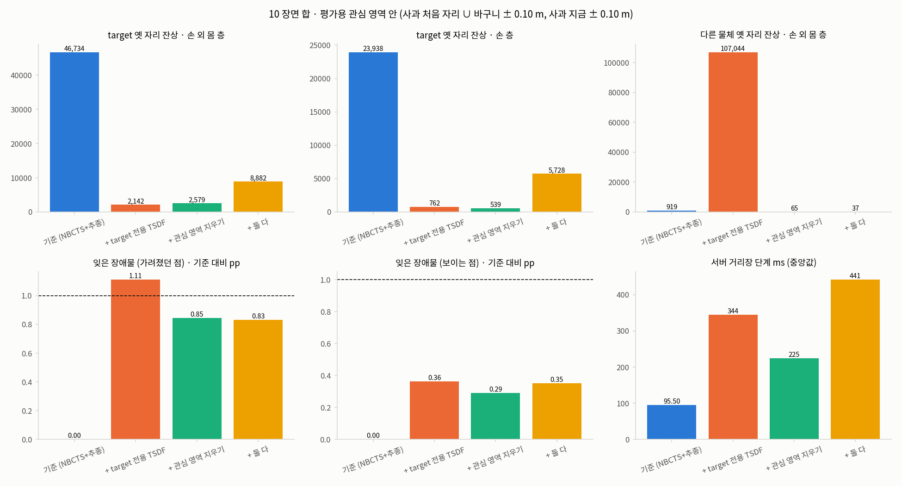 ([sidecar](figures/task-dynamic-map/task-dynamic-map-bars.json)) · 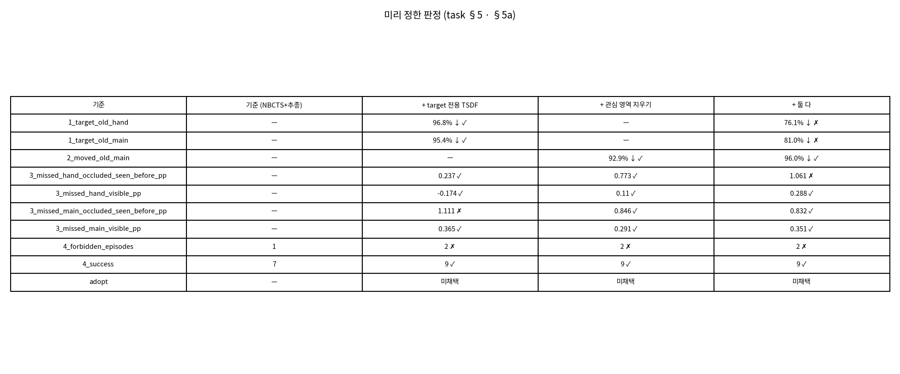 ([sidecar](figures/task-dynamic-map/task-dynamic-map-table.json)) · 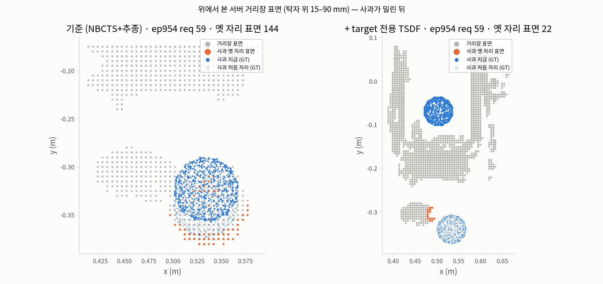 ([sidecar](figures/task-dynamic-map/task-dynamic-map-scene-ep954.json)). 보기 폴더 (git 제외): `outputs/2026-10-24_작업영역_동적거리장/` (장면별 영상 · 검증 결과).

**5.1 closed-loop** [V `closed_loop`; 성공 · 금지 접촉 episode]

| 구성 | 성공 / 10 | 금지 접촉 episode | 금지 접촉 없는 성공 | 금지 접촉이 난 episode (접촉 행 수) |
|---|---|---|---|---|
| 기준 구성 | 7 | 1 | 7 | 211 (이웃 과일 10 · 탁자 4) |
| target 전용 TSDF | 9 | 2 | 8 | 211 (이웃 과일 3), 954 (바구니 4) |
| 관심 영역 지우기 | 9 | 2 | 8 | 211 (탁자 3), 954 (이웃 과일 34) |
| 둘 다 | 9 | 2 | 8 | 250 (이웃 과일 13), 954 (이웃 과일 31) |

사실 [V `verdict.facts`]: 기준 구성은 954 · 1668 에서 사과를 잡지 못해 **놓기 단계에 가지 않았다**. 세 구성에서 늘어난 금지 접촉 episode (954) 는 놓기 단계에서 났다. 즉 기준 구성의 금지 접촉 1 은 "놓기 단계까지 간 episode 가 더 적은" 조건에서 센 값이다. (둘 다 구성의 211 은 성공이지만 기록이 place-stop 이 아닌 full 로 끝났다 — `n_place_stop` 8.)

**5.2 거리장 지표** [V `field`, `field_per_episode`]. 합은 10 episode 의 chunk 합이고, 구성마다 궤적이 갈라져 chunk 수 (main fine layer 440 / 385 / 352 / 397) 가 다르다.

| 지표 (평가용 관심 영역 안) | 기준 구성 | target 전용 TSDF | 관심 영역 지우기 | 둘 다 |
|---|---|---|---|---|
| target stale residue — main fine layer (voxel) | 46,734 | 2,142 | 2,579 | 8,882 |
| 〃 기준 대비 [D = 1 − 값/46,734] | — | −95.4 % | −94.5 % | −81.0 % |
| target stale residue — hand layer (voxel) | 23,938 | 762 | 539 | 5,728 |
| 〃 기준 대비 [D = 1 − 값/23,938] | — | −96.8 % | −97.7 % | −76.1 % |
| 움직인 다른 물체 stale residue — main fine layer (voxel) | 919 | 107,044 | 65 | 37 |
| forgotten obstacle, main, visible (%) | 0.794 | 1.159 | 1.085 | 1.145 |
| forgotten obstacle, main, occluded-seen-before (%) | 0.567 | 1.678 | 1.413 | 1.399 |
| forgotten obstacle, hand, visible (%) | 0.798 | 0.624 | 0.908 | 1.086 |
| forgotten obstacle, hand, occluded-seen-before (%) | 0.563 | 0.799 | 1.335 | 1.624 |

**5.3 판정 — 세 구성 모두 미채택** [V `judgement`, `verdict`]. 미리 정한 판정은 바뀌지 않았다.

| 구성 | 기준 1 (target residue −90 %) | 기준 2 (다른 물체 residue −50 %) | 기준 3 (forgotten obstacle +1 pp 이하) | 기준 4 (성공 ≥ 기준, 금지 접촉 ≤ 기준) | 판정 |
|---|---|---|---|---|---|
| target 전용 TSDF | 통과 (−95.4 % / −96.8 %) | 적용 안 됨 | **미달**: main · occluded-seen-before **+1.111 pp** (나머지 세 값 −0.174 ~ +0.365 pp) | 성공 9 ≥ 7 통과, 금지 접촉 episode **2 > 1 미달** | 미채택 |
| 관심 영역 지우기 | 적용 안 됨 | 통과 (−92.9 %: 919 → 65) | 통과 (최대 +0.846 pp, main · occluded-seen-before) | 성공 9 ≥ 7 통과, 금지 접촉 episode **2 > 1 미달** | 미채택 (기준 4 만 미달) |
| 둘 다 | **미달** (main −81.0 %, hand −76.1 %) | 통과 (−96.0 %: 919 → 37) | **미달**: hand · occluded-seen-before **+1.061 pp** (나머지 세 값 +0.288 ~ +0.832 pp) | 성공 9 ≥ 7 통과, 금지 접촉 episode **2 > 1 미달** | 미채택 (기준 1 · 3 · 4 미달) |

사용자 판정 (2026-10-24) [T task §6a]: "사과 잔상을 제외하고는 거의 다 아슬아슬 — 나쁘지 않다" → 권장 방향으로 진행: ① 954 이웃 과일 접촉 진단, ② 가려졌던 장애물 잊음 증가의 원인 (물체별), ③ 판정 기준을 미리 고정하고 표본을 늘려 재비교 (아래 §6).

**5.4 사실 (원인으로 읽지 않는다)** [V `verdict.facts`, `diagnosis_954_B_TL`]

- target 전용 TSDF 구성의 다른 물체 stale residue 107,044 는 **954 한 장면이 전부**다 (바구니가 27 mm 밀렸고, 10 mm 를 처음 넘은 request 는 49; 같은 장면에서 사과는 최대 386 mm 이동). 기준 구성은 954 에서 사과를 잡지 못했으므로 같은 상황이 만들어지지 않았다 (기준 구성의 값 919 는 다른 장면 합).
- 둘 다 구성의 target stale residue 8,882 중 **211 · 250 두 장면이 8,486**이다. 둘 다 재파지가 이어지며 manipulated 가 occluded 로 유지되고 중심 이동이 10 mm 미만이라 target TSDF reset 이 드물었다.
- 장면 그림의 두 panel (episode 954, request 59) 은 같은 request 번호지만 **궤적이 갈라져** 사과 위치가 다르다 (기준 구성: 처음 위치에서 16.6 mm, target 전용 TSDF 구성: 302.1 mm). 옛 자리 표면 voxel 144 → 22 는 같은 상태에서의 효과 비교가 아니라 이 장면의 그림이다. 효과의 판정은 5.2 의 10 장면 합으로 한다 [V `figures`, sidecar].

### 6. 진단 두 가지와 추가 실험 E2 (관심 영역 지우기, 18 장면)

진단은 코드를 고치지 않고 같은 기록으로 했다. 진단 결과는 E2 의 설계를 바꾸지 않았다 (task §8: 코드 · snapshot · kit · 서버 인자는 1차와 같다) [T task §8].

**6.1 진단 ① — episode 954 의 이웃 과일 접촉** [V `diag_954_neighbour_contact`]

| 항목 | 값 |
|---|---|
| 접촉 쌍 · chunk | `ee_finger_r2` ↔ banana (바나나), chunk 13–21 (사과를 쥐는 구간) |
| 접촉 행 수 | 관심 영역 지우기 구성 34, 둘 다 구성 31 (둘 다 닿았다) |
| 겹침 (관통) 최대 | 1.9 mm (관심 영역 지우기 구성) |
| server 설정 | `--neighbour-contact-mm 20` — 손가락이 이웃 장애물과 120 mm 안에서 최대 20 mm 겹치는 것을 허용 |
| 손 근처 (60 mm 안) 바나나 표면이 hand layer 에서 빠진 비율 | 기준 구성 0.00–0.03 (닫는 chunk 에서 0.14) · 관심 영역 지우기 0.08–0.21 · 둘 다 0.02–0.07 |

**6.2 진단 ② — forgotten obstacle 증가는 어느 물체에서 났는가** [V `diag_missed_by_body_every_3rd_chunk`, 3 chunk 마다 표본 · 분수는 [D = 놓친 표본 / 전체 표본, main fine layer]. 진단 대상 장면 범위는 `verify.json` 에 적혀 있지 않다. 18 장면 진단은 §7.3]

| 물체 | visible: 기준 구성 → 관심 영역 지우기 | occluded-seen-before: 기준 구성 → 관심 영역 지우기 |
|---|---|---|
| **놓을 곳 기둥 (obstacle, 반지름 15 mm)** | 196/30,964 = 0.63 % → 1,993/22,268 = **8.95 %** | 29/9,834 = 0.29 % → 1,493/7,419 = **20.12 %** |
| 바구니 (crate) | 11,989/1,035,547 = 1.16 % → 12,841/855,885 = 1.50 % | 2,256/372,098 = 0.61 % → 4,708/302,284 = 1.56 % |
| 바나나 | 1,832/32,451 = 5.65 % → 409/25,902 = 1.58 % | 970/11,685 = 8.30 % → 854/12,909 = 6.62 % |
| 배 | 8/14,143 = 0.06 % → 37/11,681 = 0.32 % | 23/11,647 = 0.20 % → 75/5,534 = 1.36 % |
| 오렌지 | 5/3,537 = 0.14 % → 12/3,270 = 0.37 % | 11/1,010 = 1.09 % → 11/928 = 1.19 % |
| 탁자 | 4/758,314 → 120/622,867 (0.00 % → 0.02 %) | 6/191,094 → 309/139,405 (0.00 % → 0.22 %) |

hand layer 의 놓을 곳 기둥도 같은 방향이다: visible 192/28,933 = 0.66 % → 1,692/18,796 = 9.00 %, occluded-seen-before 24/9,232 = 0.26 % → 983/6,115 = 16.08 % [D]. 바나나는 관심 영역 지우기에서 visible · occluded-seen-before 모두 줄었다 (잊음이 모든 물체에서 늘지는 않았다).

**6.3 추가 실험 E2 — 관심 영역 지우기 구성 하나만, 표본을 18 장면으로** (결과 전 고정, 2026-10-24 13:3x KST) [T task §8]

| 항목 | 내용 |
|---|---|
| 구성 | 기준 구성 · 관심 영역 지우기 구성 두 개만. 코드 · snapshot · kit · 서버 인자는 1차와 같다 |
| 장면 | IFG-APPLE 풀 24 장면 중 VLA 단독 성공 18 장면 **전부** = 1차 10 장면 + 새 8 장면 (1345, 1596, 121, 119, 325, 901, 572, 850; 901 · 572 · 850 은 놓을 곳 기둥). 새 8 장면만 돌리고 1차 10 장면 기록과 합쳤다 (16 episode 추가) |
| 판정 | 기준 2 (다른 물체 residue −50 %) · 3 (forgotten obstacle +1 pp 이하, 네 값) · 4 (성공 ≥ 기준, 금지 접촉 episode ≤ 기준). 넷 다 지키면 "관심 영역 지우기" 채택. target stale residue 는 기록만 (이 구성은 target 전용 TSDF 가 아니다). 1차의 미달 판정은 그대로 남는다 — E2 는 별도 판정이며 1차를 덮지 않는다 |

그림: 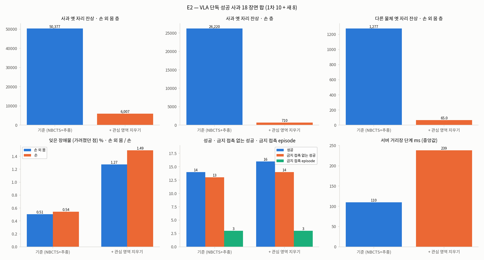 ([sidecar](figures/task-dynamic-map/task-dynamic-map-e2-bars.json)) · 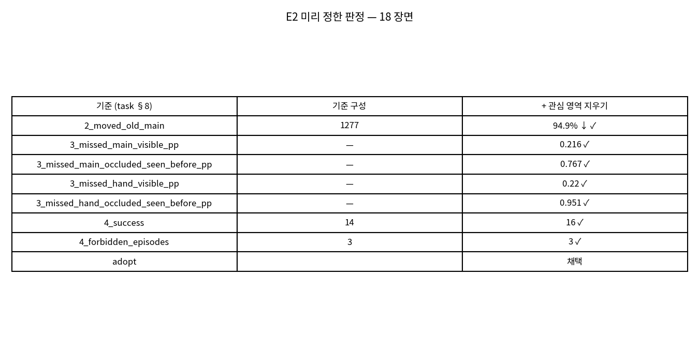 ([sidecar](figures/task-dynamic-map/task-dynamic-map-e2-table.json)). 보기 폴더: `outputs/2026-10-24_관심영역지우기_18장면/`.

**6.4 E2 결과 — 관심 영역 지우기 채택 (이 STEP 의 판정)** [V `e2_18_scenes`]

| 지표 (18 장면 합) | 기준 구성 | 관심 영역 지우기 | 변화 / 판정 |
|---|---|---|---|
| 성공 | 14 / 18 | 16 / 18 | 기준 4 통과 (16 ≥ 14) |
| 금지 접촉 episode | 3 | 3 | 기준 4 통과 (3 ≤ 3) |
| 금지 접촉 없는 성공 | 13 | 14 | — |
| 움직인 다른 물체 stale residue, main (voxel) | 1,277 | 65 | −94.9 % — 기준 2 통과 (≥ −50 %) |
| forgotten obstacle, main, visible (%) | 1.210 | 1.425 | +0.216 pp — 기준 3 통과 |
| forgotten obstacle, main, occluded-seen-before (%) | 0.506 | 1.274 | +0.767 pp — 기준 3 통과 |
| forgotten obstacle, hand, visible (%) | 1.253 | 1.473 | +0.220 pp — 기준 3 통과 |
| forgotten obstacle, hand, occluded-seen-before (%) | 0.544 | 1.495 | **+0.951 pp — 기준 3 통과 (한도 1 pp 에 가깝다)** |
| (기록만) target stale residue, main / hand (voxel) | 50,377 / 26,220 | 6,007 / 710 | [D = 1 − 6,007/50,377 = −88.1 % / 1 − 710/26,220 = −97.3 %] 이 구성은 target 용 판정 대상이 아니다 |
| 서버 거리장 단계 중앙값 (ms) · p95 | 109.7 · 265.09 | 238.51 · 597.44 | 비용 (판정에 넣지 않음) |

금지 접촉이 난 episode 는 두 구성 모두 3 개이지만 **같은 3 개가 아니다** [V `e2_18_scenes.closed_loop_runs`]:

| 구성 | 금지 접촉 episode (접촉 행 수) | 성공하지 못한 episode |
|---|---|---|
| 기준 구성 | 1345 (이웃 과일 27), 211 (이웃 과일 10 · 탁자 4), 850 (바구니 2) | 1668, 211, 850, 954 |
| 관심 영역 지우기 | 1345 (이웃 과일 19), 211 (탁자 3), 954 (이웃 과일 34) | 211, 850 |

954 는 기준 구성에서 사과를 잡지 못해 (접촉 행 0) 놓기 단계까지 가지 않았고, 관심 영역 지우기에서는 놓기까지 갔으나 6.1 의 바나나 접촉이 났다. 판정은 이 STEP 의 사전 기준 문자 그대로의 적용이고, 18 episode 규모이므로 우수성 주장은 하지 않는다 (task §5 기준 4).

### 7. 추가 실험 E3 — 가는 물체 가장자리 보존 (`--roi-carve-footprint`), 18 장면 (2026-10-24 KST)

**7.1 목적 → 변경 → 실험 설계 (결과 전 고정)** [T task §9]

| 항목 | 내용 |
|---|---|
| 목적 | E2 의 진단 ② 가 가리킨 곳을 고친다. 관심 영역 지우기에서 forgotten obstacle 이 늘어난 것이 놓을 곳 기둥 (반지름 15 mm) 에 몰렸다 (§6.2). 가설 [H]: 판정이 가장 가까운 pixel 하나로 이루어져 가는 물체의 가장자리 pixel 이 배경 depth 를 본다 |
| 변경 (flag, 기본 꺼짐) | `--roi-carve-footprint` (`esdf.roi_carve_footprint`, `--roi-carve` 와 함께만). 판정을 voxel 의 투영 영역 전체 pixel 로 바꾼다 (§3). 서버 기본값은 이 수정이 확인될 때까지 꺼짐 (사용자 2026-10-24 "수행하세요") |
| 합성 장면 측정 (가설 근거로만) | test `test_roi_carve_footprint_keeps_a_thin_post`: 30 mm 기둥을 depth 로 그릴 때 **pixel 중심 0.5 어긋남**이면 기존 판정이 기둥 옆면 표본의 10.7 % 를 1 frame 부터 잃고 영역 판정은 0 %. 정수 pixel 중심이면 둘 다 0 % [V `e3_18_scenes.synthetic_post_test.post_side_missing_frac`]. 실제 서버 depth 의 반 pixel 어긋남은 측정하지 않았다 [H]. 이것은 실제 rollout 결과가 아니라 구현 확인이다 |
| 실험 | 가장자리 보존 구성 (= 관심 영역 지우기 구성 + `--roi-carve-footprint`) 을 E2 와 **같은 18 장면 · 같은 policy seed** 로 돌린다 (18 episode 새로 실행). 기준 구성 · 관심 영역 지우기 구성은 E2 기록을 그대로 쓴다. 새 snapshot `snapshot_tdm2`, kit `verify/AG3S-TASK-DYNAMIC-MAP-E3/` |
| 이전 대비의 기준점 | 직전 구성 = 관심 영역 지우기 구성 (E2 에서 채택된 형태), 그 바탕 = 기준 구성. V11AB 와의 비교는 이 STEP 에서 하지 않는다 (§9 의 사유와 같다) |

**판정 (결과 전 고정)** [T task §9]. 아래 (a) · (b) 를 둘 다 지키면 관심 영역 지우기의 채택 형태를 가장자리 보존 구성으로 바꾸고 서버 기본값 켜기를 제안한다. (a) 만 지키면 관심 영역 지우기 구성을 유지한다.

| 판정 | 내용 | 비교 대상 |
|---|---|---|
| (a) | §4 의 기준 2 · 3 · 4 를 모두 지킨다 (다른 물체 stale residue −50 % 이상, forgotten obstacle +1 pp 이하 네 값, 성공 ≥ 기준 · 금지 접촉 episode ≤ 기준) | 기준 구성 |
| (b) | 놓을 곳 기둥의 잊은 표면 (main fine layer · occluded-seen-before, 3 chunk 마다 표본, `diag_missed_by_body.py`) 50 % 이상 감소 | 관심 영역 지우기 구성 |

비용 (서버 거리장 단계 ms) 은 기록만 한다.

**7.2 결과 — 판정** [V `e3_18_scenes.judgement`, `verdict.E3_B_ROI_FP`]

그림 (verifier 가 만든 것, 링크만 한다): 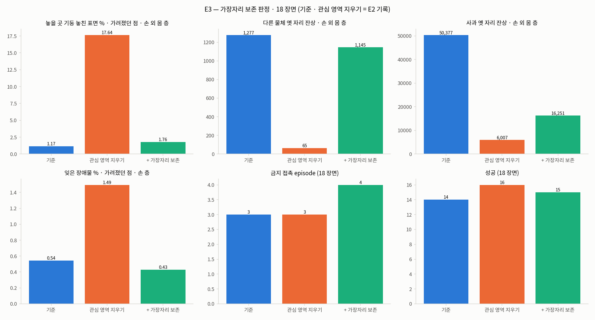 ([sidecar](figures/task-dynamic-map/task-dynamic-map-e3-bars.json)) · 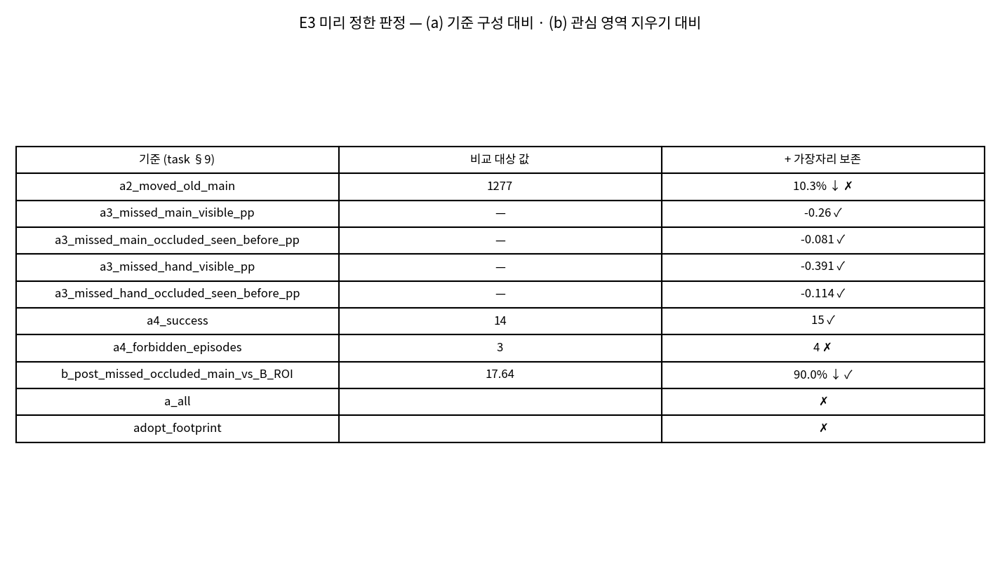 ([sidecar](figures/task-dynamic-map/task-dynamic-map-e3-table.json)). 막대 그림은 기준 구성 · 관심 영역 지우기 구성 · 가장자리 보존 구성을 나란히 놓는다 (기준 구성 · 관심 영역 지우기 구성은 E2 기록). 보기 폴더 (git 제외): `outputs/2026-10-24_가장자리보존_18장면/` (장면별 영상 · 검증 결과).

| 판정 항목 | 기준 | 기준 구성 / 관심 영역 지우기 구성 | 가장자리 보존 구성 | 통과 |
|---|---|---|---|---|
| (a) 기준 2 — 다른 물체 stale residue, main (voxel) | 기준 구성 대비 −50 % 이상 | 1,277 / 65 | **1,145 (−10.3 %)** | **미달** |
| (a) 기준 3 — forgotten obstacle main visible | 기준 구성 대비 +1 pp 이하 | 1.210 % | 0.950 % (−0.260 pp) | 통과 |
| (a) 기준 3 — main occluded-seen-before | 〃 | 0.506 % | 0.425 % (−0.081 pp) | 통과 |
| (a) 기준 3 — hand visible | 〃 | 1.253 % | 0.862 % (−0.391 pp) | 통과 |
| (a) 기준 3 — hand occluded-seen-before | 〃 | 0.544 % | 0.430 % (−0.114 pp) | 통과 |
| (a) 기준 4 — 성공 | 기준 구성 이상 | 14 / 16 | 15 | 통과 |
| (a) 기준 4 — 금지 접촉 episode | 기준 구성 이하 | 3 / 3 | **4** | **미달** |
| (b) 놓을 곳 기둥 놓친 표면, main · occluded-seen-before | 관심 영역 지우기 구성 대비 −50 % 이상 | 17.64 % | **1.764 % (−90.0 %)** | 통과 |
| 결과 | (a) · (b) 모두 | — | (a) 미달 | **가장자리 보존 미채택 — 관심 영역 지우기의 채택 형태는 E2 의 것을 유지** |

표의 forgotten obstacle 값은 `e3_18_scenes.field` 의 `missed_frac` (main visible 0.009499 · occluded 0.004252, hand 0.008624 · 0.004302) 이고, 기준 구성의 값은 `e2_18_scenes.field` 이다. pp 변화는 `judgement` 의 값이다. 그림 표의 행 이름은 아래와 같이 읽는다.

| 그림 표의 행 이름 | 뜻 |
|---|---|
| `a2_moved_old_main` | 위 (a) 기준 2 |
| `a3_missed_{main,hand}_{visible,occluded_seen_before}_pp` | 위 (a) 기준 3 의 네 값 |
| `a4_success` · `a4_forbidden_episodes` | 위 (a) 기준 4 |
| `b_post_missed_occluded_main_vs_B_ROI` | 위 (b) |
| `a_all` · `adopt_footprint` | (a) 전체 통과 여부 · 채택 여부 |

**7.3 (b) 의 상세 — 놓을 곳 기둥은 거의 기준 구성 수준으로 돌아왔다** [V `e3_18_scenes.diag18_missed_by_body`, 3 chunk 마다 표본; 값은 [D = 놓친 표본 / 전체 표본]]

| 층 · 상태 | 기준 구성 | 관심 영역 지우기 구성 | 가장자리 보존 구성 |
|---|---|---|---|
| main, 기둥, visible | 310/50,068 = 0.62 % | 4,264/39,704 = 10.74 % | 312/40,263 = 0.77 % |
| main, 기둥, occluded-seen-before | 175/14,984 = 1.17 % | 2,201/12,477 = **17.64 %** | 193/10,943 = **1.76 %** |
| hand, 기둥, visible | 257/44,877 = 0.57 % | 3,775/33,810 = 11.17 % | 208/33,031 = 0.63 % |
| hand, 기둥, occluded-seen-before | 101/13,373 = 0.76 % | 1,551/10,316 = 15.03 % | 100/8,356 = 1.20 % |

(b) 의 감소율 = 1 − 1.764/17.64 = 90.0 % [D, `judgement` 의 `reduction` 0.9 와 같다]. 이 18 장면 진단의 관심 영역 지우기 구성 값 (17.64 % 등) 은 §6.2 의 10 장면 값 (20.12 % 등) 과 표본이 달라 다르다. 가장자리 보존 구성의 기둥 occluded-seen-before 1.76 % 는 기준 구성의 1.17 % 보다 약간 높다 (main) — 기준 구성과 같아졌다고 쓰지 않는다.

**7.4 (a) 의 상세 — 옛 자리를 지우는 능력이 줄었고, 금지 접촉 episode 가 하나 늘었다**

(i) 다른 물체의 옛 자리 잔상 (기준 2). 관심 영역 지우기 구성은 1,277 → 65 였는데 가장자리 보존 구성은 1,145 이다 [V `field.B_ROI_FP.main.moved_old`, `judgement.a2_moved_old_main`]. 거의 기준 구성 수준으로 되돌아갔다. 이웃 물체가 실제로 옮겨진 두 장면에서의 값은 다음과 같다 [T task §9a — `verify.json` 의 `numbers` 에 장면별 값은 없다].

| 장면 | 기준 구성 | 관심 영역 지우기 구성 | 가장자리 보존 구성 |
|---|---|---|---|
| 1345 (옛 자리 잔상, voxel) | 358 | 0 | 327 |
| 1668 (옛 자리 잔상, voxel) | 857 | 0 | 783 |

즉 영역 판정이 기둥을 지우지 않게 된 만큼 **이웃 물체의 옛 자리도 지우지 않게 됐다.** 이유는 측정하지 않았다 — 가설 [H]: 영역 판정은 영역의 pixel 이 하나라도 로봇 mask 이면 지우지 않는데, 옮겨진 물체의 옛 자리는 손 근처라 영역에 robot mask pixel 이 들어가 판정이 보류된다. (두 번째 후보 [I]: 영역 반지름이 8 pixel 을 넘는 가까운 voxel 은 지우지 않는 규칙.) 두 가설 모두 측정하지 않았다.

(ii) 금지 접촉 episode (기준 4). 가장자리 보존 구성은 4 개로 기준 구성의 3 개보다 많다 [V `closed_loop.B_ROI_FP`, `judgement.a4_forbidden_episodes`].

| 구성 | 성공 / 18 | 금지 접촉 episode | 금지 접촉 episode (접촉 행 수) | 성공하지 못한 episode |
|---|---|---|---|---|
| 기준 구성 [V E2] | 14 | 3 | 1345 (이웃 과일 27), 211 (이웃 과일 10 · 탁자 4), 850 (바구니 2) | 1668, 211, 850, 954 |
| 관심 영역 지우기 [V E2] | 16 | 3 | 1345 (이웃 과일 19), 211 (탁자 3), 954 (이웃 과일 34) | 211, 850 |
| **가장자리 보존** [V E3] | **15** | **4** | 1345 (이웃 과일 27), 211 (탁자 5), 753 (탁자 78), 954 (이웃 과일 9) | 1668, 211, 954 |

가장자리 보존 구성의 집계는 금지 접촉 episode 의 그룹별 수가 이웃 과일 2 · 탁자 2, 접촉 행 수가 이웃 과일 36 · 탁자 83 이다 [V `closed_loop.B_ROI_FP.n_by_group`, `rows_by_group`]. **753 (탁자 접촉 78 행) 은 기준 구성 · 관심 영역 지우기 구성에서는 금지 접촉이 없던 episode 다 [D, `closed_loop_runs` 대조].** 그 접촉의 원인은 보지 않았다 (재측정 대기 5). 기준 4 의 성공 수는 통과다 (15 ≥ 14).

**7.5 기록만 하는 값**

| 값 | 기준 구성 | 관심 영역 지우기 | 가장자리 보존 | 출처 |
|---|---|---|---|---|
| target stale residue, main (voxel) | 50,377 | 6,007 | 16,251 | [V `e2_18_scenes.field`, `e3_18_scenes.field`] |
| target stale residue, hand (voxel) | 26,220 | 710 | 10,864 | 〃 |
| 서버 거리장 단계 중앙값 · p95 (ms), 요청 수 | 109.7 · 265.09, 736 | 238.51 · 597.44, 635 | 267.54 · 815.87, 704 | [V `closed_loop.*.esdf_ms`] |
| 중앙값 비 (가장자리 보존 / 기준 구성, / 관심 영역 지우기) | — | — | 2.44 배 · 1.12 배 | [D = 267.54/109.7, 267.54/238.51] |

target 의 옛 자리 잔상도 관심 영역 지우기 구성보다 많다 (6,007 → 16,251, 같은 구성의 hand layer 710 → 10,864). target 용 판정 대상은 아니다 (§6.3 과 같다). 가장자리 보존 구성의 target 잔상은 기준 구성 대비 main −67.7 %, hand −58.6 % [D = 1 − 16,251/50,377, 1 − 10,864/26,220] 이다.

**7.6 이전 대비 (before → after)**

| 변경 (flag, 기본 꺼짐) | 지표 | before (관심 영역 지우기 구성 → 기준 구성) | after (가장자리 보존) | 판정 |
|---|---|---|---|---|
| `--roi-carve-footprint` | 기둥 놓친 표면 main · occluded-seen-before | 17.64 % (기준 구성 1.17 %) | 1.76 % (−90.0 %) | (b) 통과 |
| 〃 | 다른 물체 stale residue main | 65 (기준 구성 1,277) | 1,145 | 기준 2 미달 (기준 구성 대비 −10.3 %) |
| 〃 | forgotten obstacle 네 값 | 기준 구성 대비 +0.216 ~ +0.951 pp | 기준 구성 대비 −0.081 ~ −0.391 pp | 기준 3 통과 |
| 〃 | 금지 접촉 episode · 성공 | 3 · 16 (기준 구성 3 · 14) | 4 · 15 | 기준 4: 금지 접촉 미달 · 성공 통과 |

**개선인가.** **아니다 — 한쪽을 고치면서 다른 쪽을 잃었다.** 가장자리 보존은 기둥을 잊는 문제 (진단 ② 가 가리킨 곳) 를 고쳤고 forgotten obstacle 네 값을 기준 구성보다 낮췄다. 그러나 이 STEP 의 원래 목적인 **옛 자리 잔상 지우기**가 거의 사라졌다 (65 → 1,145). 사전 고정 판정 (a) 의 기준 2 · 4 가 미달이므로 미채택이고, 관심 영역 지우기의 채택 형태는 E2 의 것을 유지한다. 판정은 18 episode · seed 1 개에서 사전 기준 문자 그대로의 적용이다. 금지 접촉 episode 3 → 4 는 한 episode 차이이고, 구성마다 궤적이 갈라져 접촉의 원인을 구성 변경으로 단정하지 않는다.

**7.7 사실 (원인으로 읽지 않는다)**

- 1345 · 1668 에서 관심 영역 지우기 구성의 옛 자리 잔상 0 · 0 이 가장자리 보존 구성에서 327 · 783 (기준 구성 358 · 857) 이 됐다 [T task §9a].
- 합성 장면의 0.5 pixel 중심 결과 (기존 판정 10.7 % 손실 → 영역 판정 0 %) 는 실제 rollout 에서의 기둥 −90 % 와 방향이 같다. 합성 결과가 실제 감소의 기전임을 보인 것은 아니다 (가설 근거로만).
- 금지 접촉 episode 의 구성 (211 탁자 · 753 탁자 78 행 · 954 바나나 · ~~1345 바나나~~ → 1345 이웃 과일 (오렌지, §13.6 에서 확인)) [V `closed_loop_runs`].

### 8. 추가 실험 E4 — 가장자리 보존 완화 (`--roi-carve-footprint-robot ignore`), 18 장면 (2026-10-24 KST, 기록 19:3x KST) — 채택, serving 기본값 켬

**8.1 목적 → 변경 → 실험 설계 (결과 전 고정)** [T task §10]

| 항목 | 내용 |
|---|---|
| 목적 | E3 (가장자리 보존) 는 기둥을 지켰지만 이웃 물체의 옛 자리까지 지우지 않게 됐다 (다른 물체 stale residue 65 → 1,145, §7.4). 기둥 보존은 유지하고 옛 자리 지우기를 되돌린다 |
| 변경 (flag, 기본 꺼짐) | **(1) `--roi-carve-footprint-robot ignore`** — 투영 영역 안의 robot mask pixel 을 "판정 보류" 사유에서 뺀다. 단, **가장 가까운 pixel 자체는 robot 이 아니어야 하고 voxel 보다 margin 넘게 뒤를 봐야 한다** (손이 voxel 을 직접 가린 자리는 여전히 지우지 않는다). **(2) `--roi-carve-footprint-pad-px 0`** — 영역 반지름을 `ceil(0.5 · f · voxel / z)` pixel 로 둔다 (E3 는 `+1`). 둘 다 `--roi-carve-footprint` 와 함께만 쓴다 |
| 합성 장면 (구현 확인, rollout 결과 아님) | 30 mm 기둥 옆면 표본 손실: 기존 판정 10.7 % → 완화 0.0 % (0.5 pixel 중심). 치운 이웃 상자의 옛 윗면 거리 (`removed_neighbour_top_distance_mm`, 값이 클수록 옛 윗면이 거리장에서 멀어짐으로 읽음 [I]): 기존 TSDF 4.0 · 관심 영역 지우기 37.0 · 가장자리 보존 30.1 · **완화 32.5 mm** [V `e4_18_scenes.synthetic`]. 합성 장면에는 로봇이 없어 E3 의 "robot mask 가 판정을 보류한다" 가설은 이 test 로 확인되지 않는다 — closed-loop 에서만 본다 [T task §10] |
| 실험 | **가장자리 보존 완화 구성** (= 관심 영역 지우기 구성 + 위 세 flag: `--roi-carve-footprint --roi-carve-footprint-pad-px 0 --roi-carve-footprint-robot ignore`) 을 E2 · E3 와 **같은 18 장면 · 같은 policy seed** 로 18 episode 새로 실행. 기준 구성 · 관심 영역 지우기 구성은 E2 기록, 가장자리 보존 구성은 E3 기록을 그대로 쓴다. run `20261024T034606+0900_8da37119afd3_31d9b16e3c97`, snapshot `snapshot_tdm3`, kit `verify/AG3S-TASK-DYNAMIC-MAP-E4/` [V `e4_18_scenes.snapshot`, `kit`] |
| 이전 대비의 기준점 | 직전 구성 = 가장자리 보존 구성 (E3, 미채택), 채택 형태 = 관심 영역 지우기 구성 (E2), 바탕 = 기준 구성. V11AB 와의 비교는 이 STEP 에서 하지 않는다 (§9 의 사유) |

**판정 (결과 전 고정, §7.1 과 같은 정의 · 같은 한도)** [T task §10]. (a) 기준 구성 대비 기준 2 · 3 · 4 모두, (b) 관심 영역 지우기 구성 대비 놓을 곳 기둥의 놓친 표면 (main fine layer · occluded-seen-before) 50 % 이상 감소. (a) · (b) 모두 통과하면 채택 형태를 가장자리 보존 완화 구성으로 바꾸고 서버 기본값을 켠다. 켜기 전에 핵심 평가 세션에 영향을 알린다. 그 밖이면 서버 기본값 꺼짐 유지. 비용은 기록만 한다.

**8.2 결과 — 판정** [V `e4_18_scenes.judgement`, `verdict.E4_B_ROI_FPR`]

그림 (verifier 가 만든 것, 링크만 한다): 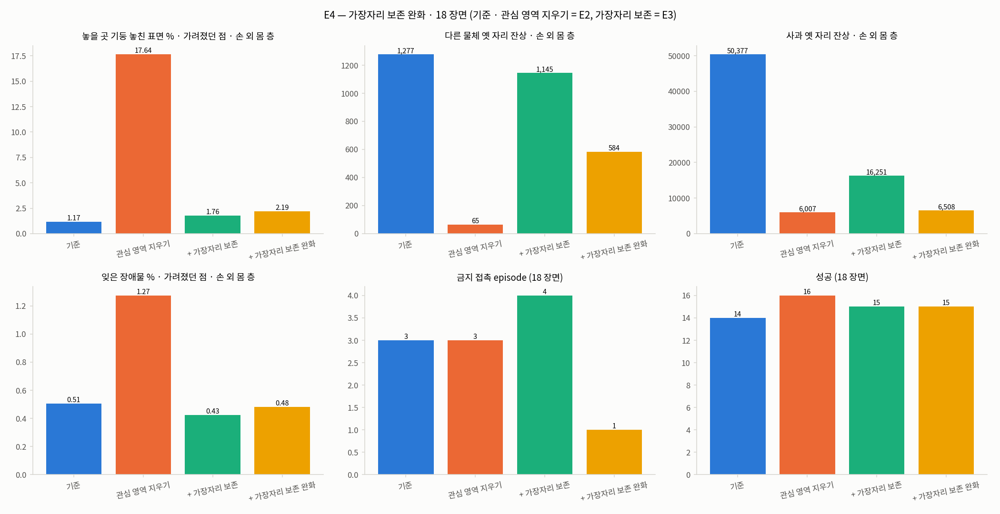 ([sidecar](figures/task-dynamic-map/task-dynamic-map-e4-bars.json)) · 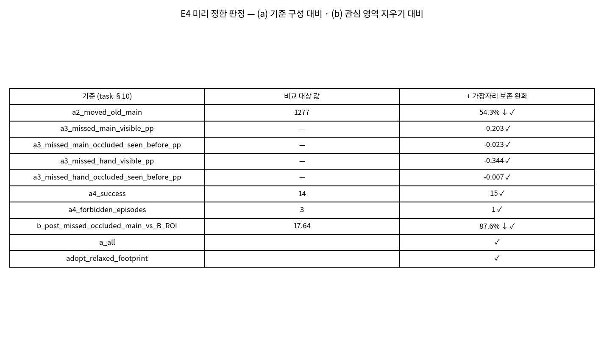 ([sidecar](figures/task-dynamic-map/task-dynamic-map-e4-table.json)). 보기 폴더 (git 제외): `outputs/2026-10-24_가장자리보존완화_18장면/` (장면별 영상 · 검증 결과).

| 판정 항목 | 기준 | 기준 구성 | 완화 구성 | 통과 |
|---|---|---|---|---|
| (a) 기준 2 — 다른 물체 stale residue, main (voxel) | 기준 구성 대비 −50 % 이상 | 1,277 | **584 (−54.3 %)** | 통과 (한도에 가깝다) |
| (a) 기준 3 — forgotten obstacle main visible | 기준 구성 대비 +1 pp 이하 | 1.210 % | 1.007 % (−0.203 pp) | 통과 |
| (a) 기준 3 — main occluded-seen-before | 〃 | 0.506 % | 0.483 % (−0.023 pp) | 통과 |
| (a) 기준 3 — hand visible | 〃 | 1.253 % | 0.909 % (−0.344 pp) | 통과 |
| (a) 기준 3 — hand occluded-seen-before | 〃 | 0.544 % | 0.537 % (−0.007 pp) | 통과 |
| (a) 기준 4 — 성공 | 기준 구성 이상 | 14 | 15 | 통과 |
| (a) 기준 4 — 금지 접촉 episode | 기준 구성 이하 | 3 | **1** | 통과 |
| (b) 놓을 곳 기둥 놓친 표면, main · occluded-seen-before | 관심 영역 지우기 구성 대비 −50 % 이상 | (관심 영역 지우기) 17.64 % | **2.189 % (−87.6 %)** | 통과 |
| 결과 | (a) · (b) 모두 | — | — | **채택** |

forgotten obstacle 값은 `e4_18_scenes.field` 의 `missed_frac` (main visible 0.010065 · occluded 0.004834, hand 0.009089 · 0.005374), 기준 구성 값은 `e2_18_scenes.field` 이고 pp 변화는 `judgement` 의 값이다. (b) 의 감소율 = 1 − 2.189/17.64 = 87.6 % [D, `judgement` 의 `reduction` 0.8759 와 같다].

**8.3 네 구성 비교 — 기준 / 관심 영역 지우기 / 가장자리 보존 / 완화 (18 장면, before → after)**

| 지표 | 기준 구성 [E2] | 관심 영역 지우기 [E2] | 가장자리 보존 [E3] | **가장자리 보존 완화 [E4]** |
|---|---|---|---|---|
| 성공 / 18 | 14 | 16 | 15 | 15 |
| 금지 접촉 episode | 3 | 3 | 4 | **1** |
| 금지 접촉 없는 성공 | 13 | 14 | 13 | 14 |
| 다른 물체 stale residue, main (voxel) | 1,277 | 65 | 1,145 | **584** |
| 〃 hand layer (voxel) | 926 | 2 | 870 | 85 |
| forgotten obstacle main visible / occluded-seen-before (%) | 1.210 / 0.506 | 1.425 / 1.274 | 0.950 / 0.425 | 1.007 / 0.483 |
| forgotten obstacle hand visible / occluded-seen-before (%) | 1.253 / 0.544 | 1.473 / 1.495 | 0.862 / 0.430 | 0.909 / 0.537 |
| 기둥 놓친 표면 main visible / occluded-seen-before (%) | 0.62 / 1.17 | 10.74 / 17.64 | 0.77 / 1.76 | 1.13 / **2.19** |
| 기둥 놓친 표면 hand visible / occluded-seen-before (%) | 0.57 / 0.76 | 11.17 / 15.03 | 0.63 / 1.20 | 0.84 / 1.44 |
| target stale residue main / hand (voxel) | 50,377 / 26,220 | 6,007 / 710 | 16,251 / 10,864 | 6,508 / 2,298 |
| 서버 거리장 단계 중앙값 · p95 (ms), 요청 수 | 109.7 · 265.09, 736 | 238.51 · 597.44, 635 | 267.54 · 815.87, 704 | **303.19 · 885.3, 683** |

출처 [V]: 완화 열 = `e4_18_scenes.closed_loop.B_ROI_FPR` · `field.B_ROI_FPR` · `diag18_missed_by_body_B_ROI_FPR.{main,hand}.obstacle` (놓친 / 전체 표본: main visible 569/50,279 · occluded 326/14,890, hand visible 365/43,341 · occluded 182/12,630 → [D] 1.13 · 2.19 · 0.84 · 1.44 %). 기준 · 관심 영역 지우기 · 가장자리 보존 열 = `e2_18_scenes.*` · `e3_18_scenes.*` (기둥 값은 `e3_18_scenes.diag18_missed_by_body`, §7.3 과 같다). 기준 구성의 hand layer 926 · 관심 영역 지우기 2 · 가장자리 보존 870 은 `field.*.hand.moved_old`.

읽는 법 (사실만).

- 다른 물체 옛 자리 잔상은 가장자리 보존 1,145 → 완화 584 (절반)로 줄었지만, **관심 영역 지우기의 65 만큼은 지우지 못한다** (584 는 65 의 약 9 배 [D = 584/65]). 기준 2 의 한도 −50 % 에 −54.3 % 로 통과했다 — 여유가 3.4 pp 다.
- 기둥은 가장자리 보존 때보다 약간 더 놓친다 (main occluded-seen-before 1.76 → 2.19 %, 기준 구성 1.17 %). 기준 구성과 같아졌다고 쓰지 않는다.
- 금지 접촉 episode 는 4 → 1 이다. 남은 1 개는 1345 의 이웃 과일 ~~(바나나)~~ → **(오렌지; 왼손 몸체 mesh 와의 접촉, §13.6)** 27 row 로, 기준 구성 · 가장자리 보존에서도 같은 장면에서 27 row 였다 [V `closed_loop_runs`; E2 의 관심 영역 지우기는 19 row]. E3 의 753 탁자 접촉 (78 row) 은 완화에서 0 row 다. 접촉이 없어진 **원인은 보지 않았다** (구성마다 궤적이 갈라진다).
- 실패한 episode 는 211 · 850 · 954 로 3 개 (성공 15) [V `closed_loop_runs`].
- 사과 (target) 옛 자리 잔상은 기준 구성 대비 main −87.1 % (50,377 → 6,508), hand −91.2 % (26,220 → 2,298) [D]. 이 구성은 target 용 판정 대상이 아니다 (§6.3 과 같다).

**8.4 서버 거리장 단계 비용 — 기준 구성보다 늘었다** [V `closed_loop.B_ROI_FPR.esdf_ms`, 같은 파일 `e2_18_scenes`]

| 구성 | 요청 수 | 중앙값 (ms) | p95 (ms) | 기준 구성 대비 중앙값 [D] |
|---|---|---|---|---|
| 기준 구성 | 736 | 109.7 | 265.09 | — |
| 관심 영역 지우기 | 635 | 238.51 | 597.44 | 2.17 배 |
| 가장자리 보존 | 704 | 267.54 | 815.87 | 2.44 배 |
| **가장자리 보존 완화** | 683 | **303.19** | **885.3** | **2.76 배** (+193.49 ms) |

완화 구성은 가장자리 보존 대비 중앙값 1.13 배, 관심 영역 지우기 대비 1.27 배, p95 는 기준 구성 대비 3.34 배 [D]. 판정에 넣지 않았지만 **serving 기본값으로 켜면 모든 요청이 이 비용을 낸다.** ~~늘어난 시간이 어느 단계 (투영 영역 판정 · 반경 · robot 처리) 에서 나는지는 측정하지 않았다.~~ → **측정했다 (§13.4): 늘어난 시간은 관심 영역 지우기 자체이고 (거리장 단계에서 그것을 뺀 값은 기준 구성과 같은 크기), 그 안에서는 영역 최솟값 filter 가 가장 크다. 이 비용은 `--roi-carve-device cuda` 로 줄였다 (§13.5, serving 기본).**

**8.5 이전 대비 (before → after)**

| 변경 (flag, 기본 꺼짐) | 지표 | before (가장자리 보존 [E3] → 관심 영역 지우기 [E2] → 기준 구성) | after (완화 [E4]) | 판정 |
|---|---|---|---|---|
| `--roi-carve-footprint-robot ignore` + `--roi-carve-footprint-pad-px 0` | 다른 물체 stale residue main | 1,145 → 65 → 1,277 | 584 (기준 구성 대비 −54.3 %) | 기준 2 통과 |
| 〃 | 금지 접촉 episode · 성공 | 4 · 15 → 3 · 16 → 3 · 14 | 1 · 15 | 기준 4 통과 |
| 〃 | forgotten obstacle 네 값 (기준 구성 대비) | −0.081 ~ −0.391 pp [E3] | −0.007 ~ −0.344 pp | 기준 3 통과 |
| 〃 | 기둥 놓친 표면 main occluded-seen-before | 1.76 % → 17.64 % → 1.17 % | 2.19 % (관심 영역 지우기 대비 −87.6 %) | (b) 통과 |

**개선인가.** **사전 고정 기준으로는 그렇다 — 가장자리 보존 (E3) 이 잃은 옛 자리 지우기를 절반 되돌렸고 (1,145 → 584), 기둥 보존은 거의 유지했으며 (1.76 → 2.19 %), 금지 접촉 episode 는 4 → 1 이 됐다.** 다만 (i) 옛 자리 지우기는 관심 영역 지우기의 65 에 비하면 9 배 남아 있고, (ii) 기준 2 는 한도 근처 (−54.3 %) 이며, (iii) 서버 거리장 단계 중앙값은 기준 구성의 2.76 배다. 판정은 18 episode · seed 1 개에서 사전 기준 문자 그대로의 적용이므로 우수성 주장은 하지 않는다. 금지 접촉 4 → 1 도 episode 수 차이일 뿐이고 구성마다 궤적이 갈라진다.

**8.6 기전 — 가설일 뿐, 분리하지 않았다**

가장자리 보존 → 완화에서 옛 자리 잔상이 줄어든 것 (1,145 → 584) 은 E3 의 가설 [H] ("영역 안 robot mask pixel 이 판정을 보류한다") 와 같은 방향이다. 그러나 **robot 처리와 영역 반지름 두 가지를 한꺼번에 바꿨으므로 어느 쪽 효과인지 분리하지 않았다**, 합성 장면에는 로봇이 없어 가설을 직접 시험하지 못했다 (§8.1). 1345 · 1668 의 장면별 옛 자리 잔상은 `verify.json` 의 `numbers` 에 없다 → 재측정 대기 2.

**8.7 serving 기본값을 켰다 (2026-10-24)** [V `e4_18_scenes.serving_default`, T task §10a; 상수 `serve_safe.ROI_CARVE_SERVING_DEFAULT`, `AG3S/trajopt/serve_safe.py:982` 를 읽어 확인 — 이 로그 작성 중 코드를 실행하지는 않았다]

| 항목 | 내용 |
|---|---|
| 언제 켜지나 | `--esdf-backend curobo` 로 AG3S 를 띄우고, 관심 영역 flag (`--roi-carve` 류) 를 **하나도 주지 않으면** `--roi-carve --roi-carve-footprint --roi-carve-footprint-pad-px 0 --roi-carve-footprint-robot ignore` 와 같다 |
| 이전 설정으로 | `--no-roi-carve` — 이전 esdf 설정 (관심 영역 지우기 없음) |
| 바뀌지 않는 것 | `--no-safe` · `--no-perception` · legacy backend 는 이전 의미 그대로. 관심 영역 flag 를 하나라도 직접 주면 그 값 그대로 (기본값을 덧씌우지 않는다). **`EsdfConfig` 의 코드 기본값은 꺼짐 유지** — 켜진 것은 serving 의 flag 해석뿐이다 |
| 확인하는 법 | 서버 시작 로그의 `AG3S roi_carve: …` 한 줄 |
| **(2026-10-25 추가) 판정 장치** | 위 기본값은 이제 `roi_carve_device: cuda` 도 포함한다 (GPU 판정, §13 의 G1–G3 통과 후). 되돌리기는 `--roi-carve-device cpu`. 코드 기본값 `EsdfConfig.roi_carve_device` 는 `cpu` 유지. 이 18 장면 판정 (E4) 자체는 CPU 판정으로 한 측정이고, GPU 판정이 같은 voxel 을 지우는지는 §13 에서 따로 확인했다 |
| 알림 | 켜기 전에 핵심 평가 세션 (`ag3s-vla-development-c4`) 에 알렸다. 그 세션의 kit 은 snapshot 이라 영향이 없고, checkout 에서 새로 띄우는 실행은 바뀐다. 그 세션은 checkout 에서 kit 을 새로 만들 때 `--no-roi-carve` 를 manifest 에 명시한다고 답했다 [T task §10a] |
| 주의 | 2026-10-24 이전의 기록 · 실행 (`AG3S_T47_LOG.md` 의 STEP 포함) 은 모두 꺼짐 상태의 측정이다. 이후 flag 없이 띄운 서버의 기록을 이전 기록과 비교할 때는 시작 로그를 먼저 본다. 켠 것의 근거는 이 절의 18 장면 · seed 1 개 판정이다 (§8.5 의 한계) |

**8.8 사실 · 가설 구분**

- 사실 [V]: §8.2–§8.4 의 표 값. 판정 (a) · (b) 통과. serving 기본값은 켜졌다.
- 가설 [H]: 옛 자리 잔상 감소의 기전 (robot mask 판정 보류 제거 · 영역 반지름 축소 중 어느 것인가), 753 탁자 접촉이 사라진 이유, ~~1345 바나나 27 row 의 원인~~ → 1345 의 왼손 몸체 ↔ 오렌지 27 row 의 원인 (접촉 쌍 · 거리장 상태는 §13.6 에서 측정, 원인 분리는 안 됨).
- 측정하지 않은 것: 완화가 **손에 가려진 이웃 과일** (기둥이 아닌 물체) 을 더 잊는지 — (b) 는 기둥만 본다. 바구니 · 바나나 등 물체별 놓친 표면은 `diag18_missed_by_body_B_ROI_FPR` 에 있으나 이 로그에서 판정에 쓰지 않았다.

### 9. 이전 대비 (before → after) 와 기준점 — 1차 · E2

기준점: **직전 구성 = 기준 구성** (같은 run · 같은 장면 · 같은 seed 에서 함께 돌렸다). V11AB (benchmark 의 기준 모델) 와의 비교는 이 STEP 에서 하지 않았다 — 장면이 사과 VLA 단독 성공 풀이고 평가는 서버 거리장 · GT 비교라서 V11AB 의 benchmark 지표로 읽을 수 없다. E3 의 이전 대비는 §7.6, E4 는 §8.5.

| 변경 (flag, 기본 꺼짐) | 지표 | before (기준 구성) | after | 판정 |
|---|---|---|---|---|
| target 전용 TSDF (10 장면) | target stale residue main / hand | 46,734 / 23,938 | 2,142 / 762 | 기준 1 통과 |
| 〃 | forgotten obstacle main occluded-seen-before | 0.567 % | 1.678 % (+1.111 pp) | 기준 3 미달 |
| 〃 | 금지 접촉 episode | 1 | 2 | 기준 4 미달 |
| 관심 영역 지우기 (10 장면) | 다른 물체 stale residue main | 919 | 65 | 기준 2 통과 |
| 〃 | 금지 접촉 episode | 1 | 2 | 기준 4 미달 |
| 둘 다 (10 장면) | target stale residue main / hand | 46,734 / 23,938 | 8,882 / 5,728 | 기준 1 미달 (−81.0 % / −76.1 %) |
| 관심 영역 지우기 (18 장면) | 다른 물체 stale residue main | 1,277 | 65 | 기준 2 통과 |
| 〃 | forgotten obstacle hand occluded-seen-before | 0.544 % | 1.495 % (+0.951 pp) | 기준 3 통과 (한도 근처) |
| 〃 | 성공 · 금지 접촉 episode | 14 · 3 | 16 · 3 | 기준 4 통과 |

**개선인가 (1차 · E2).** 관심 영역 지우기는 stale residue 를 크게 줄였고 (다른 물체 −94.9 %) 사전 기준 네 개를 모두 통과했다. 그러나 forgotten obstacle 은 모든 층 · 상태에서 늘었다 (+0.216 ~ +0.951 pp). target 전용 TSDF 는 target stale residue 를 줄였지만 (−95 % 대) 다른 물체 residue · forgotten obstacle · 금지 접촉에서 기준을 못 지켰고, 두 flag 를 함께 쓰면 target stale residue 감소가 −81 % / −76 % 로 줄었다. §10 의 원인은 그 증상이 어느 구성 요소에서 났는지의 표다.

### 10. 실패 · 한계 정리 — 구성 요소별 (증상 위치 ≠ 원인 위치일 때 둘 다)

구성 요소: ATS (Attention-based Target Segmentation, attention 으로 target 분할 · 추적) · HSR (Hidden-state Sub-task Recognition, 작업 단계 · 쥠 판단) · LTE (Link-specific Target Exemption, link 별 target 제외 거리장) · CCR (Constrained Chunk Refinement, TrajOpt 궤적 수정 · HOLD).

| 증상 | 증상 위치 | 원인 위치 | 근거 · 상태 |
|---|---|---|---|
| 954 에서 손가락이 바나나에 닿음 (겹침 최대 1.9 mm, chunk 13–21) | 실행 접촉 (MuJoCo replay) | **LTE + CCR** — 손 근처 바나나 표면의 hand layer 누락이 기준 구성 0–3 % 에서 관심 영역 지우기 8–21 % (LTE 의 hand layer 입력), server 에는 `--neighbour-contact-mm 20` (이웃 장애물과 최대 20 mm 겹침 허용) 설정이 있고 관측된 겹침 최대 1.9 mm 는 그 안이다 (CCR 설정). 둘 다 구성 (2–7 %) 도 닿았다 | [V `diag_954_neighbour_contact`] 사용자 지시의 층 분류. 바나나 표면이 hand layer 에서 빠지는 **기전은 측정하지 않았다** |
| 관심 영역 지우기에서 forgotten obstacle 증가 | 거리장 (main fine layer · hand layer) | **LTE** — 놓을 곳 기둥 (반지름 15 mm) 에 몰림: main occluded-seen-before 0.29 % → 20.12 %, visible 0.63 % → 8.95 % (10 장면), 18 장면 진단에서 1.17 % → 17.64 % (occluded-seen-before) | [V `diag_missed_by_body_every_3rd_chunk`, `e3_18_scenes.diag18_missed_by_body`], task §8a. E3 의 가장자리 보존이 이 증상을 −90 % 로 줄였다 (§7). 기전은 가설 [H]: 가장 가까운 pixel 하나로 판정해 물체 가장자리 pixel 이 배경 depth 를 본다 (직접 측정 안 함) |
| 가장자리 보존에서 이웃 물체의 옛 자리 잔상이 남음 (1345 · 1668, 다른 물체 residue 65 → 1,145) | 거리장 (main fine layer) | **LTE** (거리장 층 입력의 지우기 판정) — 영역 판정이 지우기를 보류한 것 | [V `judgement.a2_moved_old_main`], [T task §9a]. 기전은 가설 [H]: 영역 안 robot mask pixel 이 판정을 보류한다 (측정 안 함). **E4 완화 (§8) 에서 18 장면 합 1,145 → 584 로 줄었다 (장면별 값 없음, 두 변경을 분리하지 않음, 관심 영역 지우기의 65 에는 못 미침)** |
| 가장자리 보존에서 753 탁자 접촉 (78 행) | 실행 접촉 (MuJoCo replay) | **미확인** — 기준 · 관심 영역 지우기 구성의 753 에는 접촉이 없었다. E4 완화의 753 은 0 행 | [V `e3_18_scenes.closed_loop_runs`, `e4_18_scenes.closed_loop_runs`]. 원인 · 층을 보지 않았다 |
| ~~E4 완화에서도 1345 에 이웃 과일 (바나나) 접촉 27 행~~ → **E4 완화에서도 1345 에 왼손 몸체 mesh (geom 1052, EE_BODY_L) ↔ 오렌지 접촉 27 행 (바나나 아님, 손가락 아님)** | 실행 접촉 (MuJoCo replay) | ~~미확인~~ → ~~**로봇 구 모델의 범위 + CCR 의 이웃 접촉 허용 설정 — 둘 다 있고 분리하지 않았다** (반사실 실행 없음).~~ → **CCR 의 제약 기하 (로봇 구 모델이 손바닥 mesh 를 덮지 못함) — §14 에서 분리: 이웃 접촉 허용만 끄면 접촉이 남고 (40 row), 손바닥 구를 URDF 굵기로 하면 접촉이 없다 (단, 쥐기를 잃음). 허용은 단독 원인이 아니다. 1 장면 · 조건마다 1 episode.** LTE (거리장) 는 측정 범위에서 원인이 아니다: 오렌지는 거리장에 있다. 접촉 부위가 기록된 어떤 구에서도 9–25 mm 밖이고, 허용이 켜진 요청에서 finger_l1 의 계획 clearance 가 음수였다. VLA 단독 · 모든 구성에서도 같은 쌍 | [V `R4_ep1345_neighbour_contact`] (§13.6). 기준 구성 · 가장자리 보존 27 행, 관심 영역 지우기 19 행 (`e4_18_scenes`, `e2_18_scenes`, `e3_18_scenes`). 원인 분리: [V `AG3S-NBC-1345.verify.json` `results`] (§14) |
| 손바닥 구를 URDF 굵기로 하면 (허용 유지 · 끔 모두) 오렌지 접촉은 0 row 이나 사과를 쥐지 못함 (no_grasp, 닫기 7 · 5 회, 600 step 한계까지) | 실행 (쥐기 단계) | **미확인** — 가설 [H]: URDF 굵기 구가 손바닥 mesh 를 과하게 덮어 (요청 13 에서 손바닥 구가 사과에서 0.55 mm) 사과에 다가가는 것을 막는다. 구성 요소로는 CCR 의 제약 기하 후보이나 직접 확인하지 않았다 | [V `AG3S-NBC-1345.verify.json` `results`, `scene_request13`], §14.6 · §14.7 |
| 완화에서 관심 영역 지우기보다 옛 자리가 더 남음 (다른 물체 residue 65 → 584) | 거리장 (main fine layer) | **LTE** (영역 판정) — 완화가 "손이 직접 가린 자리는 지우지 않는다" 를 유지하므로 일부가 남는 것은 설계 범위일 수 있다 [H] | [V `e4_18_scenes.judgement`]. 기전 측정 안 함 |
| 둘 다 구성에서 target stale residue 가 −81 % / −76 % 에 그침 (211 · 250 이 8,486 / 8,882) | 거리장 (target 전용 TSDF 층 합성 입력) | target TSDF 의 이동 감지 reset 규칙 (이번 STEP 의 새 구성 요소) — 재파지로 manipulated 가 occluded 로 유지되고 중심 이동이 10 mm 미만이라 reset 이 드물었다. manipulated 점은 ATS 가 만든다 | [V `verdict.facts`]. 분류 중 ATS 부분은 기록자 정리 [I]. 정적 TSDF 로 새어 든 사과 pixel 의 기전 (가설 [H]: 가려진 동안 추종 형상과 실제 사과가 어긋나 pixel 배정 누락) 은 측정 안 함 |
| target 전용 TSDF 구성에서 다른 물체 stale residue 107,044 | 거리장 (main fine layer) | 이 구성은 사과만 별도 층으로 다룬다 — 바구니가 밀린 옛 자리는 지우는 장치가 없다 (954 의 바구니 27 mm 이동, request 49). 바구니 접촉 4 행이 이 구성의 954 에서 났다 (바구니 27 mm 이동과 같은 장면이고, 접촉이 이동의 원인인지는 따로 보지 않았다) | [V `diagnosis_954_B_TL`, `verdict.facts`]. 한 장면이 전부이므로 일반화하지 않는다 |
| 기준 구성이 954 · 1668 에서 사과를 잡지 못함 | 실행 (놓기 단계 미도달) | 이 STEP 이 조사하지 않았다 | [V `verdict.facts`]. 이 때문에 구성 간 금지 접촉 episode 수가 같은 단계에서 센 값이 아니다 |

### 11. 비용

서버 거리장 단계 (`profile_ms.esdf`) 중앙값 · p95 [V `closed_loop.*.esdf_ms`, `e2_18_scenes.closed_loop.*.esdf_ms`, `e3_18_scenes.closed_loop.B_ROI_FP.esdf_ms`]:

| 구성 | 요청 수 | 중앙값 (ms) | p95 (ms) |
|---|---|---|---|
| (10 장면) 기준 구성 | 440 | 95.5 | 261.94 |
| (10 장면) target 전용 TSDF | 385 | 344.14 | 571.26 |
| (10 장면) 관심 영역 지우기 | 352 | 224.89 | 601.96 |
| (10 장면) 둘 다 | 397 | 441.4 | 779.78 |
| (18 장면) 기준 구성 | 736 | 109.7 | 265.09 |
| (18 장면) 관심 영역 지우기 | 635 | 238.51 | 597.44 |
| (18 장면, E3) 가장자리 보존 | 704 | 267.54 | 815.87 |
| **(18 장면, E4) 가장자리 보존 완화 (serving 기본값)** | 683 | **303.19** | **885.3** |

E2 의 중앙값 비는 238.51 / 109.7 = 2.17 배, 가장자리 보존은 267.54 / 109.7 = 2.44 배, **E4 완화는 303.19 / 109.7 = 2.76 배 (+193.49 ms), p95 는 885.3 / 265.09 = 3.34 배 [D, `e4_18_scenes.closed_loop.B_ROI_FPR.esdf_ms`]. 기준 구성보다 늘었고, serving 기본값이 켜져 모든 요청이 낸다 (§8.4).** smoke (둘 다 구성, episode 56 1 개) 에서 기록된 `target_layer.ms` 중앙값 280.8 ms · `roi_carve.ms` 중앙값 35.0 ms (최대 318.95) 였다 [V `smoke_B_TL_ROI_ep56`]. `target_layer.ms` 는 routing 시작부터 층 합성까지의 시간이라 target 전용 TSDF 단독 비용이 아니다 [V `not_measured`]. 처리 시간은 판정에 넣지 않았다.

**(2026-10-25 추가)** 위 단계 시간의 원인 분해 (거리장 단계 = 관심 영역 지우기 + 나머지) 와 GPU 판정 뒤의 시간은 §13.4 · §13.5 에 있다. 이 절의 CPU 판정 값 (303.19 ms 등) 은 E4 기록 그대로이고 바뀌지 않는다.

### 12. 한계 · 측정하지 않은 것 · 되돌아올 지점

**한계 [V `limits`].**

1. 10 episode (E2 · E3 는 18), seed 1 개. 구성 간 궤적이 갈라져 거리장 지표의 분모 (chunk · 장면 상태) 가 구성마다 다르다.
2. 평가용 관심 영역은 GT 사과 · 바구니 기준이고 알고리즘의 관심 영역과 다르다.
3. surface voxel 정의가 관측면 뒤 그림자 seed 도 stale residue 에 섞는다. residue 총량은 판정에 쓰지 않았다.
4. 기준 3 의 E2 최댓값 +0.951 pp (hand layer, occluded-seen-before) 는 한도 1 pp 에 가깝다. 표본이 늘면 한도를 넘을 수 있는지는 확인하지 않았다.
5. E3 의 금지 접촉 episode 3 → 4 는 한 episode 차이이고, 기준 구성이 954 · 1668 에서 놓기에 도달하지 못해 같은 단계에서 센 값이 아니다. E4 의 4 → 1 도 같은 18 episode · seed 1 개의 차이다.
6. E4 의 기준 2 는 −54.3 % 로 한도 −50 % 에 가깝고, serving 기본값은 이 한 번의 판정으로 켰다. 표본이 늘거나 seed 가 바뀌면 뒤집힐 수 있는지는 확인하지 않았다.

**측정하지 않은 것 [V `not_measured`].** (a) 둘 다 구성 211 · 250 에서 정적 TSDF 로 새어 든 사과 pixel 의 기전. (b) target 전용 TSDF 단독 비용. (c) seed 반복 · 18 episode 넘는 표본. (d) 가는 물체 가장자리가 지워지는 기전 (가설: 가장 가까운 pixel 하나로 판정해 물체 가장자리 pixel 이 배경 depth 를 본다) 과 실제 서버 depth 의 반 pixel 어긋남. (e) 가장자리 보존에서 이웃 물체의 옛 자리가 지워지지 않는 기전. (f) E3 의 753 탁자 접촉 원인. (g) E4 에서 robot 처리와 영역 반지름 변경의 개별 효과, 1345 · 1668 장면별 옛 자리 잔상, ~~1345 바나나 접촉 원인~~ → 1345 접촉의 원인 분리 (§13.6: 접촉 쌍은 왼손 몸체 ↔ 오렌지로 확인, ~~구 모델 범위와 허용 설정 중 무엇이 원인인지는 분리 안 됨~~ → §14 에서 분리: 원인 = 구 모델이 손바닥을 덮지 못함, 허용 단독은 아님. 손바닥을 덮는 구 모델이 쥐기를 잃지 않는지는 미해결). (h) 완화가 기둥 외 물체를 더 잊는지 · ~~비용 증가의 단계별 원인~~ (→ 측정함, §13.4).

**되돌아올 지점 [T task §6, 전환 신호].**

| 신호 | 다음 |
|---|---|
| target pixel 배정이 이웃 과일 표면을 target 으로 가져가 forgotten obstacle 이 오르면 | tol 을 줄이거나 attention surface 의 pixel 판정으로 바꾼다 |
| 관심 영역 지우기가 가려졌던 점을 더 잊으면 (기준 3 근처 +0.951 pp 포함) | 가장자리 보존 (E3: 기둥은 고쳤으나 옛 자리 지우기가 줄어 미채택) → **완화 (E4: 채택, 켬)**. 그래도 잊음이 늘면 `--no-roi-carve` 로 끄거나 Dynablox 식 다중 frame 확인 (연속 k frame ray 통과) |
| 손에 가려진 이웃 물체의 옛 자리 | Lost & Found · POCD 식 상호작용 구간 표시 (별도 STEP) |
| ~~§8 의 완화가 통과하지 못하면 → 서버 기본값은 꺼짐 유지, 관심 영역 지우기 구성이 이 STEP 의 채택 형태로 남는다~~ | E4 가 통과했다. 이 행은 쓰이지 않는다 |
| ~~serving 기본값 변경 → 사용자 판정 (이 STEP 은 flag 를 꺼짐으로 둔다)~~ | **켰다 (2026-10-24, §8.7).** 되돌릴 때는 `--no-roi-carve` |
| 서버 거리장 단계 중앙값이 기준 구성의 2.76 배 (303.19 ms) 라 시간 예산이 문제가 되면 | ~~단계별 시간 (투영 영역 판정 · 반경) 을 재고 영역 반경 상한 (8 pixel) · 판정 대상 voxel 수를 줄이는 쪽을 검토한다 [H, 측정 안 함]~~ → 단계별 시간을 쟀고 (§13.4) 관심 영역 지우기를 GPU 로 옮겼다 (§13.5, serving 기본 `cuda`). 되돌릴 때는 `--roi-carve-device cpu` |
| 핵심 평가에서 켠 기본값 때문에 이전 kit 과 비교가 어긋나면 | 서버 시작 로그 `AG3S roi_carve: …` 로 켜짐 여부를 확인하고 manifest 에 `--no-roi-carve` 를 명시한다 |

### 13. AG3S-ROI-CARVE-GPU — 관심 영역 지우기의 비용 원인과 GPU 판정, 1345 이웃 과일 접촉 진단 (2026-10-25 KST)

작성 **2026-10-25 04:5x KST** (`date -u` 2026-10-24 19:52 UTC + 9 h). 측정자: lead (직접 측정, 순차 작업). 이 절의 숫자는 [`handoff/AG3S-ROI-CARVE-GPU.verify.json`](handoff/AG3S-ROI-CARVE-GPU.verify.json) 의 `numbers` 이고, 설계 · 결과 전 고정 기준 · 사용자 판정은 [`task`](handoff/AG3S-ROI-CARVE-GPU.task.md) 이다. 원시 기록 run: `20261025T035831+0900_8da37119afd3_f082f20e9463` (`verify/AG3S-ROI-CARVE-GPU/`). 앞선 작업은 commit `f7c1c84c` (동적 거리장 묶음, §1–§12). 보기 폴더 (git 제외): `outputs/2026-10-25_관심영역지우기_GPU판정/`.

**13.1 목적 — 앞 세션 요약이 로그와 달랐던 네 주장을 측정하거나 거둔다** [T task §0 · §1]

앞 세션 요약은 아래 주장을 했지만 이 로그에서는 모두 측정되지 않은 상태였다 (§8.4 · 재측정 대기 9 · §10). 사용자 판정 (2026-10-25): "GPU 변환 전에 원인 측정이 중요하다면 먼저 수행하고, 해결 방법이 (가) 이면 그대로 진행", "로그와 다른 점에서 작성된 것을 해결".

| # | 앞 요약의 주장 | 이 STEP 의 처리 | 결과 위치 |
|---|---|---|---|
| R1 | 거리장 단계 110 → 303 ms 의 원인 = CPU 세 부분 (target pixel 판정 · 점유 voxel host 내리기 · 광선 판정) | 서버 기록 집계 + offline replay 단계별 시간 | §13.4 |
| R2 | 위 세 부분 중 "target pixel 판정" | 코드 확인 | §13.4 |
| R3 | 서버 한 chunk 의 "제약 생성 약 380 ms · target 찾기 약 80 ms" | stage 중첩 확인 후 거리장 단계를 뺀 값 | §13.4 |
| R4 | 1345 "손가락이 바나나를 스칩니다, 원인은 궤적 쪽 이웃 접촉 허용 설정" | 954 진단 (§6.1) 과 같은 항목을 1345 에 측정 | §13.6 |
| R5 | target 전용 TSDF 의 사과 pixel 이 정적 TSDF 로 새는 원인 = target 추적 | **측정하지 않는다** (serving 에서 target 전용 TSDF 는 꺼짐). 단정만 거둔다 | §13.8 |

**13.2 변경 (flag, 코드 기본 꺼짐 = CPU)** [T task §3, V `code_state`]

| 항목 | 내용 |
|---|---|
| `esdf.roi_carve_device` / `--roi-carve-device {cpu,cuda}` | `cuda`: 점유 voxel 선택 · 중심 · 상자 판정, 투영 · 영역 최솟값 (`max_pool2d` 로 같은 `minimum_filter(mode=constant, cval=0)`), 쓰기를 GPU 에서 한다. host 로는 개수만 온다. depth 는 update 마다 한 번 올린다. 판정 규칙은 CPU 와 같다. float64 투영의 연산 순서가 BLAS 와 달라 마지막 bit 에서 경계가 갈릴 수 있어 G1 에서 쟀다 |
| 코드 기본값 | `EsdfConfig` = `cpu` |
| serving 기본값 | `serve_safe.ROI_CARVE_SERVING_DEFAULT` 에 `roi_carve_device: cuda` 를 더했다 (§13.5 의 G1–G3 통과 후). 핵심 평가 세션 (`ag3s-vla-development-c4`) 에 켜기 전에 알렸고 동의를 받았다 [T lead 전달]. **되돌리기: `--roi-carve-device cpu`** |
| 제약 | `--roi-carve-device` 는 관심 영역 지우기 flag 가 아니다 (serving 기본값을 끄지 않는다). `--no-roi-carve` 와 `cuda` 는 함께 쓸 수 없다 [T task §3] |
| 신규 측정 도구 | `AG3S/ag3s/experiments/studies/roi_carve_profile.py` (offline replay 단계별 시간 · CPU/GPU 판정 비교). test [V `numbers.tests`]: CPU 회귀 (`.venv-ag3s`, `tests/ag3s` 2 shard + `tests/trajopt`, 최종 working tree) 3724 passed · 55 skipped · 1 failed — 실패 1 개는 `test_t43t_replay::test_off_is_bit_identical_to_the_pre_fix_commit` 로 깨끗한 HEAD worktree 에서도 실패하는 이전부터의 것 (§3). 소스 문자열 test 6 개는 f7c1c84c 에서 고쳤다. GPU (`.venv-openpi-live`): `test_roi_carve_gpu.py` 8 passed (min filter = scipy r 0..8, `seen_through_gpu` = `seen_through` 3 random scene × 5 mode, builder 거리장 cpu · cuda bit 동일), `test_task_dynamic_map.py` + `test_dynamic_field.py` 29 passed |

**13.3 실험 — 결과 전 고정 기준** [T task §2 · §4 · §5]

| 실험 | 내용 |
|---|---|
| 서버 기록 집계 (R1 · R3) | E2 기준 구성 · 관심 영역 지우기 · E3 · E4 의 closed-loop 기록 전 chunk (target 전용 TSDF 층 chunk 제외) 의 `profile_ms.*` 와 `esdf_stats.roi_carve.ms`. "거리장 단계 − 관심 영역 지우기" 가 기준 구성의 거리장 단계와 같은 크기이면 증가분은 관심 영역 지우기다 |
| offline replay (R1) | E4 18 장면 policy record (요청별 depth 3 대 · K · T · qpos) 를 E4 서버 argv 의 builder 에 차례로 넣고, 관심 영역은 서버가 그 요청에 기록한 상자를 쓴다. 관심 영역 지우기의 부분을 CUDA synchronize 로 잰다. replay TSDF 는 서버의 쥔 물체 처리 · target 제외를 빠뜨리므로 시간 절대값은 서버와 다를 수 있고 비율로 읽는다 |
| R4 | E4 기록 1345 에서 접촉 쌍 · chunk 구간 · 접촉 행 수 · 최대 겹침, 그 chunk 의 서버 설정, 접촉 근처 이웃 과일 표면이 거리장에서 빠진 비율, TrajOpt 결과. **측정이 가리키는 만큼만 원인 층을 적는다 (측정으로 정해지지 않으면 "미확인" 유지)** |

| 판정 (결과 전 고정) | 내용 |
|---|---|
| G1 동등성 | E4 18 장면 replay 의 모든 요청 · 두 TSDF 에서, 같은 TSDF 상태에 대한 CPU 판정과 GPU 판정의 **지울 voxel 집합이 같다 (차이 0 개)**. 하나라도 다르면 serving 기본값을 바꾸지 않는다 |
| G2 속도 | 같은 replay 에서 관심 영역 지우기 시간 (두 TSDF 합, GPU 는 depth 업로드 포함) 중앙값이 CPU 대비 50 % 이상 줄고 p95 도 줄어든다 |
| G3 서버 경로 | `--roi-carve-device cuda` 서버 smoke (closed-loop 1 episode, E4 와 같은 장면 · seed) 가 정상 종료하고 기록의 `roi_carve.device = cuda`. 서버 `profile_ms.esdf` 를 E4 같은 장면과 나란히 적는다. **성공 · 접촉은 판정에 쓰지 않는다 (1 episode)** |

G1 · G2 · G3 모두 통과하면 serving 기본값에 `roi_carve_device: cuda` 를 더한다.

**13.4 결과 — 비용 원인 (R1 · R2 · R3)**

그림 (verifier 가 만든 것, 링크만 한다): 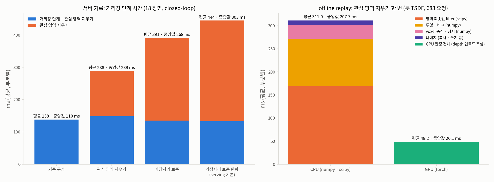 ([sidecar](figures/roi-carve-gpu/roi-carve-gpu-cost.json)). 왼쪽 = 서버 기록의 거리장 단계 (파랑 = 관심 영역 지우기를 뺀 나머지, 주황 = 관심 영역 지우기), 오른쪽 = replay 한 번의 부분별 시간 (CPU 와 GPU).

**(i) 서버 기록: 늘어난 시간은 관심 영역 지우기 자체다** [V `R1_server_records`; 값은 chunk 마다 잰 것의 통계. 평균 · 중앙값 열은 서로 더하지 않는다]

| 구성 (18 장면) | chunk 수 | 거리장 단계 중앙값 (ms) | 관심 영역 지우기 중앙값 | (거리장 단계 − 관심 영역 지우기) 중앙값 | 거리장 단계 평균 | 관심 영역 지우기 평균 | (거리장 단계 − 관심 영역 지우기) 평균 |
|---|---|---|---|---|---|---|---|
| 기준 구성 | 736 | 109.7 | 0.0 | 109.7 | 138.32 | 0.0 | 138.32 |
| 관심 영역 지우기 [E2] | 635 | 238.51 | 75.23 | 112.63 | 288.47 | 140.02 | 148.45 |
| 가장자리 보존 [E3] | 704 | 267.54 | 119.85 | 97.28 | 390.89 | 255.9 | 134.99 |
| 가장자리 보존 완화 [E4, serving 기본] | 683 | 303.19 | 144.59 | 96.83 | 444.43 | 311.6 | 132.84 |

읽는 법: E4 에서 "거리장 단계 − 관심 영역 지우기" 평균은 132.84 ms 로 기준 구성 138.32 ms 와 같은 크기다 (차이 −5.48 ms [D = 132.84 − 138.32]). 평균 증가분 306.11 ms [D = 444.43 − 138.32] 는 관심 영역 지우기 평균 311.6 ms 와 같은 크기다. 즉 **110 → 303 ms 의 증가는 관심 영역 지우기가 낸 것이고, 거리장 단계의 나머지는 늘지 않았다.**

**(ii) offline replay: 관심 영역 지우기 안에서 가장 큰 부분은 영역 최솟값 filter 다** [V `R1_replay_cpu`; 683 요청 (18 장면), 두 TSDF 합. 점유 voxel 수 중앙값 164,750]

| 부분 | 평균 (ms) | 비중 [D = 평균 / 311.02] | 무엇 |
|---|---|---|---|
| 영역 최솟값 filter (`footprint.filter`, scipy `minimum_filter`) | 169.15 | 54.4 % | 투영 영역 판정 중 pixel 영역의 최솟값 |
| 투영 · 비교 (`judge`) | 102.5 | 33.0 % | [D = `seen_through` 평균 271.655 − filter 169.153]. voxel 을 카메라에 투영해 깊이를 비교하는 나머지 |
| voxel 중심 · 상자 (host 계산, `occupied.host`) | 29.62 | 9.5 % | 점유 voxel 의 host 계산 |
| 나머지 (복사 · 쓰기 등) | 9.75 | 3.1 % | [D = 311.017 − 271.655 − 29.616] |
| 합 (`roi_carve_total`) | 311.02 | 100 % | 중앙값 207.73, p95 765.67 ms |

- 앞 요약의 "점유 voxel host 내리기" 는 큰 부분이 아니다: 점유 voxel 의 device → host 복사 (`occupied.d2h`) 는 중앙값 0.46 ms · p95 0.993 ms 였다 [V]. host 에서의 계산은 평균 29.62 ms (9.5 %) 다.
- 앞 요약의 세 부분에 없던 **영역 최솟값 filter 가 가장 큰 부분 (54.4 %)** 이다.
- replay 합의 평균 311.02 ms 는 서버 E4 기록의 관심 영역 지우기 평균 311.6 ms 와 같은 크기이나 중앙값은 207.73 대 144.59 ms 로 다르다 [V]. replay TSDF 가 서버의 쥔 물체 처리 · target 제외를 빠뜨리므로 (limits) 비율로 읽는다. 같은 요청의 서버 쪽 점유 voxel 수는 `verify.json` 에 없어 작업량 일치는 확인하지 않았다.

**(iii) R2 — "target pixel 판정" 은 이 구성에서 실행되지 않는다** [V `R2_target_pixel_judgement`]: `target_pixel_mask` 는 `_target_layer_route` 에서만 실행되고, `CuroboFieldBuilder.update` 는 `esdf.target_layer` 가 꺼져 있으면 target 층 요청을 거부한다. E4 · serving 은 `--target-layer` 없이 돈다. 따라서 앞 요약이 든 원인 중 하나가 아니다.

**(iv) R3 — "제약 생성 약 380 ms" 는 거리장 단계를 포함한 값이다** [V `R3_constraint_generation_contains_esdf`]: `esdf` stage 가 `constraint_generation` stage 안에 중첩되어 있다 (`pipeline.py` 8b).

| 구성 | 제약 생성 중앙값 (ms) | (제약 생성 − 거리장 단계) 중앙값 | target grounding 중앙값 |
|---|---|---|---|
| 기준 구성 | 154.43 | 14.6 | 78.0 |
| 관심 영역 지우기 [E2] | 302.66 | 14.5 | 88.13 |
| 가장자리 보존 [E3] | 300.11 | 14.0 | 78.73 |
| 가장자리 보존 완화 [E4] | 368.04 | 13.9 | 89.43 |

제약 생성에서 거리장 단계를 뺀 값은 구성과 무관하게 약 14 ms 다. E4 의 제약 생성 중앙값 368.04 ms 는 약 380 ms 에 가깝지만 **거리장 단계 (중앙값 303.19 ms) 를 포함한 값이다.** target grounding 중앙값은 78.0–89.43 ms 로 "약 80 ms" 와 같은 크기다.

**13.5 결과 — GPU 판정 (G1 · G2 · G3)**

그림: 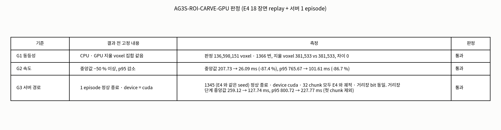 ([sidecar](figures/roi-carve-gpu/roi-carve-gpu-table.json)).

| 판정 | 기준 (결과 전 고정) | 결과 [V] | 통과 |
|---|---|---|---|
| G1 동등성 | 지울 voxel 집합 차이 0 | 1,366 번 비교 [D = 683 요청 × 두 TSDF]. 판정한 voxel CPU 136,598,151 = GPU 136,598,151, 지울 voxel CPU 381,533 = GPU 381,533, `cpu_only` 0 · `gpu_only` 0 (`G1_equivalence`) | **통과** |
| G2 속도 | 중앙값 −50 % 이상, p95 감소 | 중앙값 207.73 → 26.09 ms (−87.4 %), p95 765.67 → 101.61 ms (−86.7 %). GPU 값 = 판정 + depth 업로드 (`G2_speed`; −87.4 % = 1 − 26.09 / 207.73 [D]) | **통과** |
| G3 서버 경로 | 정상 종료 · `roi_carve.device = cuda`, 거리장 단계 시간을 E4 와 나란히 | 1345 (seed 13453) `--roi-carve-device cuda` 서버 smoke 정상 종료 (client 는 t = 211 에서 place, `--stop-after-place 2.5`), 기록의 `device = cuda`, 32 chunk (E4 도 32) | **통과** |

G2 의 GPU 값 분해 (replay, 평균 · 중앙값 · p95, ms) [V `replay_gpu`]: 판정 · 쓰기 `roi_carve_total` 32.522 · 18.711 · 92.009, depth 업로드 `gpu_cameras` 15.645 · 2.905 · 60.757, 합 (업로드 포함) 중앙값 26.09 · p95 101.61. 평균 합은 48.17 ms [D = 32.522 + 15.645] 로 CPU 평균 311.02 ms 의 15.5 % [D = 48.17 / 311.02] 다.

G3 의 서버 거리장 단계 · 관심 영역 지우기 시간 (같은 장면 1345 의 E4 CPU 기록과 나란히, ms) [V `G3_server_smoke`]:

| | 거리장 단계 중앙값 · p95 · 평균 | 관심 영역 지우기 중앙값 · p95 · 평균 |
|---|---|---|
| E4 CPU (첫 chunk 제외) | 259.12 · 800.72 · 399.03 | 121.56 · 683.72 · 285.77 |
| `cuda` (첫 chunk 제외) | 127.74 · 227.77 · 139.19 | 12.84 · 96.16 · 24.62 |
| 변화 [D = 1 − cuda / E4] | 중앙값 −50.7 % · p95 −71.6 % | 중앙값 −89.4 % |
| (참고) 첫 chunk 포함 | cuda 131.82 · 272.51 · 486.85 / E4 259.89 · 880.34 · 455.96 | cuda 12.86 · 97.58 · 27.69 / E4 121.32 · 682.03 · 280.55 |
| **첫 chunk 의 거리장 단계** | **cuda 11,264.27 / E4 2,220.88** | — |

**첫 chunk 값은 시작 비용이다**: smoke 의 1345 는 그 서버의 첫 episode 였고 (CUDA · kernel 시작), E4 에서는 그 서버의 두 번째 episode 였다 [V `first_chunk_esdf_ms.note`]. 그래서 시간 비교는 첫 chunk 를 뺀 값 (`without_first_chunk`) 으로 읽고, 첫 chunk 포함 평균 (cuda 486.85 > E4 455.96) 은 이 시작 비용이 섞인 값이라 비교에 쓰지 않는다. 같은 smoke 에서 32 chunk 모두 E4 와 비교해 `refined_chunk` · `esdf_distance` · `esdf_coarse_distance` · 관심 영역 지우기 개수가 **동일** (각 32 / 32) 했다 [V `identical_*`]. 성공 · 접촉은 판정에 쓰지 않았다 (1 episode).

→ G1 · G2 · G3 모두 통과, **serving 기본값에 `roi_carve_device: cuda` 를 더했다.**

**13.6 결과 — 1345 이웃 과일 접촉 진단 (R4): 접촉은 왼손 몸체 mesh 와 오렌지다**

그림: 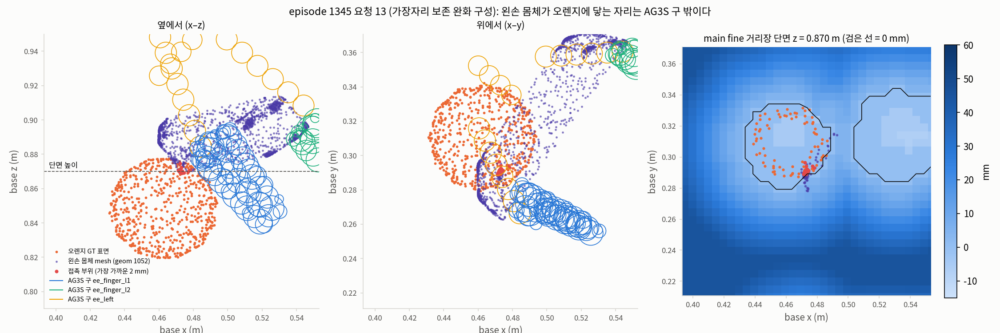 ([sidecar](figures/roi-carve-gpu/roi-carve-gpu-scene-ep1345.json)). episode 1345, 요청 13 (chunk `chunk_00042.npz`, 가장자리 보존 완화 구성). 왼쪽 = 옆에서 (x–z), 가운데 = 위에서 (x–y), 오른쪽 = main fine layer 단면 (z = 0.870 m, 검은 선 = 0 mm). 단면 높이는 왼쪽 panel 의 점선이다. 주황 점 = 오렌지 GT 표면, 보라 점 = 왼손 몸체 mesh (geom 1052), 빨간 점 = 접촉 부위, 원 = AG3S 로봇 구 (파랑 `ee_finger_l1`, 초록 `ee_finger_l2`, 노랑 `ee_left`).

**(i) 접촉의 사실** [V `R4_ep1345_neighbour_contact`]

| 항목 | 값 |
|---|---|
| 접촉 쌍 (E4, MuJoCo replay) | `EE_BODY_L` geom #1052 (**왼손 몸체 mesh**) ↔ `orange_geom`. 손가락 ↔ 바나나가 **아니다** |
| 접촉 행 · 구간 | 27 행, t = 101–127, chunk 12–15. 최소 거리 −0.569 mm, 최대 힘 53.27 N |
| 다른 구성의 같은 접촉 | 기준 구성 27 행 · 관심 영역 지우기 19 행 · 가장자리 보존 27 행 · 가장자리 보존 완화 27 행 |
| VLA 단독 (E0) | 같은 쌍 `EE_BODY_L` ↔ orange, 31 행, t = 150–180 (`IFG-APPLE/replay/runs_E0_E0_ep1345_s13453.json`) |

즉 이 접촉은 **VLA 단독에서도 나고, 이 STEP 이 본 모든 AG3S 구성에서도 난다.**

**(ii) 요청별 측정 (E4, 요청 11–17 = t_step 12–18)** [V `per_request_E4`]. 접촉 부위 = 그 요청에서 손 geom 의 표본점 중 오렌지 최근접 거리에서 2 mm 안의 것 (표본 수는 "부위 표본"). "구 모델 밖" = 그 표본점에서 기록된 AG3S 구 전부에 대한 `|p − c| − r` 의 최솟값의 범위. 오렌지 표면 표본이 거리장에서 잊혀진 비율은 "visible" (지금 카메라에 보이는 점) 만 적는다.

| 요청 | 손 geom ↔ 오렌지 GT 최소 거리 (mm) | 부위 표본 | 구 모델 밖 (mm) | 가장 가까운 구 (link: 표본) | 그 link 의 계획 clearance 최솟값 (mm) | 이웃 접촉 허용 | 잊음 visible, main 층 | 잊음 visible, hand 층 | TrajOpt |
|---|---|---|---|---|---|---|---|---|---|
| 11 | 57.23 | 60 | 12.05–16.74 | l1: 60 | −0.158 | 꺼짐 | 0.0 % | 0.34 % | optimal |
| 12 | 26.57 | 54 | 10.13–16.96 | l1: 54 | −3.52 | 켜짐 | 0.0 % | 0.70 % | optimal |
| 13 | 0.76 | 30 | 9.27–14.82 | l1: 30 | +0.128 | 켜짐 | 0.0 % | 2.01 % | optimal |
| 14 | 1.16 | 27 | 9.11–19.08 | l1: 27 | −2.462 | 켜짐 | 0.0 % | 0.41 % | optimal |
| 15 | 1.90 | 48 | 10.74–24.08 | l1: 48 | −0.406 | 켜짐 | 0.0 % | 1.71 % | optimal |
| 16 | 1.53 | 11 | 13.33–17.85 | l1: 11 | −0.843 | 켜짐 | 0.0 % | 1.96 % | feasible |
| 17 | 7.28 | 36 | 15.34–25.01 | l1: 16, ee_left: 20 | l1 −2.476, ee_left +20.233 | 켜짐 | **13.03 %** | **16.90 %** | feasible |

(l1 = `ee_finger_l1`. 오렌지 표면 중 지금 보이는 비율은 0.39–0.49. main 층에서 오렌지 표면의 거리장 최솟값 (`esdf_at_neighbour.min_mm`) 은 −7.07 ~ −11.18 mm 로 모두 음수, 즉 오렌지 자리는 점유로 읽힌다.) 가장 가까운 구의 반지름: `ee_finger_l1` · `ee_finger_l2` 2.54–8.44 mm, `ee_left` 5.7–6.22 mm [V `scene_figure.sphere_radius_mm`]. 이웃 접촉 허용 설정 = `--neighbour-contact-mm 20`: 손가락 구 (`ee_finger_l1` · `ee_finger_l2`) 가 target 근처 (파지 전) 에서 이웃 장애물과 20 mm 까지 겹칠 수 있다. 요청 12–17 에서 켜져 있었다 [V `neighbour_contact_setting`]. 기준 구성 기록 (`per_request_B_contact_region`) 의 구 모델 밖 거리 · 계획 clearance 도 같은 크기다 (예: 요청 11 `12.05–16.735` · −0.158, 요청 12 `10.132–16.956` · −3.52).

**(iii) 원인 위치 — 측정이 가리키는 만큼만**

| 구성 요소 | 측정이 말하는 것 | 판정 |
|---|---|---|
| LTE (link 별 target 제외 거리장) · 거리장 | 오렌지는 거리장에 있다: 요청 11–16 에서 main 층 visible 잊음 0.0 %, hand 층 0.34–2.01 %, 오렌지 자리 거리장 최솟값 음수. 요청 17 에서만 main 13.03 % · hand 16.90 % 로 잊는다 | 요청 11–16 에서는 원인이 **아니다**. 요청 17 의 잊음이 접촉에 영향을 주었는지는 보지 않았다 |
| 로봇 구 모델의 범위 (TrajOpt 가 쓰는 구) | 접촉 부위는 기록된 어떤 구에서도 9.1–25.0 mm 밖이다 (요청 11–17 전체 범위; 요청 11–16 은 9.1–24.1 mm). 가장 가까운 구도 반지름 8.44 mm 이하다. 즉 손 몸체의 이 자리는 구로 덮이지 않는다 | 원인 **후보로 있다** |
| CCR (TrajOpt 궤적 수정) 의 이웃 접촉 허용 설정 | 허용 (20 mm) 이 요청 12–17 에서 켜져 있었고, 가장 가까운 구 `ee_finger_l1` 의 계획 clearance 는 7 개 요청 중 6 개에서 음수 (−0.158 ~ −3.52 mm, 허용 20 mm 안) 였다 | 원인 **후보로 있다** |

~~**구 모델 범위와 허용 설정은 둘 다 있고 서로 분리하지 않았다** (둘 중 하나만 바꾼 반사실 실행 (counterfactual run) 이 없다).~~ → **둘 중 하나만 바꾼 반사실 실행 (counterfactual run) 은 §14 에서 했다.** 이 절의 표는 그 이전의 기록 그대로다. 아래 문장 중 "원인 하나로 정한 것도 근거가 없다" 는 §14 의 판정으로 갱신된다 (단, 1 장면 · 조건마다 1 episode). 앞 요약의 "원인은 궤적 쪽 이웃 접촉 허용 설정" 은 접촉 쌍 (손가락 ↔ 바나나) 이 틀렸고, 원인 하나로 정한 것도 근거가 없다. 허용이 켜져 있고 손가락 구의 clearance 가 음수였다는 부분만 측정으로 확인된다.

**13.7 이전 대비 (before → after)**

기준점: 직전 구성 = CPU 판정의 가장자리 보존 완화 구성 (E4, 채택), 바탕 = 기준 구성. V11AB 와의 비교는 하지 않는다 (§9 의 사유와 같다).

| 변경 (flag, 코드 기본 꺼짐) | 지표 | before (CPU, E4) | after (`--roi-carve-device cuda`) | 판정 |
|---|---|---|---|---|
| `esdf.roi_carve_device = cuda` | 지울 voxel 집합 (replay 1,366 번) | CPU 381,533 | GPU 381,533, 차이 0 | G1 통과 |
| 〃 | 관심 영역 지우기 시간, 중앙값 · p95 (replay, 두 TSDF 합, 업로드 포함) | 207.73 · 765.67 ms | 26.09 · 101.61 ms (−87.4 % · −86.7 %) | G2 통과 |
| 〃 | 서버 거리장 단계 중앙값 · p95 (1345 1 episode, 첫 chunk 제외) | 259.12 · 800.72 ms | 127.74 · 227.77 ms (−50.7 % · −71.6 %) | G3 통과 |
| 〃 | 서버 관심 영역 지우기 중앙값 (1345 1 episode, 첫 chunk 제외) | 121.56 ms | 12.84 ms (−89.4 %) | — |
| 〃 | 서버 기록 chunk (1345, 32 개) | — | 궤적 · 거리장 · 개수 모두 E4 와 동일 | G3 통과 |

**개선인가.** **속도에 대해서는 그렇다: 결과 전 고정 기준 세 개를 모두 지켰다.** 판정 결과는 바뀌지 않았다 (replay 의 지울 voxel 집합 동일, 1345 의 32 chunk 동일). 따라서 §8 의 E4 판정 (성공 · 금지 접촉 · stale residue) 이 바뀔 근거는 이 측정에 없지만, **18 장면 closed-loop 을 `cuda` 로 다시 돌리지는 않았다.** 서버 시간은 한 episode (1345, 32 chunk) 의 값이라 18 장면 중앙값 303.19 ms 와 직접 비교하지 않는다. 서버 시작 직후 첫 chunk 는 `cuda` 에서 11,264.27 ms 로 느리다 (시작 비용).

**13.8 사실 · 가설 구분**

- 사실 [V]: §13.4 · §13.5 · §13.6 의 표 값. 거리장 단계 증가분 = 관심 영역 지우기, 그 안의 가장 큰 부분 = 영역 최솟값 filter (replay 평균 54.4 %). `target_pixel_mask` 는 이 구성에서 실행되지 않는다. 제약 생성은 거리장 단계를 포함한다. G1–G3 통과. 1345 접촉 쌍은 왼손 몸체 ↔ 오렌지이고 VLA 단독 · 모든 구성에서 난다.
- 가설 [H]: ~~구 모델의 범위 (9–25 mm 밖) 와 이웃 접촉 허용 (20 mm) 중 무엇이 1345 접촉을 낳는가 — 둘 다 있고 분리하지 않았다.~~ → §14 에서 분리했다 (구 모델 범위가 원인, 허용 단독은 아님). 영역 최솟값 filter 가 큰 이유는 측정하지 않았다.
- **R5 (target 전용 TSDF 의 사과 pixel 이 정적 TSDF 로 새는 원인 = target 추적) 는 이 STEP 에서 측정하지 않았다.** 앞 요약의 단정만 거둔다. 재측정 대기 3 의 상태 (기전 측정 안 됨) 는 그대로다.

**13.9 측정하지 않은 것 · 한계** [V `not_measured`, `limits`]

1. ~~구 모델 범위 (9–25 mm) 와 이웃 접촉 허용 (20 mm) 중 어느 것 하나만으로 1345 접촉이 막혔을지 — 반사실 실행 없음.~~ → §14 에서 반사실 실행으로 분리했다.
2. R5: target 전용 TSDF 누출의 기전 (serving 에서 target 전용 TSDF 꺼짐).
3. GPU 판정을 closed-loop 1 episode (1345) 보다 많이 돌려 보는 것. G3 는 1 episode 이고 18 장면 증거는 offline replay 다.
4. replay 의 TSDF 는 서버의 쥔 물체 처리 · target 제외를 빠뜨린다 (점유 voxel 수 중앙값 164,750 는 replay 의 값이고, 서버 쪽 값은 `verify.json` 에 없어 작업량 일치를 확인하지 않았다). 시간의 절대값은 서버와 다를 수 있다 (중앙값 207.73 대 서버 144.59 ms).
5. G3 의 시간 비교는 첫 chunk (시작 비용 11,264.27 ms) 를 뺀 값이다. 시작 비용이 서버 수명 동안 한 번만 나는지는 이 smoke 1 개로만 본다.
6. 1345 의 요청별 진단에서 요청 17 의 거리장 잊음 (13.03 % · 16.90 %) 의 원인과 접촉에 대한 영향. 요청별 `link_planned_clearance_min_mm` 중 요청 단위 최솟값 (14.69–21.45 mm) 은 정의가 `verify.json` 에 없어 이 로그가 해석하지 않는다 (위 표의 값은 접촉 부위의 가장 가까운 구 link 값만 썼다).

### 14. AG3S-NBC-1345 — 1345 오렌지 접촉의 원인 분리: 이웃 접촉 허용 vs 손바닥 구 모델 (2026-10-25 KST)

작성 **2026-10-25 17:4x KST** (`date -u` 08:45 UTC + 9 h). 측정자: lead (직접 실행, 순차 작업). 이 절의 숫자는 [`handoff/AG3S-NBC-1345.verify.json`](handoff/AG3S-NBC-1345.verify.json) 의 `numbers` 이고, 조건 · 지표 · 판정은 결과를 보기 전에 [`task`](handoff/AG3S-NBC-1345.task.md) 에 고정했다. 사용자 판정 (2026-10-25): "우선 요인을 분리해봅시다". 원시 기록 run: `20261025T035831+0900_8da37119afd3_f082f20e9463` (`verify/AG3S-NBC-1345/`, 기준 조건은 같은 run 의 `verify/AG3S-ROI-CARVE-GPU-SMOKE/`). 앞선 STEP: `AG3S-ROI-CARVE-GPU` (§13.6, 접촉 쌍 · 거리장 · 구 모델 밖 거리를 측정하고 원인은 분리하지 못했다). 보기 폴더 (git 제외): `outputs/2026-10-25_1345_오렌지접촉_원인분리/`.

**14.1 목적**

§13.6 에서 1345 (seed 13453) 의 금지 접촉은 왼손 몸체 mesh (`EE_BODY_L`, geom 1052) 와 오렌지의 27 control row (t = 101–127) 로 확인됐다. 오렌지는 거리장에 있었으므로 (요청 11–16 의 main fine layer 에서 보이는 표면 놓침 0 %) 거리장 층 (LTE, link 별 target 제외 거리장) 은 원인이 아니다. 남은 후보 두 개가 **함께 있어서 분리되지 않았다.**

| 후보 | 구성 요소 | 내용 |
|---|---|---|
| (가) 이웃 접촉 허용 | CCR (Constrained Chunk Refinement, TrajOpt 궤적 수정) 설정 | `--neighbour-contact-mm 20`: 손가락 구가 이웃 장애물과 20 mm 까지 겹쳐도 된다 |
| (나) 손바닥 구 모델 | CCR 이 쓰는 제약 기하 (로봇 구 모델) | 손바닥 link (`ee_left`) 의 구가 손바닥 mesh 를 덮지 못한다 |

이 STEP 은 **원인 분리까지**다. 고치는 방법은 결과를 본 뒤 사용자 판정으로 정한다 [T task §2].

**14.2 설계 확인 (offline coverage check — rollout 이 아니다)** [V `design_coverage_check_offline`]

run 을 하기 전에, 요청 시점의 관절 · 손가락 열림으로 "AG3S 구 모델이 보는 손 – 오렌지 거리" 를 MuJoCo GT mesh 거리와 비교했다 (1345 E4 기록, 요청 12–16). 구 모델은 세 가지: 현재 (base), gripper link 의 capsule 배율을 0.35 로 한 것 (`gripper0.35`, 손가락 구 반지름 최대 13.01 mm), 손바닥 link (`ee_left`) 를 URDF 굵기 (배율 1.0) 로 한 것 (`gripper1`; 손바닥 구 반지름 33.53 mm).

| 요청 | 손 mesh ↔ 오렌지 (mm, GT) | 구 모델 ↔ 오렌지, 현재 (mm) | 가장 가까운 구 (현재) | 구 모델 ↔ 오렌지, 손가락 배율 0.35 (mm) | 구 모델 ↔ 오렌지, 손바닥 URDF 굵기 (mm) | 가장 가까운 구 (손바닥 URDF 굵기) |
|---|---|---|---|---|---|---|
| 12 | 26.57 | 29.61 | `ee_finger_l1` | 29.61 | 18.81 | `ee_left` |
| 13 | 0.76 | 10.18 | `ee_finger_l1` | 10.18 | **−2.28** | `ee_left` |
| 14 | 1.16 | 11.13 | `ee_finger_l1` | 11.13 | **−2.33** | `ee_left` |
| 15 | 1.90 | 11.68 | `ee_finger_l1` | 11.68 | **−2.31** | `ee_left` |
| 16 | 1.53 | 13.35 | `ee_finger_l1` | 13.35 | **−1.43** | `ee_left` |

읽는 법 (사실 [V]): 접촉 순간 (요청 13–16) 실제 mesh 는 오렌지에서 0.76–1.90 mm 인데 현재 구 모델은 10.18–13.35 mm 라고 본다. 손가락 구 반지름을 키워도 (배율 0.35) 값이 바뀌지 않는다 — 가장 가까운 구가 손가락 구 그대로다 (접촉 부위가 손가락 구가 아닌 손바닥 쪽에 있기 때문일 수 있다 [H], 이 계산은 그것을 직접 보이지 않는다). 손바닥 구를 URDF 굵기로 하면 가장 가까운 구가 `ee_left` 로 바뀌고 −1.43 ~ −2.33 mm, 즉 구 모델이 접촉을 본다.

[I] 이 계산에서 나오는 해석 (결과가 아니다): 현재 구 모델에서는 오렌지가 구에서 10 mm 이상 떨어져 보이므로, 이웃 접촉 허용을 꺼도 그 구의 제약은 위반되지 않는 자세일 수 있다. 이 해석이 맞는지는 rollout 으로 봐야 하고, 아래 조건 실행이 그것이다.

**14.3 조건과 결과 전 고정 판정** [T task §1 · §2]

같은 장면 (1345, seed 13453), 같은 snapshot (`snapshot_gpu`: 서버 경로는 `7ddada87` 의 코드, `--roi-carve-device cuda` 명시), 같은 client 설정 (`--stop-after-place 2.5`). 바탕 = serving 기본 구성 (이웃 과일과 붙은 target 떼어 내기 + 사과 표면 점 빼기 + 관심 영역 지우기의 가장자리 보존 완화, §8) 위에 하나씩 바꾼다. 1 장면 진단이다 — 일반화 · 우수성 주장은 하지 않는다.

| 조건 | 바꾼 것 | 무엇을 묻나 | `verify.json` 키 |
|---|---|---|---|
| 기준 (이미 있음) | — (E4 와 bit 동일, §13.5 의 smoke run) | 27 row 접촉 | `B_ROI_FPR` |
| 허용 끔 | `--neighbour-contact-mm 20` 을 뺀다 | 허용만 없으면 TrajOpt 가 손을 오렌지에서 떼는가 | `NBC0` |
| 손바닥 구 URDF 굵기 | `--capsule-radius-scale-link ee_left=1.0 ee_right=1.0` | 구 모델이 손바닥을 덮기만 하면 떼는가 (허용은 손가락 구에만 걸리므로 손바닥 구에는 적용되지 않는다) | `PALM` |
| 둘 다 | 위 둘 | 둘이 함께 있어야만 떼는가 | `NBC0_PALM` |

주 지표: MuJoCo replay 의 **손 – 이웃 과일 (오렌지) 접촉 row 수**, 모든 금지 접촉, 성공 (사과가 바구니에). 보조: 접촉 구간의 손 – 오렌지 최소 거리 (`hand_orange_min_mm`, 음수 = 겹침. 접촉 row 가 없는 조건은 값이 없다).

| 결과 (결과 전 고정) | 판정 (원인 층) |
|---|---|
| 허용 끔만으로 0 row, 손바닥 굵게만으로는 남음 | 원인 = 이웃 접촉 허용 (CCR, TrajOpt 설정) |
| **손바닥 굵게만으로 0 row, 허용 끔만으로는 남음** | **원인 = 구 모델이 손바닥을 덮지 못함 (제약 기하 — 로봇 구 모델)** |
| 둘 다 있어야 0 row | 두 요인이 함께 필요 |
| 어느 하나만으로도 0 row | 어느 쪽도 충분 — 고칠 층은 부작용 (성공 · 다른 접촉) 으로 고른다 |
| 둘 다 해도 남음 | 다른 원인 (명령 ≠ 실제 궤적, chunk 경계 등) — 실제 궤적으로 다시 진단 |

성공을 잃거나 다른 금지 접촉이 생기면 그 사실을 함께 적는다 (판정을 바꾸지 않는다) [T task §2].

**14.4 결과** [V `results`]

그림 (verifier 가 만든 것, 링크만 한다): 표 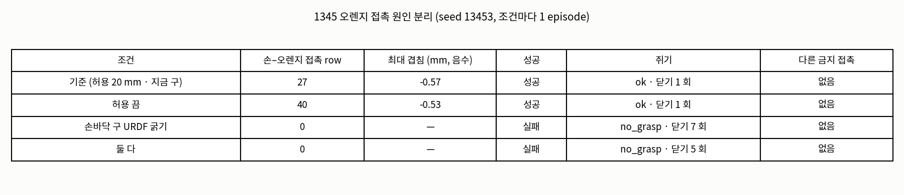 ([sidecar](figures/nbc-1345/nbc-1345-table.json)), 시간 축 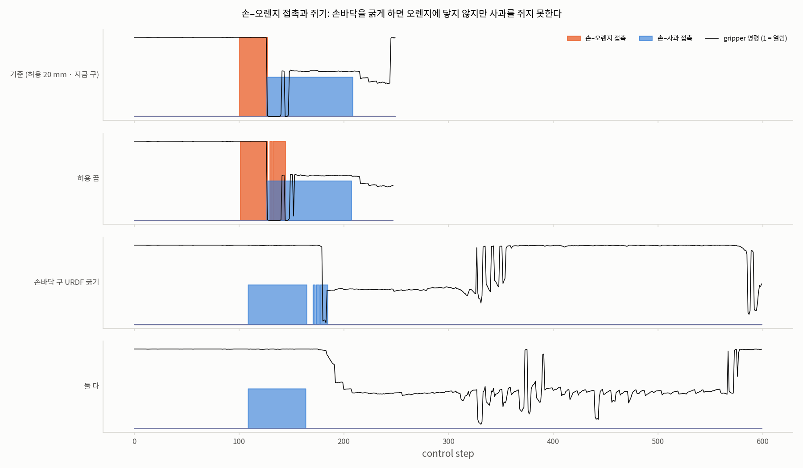 ([sidecar](figures/nbc-1345/nbc-1345-timeline.json)). 시간 축은 control step 별로 손 – 오렌지 접촉 (주황), 손 – 사과 접촉 (파랑), gripper 명령 (검정 선, 1 = 열림) 을 조건마다 한 줄에 놓았다.

| 조건 | 손 – 오렌지 접촉 row | 최대 겹침 (mm) | 접촉 구간 (t) | 성공 | 쥐기 (`failure_mode`) | 닫기 시도 | planning 횟수 | episode 길이 (step) | 다른 금지 접촉 |
|---|---|---|---|---|---|---|---|---|---|
| 기준 (허용 20 mm · 현재 구) | 27 | −0.57 | 101–127 | 성공 | `ok` | 1 회 | 32 | 250 | 없음 |
| 허용 끔 | **40** | −0.53 | 102–144 | 성공 | `ok` | 1 회 | 31 | 248 | 없음 |
| 손바닥 구 URDF 굵기 | **0** | — | — | **실패** | **`no_grasp`** | 7 회 | 75 | 600 (한계) | 없음 |
| 둘 다 | **0** | — | — | **실패** | **`no_grasp`** | 5 회 | 75 | 600 (한계) | 없음 |

(episode 길이는 `verify.json` 의 `numbers` 가 아니라 시간 축 sidecar 의 `n_steps` 다. 손 – 오렌지 접촉 row 는 sidecar 의 t 목록 길이 (27 · 40 · 0 · 0) 가 위 표와 같다. 손 – 사과 접촉 row 는 sidecar 의 t 목록 길이로, 기준 82 (t = 127–208) · 허용 끔 81 (127–207) · 손바닥 구 68 (109–184) · 둘 다 55 (109–163) [D = 목록 길이].)

그림 (장면): 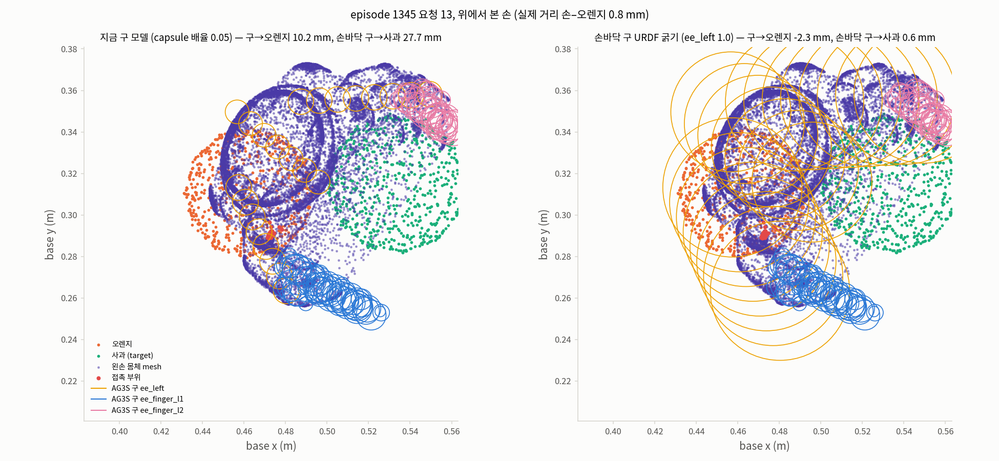 ([sidecar](figures/nbc-1345/nbc-1345-scene.json)). episode 1345 요청 13, **위에서 본 손** (x–y 평면). 왼쪽 = 현재 구 모델, 오른쪽 = 손바닥 구 URDF 굵기. 주황 점 = 오렌지, 초록 점 = 사과 (target), 보라 점 = 왼손 몸체 mesh, 빨간 점 = 접촉 부위, 원 = AG3S 구 (노랑 `ee_left`, 파랑 `ee_finger_l1`, 분홍 `ee_finger_l2`). 이 그림의 두 변형은 **같은 요청 13 의 기준 run 자세**에 두 구 모델을 각각 씌운 것이다 (손바닥 구 조건 run 의 자세가 아니다).

| 요청 13 (기준 run 의 자세) | 현재 구 모델 | 손바닥 구 URDF 굵기 |
|---|---|---|
| 손 mesh ↔ 오렌지 (GT) | 0.76 mm | 0.76 mm |
| 구 모델 ↔ 오렌지 | 10.18 mm | −2.28 mm |
| 손바닥 구 ↔ 사과 | **27.74 mm** | **0.55 mm** |
| 손바닥 구 반지름 | 6.22 mm | 33.53 mm |

[V `scene_request13`; 그림 제목은 현재 구 모델의 capsule 배율을 0.05 로 적었다.]

**14.5 판정 (결과 전 고정 표 적용)**

허용 끔만으로는 **접촉이 남았고** (27 → 40 row), 손바닥 구 URDF 굵기만으로는 **0 row** 였다. 이것은 고정 표의 두 번째 행 ("손바닥 굵게만으로 0 row, 허용 끔만으로는 남음") 에 해당한다. 따라서

> **원인 층 = 구 모델이 손바닥을 덮지 못함 (제약 기하 — 로봇 구 모델). 이웃 접촉 허용은 단독 원인이 아니다.** [V `verdict_pre_fixed_table`]

둘 다 바꾼 조건도 0 row 이므로 "둘이 함께 있어야만 떼는가" (세 번째 행) 는 아니다 — 손바닥 구만으로 충분하다. 이 판정은 **한 장면 · 조건마다 1 episode** 에 대한 것이다. 허용이 오렌지 접촉에 기여하는 정도는 이 측정으로 정해지지 않는다 (허용을 끄고도 접촉이 남았다는 것까지만 확인된다).

**14.6 부작용 — 손바닥 구 조건은 쥐기를 잃는다** [V `side_effect`]

| 조건 | 부작용 |
|---|---|
| 손바닥 구 URDF 굵기 | **사과를 쥐지 못한다** (`no_grasp`, 닫기 7 회, planning 75 회, 600 step 한계까지 진행). 다른 금지 접촉은 없다 |
| 둘 다 | 같다 (`no_grasp`, 닫기 5 회, planning 75 회, 600 step). 다른 금지 접촉은 없다 |
| 허용 끔 | 성공 · 쥐기는 유지되나 오렌지 접촉이 27 → 40 row (+13 [D = 40 − 27]), 접촉 구간 t = 101–127 → 102–144 로 늘었다 |

시간 축 그림: 두 손바닥 구 조건에서는 손 – 사과 접촉이 t = 109 부터 시작해 (기준은 127) gripper 명령이 여러 번 닫혔다 열리지만 (닫기 7 회 · 5 회) 끝까지 쥐기에 이르지 않고 episode 가 600 step 한계에서 끝난다 [V 시간 축 sidecar]. 기준 · 허용 끔은 닫기 1 회로 쥐고 250 · 248 step 에 끝난다. 따라서 **손바닥 구를 URDF 굵기로 키우는 것은 지금 형태로는 고침이 될 수 없다** (오렌지 접촉은 없앴으나 과제 성공을 잃었다) [I].

**14.7 실패 정리 — 구성 요소별 · 사실 / 가설 구분**

| 증상 | 증상 위치 | 원인 위치 | 근거 · 상태 |
|---|---|---|---|
| 왼손 몸체 mesh ↔ 오렌지 접촉 (27 row, 1345) | 실행 접촉 (MuJoCo replay) | **CCR 의 제약 기하 — 로봇 구 모델이 손바닥 mesh 를 덮지 못함.** 이웃 접촉 허용은 단독 원인이 아니다 | [V `results`, `verdict_pre_fixed_table`], 사실 (1 장면 · 조건마다 1 episode) |
| 손바닥 구 URDF 굵기에서 사과를 쥐지 못함 | 실행 (쥐기 단계) | **미확인** — 가설 [H]: URDF 굵기 구가 손바닥 mesh 를 과하게 덮어 사과에 다가가는 것을 막는다 | [V `scene_request13`] 은 기준 run 자세 한 곳의 기하만 보인다 |

사실 [V]:

- 허용만 끄면 접촉이 남는다 (27 → 40 row), 성공은 유지된다.
- 손바닥 구만 URDF 굵기로 하면 오렌지 접촉 0 row 이나 `no_grasp` 로 episode 가 600 step 한계까지 간다. 둘 다 바꿔도 같다.
- 요청 13 의 기준 run 자세에서 현재 손바닥 구 (반지름 6.22 mm) 는 사과에서 27.74 mm 떨어져 있고, URDF 굵기 구 (33.53 mm) 는 사과에서 0.55 mm 다. 즉 **URDF 굵기 구는 이 자세에서 사과 표면에 거의 닿는다 — 손바닥 mesh 보다 구가 크게 덮는다.** 이것은 한 요청의 기하이다.
- 기준 구성은 같은 설정에서 두 번 (E4 CPU 판정 · GPU 판정 smoke) 27 row 로 재현됐다 (§13.5 · §13.6 — 이것이 "허용 끔" 의 40 row 가 우연한 흔들림만은 아니라는 정황이지만, 조건마다 1 episode 이므로 흔들림의 크기는 재지 않았다).

가설 [H]:

- URDF 굵기 구가 **쥐기를 잃는 이유** 라는 것 — 위 기하 사실은 그럴듯한 설명이지만, 손바닥 구 조건 run 안에서 어느 link 의 구가 어느 요청에서 제약을 위반해 사과 접근을 막았는지 확인하지 않았다 (손바닥 구 조건은 접촉 row 가 없고 사과 접촉 row 는 있으며 (68 row), 접근 자체가 완전히 막힌 것은 아니다).
- "허용 끔" 에서 접촉 row 가 늘어난 (27 → 40) 기전 — 측정하지 않았다. 궤적이 조건 사이에 갈라지므로 (`limits`) 같은 자세에서의 비교가 아니다.
- 손바닥 구 조건의 0 row 가 "구가 손을 오렌지에서 떼었다" 인지 "궤적이 달라져 오렌지 가까이 가지 않았다" 인지 — 조건 run 의 손 – 오렌지 최소 거리 (접촉 없을 때의 값) 는 `verify.json` 에 없어 구별하지 않았다. 고정 판정표가 접촉 row 수로 판정하므로 판정은 유효하나, 0 row 의 강도는 쥐기가 성립한 run (기준 · 허용 끔) 의 값보다 약하다 [I].

**14.8 측정하지 않은 것 · 한계** [V `not_measured`, `limits`]

1. **손바닥 mesh 에 맞춘 구 집합 (URDF capsule 보다 촘촘한 것) — 만들지 않았다.** URDF 굵기는 mesh 를 과하게 덮는다 (요청 13 에서 손바닥 구 ↔ 사과 0.55 mm). 중간 굵기 (현재와 URDF 사이의 배율) 도 run 하지 않았다 — coverage check 의 손가락 배율 0.35 는 offline 계산이고 손바닥 배율이 아니다.
2. **다른 장면 — 1 장면 진단이다.** 1345 한 장면 · 조건마다 1 episode (seed 13453), 반복 없음.
3. **핵심 평가의 link 집합 (`--links gripper_wrist`) — 측정하지 않았다.** 이 STEP 은 `--links gripper` 로 돌렸다. 핵심 평가에서 같은 결과가 나오는지는 모른다.
4. 조건 사이에 궤적이 갈라진다 (`limits`). 접촉 row 수 · 닫기 횟수는 같은 자세에서의 비교가 아니다.
5. URDF 굵기 구가 손바닥 mesh 를 과하게 덮으므로, 손바닥 구 조건은 접촉 제약뿐 아니라 **쥐기 기하도 함께 바꾼다** (`limits`). 접촉 제거의 효과와 쥐기 상실의 원인을 같은 run 에서 분리하지 못한다.

**14.9 다음 — 사용자 판정 대기**

이 STEP 은 원인 분리까지다. 아래는 결과가 가리키는 후보이고 **고르지 않았다** (사용자 판정). 이 로그가 어느 것을 권하지 않는다.

| 후보 | 근거 | 확인할 것 · 전환 신호 |
|---|---|---|
| 손바닥 mesh 에 맞춘 구 집합 (URDF capsule 보다 얇게) 을 만들어 같은 3 조건 중 "손바닥 구" 만 다시 돌린다 | §14.2 coverage (현재 10–13 mm 밖 → URDF 굵기 −1.4 ~ −2.3 mm) 와 §14.6 (URDF 굵기에서 쥐기 상실) 사이의 중간 | 접촉 0 row 이면서 `ok` 로 쥐는가. 사과 쪽 구 ↔ 사과 거리가 0.55 mm 처럼 붙지 않는가 |
| 손바닥 배율을 현재와 1.0 사이에서 몇 단계로 돌린다 | §14.6 | 접촉이 사라지는 배율과 쥐기를 잃는 배율이 겹치는가 |
| 1345 한 장면 밖에서 같은 접촉이 나는지 (다른 장면의 오렌지 · 이웃 과일 접촉) | §14.8 의 2 | 같은 쌍 (`EE_BODY_L` ↔ 이웃 과일) 이 다른 장면에서도 나면 구 모델 쪽 수정이 일반 문제 |
| 핵심 평가의 link 집합 (`--links gripper_wrist`) 에서 같은 coverage 를 본다 | §14.8 의 3 | link 집합이 다르면 손바닥 구가 구 모델에 포함되는지부터 다시 본다 |
