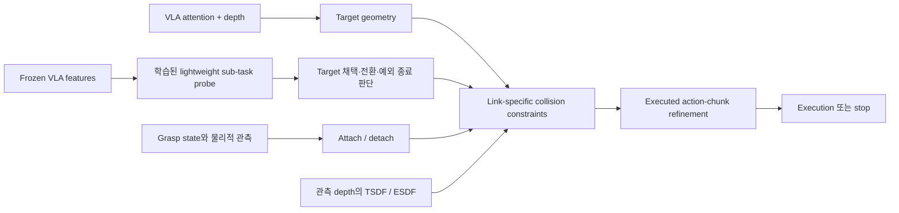
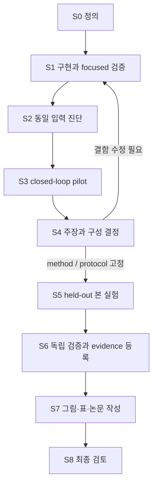

# AG3S VLA — 구현·실험·확인·검증·논문 작성 계획

작성: 2026-10-07 18:44 KST  
수정: 2026-10-12 KST — 기여 강화 방향과 논문 표현 전략 반영

문서 상태: `PLANNED / PAPER-FIRST` — 0.10절이 최신 연구·집필 우선순위이며, 나머지는 선택해서 사용하는 상세 작업 명세

대상 원고: [main.pdf](paper/latex/build/main.pdf)  
목적: VLA의 task grounding을 접촉 판단에 사용할 수 있는 3D target geometry로 구체화하고, 필요한 대상 접촉과 인접 장애물 보존을 함께 다루는 기여를 구현·실험·논문 표현으로 강화한다.

이 문서는 이번 대화에서 합의한 연구 방향을 실행 가능한 작업으로 정리한다. 기존 환경 구축 계획인 `paper/SETUP_PLAN.md`와 역할이 다르다. 이 문서의 작성은 GPU/MuJoCo 실험, 구현 변경, evidence 등록 또는 원고 수정이 실행되었다는 뜻이 아니다. 연구 코드는 해당 구현 작업에서 변경하며, 원고·분석 작업이 실행 코드를 함께 변경하지 않도록 한다.

## 0. 최신 실행 방향 — 논문 완성 우선

수정: 2026-10-07 19:04 KST (0.9절 추가: 확정 실험 구성). 사용자 목표는 남은 시간에 완성도 높은 논문을 만드는 것이다. 시스템의 모든 문제를 해결하거나 모든 가설을 입증하는 것을 완료 조건으로 삼지 않는다. **논문의 핵심 주장을 설득하는 데 필요한 근거와 표현을 먼저 완성한다.**

**적용 순위:** 이 절이 아래 S0–S8 순차 진행, DX 실험의 `필수` 표시, 모든 artifact 제작 계획보다 우선한다. 아래 1–13절은 상세 명세와 실험 후보 목록이다. 선택한 주장에 필요한 항목만 수행한다. 10개 실험·8개 Figure·8개 Table을 모두 완성할 필요가 없다.

### 0.1 먼저 완성할 논문 이야기

> 조작 대상을 찾는 것만으로는 접촉을 허용할 공간을 결정할 수 없다. VLA attention과 depth에서 대상의 관측 범위를 추정하고, 이를 링크·단계별 접촉 제약에 연결한다. 연구 강화의 중심은 필요한 대상 접촉 영역을 확보하면서 바로 옆의 금지 표면을 보존하는 것이다.

앞의 두 문장은 현재 구현을 설명하는 중심 이야기다. 마지막 문장의 경계 보존 개선은 0.10절의 개발·검증 목표이며, 달성 전에는 현재 방법의 검증된 성능으로 쓰지 않는다. 외부 segmenter 불필요성은 이 연결의 중요한 특성이지만, 그것만으로 기존 방법 대비 우수성을 설명하지 않는다.

ATS→target geometry→link-specific constraints를 중심에 둔다. HSR은 우선 이를 지원하는 구성 요소로 설명한다. Strong rule보다 추가 이득이 확인되면 비중을 높인다. HSR의 독립적인 우수성 입증이 전체 논문 진행을 막게 하지 않는다. CCR 역시 별도 novelty를 입증하려고 실험 범위를 늘리기보다, 핵심 제약을 실행하는 구성 요소로 먼저 배치한다.

원고에는 연구의 모든 시행착오를 싣지 않는다. 핵심 성과를 Abstract·Introduction·주 결과 표에서 선명하게 제시한다. 재현에 필요한 세부 설정과 추가 분석은 supplementary에 둔다. 수치, 학습 범위, 입력 정보, 비교 조건, 실제 검사 범위 등 결론의 해석을 바꾸는 사실은 정확히 설명한다. 불리한 결과를 보고 평가 분모나 성공 기준을 바꾸지 않는다.

### 0.2 논문에 필요한 최소 근거 묶음

| 우선순위 | 독자가 납득해야 할 내용 | 최소 연구·확인 | 완성할 논문 자료 |
|---|---|---|---|
| P0-A | 제안 시스템이 조작과 충돌의 문제를 실제로 개선하는가 | 기준 snapshot을 정하고 기존 자료의 사용 가능 범위를 확인; 부족한 main comparison을 동일 조건의 held-out 실행으로 보완 | **Main Table**: task success·forbidden contact·safe success, sample 수·불확실성; **Figure 1**: 실제 실행의 문제와 개선 |
| P0-B | 대상 identity, 경계 추정, 접촉 처리 중 무엇이 실행을 개선하는가 | DX-01에서 target source와 고정 identity의 extent를 분리; ball leakage를 진단하고 필요하면 경계 보존 방법을 개발; DX-04에서 실제 비허용 query link를 포함한 global exclusion vs LTE 비교 | **Ablation Table**: identity·extent·contact handling 비교; **Figure 3**: 대상 경계→잘못된 접촉 허용/차단→제약→실행 |
| P0-C | 구현 설명과 실험 결과를 믿을 수 있는가 | Contact 정의·sample/split·geometry 범위·추가 pass/probe 학습 점검; 기존 평가기와 기록 활용; 실제 runtime 요약 | **Figure 2**: 정확한 pipeline; 짧은 implementation/runtime 표와 supplementary 설정 |
| P1-A | Phase 처리의 효과를 어느 강도로 주장할 것인가 | 기존 V7/V7g trace 재분석, 작은 strong-rule 비교를 먼저 수행; 필요할 때만 신규 phase 진단 | Ablation의 HSR 행과 Figure 3의 phase timeline; 효과가 약하면 보조 분석으로 이동 |
| P1-B | 자체 scene에만 맞춘 방법이라는 의문을 줄일 수 있는가 | 가까운 공개 benchmark adapter·baseline을 초기에 점검; 준비 비용과 얻을 근거를 보고 한 가지 확장 선택 | Main Table의 추가 환경 또는 compact held-out/robustness 표 |
| P2 | 추가 연구로 논문을 더 강화할 수 있는가 | 여러 checkpoint/embodiment, 전체 factorial, 다수 oracle, 상세 head/layer sweep, controller horizon sweep, 대규모 noise grid | 여유가 있을 때만 supplementary에 추가 |

P1-B는 늦게 가능성을 확인하지 않는다. 초기에 실행 가능성을 파악하고 논문이 주장할 일반성 범위를 정한다. 공개 benchmark 없이 넓은 일반성을 약속하지 않으며, 가능하면 자체 진단 scene과 상보적인 외부 평가 하나를 확보한다.

### 0.3 실행할 작업 순서

| 작업 | 구현·실험·확인·검증·작성의 범위 | 끝나는 조건 |
|---|---|---|
| PA-1: 논문 설계와 evidence 선별 | 현재 구현 하나를 기준으로 이야기·contribution·Figure 1–3 초안·main/ablation table의 행과 열을 정한다. 기존 결과의 metric·설정·raw source를 확인한다 | 각 핵심 주장에 필요한 자료와 부족한 실험이 한 장의 목록으로 정리됨 |
| PA-2: 핵심 방법과 비교 구현 | 기존 source/gate 스위치, evaluator, 기록 도구를 재사용한다. 비허용 link 비교를 성립시키고, P0-B 진단에 따라 대상 경계 보존 방법 하나를 집중 개발한다 | Main 및 identity·extent·contact ablation이 가능하고, 선택한 새 방법을 기존 ball과 독립 비교할 수 있음 |
| PA-3: 핵심 실험과 즉시 집필 | P0-A/B를 우선 수행하고 작은 HSR 비교를 병행한다. 결과가 나오는 대로 표·실제 장면·Results 문단을 함께 만든다 | 핵심 주장을 뒷받침하거나 축소할 근거가 확보되고 본문 전체 초안이 존재함 |
| PA-4: 가장 큰 약점 하나 보완 | 가까운 baseline, 외부 benchmark, held-out stress 중 reviewer 판단에 가장 큰 영향을 줄 공백 하나를 선택한다 | 선택한 공백이 해소되거나 claim 범위에 반영됨 |
| PA-5: 최종 검증과 원고 완성 | 실제 사용한 결과의 source·metric·통계·caption·학습/추론 설명을 대조한다. Figure 가독성과 원고 논리·분량을 다듬는다 | 본문·그림·표·supplementary가 일치하는 제출용 원고가 완성됨 |

전체 state restore infra, 모든 geometry의 보수적 coverage 증명, 새로운 통합 benchmark framework를 기본 선행 과제로 만들지 않는다. 같은 episode/seed 비교와 기존 trace로 충분하면 그것을 사용하고 실험 성격을 정확히 설명한다. 평가기 자체의 오류, 조건 불일치, 실제 collision 누락처럼 결론을 무효화하는 문제는 먼저 해결한다.

### 0.4 시간 배분과 중단 기준

목표 제출일이 확정되지 않았으므로 아래는 남은 작업 시간의 상대 배분안이다. Conference deadline을 추정하지 않는다.

| 범위 | 시간 배분 제안 |
|---|---|
| 이야기·기존 evidence·표/그림 설계와 초기 feasibility | 10% |
| 필수 구현 수정과 핵심 실험 | 40% |
| 본문·Figure·Table·supplementary 완성 | 35% |
| 결과 검증·재실행 buffer·최종 PDF 점검 | 15% |

논문 작성은 처음부터 병행한다. 마지막 35% 구간에 들어가면 새로운 contribution이나 대규모 실험 축을 추가하지 않는다. 핵심 결론을 무효화하는 결함만 수정하고, 나머지는 claim의 범위와 limitation을 정리한다.

- HSR은 첫 비교에서 이득이 제한적이면 해당 범위로 서술한다. HSR을 강한 독립 contribution으로 만들기 위해 계속 새 task를 찾지 않는다.
- 이미 수행된 자료로 주장을 충분히 뒷받침할 수 있으면 같은 성격의 실험을 반복하지 않는다. 필요한 source 검증과 누락 metric 보완은 수행한다.
- 필요한 근거를 채우고 protocol의 예정 실행을 끝냈다면 추가 유리한 결과를 얻기 위해 test sample을 계속 늘리지 않는다.
- 구현 최적화는 실제 주 결과나 명시적 latency 주장에 영향을 줄 때 우선한다. Single-pass 통합·whole-body 확장은 기본 필수 과제가 아니다.
- Figure 3 하나에서 핵심 메커니즘을 설득할 수 있으면 같은 이야기를 설명하는 Figure 여러 장을 만들지 않는다.

### 0.5 본문 산출물 목표

**우선 완성: Figure 3개, 주요 Table 2개, 간결한 runtime/설정 자료.** 추가 그림·표는 결과와 지면을 보고 선택한다.

1. Figure 1: 실제 장면에서 필요한 contact와 피해야 할 collision, 제안 방법의 실행 결과.
2. Figure 2: Frozen VLA–attention/depth–target/phase–link constraints–refinement의 정확한 pipeline.
3. Figure 3: Attention-derived target과 contact exemption이 제약·실행을 바꾸는 사례; 필요한 경우 phase timeline을 같은 그림에 포함.
4. Main Table: 가장 중요한 외부/기본 비교와 task·contact·safe success.
5. Ablation Table: target identity·extent·contact handling 중 핵심 주장에 필요한 비교와 HSR의 적절한 위치.
6. Runtime/설정: 실제 측정 경계와 추가 비용을 짧게 보고하고 세부 항목은 supplementary로 이동.

**계획상 다음 작업은 0.10절을 반영한 PA-1이다.** 기존 및 후속 자료의 완료 상태를 확인하고, 논문의 table skeleton과 Figure 1–3 storyboard를 설계해 그것을 채우는 데 필요한 방법 개선과 실험을 확정한다.

### 0.6 CVPR 2027 독자를 위한 기여의 배치

추가: 2026-10-07 19:18 KST. CVPR 2027 CFP는 공개되어 있으며 Embodied vision and robotics, Physical AI/VLA, 3D geometry를 주제로 포함한다. 세부 부록 규정은 아직 이번 확인에서 확보하지 못했으므로 2026 기준을 임시 적용한다. 확인 출처와 상세 실행안은 [부록·프로젝트 페이지 계획](paper/notes/CVPR_APPENDIX_PROJECT_PAGE_PLAN.md)에 기록한다.

**집필 방향:** VLA의 시각 신호를 3D target geometry로 구체화하고 이를 작업 단계·링크별 접촉 제약으로 변환하는 연결을 전면에 둔다. Attention heatmap의 보기 좋은 사례만으로 유효성을 설명하지 않는다. Target 선택·기하 복원·제약 변화·실제 실행을 이어서 보여준다. SQP/ESDF 세부 구현은 이 연결을 실행하는 방법으로 배치한다. 새로운 segmentation benchmark나 foundation model 학습을 추가하는 것은 기본 과제가 아니다.

Figure 3의 우선 후보는 동일 장면/초기 상태에서 지시 대상만 바뀌는 비교다. VLA attention→3D target→링크별 허용/금지 접촉→실행 차이를 시각화한다. Geometry-only와 ATS를 동일 controller에서 비교하고, attention이 유용한 target identity를 제공하는지와 복원 범위가 잘못된 obstacle 제거를 유발하는지를 구분한다. 기존 P0-B 범위에서 먼저 수행하며, 이 사례만으로 instruction generalization을 주장하지 않는다.

### 0.7 본문·부록·프로젝트 웹페이지

| 산출물 | 역할 | 먼저 담을 내용 |
|---|---|---|
| Main paper | 핵심 아이디어와 효과를 자체적으로 설득 | Figure 1–3, main/ablation table, 핵심 protocol·학습 범위·적용 한계 |
| Appendix / supplementary PDF | 방법과 근거를 자세히 확인 | ATS/HSR/LTE/CCR 설정, metric·split·baseline 상세, 추가 분석·실패 사례·runtime breakdown |
| Supplementary video | 시간에 따른 실행과 메커니즘을 확인 | 같은 조건의 비교 실행, target/phase/접촉 overlay, 필요한 전체 rollout |
| GitHub Pages | 연구를 빠르게 이해하고 자료에 접근 | 짧은 대표 영상, 시각적 method 설명, 비교 데모, 주 결과, paper/code/resources |

Appendix는 기존 `paper/supplementary/`에서 별도 PDF로 준비한다. 공개 사이트는 심사용 supplementary를 대체하지 않는다. 2026 기준의 공개 사이트 허용과 제출물에서 추가 내용을 외부 링크로 제공하는 제한을 구분한다. 상세 규정은 연결 문서에 일원화하고, 2027 안내 공개 및 실제 제출/공개 시 다시 확인한다.

### 0.8 실행 순서에 포함할 작업

- **PA-1:** Figure 1–3 storyboard와 함께 Appendix 목차, supplementary video 컷, 웹페이지 한 화면의 핵심 메시지를 정한다.
- **PA-2:** 기존 저장 기능을 먼저 확인한다. 부족한 RGB/depth·target point cloud·phase·active constraint·contact event·timestamp 기록만 보완한다. 웹사이트 전용 simulation이나 backend는 만들지 않는다.
- **PA-3:** 핵심 실험에서 논문 그림, 익명 비교 영상, 웹 데모의 원자료를 함께 확보한다. 같은 run ID와 설정에서 파생하고 본문·부록·웹의 수치를 일치시킨다.
- **PA-4:** 본문에 필요한 근거 확보를 우선한다. 새 실험 없이 추가할 수 있는 상세 분석과 웹 데모부터 구성한다.
- **PA-5:** 본문·부록·익명 영상 패키지를 먼저 완성하고 GitHub Pages 정적 사이트 초안을 검증한다. 공개 시점은 preprint 계획과 최신 지침에 맞춘다.

웹페이지는 제출(11/16) 이후로 미룬다(0.9절). 아래 원래 문장은 0.9절 이전의 계획이다: 웹페이지는 기존 35%의 집필·자료 제작 시간 안에 포함한다. 별도 대규모 웹 개발 단계는 추가하지 않는다. 최소 페이지는 hero 영상·method 시각화·비교 사례·결과·자료 링크로 충분하다. 실시간 3D viewer와 복잡한 상호작용은 선택 사항이다. 이번 변경은 계획이며 실제 사이트 구축·배포나 Appendix 본문 집필 완료를 의미하지 않는다.

### 0.9 확정된 실험 구성 — 사용자 판정 (2026-10-07)

이 절은 0.2의 P1-B, 0.4의 시간 배분, DX-07의 환경·baseline 구성, 0.7–0.8의 웹페이지 일정보다 우선한다.
상세는 [SAFELIBERO_PLAN](paper/notes/SAFELIBERO_PLAN.md)에 있다.

**용어.** *Benchmark* = 시험 환경과 평가 규칙(SafeLIBERO, 우리 MuJoCo 장면). *Baseline* = 비교 대상 방법(pi0.5 단독, VLSA,
KNOWS, WBAG). VLSA는 baseline이고, VLSA 논문이 만든 SafeLIBERO는 benchmark다.

| 환경 | 비교 | baseline 수치 | 역할 |
|---|---|---|---|
| SafeLIBERO (최우선) | pi0.5 + AG3S 대 pi0.5 단독 · VLSA · KNOWS · WBAG 중 2–3개 | pi0.5 단독·AG3S 직접 실행; 세 baseline은 각 논문의 지표 정의대로 인용(조건이 다르면 별도 블록), 코드가 있으면 재실행 | 주 결과 |
| MuJoCo (자체 과제) | AG3S 대 baseline 3–4개 | GitHub 코드 사용, 없으면 핵심 재구현 후 "re-implemented" 표시. 우선순위 KNOWS → VLSA → WBAG, 2개 먼저 | 자체 과제 결과 + ablation |
| 실물 RB-Y1 | AG3S만 | — | 실행 가능성 시연, 개선 주장 없음 |

**Ablation은 부품 대 부품**으로 한다. 논문 전체와 비교하지 않고, 우리 시스템에서 한 부품만 바꾸며 대안으로 다른 논문의 방식을 넣는다:
ATS 대 외부 segmenter·기하 규칙(·정답 target 참고), HSR 대 gate 없음·강한 규칙(·정답 phase 참고), LTE 대 면제 없음·전 링크 제거,
attached object 끔/켬. 최신 우선순위는 0.10절에 따라 ATS의 identity·extent 분리와 contact handling 비교를 핵심 행으로 두며,
HSR의 대안 비교는 유지하되 독립 contribution의 비중은 strong rule 대비 downstream 결과로 결정한다(DX-01·DX-02·DX-04·DX-05와 대응).

**확정 일정** (`paper/guidelines/CVPR_2027_DEADLINES.md`, CONFIRMED_2027): 등록 2026-11-10, 본문 제출 11-16, 보충자료 11-23 (모두 AoE).
SafeLIBERO 판정 시점: 10/10 AG3S 1 episode 완주, 10/14 pi0.5 단독 공식 수치 재현. 주장 고정 10/21. 웹페이지는 제출 이후.

**선행 조건.** 기준 snapshot(V7g 또는 V8)과 검사 링크 범위를 먼저 정한다. 손바닥·손가락만 검사하는 구성에서는
LTE 대 전 링크 제거의 차이가 거의 나타나지 않으므로, DX-04 전에 검사 범위를 결정한다.

### 0.10 최신 개정 — 기술적 기여와 표현력을 함께 강화 (2026-10-12)

**적용 순위:** 연구 초점·실험 순서·집필 전략은 이 절이 앞선 표현 및 아래 상세 명세보다 우선한다. 0.9절에서 정한 SafeLIBERO 주 평가, 자체 MuJoCo 비교/ablation, 실물 RB-Y1 실행 가능성 시연의 역할과 웹페이지의 제출 이후 일정은 유지한다. 기존 10/10·10/14 milestone은 당시의 계획이며, 날짜가 지났다는 이유로 완료 처리하지 않는다. 이 개정은 일정·학회 규정을 새로 확인한 기록이 아니다.

**기존 계획과 달라지는 점.** 기존의 attention→geometry→constraints 방향은 유지한다. 다만 HSR 우선 진단과 시스템 연결 자체의 강조에서, **target identity와 extent를 분리하고 접촉 허용 영역의 경계 오류를 해결하는 연구**로 우선순위를 옮긴다. 논문 표현 개선도 별도의 산출물로 취급한다.

| 축 | 기존 중심 | 이번 개정 |
|---|---|---|
| 핵심 문제 | 내부 신호를 충돌 회피에 연결 | 대상 위치 파악만으로 해결되지 않는 접촉 영역 추정과 인접 장애물 보존 |
| 기술적 강화 | 기존 시스템의 핵심 비교를 완성 | Ball exemption의 정보 손실을 진단하고, 경계를 보존하는 3D 방법 하나를 집중 개발 |
| 실험 순서 | 상세 명세에서 HSR 비교 우선 | 비허용 link 확인 → identity/extent 분리 → contact handling → HSR의 추가 가치 |
| Contribution | ATS·HSR·LTE·CCR 연결 | Grounding 방법 + 접촉 제약으로의 연결 + 이를 분해해 설명하는 실증 결과 |
| 표현 | 범위·정확성 중심 | 강한 문제 제기·명확한 차별성·메커니즘·핵심 결과를 전면에 배치하고 정확한 범위를 함께 제시 |

#### 0.10.1 선택할 기술적 연구 방향

1. **먼저 비교의 성립을 확인한다.** 실제 query geometry에 허용 contact link와 비허용 link가 함께 있어야 LTE와 global exclusion의 차이를 검증할 수 있다. 필요하면 wrist 등 관련 비허용 link를 최소 범위로 추가하고 모든 비교 조건에 같은 geometry를 적용한다. Whole-body 확장은 기본 과제가 아니다.
2. **Ball로 바꾸기 전후의 손실을 측정한다.** Target identity가 맞는 상태에서도 구형 제거 영역이 인접 장애물까지 포함하는지, 필요한 대상 표면을 남겨 grasp를 막는지 확인한다. 추출된 cluster 자체의 오류와 ball 근사의 오류를 구분한다.
3. **경계 보존 방법 하나를 개발한다.** 후보는 target에 속한다는 근거가 있는 voxel/surface의 선택적 제외, 다중 시점·시간 일관성을 이용한 경계 유지, 불확실한 영역의 보수적 접촉 허용이다. 단순 mask 교체만을 새로운 알고리즘이라고 주장하지 않고, 붙어 있는 물체·가림·depth noise에서 기존 기하 분리보다 나아지는 원리와 근거를 확보한다.
4. **진단과 실행 결과를 연결한다.** 같은 identity의 extent 비교, 같은 geometry의 contact handling 비교, matched-controller closed-loop 결과를 통해 새 방법의 작용을 분리한다. 실패하면 원인을 기록하고 현재 구현으로 가능한 기여 범위를 선택한다.

세 후보를 모두 모듈화하거나 새 foundation model·대규모 학습 과제를 추가하지 않는다. Pilot에서 extent 병목이 확인되고 개선 가능성이 있을 때 하나를 선택한다. 효과가 없으면 완료 시점을 계속 미루지 않되, 방법론 novelty가 강화되지 않았다는 판단도 그대로 남긴다. **명명이나 수식화 자체를 기술적 기여의 대체물로 삼지 않는다.**

#### 0.10.2 Novelty를 배치할 위치

- KNOWS는 이미 VLA attention을 target 선택에 활용하고 외부 segmenter의 geometry와 결합한다. 따라서 attention으로 target을 찾는다는 사실 자체를 최초 기여로 쓰지 않는다. [Primary source](https://arxiv.org/html/2606.09749v1)
- Link별 allowed collision과 attached object는 기존 motion planning에 존재하며, WBAG는 grasp-dependent attached geometry를 VLA filtering에 사용한다. 우리 차별성은 **VLA 신호와 관측 depth에서 필요한 geometry를 구성하는 방법 및 그 오류가 접촉 제약에 미치는 영향을 해결하는 방식**에서 입증한다. [MoveIt](https://moveit.picknik.ai/main/doc/concepts/kinematics.html), [WBAG](https://arxiv.org/abs/2610.01083)
- 보호 link의 수를 늘리는 것만으로 차별성을 세우지 않는다. 최근 multi-link VLA filtering과도 비교해 범위를 설명한다. [Multi-Link Safety Filtering](https://arxiv.org/abs/2609.40007)
- 외부 segmenter를 쓰지 않는다는 장점과 실제 정확도·효율·일반화 우위는 구분한다. 현재 별도 attention pass의 비용까지 포함해 비교한다.

이 문헌 비교는 연구 방향을 정하기 위한 근거이며 포괄적인 최초성 조사 결과가 아니다. 최종 집필 시 선택한 알고리즘에 가까운 3D segmentation·tracking 방법도 추가 확인한다.

#### 0.10.3 표현력도 완료 기준으로 삼는다

논문의 강점은 독자가 추론하게 두지 않고 Abstract·Introduction·Figure 1·contribution에서 직접 말한다. 구체적 문제, 기존 접근의 미해결 부분, 제안 원리, 검증된 효과를 같은 용어로 반복 연결한다. 보수적인 면책 문구를 매 문단에 반복하지 않으며, 비교 해석에 필요한 학습·입력·검사 범위는 관련 절에 명료하게 배치한다.

PA-1에서 10.4–10.6절의 핵심 문장·contribution·abstract 골격·Figure 1 storyboard를 작성하고, PA-3에서 결과에 맞춰 갱신하며, PA-5에서 기술 검증과 별도로 표현 검토를 수행한다. 성능 근거가 확보된 문장은 모호한 가능형 대신 직접적인 동사와 수치로 쓴다. 계획 단계의 방법과 예상 효과는 완료된 기여처럼 서술하지 않는다.

## 1. 연구 목표와 주장 범위

### 1.1 논문 전체가 답할 질문

> Frozen VLA의 내부 신호와 depth를 이용해, 조작에 필요한 접촉은 허용하면서 다른 충돌은 제한하는 기하학적 제약을 구성할 수 있는가?

논문의 중심 연결은 다음과 같다.



위 그림은 연구 설명용 개념도다. 실제 데이터 흐름, 실행 순서, 예외 경로는 구현 audit 후 Figure 2에 반영한다.

### 1.2 가설과 확인할 근거

| 계획 claim | 가설 | 필요한 근거 | 결과가 약할 때의 조치 |
|---|---|---|---|
| DC-1 | ATS가 외부 segmentation model 없이 작업에 필요한 target identity와 extent를 제공하며, 선택한 경계 보존 개선이 잘못된 접촉 허용/차단을 줄인다 | Target source 비교와 고정 identity의 ball/제안 extent/visible-target oracle 비교를 분리; non-target 삭제와 필요한 접촉 영역의 잔류 측정 | Identity만 개선되면 extent 개선을 주장하지 않음; 개선 방법 미입증 시 현재 구현 범위로 제한 |
| DC-2 | HSR이 강한 grasp-state/history rule보다 접촉 예외의 시점을 더 적절하게 결정한다 | 동일 ATS/LTE/CCR에서 rule vs HSR; stage error와 downstream failure 연결 | HSR을 보조 구성으로 낮추고 학습된 phase reasoning의 필요성을 주장하지 않음 |
| DC-3 | Link-specific exemption과 attached-object 처리가 필요한 접촉과 금지 접촉을 더 잘 구분한다 | 같은 target/phase에서 field policy와 attached geometry만 교체 | 효과가 확인된 link·phase·scene만 서술 |
| DC-4 | 전체 시스템이 task completion과 forbidden contact의 trade-off를 개선한다 | Paired closed-loop 실행, 독립 contact GT, task success·safe success·stop·시간 함께 보고 | 충돌만 감소하거나 성공 손실이 크면 trade-off와 실패 조건을 명시 |
| DC-5 | 적용 범위와 실행 비용을 재현 가능하게 설명할 수 있다 | Held-out 조건, geometry coverage, 실제 end-to-end timing | Real-time, general-purpose, whole-body 표현을 측정 범위에 맞춰 제한 |

`DC-*`, `DX-*`, `DF-*`, `DT-*`는 이 계획 안의 임시 ID다. 기존 `C001`, `P001`, `EXP001`, `F01`, `T01`을 대체하거나 등록 상태를 바꾸지 않는다. 단계 S0에서 기존 registry와 대응표를 만든다.

### 1.3 원고에 사용할 표현

- 권장: “The VLA remains frozen after embodiment fine-tuning; no additional VLA training for collision avoidance is required.”
- HSR 학습은 별도로 공개: “A lightweight linear probe is trained on frozen VLA features using phase-annotated demonstrations.” Annotation이 기존 자료에 실제로 있었는지 새로 부여했는지는 별도 확인해 명시한다.
- `no extra training`, `no additional model`처럼 시스템 전체의 학습·모델 존재를 부정하는 문구는 사용하지 않는다.
- 현재 attention 추출은 동일 checkpoint의 별도 instance에서 추가 pass를 사용한다. HSR은 그 attention-extraction pass의 cache를 재사용한다. 구현을 통합하고 parity를 확인하기 전에는 served action과 “same forward pass”라고 쓰지 않는다.
- HSR은 target 채택·전환 및 placement 이후 exemption 종료에 관여한다. Attach/detach의 권한은 물리적 증거를 사용하는 grasp state machine에 있다.
- 단계별 collision processing, allowed collision, attached geometry, ESDF, SQP 자체의 최초성을 주장하지 않는다. 내부 신호로 얻은 정보와 관측 geometry를 실제 제약에 연결하는 방식의 차별성을 설명한다.
- Attention에 담긴 정보의 유용성과 VLA가 내부적으로 특정 sub-task를 인과적으로 계획한다는 주장을 구분한다. 이 계획의 intervention은 wrapper의 효과를 평가한다.
- Active hand와 contact-link set을 입력받고 규칙으로 접촉을 허용하는 현재 구성은 “learned contact affordance”나 자율적인 permission 추론으로 서술하지 않는다.
- 강한 핵심 문장·contribution 예시·결과 중심 서술 원칙은 10.4–10.6절을 사용한다. 정확성 점검과 표현력 개선을 모두 집필 작업으로 수행한다.

## 2. 현재 출발점과 기존 자료의 처리

| 자료 | 현재 확인한 의미 | 이번 계획에서의 사용 |
|---|---|---|
| [EXP001 registry](paper/evidence/EXPERIMENTS.md) | T39의 특정 16-D snapshot에서 descriptive task outcomes만 등록됨 | 최신 시스템의 safety 결과로 전용하지 않음 |
| [SUBTASK_FACTS](paper/notes/SUBTASK_FACTS.md) | Probe 학습·split·label·기존 gate 분석; 이후 실행을 모두 반영하지는 않음 | 구현 및 초기 진단의 출발점; 최신 raw/verify와 교차 확인 |
| [V7G_FACTS](paper/notes/V7G_FACTS.md) | V7g의 gate-on 구성과 미등록 관찰 | Main candidate snapshot의 하나이며 최종 구성으로 자동 확정하지 않음 |
| [T43GD.verify.json](benchmark/ag3s/docs/handoff/T43GD.verify.json) | 장애물 조건을 포함한 V7/V7g 19쌍 비교; task outcome과 exemption 동작의 차이를 기록 | HSR 실험 설계용 candidate; source audit와 재분석 전 본문 수치로 사용하지 않음 |
| [T43V8.verify.json](benchmark/ag3s/docs/handoff/T43V8.verify.json) | Finger coverage 보완 구성의 후속 실행 | Geometry snapshot 선정 시 검토; V7g와 설정을 혼합하지 않음 |
| [attention_policy.py](benchmark/trajopt/attention_policy.py) | 별도 attention pass와 HSR feature 재사용 | 계산 비용 및 방법 설명 audit |
| [subtask_probe.py](benchmark/ag3s/stages/subtask_probe.py) | Linear probe와 label debounce | HSR 비교 interface의 출발점 |
| [fixed_input_ablation.py](benchmark/trajopt/experiments/fixed_input_ablation.py) | 기존 fixed-input 진단 도구 | 재사용 가능한 snapshot·입출력 범위를 확인한 뒤 확장 여부 결정 |

현재 candidate 관찰은 HSR이 placement 후 target 전환과 exemption 유지를 줄일 가능성을 보여준다. 동일한 성공 결과나 비유의 차이는 성능 유지의 입증이 아니다. 기존 실행 길이가 다르면 raw chunk count만으로 효과를 비교하지 않는다. 과거 log의 설명과 최신 code/record가 다를 경우 불일치를 기록하고 provenance가 확인된 snapshot 기준으로 판단한다.

## 3. 상세 작업 후보 — 선택한 범위에 적용할 단계와 진행 기준

0절의 PA-1~PA-5가 현재 실행 순서다. 아래 S0~S8는 작업을 선택했을 때 참고하는 상세 명세이며, 모두를 순서대로 완료해야 하는 prerequisite가 아니다.

`확인`은 관측된 결과가 가설·예상 메커니즘과 맞는지 분석하는 작업이다. `검증`은 구현, 데이터, 평가기, 통계, provenance 및 재현성을 독립적으로 점검하는 작업이다. 구현 직후의 검증을 미루지 않으며, 본 실험 이후에도 별도의 최종 검증을 수행한다.

| 단계 | 성격 | 핵심 작업 | 산출물 | 다음 단계 진입 조건 | 상태 |
|---|---|---|---|---|---|
| S0 | 준비·정의 | Snapshot, metric, split, protocol 확정 | Scope·protocol·claim map | 공정 비교와 독립 평가가 정의됨 | PLANNED |
| S1 | 구현 | 신호 교체, 기록, 상태 복원, 독립 평가기 | 구현 보고·focused tests·smoke artifact | Intervention 외 변경이 없음을 확인 | PLANNED |
| S2 | 실험·확인 | Fixed-input target/phase 진단 | Constraint·action 변화 figure/table | 신호→제약→action의 연결 확인 또는 반증 | PLANNED |
| S3 | 실험 | Matched closed-loop pilot와 기법별 ablation | Pilot 결과·실패 사례·원자료 | 최종 평가에 필요한 sample size·조건 결정 가능 | PLANNED |
| S4 | 확인·연구 판단 | HSR 비중, 핵심 claim, 잔여 결함 결정 | Claim decision report | 최종 method와 protocol freeze | PLANNED |
| S5 | 실험 | Held-out 본 평가·외부 비교·robustness·runtime | 전체 run ledger·최종 원자료 | 사전 정의한 run 계획 완료 | PLANNED |
| S6 | 검증 | 독립 재계산·재현·source audit·evidence 등록 | Verification report·manifest·result registry | 각 claim의 사용 가능 범위 확정 | PLANNED |
| S7 | 논문 작성 | Figure/table 제작·본문 재구성 | 원고·supplementary·artifact sidecar | Claim–evidence–artifact 연결 완료 | PLANNED |
| S8 | 최종 확인·검증 | 기술·문헌·PDF·재현성 최종 점검 | Final review와 unresolved list | 미해결 사항의 해결 또는 명시적 범위 축소 | PLANNED |



역할은 구현 담당, 실행 담당, 독립 검증 담당, 분석·논문 담당으로 구분한다. 역할 구분이 동시 agent 실행을 요구하지는 않는다. 동일인이 맡더라도 구현 결과와 독립 재계산을 구분해 기록한다. Method/Introduction의 결과 없는 outline은 S0 이후 작성 가능하나, 성능 문장과 정량 artifact는 S6 이후 확정한다.

## 4. S0 — 평가 정의와 기준 구성 확정

### 4.1 구현 snapshot

- [ ] Root, benchmark, VLA/시뮬레이터 코드의 revision과 dirty diff를 각각 기록한다.
- [ ] Policy checkpoint hash, embodiment fine-tuning 범위, probe asset hash, phase mapping과 train/validation split을 기록한다.
- [ ] V7g/V8 및 이후 자료를 검토해 기준 collision geometry를 선정한다. 기존 최고 성공률만으로 선정하지 않는다.
- [ ] State/action의 실제 차원과 channel 의미, instruction, sensor calibration, H/K, control period, active hand, gripper 처리, self-collision 범위를 고정한다.
- [ ] Model inference, attention 추출, HSR, TSDF/ESDF, LTE, attached object, CCR, stop fallback의 활성 설정을 한 config로 저장한다.
- [ ] 현재 문서의 안전성 주장과 actual sphere/mesh coverage 차이를 기록한다.

Geometry 변경은 같은 ablation의 암묵적 변경 요인이 될 수 없다. 기준 geometry를 바꾸면 영향받는 실험 조건을 함께 다시 평가하고 별도 snapshot으로 관리한다. 전체 arm 검사나 attention pass 통합은 필요성이 확인될 때 별도 구현 작업으로 분리한다.

### 4.2 독립 contact policy

평가용 allowed-contact policy는 method의 predicted target/phase/exemption과 독립적으로 정의한다. Simulator의 object identity와 task milestone은 evaluator와 명시적 oracle 조건에만 제공한다.

| Contact pair | 기본 평가 방향 | 실행 전 확정할 세부 규칙 |
|---|---|---|
| Active contact links–true target | Grasp에 필요한 접촉 허용 | 접근·폐합·운반·해제 전환, palm/finger 허용 범위 |
| 비허용 robot link–target | Forbidden contact | 실제 보호 범위와 전체 robot 평가 범위를 별도 보고 |
| Robot–비대상 물체/장애물 | Forbidden contact | Initial contact, contact tolerance 및 support 예외 |
| Attached object–장애물 | Forbidden contact | Attached 여부를 evaluator의 물리적 기준으로 판정 |
| Object–destination | 정상 placement 접촉만 허용 | 바닥 지지/착지와 운반 중 rim 충돌 구분; task별 annotation |
| Robot/object–support | 작업상 필요한 접촉만 허용 | Table 전체를 일괄 면제하지 않음; grasp/placement 규칙 명시 |
| Robot self-contact | 정의한 self-collision 정책 사용 | 검사·평가 가능 범위와 미측정 범위 명시 |

Raw contact는 simulator physics sub-step마다 수집한다. Contact 발생 유무와 물리적 penetration/force 등의 severity를 구분한다. 수치 tolerance, event 병합, force 산출 방식은 evaluator 검증 후 고정한다. Measurement uncertainty를 숨기기 위해 성공 결과에 맞춰 threshold를 조정하지 않는다.

### 4.3 핵심 metric

| Metric | 정의·분모 | 해석상 주의 |
|---|---|---|
| Task success | 사전 정의된 lift→release→stable placement 완료 episode 비율 | 기존 T39 planning-row 기준과 다르면 새 metric version 사용 |
| Forbidden-contact rate | 평가 window 중 금지 접촉이 한 번 이상 발생한 episode 비율 | Target/destination 전체를 제외하지 않음 |
| Safe success | 같은 episode에서 task success이고, 명시한 평가 범위에 금지 접촉이 없으며 contact 기록이 완전한 경우 | Marginal success와 collision rate를 곱하지 않음 |
| Contact breakdown | Robot–obstacle, 비허용 robot–target, held-object–obstacle 등 pair별 event/episode 비율 | 보호하지 않는 link의 충돌도 별도 표시 |
| Target identity | Target을 선택해야 하는 상태에서 정답 object를 선택한 비율 | No-target을 누락하지 않고 별도 confusion category로 포함 |
| Target geometry | 같은 관측 point set에서 precision/recall/IoU와 centroid error | Centroid만 맞아도 인접 장애물을 함께 지울 수 있음 |
| False exemption | 잘못 제외한 관측 non-target surface / 평가 ROI의 전체 관측 non-target surface; 제외 surface 중 non-target 비율도 별도 보고 | ROI·surface 가중·분모를 protocol에 고정; seed 삭제 proxy와 실제 field의 잘못된 접촉 허용을 구분 |
| Missed required-contact region | 독립 annotation/oracle로 정한 관측 required-contact surface 중, 허용 link의 충돌 제약으로 잘못 남은 비율 | 접촉 필요 영역 label이 없으면 target-surface retention proxy로 표시; 대상의 모든 표면을 필요한 접촉 영역으로 간주하지 않음 |
| Phase handling | 전환 delay, 잘못된 adopt/switch/block, release 뒤 exemption 유지 시간 | Chunk 수와 simulated time을 함께; wall time은 별도 |
| Recovery | Grasp failure/slip 뒤 재시도·완료 비율 | Method가 실패를 놓친 episode도 분모에서 제외하지 않음 |
| Stop/completion | Stop 비율·지속 시간, timeout, 완료/retreat 시간 | 정지만 늘려 얻은 collision 감소를 분리 |
| Action correction | Arm joint 단위의 수정량, smoothness, task progress | Gripper와 arm의 raw channel 차이를 무차별 합산하지 않음 |
| Runtime | End-to-end 및 stage latency, deadline miss, memory | Stage median의 합을 end-to-end median으로 쓰지 않음 |

주 작업 평가는 P까지 수행한다. release 이후 복귀는 H까지 별도로 평가하며, 복귀 실패와 해당 구간의 비허용 접촉을 함께 보고한다. H 완료 후 계속되는 대기 구간은 기본 작업 지표에서 제외한다. (P = 안정 placement 완료, H = 준비자세 복귀 완료; 정의와 허용범위는 `AG3S/ag3s/docs/handoff/T60.task.md`, 사용자 판정 2026-10-13 · 2026-10-14. 이미 고정된 실험은 기존 주 판정을 유지하고 P · H 를 보조로 함께 보고한다.) Branch별 조기 종료로 post-release 관측 길이가 달라지는 경우, 공통 event-aligned window와 censoring을 보고한다. 안전 종료된 trial도 종료 전 collision은 남기고 task failure/abort를 함께 센다. 모든 조건의 실패·timeout·missing record는 run ledger에 남긴다. 기록이 없으면 `UNKNOWN`이며 0 contact로 간주하지 않는다.

### 4.4 Split과 통계 계획

- Policy/probe training, head·layer·threshold 선택, scene 설계, pilot, final test의 사용 이력을 episode 단위로 구분한다.
- 기존 반복 개발 episode와 그 궤적에 맞춰 찾은 hurdle 배치는 diagnostic/development로 분류한다. Final test 장애물은 사전 고정한 분포에서 생성한다.
- 같은 layout/episode의 여러 seed와 frame을 독립 scene으로 취급하지 않는다. Paired 결과를 유지하고 episode cluster 단위 confidence interval을 사용한다.
- Pilot은 진단 family별 20개의 새 scene/layout × 2 policy seeds를 초기 설계안으로 한다. 이는 최종 충분 표본 수가 아니며 GPU·run 비용을 확인해 protocol에서 확정한다. 본 평가와 분리한다.
- Final sample size는 pilot의 paired discordance·episode variation과 사전 최소 효과 크기/목표 CI 폭으로 정한다. 실행 전 `n_scenes`, `n_seeds`, 계산 근거와 종료 규칙을 기록한다.
- Task preservation을 주장할 경우 non-inferiority margin `delta_task`와 판단 방식을 S4 전에 정한다. 차이가 유의하지 않다는 이유만으로 preservation을 주장하지 않는다.
- Primary contrast는 0.10절에서 선택한 ATS identity/extent 효과, LTE 대 global exclusion, full system의 safe success 중 최종 핵심 주장에 필요한 소수로 사전 고정한다. HSR 대 strong rule은 기본 secondary이며 독립 기여로 채택할 때만 primary로 격상한다. 추가 비교는 exploratory로 표시하거나 다중 비교 정책을 정한다.
- 재시도 허용 조건은 infrastructure failure 등 사전 정의한 사유로 한정한다. 최초 run과 재시도 모두 남기며 method failure를 성공 run으로 교체하지 않는다.

### 4.5 S0 산출물과 종료 조건

예정 파일: `paper/experiments/configs/develope/scope.md`, `contact_policy.md`, `metrics.md`, `split_manifest.json`, `protocol_DX-*.md`. 아직 생성된 파일이 아니며 S0에서 작성한다. Protocol에는 실행 command, hardware/port/resource budget, config path, seed list, 예상 run 수, 분석 script, 제외·재시도 규칙, 미정 항목을 포함한다.

S0는 위 문서와 DT-00의 설정 표가 확정되고, critical `TBD`가 남지 않았을 때 완료한다. 실제 값이 미정인 shell flag나 실행 script를 이 문서에서 존재하는 명령처럼 제시하지 않는다.

## 5. S1 — 구현과 구현 직후 검증

### 5.1 구현 work package

| ID | 구현 작업 | 기존 출발점 | 완료 확인 |
|---|---|---|---|
| DI-01 | Target source 교체 interface: ATS / geometry rule / external segmenter / visible-target oracle | `benchmark/ag3s/stages/target_grounding.py` | 같은 downstream contract, no-target 표현, condition별 source log |
| DI-02 | Phase source 교체 interface: ungated / strong rule / HSR / oracle | `subtask_probe.py`, `target_grounding.py`, `grasp_latch.py` | HSR 외에는 label 접근 불가; attach/detach 권한 불변 |
| DI-03 | Fixed-input snapshot과 closed-loop branch/restore | 기존 fixed-input ablation 및 client 기록 | 동일 조건 replay의 action/field/state parity |
| DI-04 | 독립 task/contact evaluator와 physics sub-step logging | Simulator client와 기존 contact 자료 | Known allowed/forbidden scene에서 evaluator 판정 확인 |
| DI-05 | Geometry coverage·exemption leakage 측정 | Robot sphere model, held-object model, field builder | Mesh와 sphere overlay, non-target seed 삭제 측정 |
| DI-06 | Constraint·action·phase·reason trace의 시간 정렬 | SafePolicy, scene/constraint 기록 | 한 request를 observation→constraint→execution까지 추적 |
| DI-07 | 동일 경계의 runtime 계측 | Policy/attention/AG3S/CCR profiler | GPU synchronization과 network-inclusive timestamp 확인 |
| DI-08 | Figure/table용 deterministic export | `paper/tools/analysis/`, `paper/tools/plotting/` | 원자료에서 table cell·plot data 재생성 |
| DI-09 | Target identity와 extent의 교체를 분리하고 선택한 경계 보존 방법 구현 | Target grounding·target-free field builder의 현행 경로를 audit 후 확정 | 같은 identity로 ball/제안 extent/oracle을 비교; 인접 장애물 보존과 대상 잔류를 독립 측정; 다른 controller 설정 불변 |

위 파일 경로는 조사된 출발점이며 정확한 수정 파일은 구현 audit 후 결정한다. 기존 연구 source와 raw output을 덮어쓰지 않고 구현용 branch/worktree와 새로운 output namespace를 사용한다.

### 5.2 Strong rule과 oracle의 계약

Strong rule은 gripper opening 하나만 보는 약한 baseline으로 만들지 않는다. HSR 조건과 동일하게 사용 가능한 gripper command/opening, grasp-latch 상태, 관측 target tracking, 실행 이력을 사용한다. 최소한 SEARCHING/LATCHED/CLOSING에서는 grasp target 유지, HELD에서는 불필요한 재채택 제한, PLACED 이후 이전 exemption 해제, slip/실패 후 reacquisition을 정의한다. 규칙은 development set에서 정하고 test 전에 고정한다.

HSR과 rule의 비교에서는 downstream gate 로직을 같게 하고 phase decision의 출처만 바꾸는 비교를 기본으로 한다. 공통 debounce 조건의 비교를 먼저 수행하고, 각 방식의 validation-tuned debounce 비교는 별도로 표시한다. 원시 label 성능과 debounce 적용 후 gate 성능을 모두 남긴다. Gate off는 과거 결과와의 연결 및 기능 제거 ablation에 사용하며 strong-rule baseline을 대체하지 않는다.

Oracle target identity와 oracle target mask는 다른 개입이다. 전자는 동일 후보 중 선택만 바꾸고, 후자는 동일 depth의 GT visible points로 extent까지 교체한다. Full mesh oracle은 별도의 privileged diagnostic으로만 사용한다. Oracle phase는 독립 task milestones로 생성하며 deployable 방법과 섞지 않는다. Oracle을 넣어도 heuristic downstream 때문에 성능이 단조롭게 좋아진다고 보장할 수 없으므로, 수학적 upper bound라고 부르지 않는다.

### 5.3 Snapshot과 branch parity

Snapshot에는 simulator qpos/qvel/act/ctrl, object state, 가능한 solver state, sensor timing, TSDF history, target tracker, grasp latch, phase debounce, previous executed chunk, RNG, policy seed 및 control clock을 포함한다. State serialization이 불완전하면 공통 prefix를 deterministic하게 재실행하고 branch 직전 parity를 확인한다.

동일 snapshot·동일 source·동일 seed를 두 번 실행해 기준 tolerance 내에서 같은 결과가 나오는지 확인한다. Divergence가 있는 경우 원인·범위를 기록하고, exact counterfactual이라는 표현을 사용하지 않는다. Intervention 시점까지의 history는 같게 하며, branch 이후에는 각 조건이 자신의 관측으로 policy와 field를 갱신한다. Action sequence를 계속 공유하는 offline replay와 closed-loop 평가를 구분한다.

### 5.4 구현 검증과 S1 종료

필수 focused checks는 source 교체 parity, label-only intervention, oracle information 격리, restore parity, metric allowed/forbidden 판정, time alignment이다. 모든 row re-check의 범위와 stop exception도 확인한다. Zero/negative control로 no-target, stale depth, wrong-target, missing label을 시험하고 실제 fallback을 기록한다.

Runtime library 통합이나 collision geometry 수정이 실제로 발생한 경우 관련 regression을 실행한다. 문서·plot label 수정만으로 대규모 GPU 회귀를 반복하지 않는다. S1은 DI-01~DI-07의 필수 항목이 검증되고 DX-00 및 DF-04/DT-00의 개발용 artifact가 준비되면 완료한다.

## 6. 실험 명세 — 무엇을 비교하고 어떤 Figure/Table을 만들 것인가

모든 실험의 상태는 `BACKLOG / PLANNED`다. 아래의 `필수`는 해당 독립 claim을 선택할 때 필요한 근거라는 뜻이며, 전체 논문에서 모든 DX 실험을 실행해야 한다는 뜻이 아니다. 활성 범위는 0절에서 선택한다. `DF-*`와 `DT-*`의 상세 명세는 9절에 있다. Figure는 source가 확인된 실제 scene/record로 생성하며, 예상 결과를 실측처럼 그리지 않는다.

### DX-00 — 평가기·geometry·intervention 검증 / S1 / 필수

- **질문:** 보호한다고 서술하는 geometry, 독립 contact 판정, branch 실험이 실제 구현과 일치하는가?
- **비교:** 알려진 allowed/forbidden contact scene, target 근처 non-target surface, 기존 sphere와 coverage 보완 sphere; 동일 source replay.
- **고정:** 관측·robot pose·field·contact policy. Geometry 변경은 별도 조건으로 표시한다.
- **측정:** Mesh sample coverage와 최대 uncovered distance, 과대 근사, attached-object coverage, exemption의 non-target leakage, evaluator confusion, replay error.
- **필요 Figure:** **DF-04** — palm/finger/held object의 실제 mesh–sphere overlay, target ball 안의 non-target surface, waypoint 사이 충돌 사례.
- **필요 Table:** **DT-00** — 검사 link, self-collision, depth visibility, sphere 설정, 평가 sub-step coverage와 잔여 한계.
- **판정:** False-negative 원인을 알 수 없는 evaluator 또는 정의하지 않은 geometry coverage 상태로 본 safety 실험에 진입하지 않는다. 엄밀한 coverage를 확보하지 못하면 경험적 collision 감소와 검사 범위를 분리해 서술한다.

### DX-01 — ATS의 target 선택과 extent / S2·S3 / 필수

- **질문:** Attention이 geometry·proximity rule에 비해 task target을 더 잘 구분하며 안전한 exemption geometry를 제공하는가?
- **조건 A — identity:** ATS, 동일 candidate의 geometry/proximity ranking, external segmenter 경로, oracle identity. Ranking 비교는 후보·extent builder를 고정하고, segmenter 전체 경로 비교는 입력/표현 차이를 명시한다.
- **조건 B — extent:** 동일한 올바른 target identity에서 현행 ball, 선택한 제안 extent, visible-target-mask oracle을 비교한다. 추출 cluster와 최종 제외 영역을 모두 기록해 clustering 오류와 ball 근사 오류를 분리한다. 정답 관측 geometry는 센서 visibility에 맞추며 full-mesh oracle과 구분한다.
- **Negative control:** Random/shuffled attention은 wrapper의 failure sensitivity 진단으로 사용하며 정책 내부의 인과적 의도 이해를 입증하는 실험으로 해석하지 않는다.
- **장면:** 여러 graspable object, target–distractor 근접, instruction에 따른 target 변경, partial occlusion. Policy가 수행하지 못하는 instruction은 grounding 진단과 task 성능을 분리한다.
- **통제:** Ranking 비교에서는 후보 cluster와 모든 threshold를 동일하게 둔다. Attention seed 자체의 효과는 full-cloud 후보 생성과 별도로 비교한다. External segmenter는 출력 geometry를 동일 downstream interface에 연결하고 추가 입력·학습·latency를 기록한다.
- **측정:** Target identity/no-target, target extent precision/recall/IoU, centroid error, false exemption, missed required-contact region(또는 명시된 retention proxy), identity switch, downstream forbidden contact·task success·safe success·stop. 두 경계 오류와 실행 결과를 함께 분석한다.
- **Instruction 통제:** 같은 장면·robot state·history에서 지시만 바꾸는 grounding 진단과, reference action을 고정한 채 target/extent 입력을 교체하는 controller 진단을 분리한다. Closed-loop에서는 같은 초기 scene/seed를 사용하되 정책 행동이 달라질 수 있음을 명시한다.
- **필요 Figure:** **DF-03A** — 같은 RGB-D에서 instruction/target source별 비교. **DF-03B** — 고정 identity의 ball/제안 extent/관측 oracle에서 제외 영역→제약→실행 비교. **DF-05** — target/distractor gap·occlusion별 성능과 failure example.
- **필요 Table:** **DT-02** — identity source와 고정 identity의 extent 비교를 별도 block으로 표시; leakage·retention·latency를 포함한다. Closed-loop 결과는 **DT-03**에 연결한다.
- **판정:** Attention이 wrong-target exemption을 줄이는지와 그 차이가 action/실행에 영향을 주는지를 구분한다. Centroid 개선만으로 안전한 segmentation을 주장하지 않는다.

### DX-02 — HSR과 strong rule의 같은 상태 비교 / S2·S3 / 보조, 독립 기여 채택 시 필수

- **질문:** 동일 ATS와 geometry에서 HSR이 strong rule보다 유효한 접촉 예외 시점을 더 잘 결정하는가?
- **조건:** Gate off, strong rule, HSR, oracle phase. ATS, LTE, CCR, grasp-state machine, attach/detach, geometry 및 stop 기준은 고정한다.
- **장면:** 정상 release→retreat, place/home 중 attention 이동, 실패한 grasp, slip, 지연된 grasp 및 재시도. 정상 성공 scene도 포함한다.
- **실행:** 기존 trace의 event를 사전 기준으로 추출해 fixed-input gate/constraint 차이를 조사하고, 동일 상태에서 branch closed-loop pilot를 수행한다. 두 방식이 불일치한 state만 보는 분석은 mechanism diagnostic으로 표시하고 전체 평가와 분리한다.
- **측정:** Phase confusion, transition delay, 잘못된 target adoption/switch/block, exemption 유지 시간, retreat/held-object contact, recovery·task success, stop 시간.
- **필요 Figure:** **DF-03C** — independent milestone, raw/debounced label, latch, target ID, exemption, clearance, command와 measured motion을 정렬한 timeline 및 같은 시점 scene inset. HSR 비중에 따라 supplementary로 이동한다.
- **필요 Table:** **DT-04** — off/rule/HSR/oracle의 phase handling·recovery·contact 결과. **DT-03**의 HSR contrast와 연결한다.
- **판정:** HSR이 off보다 낫지만 rule과 같다면 phase gating의 가치는 인정하되 HSR의 필요성은 입증되지 않은 것으로 기록한다. Switch 감소가 contact·recovery 개선으로 이어지지 않으면 표현도 그 범위에 한정한다.

### DX-03 — Target × phase source의 2×2 factorial / S3·S5 / 결합 효과 주장 시 선택

기본 ablation은 DX-01의 identity/extent와 DX-04/05의 contact handling 비교다. 아래 2×2는 HSR의 추가 가치 또는 target–phase interaction을 본문 기여로 선택할 때 수행한다. HSR 결과가 약한데 표를 채우기 위해 전체 factorial을 선행하지 않는다.

| 조건 | Target source | Phase source | 비교 목적 |
|---|---|---|---|
| A | Geometry rule | Strong rule | 내부 신호 없는 기준 |
| B | ATS | Strong rule | A 대비 target 신호 효과 |
| C | Geometry rule | HSR | A 대비 phase 신호 효과 |
| D | ATS | HSR | B 대비 HSR 효과, C 대비 ATS 효과 |

- **통제:** 동일 depth/field algorithm, query geometry, LTE, attached object, CCR, safety margin, stop logic, checkpoint, scene/seed. Signal 변화에 따른 field·trajectory의 downstream 변화는 측정할 효과이지 고정할 대상이 아니다.
- **측정:** Safe success·task success·forbidden contact·stop·completion time과 DX-01/02의 mechanism metric.
- **분석:** 각 source의 simple effect와 interaction을 episode cluster 단위로 보고한다. 해석 가능한 척도에서 `(D-B)-(C-A)`와 uncertainty를 제시하고, D가 최고라는 사실만으로 synergy를 주장하지 않는다.
- **필요 Figure:** **DF-06** — 같은 scene의 A~D rollout과 contact location; signal→constraint→action→failure 연결. **DF-07A** — paired outcome difference/CI와 safety–success trade-off.
- **필요 Table:** **DT-03** — 2×2 결과와 contrast. 셀마다 episode/run 수와 CI를 명시한다.
- **판정:** 개별 module 효과와 결합 효과를 분리한다. 누적형 ablation만으로 독립적인 효과를 주장하지 않는다.

### DX-04 — Link-specific exemption / S3·S5 / 필수

- **질문:** Target을 전역적으로 삭제하는 방식보다 link-specific 처리가 필요한 접촉과 비허용 접촉을 더 잘 구분하는가?
- **선행 확인:** 실제 query set에 허용 link와 비허용 link가 모두 있고, 진단 장면에서 후자가 target에 접근해야 한다. Active hand만 검사하고 그 전체가 허용 집합이면 비교가 퇴화하므로, 관련 비허용 link를 모든 조건에 동일하게 추가하거나 link-specific 효과 주장을 축소한다.
- **조건:** No exemption / global exclusion / LTE. 1차 mechanism 진단은 동일 oracle-visible target/phase를 사용해 upstream error를 분리하고, 2차 실험은 실제 ATS/선정 phase source로 확인한다.
- **장면:** Grasp 필요 접촉, active hand 외 검사 대상 link가 target에 접근하는 상태, target–distractor 근접. Forearm을 검사하지 않는 구성에서는 forearm 보호를 주장하거나 그림으로 표시하지 않는다.
- **측정:** Grasp/task success, 비허용 link–target contact, obstacle leakage/contact, stop 시간. Global exclusion의 해제 시점·attachment 처리는 LTE와 맞춰 별도 confound를 제거한다.
- **필요 Figure:** **DF-04B** — 같은 ESDF slice에서 link별 distance/gradient, 허용·비허용 link의 궤적과 실제 contact.
- **필요 Table:** **DT-05A** — 세 field policy의 pair별 contact·success·stop.
- **판정:** Global exclusion보다 이득을 보이는 실제 link query와 물리 contact를 연결한다. No exemption이 멈춘다는 관찰만으로 LTE 전체 효과를 결론내리지 않는다.

### DX-05 — Attached-object protection / S3·S5 / 필수

- **질문:** 손의 clearance만 확인할 때 놓치는 운반 물체 충돌을 줄이는가?
- **조건:** Attached-object query off / 현재 fitted representation / coverage 보완 representation / oracle geometry diagnostic.
- **통제:** Target 추적, grasp 확인, held-object self-filter와 환경 중복 제거는 동일하게 유지하고 query sphere 사용만 바꿔 기본 효과를 측정한다. 전체 attachment lifecycle 제거는 별도 조건으로 구분한다.
- **장면:** 손은 통과하지만 held object는 걸리는 bar/rim, 좁은 통로, 다양한 object extent, slip. 정상 placement 접촉도 포함한다.
- **측정:** Held-object contact, coverage·overestimation, false stop, slip detach delay, delivery/task success.
- **필요 Figure:** **DF-06B** — hand/object clearance를 구분한 운반 전후 scene, object–bar contact와 corrected path. **DF-04C** — object mesh/observed surface–sphere coverage.
- **필요 Table:** **DT-05B** — attached representation별 contact·stop·success.
- **판정:** 무조건 크게 만든 구가 stop을 늘려 얻은 collision 감소와 유효한 회피를 구분한다.

### DX-06 — Chunk refinement의 추가 효과 / S3·S5 / CCR를 독립 기여로 유지할 때 필수

- **질문:** 동일 geometry/contact policy에서 실행 window 전체 refinement가 per-command correction보다 이점이 있는가?
- **조건:** 동일 공통 controller 위의 stop-only, per-command correction, K-step CCR. 각 조건이 실제로 검사·수정한 horizon을 명시한다.
- **통제:** Joint limits, margins, target/phase, query geometry, objective의 공통 항, execution cadence. Per-command baseline은 매 명령을 보정하며 나머지 chunk를 무검사 실행하는 약한 baseline으로 만들지 않는다.
- **측정:** Forbidden contact, safe success, stop, 수정량, oscillation/smoothness, goal progress, compute. 같은 update cadence 비교와 같은 wall-clock budget 비교를 구분한다.
- **필요 Figure:** **DF-06C** — 같은 시작점의 joint/EE path, future clearance, correction/stop 시점. **DF-07B** — compute–success/contact trade-off.
- **필요 Table:** **DT-05C** — refinement 조건별 결과와 실제 계산 budget.
- **판정:** 더 많은 compute나 더 자주 관측한 효과와 horizon 효과를 구분한다. 차이가 약하면 CCR는 구현 수단으로 서술하고 독립 novelty를 축소한다.

### DX-07 — Held-out main comparison 및 공개 benchmark / S5 / 필수

- **질문:** 개발에 사용하지 않은 조건에서 full system의 효과가 재현되는가?
- **조건:** 같은 policy의 VLA-only, geometry+strong-rule wrapper, ATS+strong rule, full candidate, 재현 가능한 근접 선행연구. Field/attached ablation은 별도 표로 분리할 수 있다.
- **환경:** Held-out dual-arm-platform scene family와 공개 benchmark. 실제 조작 hand, tested task와 obstacle distribution을 명시한다. SafeLIBERO와 LIBERO-Safety를 혼동하지 않는다.
- **사전 구현 확인:** 관련 LIBERO 코드가 있다는 사실은 AG3S adapter 완료를 의미하지 않는다. Depth/camera calibration, action parameterization, joint-space refinement, robot spheres, target/phase class 적용, termination/contact 판정을 smoke test한다.
- **비교 공정성:** 외부 baseline의 checkpoint·sensor·privileged input·control rate·compute 차이를 DT-00에 공개한다. 원 논문 reported result와 재실행 결과를 같은 protocol처럼 섞지 않는다.
- **Schema:** 현재 paper manifest는 state/action 16-D를 강제한다. Benchmark의 native dimension이 다르면 adapter 의미와 native/converted dimension을 모두 기록하고 schema/validator를 versioning하거나 별도 registry를 만든다. 차원을 거짓 16-D로 기입하지 않는다.
- **측정:** Task success, 범위가 명시된 safe success, contact breakdown, abort/stop, completion time, 조건별 CI.
- **필요 Figure:** **DF-01** teaser의 검증된 source, **DF-06** matched rollout과 failure cases, **DF-07A** trade-off.
- **필요 Table:** **DT-01** main comparison; **DT-00** input/coverage/protocol fairness; **DT-03** 핵심 ablation.
- **판정:** 공개 benchmark 실행이 불가능하거나 범위가 좁으면 그 제한을 명시한다. 구현하지 않은 비교를 완료한 것으로 쓰지 않는다. 자체 설계 scene만으로 광범위 generalization을 주장하지 않는다.

### DX-08 — Robustness와 실패 범위 / S3·S5 / 핵심 조건 필수, 확장은 조건부

- **질문:** Geometry 분리·phase timing에 대한 가정이 어느 조건까지 유지되는가?
- **필수 축:** Unseen layout/object 배치, target–distractor gap, occlusion/depth dropout 또는 noise, instruction target 변경, phase duration 변화와 실패 후 retry.
- **조건부 확장:** Size로 destination과 target을 구별할 수 없는 scene, camera/calibration perturbation, 다른 hand·embodiment·checkpoint. 실제 구현/데이터가 갖춰진 범위에서 수행한다.
- **HSR shortcut 점검:** Frame-index baseline, gripper/state/history baseline, image/text feature 분리, state masking. Masking은 distribution shift와 재학습 조건을 구분한다. Layer/head 선택은 validation에서만 수행한다.
- **통제:** 한 축씩 바꾸는 기본 평가 후, 사전 정의한 복합 조건을 추가한다. 모든 조합의 full Cartesian sweep은 기본 계획에 포함하지 않는다.
- **측정:** DX-01~05 metric의 조건별 변화, catastrophic wrong exemption, abstention/no-target, recovery failure, uncertainty.
- **필요 Figure:** **DF-05** stress curve와 실제 failure gallery. **DF-03C** phase transition/retry 사례.
- **필요 Table:** **DT-06** 조건별 결과, **DT-04** HSR shortcut/transition 분석.
- **판정:** Probe 정확도만으로 깊은 sub-task reasoning을 주장하지 않는다. 취약 조건은 method scope와 limitation에 반영한다.

### DX-09 — Runtime과 배치 가능성 / S3 pilot·S5 / 필수

- **질문:** 실행에 필요한 전체 계산 및 통신 비용은 얼마이며 chunk period를 만족하는가?
- **조건:** VLA-only / ATS+strong rule / ATS+HSR / 선정 full system. 가능한 경우 external segmenter 경로도 포함한다.
- **기록:** Hardware·공유 자원 부하, policy pass, attention pass, feature extraction/probe, ATS, TSDF/ESDF, target-free field, attached updates, CCR, serialization/network, client capture→response→execution.
- **측정:** Cold/warm 분리, per-run/episode 요약과 p50/p95/p99, deadline miss rate, memory, wall-clock completion time. Percentile 계산 단위와 GPU synchronization 방식을 공개한다.
- **필요 Figure:** **DF-08** latency CDF/분포와 533 ms 기준선, 단계별 평균 breakdown 또는 명시된 aggregate. 독립 stage percentile들을 더한 가짜 총시간을 그리지 않는다.
- **필요 Table:** **DT-07** stage/end-to-end timing, 추가 model instance, memory, cold/warm, deadline miss.
- **판정:** Synchronous paused simulation이면 real-time control 검증으로 해석하지 않는다. Deadline을 넘으면 현재 비용과 병목을 그대로 보고한다. 비동기 실행·dynamic obstacle 대응 주장은 해당 controller와 실험을 추가한 뒤에만 사용한다.

## 7. S2–S5 — 실행 순서와 확인에 따른 분기

### 7.1 최소 실행 순서

1. DX-00과 DX-04 선행 확인으로 evaluator·geometry 및 허용/비허용 link 비교가 실제로 성립하는지 확인한다. 필요한 범위의 replay parity만 점검한다.
2. **DX-01에서 target identity와 extent를 분리하고 ball의 인접 장애물 삭제·대상 잔류 오류를 우선 진단한다.** 같은 장면의 지시 변경과 같은 controller의 입력 교체는 별도 비교로 수행한다.
3. Extent 병목이 확인되면 DI-09의 경계 보존 방법 하나를 개발하고, 같은 identity·controller에서 ball 및 visible-target oracle과 비교한다. 추가 방법을 선택하지 않으면 그 이유와 남는 novelty 범위를 기록한다.
4. DX-04/05로 contact handling과 attached-object mechanism을 확인한다. DX-02의 작은 strong-rule 비교는 병행하되 핵심 경계/접촉 실험의 선행 조건으로 삼지 않는다.
5. HSR의 추가 가치나 target–phase 결합을 주요 기여로 선택할 때 DX-03을 수행한다. CCR 독립 기여를 선택할 때만 DX-06을 수행한다.
6. S4에서 method·claim·protocol을 고정한다. Pilot을 계속 튜닝용으로 쓰되 final test와 분리한다.
7. DX-07과 필수 DX-08/09를 held-out 조건에서 실행한다. Pilot에서 선택한 주요 ablation도 본 평가의 정해진 subset에서 재실행한다.

초기에는 모든 조합을 대규모로 실행하지 않는다. 핵심 signal/extent intervention의 효과가 없으면 원인을 먼저 진단한다. 실물 RB-Y1은 0.9절에서 정한 실행 가능성 시연으로 유지하며, comparative improvement의 근거로 사용하지 않는다. 실물 완료 여부와 sim-only 결과의 관측 noise·실제 timing 한계를 구분한다.

### 7.2 S4 claim decision

| 관측 | 해석 | 수정 방향 |
|---|---|---|
| HSR가 strong rule보다 유효한 contact/recovery 개선 | Learned phase cue의 추가 가치가 확인됨 | ATS+HSR를 핵심 이야기로 유지 |
| HSR와 rule이 비슷하고 off만 나쁨 | Phase-aware 처리의 가치; HSR 고유 이득은 미입증 | HSR 비중 축소, rule 비교를 공개 |
| Switch/exemption만 감소하고 contact는 동일 | Semantic consistency의 효과 | Collision 개선으로 확대하지 않고 mechanism 결과로 보고 |
| HSR가 실패·retry에서 더 나쁨 | Closed-set phase read-out의 취약성 | 적용 범위 축소 또는 fallback 수정 후 새 version으로 재평가 |
| ATS는 좋지만 oracle-visible extent 대비 leakage가 큼 | Target identity보다 extent/geometry가 병목 | Clustering/exemption 수정 후 영향받는 조건을 재평가 |
| 같은 identity에서 제안 extent가 ball보다 leakage/retention과 실행 결과를 개선 | 경계 보존 방법의 추가 가치가 확인됨 | 이를 핵심 방법론 contribution으로 올리고 효과 크기·조건을 본문에 명시 |
| Extent metric만 개선되고 실행 차이는 확인되지 않음 | 기하 추정 개선과 downstream 이득은 별개 | 기하 기여로 제한; safe success 개선으로 확대하지 않음 |
| LTE와 global exclusion이 같은 link query에 적용됨 | 비교가 차이를 식별하지 못함 | 비허용 link·장면을 보완하거나 link-specific 효과 주장 축소 |
| Oracle 정보를 넣어도 실패가 남음 | Geometry·controller·coverage 등이 병목일 가능성 | Representational claim으로 설명하지 않고 원인 분해 |
| Contact 감소와 함께 stop/timeout이 크게 증가 | Safety–progress trade-off | Safe success·완료 시간으로 판단; 성공 유지 주장 보류 |
| End-to-end deadline 미달 | 현재 구현의 timing 한계 | Real-time 표현 제거 또는 별도 최적화 과제 |

S4 결과는 `paper/notes/develope_claim_decision.md`에 claim별 `SUPPORTED_SCOPE_PENDING_VALIDATION`, `NARROWED`, `NOT_SUPPORTED`, `REQUIRES_REDESIGN`으로 기록한다. 이는 evidence registry의 `REGISTERED` 상태를 대체하지 않는다. 불리한 결과도 남기며 Figure/Table 계획은 근거에 맞게 변경한다.

## 8. S6 — 독립 검증과 evidence 등록

### 8.1 실행·평가·통계 검증

- [ ] 실행 command와 실제 server/client log가 protocol/config와 일치하는지 확인한다.
- [ ] Condition label, snapshot/hash, checkpoint, probe asset, geometry, seed, split과 run completion을 교차 확인한다.
- [ ] Target/phase oracle GT가 deployable condition에 유입되지 않았는지 확인한다.
- [ ] Trial 간 TSDF, tracker, latch, RNG가 reset되며 branch state는 의도대로 복원되는지 확인한다.
- [ ] Raw contact에서 event/episode metric을 독립 script로 재계산한다. Borderline·false-zero·stale geometry 사례는 실제 geometry와 대조한다.
- [ ] Stable placement·release·retreat·recovery 정의가 annotation/evaluator에 동일하게 적용되는지 확인한다.
- [ ] 성공, 실패, 불일치 pair, contact 경계, missing/timeout을 포함한 사전 선정 subset의 trace와 scene을 확인한다.
- [ ] 대표 정상·실패·조건 불일치 case의 재실행 또는 replay를 통해 재현성을 확인한다. 비결정성은 tolerance와 함께 기록한다.
- [ ] Pairing, episode cluster, denominator, missingness, CI, 사전 primary contrast와 non-inferiority 해석을 재검산한다.
- [ ] Runtime은 실제 wall time, GPU 완료, 통신 boundary와 deadline 기준을 교차 확인한다.

### 8.2 원자료와 figure/table provenance

각 run에는 다음 항목이 필요하다: run ID, episode/layout/seed, condition, source revisions, full config, checkpoint/probe hash, native/adapter dimensions, RGB-D/state timestamp, raw/refined/executed actions, target geometry/ID, phase probabilities/raw/debounced label, grasp latch, field version, query spheres, constraint rows/verdict, simulator contact, success/termination, stage timing, error/retry 기록.

대용량 field/sensor 기록의 저장 주기는 protocol에서 정한다. 핵심 contact·transition·failure는 재구성 가능한 event snapshot을 보존한다. 개발 raw 자료는 `outputs/verify/`의 신규 run namespace에, 분석·publication artifact는 `paper/`에 저장한다. 경로는 manifest로 연결하고 기존 결과를 복사해 출처를 흐리지 않는다.

실제 source audit 후 `paper/evidence/CLAIMS.md`, `EXPERIMENTS.md`, `METRICS.md`, `RESULTS.md`, `FIGURES_TABLES.md`와 manifest를 갱신한다. 기존 등록 결과를 사용하는 경우와 신규 등록 모두 해당 scope를 확인한다. 현재 validator의 검사 명령은 다음과 같다.

```bash
python3 paper/tools/analysis/validate_manifests.py
```

명령은 repository root 기준이다. Manifest 통과는 물리적 안전성이나 과학적 타당성을 자동 인증하지 않는다. DX-07에서 schema를 확장했다면 해당 version의 validator와 backward-compatibility 확인을 함께 기록한다.

### 8.3 S6 완료 기준

정량 claim마다 experiment/result/metric ID, raw source hash, verify key, sample unit, denominator, uncertainty, limitation이 연결되어야 한다. 누락 범위는 `UNKNOWN`/`NOT_MEASURED`로 남긴다. 검증된 범위만 본문 수치로 사용하며, candidate와 pilot은 final result에 합쳐 표본 수를 늘리지 않는다.

## 9. Figure와 Table 제작 명세

아래 ID는 제작 계획이다. Final paper 번호는 S7에서 결정한다. 일부 패널은 합치거나 supplementary에 배치해 중복을 줄인다. 예상 위치는 학회 규정이 아닌 편집 제안이다.

### 9.1 Figure

| ID | 답할 질문 / 패널 | 연결 실험 | 필수 source | 예상 위치 |
|---|---|---|---|---|
| DF-01 | 왜 필요한가: 같은 장면의 all-obstacle / global exclusion / 제안 처리 대비; grasp→carry→release에서 geometry 역할 변화 | DX-01/04/05/07 | 같은 task/scene의 실제 frames, contact event, target/phase, baseline/ours trajectory | **Figure 1**, Introduction |
| DF-02 | 어떻게 작동하는가: frozen policy, 별도 attention pass, 학습된 probe, depth→field, link constraints, CCR와 stop | S0/S1 code audit | 선정 config와 구현 data flow; measured latency는 DX-09 이후만 | **Figure 2**, Method |
| DF-03 | 무엇이 제약을 바꾸는가: A 지시/target source, B 고정 identity의 ball/제안 extent와 보존 장애물, C 필요시 phase timeline | DX-01/02/04 | 지시 변경과 fixed-reference 진단을 구분한 RGB-D·history·trace, independent GT | **Figure 3**, Analysis |
| DF-04 | 실제로 무엇을 보호하는가: A mesh/sphere, B link별 exemption slice, C attached object coverage | DX-00/04/05 | FK pose, collision mesh, field slice, sphere/seed membership, contact | Method 소패널 + supplementary |
| DF-05 | 어디서 실패하는가: gap/occlusion/noise/phase timing stress curve와 failure gallery | DX-01/08 | 전체 조건별 raw metric·CI, 사전 선정 failure records | Experiments / supplementary |
| DF-06 | 실제 실행이 왜 달라졌는가: A factorial, B attached object, C horizon correction rollout | DX-03/05/06/07 | Matched runs 또는 verified branches, actual path/contact/stop | Qualitative results |
| DF-07 | 이득과 비용은 무엇인가: A success/contact/stop trade-off, B compute/horizon trade-off | DX-03/06/07 | Paired episode outcomes, 모든 평가 operating point, CI | Analysis |
| DF-08 | 시간 예산을 만족하는가: latency distribution/CDF, deadline line, breakdown | DX-09 | 동기화된 stage 및 end-to-end timestamps, resource metadata | Efficiency / supplementary |

Figure 1은 또 하나의 block diagram으로 만들지 않는다. Figure 2는 구현하지 않은 single-pass 추출이나 보호하지 않는 whole-body coverage를 그리지 않는다. Figure 3은 단순 schematic보다 동일 상태에서의 실제 차이를 보여주는 것을 우선한다.

Timeline은 simulation time/physics step을 기본 축으로 하고 request/chunk 경계를 표시한다. Runtime plot의 wall time과 혼동하지 않는다. 시점 정렬을 위해 method별 label이나 성공 시점만으로 유리한 frame을 고르지 않는다.

### 9.2 Table

| ID | 필수 열 / 행 | 연결 실험 | 기존 artifact 대응 | 예상 위치 |
|---|---|---|---|---|
| DT-00 | Method/input/checkpoint, native action space, extra model/training, inspected links, attached/self coverage, sensor, cadence, oracle 사용, latency boundary | DX-00/07/09 | 기존 prior comparison과 설정 표를 구분해 정리 | Setup + supplementary |
| DT-01 | Method × benchmark; task success, safe success, forbidden contact, stop/timeout, n scenes/runs, CI | DX-07 | 기존 **T01** | Main results |
| DT-02 | A target source; B 고정 identity의 extent; identity/no-target, visible IoU/precision/recall, false exemption, required-contact 잔류 또는 proxy, latency | DX-01 | 신규 분석 표 | Target analysis |
| DT-03 | Identity·extent·contact handling의 핵심 contrast; success/contact/safe success/stop, CI; 선택 시 target×phase 2×2 추가 | DX-01/04/05, 선택 DX-02/03 | 기존 **T03**의 핵심 비교로 재구성 | Ablation |
| DT-04 | Phase source off/rule/HSR/oracle; class/transition error, false block/adopt, exemption duration, recovery/contact; shortcut control | DX-02/08 | 신규 분석 표 | Sub-task analysis |
| DT-05 | A field policy / B attached geometry / C refinement; pair별 contact, success, stop, compute | DX-04/05/06 | 기존 **T03**과 묶거나 supplementary | Component analysis |
| DT-06 | Unseen/stress condition별 task/safety/grounding/phase, n, CI와 training/tuning 노출 여부 | DX-08 | 기존 **T02** | Generalization/limitations |
| DT-07 | Stage 및 end-to-end p50/p95/p99, deadline miss, memory, hardware, cold/warm, extra pass | DX-09 | 기존 **T04** | Efficiency |

DT-02/04의 detailed confusion과 DT-05의 세부 variant는 supplementary로 옮길 수 있다. 동일 결과를 여러 표에 중복해서 새로운 근거처럼 제시하지 않는다. 표의 `not measured`와 실제 0을 구분한다.

### 9.3 제작·검증 규칙

- Figure마다 질문 한 개와 caption의 첫 주장 문장을 먼저 정한다. 그 문장을 뒷받침할 metric/source가 없으면 계획 상태로 남긴다.
- 실제 scene·point cloud·ESDF·trajectory를 사용한다. 생성 이미지로 measured geometry나 collision 결과를 대체하지 않는다.
- Case 선정 규칙을 사전 정의한다. 대표 성공, 대표 실패, 주요 조건 불일치 사례를 포함하고 선정 이유와 run ID를 남긴다. 최고의 성공 사례만 뽑아 전체 성능처럼 보이지 않게 한다.
- Color/legend는 target, obstacle, allowed contact, forbidden contact, held object를 문서 전체에서 일관되게 사용한다. 색뿐 아니라 선 모양·기호도 사용한다.
- Table cell과 error bar에 unit, denominator, episode/run 수, paired structure, CI 계산법을 연결한다.
- JSON sidecar에 claim/experiment/result/metric ID, source path·hash·verify pointer, plotting script revision, scene/frame 선택 규칙, caption scope를 기록한다.
- Final format은 vector PDF/SVG 중심으로 하고 실제 scene inset은 원본 raster 해상도를 유지한다. Caption·legend·small multiples의 가독성을 최종 column width에서 확인한다.
- Internal absolute path·식별 정보는 공개 제출물에 포함하지 않고 source provenance로 보관한다.

## 10. S7 — 논문 작성 계획

### 10.1 구조와 각 절의 역할

| 절 | 수정 방향 | 필요한 근거·artifact |
|---|---|---|
| Title / Abstract | Target localization으로 충분하지 않은 이유→3D extent와 contact constraints→검증된 핵심 효과를 강하게 제시 | DC-1~4의 최종 판정, DT-01/03, 10.4–10.6 문장안 |
| Introduction | 필요한 접촉과 금지 충돌→대상 선택만으로 해결되지 않는 경계 문제→가까운 선행연구의 남는 공백→제안 원리→실제 장면→세 가지 기여 | DF-01, 가장 가까운 선행연구 원문 |
| Related Work | Attention target selection, external perception safety layer, phase/read-out, allowed collision/attached geometry의 겹침과 차이 | Primary source audit, 비교 범위가 명시된 prior-work 표 |
| Method 3.1 | Observation/action, frozen policy, target/phase, link-specific constraints와 refinement 문제 정의 | Snapshot·입출력 contract, DF-02 |
| Method 3.2 | Attention은 선택, depth는 extent; 선택한 경계 보존 방법의 원리와 ball 대비 차이를 중심으로 설명 | DX-01, DT-02, DF-03A/B |
| Method 3.3 | Phase/lifecycle 관리; HSR 비중은 실증에 맞추고 학습·권한은 명시, 상세 설정은 부록 | DX-02/08, DT-04, 필요시 DF-03C |
| Method 3.4 | Full/target-free field, contact-link query, attachment lifecycle 및 실제 coverage | DX-00/04/05, DF-04 |
| Method 3.5 | CCR objective·제약·slack·row re-check·stop exception·command waypoint 범위 | DX-06/09, DT-05C/07 |
| Experiments | Main result→같은 downstream의 정보 교체→contact mechanism→robustness/failure→runtime | DT-01~07, DF-03/05~08 |
| Conclusion / Limitations | 입증된 결과와 적용 범위; noise/occlusion, phase 오류, coverage, temporal checks, latency를 구체적으로 | 실패 사례와 DX-08/09 |
| Supplementary | 전체 thresholds, state transition, per-condition counts, evaluator/contact policy, seed/split, baseline adaptation, 추가 실패와 재현 command | Verified protocol·manifest·artifact sidecar |

Figure와 Method에서 “현재 구현”, “실험용 oracle”, “추가 구현 제안”을 구분한다. Experimental result 없이 예상 실패 메커니즘을 완료된 관찰처럼 서술하지 않는다. Results 문단은 관측→비교→해석→범위 순서로 쓴다.

### 10.2 기여 문장 확정 기준

1. ATS의 기여는 target identity/extent와 downstream false exemption의 근거로 뒷받침한다.
2. HSR의 독립 기여 여부는 **strong rule 대비 결과**로 결정한다. 설명상 보기 좋은 module 수를 맞추기 위해 유지하지 않는다.
3. LTE/attached object는 기존 robotics 개념과 겹치는 부분을 인정하고, 관측·추정된 target에 이를 적용하는 방식과 실제 실패 해결로 설명한다.
4. CCR를 독립 기여로 주장하려면 DX-06이 필요하다. 그렇지 않으면 실행 가능한 geometric refinement의 구성 요소로 서술한다.
5. `first`, `real-time`, `preserves task performance`, `collision-free`, `whole-body`, `generalizes`는 각각 별도의 근거가 없으면 사용하지 않는다.
6. 경계 보존 개선의 기여는 동일 identity의 ball 대비 비교로 판정한다. Target 선택이 개선된 효과를 extent 알고리즘의 효과로 전용하지 않는다.
7. 독자가 첫 페이지에서 문제·기술적 차이·주요 성과를 설명할 수 있어야 한다. 정확하지만 핵심이 드러나지 않는 문장도 수정 대상이다.

### 10.3 참고 논문 4편의 적용

| 참고 논문 | 가져올 구성 방식 | 우리 원고의 적용 |
|---|---|---|
| Visual-RRT | 결합이 어려운 구체적 이유와 전체 과제/분리 진단 | Introduction의 접촉 제약 문제, DX-01/02와 DX-07 분리 |
| BiPreManip | 실제 장면의 예시로 문제와 행동을 연결 | DF-01의 grasp→carry→release walkthrough |
| GeoPredict | 구성 요소를 실험 가설과 연결 | DT-03/05; 누적 ablation에 controlled source 비교 추가 |
| AutoMoMa | 시스템 기여를 인정하고 범위·규모·비용으로 설득 | Method의 구현 경계, DT-00/07, 단계별 collision processing 인용 |

자료 위치는 [참고 논문 폴더](paper/cvpr2026_ref_paper), 기존 분석은 [Highlight writing report](paper/notes/CVPR2026_HIGHLIGHT_WRITING_REPORT.md)다. 논문의 수사나 결론을 근거 없이 그대로 옮기지 않는다. Conference page budget·template·규정은 S8에서 최신 공식 자료로 확인하며 이 계획의 배치를 공식 규정으로 취급하지 않는다.

### 10.4 핵심 메시지·제목·contribution 문장안

아래는 집필용 문장안이다. 현재 구현을 설명하는 문장과 추가 개발·실험 이후 사용할 문장을 구분한다. 결과 없는 수치나 성능 동사는 채워 넣지 않는다. 논문 제목·용어를 바꾸는 것 자체는 novelty가 아니다.

**문제 제기 — 현재 사용할 수 있는 문장**

> Localizing the intended object is insufficient for contact-aware manipulation: the robot must recover its spatial extent while preserving nearby forbidden surfaces.

**핵심 통찰 — 현재 설계 원리를 설명하는 문장**

> Attention identifies the task-relevant object; geometry determines its observed extent; contact rules determine which links may interact with it.

이 문장은 세 정보의 역할을 분명히 한다. Contact-link set은 현재 supplied input이며, contact rules가 모델 내부에서 학습되었다는 뜻이 아니다. Geometry는 관측된 표면의 추정이며 unseen surface completion을 약속하지 않는다.

**제목 후보**

- 현 구현 중심: **From VLA Attention to 3D Contact Constraints**
- Extent 방법까지 강화한 뒤 선택: **Grounding Where to Touch: Task-Conditioned 3D Geometry for VLA Manipulation**
- 제목의 `Where to Touch`는 task-dependent contact region의 의미로 본문에서 정의한다. 최적 grasp point·접촉력·affordance 학습까지 포괄하는 표현으로 사용하지 않는다.

**Contribution은 원칙적으로 세 개로 정리한다.** ATS·HSR·LTE·CCR을 동등한 네 가지 발명으로 나열하지 않는다. 각 bullet은 결과물, 기술적 차이, 해결하는 문제를 담으며 마지막 성과 문구는 실험 이후 확정한다.

1. **Grounding 방법 — 현재 구현 설명안**

   > We introduce an attention-guided 3D grounding procedure that recovers observed target geometry from a frozen VLA and calibrated depth, without an external detector or segmentation network.

   기존 attention target selection과의 차이는 depth 기반 extent 구성 방법에 둔다. 경계 보존 방법의 이득까지 확인되면 다음 문장으로 강화한다.

   > We develop a 3D grounding method that combines VLA attention with geometric and temporal evidence to recover contact-target extent while preserving adjacent obstacle surfaces.

   `temporal evidence`는 실제 채택한 방법에 포함될 때만 유지한다. 비교 대비 개선 결과가 없다면 `preserving`을 검증된 효과처럼 사용하지 않는다.

2. **접촉 제약과의 연결 — 현재 구현 설명안**

   > We use the recovered target geometry to configure link- and phase-specific collision queries, permitting designated grasp contacts while retaining the target for non-contact links and representing grasped objects as attached geometry.

   Allowed collision과 attachment 자체의 최초성을 주장하지 않는다. 자동 구성에 사용한 visual geometry, 그 갱신 방식, 실제 비허용 link에서 확인한 효과를 뒤 문장에서 설명한다. 해당 link가 평가되지 않았다면 방법 설명과 실증 범위를 분리한다.

3. **실증 결과 — 실험 완료 후 사용할 골격**

   > Through controlled experiments, we disentangle target identification, geometric extent, and contact handling, and quantify how their errors affect task completion and forbidden contact.

   최종 문장에는 이 분석에서 발견한 가장 강한 사실과 main safe-success 결과를 넣는다. “Extensive experiments demonstrate effectiveness”처럼 실험의 양만 말하지 않는다. 세 번째 bullet의 가치는 평가 자체를 새 benchmark라고 부르는 데 있지 않고, 어떤 오류가 왜 실행 결과를 바꾸는지 입증하는 데 있다.

### 10.5 Abstract·Introduction·그림의 서사

**Abstract는 문제 → 미해결 부분 → 원리 → 방법 → 핵심 결과 순으로 쓴다.** 첫 두 문장에서 왜 task-conditioned geometry가 필요한지 설명하고, 모듈 이름 네 개를 소개하는 데 지면을 쓰지 않는다. 다음은 현재 설계에 맞춘 결과 전 골격이며, 마지막 대괄호는 실제 결과로 교체할 편집 placeholder다.

> Manipulation requires selective contact: the same object must be reachable by the gripper yet remain collision-relevant to other robot links. Identifying the intended object alone does not specify the spatial extent of this contact exception. We present AG3S VLA, which grounds a frozen VLA's visual attention in observed 3D geometry and uses that geometry to configure task-dependent contact constraints. Attention supplies a target-selection cue, while calibrated depth supplies the target's observed extent without an external segmentation network. The resulting geometry supports link-specific distance queries and attached-object checking during action-chunk refinement. [Insert the verified main safe-success result and the strongest matched-controller finding, including the relevant evaluation scope.]

경계 보존 방법을 실제 개발하면 네 번째·다섯 번째 문장을 그 원리와 효과로 교체한다. Probe 학습·추가 attention pass·최종 검사 범위는 Method/Setup에서 명시한다. Abstract에서 시스템 전체를 `training-free`, `zero-overhead`, `whole-body safe`로 요약하지 않는다. 미측정 결과를 암시하는 완성형 abstract를 만들지 않는다.

**Introduction은 다섯 문단을 기본으로 한다.**

1. **문제와 결과:** 같은 물체라도 손가락 접촉, 비허용 link 접촉, 운반 중 object–obstacle 충돌의 의미가 다름을 Figure 1의 장면으로 보여준다.
2. **가장 가까운 해법과 남는 공백:** Attention target selection과 기존 collision permission을 정확히 인정하고, task target을 접촉 제약에 쓸 수 있는 spatial extent로 바꾸는 어려움을 특정한다. 모든 선행연구가 모든 물체를 장애물로 취급한다고 일반화하지 않는다.
3. **제안 원리:** Attention의 target relevance와 depth의 spatial evidence를 연결하며, 채택한 경계 보존 방식이 왜 인접 장애물 누락을 줄이는지 설명한다. 핵심 기술 차이가 없는 상태에서 추상적인 framework 용어로 공백을 메우지 않는다.
4. **실행과 증거:** Grasp→carry→release의 한 사례를 짧게 연결하고, main 결과와 identity/extent/contact 분해 실험의 핵심 발견을 제시한다.
5. **기여 세 개:** 10.4절의 구조를 사용하되 앞 문단의 반복 요약에 그치지 않고 독자가 평가할 구체적 결과물을 명시한다.

**Figure 1의 기본 storyboard:** 같은 장면의 all-obstacle 처리(필요한 grasp 차단), global exclusion(비허용 link의 target 접촉), 제안 처리의 실제 차이를 보여준다. Ball이 인접 장애물을 지우는 실패는 global exclusion과 별개의 축이므로 inset 또는 Figure 3의 extent 비교로 분리한다. 아래에 grasp→carry→release의 geometry 역할 변화를 배치할 수 있다. 현 방법에서 성공하지 않은 대비를 제안 방법의 성공처럼 그리지 않는다.

**Figure 3:** A는 같은 관측의 지시/identity 변화, B는 같은 identity의 ball/제안 extent/관측 oracle, C는 필요한 경우 phase timeline이다. A와 B의 통제 조건을 caption에 명시하고, attention heatmap뿐 아니라 남은 장애물·제외 영역·활성 제약·실제 접촉을 연결한다.

**Caption 원칙:** 첫 문장은 해당 패널이 입증한 사실을 말하고, 그 다음에 패널 설명·비교 조건·source 범위를 적는다. `Overview of our method`만으로 끝내지 않는다. 실제 결과가 없는 storyboard는 `planned illustration`로 유지한다.

### 10.6 표현력을 높이는 편집 규칙과 완료 확인

| 약한 서술 형태 | 강화 방향 | 필요한 근거 |
|---|---|---|
| “We combine attention, depth, and an optimizer.” | 어떤 추정 문제가 남는지 먼저 밝히고 attention→extent→contact constraints의 기술적 역할을 설명 | 구현과 DX-01/04 |
| “Our method does not use SAM/YOLO.” | 외부 instance enumeration 없이 task-relevant 3D extent를 구성한다는 능력을 전면에 배치 | 실제 모델 의존성·입력 audit |
| “We propose ATS, HSR, LTE, and CCR.” | 대상 grounding, 접촉 처리, 핵심 실증 발견으로 contribution을 구성 | 각 기여의 claim–evidence map |
| “Experiments show better safety.” | 어느 benchmark·contact 범위에서 어떤 성공/접촉 변화가 있었는지 효과 크기와 함께 명시 | Main 결과·분모·CI |
| “The probe understands task progress.” | Frozen features에서 읽은 phase 정보가 어떤 잘못된 switching/예외 유지를 줄였는지 명시 | Strong rule 대비 downstream 비교 |

집필 시 `novel`, `powerful`, `comprehensive`, `significant`를 반복하는 대신 어려운 실패 조건, 방법의 구체적 차이, 검증된 효과를 쓴다. 측정 결과가 명확하면 `may help` 같은 불필요한 가능형을 걷어내고 `reduces`, `improves`, `retains`처럼 직접적인 동사를 사용한다. 통계적 유의성과 일상적 의미의 “큰 개선”은 구분한다.

본문은 해결 원리와 증거를 읽는 순서로 구성한다. Layer/head 번호·threshold·설정 목록은 재현에 필요한 위치로 옮기고, 핵심 알고리즘은 본문에 남긴다. 추가 모델·학습·입력·평가 coverage처럼 비교 해석을 바꾸는 사실은 supplementary에만 숨기지 않는다. 한계는 한계 절과 직접 관련된 방법 설명에 구체적으로 제시하며, 같은 제한을 모든 기여 문장에 반복해 중심 메시지를 흐리지 않는다.

PA-5에서 다음을 별도로 점검한다.

- [ ] 첫 페이지에서 연구 문제, 가까운 선행연구 대비 차이, 제안 원리, 주 성과를 파악할 수 있다.
- [ ] 각 contribution은 방법/결과 하나를 특정하며, 기존 요소를 새 이름으로 포장한 문장이 아니다.
- [ ] Abstract·Introduction·Figure 1·Results가 같은 핵심 메시지와 용어를 사용한다.
- [ ] 핵심 비교의 효과 크기가 확보되면 이를 직접 서술하고 불필요한 약한 표현을 제거했다.
- [ ] 현재 구현, 추가 개발 제안, 완료된 실험 결과가 문장의 시제와 동사에서 구분된다.
- [ ] 가장 강한 주장마다 이를 뒷받침하는 표·그림·비교가 있으며, 인접 장애물 보존은 실제 extent 실험으로 뒷받침된다.

**집필 산출물:** 핵심 메시지 한 문장, 제목 후보 두 개 중 선택, contribution 세 문장, 결과 반영 abstract, 다섯 문단 introduction, Figure 1–3 caption을 같은 revision에서 정렬한다. 이 계획 수정만으로 해당 원고 산출물이 완성되었다고 표시하지 않는다.

## 11. S8 — 최종 확인·검증

- [ ] 주요 claim마다 적어도 하나의 독립적으로 검증된 정량 근거가 있다.
- [ ] ATS/HSR의 효과와 geometry/controller의 효과를 구분할 수 있다.
- [ ] Target identity, extent, contact handling의 효과가 분리되며, ball 대비 경계 보존 주장은 고정 identity 비교로 확인했다.
- [ ] LTE 비교에는 실제 비허용 query link가 포함되며, protection coverage를 그림과 본문에서 동일하게 표현했다.
- [ ] 10.6절의 표현 검토를 완료해 첫 페이지와 contribution이 기술적 차이·성과를 직접 전달한다.
- [ ] Main table, abstract, introduction, conclusion의 수치·분모·scope가 일치한다.
- [ ] 모든 baseline의 input, checkpoint, training, privileged information, geometry coverage, runtime 차이가 공개되어 있다.
- [ ] Allowed contact와 forbidden contact가 논문의 동기 및 evaluator에서 일치한다.
- [ ] Self-collision·whole-arm·미관측 공간·waypoint 사이 동작의 미검사 범위를 숨기지 않는다.
- [ ] HSR의 supervised probe, 별도 attention pass, actual attachment authority가 정확히 표현되어 있다.
- [ ] Figure 1–3은 실제 source/구현과 일치하며 성공·실패 case 선택이 추적 가능하다.
- [ ] Table/plot이 clean analysis 환경에서 같은 raw source로 재생성된다.
- [ ] Citation의 primary source와 novelty overlap을 다시 확인한다.
- [ ] PDF build 후 그림 잘림, font, 작은 글자, cross-reference, anonymous submission 정보를 시각적으로 확인한다.
- [ ] 최신 공식 CVPR 2027 규정·template과 구분하여 submission readiness를 별도로 판정한다.

## 12. 작업 기록과 다음 실행 단위

단계가 끝날 때 다음 양식으로 기록한다. 완료되지 않은 항목을 보고서 파일의 존재만으로 완료 처리하지 않는다.

| 필드 | 기록할 내용 |
|---|---|
| 시각·단계 | KST timestamp, S/DI/DX ID, 상태 |
| 수행 범위 | 이번에 구현·실행·분석·검증한 내용과 source revision |
| 결과 | 근거 경로·raw/verify key, 관측과 해석 분리 |
| Figure/Table | DF/DT ID, artifact·sidecar·선정 규칙, planned/rendered/verified 상태 |
| 검증 | 적용한 check, 재현·재계산 결과, 미검증 범위 |
| 연구 판단 | Claim 유지/축소/반증/추가 진단과 이유 |
| 다음 작업 | Dependency가 충족된 구체적인 한 작업 단위 |

**계획상 다음 실행 단위는 0.10절을 반영한 PA-1이다.** 기존 및 후속 연구의 완료 상태를 먼저 확인하고, target identity·extent·contact handling을 분리한 main/ablation table과 Figure 1–3, 10.4–10.6절의 핵심 문장안을 정렬한다. 실제 비허용 link 비교와 ball leakage 진단의 준비 여부를 확인한 뒤 필요한 구현·실험만 선택한다. S0~S8 및 DX 명세는 남은 핵심 근거를 채우는 데 필요한 범위에서만 적용한다.

**이 계획의 연구 완료 기준:** 코드가 실행되는 것에 더해, 내부 신호가 바꾸는 제약과 실제 실행 결과를 구분해 설명할 수 있고, 그 범위에 맞는 Figure/Table과 원고를 재현 가능한 근거로 완성하는 것이다.

## 13. 이번 문서 작성 기록

- 2026-10-07 18:44 KST: 사용자 요청에 따라 계획서 작성. 앞선 원고 평가, 구현/기록 조사와 참고 논문 구조 분석을 반영했다.
- 이번 작업의 산출물은 이 계획서와 논문 작업 log다. 연구 코드·원자료·실험 registry·원고는 변경하지 않았다.
- 문서 검증 대상: 단계 dependency, 실험별 비교/metric/판정 기준/figure/table 연결, 내부 참조·기존 파일 경로, 완료 상태와 계획 상태의 구분.
- 2026-10-07 18:54 KST: 정적 검증 완료. 9개 단계, 10개 실험, 8개 Figure와 8개 Table의 ID 및 참조를 확인했다. 모든 실험에 측정 항목·판정 기준·Figure·Table이 연결되어 있으며, 로컬 Markdown 링크 11개가 존재하는 경로를 가리킨다. 문서 구조와 코드 블록 delimiter 확인을 통과했다.
- 실험 실행·성능 재계산·evidence source validator 실행은 이번 문서 작성의 검증 범위에 포함하지 않는다.
- 2026-10-07 19:04 KST: 사용자 목표에 맞춰 0절의 PAPER-FIRST 실행 계획을 추가했다. 기존 전면 검증 계획은 선택용 상세 명세로 전환했다. 기본 산출물을 Figure 3개·주요 Table 2개·runtime/설정 자료로 줄이고, 기존 evidence 재사용·동시 집필·시간 배분·scope 중단 기준을 명시했다.
- 2026-10-07 KST: 사용자 판정 반영 — 0.9절 추가(용어 구분, SafeLIBERO·MuJoCo·실물의 역할, MuJoCo baseline 우선순위,
  부품 대 부품 ablation, 확정 마감일, snapshot·검사 링크 선행 조건). 0.8절의 웹페이지 일정을 제출 이후로 변경. 상세: paper/notes/SAFELIBERO_PLAN.md.
- 2026-10-12 KST: 사용자 요청에 따라 기존 계획과 새 논문 평가를 비교해 개정. 0.10절에 최신 우선순위를 명시하고, identity·extent·contact handling 분리, ball 경계 오류 진단과 선택적 방법 개발, 비허용 link 선행 확인을 P0-B·DI-09·DX-01/04·실행 순서에 반영했다. HSR은 strong-rule 비교를 유지하되 독립 기여가 확인될 때 비중을 높인다.
- 2026-10-12 KST: 10.4–10.6절에 제목·핵심 메시지·contribution 영문안, abstract 골격, introduction·Figure/caption 구성, 표현 검토 기준을 추가했다. SafeLIBERO/MuJoCo/실물 역할은 유지했다. 이번 수정 범위는 이 계획서이며 연구 코드·원고·evidence registry·실험 결과는 변경하지 않았다. 기존 및 후속 구현의 실제 완료 상태를 새로 인증한 기록이 아니다.
- 2026-10-12 KST: 문서 정적 점검에서 제목 중복·코드 블록 delimiter·표 열 수·신규 절/ID 존재를 확인하고, Figure 3 패널 참조와 이전 HSR 우선순위 문구를 정렬했다. 연구 실험·성능 검증은 이번 문서 편집의 범위에 포함하지 않는다.
