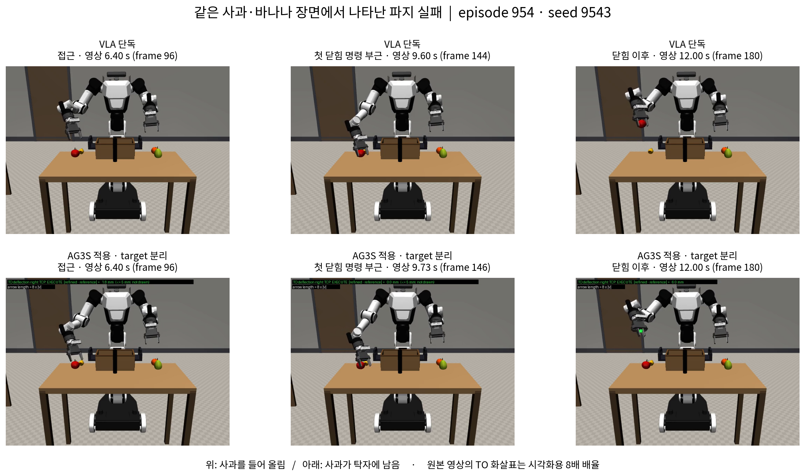
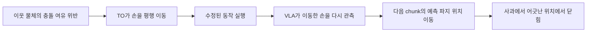
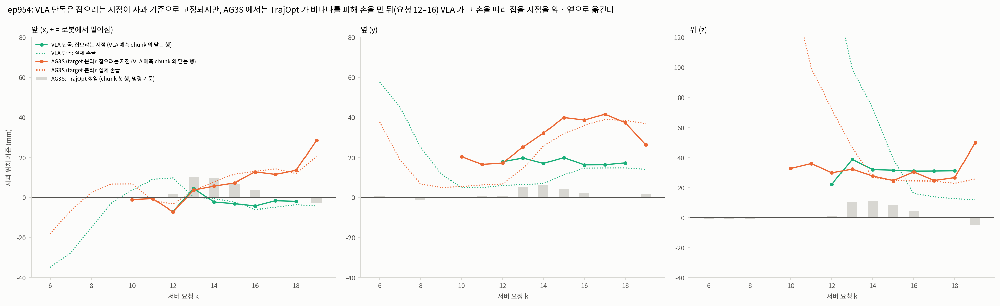
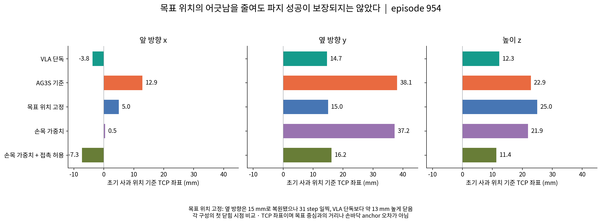
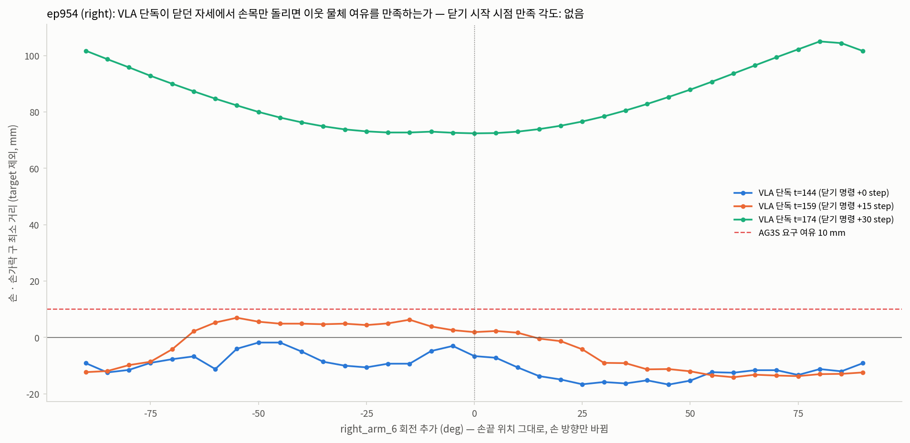

# 이웃 물체 회피 과정에서 파지 목표가 어긋나는 문제

**PPT용 기술 서술 초안 · 작성: 2026-10-25 KST**  
범위: 이웃 물체가 있는 장면의 CCR/TO(Trajectory Optimization) 문제. 가려짐 객체 문제는 별도 발표 항목으로 남긴다.  
근거: 2026-10-20~21 TO 진단 실험과 10-23까지의 관련 후속 기록. 이번 문서 작업에서는 새 로봇 실험을 수행하지 않았다.

> **발표의 중심 주장:** 이웃 물체를 피하도록 TO가 손의 경로를 수정하면서 정지한 사과의 파지 위치까지 어긋났다. 목표 위치 보존과 회전 유도를 시도했지만, 위치·자세·닫힘 시점·충돌 제약을 함께 만족시키지 못해 대표 장면의 파지 실패가 남았다. 제한된 이웃 접촉을 허용한 구성은 일부 장면을 회복했으나, 원래 요구한 ‘접촉을 피하면서 파지 목표를 보존하는 궤적 수정’의 해결로 볼 수는 없다.

## 1. 어떤 문제를 겪었는가

### 1.1 기대한 동작과 실제 동작

사과 바로 옆에 바나나가 있는 장면에서, VLA가 만든 파지 경로에 이웃 물체와의 충돌 위험이 있었다. 기대한 동작은 **잡을 위치를 유지하면서 접근 경로 또는 손의 자세를 바꾸는 것**이었다. 실제로는 TO가 손을 앞·옆·위로 옮겼고, 로봇이 사과에서 벗어난 위치에서 손가락을 닫아 빈손 파지로 이어졌다.

대표 사례는 **episode 954, seed 9543, 오른손으로 사과를 바구니에 넣는 작업**이다. 여기서 ‘AG3S 적용’은 당시 기존 구성에 target 분리 수정을 적용한 `SPL` 실행을 뜻한다. 모든 AG3S 버전에 대한 일반화가 아니다.

| 비교 | 구성 | 관찰 |
|---|---|---|
| AG3S 미적용 | VLA 단독(`E0`) | 사과를 잡아 들어 올림. 이웃 바나나 접촉도 발생 |
| AG3S 적용 | 기존 구성 + target 분리(`SPL`) | 이웃 물체를 피하며 손 위치가 이동. 사과가 탁자에 남고 빈손으로 올라감 |



**그림 1 읽는 법:** 위가 VLA 단독, 아래가 AG3S 적용이다. 첫 닫힘 명령에 해당하는 기록은 각각 step 144와 146이므로 가운데 열은 서로 2 frame 차이가 난다. 마지막 열은 두 영상 모두 frame 180이다. 시간은 15 fps 영상의 재생 시간이며, 서버 계산 지연을 포함한 실제 경과 시간이 아니다. 아래 영상에 원래 포함된 TO 화살표는 8배 배율이므로 실제 이동량은 다음 표로 판단한다.

### 1.2 파지 위치가 얼마나 어긋났는가

‘파지 목표’와 ‘실제로 닫은 위치’를 구분한다.

- **예측 파지 위치:** TO 적용 전 VLA chunk에서 그리퍼 명령이 처음 0.5 미만이 되는 행의 TCP 위치. 매 요청에서 다시 계산되는 정책의 의도다.
- **첫 닫힘 시점의 실제 TCP 위치:** 재생 기록에서 첫 닫힘 명령 시점의 TCP 위치. 접촉이 완료된 순간이나 물체 중심 자체를 뜻하지 않는다.
- 아래 좌표는 모두 **초기 사과 위치를 원점**으로 한다. 손바닥 anchor 위치와 TCP는 서로 다른 점이다.

| 첫 닫힘 시점 | 앞 x (mm) | 옆 y (mm) | 위 z (mm) | control step |
|---|---:|---:|---:|---:|
| VLA 단독 | −3.8 | 14.7 | 12.3 | 144 |
| AG3S 적용 | 12.9 | 38.1 | 22.9 | 146 |
| 차이: 적용 − 미적용 | **+16.6** | **+23.4** | **+10.6** | +2 |

차이는 반올림 전 원시 좌표로 계산했다. **발표 문장:** “충돌을 피하는 과정에서 손이 이동했고, 닫는 위치가 기준 동작보다 옆으로 약 23 mm, 위로 약 11 mm 어긋났습니다.” [R2, R3]

영상만으로 TO의 인과 기전을 확정하지 않고, 아래의 서버 기록·관절 수정량·예측 파지 위치 분석으로 연결한다.

## 2. 왜 발생했는가

### 2.1 ATS·HSR·LTE 가운데 TO를 우선 문제로 본 근거

| 구성 요소 | 역할 | 이 사례에서의 판단 |
|---|---|---|
| ATS | attention으로 목표 물체를 선택·분리 | 비교 대상은 이미 target 분리 수정이 들어간 실행이다. 분리 수정만으로 954의 파지 실패가 해결되지 않았다 |
| HSR 및 grasp latch | 작업 단계·쥠 상태 판단 | 실패 뒤 latch가 `closing`에 머물러 쥠을 인정하지 않았다. 빈손을 정상 파지로 판단한 것이 954 실패의 주된 설명은 아니다 |
| LTE | 접촉이 허가된 링크에 target을 제외한 거리장 제공 | target을 제외해도 이웃 바나나는 장애물로 남는다. 다만 후속 진단에서 target 잔류 제약도 확인됐으므로 LTE 전체가 정상이라고 단정할 수 없다 |
| **CCR / TO** | VLA 관절 궤적을 충돌 제약에 맞게 수정 | 접근 요청 12~16에서 손을 약 6~19 mm 이동시키고 회전은 0.5~1.7°에 그쳤다. 그 뒤 예측 파지 위치가 이동했다 |

따라서 **954의 목표 이탈을 유발한 개입은 TO의 회피 수정**으로 좁힐 수 있다. 이는 모든 실패가 TO에만 기인하거나 ATS·HSR·LTE의 오차를 완전히 배제했다는 뜻은 아니다. [R1, R2]

### 2.2 원인 ① 관절 궤적 추종에는 파지 위치 보존이 명시되어 있지 않았다

기존 TO는 VLA 관절 명령을 최대한 따르면서 충돌 위반, 움직임의 거칠기, 이전 chunk와의 불연속을 줄인다. 이때 관절값이 조금만 달라져도 TCP는 수 cm 이동할 수 있다. **관절 공간에서 원래 명령에 가깝다는 조건이 파지 위치를 유지한다는 조건과 같지 않다.**

기존 문제를 설명용으로 요약하면 다음과 같다. 실제 구현의 모든 항을 전개한 식은 아니다.

$$
\min_{Q,s\ge0}\quad
w_{\rm track}\sum_k\gamma_k\|q_k-r_k\|^2
+J_{\rm smooth}+J_{\rm continuity}+J_{\rm deflection\ rate}
+w_{\rm slack}\sum s
$$

$$
d(c_j(q_k))-\rho_j-m_{k,j}\ge-s_{k,j}
$$

여기서 $R$은 VLA 관절 궤적, $Q$는 수정 궤적, $c_j$와 $\rho_j$는 로봇 충돌 구의 중심과 반지름, $d$는 ESDF 거리, $m$은 요구 여유다. **정지한 물체에 대해 닫아야 할 위치 $g$를 유지하는 항은 기존 구성에 없었다.** 남은 위반은 실행 판정에서 HOLD로 이어질 수 있다. [R2, C1, C2]

### 2.3 원인 ② 수정된 손 상태가 다음 VLA 예측에도 영향을 주었다

VLA는 50-step 명령 chunk를 만들고 앞 8 step을 실행한 뒤 다시 관측한다. TO는 이 명령을 사후 수정하므로 다음 관측에는 이미 이동한 손이 나타난다. 원래 파지 위치를 별도로 보존하지 않으면 다음 chunk의 파지 위치도 달라질 수 있다.



954에서는 VLA 단독의 예측 파지 위치가 요청 12~18 동안 대체로 유지됐다. AG3S 적용에서는 요청 12부터 TO 수정이 발생한 뒤, 요청 16의 예측 파지 위치가 사과 기준 약 `(13, 39, 30) mm`로 옮겨졌다. **닫는 요청 17~18에서 TO 수정량이 거의 0이어도, 앞선 수정의 영향이 이미 상태와 VLA 예측에 남아 있었다.** 실패 순간의 TO 수정량만 확인하면 원인을 놓칠 수 있다. [R1: 10-20 23:55, 10-21 00:10; R3]



**그림 2 읽는 법:** 실선은 TO 전 VLA의 예측 파지 위치, 점선은 실제 손끝, 회색 막대는 TO가 chunk 첫 행에 가한 수정량이다. 원인 서술의 주체는 “VLA가 스스로 목표를 잘못 옮겼다”가 아니라 “TO가 손을 이동시켰고 폐루프 재예측에서 목표 이탈이 이어졌다”로 둔다.

### 2.4 원인 ③ 기준 파지 자체가 이웃 접촉을 포함했다

VLA 단독은 954에서 바나나와 접촉하면서 사과를 잡았다. 접촉은 17 control row에 기록됐다. 반면 실험 launcher는 이웃 장애물에 `--obstacle-margin 0.010`, 즉 **10 mm의 양의 여유**를 설정했다. 원래 접촉을 포함한 동작을 같은 자세로 유지하면서 양의 비접촉 여유까지 만족시킬 수는 없다. [R2, R7, V1]

다만 **다른 모든 관절 자세와 접근 경로까지 불가능하다고 입증한 것은 아니다.** 뒤에서 설명하는 기하 검사는 고정된 자세에서 마지막 손목 관절만 회전한 제한된 탐색이다. 또 초기 작업 기록과 코드 설명에는 ‘5 mm’라는 표현이 남아 있으나, 이 문서의 10 mm는 launcher와 후속 기하 검사의 설정을 따른다. 개별 충돌 행의 유효 margin까지 모두 동일하다고 주장하지 않는다.

## 3. 원인을 바탕으로 무엇을 시도했는가

### 3.1 비교 기준과 지표

아래 실험은 **VLA 단독 성공 장면으로 선택한 사과 10개, 장면당 seed 하나**의 진단이다. 장면은 `56, 211, 1837, 320, 753, 954, 309, 250, 1668, 126`이다. 전체 장면 분포의 일반 성공률 평가가 아니다.

‘성공’은 당시 기록의 `primary`를 사용한다. 이 지표가 기존 문서에서 ‘접촉 없는 성공’으로 불리더라도 **이웃 과일 접촉은 이 지표에서 제외되어 있었다.** 분석 코드는 별도로 `strict = primary AND neighbour_rows == 0`를 정의한다. 따라서 ‘9/10 성공’을 ‘모든 물체와 접촉 없이 9/10 성공’으로 표현하면 안 된다. [C4]

| 방법 | 시도한 이유 | `primary` 성공 / 10 | 대표 결과 |
|---|---|---:|---|
| VLA 단독 | 비교 기준 | 10 | 954·211은 이웃 접촉을 동반 |
| AG3S 기준: target 분리 적용 | 문제가 나타난 구성 | 7 | 211·320·954 실패 |
| look-ahead 끄기 | 먼 미래 회피가 파지를 방해하는지 확인 | 7 | 954·211 실패 유지 |
| 파지 전 수정량 유지 항 끄기(TOB) | 이전 회피 수정이 누적되는지 확인 | 7 | 다음 chunk로 이어지는 수정은 감소, 954 실패 유지 |
| 목표 위치 고정(TOA2) | 위치를 보존하고 자세로 회피 | 7 | 954 옆 방향 이탈 감소, 211 HOLD 63 chunk |
| 목표 고정 + 대체 풀이(TOA3) | 위치 고정과 충돌 회피의 충돌 완화 | 7 | 211 HOLD 49 chunk, 파지 실패 유지 |
| 후퇴·재시도(REC) | 실패 이후 정상 접근으로 복귀 | 7 | 실패 탐지와 후퇴 위치 선정이 늦음 |
| 손목 추종 가중치 완화(TOW) | 손목을 돌리는 회피를 싸게 만듦 | 8 | 320 회복, 954·211 실패 유지 |
| 손목 가중치 + 이웃 접촉 허용(NBC) | 원래 파지의 접촉을 제한적으로 허용 | 9 | 954 회복, 211 실패 유지 |

각 행을 순서대로 모두 누적한 실험이 아니다. 대부분 AG3S 기준에서 해당 기능만 바꿨다. TOA3는 TOA2의 후속이고, NBC는 TOW에 접촉 허용을 추가한 구성이다. 마지막 손목 관절 회전 검사는 offline 진단이므로 성공 수 표에 넣지 않았다. [R2, R4~R7]

## 4. 방법별 상세 설명과 실패 분석

### 4.1 진단: look-ahead 끄기

**왜 시도했는가:** 운반 중 허들을 미리 피하려고 도입한 미래 경로 검사가, 잡기 전부터 손을 과하게 이동시켰을 수 있었다.

**기존과의 차이:** 기준 실행의 `--plan-horizon 16 --lookahead obstacles --lookahead-gate-mm 20` 설정을 제거했다. target 분리와 나머지 구성은 유지했다.

**결과와 해석:** 10개 중 7개 성공으로 같았고 954·211은 그대로 실패했다. 320은 회복하고 1837은 새로 실패했다. **look-ahead를 제거하는 것만으로 대표 실패를 해소하지 못했다.** 이 실험만으로 모든 장면에서 look-ahead가 무관하다고 일반화하지 않는다. [R1: 10-20 23:30; R4]

### 4.2 방법 B: 파지 전에는 이전 회피 수정량을 유지하지 않기

**왜 시도했는가:** 허들 회피를 부드럽게 유지하기 위해 만든 항이, 접근 중의 일시적인 회피 이동까지 다음 chunk로 전달한다고 보았다.

**기존과의 차이:** $D_k=q_k-r_k$를 정책 대비 수정량이라 할 때, $\sum_k\|D_k-D_{k-1}\|^2$ 형태의 수정량 변화 억제 항과 직전 수정량 이력을 **파지 전 상태에서만 제거**했다. `--deflection-rate-after-grasp`를 켜고, 쥔 뒤 운반 구간에서는 원래 기능을 유지했다. 다른 연속성 항까지 모두 끈 것은 아니다.

**결과:** 954의 요청 13~15 첫 행에 이어지는 x 방향 수정량은 대략 `10, 10, 7 mm`에서 `5, 4, 0 mm`로 줄었다. 그러나 요청 12 끝 행의 x·z 수정은 각각 약 24 mm였고, 첫 닫힘 TCP는 `(13, 36, 22) mm`로 여전히 어긋났다.

**왜 해결되지 않았는가:** 수정량의 이월을 줄여도 **한 chunk 안의 회피 이동 자체가 남았다.** 그 이동 후 VLA가 재예측하면서 목표가 계속 어긋났다. 남은 첫 행 수정량에 `w_continuity=0.5`가 관여한다는 해석은 기록상 가설이며, 독립적으로 확인된 원인으로 쓰지 않는다. [R1: 10-21 01:10; R5; C1]

### 4.3 방법 A: 손바닥 경로와 파지 목표 위치를 비용으로 고정하기

**왜 시도했는가:** “장애물을 피하더라도 잡을 위치는 바뀌면 안 된다”는 요구를 TO가 직접 보도록 만들기 위해서다.

**기존과의 차이:** 관절 추종에 두 Cartesian 비용을 추가했다.

$$
J_{\rm anchor}=
w_{\rm tcp}\sum_k\|p_k(Q)-p_k(R)\|^2
+w_{\rm goal}\sum_{k=c}^{c+G-1}\|p_k(Q)-g\|^2,\qquad G=3
$$

- $p_k$는 **손바닥 link 원점**이다. 첫 항은 정책의 손바닥 경로 이탈을 비싸게 하고, 둘째 항은 닫는 행 $c$부터 3행 동안 기억한 목표 $g$로 유도한다.
- $g$는 VLA가 처음 닫기를 계획했을 때 해당 행의 손바닥 위치로 정한다. 정답 grasp pose를 새로 계산한 값이 아니다. target 중심에서 120 mm 이내인 후보만 채택한다.
- `latched` 또는 `closing` 상태이고 현재 손바닥이 기억한 목표에서 150 mm 안일 때 적용한다. 실험은 `--grasp-anchor 2000`을 사용했다.
- 손바닥 Jacobian으로 매 SQP 반복에서 선형화해 QP에 넣고, 후보 수락 판단에도 동일한 비용을 반영했다. 모든 관절은 움직일 수 있으며 **위치 고정은 hard constraint가 아닌 soft cost**다.
- 처음 구현은 닫는 행 뒤의 들어 올리기까지 목표에 묶는 결함이 발견되어 중단됐다. TOA2부터 목표 행을 3행으로 제한하고, chunk가 이미 닫힌 명령으로 시작하면 목표 항을 적용하지 않았다. 초기 중단 실행에는 완주 성공 수를 부여하지 않는다. [R1: 10-21 02:40~03:10; C1, C2]

**954에서 의도대로 개선된 부분:** 요청 12~14의 회피 회전은 약 6~14°로 늘었고, 손바닥의 정책 경로 이탈은 최대 약 4 mm였다. 첫 닫힘 TCP의 옆 좌표는 38 mm에서 15 mm로 줄어 VLA 단독 수준에 도달했다.

**그래도 실패한 이유:** 첫 닫힘은 step 113으로 VLA 단독의 144보다 31 step, 약 2.1초 빨랐고 TCP 높이는 약 13 mm 높았다. **손바닥 위치를 유도하는 비용이 올바른 TCP 접촉 자세와 닫힘 시점을 함께 보장하지 못했다.** 닫힘 시점 변화의 모든 원인을 이 기록만으로 분리한 것은 아니다. [R6]



**211·1668의 다른 실패:** 고정 비용이 필요한 회피 평행 이동까지 비싸게 만들었다. 211의 요청 17에서는 초기 위반 42.9 mm가 후보별 39.6~43.5 mm로 거의 줄지 않았고, 비용이 증가해 후보 3개가 모두 거절됐다. 그 결과 HOLD가 63 chunk 발생했다. 고정 비용은 여러 계획 행에 누적되므로, 단일 위치 오차만 보고 “충돌 비용이 항상 우선한다”고 계산한 초기 설명은 잘못됐다. soft cost만으로 우선순위를 보장할 수 없었다. [R1: 10-21 04:20; R6]

### 4.4 후속: 고정한 해가 위험하면 목표 고정 없이 다시 풀기

**왜 시도했는가:** 파지 위치 보존 때문에 충돌 위반을 해소하지 못하면 안전한 이동을 먼저 선택하도록 하기 위해서다.

**기존과의 차이:** 목표 고정을 포함한 해의 위반이 허용 오차를 넘으면, anchor 없이 한 번 더 풀고 위반이 더 작은 해를 선택했다. 기록에는 `grasp_anchor.fallback`으로 남긴다.

**결과:** 211에서 대체 풀이가 51회 실행됐지만, 고정 없이 다시 풀어도 위반이 19~27 mm 남았다. HOLD는 63에서 49 chunk로 감소했으나 파지는 실패했다. 954에는 대체 풀이가 발동하지 않았다.

**왜 해결되지 않았는가:** 앞선 목표 고정이 경로를 바꾼 뒤에는, 해당 상태에서 짧은 국소 최적화로 빠져나오지 못했다. 결과를 거절하고 정지하면 다음 요청에서도 비슷한 상태가 반복됐다. **같은 위치에서 비용을 바꿔 다시 푸는 것만으로 접근 경로를 재구성하거나 교착에서 탈출하지 못했다.** 다만 모든 가능한 궤적의 부재를 증명한 것은 아니다. [R1: 10-21 05:30; R6; C2]

### 4.5 후퇴·재시도: 파지 실패 뒤 정상 접근으로 복귀하기

**왜 시도했는가:** TO 수정 뒤 빈손으로 운반을 계속하거나 HOLD를 반복한다면, 손을 열고 이전 접근 상태에서 다시 시작할 필요가 있었다.

**기존과의 차이:** `--recovery-retreat`를 추가했다. 파지 전에 전체 chunk HOLD가 3회 연속이거나, 닫는 중 손가락이 멈췄지만 물체에 막히지 않은 관측이 2회 연속이면 후퇴한다. target에서 손바닥이 120 mm 이상 떨어졌던 최근 자세를 목표로 정하고, 손가락을 열어 행당 0.03 rad 이하로 복귀한다. 후퇴도 TO 검사를 거치고, episode당 최대 2회다.

**결과:** 실패 3개 장면 모두 빈손 조건으로 발동했지만 성공 수는 7/10으로 같았다. 성공 7개 장면에서는 오경보가 없었다. 이 실행은 anchor 구성이 아닌 AG3S 기준에 추가한 것이므로, TOA3의 49 chunk 교착을 직접 재시험한 결과로 읽으면 안 된다.

**왜 실패했는가:** 탐지 때 손바닥은 이미 target에서 171~373 mm 떨어져 있었다. 후퇴 목표도 현재와 비슷하거나 직전 요청 자세여서, 올바른 파지 전 상태로 되돌아가지 못했다. 954·211은 재접근 후에도 사과보다 50~170 mm 앞에서 닫았다. **늦은 실패 탐지와 부적절한 복귀 시점 선정**이 확인됐다. [R1: 10-21 14:35~15:45; R7; C1]

### 4.6 손목 관절의 수정 비용을 낮춰 회전 회피 유도하기

**왜 시도했는가:** 기존 회피가 평행 이동에 치우쳤으므로, 방향을 바꾸는 손목 관절을 상대적으로 더 많이 사용하게 하려 했다.

**기존과의 차이:** 추종 항을 $w_{\rm track}\sum_k\gamma_k\sum_j\sigma_j(q_{k,j}-r_{k,j})^2$로 바꾸고, 잡는 팔의 관절 인덱스 `4, 5, 6`에 $\sigma_j=0.1$, 나머지에 1을 적용했다. 손바닥이 target 150 mm 안에 있고 `latched/closing`일 때만 켜므로, 운반·허들 통과에는 원래 가중치를 쓴다. 앞쪽 관절을 잠그지는 않았다.

**결과:** 성공은 8/10으로 320이 회복됐다. 그러나 954의 손목 수정량 합은 29.3°에서 65.7°로 늘어난 반면, 앞쪽 관절 수정량 합도 29.9°에서 33.7°로 늘었다. 닫힘 TCP는 `(0.5, 37.2, 21.9) mm`로 옆 방향 약 23 mm 이탈이 남았다.

**왜 대표 실패를 못 풀었는가:** 손목을 싸게 움직이게 하는 것은 **손 위치 보존이나 충돌 없는 grasp pose의 존재를 보장하는 조건이 아니다.** 관절의 위치·방향 효과는 결합돼 있고, 필요한 이동을 자동으로 회전으로 대체하지 못했다. [R2, R7; C1, C2]

### 4.7 기하 진단: 마지막 손목 관절만 돌리면 가능한가

**왜 검사했는가:** 원래 닫는 위치를 유지한 채 손목 회전만으로 이웃 여유를 확보할 수 있는지 확인하려 했다.

**방법:** VLA 단독의 닫힘 자세에서 마지막 손목 관절만 −90°~+90°로 바꿔, 기록된 target 제외 거리장에서 손·손가락 충돌 구의 최소 여유를 검사했다. 새 폐루프 실행은 아니다.

| 장면·시점 | 검사한 범위의 최선 여유 | 요구 여유 | 결과 |
|---|---:|---:|---|
| 954 첫 닫힘 | −1.8 mm, −50° | +10 mm | 미충족 |
| 211 첫 닫힘 | +0.7 mm, +10° | +10 mm | 미충족 |
| 211 닫기 15 step 뒤 | −6.5 mm | +10 mm | 미충족 |

**해석:** 해당 모델·거리장·손목 회전 범위에서는 해를 찾지 못했다. **모든 관절을 활용한 다른 grasp pose나 우회 접근까지 불가능하다는 결론은 이 검사 범위를 넘는다.** [R7, C3]



### 4.8 제한된 이웃 접촉 허용: 일부 회복했지만 문제 조건이 달라짐

**왜 시도했는가:** VLA 단독의 성공 동작 자체가 이웃 접촉을 포함했다. 엄격한 비접촉 여유가 그 동작을 밀어낸다면, 손가락 근처의 접촉을 제한적으로 받아들이는 대조가 필요했다.

**기존과의 차이:** 손목 가중치 구성에 `--neighbour-contact-mm 20`을 더했다. 파지 전 손바닥이 target 150 mm 안에 있고, 잡는 손의 손가락 충돌 구가 target 120 mm 안에 있을 때만, 대상 obstacle 행에 음의 margin을 적용한다.

$$
d(c_j(q_k))-\rho_j\ge-20\ {\rm mm}
$$

이는 **충돌 구와 거리장 모델에서의 허용 겹침**이다. 실제 물체 침투가 20 mm였다는 측정이나 접촉력의 제한을 뜻하지 않는다. 조건은 ‘바나나’라는 의미 라벨이 아니라 링크·위치·행 분류를 사용한다. target·support·held 행과 손바닥·팔의 규칙은 그대로 둔다.

**결과:** 954가 회복돼 성공 수는 9/10이었다. 첫 닫힘 TCP는 `(−7.3, 16.2, 11.4) mm`로 VLA 단독에 가까웠고, 실제 이웃 접촉은 8 row였다. VLA 단독의 17 row보다 적지만 **접촉 0은 아니다.** 211은 여전히 실패했고 이웃 접촉 14 row가 발생했다.

**왜 완전한 해결이 아닌가:** 954 회복은 원래의 비접촉 조건을 완화한 결과다. 211에서는 규칙 활성화 전부터 HOLD와 경로 분기가 있었고, 사과를 지나쳐 닫는 실패가 남았다. 해당 기록은 손목 회전만으로 회피하며 파지 위치를 보존하는 방법이 완성됐다는 증거가 아니다. [R2, R7; C1, C2]

## 5. 최종 분석: 무엇이 밝혀졌고 무엇이 남았는가

### 5.1 실패는 한 종류가 아니었다

| 층위 | 확인한 사실 | 남은 요구 |
|---|---|---|
| 파지 목표 표현 | 관절 추종만으로는 TCP 파지 위치를 유지하지 못함 | 경로 수정과 파지 목표를 명시적으로 함께 다루기 |
| 자세·시점 결합 | anchor로 옆 이탈을 줄여도 높고 일찍 닫아 실패 | 손바닥 위치뿐 아니라 TCP 자세·개도·접촉 시점을 함께 평가 |
| 제약 양립 | 기준 동작에 이웃 접촉이 있고, 손목 회전 검사에서 양의 여유 미충족 | 허용 접촉 범위와 가능한 파지 자세를 구분해 정의 |
| 국소 최적화 | anchor와 충돌 비용의 경쟁, 후보 거절 후 HOLD 반복 | 회피 경로 변경과 교착 탈출까지 고려 |
| 폐루프 영향 | TO 수정 후 다음 VLA 예측이 달라짐 | 수정된 한 chunk뿐 아니라 이후 재계획까지 검증 |
| 실패 회복 | 빈손 탐지와 후퇴 목표 선정이 늦음 | 파지 직후 탐지와 의미 있는 파지 전 상태 복귀 |

**발표 결론 문장:** “TO는 충돌을 줄이는 방향으로 동작했지만, 그 수정이 원래 작업의 파지 조건을 보존하도록 설계되어 있지 않았습니다. 위치 고정과 손목 가중치로 일부 동작은 바뀌었으나, 파지 자세·닫힘 시점·충돌 여유를 동시에 만족시키지 못했습니다. 이웃 접촉 허용으로 일부 사례를 회복했으며, 비접촉 회피와 파지 보존을 함께 달성하는 문제는 남아 있습니다.”

### 5.2 후속 기록을 반영한 결론의 범위

10-21 설명만으로 “모든 문제의 원인은 TO이고 앞단은 정상”이라고 결론 내리면 부정확하다. 10-22~23에는 target 표면이 non-target 근거로 보존되어 잘못된 제약을 만드는 경로가 확인됐다. 이를 수정한 후속 구성에서는 10장면의 파지 전 HOLD가 9에서 0으로, 사과 출처 활성 제약 행이 2,117에서 39로 줄었지만, 성공은 9/10으로 같고 211은 계속 실패했다. **부정확한 제약 입력과 TO의 파지 보존 한계가 함께 존재했다.** 이 후속 구성은 NBC 계열이며, 앞의 TOA2/TOA3 실험 결과와 섞지 않는다. [R1: 10-22 03:16, 10-23 01:32]

또한 10-23의 다른 구성 비교에서는 매우 작은 명령 차이가 폐루프에서 증폭돼 성공·실패가 달라지는 현상이 관찰됐다. 따라서 이번 **10장면·seed 하나**에서 얻은 7→8→9라는 수는 사례 진단 결과다. 일반적인 성능 향상이나 “같은 성공 수이므로 방법 효과가 없다”는 통계 결론으로 확대하지 않는다. 후속 관찰이 앞선 변형들의 결과 변동을 모두 설명하는지도 미확인이다. [R1: 10-23 13:19]

다음 평가에 필요한 것은 이미 성공했다고 주장할 새 기법이 아니라, **목표 위치 오차·접촉 자세·닫힘 시점·실제 접촉·HOLD·최종 작업 성공을 함께 비교하는 기준**이다. 목적 함수 가중치 하나를 바꾸고 성공 수만 보는 방식으로는 어느 요구를 개선하거나 훼손했는지 구분하기 어렵다.

## 6. PPT로 옮길 때의 구성

| 장 | 제목 | 한 장의 핵심 | 시각 자료 |
|---|---|---|---|
| 1 | 이웃 물체 회피가 파지를 실패시켰다 | 같은 장면에서 적용 전후 결과 비교 | 그림 1, 원본 두 영상 |
| 2 | 궤적뿐 아니라 잡을 위치도 바뀌었다 | 앞 +16.6 / 옆 +23.4 / 위 +10.6 mm | §1.2 표, 그림 2 |
| 3 | TO 수정이 다음 정책 예측까지 바꿨다 | 목표 항 부재와 폐루프 재예측 | §2.3 흐름도 |
| 4 | 회피 수정의 이월을 끊어도 해결되지 않았다 | look-ahead·수정량 유지 항 진단 | §4.1~4.2, TOB 기존 그림 |
| 5 | 목표 위치 고정은 일부 작동했다 | 옆 이탈 감소와 높고 이른 닫힘 | 그림 3, anchor 식 |
| 6 | 목표 고정과 충돌 회피가 경쟁했다 | 211 HOLD 63→49, 파지 실패 유지 | §4.3~4.4 수치 |
| 7 | 손목 회전만으로는 검사 범위의 해가 없었다 | 가중치 변경과 기하 검사는 다른 실험 | 그림 4, §4.6~4.7 |
| 8 | 후퇴·재시도도 적절한 상태로 돌아가지 못했다 | 탐지 시점과 복귀 시점 문제 | 기존 회복 그림, §4.5 |
| 9 | 접촉 허용은 일부 사례를 회복했다 | 성공 9/10과 이웃 접촉을 함께 표시 | 기존 NBC 결과 그림, §4.8 |
| 10 | 파지 조건을 보존하는 TO가 필요하다 | 위치·자세·시점·제약의 결합, 검증 한계 | §5.1 표 |

발표 시간이 짧으면 4·8장을 부록으로 옮긴다. 방법 이름 A/B는 과거 기록에서 다른 의미로도 쓰였으므로, 슬라이드에는 ‘목표 위치 고정’, ‘수정량 유지 항 제거’, ‘이웃 접촉 허용’처럼 내용을 적는다.

## 7. 참고 문서·코드·원본 자료 경로

아래 상대 경로는 이 Markdown 파일 기준이다. 소스의 당시 실험 결과와 현재 코드의 동작 설명을 구분해 인용했다.

### 7.1 문서와 검증 수치

| ID | 경로 | 사용한 내용 |
|---|---|---|
| R1 | [WORKLOG_S0S3_KO.md](../../reviews/vla_dump_20261015/WORKLOG_S0S3_KO.md) | 10-20 23:30~10-21 20:00 TO 실험 경과, 10-22~23 후속 원인·해석 정정 |
| R2 | [NEIGHBOUR_CONTACT_REPORT_KO.md](../../reviews/vla_dump_20261015/NEIGHBOUR_CONTACT_REPORT_KO.md) | 문제·시도·구현·결과의 기존 종합 보고. 일반적인 해 부재 등의 강한 표현은 본문에서 검사 범위로 한정 |
| R3 | [ifg-goal-drift-ep954.json](../../../../AG3S/ag3s/docs/figures/ifg-split/ifg-goal-drift-ep954.json) | 요청별 목표 변화, 첫 닫힘 step, 정확한 TCP 좌표 |
| R4 | [IFG-APPLE-LOOKAHEADOFF.verify.json](../../../../AG3S/ag3s/docs/handoff/IFG-APPLE-LOOKAHEADOFF.verify.json) | look-ahead 제거 진단 |
| R5 | [IFG-APPLE-TOB.verify.json](../../../../AG3S/ag3s/docs/handoff/IFG-APPLE-TOB.verify.json) | 수정량 유지 항 제거, 잔류 이탈 |
| R6 | [IFG-APPLE-TOA2.verify.json](../../../../AG3S/ag3s/docs/handoff/IFG-APPLE-TOA2.verify.json) · [IFG-APPLE-TOA3.verify.json](../../../../AG3S/ag3s/docs/handoff/IFG-APPLE-TOA3.verify.json) | anchor 효과, 닫힘 높이·시점, HOLD·대체 풀이 |
| R7 | [IFG-APPLE-REC.verify.json](../../../../AG3S/ag3s/docs/handoff/IFG-APPLE-REC.verify.json) · [IFG-APPLE-NBC.verify.json](../../../../AG3S/ag3s/docs/handoff/IFG-APPLE-NBC.verify.json) | 회복, 손목 가중치, 회전 검사, 이웃 접촉 허용 |
| R8 | [IFG-APPLE-NBC-TARGETSURFACE.verify.json](../../../../AG3S/ag3s/docs/handoff/IFG-APPLE-NBC-TARGETSURFACE.verify.json) | target 표면 점 보존 문제를 수정한 후속 결과 |

### 7.2 구현·분석 코드

| ID | 경로 | 확인 위치 |
|---|---|---|
| C1 | [safe_policy.py](../../../../AG3S/trajopt/safe_policy.py) | `_deflection_rate_gate`, `_grasp_anchor_gate`, `_wrist_track_gate`, `_neighbour_contact_gate`, `_recovery_observe`, `_recovery_chunk` |
| C2 | [grasp_anchor.py](../../../../AG3S/trajopt/grasp_anchor.py) · [sqp.py](../../../../AG3S/trajopt/sqp.py) · [problem.py](../../../../AG3S/trajopt/problem.py) · [linearize.py](../../../../AG3S/trajopt/linearize.py) | anchor 비용·행 mask, fallback, 관절 추종, 이웃 margin 적용 |
| C3 | [ifg_goal_drift.py](../../../../AG3S/ag3s/experiments/studies/ifg_goal_drift.py) · [ifg_roll_feasibility.py](../../../../AG3S/ag3s/experiments/studies/ifg_roll_feasibility.py) | TCP 측정 정의와 제한된 손목 회전 검사 |
| C4 | [ifg_apple_fail.py](../../../../AG3S/ag3s/experiments/studies/ifg_apple_fail.py) · [ifg_nbc_result.py](../../../../AG3S/ag3s/experiments/studies/ifg_nbc_result.py) | `primary`와 이웃 접촉 없는 `strict`의 구분, NBC 표 |

### 7.3 원본 영상과 run 경로

공통 원본 root:

```text
/mnt/dev/AG3S_VLA-storage/results/development/20261019T132719+0900_f15e587290f6_11408fd6d27f/verify/
```

- **V1 · 사용자 제공 영상, AG3S 미적용:** [E0_ep954_s9543/third_person_front.mp4](/mnt/dev/AG3S_VLA-storage/results/development/20261019T132719+0900_f15e587290f6_11408fd6d27f/verify/IFG-APPLE/runs/E0/E0_ep954_s9543/third_person_front.mp4)
- **V2 · 사용자 제공 영상, AG3S 적용:** [SPL_ep954_s9543/third_person_front.mp4](/mnt/dev/AG3S_VLA-storage/results/development/20261019T132719+0900_f15e587290f6_11408fd6d27f/verify/IFG-APPLE-SPLIT/runs/SPL/SPL_ep954_s9543/third_person_front.mp4)
- 각 영상과 같은 디렉터리의 `manifest.json`, `traj.npz`, `frames.jsonl`이 장면·동작 기록이다.
- 당시 실행 설정: 위 root 아래 `IFG-APPLE-SPLIT/p/start_server.sh`. `--obstacle-margin 0.010` 확인.
- 수정 실험 폴더: 위 root 아래 `IFG-APPLE-LOOKAHEADOFF`, `IFG-APPLE-TOB`, `IFG-APPLE-TOA2`, `IFG-APPLE-TOA3`, `IFG-APPLE-REC`, `IFG-APPLE-TOW`, `IFG-APPLE-NBC`. snapshot 식별자는 각 `verify.json`에 남아 있다.

### 7.4 시각 자료와 재현

| 자료 | 경로 | 용도 |
|---|---|---|
| 새 영상 비교 그림 | [01_video_comparison.png](assets/01_video_comparison.png) · [SVG](assets/01_video_comparison.svg) · [출처 JSON](assets/01_video_comparison.json) | 문제 상황 제시. 원본 frame 6개도 assets에 보존 |
| 새 닫힘 위치 비교 그림 | [02_close_position.png](assets/02_close_position.png) · [SVG](assets/02_close_position.svg) · [수치·출처 JSON](assets/02_close_position.json) | 목표 위치 고정과 접촉 허용 결과 비교 |
| 요청별 목표 이동 | [ifg-goal-drift-ep954.png](../../../../AG3S/ag3s/docs/figures/ifg-split/ifg-goal-drift-ep954.png) | TO 수정 이후 VLA 파지 목표 이동 |
| 수정량 유지 항 제거 | [ifg-goal-drift-ep954-deflection-rate-after-grasp.png](../../../../AG3S/ag3s/docs/figures/ifg-split/ifg-goal-drift-ep954-deflection-rate-after-grasp.png) | TOB 후 남은 목표 이탈 |
| TO 변형 비교 | [ifg-to-variants.png](../../../../AG3S/ag3s/docs/figures/ifg-split/ifg-to-variants.png) | 장면별 성공·실패 및 HOLD |
| 회복 실패 | [ifg-rec-recovery.png](../../../../AG3S/ag3s/docs/figures/ifg-split/ifg-rec-recovery.png) | 후퇴 발동·복귀 목표의 거리 |
| 회전 가능성 검사 | [ifg-roll-feasibility-ep954.png](../../../../AG3S/ag3s/docs/figures/ifg-split/ifg-roll-feasibility-ep954.png) | 제한된 손목 회전의 여유 부족 |
| 접촉 허용 결과 | [ifg-nbc-result.png](../../../../AG3S/ag3s/docs/figures/ifg-split/ifg-nbc-result.png) | 성공 수와 실제 이웃 접촉 수 |

기존 그림의 같은 이름 `.json`에 정의와 수치가 있다. 새 그림의 JSON에는 원본 경로와 SHA-256을 기록했다. 새 그림은 실제 영상 frame과 기존 검증 수치만 사용했으며, 추정한 궤적을 영상에 덧그리지 않았다.

저장소 root에서 다음 명령으로 새 그림 2개를 다시 생성한다. GPU나 새 rollout은 필요 없다.

```bash
MPLCONFIGDIR=/tmp/ag3s-to-ppt-mpl .venv-ag3s/bin/python doc/active/presentations/to_grasp_failure/make_figures.py
```
