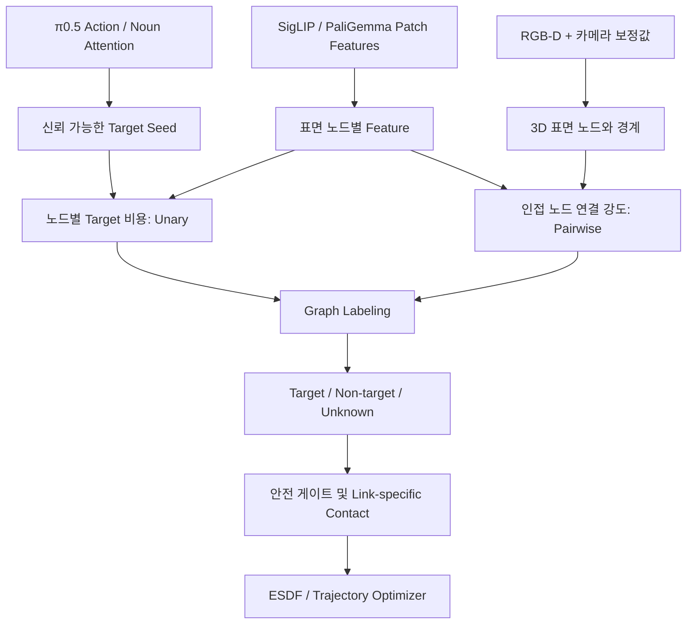

# AG3S-VLA 기술 설명서: 3D Surface Graph 연산과 파라미터 튜닝

> **목적:** Frozen π0.5의 Attention으로 선택한 Target Seed를 기준으로, 내부 시각 특징과 RGB-D 기하 정보를 결합해 **Target / Non-target / Unknown**을 분리하는 3D Graph 방식의 동작 원리·계산량·파라미터 설계·실험 절차를 설명한다.  
> **적용 범위:** AG3S의 Target–Obstacle 구분 모듈. 기존 ESDF·Trajectory Optimization·Link-specific Contact 제약은 유지한다.  
> **중요:** 본 문서의 결합 방식과 권장 절차는 **AG3S에 적용하기 위한 설계 가설**이다. Graph Cut, Supervoxel, Feature Affinity는 기존에 연구된 방법이지만, π0.5 내부 Attention과 결합했을 때의 성능 개선은 별도 검증이 필요하다.

> **2026-10-15 실행 보완:** 실패 후 개선·재실험은 **§15**를 따른다. 기존 절차는 원인별 조언까지만 있었으므로, 실패 분류·당위성 확인·최소 수정·전체 dev 재평가·held-out 실패 처리까지 추가했다. 수치/평가 정본은 [실험 프로토콜 v1.2](vla_dump_20261015/EXPERIMENT_PROTOCOL_KO.md)이며, 본문의 Graph Cut 예시와 정본의 연속 graph 최적화를 같은 solver로 취급하지 않는다.

---

## 1. 요약: 왜 Graph가 필요한가?

기존 Feature-only 방식은 Attention으로 찾은 Target Seed에서 대표 특징(Prototype)을 만들고, 다른 관측 위치의 특징과 유사한지를 비교한다.

```text
기존 방식:
Action / Noun Attention → Target Seed → Feature Prototype
                                   ↓
                           Cosine Similarity
                                   ↓
                         Target / Non-target
```

이 방식은 **특징이 비슷하지만 서로 다른 물체** 또는 **같은 패치 안의 손·사과·기둥이 섞인 상황**에서 혼입을 일으킬 수 있다. Feature는 물체의 외형·의미를 설명하지만, 물리적으로 같은 표면인지 항상 알려주지는 않는다.

그래프 방식에서는 관측 표면을 여러 **노드(Node)**로 나누고, 가까운 표면 노드 사이에 **간선(Edge)**을 만든다. 각 노드가 Target일 가능성과 이웃 노드가 같은 객체일 가능성을 **함께** 고려한다.



**안전 원칙:** `Target`이라는 라벨만 얻었다고 해당 공간을 장애물에서 전역적으로 제거하지 않는다. **정확히 확인된 Target 표면**에 대해 **허용된 로봇 링크·작업 단계**에서만 접촉 예외를 적용한다. `Non-target`과 `Unknown`은 기본적으로 회피 대상으로 유지한다.

---

# Part I. 추가 Graph 연산의 상세 원리

## 2. 그래프의 노드는 무엇인가?

그래프를 $G=(V,E)$라 하자.

- $V$: 현재 장면에서 구분한 관측 **3D 표면 영역들의 집합**
- $E$: 서로 인접하거나 연속된 표면이라고 판단할 수 있는 **노드 쌍의 집합**

각 노드 $i$에는 다음과 같은 속성을 둘 수 있다.

| 속성 | 표기 | 의미 | 출처 |
|---|---|---|---|
| 3D 중심 좌표 | $\mathbf x_i\in\mathbb R^3$ | 노드가 어디에 있는지 | Depth 역투영 + Extrinsic |
| 표면 법선 | $\mathbf n_i\in\mathbb R^3$ | 표면이 어느 방향을 향하는지 | 근방 점군의 법선 추정 |
| 시각 특징 | $\mathbf f_i\in\mathbb R^d$ | 모양·질감·의미 등의 학습된 표현 | SigLIP/PaliGemma, 투영·집계 |
| Seed 신뢰도 | $a_i$ | VLA Attention이 이 영역을 얼마나 지지하는지 | 기존 Attention lifting |
| Depth/관측 신뢰도 | $r_i$ | 결측·노이즈·가림 등 관측의 신뢰성 | 센서·기하 검사 |
| Robot/Grasped 라벨 | $m_i$ | 자기 로봇·쥔 물체 여부 | FK·Self-filter·grasp state |

### 2.1 16×16 Attention 패치 하나를 3D 노드 하나로 만들면 안 되는 이유

16×16 Attention은 224×224 이미지 기준으로 개별 패치가 비교적 큰 시야를 담당한다. 그 안에 **사과, 손가락, 테이블**의 픽셀이 모두 들어갈 수 있다. 패치 중심의 Depth 한 점만 사용하거나 패치 전체를 평균점 하나로 만들면 다른 물리적 표면이 합쳐진다.

**권장 순서:**

1. 원본 Depth 픽셀을 3D Point로 역투영하고, 원본 픽셀 좌표를 보존한다.
2. RGB/Depth의 실제 resize·crop·camera intrinsics 변환을 반영하여 각 점에 Attention 및 Patch Feature를 정렬한다.
3. Depth 불연속, 공간적 연결성, 법선 차이 등을 이용해 **관측 표면 단위**로 분할한다.
4. 같은 표면에 속하는 점들을 노드로 요약한다. 하나의 Attention Patch에 복수의 표면 노드가 들어가도 괜찮다.

> **중요한 한계:** 원본 Attention/Feature가 16×16 수준이면 동일 패치 내부의 두 물체는 **같거나 매우 비슷한 Feature**를 받을 수 있다. Depth나 고해상도 RGB 경계로 표면을 나눌 수는 있지만, 가려져 보이지 않는 뒷면을 복원하거나 Feature만으로 두 물체의 정체를 구분할 수는 없다.

### 2.2 Depth에서 3D 좌표를 만드는 방법

핀홀 카메라 모델에서 Depth 픽셀 $(u,v,z)$를 역투영하면:

$$
X=\frac{(u-c_x)z}{f_x},\qquad
Y=\frac{(v-c_y)z}{f_y},\qquad Z=z.
$$

이를 카메라 좌표계에서 공통 World/Base 좌표계로 변환한다.

$$
\mathbf x_{world}=\mathbf T_{world\leftarrow cam}\,[X,Y,Z,1]^\top.
$$

**주의:** Head/Wrist camera 각각의 시점과 보정값을 사용하며, 이미지 crop/resize 후의 좌표계 혼동을 방지한다. RGB–Depth 정합, 동기화, 로봇 움직임 중 Wrist 카메라 pose 갱신도 필요하다.

---

## 3. 간선은 언제 생성하는가?

모든 노드를 서로 연결하지 않고 **가까운 표면에만** 간선을 두는 **Sparse Graph**가 적합하다.

예를 들어:

- 동일한 물체의 연속적인 사과 표면: 간선 후보를 만든다.
- 사과와 조금 떨어진 검은 기둥: 거리가 가깝더라도 법선·Depth 경계·Feature를 보고 연결을 약하게 만든다.
- 서로 멀리 있는 두 개의 빨간 사과: Feature가 비슷해도 공간적으로 멀다면 일반적으로 연결하지 않는다.

간선 후보 생성 방법에는 3D 반경 탐색, $k$-nearest neighbors, 2D 픽셀 이웃 기반 표면 인접성, voxel/supervoxel 인접성 등이 있다. $k$-NN만 사용하면 **실제 3D 표면 연결이 끊어진 두 물체**도 연결될 수 있으므로, 센서의 관측 경계와 물체 사이의 빈 공간을 확인하는 편이 안전하다.

### 3.1 간선 강도 $W_{ij}$의 의미

$W_{ij}$는 “노드 $i$와 $j$를 **서로 다른 라벨로 나누면 얼마나 손해인가**?”라는 값이다.

- **큰 $W_{ij}$:** 두 노드를 갈라놓으면 큰 비용 → 같은 물체로 묶기 쉬움
- **작은 $W_{ij}$:** 둘을 갈라도 비용이 작음 → 객체 경계로 분리하기 쉬움

직관적인 형태는 다음과 같다.

$$
W_{ij}=g_{ij}\,
\exp\!\left(-\frac{\|\mathbf x_i-\mathbf x_j\|^2}{2\sigma_x^2}\right)
\exp\!\left(-\frac{1-\cos(\mathbf f_i,\mathbf f_j)}{\sigma_f}\right)
\exp\!\left(-\frac{1-|\mathbf n_i^\top\mathbf n_j|}{\sigma_n}\right).
$$

- $g_{ij}\in[0,1]$: 깊이 불연속·공간적 끊김 등을 반영하는 **기하 경계 게이트**
- $\sigma_x,\sigma_f,\sigma_n$: 거리·특징·법선 차이에 대한 **민감도**를 결정하는 척도
- 모든 인수는 음수가 아닌 값을 유지한다. 간선은 실제로 후보인 가까운 노드 사이에만 생성한다.

위 식은 **AG3S를 위한 예시 설계식**이며 특정 기존 논문의 고정된 공식은 아니다. 법선만으로는 둥근 사과의 서로 인접한 표면이 분리될 수 있으므로, 국소 곡률·법선 신뢰도에 따라 가중치를 조절하거나 법선 항을 제거하는 ablation을 권장한다. 법선에 절댓값을 쓸지는 법선 방향의 일관성 여부에 따라 결정해야 한다.

### 3.2 손이 사과를 잡고 있을 때는?

손가락과 사과가 실제로 접촉하면 3D 거리만으로는 구분이 불가능할 수 있다. 따라서 **Robot Self-filter(FK 기반 기존 마스크)**와 grasp state를 독립적인 제약으로 사용한다.

- 로봇 표면으로 신뢰 있게 분류된 점은 **Target Seed에서 제외**하고, 필요하면 별도의 로봇 라벨/제약을 부여한다.
- 손가락과 사과 사이의 연결이 강해도, 로봇 소유 표면이 Target으로 전파되지 않도록 막는다.
- Grasp 이후에는 **그립된 물체의 ownership/attachment 상태**를 별도 관리한다.

Feature + Geometry가 잘 동작해도 Robot Link 제약을 대체하지는 못한다.

---

## 4. 그래프 최적화는 실제로 무엇을 계산하는가?

### 4.1 각 노드에 라벨을 붙인다

가장 단순한 경우에는 이진 라벨을 쓴다.

$$
y_i\in\{1\;(Target),\;0\;(NonTarget)\}.
$$

최적화 목적함수는 다음과 같다.

$$
\boxed{
E(\mathbf y)=
\underbrace{\sum_{i\in V}D_i(y_i)}_{\text{Unary: 노드 자체의 라벨 적합도}}
+\lambda\underbrace{\sum_{(i,j)\in E}W_{ij}\,\mathbf1[y_i\ne y_j]}_{\text{Pairwise: 잘 연결된 노드를 분리하는 비용}}
}
$$

여기서 $\mathbf 1[\cdot]$은 조건이 참이면 1, 아니면 0이다.

#### Unary 비용 $D_i$: 이 노드 자체가 타깃처럼 보이는가?

예를 들어 Attention Seed, Feature Prototype 유사도, 관측 품질을 결합해 $p_i\in(0,1)$라는 **보정된 Target 소속 추정 점수**를 만든다면:

$$
D_i(Target)=-\log(\tilde p_i),\qquad
D_i(NonTarget)=-\log(1-\tilde p_i),\qquad
\tilde p_i=\mathrm{clip}(p_i,\varepsilon,1-\varepsilon).
$$

- $p_i$가 높으면 Target 라벨 비용이 작음
- $p_i$가 낮으면 Non-target 라벨 비용이 작음

**주의:** Attention이나 Cosine Similarity 값은 그대로 확률이 아니다. 위 식을 사용하려면 별도의 변환/캘리브레이션을 설계하고, 실제 정확도를 확인해야 한다. 초기에는 로짓을 경험적으로 정의하되 “확률”이라고 주장하지 않는다.

#### Pairwise 비용: 연결된 두 노드의 라벨이 달라도 되는가?

- 같은 물체 표면의 간선 $W_{ij}=0.9$라면 분리 페널티가 큼
- 사과–기둥 경계의 간선 $W_{ij}=0.05$라면 분리 페널티가 작음

그래프 최적화는 전체 노드의 라벨을 동시에 정해, **노드 단서와 주변 표면의 연속성 사이에 균형**을 찾는다.

### 4.2 세 노드짜리 숫자 예시

다음은 설명을 위한 임의 수치이며, AG3S 실측값이 아니다.

```text
[사과 A] --- 강한 간선(0.90) --- [사과 가장자리 B] --- 약한 간선(0.05) --- [기둥 C]
   p=.90                                 p=.60                              p=.15
```

$\lambda=2$로 설정하자.

| 라벨 배정 (A,B,C) | Unary 합(근사) | 간선 분리 비용 | 전체 에너지 |
|---|---:|---:|---:|
| Target, Target, Non-target | 0.779 | $2\times0.05=0.100$ | **0.879** |
| Target, Non-target, Non-target | 1.184 | $2\times0.90=1.800$ | 2.984 |
| Target, Target, Target | 2.513 | 0 | 2.513 |

따라서 이 예시에서는 **사과 A/B는 Target으로 묶고 기둥 C는 제외하는 결과**가 에너지를 가장 낮춘다.

이것이 Feature-only Threshold와 다른 점이다. B의 점수가 애매하더라도 A와의 연결이 강하다는 근거를 활용할 수 있다. 반면 B와 C 사이의 약한 연결은 기둥으로 라벨이 번지는 것을 막는다.

### 4.3 Graph Cut과 다른 알고리즘의 차이

| 알고리즘 | 작동 개념 | AG3S 활용 관점 |
|---|---|---|
| **Seeded Region Growing** | Seed에서 시작해 연결 조건을 충족하는 이웃으로 확장 | **가장 단순한 첫 Baseline**; 빠르지만 초기 Seed·확장 순서와 임계값에 민감 |
| **Label Propagation** | 이웃 가중치를 따라 Seed 정보를 여러 번 전파 | 구현이 비교적 단순하나 전파 누출·수렴 조건 확인 필요 |
| **Binary s–t Graph Cut** | Unary/Pairwise 비용을 최소화하는 Target–Non-target 분할 | 위와 같은 **비음수 Potts Pairwise**의 이진 문제는 최소 컷으로 전역 최적해를 구할 수 있음 |
| **Multi-label 방법** | Target/Obstacle/Unknown 등 3개 이상 라벨을 직접 최적화 | 일반적으로 binary cut보다 복잡함; α-expansion 등의 근사 해법은 사용 가능 조건 확인 필요 |

**Unknown의 처리:** 이진 Graph Cut 결과만으로는 불확실성이 자동으로 제공되지 않는다. 보수적인 **별도의 reject/uncertainty gate**를 도입하거나 다중 라벨 최적화를 명시적으로 설계해야 한다. C arm에서는 이진 분할 + 별도 reject gate를 명시한다. 현재 실행 정본의 첫 graph 기준은 연속 Q이며, C는 §15의 근거 확인 뒤 추가 비교한다.

**Hard Seed 주의:** 확실한 Target/Non-target Seed에 큰 페널티를 부여할 수 있지만, 잘못 선택한 Hard Target Seed는 위험한 오분류를 강제할 수 있다. 강제 Seed는 충분히 검증된 경우에만 사용한다.

---

## 5. 왜 추가 연산 비용이 발생하는가?

### 5.1 Feature-only와 Graph의 연산 비교

Feature-only:

1. Seed 특징을 평균해 Prototype 생성
2. 각 특징과 Cosine Similarity 계산
3. Threshold 또는 연결성 후처리

Graph 추가:

1. Depth Point Cloud 구성·전처리
2. 표면 노드(예: supervoxel/connected surface segment) 생성
3. 노드마다 위치·법선·Feature·신뢰도 집계
4. **이웃 탐색**으로 간선 후보 생성
5. 모든 간선의 $W_{ij}$ 계산
6. Region Growing / Label Propagation / Graph Cut 수행
7. 결과를 관측 점군과 ESDF 안전 인터페이스에 다시 연결

### 5.2 노드와 간선 규모

노드 수가 $N$일 때 모든 노드를 연결하면 간선은 최대 $N(N-1)/2$, 즉 $O(N^2)$이다.

가까운 $k$개 이웃만 연결하는 경우 저장·가중치 평가할 간선 수는 일반적으로 $O(Nk)$ 수준이다. **이것은 그래프의 크기에 대한 설명이지, 전체 최적화 실행시간이 항상 $O(Nk)$라는 뜻은 아니다.**

- Voxelization/특징 집계: 입력 포인트 수 및 자료구조에 좌우
- Nearest-neighbor 검색: KD-tree/voxel hashing 등 사용 방법에 좌우
- 법선 추정: 근방 점군 크기와 데이터 품질에 좌우
- Graph Cut/Label Propagation: 그래프 크기·구조·알고리즘과 구현에 좌우
- Multi-view: 중복 관측을 어떻게 병합하는지에 좌우

**예시(가정):** 표면 노드 4,000개에 평균 간선 차수 8을 두면 무방향 간선은 약 $4,000\times8/2=16,000$개이다. 이는 **실험 결과나 속도 보장값이 아닌** 그래프 규모 계산 예시다.

### 5.3 실시간성을 위해 지켜야 할 기준

- **ROI 제한:** 현재 Target 후보와 그 주변 안전 여유 공간에만 고비용 Graph 연산을 수행한다. ROI 밖의 환경 점군은 ESDF 충돌 대상에서 제거하지 않는다.
- **Sparse Adjacency:** 공간적으로 연결된 표면에만 간선을 만든다.
- **재사용:** 변화가 작은 정적 환경에서는 인접 관계·Voxel 구조 등 재활용을 검토한다. 이동 로봇·물체·Wrist Camera 변화는 갱신한다.
- **측정 분해:** Feature Extraction / Node Creation / Edge Construction / Optimization / Safety Transfer의 시간을 각각 기록한다.
- **비동기 설계 주의:** 갱신 주기를 낮출 경우 **Scene Information Age**와 이동 장애물의 변화 대응성을 측정해야 한다.

권장 지연 지표는 평균만이 아니라 **P50·P95·최악값**, 추가 GPU 메모리, Feature Extraction이 π0.5 추론에 더하는 overhead, 갱신 지연이다.

---

# Part II. 파라미터 튜닝의 상세 원리

## 6. 파라미터 튜닝이란 무엇인가?

파라미터 튜닝은 **동일 물체의 표면은 연결하고 다른 물체의 표면은 분리하기 위한 민감도와 기준을 정하는 작업**이다.

예를 들어 사과와 기둥 사이가 5mm 떨어져 있을 때:

- 이웃 탐색 반경이 10mm이면 양쪽 표면 사이에 **간선 후보**가 생길 수 있다.
- 3mm이면 그 후보가 생기지 않을 수 있지만, 사과 자체의 유효한 표면 연결도 끊어질 수 있다.

단, **간선 후보가 생겼다고 반드시 하나의 물체로 합쳐지는 것은 아니다.** 실제 병합 여부는 Feature·법선·경계 게이트·Unary·$\lambda$가 함께 결정한다.

> **주의:** 수치 3mm/5mm/10mm는 이해를 돕는 사례이며 센서 오차·작업 거리·물체 크기가 반영된 AG3S 권장값이 아니다.

---

## 7. 주요 파라미터의 의미와 실패 양상

| 파라미터 | 실제 역할 | 값이 작을 때 | 값이 클 때 |
|---|---|---|---|
| **Voxel Size** $r_v$ | 점군을 격자로 축약하는 최소 크기 | 노드·노이즈 증가, 연산 증가 | 인접 객체가 같은 voxel에 합쳐질 수 있음 |
| **Supervoxel Seed Size** $r_s$ | 표면 요약 영역의 대표 크기 | 파편화·연산 증가 | 얇은 장애물 및 경계 소실 |
| **Neighbor Radius** $r_n$ / $k$ | 간선 후보 범위 또는 수 | 같은 물체 연결이 끊어짐 | 서로 다른 물체에도 간선 후보가 생김 |
| **Depth Jump Threshold** $\tau_z$ | 관측 깊이 불연속 판정 | 경사진 정상 표면이 잘못 단절 | 전후로 분리된 물체가 연결될 수 있음 |
| **Normal Angle Threshold** $\tau_\theta$ | 법선 차이를 얼마나 허용할지 | 둥근 사과 표면이 파편화 | 손·물체 경계를 통과할 수 있음 |
| **Feature Threshold** $\tau_f$ | `cosine ≥ τ_f`인 경우 포함 | 더 쉽게 포함되어 혼입 증가 가능 | 더 엄격하여 Target Recall 저하 가능 |
| **Geometry Scale** $\sigma_x$ | 거리에 따른 간선 감쇠 속도 | 연결성 부족 | 먼 표면 영향 확대 |
| **Feature Scale** $\sigma_f$ | 특징 차이에 따른 감쇠 속도 | 미세 차이에도 간선 단절 | 다른 객체도 유사하게 취급 |
| **Normal Scale** $\sigma_n$ | 법선 차이에 따른 감쇠 속도 | 곡면 단절 | 법선 경계 정보 약화 |
| **Smoothness** $\lambda$ | 라벨 일치 비용의 상대적 비중 | 조각난 Segmentation | 다른 물체까지 과도 병합 |
| **Seed Confidence** $\tau_s$ | `confidence ≥ τ_s`인 경우 seed 인정 | 잘못된 Seed 포함 증가 가능 | 좋은 Seed 누락 가능 |
| **Unknown band 폭** $b_u$ | 점수의 미확정 구간 폭(구간 중심은 고정) | 미확정 구간이 좁아져 성급한 확정 가능 | Unknown 증가·Target Recall 감소 가능 |
| **ROI Margin** $m_{ROI}$ | 상세 분할을 수행할 주변 공간 | 필요한 표면·이웃 누락 | 계산량 증가 |

같은 개념을 두 번 제어하는 파라미터를 과도하게 만들지 않는 것이 중요하다. 예를 들어 $\tau_f$로 간선을 강하게 자르고 $\sigma_f$로 같은 유사도 차이를 다시 조절하면, 어느 설정 때문에 성능이 달라졌는지 해석하기 어려울 수 있다.

### 7.1 원시 거리 대신 정규화된 특징을 쓰는 이유

3D 거리(미터), 법선 각도(도/라디안), Cosine Similarity(무차원)는 단위와 범위가 다르다. 다음처럼 단위를 맞추지 않고 더하면 의미 없는 가중치가 될 수 있다.

$$
W_{ij}=\alpha\,\|\mathbf x_i-\mathbf x_j\|+\beta\,\cos(\mathbf f_i,\mathbf f_j)
$$

일반적으로 각 차이를 고유한 척도 $\sigma_x,\sigma_f,\sigma_n$로 정규화한 뒤 곱하거나, 명시적으로 보정된 비용을 사용한다. 장면마다 깊이 센서 노이즈가 다르면 거리와 법선 불확실성 역시 함께 고려해야 한다.

### 7.2 Voxel Size와 Supervoxel Size는 다르다

- **Voxel:** 3D 공간을 일정한 격자 셀로 나누어 점을 묶는 기본 자료구조.
- **Supervoxel:** 색·법선·위치·연결성 등을 이용해 **여러 voxel을 하나의 관측 표면 영역**으로 묶은 결과.

Supervoxel을 사용하면 그래프 노드가 크게 줄어 연산 비용이 감소한다. 그러나 하나의 supervoxel이 사과와 기둥의 경계를 가로질러 만들어지면 **뒤의 Graph Cut이 그 노드를 두 물체로 다시 나눌 수 없다.** 그래서 초기에 **경계를 넘지 않는 보수적인 과분할(over-segmentation)**이 중요하다.

### 7.3 법선·Depth만으로 풀 수 없는 사례

- 사과 표면은 구면이라 인접한 정상 표면끼리도 법선 방향이 다르다.
- 손가락과 사과는 서로 닿아서 3D 거리 차이가 거의 없다.
- 기둥과 사과의 접촉점은 가시적인 Depth Gap이 없을 수 있다.
- 투명·반사체나 경계 픽셀은 Depth가 누락되거나 튈 수 있다.
- 가려져 보이지 않는 면은 어떤 그래프도 관측 없이 실제 형상을 확정할 수 없다.

따라서 특징·기하·Robot Self-filter·Uncertainty를 **각각 다른 역할**로 사용해야 한다.

---

## 8. $\lambda$와 Feature/Geometry 가중치를 어떻게 이해할까?

### 8.1 $\lambda$가 너무 작을 때

노드의 Feature/Attention Score가 조금만 변해도 각 노드가 독립적으로 Target 또는 Non-target이 된다.

```text
타깃 사과 표면:  T T N T N T  ← 경계가 들쭉날쭉, 누락 증가
```

### 8.2 $\lambda$가 너무 클 때

연결된 노드가 같은 라벨이 되려는 힘이 강해져, **사과와 기둥 사이 간선이 약하지 않다면** 둘까지 합쳐질 수 있다.

```text
사과 T T T + 기둥 T T  ← Obstacle을 Target으로 잘못 포함할 위험
```

### 8.3 좋은 설정의 의미

같은 사과 내부 연결에서는 분할이 덜 흔들리되, 기둥·손·테이블 경계의 간선은 충분히 약해져서 라벨이 넘어가지 않는다.

```text
사과: T T T T   |낮은 W_ij|   기둥: N N
```

중요하게도 $\lambda$의 최적값을 단일 숫자로 제시할 수는 없다. Unary 비용의 크기/캘리브레이션이 바뀌면 같은 $\lambda$도 전혀 다른 효과를 보인다. **Unary와 Pairwise의 값 분포를 먼저 기록**해야 한다.

---

## 9. AG3S에서 권장하는 튜닝 순서

무작정 모든 파라미터의 조합을 전수 조사하지 말고 **원인 분리가 가능한 순서**로 실험한다.

### 단계 0 — 동일 입력·Ground Truth 준비

- **frame022** 등 기존 실패 재현 장면을 고정하고 센서 원본, 카메라 보정값, π0.5 Feature, Attention, 로봇 관절 상태를 보관한다.
- Target/Obstacle GT는 가능하면 **MuJoCo Object ID/Geometry**에서 만든다. 외부 Segmenter 결과를 절대 정답으로 가정하지 않는다.
- Seed 오류와 영역 확장 오류를 나눠 기록한다. GT Target Seed를 준 **Oracle Seed** 실험을 추가하면 분리 가능하다.
- 카메라 간 정렬·Depth 스케일·좌표계 단위를 먼저 확인한다.

### 단계 1 — Feature-only / Geometry-only 진단

- 기존 Attention-only 결과 재현
- Feature-only: Seed Prototype과 패치/표면 Feature 유사도만 사용
- Geometry-only: 동일 Seed에서 표면 연결성과 Depth 경계만 사용
- 두 방식의 Target Recall, 오분류 사례, 계산 시간을 비교

이 단계에서 Feature가 서로 다른 객체를 혼합하는지, Geometry만으로 사과가 지나치게 분리되는지 분석한다.

### 단계 2 — 간단한 Seeded Region Growing

복잡한 Graph Cut보다 먼저 **Feature + Geometry 게이트를 결합한 Region Growing**을 실험한다.

```text
입력: 노드, 연결 후보, Attention Seed, Feature Prototype
시작: 검증된 Target Seed만 큐에 추가
반복:
  이웃 노드가 관측상 연속이고
  feature/geometry 조건을 통과하며
  robot/uncertainty 안전 게이트를 통과할 때만 확장
출력: 보수적인 Target 후보 + 나머지 비타깃/미확정
```

성능이 충분하면 Graph Cut의 구현·튜닝 비용을 추가로 들이지 않아도 된다.

### 단계 3 — Graph Cut을 사용한다면

1. 표면 노드 및 Sparse Edge를 확정한다.
2. Edge별 $W_{ij}$ 분포를 **같은 객체 내부 vs 서로 다른 객체 경계**로 나누어 시각화한다.
3. Unary의 Calibration과 False Seed 사례를 검증한다.
4. $\lambda$를 변화시키며 Recall–Contamination 균형을 관찰한다.
5. Graph Cut 후 **보수적인 Unknown/Contact 게이트**를 통과시킨다.

특히 사과–기둥 경계 간선의 $W_{ij}$가 계속 높으면 $\lambda$만 바꾸어 해결하려 하지 말고 **노드 생성과 Edge Feature**부터 수정해야 한다.

### 단계 4 — 다중 Episode 검증 및 시간 일관성

한 장면에서 설정을 정한 후 다음 장면은 **설정 변경 없이** 평가한다.

- 장애물 없음 / Target 바로 옆 기둥 / 일부 가림 / 심한 가림
- 사과·오렌지 등 외형 차이 / 같은 종류 여러 개
- Head/Wrist별 시야 차이 / 움직이는 로봇 손 / Grasp 전후
- 다른 물체 크기·거리·센서 노이즈·카메라 포즈

기존 **T55 평가기와 T56 동반 운동** 결과를 재사용하되, 기존 실험 결과와 신규 결과의 조건·버전을 추적한다.

---

## 10. 실제 튜닝 실험에서 기록할 것

| 지표 | 정의/해석 | 특히 주의할 점 |
|---|---|---|
| Target IoU | 예측 Target과 GT Target의 교집합/합집합 | 관측 가능 표면과 전체 객체를 구분 |
| Target Recall | 실제 Target 중 맞게 포함한 비율 | Recall만 높으면 장애물까지 합칠 수 있음 |
| Target Precision | Target으로 판정한 영역 중 실제 Target 비율 | Target–Obstacle 혼합의 1차 지표 |
| Target–Obstacle Contamination | Obstacle GT가 Target 라벨로 들어온 비율/양 | 관측 점 수·면적·체적 단위 명시 |
| False Target Exclusion | 실제 장애물인데 충돌 검사에서 제외된 점/표면/체적 | **안전성에 직접 연결**, 최우선 |
| Boundary Quality | GT 물체 경계와 예측 경계의 차이 | 가림·Depth 결측 구간은 별도 보고 |
| Seed Accuracy / Oracle Gap | Seed 자체 오류 vs 확장 알고리즘 오류 | 잘못된 Seed를 Graph가 증폭하는지 확인 |
| Latency P50/P95 | 컴포넌트별 및 전체 추가 지연 | 평균만 보고하면 최악 지연 누락 |
| Collision / Task Success | 실제 행동 수준 지표 | 같은 VLA·TO·ESDF 조건으로 비교 |

**권장 ablation:**

| 실험군 | Attention Seed | Feature | 3D Geometry | Graph / Region Consistency |
|---|---|---|---|---|
| A0 Existing | ✓ | — | 기존 lifting·growth·clustering·ball | 기존 처리 포함 |
| A1 Feature-only | ✓ | ✓ | — | — |
| A2 Geometry-only | ✓ | — | ✓ | 간단한 연결성 |
| A3 Feature+Geometry | ✓ | ✓ | ✓ | Region Growing |
| A4 Full Graph | ✓ | ✓ | ✓ | Q(연속) / C(binary cut)를 별도 arm으로 기록 |
| A5 Oracle Seed | GT Seed | ✓ | ✓ | 비교 parent와 같은 방식 고정 |

- **A1과 A2 비교:** 무엇이 정보 이득을 가져오는가?
- **A3과 A4 비교:** 추가 Graph Optimization이 비용 대비 실제 이득이 있는가?
- **A3과 A5 비교:** 같은 downstream에서 seed만 oracle로 바꾸어 seed 오류를 분리한다. Q/C를 진단할 때는 각각 동일 Q/C parent와 비교한다.

---

## 11. 과적합을 막는 파라미터 탐색 전략

1. **훈련/튜닝 Episode와 최종 검증 Episode를 미리 분리한다.** 같은 Episode의 프레임을 훈련·검증으로 섞으면 과적합을 과소평가한다.
2. **공간·관측 관련 파라미터부터** 튜닝한다: Voxel 크기, 노드 생성, Depth 경계, Neighbor 범위. 이들이 잘못되면 뒤의 Graph Cut이 경계를 되살릴 수 없다.
3. 다음으로 **Feature/Geometry 상대 가중치**를 소수의 후보로 비교한다. 중복된 Threshold를 지나치게 늘리지 않는다.
4. 마지막으로 **Unary–Pairwise 균형 $\lambda$**와 Unknown Reject Gate를 튜닝한다.
5. **검증 세트에 동일 설정으로 고정**하여 성능 편차 및 실패 장면을 보고한다.
6. False Exclusion의 심각도를 우선 고려한다. Task Success나 Recall만 높아지는 설정이 안전한 설정이라는 뜻은 아니다.

### 11.1 실험 설정 파일 예시 — 값은 의도적으로 미지정

```yaml
ag3s_surface_graph:
  enabled: false               # 검증 전까지 기본 OFF
  source_attention: "L8H2"
  features: "siglip_pre_projector"
  node_construction:
    voxel_size_m: null         # Depth 노이즈/ROI/객체 크기 측정 후 결정
    supervoxel_size_m: null
    depth_jump_threshold_m: null
  neighbors:
    method: "radius"          # 또는 k_nn + continuity gate
    radius_m: null
    max_neighbors: null
  affinity:
    feature_scale: null
    geometry_scale_m: null
    normal_scale: null
    smoothness_lambda: null
  solver: "region_growing"    # 효과 확인 후 binary_graph_cut 비교
  safety:
    robot_self_filter: true
    unknown_is_obstacle: true
    target_exclusion_scope: "authorized_links_only"
    require_confident_target: true
  measurement:
    record_stage_latency: true
    record_false_target_exclusion: true
```

`null`은 실측과 튜닝 없이 임의의 추천값을 만들지 않기 위해 비워둔 항목이다. 실제 구현 전 유효한 설정 검증을 추가해야 한다.

---

## 12. 실제 구현에서 자주 놓치는 오류와 점검표

### 12.1 기하·좌표 오류

- [ ] 224×224 모델 입력의 resize/crop이 Depth 원본 픽셀로 정확히 역변환되는가?
- [ ] Camera intrinsics는 사용 중인 영상 해상도에 맞는가?
- [ ] 세 카메라 Depth의 미터 단위와 Extrinsic 방향이 일관적인가?
- [ ] Wrist pose의 시점이 이미지 캡처 시각과 일치하는가?
- [ ] 한 Attention 패치 속 서로 다른 깊이 표면을 하나로 평균하지 않는가?
- [ ] Depth가 관측하지 못한 Occluded 영역을 확정 Target으로 채우지 않는가?

### 12.2 특징·그래프 오류

- [ ] SigLIP Feature가 실제 Spatial Patch에 대응하는가(특수 토큰 제외)?
- [ ] Layer/Head·Normalization·Feature 공간을 혼용하지 않는가?
- [ ] 간선은 **비음수**이고 후보 노드 간 실제 경계/연결성 근거가 있는가?
- [ ] 같은 물체 표면의 강한 간선과 다른 물체 경계의 약한 간선이 실제로 관찰되는가?
- [ ] 잘못된 Target Seed를 Hard Constraint로 고정하지 않는가?
- [ ] 이진 Cut만 수행하고 Unknown 라벨이 저절로 생성된다고 가정하지 않는가?

### 12.3 안전 오류

- [ ] `Target` 판정을 근거로 장애물을 전역 ESDF에서 지우지 않는가?
- [ ] 다른 링크의 Target 접촉을 허용하지 않는가?
- [ ] Robot Self-filter와 grasped object ownership이 동작하는가?
- [ ] 가장 위험한 지표인 False Target Exclusion을 지속적으로 기록하는가?
- [ ] 새로운 알고리즘 적용 후 기존 회귀 테스트가 통과하는가?

---

## 13. 최종 권장 실행 순서와 중단 기준

1. **frame022 입력 정합 및 기존 결과 재현.** 기존 Seed가 올바른지부터 구분한다.
2. **표면 노드 생성 품질 확인.** 사과·기둥·손이 **동일 노드에 들어간 비율**을 검사한다.
3. **Feature-only / Geometry-only / Region Growing / 정본의 연속 graph(Q)**를 명시된 동일 조건으로 비교한다.
4. 그 결과와 실패 원인에 따라 **binary Graph Cut(C)의 추가 비교**가 필요한지 판단한다. Q와 C는 목적함수도 다르므로 solver만 바꾼 효과라고 쓰지 않는다.
5. 채택 전 전체 dev episode에서 재평가한다. 가림/시간 문제가 실패 원인이라면 §15의 F7 개선을 수행하며, T55/T56은 필요한 범위에서 재사용한다.
6. 최종적으로 ESDF/TO에 연결하되 False Target Exclusion과 충돌 안전 규칙을 회귀 테스트한다.

**중단·재설계 기준:**

- Seed Accuracy가 낮으면 Feature/Graph를 더 복잡하게 만들기 전에 **Seed 선택**을 개선한다.
- 표면 노드가 객체 경계를 넘으면 Graph Optimizer보다 **Node Construction**부터 개선한다.
- Region Growing과 Graph Cut 성능 차이가 거의 없는데 지연만 증가하면 **단순한 방법**을 우선한다.
- Target Recall이 올라가도 False Target Exclusion이 악화되면 **안전한 개선으로 채택하지 않는다.**

---

## 14. 기존 문헌과 제안 요소의 출처 구분

| 요소 | 기존 연구에서 확립된 내용 | AG3S에 대한 본 문서의 제안/가설 |
|---|---|---|
| Seed 기반 이진 Graph Cut | Boykov & Jolly(2001), GrabCut(2004) | π0.5 Attention을 Seed/Unary로 사용하는 방법 |
| RGB-D Supervoxel과 3D 연결성 | VCCS, Papon et al.(CVPR 2013) | Attention Patch가 혼합된 상황에서 표면 노드 생성 |
| 이진 에너지의 Graph Cut 최적화 | Kolmogorov & Zabih(TPAMI 2004) | Target 소속 + Feature·기하 Pairwise 결합 |
| Sparse Graph, Region Growing | 일반적인 점군/그래프 처리 원리 | 안전성·지연 기준으로 Graph Cut 이전 비교 |
| Frozen VLA Feature로 Target 분리 | **본 문서만으로 검증되지 않음** | Attention-guided 3D Surface Graph가 혼입을 줄일 것이라는 실험 가설 |

**참고 자료**

1. Boykov & Jolly, *Interactive Graph Cuts for Optimal Boundary & Region Segmentation of Objects in N-D Images*, ICCV 2001. https://www.cs.cmu.edu/~efros/courses/LBMV07/Papers/boykov-iccv-01.pdf
2. Rother, Kolmogorov & Blake, *GrabCut: Interactive Foreground Extraction Using Iterated Graph Cuts*, SIGGRAPH/ACM TOG 2004. https://www.microsoft.com/en-us/research/publication/grabcut-interactive-foreground-extraction-using-iterated-graph-cuts/
3. Papon et al., *Voxel Cloud Connectivity Segmentation — Supervoxels for Point Clouds*, CVPR 2013. https://openaccess.thecvf.com/content_cvpr_2013/html/Papon_Voxel_Cloud_Connectivity_2013_CVPR_paper.html
4. Kolmogorov & Zabih, *What Energy Functions Can Be Minimized via Graph Cuts?*, IEEE TPAMI 2004. https://pubmed.ncbi.nlm.nih.gov/15376891/
5. Point Cloud Library(PCL), *Supervoxel Clustering Tutorial*. https://pointclouds.org/documentation/tutorials/supervoxel_clustering.html

> **요점:** Graph는 새 정보를 만들어 내는 모듈이 아니라, **Attention·Feature·Depth가 제공하는 증거를 공간적으로 일관되게 조합하는 최적화 방법**이다. 성패는 그래프 솔버 그 자체보다 **Target Seed, 관측 표면 노드 생성, 경계 간선의 신뢰성, 안전한 Unknown 처리**에 크게 달려 있다.

---

<a id="failure-improvement-loop"></a>

## 15. 실패 후 개선·재실험 실행 계약 — 사용자 요청 반영

### 15.1 점검 결론과 적용 범위

**기존 §9·11·13에는 원인별 튜닝/재설계 방향이 있었지만, 실패 후 반드시 어떤 증거로 개선하고 어떻게 재평가할지까지는 충분히 명세되지 않았다.** 이 절을 추가하여 `최초 비교 → 실패 진단 → 당위성 확인 → 최소 수정 → 대조 실험 → 전체 dev 재평가`를 실행 절차로 고정한다. **첫 FG 실패나 G≈FG 결과만으로 전체 연구를 종료하지 않는다.** 효과가 없던 최초 결과도 보존한다.

사용자가 요청한 개선·재실험 범위 안에서는 근거 있는 offline 수정을 매번 재승인 요청하지 않고 수행한다. Frozen VLA, GT 격리, 기존 permission/controller 통제, 중복 dump 금지는 유지한다. 새 대규모 학습·외부 segmenter 도입·운영 기본값 변경은 이 반복 절차에 자동 포함되지 않는다.

**문서 간 역할:** [실험 프로토콜 v1.2](vla_dump_20261015/EXPERIMENT_PROTOCOL_KO.md)는 입력·평가·수치 기본값의 정본이고, 본 §15는 실패 개선 절차의 정본이다. 위 §3/4의 Graph Cut 예시와 정본의 연속 Dirichlet graph는 별도 방법이다. 새 dump는 다른 agent가 수행 중이므로 분석 agent는 산출물의 schema·좌표·시간·feature를 확인하고 재사용한다. 필요한 정보가 없으면 누락 항목과 분석 영향을 기록한다. 새 batch runner의 구현 여부는 작업 시작 시 확인한다.

### 15.2 “실패”를 먼저 분류한다

| 상태 | 판정 | 이어서 할 일 |
|---|---|---|
| `invalid` | 정합·단위·mask·shape·수치/solver 검사가 실패 | 구현/데이터 원인을 복구하고 해당 산출물을 무효 표시. 잘못된 결과로 방법을 선택하지 않음 |
| `quality_fail` | 동일 평가 조건에서 recall/false-exemption 제약 미달, 또는 FG의 추가 이득 없음 | 아래 F1–F7 진단 후 근거 있는 최소 개선 |
| `cost_fail` | 사전 기록한 latency/memory 예산 초과 | F8 진단. 표면 경계를 희생한 속도 개선은 품질과 함께 재평가 |
| `inconclusive` | 독립 episode/관측이 부족하거나 CI가 넓어 판단 불가 | 성공/실패로 단정하지 않고 데이터 범위와 미검증 조건 보고. 근거 없이 파라미터를 더 탐색하지 않음 |
| `candidate_pass` | 고정 기준을 만족하고 dev에서 유용한 효과 관측 | method/config를 잠그고 미사용 episode 평가. dev 통과는 일반화 입증이 아님 |

선택 제약은 정본의 `Δfalse-exemption≤0`, `Δrecall≥−0.02` 및 episode macro 3D IoU를 사용한다. 비교 기준은 처음 고정한 reference이며, 나빠진 직전 버전으로 기준을 바꿔 통과시키지 않는다. Parent 버전 대비 변화도 별도로 기록한다. Runtime 예산과 “실용적으로 의미 있는 최소 변화”는 baseline 반복 오차·실행 목적을 보고 **후보 결과를 열기 전에** resolved config에 고정한다. 숫자가 비어 있으면 해당 항목의 통과를 선언하지 않는다.

### 15.3 개선의 당위성: 수정 전에 남길 다섯 가지

각 개선 후보는 `improvement_registry.jsonl`에 다음을 먼저 기록한다.

1. **관측 증거:** 어느 dev episode/구간에서 어떤 오류가 발생했는지, 오류율·표면 overlay·노드/간선/score 분포의 저장 경로. 한 프레임뿐이면 그 범위로 제한한다.
2. **원인 가설:** “λ가 나쁘다” 대신 “서로 다른 물체 사이에 큰 W가 연결되어 label이 넘어간다”처럼 측정 가능한 설명.
3. **가설 구분 실험:** 같은 조건의 oracle seed, feature-shuffle, normal 제거, 고정 노드의 edge ablation 등 무엇으로 이 가설을 확인/기각할지. Oracle GT는 dev 진단에만 넣고 제안 방법의 결과와 분리한다.
4. **최소 수정과 예상 효과:** 바꿀 모듈/파라미터, 예상되는 개선 지표, 악화 가능성이 있는 지표, 예상 계산 비용.
5. **채택/기각 규칙:** 고정 reference 대비 품질 제약과 전체 dev 회귀 조건. 실패하면 rollback할 parent config/code 지문.

통과할 당위성은 **오류와 연결된 관측 증거 + 그 원인을 건드리는 수정 + 반증 가능한 대조 실험**이다. 단순히 복잡한 solver가 있으니 추가하거나, 지표가 좋아질 때까지 설정을 바꾸는 것은 통과하지 않는다. Dev GT를 보고 설계/튜닝했음을 명시하고 label-free 선택이라고 표현하지 않는다. Runtime에 GT 객체/pose/마스크를 넘기지 않는다.

### 15.4 실패 원인별 개선 경로

우선순위는 정합 → seed → node → edge → unary/feature → solver/threshold → 시간/비용이다. 앞 단계가 깨졌는데 뒤 단계의 λ만 조절하지 않는다. 복수 원인이면 하나씩 고친 뒤 다시 진단한다.

| ID | 증거·진단 | 정당한 최소 개선 | 재실험에서 확인할 것 |
|---|---|---|---|
| F0 정합/구현 | reprojection, camera order, token span, dtype/finite, parity, solver residual 실패 | mapping·단위·mask·실제 timestamp/pose·수치 계산 수정. 잘못된 cache 재생성 | 같은 입력 baseline 재현, affected sample 목록, 정상 frame 회귀 |
| F1 seed identity 오류 | seed의 target/robot/support 혼입; 같은 downstream에 oracle seed를 줄 때 개선되는지 | 기존 noun/action/T61 source를 고정 후보로 비교, robot/support seed 제외, soft seed, weighted medoid/trimmed prototype 중 원인에 맞는 하나 | seed purity와 end-to-end IoU/false-exemption. Source 변경 효과를 extent 효과와 분리 |
| F2 node가 경계를 넘음 | 공통 평가 표면에서 node별 GT class 혼합 질량; node 전체에 한 label을 줄 때의 oracle 표현 한계 | depth connected surface를 먼저 나누기, mixed voxel 분리, 더 작은 node 또는 경계 근처만 세분화 | mixed-node 질량 감소, 원래 얇은 target/장애물 보존, 고정 평가 격자의 recall/IoU·비용 |
| F3 edge 누출/과단절 | 같은 객체 내부와 객체 간 경계의 W 분포, target 연결 성분 수; 문제 edge만 제거하는 oracle 진단 | 관측 연속성 gate, depth jump/반경/normal 신뢰도 중 하나 수정. 고정 adjacency에서 feature 항 유무 비교 | boundary 누출 감소와 target 파편화의 tradeoff. 모든 간선을 끊어 FP만 줄인 것은 해결 아님 |
| F4 prototype/feature 구분력 부족 | seed가 맞는데 target/distractor cosine이 겹침; 같은 patch feature 복제; shuffled feature와 차이 없음 | 단일 평균의 outlier에 medoid/trimmed mean, 서로 다른 면이면 dev 고정 2–3 prototype, 관측 robot/support negative 대비. 검증된 feature layer 후보 재사용 | 정상 seed에서 target–neighbor score 분리 및 full dev 효과. 같은 patch 내 semantic 정보가 없으면 geometry/다른 관측으로 해결; 보간을 새 의미 정보로 취급하지 않음 |
| F5 unary·confidence 문제 | all-target/all-unknown, score 범위 불일치, 양성만 있는 component, node density 변화에 따른 결과 변화 | score 변환·Λ 정의 명시, 신뢰 가능한 negative evidence/abstain, evidence mass·node/edge 가중치 단위 수정 | unary/pairwise energy 분해, unknown/FN, false-exemption. Low attention을 확실한 negative로 만들지 않음 |
| F6 목적함수/최적화 문제 | 같은 올바른 nodes/edges/unary에서 수치 수렴 실패 또는 과도 평활화; topology/seed 오류는 배제 | 먼저 solver 정확성 복구. 그 뒤 λ 소수 후보; 필요한 경우 Q와 C를 별도 energy arm으로 비교 | 수치해 검증, recall–혼입–비용. Cut의 최소 energy를 의미상 정답 보장으로 해석하지 않음 |
| F7 가림/시간 불일치 | 관측 시점별 identity switch, stale extent, world fusion ghost; 단일 frame 모호성이 주 원인 | 과거 관측만 쓰는 multiview/temporal association, age/confidence, T56 hand-frame residual 재사용 | 같은 episode timeline의 switches·관측 surface IoU·release 후 stale exemption. HELD 조건부 self-score를 독립 onset detector로 주장하지 않음 |
| F8 비용 초과 | stage별 p50/p95/peak memory가 병목을 특정 | feature/geometry cache, sparse adjacency, 실제 동일 query 내 재사용, 경계 보존 node 축약, 공통 ROI 제한 | extraction+transfer+전체 처리 비용 및 고정 평가 표면 품질. ROI 밖 target도 FN에 포함 |

F7은 공간 단계에서 이미 이득이 확인된 경우에만 가능한 것이 아니다. **가림/시점 변화가 공간 단계 실패의 근거로 확인되면** 소규모 시간 일관성 개선으로 진행할 수 있다. 목적은 동일한 extent 병목 해결이며, 새 phase 체계 구축으로 범위를 넓히지 않는다.

### 15.5 수학적으로 반드시 구분할 사항

**Q: 기존 정본의 연속 graph.** `W=Wᵀ≥0`, `L=D−W`에서

`E_Q(m)=(m−s)ᵀΛ(m−s)+λmᵀLm`, `0≤m≤1`.

Λ는 비음수 diagonal이며, m은 소속 점수이지 자동으로 보정된 확률이 아니다. `mᵀLm=Σ_(undirected edges) w_ij(m_i−m_j)²`로 edge를 한 번씩 센다. 두 방향 edge를 합하면 1/2 보정을 명시한다. 고립되거나 Λ가 모두 0인 component는 unknown이다. 신뢰할 수 있는 unary anchor가 있는 component에서만 해를 해석하고, bound가 활성화된 해는 무제약 residual 대신 projected-gradient/KKT residual로 검사한다.

**퇴화 사례:** connected component에 `s=1`인 양성 anchor만 있고 다른 unary 제약이 없으면, `m≡1`이 energy 0이다. 따라서 해당 component 전체가 target이 되는 것은 λ 탐색으로 해결되지 않는다. 신뢰 가능한 다른 unary 증거·경계 분리·unknown 처리 중 근거 있는 수정이 필요하다. 이것이 F5를 solver 교체보다 먼저 확인하는 이유다.

**C: 이 가이드의 binary Potts Graph Cut.**

`E_C(y)=Σ_i D_i(y_i)+λΣ_(undirected edges)w_ij 1[y_i≠y_j]`, `y_i∈{0,1}`.

비음수 Potts 항은 이진 submodular 조건 `E00+E11≤E01+E10`을 만족한다. 이 조건의 최소 컷 해는 **주어진 이산 energy**에 관한 최적해이며 객체 정답이나 Q의 연속해와의 동등성을 뜻하지 않는다. [원 논문](https://pubmed.ncbi.nlm.nih.gov/15376891/)에서 graph-cut 가능한 energy의 조건을 다룬다. C는 별도 reject gate 없이는 unknown이 나오지 않는다. Q→C는 solver 구현만 바꾸는 실험이 아니라 **변수·목적함수도 바뀌는 비교**다.

노드 병합으로 경계 정보가 사라지면 어느 solver도 그 노드 내부를 다시 나누지 못한다. 따라서 먼저 관측 경계를 보존한 node를 만든다. Supervoxel의 실제 구현·연결 방식은 [PCL 공식 설명](https://pointclouds.org/documentation/tutorials/supervoxel_clustering.html)을 참고하되, 본 실험의 효과는 직접 검증한다.

§3의 예시 affinity와 정본의 affinity는 거리/feature scale 정의가 다르다. 이름이 같은 σ나 λ 값을 그대로 복사하지 않는다. `affinity_formula_id`, node weight, edge counting, unary transform, λ를 모두 config로 고정한다. Node 해상도를 바꾸면 energy 항 규모도 바뀔 수 있어 양쪽 energy와 degree 분포를 함께 기록한다.

### 15.6 실제 실행 순서와 비교군

**R0 — 최초 비교를 보존한다.** 현재 입력 계약과 frame022 재현을 확인하고, 실행 가능한 기존 producer/runner를 조사한다. 아직 없는 surface graph/통합 evaluator만 구현한다. 실제 CLI와 config를 기록하고 최초 결과를 덮어쓰지 않는다. 정본 S1의 seed×feature 검사를 수행하되, 모든 노드/solver/threshold와 Cartesian product로 확장하지 않는다.

| Arm | 정의 | 역할 |
|---|---|---|
| B0 | 기존 serving/T54 N·B 중 registry에 명시한 기준. 기존 lifting/growth/clustering/ball 포함 | 실제 기존 방법 대비 효과 |
| F | 같은 source의 feature-only score | feature 영역 확장 진단 |
| G | FG와 같은 node/edge 후보·attention seed에서 feature unary와 feature edge 항을 모두 제외 | geometry-only 기준. Feature unary를 유지한 경우는 G가 아니라 edge ablation |
| FG-R | 같은 관측 표면의 feature+geometry gated region growing | 단순 결합 비교군 |
| FG-Q | 정본 S3의 연속 Dirichlet energy | 최초 graph 기준, 임의로 C로 교체하지 않음 |
| FG-C | §4의 binary Potts + reject gate | F6 근거가 있을 때 추가하는 선택 arm |
| O-* | 비교할 parent와 동일한 builder에서 oracle seed/identity 등 **한 요소만** 교체 | 원인 진단 전용. O-R은 R과, O-Q는 Q와 비교 |

F의 patch 지표와 surface 지표를 혼용하지 않는다. F를 surface로 lift한 결과를 비교할 때는 같은 projection·robot/support 처리·ROI를 적용한다. Node 생성이 바뀌어도 **평가용 공통 surface/grid는 고정**한다. 각 버전이 자기 node를 분모로 삼아 성능을 유리하게 바꾸지 못하게 한다. G/FG에서 feature가 unary와 edge 양쪽에 쓰이면 아래 2×2를 남겨 기여를 분리한다: feature unary off/on × feature edge off/on. Attention-derived unary와 mask/ROI·node는 고정하며 `G=off/off`, `FG=on/on`, 나머지 둘은 mechanism control이다. “같은 seed”만으로 모든 입력이 같다고 쓰지 않는다.

**R1 이후 — 한 원인씩 수정한다.**

1. 전체 dev의 실패를 F0–F8로 분류하고, 사전 고정한 규칙(고정 reference의 false-exemption 큰 순, 동률 episode ID 순 등)으로 진단 사례를 선택한다. 정상 사례도 회귀 집합에 포함한다. 대표 사례 선정 규칙을 저장한다.
2. §15.3의 당위성 기록을 작성한다. Oracle/ablation은 **dev에서만**, 양성과 음성 사례를 함께 확인한다.
3. 한 원인·한 모듈을 수정하고 parent 포함 최대 3개 설정을 우선 비교한다. 후보 수는 운영상 초기값이며 결과를 본 뒤 늘릴 때도 먼저 registry에 이유·새 범위를 기록한다. 전체 조합 탐색은 하지 않는다.
4. Synthetic/작은 입력에서 의미 있는 수치 검사를 수행한다. 예: 분리된 표면 사이 edge 없음, unary 없는 component unknown, Q의 bound/KKT, C의 작은 graph 전수 energy와 cut 값 일치, 로봇 점 propagation 차단. 오류가 없으면 대표 dev 사례로 진단한다.
5. 국소 개선이 보이면 **전체 dev episode**에서 B0·parent·수정본을 같은 manifest로 평가한다. 국소 개선이 없으면 가설 기각 근거를 남기고 rollback한다. 전체 dev에서 정상 장면/작은 물체/가림의 회귀가 있으면 채택하지 않는다.
6. 동일 reference의 제약을 통과한 후보 중 episode macro IoU를 우선하고, 실용적 차이가 반복 오차 이하면 더 단순하고 저렴한 쪽을 유지한다. 효과와 CI는 episode/group 단위로 기록한다. 반복 선택한 dev CI를 독립적인 최종 유의성 증거로 해석하지 않는다.
7. 남은 실패를 다시 분류한다. 다른 원인에 근거 있는 후보가 있으면 다음 cycle로 진행한다. 채택본에서 개선 모듈을 뺀 ablation으로 실제 추가 효과를 확인한다.

**반복 관리:** 한 작업 묶음은 최초 R0 뒤 최대 3개 개선 cycle을 기본으로 기록·요약한다. 이는 연구 전체를 3회 만에 끝내라는 제한이 아니다. 다음 묶음은 새 증거·남은 원인·예상 비용을 registry에 기록하고 허용 범위 안에서 계속한다. 같은 원인에 대한 2회 연속 개선 cycle에서 예상한 중간 진단 지표와 최종 품질 모두 개선되지 않으면 그 **분기**를 기각하고 다른 근거 있는 분기로 전환한다. 같은 test를 재튜닝하거나 효과 없는 분기를 무한 반복하지 않는다.

### 15.7 held-out 실패 시 처리

방법·후보 선택·threshold·평가 창을 dev에서 고정한 뒤 미사용 episode에 적용한다. 단순히 test를 읽거나 평가했다고 과거 검증이 소급 무효가 되는 것은 아니다. **그 결과를 보고 방법을 수정하거나 후보를 골랐다면**, 해당 test와 같은 episode family는 후속 방법에 대해 inspected/dev로 표시한다.

- 원래 고정 방법의 실패·CI·개별 episode 결과는 그대로 보존한다.
- 새 진단·수정은 dev 절차로 돌아가 시행한다. 수정 후 같은 test에서 좋아진 값은 “후속 dev 개선”으로만 보고한다.
- 새로운 일반화 주장을 하려면 독립적인 미사용 episode/group에서 다시 평가한다. 새 덤프가 같은 T53/T54c episode의 다른 frame이면 이 조건을 충족하지 않는다.
- 미사용 데이터가 없으면 available dev 개선까지 수행하고 최종 검증을 pending으로 보고한다. 임의로 새 수집을 시작하지 말고 진행 중인 수집의 범위·누락을 명시한다.

### 15.8 완료·분기 종료·필수 산출물

**성공 종료:** 고정 제약을 만족하는 방법을 확정하고 독립 평가·비용·실패 범위를 보고한다. Closed-loop 성공은 해당 실험을 실제 수행한 경우에만 보고한다.

**음성 결과 종료:** 구현/정합을 확인했고, 관측으로 뒷받침되는 실패 원인과 최소 개선·대조 실험을 수행했으나 선택 기준을 충족하지 못했으며, 남은 합리적 개선이 없거나 현재 관측에 구분 정보가 부족함을 기록한다. 이때 가장 단순한 기존 방법을 유지한다. **실행 한 번의 실패만 적고 종료하는 것은 이 계약의 완료가 아니다.** 효과가 없는데 성공을 만들어내기 위해 metric/분모/제약을 바꾸지도 않는다.

**데이터/자원 한계:** 누락 항목·미실행 범위·기존 산출물을 보고한다. Integrity 실패는 방법의 음성 결과와 구분한다. 초기 3-cycle checkpoint 자체는 종료 사유가 아니다.

각 round의 필수 파일:

```text
round_Rxx/
  resolved_config.json          # source/seed, node/edge/unary/solver/threshold, reference, 예산
  hypothesis.json              # 실패 ID, evidence, 가설, 수정, 반증/채택 기준
  provenance_checks.json
  diagnostics.json             # seed purity, mixed-node, edge/unary/degree, solver residual 등
  episode_metrics.csv          # B0/parent/candidate, 모든 dev episode
  paired_summary.json          # reference와 parent 대비, 불확실성/결측
  latency.json
  decision.json                # accept/reject/inconclusive/invalid, 근거, rollback/next branch
  commands.txt                 # 실제 실행 명령과 환경; 가상 CLI 금지
```

Run 최상단에는 `improvement_registry.jsonl`, `split_manifest.jsonl`, `FINAL_REPORT_KO.md`를 둔다. Registry 최소 필드는 `round_id, parent_id, failure_id, evidence_paths, hypothesis, changed_fields, control_arms, predicted_effect, regression_risks, selection_rule, split_hash, code_hash, config_hash, status, result_paths, decision, next_action`이다. 실행 전에는 결과 fields를 null/pending으로 두고 실행 후 채운다. 보고서는 **최초 실패 → 개선 이유 → 바꾼 것 → 전후 수치 → 남은 한계** 순서로 쓴다.

새 agent에게는 [START_HERE](../../archive/reviews/vla_dump_20261015/START_HERE_KO.md), [v1.2 프로토콜](vla_dump_20261015/EXPERIMENT_PROTOCOL_KO.md), **본 §15**를 함께 전달한다. 이 절은 개선 실행 계약이며, graph runner나 새 성능 결과가 이미 만들어졌다는 뜻은 아니다.
