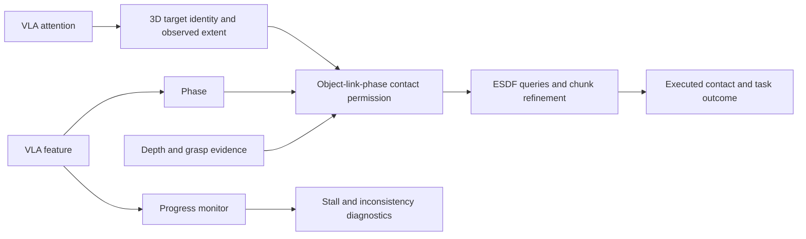

# AG3S와 localization-head / progress-probe 논문 비교

작성: 2026-10-12 13:57 KST. 기준: `feature/ag3s-development`, HEAD `bd778e5e` 및 읽기 시점 working tree.
상태: **원문·코드·기존 기록에 대한 분석과 신규 제안. 이번 검토에서 학습, rollout, 성능 재측정은 하지 않았다.**
T46 관련 미커밋 구현이 있고 T47 head-selection task 문서가 존재한다. 과거 snapshot의 결과를 현재 working tree의 성능으로 해석하지 않는다.

## 1. 권고

두 논문을 적극 인용하고, AG3S의 중심 주장을 **내부 attention/feature의 존재**에서 **내부 신호를 올바른 3D contact constraint로 변환하는 방법과 실행상 효과**로 구체화하는 것이 좋다.

- 첫 논문: head 선택과 검증 절차를 가져온다. 현재 T47 계획이 이 방향을 이미 담고 있다.
- 둘째 논문: counterfactual 검증을 우선 가져온다. Scalar progress는 기존 phase classifier를 대체하지 않고 보조 monitor로 시험한다.
- 결합 기여: `어떤 물체인가 → 어느 관측 표면인가 → 어느 단계에서 어느 link의 접촉을 허용하는가 → 실제 실행은 어떻게 바뀌는가`를 입증한다.
- 두 모듈을 단순히 붙였다는 사실, SAM을 쓰지 않는다는 사실만으로 novelty나 우월성이 성립하지 않는다. 이 검토는 전체 선행연구에 대한 priority 판정이 아니다.

## 2. 원문과 현재 구현의 차이

| 항목 | Kang et al. | Bhardwaj et al. | 현재 AG3S |
|---|---|---|---|
| 질문 | Frozen LVLM에서 text가 지칭하는 영역을 찾을 수 있는가 | VLA representation에서 task progress를 읽고 OOD를 감지할 수 있는가 | VLA task signal로 target geometry와 contact constraint를 구성할 수 있는가 |
| 신호 | 마지막 text token의 text→image attention | Token-mean residual activation의 linear readout | Action→image attention + prefix KV **V** feature의 linear classifier |
| 출력 | 2D box; box-prompt SAM을 통한 mask | 연속값 `τ=1−t/T`와 OOD score | 3D target, `pick/place/home`, target lifecycle 및 link별 query |
| 선택·학습 | Calibration sample에서 head 선택, LVLM 추가 학습 없음 | Frozen model 위 probe 학습; progress label은 demo 시간에서 생성 | 고정 attention cell; phase label을 이용해 probe 학습 |
| 주요 검증 | 10 LVLM, RefCOCO 계열, ReasonSeg, head-selection ablation | Layer/model sweep, counterfactual, intervention, task/OOD transfer | RB-Y1 관련 구현·기존 실험; benchmark 확장 계획 |
| 직접 다루지 않은 부분 | 로봇 3D extent, attachment, link별 contact, closed-loop collision | Target extent, link별 contact, progress 기반 접촉 제약 제어 | 두 원문의 폭넓은 grounding/progress 일반화는 아직 그대로 주장할 수 없음 |

**성능 숫자끼리 직접 비교할 수 없다.** 첫 논문의 cIoU, 둘째의 R²/AUROC, 우리의 phase accuracy/task success는 서로 다른 질문을 측정한다.

## 3. 첫 논문: 실제로 가져올 방법

원문: [사용자 제공 PDF](../../../papers/Your%20Large%20Vision-Language%20Model%20Only%20Needs%20A%20Few%20Attention%20Heads%20For%20Visual%20Grounding.pdf), §§4–6, Appendix A–B. 로컬 파일은 arXiv v1(24쪽)이다. 출판판은 [CVPR 2025](https://openaccess.thecvf.com/content/CVPR2025/papers/Kang_Your_Large_Vision-Language_Model_Only_Needs_A_Few_Attention_Heads_CVPR_2025_paper.pdf).

### 원문에서 확인한 내용

1. RefCOCO train의 1,000 image–text sample에서 image attention mass를 측정해 이미지에 충분히 주목하는 head를 남긴다.
2. Map을 평균값으로 threshold하고 8-connected component의 면적 비율로 spatial entropy를 계산한다. 이것은 attention probability 자체의 Shannon entropy와 다르다.
3. Sample마다 entropy가 낮은 10개 head를 고르고, 전체 sample에서 선택된 빈도로 head를 ranking한다. 이후 **고정 top-k**를 사용한다.
4. 기본값은 k=3이다. 각 map을 Gaussian smoothing하고 합산한다. Pseudo-mask에서 box를 얻으며, RES에서는 이 box를 SAM prompt로 사용한다.
5. 원문 Table 4의 LLaVA-1.5-7B RefCOCO validation RES는 k=1의 70.3에서 k=3의 74.2로 높아진다. 이는 해당 LVLM+SAM 조건의 결과이지 π0.5의 예상 개선량이 아니다.
6. Table 5/§6.3은 매 sample의 greedy head 선택보다 calibration set에서 정한 fixed head 선택이 좋았다고 보고한다. 집중된 map이 text-relevant하다는 보장은 없다는 설명이 핵심이다.

### 우리보다 강한 부분과 한계

장점은 **재현 가능한 head discovery**, 여러 모델·데이터에서의 검증, head 수와 selection criterion의 ablation이다. 현재 AG3S는 `denoise=0, agg=last, layer=8, head=2` 하나를 사용한다. [AttentionPolicy](../../../AG3S/trajopt/attention_policy.py:38)

[T47 문서](../../../AG3S/ag3s/docs/handoff/T47.task.md)는 기존 head가 14D·단일 camera·28 frame 조건에서 선정됐고 현재 16D·3 camera에서 재선정되지 않았다고 정리한다. 이 이력은 head 재선택의 직접적인 동기이며, 이번 검토에서 당시 raw 결과를 재계산한 것은 아니다.

다만 원문의 query는 **text**, 우리의 query는 **noisy action suffix**이다. Pick에서는 물체, place에서는 목적지, 여러 구간에서는 gripper가 집중 대상이 될 수 있다. 따라서 원문의 head index, k=3 최적성, threshold를 그대로 이식할 수 없다. 우리 `agg=last`는 **마지막 action token**이지 마지막 text token이 아니다.

또한 localization과 extent는 다르다. 좋은 peak나 box가 나와도 물체 주변의 장애물까지 exclusion하면 충돌 검사가 틀린다. 원문 RES의 SAM 의존성을 빼고도 똑같은 segmentation 성능을 얻는다고 해석해서는 안 된다.

### 적용 순서

**즉시: 기존 T47을 첫 실험으로 사용한다.** Single head / fixed top-k / all-head average를 같은 저장 frame·같은 downstream geometry에서 비교한다. Calibration과 evaluation은 episode/scene 단위로 분리하고 k, smoothing, camera별 선택도 test 전에 고정한다. T47의 소규모 held-out은 pilot이며 object-generalization 확정 근거가 아니다.

보강할 항목:

- Head의 mass를 target / other object / gripper / destination / support로 분해한다. 낮은 entropy만으로 정답·confidence를 선언하지 않는다.
- 3 camera를 이어 붙인 768 token에 2D connectivity를 적용하지 않는다. Camera별 16×16 map에서 계산하고 가시성을 구분한다.
- Raw image mass를 보존한다. Image token 안에서 먼저 정규화하면 head의 image mass가 모두 1이 되어 첫 번째 criterion이 사라진다.
- **Top-k 합은 raw amplitude를 바꾼다.** Percentile 처리 이후에도 raw peak, flat-map rejection, camera fusion 등 사용처가 남을 수 있다. Sum의 논문 재현과 mass-normalized aggregation의 공정 비교를 구분하고 관련 threshold를 dev에서 고정한다.
- 2D IoU뿐 아니라 target seed precision/recall, target 잔여, non-target seed 손실, 잘못된 contact permission을 측정한다. 10 cm centroid 기준만으로 작은 이웃 과일과의 오분리를 판정하지 않는다.
- Source가 별도 checkpoint 사본과 고정 noise seed에서 추출된다는 점을 명시한다. 실제 serving action을 설명하는 causal attention이라고 단정하지 않는다. [Sampler](../../../AG3S/ag3s/experiments/sources/pi05_attention.py:154)

**후속 후보: phase별 head 역할 분석.** 먼저 실제 phase label로 head가 target에서 destination으로 이동하는지 관찰하고, 이득이 있을 때만 phase-conditioned aggregation을 제안한다. Predicted phase로 head를 고르고 같은 attention으로 phase를 정당화하는 순환을 피한다. 고정 ensemble을 먼저 검증한다는 순서를 유지한다.

**후속 후보: instruction target과 action target의 불일치 감지.** Noun/text query와 action query를 비교하면 잘못된 물체로 향하는 policy를 진단할 가능성이 있다. Prefix attention mask와 state/prompt token 구성을 먼저 점검해야 하며, 현재 구현 또는 검증된 효과가 아니다. Wrong-object intent를 읽었다는 이유로 그 물체의 접촉을 허용해서는 안 된다.

## 4. 둘째 논문: phase classifier와 progress monitor를 구분

원문: [사용자 제공 PDF](../../../papers/Decoding%20Task%20Progress%20from%20VLA%20Representations.pdf), §§3–5, Appendix A.4. 로컬 파일은 19쪽, arXiv:2608.13474v1. [공식 서지](https://arxiv.org/abs/2608.13474)는 2026-08-13 제출 preprint로 표시한다.

### 원문에서 확인한 내용

- Token-mean residual feature 위에 `τ̂=wᵀz+b`를 학습한다. `τ=1−t/T`이므로 시작 1, 완료 0이다. 기본 probe는 L1 loss의 linear regression이다.
- OOD score는 `Vτ(t)=τ̂(t)−(1−t/E[T|instruction])`. 예상보다 progress가 뒤처지면 threshold로 flag한다. 미래의 실제 T를 runtime에 아는 방식이 아니다. Task별 정상 완료 시간의 추정은 필요하다.
- 일반 probe의 R²=0.95여도 instruction target을 바꾸면 출력이 거의 바뀌지 않았다.
- Counterfactual prompt를 사용한 layer-10 contrastive probe는 언어 민감도를 확보하지만 ID R²는 0.33 수준으로 낮아졌다. 서로 다른 layer·objective 설정의 trade-off이며 동등 조건의 단일 원인 비교는 아니다.
- Appendix A.4에는 단순 prompt augmentation 외에 within-pair hinge와 BCE anchor 등이 있다. 재현 시 vanilla linear regression과 이 확장 objective를 분리해야 한다.
- Cross-OOD unseen mode에서 per-episode AUROC 0.960을 보고한다. Cross-task unseen에서는 0.851이고 SAFE-MLP는 0.917이므로 모든 조건에서 최고라고 쓰지 않는다.
- 단일 layer/direction/magnitude의 activation injection으로 의미 있는 steering을 얻지 못했다. 이것이 모든 intervention이나 외부 controller의 실패를 증명하지는 않는다.

### 우리보다 강한 부분

가장 큰 강점은 **검증 질문의 분리**다.

| 질문 | AG3S에 필요한 검사 |
|---|---|
| Weak decodability: feature에서 label을 읽을 수 있는가 | Held-out phase/progress accuracy, shuffled-label control, state/time baseline |
| Strong decodability: 관련 입력이 바뀌면 올바르게 반응하는가 | 같은 RGB-D·q에서 instruction을 바꾸거나, 같은 시간대의 물리 상태를 바꾸는 검사 |
| Steerability: 내부 feature 수정이 원래 policy의 action을 유도하는가 | Activation intervention; AG3S의 현재 주장을 위해 필수인 것은 아님 |
| AG3S downstream utility: 외부 제약에 연결했을 때 실행이 좋아지는가 | 같은 controller의 gate off / strong rule / HSR / oracle phase 비교 |

AG3S에는 마지막 질문이 핵심이다. 외부 controller에 readout을 사용하는 이득은 원래 VLA가 그 feature를 causal하게 사용한다는 주장과 구분한다.

### 현재 HSR에서 보완할 근거

현재 [SubtaskProbe](../../../AG3S/ag3s/stages/subtask_probe.py:54)는 residual-stream scalar regression이 아니다. Prefix KV **V의 L4/H0**, image mean과 valid-text mean을 붙인 **512D feature**에서 multinomial logistic regression으로 `pick/place/home`을 분류한다.

[기존 audit](../../../paper/notes/SUBTASK_FACTS.md)에 따르면:

- Validation accuracy는 약 98.08%이지만 scripted dataset의 frame index만으로도 100%였다. Probe에 시간이 입력됐다는 뜻은 아니며, scene/pose가 일정한 시간 순서를 대신 나타낼 수 있다는 문제다.
- 당시 recorded-rollout phase accuracy 평가의 완전 held-out episode는 하나였다. 이는 별도의 gate on/off 실행 실험 규모와 구분한다.
- 당시 48 paired run에서 gate off 성공 29, on 성공 28이었다. Post-placement target switch/carving은 줄었지만 성공률 개선은 입증되지 않았다. 이 결과는 과거 snapshot이고 paper registry 미등록으로 표시되어 있다.
- 따라서 `높은 phase accuracy → task reasoning → 안전/성공 개선`을 한 번에 주장할 근거는 아직 없다.

### 적용 순서

**최우선은 counterfactual 평가다.** Instruction target swap, target–distractor position swap, gripper만 닫힌 empty grasp, slip, retry, intentional wait, slower motion을 분리한다. 특히 empty grasp와 진짜 grasp를 같은 joint/gripper 상태에 가깝게 맞춘 사례가 물리 rule을 넘어선 정보가 있는지 검사하기 좋다.

Prompt swap마다 phase가 반드시 바뀌어야 하는 것은 아니다. 두 물체 모두 pick 이전이면 둘 다 pick이 맞다. 한 물체만 들고 있는 상태처럼 instruction별 정답이 달라지는 사례를 만들고 `wrong-object/unknown` 정의도 마련해야 한다.

**다음은 phase와 progress를 병렬 readout한다.**

- `phase`: 접촉 예외의 종류와 유효 시점.
- `progress`: 정체, 반복, 예상보다 느린 진전의 경고.
- `geometry + grasp evidence`: 실제 target membership, attachment와 release 확인.

Progress scalar를 일정 구간으로 잘라 pick/place/home으로 바꾸면 task별 phase 길이 차이를 무시한다. Phase와 progress가 충돌하면 우선 진단·재관측 대상으로 삼고, progress 값만으로 attachment를 바꾸거나 장애물을 삭제하지 않는다.

**우리에게 맞춘 새 연구 후보: phase 내 progress와 event 기반 relation.** Whole-task time 대신 approach/grasp/transport 각각의 진행, 또는 `target acquired / held / supported / released` 같은 물리 event를 읽으면 slip/retry를 더 명확히 다룰 수 있다. 하지만 이것은 원문의 직접 재현이 아니라 추가 supervision과 검증이 필요한 확장이다. Event GT는 평가 대상 gripper rule을 그대로 복제하지 않는다.

### 그대로 가져오면 생기는 문제

1. `1−t/T`는 demonstration의 시간 비율이다. Semantic completion이나 성공 확률의 정답이 아니다. 실패 rollout 마지막을 τ=0으로 학습시키면 실패를 완료로 가르치게 된다.
2. AG3S는 안전 제약 때문에 hold·우회를 만든다. 원래 VLA의 정상 속도로 보정된 monitor는 이를 OOD로 오인할 수 있다. Wall-clock, 실제 실행 control step, hold 원인, planner infeasibility를 따로 기록하고 controller가 붙은 정상 rollout에서 오탐률을 검증한다.
3. Swapped prompt를 전부 τ=1로 두는 원문의 counterfactual label은 proxy다. 새 target도 이미 완료됐거나 shared subgoal이 있는 장면에는 맞지 않는다. 우리 simulator에서는 가능한 범위에서 독립 task predicate로 label을 만든다.
4. `Label-free`는 OOD/failure supervision이 없다는 뜻이다. Probe 학습도 없고 데이터도 필요 없다는 뜻이 아니다.
5. 현재 probe의 약 0.09 ms 추론 시간은 전체 내부 신호 추출 비용이 아니다. 현 wrapper는 별도 model copy의 prefix+suffix pass를 수행한다. End-to-end latency와 memory는 별도 측정한다.

## 5. 두 방법을 결합할 연구 질문

제안할 수 있는 질문:

> Frozen VLA의 공간적 relevance와 작업 상태를 함께 사용하면, 필요한 접촉은 허용하면서 주변 물체 및 비허용 link의 충돌 제약을 유지할 수 있는가?

그림의 progress monitor와 확장 permission은 **제안**이다. 현재 phase gate는 주로 새 target 채택/변경 억제 및 placement 이후 해제에 쓰이며, 모든 contact rule이 learned phase로 결정되는 구현은 아니다.

예: 사과를 잡을 때 손가락–사과 접촉을 허용하더라도 전완–사과와 손가락–옆 배 접촉은 유지해서 검사한다. 운반 시 attention이 바구니로 이동해도 바구니 전체를 새 manipulated target로 제거하지 않는다. 실제 grasp evidence로 사과를 attached geometry로 유지하고 release를 확인한 뒤 예외를 끝낸다.

이 예시의 핵심은 좋은 heatmap이 아니라 **identity / extent / permission / lifecycle의 일관성**이다. 이를 성능 개선으로 주장하려면 실행 검증이 필요하다.

## 6. 최소 실험과 채택 기준

| 순서 | 실험 | 고정/변경 | 주요 판정 |
|---|---|---|---|
| 1 | T47 head selection | Geometry·controller 고정, attention source만 변경 | 2D target relevance와 3D precision, silent wrong-target, 비용 |
| 2 | ATS→LTE extent 검사 | Target identity를 맞춘 조건에서 extent만 변경 | Target 잔여와 non-target 삭제를 동시에 측정 |
| 3 | HSR counterfactual | 동일 scene/q, instruction 또는 event를 통제 | Shortcut 여부, wrong-object/empty-grasp/slip, phase boundary delay |
| 4 | Phase source ablation | Contact rule/controller 고정; no gate / strong rule / HSR / oracle | Incorrect exemption, task success, forbidden contact, safe success, timeout |
| 5 | Progress monitor | Frozen VLA; monitor는 처음에는 동작에 개입하지 않음 | False alarms, detection delay, stall/retry 탐지; 정상 hold와 구분 |
| 6 | 필요할 때 2×2 결합 | 기존/선택 head × strong rule/HSR | 결합의 추가 이득이 개별 개선을 넘는지 |

Strong rule은 gripper 개도 하나가 아니라 command·measured opening·latch·history를 사용하는 현실적인 비교여야 한다. 같은 debounce/observation budget을 맞춘다. Oracle은 label 정보의 참고 상한이며 추가 privileged input을 표시한다.

Evaluation은 controller의 predicted target/phase로 허용 contact 정답을 만들지 않는다. 독립 object/link/task predicate로 판정한다. Episode 단위 split과 paired comparison을 사용하고 frame을 독립 trial로 세지 않는다. k나 threshold를 held-out에서 선택했다면 그 split은 최종 test가 아니다.

채택 기준:

- Heatmap만 좋아지고 3D/contact가 그대로면 main contribution을 늘리지 않는다.
- HSR이 strong rule보다 실행상 도움이 없으면 HSR은 보조 구성 요소로 남긴다.
- Monitor가 안전 hold를 자주 실패로 판정하면 controller에 연결하지 않는다.
- 두 신호의 결합이 오류 유형과 실제 safe success를 개선할 때 task-aware constraint interface의 근거로 사용한다.

## 7. 인용 및 논문 문장

**Related Work:** Kang et al.을 frozen LVLM attention 기반 grounding의 직접 선행연구로, Bhardwaj et al.을 VLA linear readout과 runtime monitoring의 직접 선행연구로 인용한다.

**Method:** Kang식 selection을 채택하면 selection-frequency criterion을 adapted한다고 명시한다. Text→action query, single→multi-view, 2D→3D의 변경과 별도 검증을 적는다. Counterfactual probe/monitor를 채택하면 Bhardwaj et al.의 정의와 objective를 해당 부분에서 인용한다. 두 논문의 모듈을 자체 최초 기여로 재명명하지 않는다.

**Experiments/Limitations:** Frozen backbone과 probe training을 구분한다. `No additional VLA backbone training for the proposed safety layer`는 가능하지만 `fully training-free`는 현재 phase probe와 맞지 않는다. Backbone의 기존 task fine-tuning도 공개한다. External-segmenter-free와 저비용은 별도 주장이다.

Related Work용 영문 초안:

> Kang et al. identify localization heads for training-free visual grounding in frozen LVLMs. Bhardwaj et al. show that task progress is linearly decodable from VLA representations and use this signal for runtime monitoring. AG3S studies how spatial relevance and manipulation state can be grounded in 3D geometry to construct object- and link-specific contact constraints for action refinement.

현재 단계의 contribution 초안:

> We investigate a representation-to-constraint interface that grounds VLA attention in observed 3D geometry and uses manipulation-state estimates to regulate target-contact exemptions during action refinement.

실험 전에는 `improves safety`, `preserves success`, `generalizes`, `understands contact rules`, `first`를 확정하지 않는다. 향후 결과가 뒷받침하면 "어떤 split에서 어떤 contact 오류가 얼마나 줄었는가"를 붙여 구체화한다.

권장 출처:

- Seil Kang, Jinyeong Kim, Junhyeok Kim, Seong Jae Hwang. *Your Large Vision-Language Model Only Needs A Few Attention Heads For Visual Grounding*. CVPR 2025. arXiv:2503.06287. 제출 bibliographic record는 출판판을 쓰고 분석한 로컬 v1과의 차이는 최종 수치 인용 전에 확인한다.
- Atiksh Bhardwaj, Edward Weiyi Duan, Prithwish Dan, Wei-Chiu Ma, Preston Culbertson. *Decoding Task Progress from VLA Representations*. arXiv:2608.13474, 2026. 저자 철자는 arXiv metadata 기준(본문 표지와 차이 있음).

## 8. 확인한 저장소 근거

- [현재 연구 우선순위](../plans/develope_PLAN_SUMMARY.md): ATS→geometry→LTE 중심, HSR의 strong-rule 비교.
- [AttentionPolicy](../../../AG3S/trajopt/attention_policy.py): 고정 head와 별도 model pass.
- [AttentionSampler](../../../AG3S/ag3s/experiments/sources/pi05_attention.py): suffix action query, noise seed, feature 추출.
- [SubtaskProbe](../../../AG3S/ag3s/stages/subtask_probe.py), [asset metadata](../../../AG3S/ag3s/asset/subtask_probe/kv_L4_v1.json): feature·label·classifier 정의.
- [Target grounding](../../../AG3S/ag3s/stages/target_grounding.py): phase gate와 persistent identity.
- [SUBTASK audit](../../../paper/notes/SUBTASK_FACTS.md): 과거 정확도·shortcut control·gate 실험의 한계.
- [T47 task](../../../AG3S/ag3s/docs/handoff/T47.task.md): 첫 논문 적용 계획. 읽은 시점에는 task 문서만 확인, 완료 결과를 확인하지 못함.
- [T46 implementation note](../../../AG3S/ag3s/docs/handoff/T46.impl.md): target-free geometry 잔여에 관한 진행 중 구현. 이번 검토에서 독립 검증하지 않음.
- [기존 phase/denoising 제안](../../../AG3S/docs/AG3S_PHASE_DENOISING_PLAN.md): 일부 아이디어는 이미 제안되어 있으며 이번 검토의 신규 발명으로 표시하지 않음.
