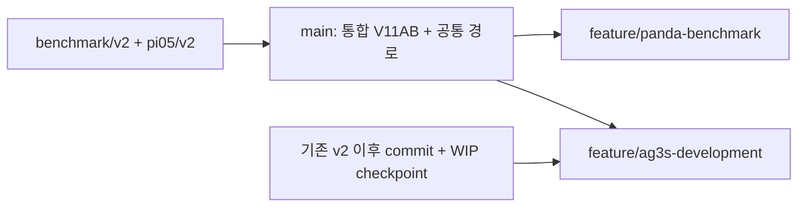

# 전체 프로젝트 폴더 및 원격 저장소 관리 최종 설계

- 작성: **2026-10-11 18:47 KST**
- 대상: `/mnt/dev/work`의 프로젝트 코드, Git 이력, 외부 dependency, 실험 자료, 문서 및 실행 환경
- 갱신: **2026-10-11 23:58 KST**
- 문서 버전: **1.4**
- 상태: **최초 통합 push 사용자 확인 / 독립 storage 전환 완료 / 후속 commit push는 사용자 수행**
- 최신 경로·환경 정본: `SHARED_STORAGE_AND_PYTHON.md`, `STORAGE_IMPLEMENTATION_REPORT.md` 및 아래 23절.
- 최초 통합 실행 결과 정본: 각 새 clone의 `doc/archive/migration/IMPLEMENTATION_REPORT.md`와 `doc/active/BRANCHES.md`. 아래 1–21절은 설계 및 작성 시점의 준비 절차이며, 실행 여부는 22절이 우선한다.
- 원칙: 현재 AG3S 개선 작업의 코드와 미커밋 변경을 유지한다. 기존 `v2`를 checkout하거나 현재 working tree에 복원하지 않는다.

## 1. 최종 판정

**직접 개발하는 코드·테스트·문서·실험 설정은 하나의 monorepo와 하나의 개발 원격저장소로 통합한다. 기존 commit과 SHA는 보존하며, 폴더 재배치는 새 commit으로 기록한다.**

공식 benchmark와 외부 라이브러리는 고정 commit의 dependency로 관리한다. Checkpoint, dataset, 대규모 rollout, cache, venv는 Git 외부에 보관하고 재현에 필요한 manifest를 저장소에 남긴다.

이 설계에서 “원격 하나”는 **우리 프로젝트 개발 사항을 push하는 기본 원격 `origin`이 하나**라는 의미다. LIBERO·cuRobo 등의 upstream 조회 및 dependency 다운로드 URL은 계속 존재한다. 외부 dependency까지 모두 vendoring하는 완전 단일 원격 방식은 이번 기본안으로 채택하지 않는다.

직접 수정한 OpenPI fork는 우리 코드와 함께 변경하는 구성 요소이므로 **fork의 원본 이력을 포함해 monorepo로 통합**한다. 기존 OpenPI upstream은 업데이트 비교용으로 유지한다. 이는 공식 benchmark·cuRobo를 submodule로 유지하는 정책과 구분된다.

| 항목 | 최종 정책 |
|---|---|
| 개발 원격 | 새 monorepo의 `origin` 하나로 통일 |
| 확정 repository 이름 | **`AG3S_VLA`**; 원격 생성·push는 아직 미실행 |
| 기존 저장소 | 통합 검증과 전환 완료까지 보존; 이후 archive 역할 |
| AG3S와 테스트 | 같은 repository, 같은 commit으로 관리 |
| OpenPI fork의 자체 수정 | 이력과 함께 직접 추적 |
| 공식 benchmark·cuRobo | commit을 고정한 외부 dependency |
| RealSense·ZED 기존 소스 | 현재 추적 파일을 우선 보존; upstream 비교 후 별도 단계에서 전환 판단 |
| 기존 commit SHA | 재작성하지 않고 유지 |
| 기존 branch·tag | 원본 저장소별 namespace로 보존 |
| 현재 개발 공간 | 새 독립 clone 두 개로 전환; 원본 code는 legacy storage에 보존 |
| 통합 작업 공간 | 현재 공간과 다른 디렉터리에서 migration 수행 |
| Panda 개발 | V11AB 통합 기준에서 전용 branch·독립 checkout으로 진행 |
| 동시 개발 폴더 | 같은 AG3S_VLA 원격의 별도 clone 두 개를 기본으로 사용; submodule 없는 구성은 worktree도 가능 |

## 2. 용어와 책임

| 용어 | 이 프로젝트에서의 의미 |
|---|---|
| Method | AG3S 등 평가받는 방법 |
| Baseline | AG3S와 비교하는 방법; KNOWS·SEAM 등의 구현 |
| Benchmark | 환경, task, 초기 상태, 실행 protocol 및 평가 규칙; LIBERO 계열 |
| Integration | VLA·AG3S·controller·robot·camera 사이를 연결하는 실행 코드 |
| Monorepo | 여러 구성 요소를 하나의 Git repository에서 함께 관리하는 구조 |
| Submodule | 상위 repository가 외부 repository의 특정 commit을 기록하는 방식 |
| Vendoring | 외부 또는 fork 소스를 프로젝트 repository에서 일반 파일로 직접 추적하는 방식 |
| Worktree | 같은 Git repository에 연결된 별도 working directory |
| Manifest | 버전, 입력, 설정, 결과 위치, checksum 등 재현 조건을 기록한 파일 |

실제 현재 폴더 이름은 `benchmark`다. 대화에서 사용한 `benchamrk`, `benchamark`는 새 폴더 이름으로 사용하지 않는다. `SafeLIBERO`와 `LIBERO-Safety`도 서로 다른 benchmark로 관리한다.

## 3. 현재 Git 경계와 보존 대상

아래는 문서 작성 시 소스 및 dependency 경로에서 읽기 전용으로 확인한 상태다. Data·cache·venv 등의 대용량 영역은 repository 탐색에서 제외했다. 실제 migration 전에 backup 디렉터리와 추가 worktree까지 repository inventory를 갱신한다.

| 현재 경로 | 역할 | 현재 원격 | 통합 후 처리 |
|---|---|---|---|
| `/mnt/dev/work/.git` | tests, `.claude`, 일부 참고 자료를 관리하는 최상위 repository | 등록된 remote 없음 | 로컬 이력도 반드시 통합 |
| `benchmark/.git` | AG3S·trajopt·KNOWS·SEAM | `Ignimkk/VLA_Benchmark` | 원본 이력 보존 후 새 구조로 배치 |
| `pi05_TO_hybrid/.git` | RB-Y1 실행 코드·robot asset·ROS 소스 | `Ignimkk/pi05_TO_hybrid` | 원본 이력 보존 후 integration·robots 등으로 배치 |
| `pi05_TO_hybrid/openpi/.git` | 자체 수정한 OpenPI fork; `.git`은 파일 | `Ignimkk/openpi` | 별도 이력 통합; 일반 추적 소스로 전환 |
| `pi05_TO_hybrid/openpi/third_party/libero/.git` | 공식 LIBERO submodule | `Lifelong-Robot-Learning/LIBERO` | `benchmark/LIBERO`의 canonical dependency로 정리 |
| `pi05_TO_hybrid/openpi/third_party/aloha/.git` | 공식 ALOHA submodule | `Physical-Intelligence/aloha` | 필요 기능을 확인해 dependency 유지; 이번에 삭제하지 않음 |
| `curobo_src/.git` | 외부 cuRobo checkout | `NVlabs/curobo` | `third_party/curobo`에 고정 dependency로 등록 |

`pi05_TO_hybrid`의 이력에는 OpenPI **gitlink**, 즉 commit 참조만 들어 있다. OpenPI의 실제 commit 이력은 별도로 가져와야 한다. 같은 이유로 상위 저장소의 backup만으로 하위 submodule의 모든 이력이 보존되지는 않는다.

문서 작성 시 관측한 HEAD는 다음과 같다. 실행 중인 병렬 작업으로 이후 바뀔 수 있으므로 migration의 source commit으로 자동 사용하지 않는다.

| 원본 | 관측 HEAD |
|---|---|
| workspace | `83591f77e54dccc75a63e19f6de5a4beba777d6a` |
| benchmark | `f3fdb70e4bb740fc8da4c83d51bbc24b1231e252` |
| pi05_TO_hybrid | `f62ab814e867912af3cecea52519d00c470d39e3` |
| OpenPI fork | `df127613c06c82567bec65f6e7e2b401dff8fa59` |
| LIBERO dependency | `f78abd68ee283de9f9be3c8f7e2a9ad60246e95c` |
| ALOHA dependency | `d1dc83afd89ded4379851257fe5d85632d31d5ec` |
| cuRobo dependency | `78fd485fa82d9b9a063fb4985e371814587e666a` |

최상위 및 benchmark repository에 미커밋 변경이 있으며, 최상위에는 미추적 문서·논문 자료도 있다. 특히 `benchmark/docs`는 현재 디렉터리가 존재하지만 확인한 tracked-file 목록에는 포함되어 있지 않다. **폴더 존재와 Git 보존 여부를 동일하게 취급하지 않는다.**

## 4. 목표 폴더 구조

아래 `project/`는 새 통합 checkout을 뜻한다. 현재 `/mnt/dev/work`를 즉시 이 구조로 바꾼다는 의미가 아니다.

```text
project/
├── .git/                           # 프로젝트 자체 이력
├── .github/                        # 향후 CI·PR template
├── .claude/                        # 공유 가능한 작업 규칙·hook·skill
├── .gitignore
├── .gitmodules                     # 외부 dependency만 등록
├── README.md
├── CLAUDE.md
├── COMMIT_MESSAGES.md              # 기존 기록 보존
├── pyproject.toml                  # package·test 설정
│
├── AG3S/
│   ├── ag3s/                       # 기존 benchmark/ag3s
│   │   ├── stages/
│   │   ├── fields/
│   │   ├── constraints/
│   │   ├── runtime/
│   │   ├── robot_models/
│   │   ├── experiments/            # 기존 method 연구 실험 보존
│   │   ├── configs/
│   │   ├── asset/                  # 실행에 필요한 소형 asset
│   │   └── docs/                   # 기존 log·handoff·figure 경로 보존
│   ├── trajopt/                    # 기존 benchmark/trajopt
│   ├── docs/                       # 기존 benchmark/docs
│   └── adapters/                   # robot별 method 입력·설정 adapter
│       ├── rby1/
│       └── panda/
│
├── Baseline/
│   ├── knows_vla/
│   ├── seam_vla/
│   └── docs/
│
├── benchmark/
│   ├── LIBERO/                     # 공식 dependency
│   ├── SafeLIBERO/                 # 공식 dependency의 benchmark 경로
│   ├── LIBERO-Safety/              # 공식 dependency
│   ├── adapters/                   # 관측·action·환경 protocol
│   ├── runners/                    # method 선택·episode 실행
│   ├── evaluators/                 # method와 독립적인 판정
│   ├── configs/
│   └── docs/
│
├── integration/
│   ├── rby1/
│   │   ├── bringup/
│   │   ├── manipulation/           # ROS/Python package 내부 구조 유지
│   │   └── docs/
│   └── panda/
│       ├── client/
│       ├── server/
│       └── docs/
│
├── robots/
│   ├── rby1/description/
│   ├── panda/
│   └── calibration/                # 필요한 calibration과 출처
│
├── common/                         # 공통 interface·통신 계약
├── third_party/
│   ├── openpi/                     # 자체 fork; 일반 파일로 직접 추적
│   ├── curobo/                     # 고정 submodule
│   ├── aloha/                      # 기능 유지가 필요한 경우 고정 submodule
│   └── ros/
│       ├── realsense-ros/           # 기존 vendored 소스 우선 보존
│       └── zed-ros2-description/    # 기존 vendored 소스 우선 보존
│
├── tests/                          # 기존 tests + 통합 검증
├── scripts/
│   ├── setup/
│   ├── rby1/
│   ├── benchmark/
│   └── data/
├── environments/                   # requirements·lock·container 정의
├── experiments/
│   ├── configs/
│   ├── manifests/
│   └── summaries/                  # 선별된 소형 결과
├── doc/                            # 프로젝트 운영·발표·migration 문서
│   ├── PROJECT_FOLDER_AND_GIT_MANAGEMENT_FINAL.md
│   ├── migration/
│   ├── plans/
│   └── presentations/
├── paper/                          # 현재 논문 작업 구조 유지
└── references/                     # 참고문헌 목록·분석·허용된 참고 자료
```

Git 외부 저장 공간은 code checkout과 분리한다. 물리 위치는 migration 실행 전에 정하고 현재 폴더는 그대로 둔다.

```text
storage/
├── checkpoints/
├── datasets/
├── recordings/
├── results/
├── cache/
├── reference_pdfs/
├── presentations/
├── wheels/
└── backups/

checkouts/
├── ag3s-development/               # 전용 venv·config·출력 경로
└── panda-benchmark/                 # 전용 venv·config·출력 경로
```

`AG3S`·`Baseline`·`benchmark`의 대소문자는 위 구조로 고정한다. Directory 이름과 Python import 이름은 packaging으로 분리하며, 새 Python package 이름은 소문자를 사용한다.

## 5. 주요 코드의 현재 → 목표 매핑

| 현재 경로 | 목표 경로 | 처리 기준 |
|---|---|---|
| `benchmark/ag3s` | `AG3S/ag3s` | 기능 유지; 내부 log·handoff·asset 구조는 1차 migration에서 유지 |
| `benchmark/trajopt` | `AG3S/trajopt` | 기능 유지; 알고리즘 변경과 분리 |
| `benchmark/docs` | `AG3S/docs` | 미추적 파일까지 inventory·checksum으로 보존 |
| `benchmark/knows_vla` | `Baseline/knows_vla` | 먼저 경로만 이동; 공통 LIBERO 도구 추출은 별도 commit |
| `benchmark/seam_vla` | `Baseline/seam_vla` | SEAM 고유 코드 유지; 공통 interface는 후속 분리 |
| `benchmark/requirements-ag3s.txt` | `environments/ag3s/requirements.txt` | 현재 pin을 출발점으로 사용 |
| `benchmark/requirements-curobo.txt` | `environments/curobo/requirements.txt` | CUDA·Torch·kernel 호환 조건 포함 |
| `pi05_TO_hybrid/rby1_bringup` | `integration/rby1/bringup` | MuJoCo·robot 실행 코드; runtime log는 결과 저장 공간으로 분리 |
| `pi05_TO_hybrid/rby1_manipulation` | `integration/rby1/manipulation` | 내부 `src`·test·package 정의·lock 유지 |
| `pi05_TO_hybrid/rby1_description` | `robots/rby1/description` | URDF/MJCF/mesh 및 원본 license 유지 |
| `pi05_TO_hybrid/scripts` | `scripts/rby1` | 범용 setup/data script 분리는 후속 단계 |
| `pi05_TO_hybrid/docs` | `integration/rby1/docs` | 원본 경로 대응표 유지 |
| `pi05_TO_hybrid/openpi` | `third_party/openpi` | fork 이력을 별도로 통합; gitlink를 일반 소스로 전환 |
| `pi05_TO_hybrid/realsense-ros` | `third_party/ros/realsense-ros` | 현재 일반 추적 파일; 자체 수정 여부 확인 전 교체 금지 |
| `pi05_TO_hybrid/zed-ros2-description` | `third_party/ros/zed-ros2-description` | 동일; robot mount 수정·license 보존 |
| `curobo_src` | `third_party/curobo` | 외부 repo commit 고정; local diff가 있으면 별도 보존 |
| `tests` | `tests` | 구현과 같은 repo에서 관리 |

### 5.1 SEAM·KNOWS의 실제 의존성

현재 `benchmark/trajopt/refiner.py`는 SEAM의 `DecodedChunkRefiner`를 import한다. 따라서 SEAM을 비교 방법 폴더로 옮겨도 AG3S의 runtime 의존성은 남는다.

최종 책임 구조는 **AG3S와 Baseline이 공통 interface에 의존**하도록 한다. 공통 refiner 계약을 `common`으로 추출하되, 이 refactor는 폴더 이동과 다른 commit에서 수행하고 API·실행 결과의 회귀를 확인한다.

KNOWS 폴더의 LIBERO 관측 수집·환경 도구는 method 공통으로 사용되는 부분만 `benchmark/adapters`로 추출한다. KNOWS 고유 attention 분석·안전 필터·설정은 `Baseline`에 둔다. 초기 migration에서 단순 파일 이름만 보고 코드를 삭제하거나 분리하지 않는다.

### 5.2 OpenPI와 benchmark dependency 중복

공식 LIBERO의 canonical checkout은 `benchmark/LIBERO` 하나로 정한다. OpenPI의 기존 `third_party/libero` gitlink는 통합 작업 공간에서 경로·import·setup을 수정한 뒤 중복 제거한다. 현재 공간의 submodule을 삭제하거나 바꾸지 않는다.

SafeLIBERO upstream은 `THU-RCSCT/vlsa-aegis` repository 안에 있다. `.gitmodules`에는 repository 전체를 commit으로 고정하고, 실행 adapter가 그 안의 `safelibero` 경로를 사용한다. Submodule URL에 단순 하위 폴더 URL을 넣지 않는다. 이 dependency 내부의 AEGIS method 코드는 외부 원본이고, 우리의 Baseline adapter는 별도로 둔다.

OpenPI 내부 ALOHA도 import·example의 실제 요구 경로를 확인한 후 정리한다. 중복 경로의 제거와 compatibility 연결은 새 작업 공간 내부에서만 수행한다.

## 6. 기타 최상위 폴더의 관리

아래는 현재 실제로 관측된 최상위 디렉터리와 symlink를 모두 분류한 표다. **“Git 제외”는 백업 불필요 또는 삭제 허용이라는 뜻이 아니다.**

| 현재 항목 | 역할 | 목표 위치·관리 |
|---|---|---|
| `.git` | 최상위 이력 | 코드 파일처럼 이동하지 않음; objects·refs를 정식 Git 절차로 통합 |
| `.claude` | agent 규칙·hook·skill·role | 공유 가능한 설정은 추적 유지; 기존 경로를 새 구조에 맞게 후속 수정 |
| `.cache` | 다운로드·실행 cache | `storage/cache`; Git 제외 |
| `.pytest_cache` | test cache | worktree별 재생성; Git 제외 |
| `.python` | 설치된 interpreter | Git 제외; 버전·설치 방법만 environment 문서에 기록 |
| `.setup-tools` | uv 등 설치 도구 | 설치 바이너리·dist-info는 Git 제외; bootstrap script·version은 `environments`/`scripts/setup` |
| `.venv-ag3s` | AG3S 실행 환경 | 복사하지 않고 새 경로에서 재생성; 기존 환경은 그대로 유지 |
| `.venv-curobo` | cuRobo 실행 환경 | 동일; CUDA·Torch·cuRobo 버전 pin 기록 |
| `.venv-openpi-live` | 현재 OpenPI live 환경 | 동일; 새 worktree를 바라보는 editable install로 재생성 |
| `.vscode` | editor 설정 | 상대 경로의 공유 template만 추적; 개인·host별 설정은 local |
| `benchmark` | 현재 method와 Baseline 코드가 혼재 | 5절에 따라 분리; 이후 이름은 실제 benchmark에 사용 |
| `curobo_src` | 외부 source checkout | `third_party/curobo`; 기존 원본 checkout 보존 |
| `data` | KNOWS 관측 데이터·sweep log | 원자료는 `storage/datasets` 또는 `storage/recordings`; 수집 script·manifest는 Git |
| `doc` | 프로젝트·발표 문서 | 운영 문서 유지; 발표 자료는 `doc/presentations` 또는 artifact 저장 공간 |
| `outputs` | 구현·검증·live·backup 산출물 | 원자료는 `storage/results`; 선별한 검증 요약·작은 figure만 Git |
| `paper` | 논문 작성·평가·제출 자료 | 자체 작성 source·분석·표·figure 생성 script는 추적; generated 파일은 선별 |
| `papers` | 외부 논문 PDF·일부 분석 | 목록·인용·분석은 `references`; 외부 PDF는 `storage/reference_pdfs`가 기본 |
| `pi05_TO_hybrid` | 기존 실행 시스템·데이터 혼재 | 코드·asset은 5절; 데이터·환경·출력은 7절 |
| `records` | `run_0000`~`run_0003` 기록 | `storage/recordings/legacy/records`; original relative path와 checksum 유지 |
| `run_0004` | 기존 episode 기록 | `storage/recordings/legacy/run_0004` |
| `run_0005` | 기존 episode 기록 | `storage/recordings/legacy/run_0005` |
| `run_16d_ep1800` | 16-D episode 기록 | `storage/recordings/legacy/run_16d_ep1800` |
| `scripts` | 현재 dataset timestamp 수정 script 등 | `scripts/data`; 재사용 가능한 코드는 추적 |
| `src` | `pi05_TO_hybrid`를 가리키는 absolute symlink | 현재 연결 유지; 새 구조에서는 package/config로 대체. 필요시 worktree 내부 한정 compatibility 연결 |
| `tests` | AG3S·trajopt·simulation·GPU test | 같은 monorepo에서 유지; `__pycache__`만 제외 |

### 6.1 Tests의 보조 폴더

`tests/o4`에는 GPU ESDF·reconstruction·sphere mask·recording 관련 test가 있다. 이름만 보고 임시 코드로 판단하지 않는다. 먼저 그대로 보존하고, 별도 commit에서 실제 책임에 따라 `tests/ag3s`, `tests/runtime`, `tests/gpu` 등으로 정리한다.

`tests/sim`의 simulation helper와 작은 regression fixture는 코드·test와 함께 추적한다. 모든 `.npz`·`.npy`를 일괄 제외하지 않는다. 대형 replay 입력만 artifact로 분리하고 checksum과 접근 방법을 test manifest에 기록한다.

Baseline 내부 test와 `rby1_manipulation/tests`는 package 단위 test로 유지할 수 있다. 최상위 `tests`에는 구성 요소 사이의 integration·regression 검증을 둔다. 경로 정리를 위해 기존 test를 제거하지 않는다.

### 6.2 Outputs·recordings 내부의 재사용 코드

현재 출력 디렉터리 안에도 실행 launcher와 분석 script가 존재한다. 예를 들어 `outputs/verify/T43/V11/p/launch_v11.sh`와 `run_chain.sh`는 V11AB 실행 조건을 확인하는 자료다. **출력 폴더 안에 있다는 이유로 코드까지 Git 외부 자료로만 분류하지 않는다.**

| 현재 output 하위 폴더 | 관리 |
|---|---|
| `outputs/verify` | 원본 측정·실행 log·constraint 기록은 artifact로 보존; 재사용 launcher·분석 script는 `scripts/benchmark` 또는 `experiments`로 별도 등록 |
| `outputs/impl` | 구현 검토 자료·prototype 원본을 보존; 채택된 code만 정식 source 위치로 이동 |
| `outputs/live`, `outputs/live_test`, `outputs/t24` | run별 raw 자료는 결과 저장; config·source와 연결 |
| `outputs/backup` | backup 저장 공간; source·범위·checksum 기록 |
| `outputs/container_setup_20260911` | 환경 setup 증거 보존; 재사용 가능한 script·container 정의는 `environments`로 등록 |
| `outputs/ag3s_architecture_2026-09-14` | 원본 figure·생성 자료 보존; 현재 사용하는 diagram source는 `AG3S/docs`로 등록 |

`data`, `records`, 개별 `run_*`에도 code·config가 있으면 같은 기준을 적용한다. 새 script 위치와 원본 artifact 위치를 path manifest로 연결하며, 과거 실행 증거는 수정하지 않는다.

### 6.3 Paper·참고문헌·발표 자료

| 자료 | 정책 |
|---|---|
| `paper/latex`, `algorithms`, `tables`, `notes`, `tools`, `guidelines` | 직접 작성 source·script·분석 문서는 Git 추적 |
| `paper/experiments`, `evidence` | 실행 manifest·소형 검증 요약은 추적; raw rollout은 외부 저장 |
| `paper/figures` | 생성 script·plot 입력·최종 선별 figure를 추적; 중간 출력은 제외 |
| `paper/submission`, `supplementary` | 최종 제출 bundle·영상은 release artifact; source·설명·checksum은 Git |
| `paper/template` | 재현에 필요한 template·license·version 유지; cache·build 출력 제외 |
| `paper/cvpr2026_ref_paper`, `papers`, 참고 PDF | 공개 원문 link·bibliography를 기본으로 관리; 이미 tracked인 파일은 과거 이력에서 제거하지 않음 |
| `paper/references` | 논문 작업용 분류·분석 구조를 초기에는 유지; 외부 PDF inventory만 `references`와 연결 |
| `doc`의 발표 대본 | `doc/presentations`에서 추적 |
| `doc`의 최종 PPTX | 선택적으로 LFS 또는 artifact 저장; editable 원본과 checksum 보존 |
| `doc`의 draft PPTX | local/artifact로 보관; 자동 삭제하지 않음 |

`paper` 전체가 현재 자동으로 Git에 들어 있다고 가정하지 않는다. 최상위 상태에는 미추적 `paper/`가 관측되므로, source와 generated 파일을 분류한 후 추적 대상으로 추가해야 한다. 대량으로 `git add .`하지 않는다.

## 7. pi05_TO_hybrid 내부 보조 폴더

| 현재 경로 | 정책 |
|---|---|
| `assets` | 실제 실행 config·normalization metadata·소형 asset은 inventory 후 추적; model weight는 `storage/checkpoints` |
| `backups` | 외부 backup 저장 공간; 대상·시점·checksum을 기록 |
| `cache` | `storage/cache`; 다운로드 가능한 자료도 provenance 기록 |
| `checkpoints` | `storage/checkpoints`; checkpoint ID·학습 config·step·checksum 기록 |
| `data` | `storage/datasets`/`recordings`; source manifest 유지 |
| `lerobot_atomic_20260825` | dataset으로 분류; 변환 script·dataset schema·version 기록 |
| `lerobot_transport` | 동일 |
| `logs` | 원자료는 `storage/results`; 이미 tracked인 역사적 log는 초기 import에서 보존 |
| `outputs` | `storage/results`; run별 manifest 연결 |
| `docs` | `integration/rby1/docs` |
| `scripts` | `scripts/rby1` |
| `rby1_bringup` | `integration/rby1/bringup`; `MUJOCO_LOG.TXT` 같은 runtime 출력은 분리 |
| `rby1_manipulation` | package·source·test·lock을 통째로 보존 |
| `rby1_description` | `robots/rby1/description`; mesh·URDF·MJCF 경로 관계 유지 |
| `openpi` | 독립 이력 통합; code와 model cache를 구분 |
| `realsense-ros` | 기존 일반 추적 소스와 license/NOTICE 보존 |
| `zed-ros2-description` | 기존 일반 추적 소스와 license 보존 |

현재 RealSense·ZED 소스는 이 경로에 독립 `.git`을 가진 repository로 확인되지 않았고, `pi05_TO_hybrid`에서 일반 파일로 추적 중이다. Upstream repository로 바로 교체하면 기존 수정이 없어질 수 있으므로 **현 상태 보존 → 출처/version 확인 → local modification 비교 → 전환 여부 판단** 순서로 처리한다.

## 8. 최상위 파일의 관리

| 현재 파일 | 목표 관리 |
|---|---|
| `.gitignore` | 기존 파일 이력 보존; 새 구조용 규칙은 별도 commit으로 작성 |
| `CLAUDE.md` | 공유 규칙 유지; 이동 경로·실행 환경을 후속 수정 |
| `COMMIT_MESSAGES.md` | 기존 개발 기록 유지; Git log의 대체물로 취급하지 않음 |
| `develope_PLAN.md` | `doc/active/plans/develope_PLAN.md`; 원문과 이전 링크 대응 보존 |
| `develope_PLAN_SUMMARY.md` | `doc/active/plans/develope_PLAN_SUMMARY.md` |
| `ag3s_pipeline_architecture.svg`, `ag3s_pipeline_architecture.png` | `AG3S/docs/figures/architecture`; source/script와 연결 |
| `ag3s_records.tgz` | `storage/backups/legacy`; archive 내용·checksum 기록 |
| `attention_step1_run0002.npz` | `storage/recordings/legacy/attention`; raw 파일로 보존 |
| `attention_step1_run0002_seeds012.npz` | 동일 |
| `attention_step1_run0004.npz` | 동일 |
| `attention_step1_run0005.npz` | 동일 |
| `state_138.npy`, `state_216.npy`, `state_311.npy`, `state_314.npy` | 기록 자료로 보존; 실제 regression fixture 사용 여부 확인 후 소형 fixture로 선별 가능 |
| `h_prof2.out` | profiling artifact; `storage/results/profiling` |
| `pypdf-6.19.0-py3-none-any.whl` | offline 설치 artifact; `storage/wheels`; package version은 environment 정의 |
| `typing_extensions-4.16.0-py3-none-any.whl` | 동일 |

형식이나 확장자만으로 파일을 삭제하지 않는다. Code·config·metadata·fixture와 weight·raw data를 내용에 따라 구분한다.

## 9. Git 이력 보존 설계

### 9.1 보존 수준

이번 통합은 **원본 commit object와 SHA를 유지**한다. 각 저장소의 원본 branch tip에서 새 relocation commit을 만들고 독립 이력을 merge한다. History 전체의 경로 rewrite, rebase, squash, cherry-pick으로 원본 이력을 대체하지 않는다.

| 대상 | 보존 방식 |
|---|---|
| Commit | 원본 object 그대로 유지; author·message·timestamp·parent·SHA 보존 |
| Branch | `legacy/<source>/<original-branch>`에 원본 tip 기록 |
| Tag | `legacy/<source>/<original-tag>`에 원본 tag object 기록 |
| Annotated/signed tag | object를 새로 만들지 않고 ref namespace만 구분 |
| 과거 경로 | 과거 commit에 그대로 유지; 새 경로는 relocation commit 이후 등장 |
| Staged/unstaged 변경 | 각각 별도 patch 및 파일 backup으로 보존; 반영 여부를 명시 |
| Untracked/ignored 파일 | 별도 inventory·backup; Git bundle만으로 보존되지 않음 |
| Submodule | dependency마다 별도 backup·commit inventory |
| Git LFS object | Git refs와 별개로 payload inventory·backup 필요 |
| Issue·PR·GitHub release 파일 | Git 이력 밖의 자료; 기존 원격 보존 또는 별도 export |

`git bundle`은 objects·refs를 전달하고 검증하는 도구다. Working tree 변경·ignored 자료·submodule payload 전체를 자동 보관하지 않는다. Reflog에만 남은 미참조 commit도 필요 여부를 확인해 backup 대상 ref로 명시해야 한다. [Git bundle 문서](https://git-scm.com/docs/git-bundle)

### 9.2 V11AB 기준 보존

사용자가 확정한 기준은 다음 두 `v2`다. 문서 작성에서는 ref를 읽었을 뿐 checkout·복원을 수행하지 않았다.

| 원본 | 원본 tag object | 원본 commit |
|---|---|---|
| benchmark/v2 | `183bb5e5185048453656c57893d57787f1e2ee8a` | `498f713b20bf9b75b4b065cd9bcdd508d7cdaecf` |
| pi05_TO_hybrid/v2 | `c1d304fabea9da0caca286ae8d69ba9980e9cd07` | `f62ab814e867912af3cecea52519d00c470d39e3` |

통합 후 tag ref 예시는 다음과 같다.

```text
legacy/benchmark/v2
legacy/pi05_TO_hybrid/v2
legacy/workspace/<original-tag>
legacy/openpi/<original-tag>
```

원본 annotated tag 내부 이름이 `v2`인 것은 그대로 유지한다. Namespaced ref의 tag object SHA와 peeled commit SHA를 모두 비교해 동일성을 확인한다.

원본 tag 하나는 당시 원본 repository의 tree를 가리킨다. **그 tag 하나가 통합 프로젝트 전체의 실행 snapshot이 되는 것은 아니다.** V11AB manifest에는 두 source commit, OpenPI gitlink, checkpoint, dependency, CLI/config, data 및 기존 검증 결과를 함께 기록한다.

현재 HEAD 기반 통합 버전과 V11AB historical baseline은 구분한다. 단지 V11AB 설정을 적용했다고 코드까지 원본 snapshot과 동일하다고 표기하지 않는다.

### 9.3 History 조회와 용량

과거 파일 경로를 현재 폴더 이름으로 바꾸지 않았으므로 rename 추적을 사용한다. `git log --follow`는 단일 파일 조사에 활용하되 모든 merge·directory 이동 이력을 완벽하게 설명한다고 가정하지 않는다. Migration mapping과 원본 branch를 함께 참조한다.

현재 tree에서 큰 파일을 제외해도 과거 commit의 blob은 남는다. 원본 SHA 보존과 과거 대형 파일 제거는 동시에 같은 이력에 적용할 수 없다. Remote 반입 전 historical blob·pack·LFS 크기를 조사하고 hosting 제한을 확인한다. 문제가 있으면 원본 이력을 archive로 유지하는 별도 대안을 제시하며, 이번 설계를 임의로 history rewrite 방식으로 변경하지 않는다. [GitHub repository 제한](https://docs.github.com/en/repositories/creating-and-managing-repositories/repository-limits)

## 10. 원격과 branch 운영

새 원격 repository 이름은 사용자 결정에 따라 **`AG3S_VLA`**로 확정한다. 기존과 같은 owner를 사용하는 경우 URL은 `github.com/Ignimkk/AG3S_VLA`가 된다. Owner와 공개 범위, 실제 생성 여부는 아직 확정·검증하지 않았으며, 기존 원격을 덮어쓰는 방식 대신 새 원격에서 검증한다.

| 구분 | 운영 |
|---|---|
| `origin` | 새 monorepo의 유일한 일상 개발 push 대상 |
| 기존 VLA_Benchmark·pi05_TO_hybrid·OpenPI fork | 원본 이력 및 전환 기간 참조; 전환 후 일상 push 중단 |
| OpenPI upstream | `upstream-openpi` 등 비교용 remote 또는 mirror; 자동 merge하지 않음 |
| 외부 submodule remote | 공식 dependency 다운로드·업데이트용; 우리의 코드 push 대상 아님 |
| Migration 원본 참조 | source별 namespace; 검증 후 archive로 유지 |

전환 전에 기존 원격을 삭제·강제 갱신·archive하지 않는다. 새 저장소를 기준으로 개발하기 시작한 이후 기존 원격과 새 원격에 동일 기능을 병행 push하는 운영은 피한다.

| Branch 예시 | 용도 |
|---|---|
| `main` | 검증된 통합 기준 |
| `migration/monorepo` | 이력 통합·폴더 이동·packaging |
| `feature/ag3s-<topic>` | AG3S 기능 개선 |
| `feature/panda-adapter` | Panda robot/camera/action adapter |
| `experiment/safelibero-<profile>` | 고정 설정의 실험 준비; 큰 결과는 commit하지 않음 |
| `legacy/<source>/<branch>` | 원본 이력 보존; 새 기능 개발에 사용하지 않음 |

Migration branch를 공개할 때는 일반 merge로 이력 연결을 유지한다. 통합 commit들을 squash하면 원본 이력이 `main`의 ancestor에서 빠질 수 있으므로 migration PR에는 squash merge를 사용하지 않는다. 일반 기능 PR 정책은 migration 이후 별도로 정할 수 있다.

새 release tag는 예를 들어 `ag3s-v2.1.0`처럼 프로젝트 전체 기준으로 사용한다. 이름은 예정 예시이며 이 문서에서 tag를 생성하지 않는다. Dependency와 checkpoint를 별도 manifest로 연결한다.

Worktree는 Git 파일 작업만 분리한다. GPU·port·global LIBERO config·cache·editable install은 자동 분리되지 않으므로 각 worktree의 runtime 설정을 별도로 관리한다.

## 11. Git 추적·ignore·artifact 정책

### 11.1 기본 분류

| 자료 | 보관 |
|---|---|
| Source·test·config·lock·문서 | 일반 Git |
| 필수 소형 probe weight·normalization metadata·fixture | 명시적 Git 추적; 필요시 checksum |
| 선별된 작은 figure·검증 JSON | Git; 생성 방법·원자료 manifest 연결 |
| 큰 robot mesh·발표 원본 | 필요성·hosting 조건을 보고 LFS 또는 artifact |
| Model checkpoint·대형 dataset·raw rollout·video | 외부 저장; manifest만 Git |
| Cache·venv·interpreter·설치 바이너리 | Git 제외; 재생성 방법 기록 |
| History backup bundle·원본 대형 archive | 외부 backup; inventory Git |

`AG3S/ag3s/asset/subtask_probe`처럼 실행 기능에 필요한 소형 `.npz`를 dataset으로 오인해 제외하면 안 된다. Normalization metadata 역시 weight와 함께 무조건 제외하지 않는다.

### 11.2 새 .gitignore 방향

현재 최상위 `.gitignore`는 `/*`로 대부분을 무시하고 일부 폴더만 허용한다. 이는 nested repository 운영을 전제로 한 규칙이다. 새 monorepo에는 아래처럼 재생성 가능한 경로를 명시적으로 제외하는 규칙을 작성한다.

```gitignore
# runtime / environment
.venv*/
__pycache__/
*.py[cod]
.pytest_cache/
.mypy_cache/
.ruff_cache/
.cache/
.python/
.setup-tools/
build/
dist/
*.egg-info/

# local data and output roots; canonical storage is outside code checkout
/data/
/datasets/
/checkpoints/
/records/
/outputs/
/storage/
/worktrees/
/third_party/openpi/cache/
/third_party/openpi/checkpoints/

# machine-local settings
.env
.env.*
!.env.example
```

위 내용은 정책 예시이며 최종 `.gitignore` 전체가 아니다. Vendored package의 기존 ignore, paper build 출력, generated robot 자료를 조사해 합친다. `*.npz`, `*.npy`, `*.json`, `*.png`, `*.pdf`를 일괄 제외하는 규칙은 사용하지 않는다. 이미 tracked인 파일에는 ignore 추가만으로 추적 제외가 적용되지 않는다.

현재 요청 경로 `doc/`는 기존 최상위 ignore 정책상 제외되어 있다. **이 문서는 요청대로 파일로 작성했으며, 이번 작업에서 `.gitignore` 변경·강제 add·commit은 하지 않는다.** Migration 때 운영 문서의 추적 대상으로 포함한다.

## 12. 경로·package·증거 기록 변경

| 항목 | 변경 원칙 |
|---|---|
| Python import | `benchmark.ag3s` 등 현재 import를 조사; install 가능한 package로 전환 |
| Package 이름 | `ag3s`, `trajopt`, `knows_vla`, `seam_vla` 등 소문자 사용; directory와 별도로 선언 |
| Environment | 실제 runtime dependency가 다른 환경은 유지; 한 venv로 억지로 합치지 않음 |
| Editable install | 새 checkout을 참조하도록 재설치; 주요 module의 `__file__` 기록 |
| Robot/camera asset | 이름·mount·geometry를 보존; 상대 경로 또는 명시 config로 탐색 |
| `.gitmodules` | canonical 외부 dependency만 등록; 기존 fork gitlink의 일반 파일 전환을 검증 |
| Script | working directory와 `/mnt/dev/work` hard-coded 경로 조사 |
| 문서·hook·agent 규칙 | 살아 있는 실행 경로만 새 구조에 맞게 갱신 |
| 과거 verify/log | 원본 측정값·command·source path를 보존; mapping을 별도 추가 |
| Raw data 이동 | original relative path → storage URI → checksum 대응표 유지 |

과거 증거 JSON의 absolute path를 일괄 치환해 원본 기록처럼 만들지 않는다. Migration mapping 또는 resolver를 추가해 새 위치에서도 자료를 찾을 수 있게 한다. Log의 상태·수치·실험 결과는 재측정 없이 바꾸지 않는다.

Compatibility symlink가 필요한 경우 새 worktree 내부를 가리키게 한다. 새 작업 공간의 `src`가 현재 개선 작업 공간의 코드를 가리키게 만들면 분리가 무효가 된다.

## 13. Manifest와 재현 관리

향후 필요한 manifest는 다음과 같다. 이번 문서 작성에서 아래 파일들을 생성하거나 실제 측정 결과를 채우지는 않는다.

| 파일 예시 | 내용 |
|---|---|
| `doc/migration/repository_inventory.json` | repository 경계·source URL·refs·submodule·dirty 상태 |
| `doc/migration/history_map.json` | 원본 ref/object SHA와 새 namespace 대응 |
| `doc/migration/path_map.csv` | 기존 코드·문서·data 경로와 새 위치 |
| `experiments/manifests/dependencies.lock.json` | dependency commit·license·patch 여부 |
| `experiments/manifests/v11ab_legacy.json` | 두 v2·OpenPI·checkpoint·CLI·검증 자료의 조합 |
| `experiments/manifests/<run-id>.json` | 실험의 실제 실행 조건·입력·결과 |

Run manifest에는 다음 항목을 기록한다.

- Monorepo commit, branch와 dirty 여부. Dirty 실행은 별도 patch/hash로 명시한다.
- Benchmark 이름·dependency commit·suite·task·level·episode/init-state ID·seed.
- VLA config·checkpoint 위치·checksum·normalization metadata.
- Robot geometry·camera calibration·protected links·contact permission 설정.
- 실제 model chunk 길이 `H`, 실행 길이 `K`, control period, lookahead와 solver 설정.
- AG3S·Baseline profile, attention/probe 출처 및 privileged input 사용 여부.
- Python/package/CUDA·GPU·renderer 버전, server/client 실행 command.
- Official success·collision 정의, 독립 contact evaluator 버전.
- Runtime·error·timeout·stop과 output URI/checksum.

작은 summary와 figure는 Git에 남길 수 있지만 동일한 수치의 raw evidence 위치가 연결되어야 한다. Raw 자료가 없거나 기록이 누락된 결과를 안전한 episode로 취급하지 않는다.

## 14. 실행 순서와 완료 기준

문서 작성 권한은 migration 실행·원격 생성·push 권한을 대신하지 않는다. 아래 절차는 이후 실제 통합 작업의 실행 계획이다.

| 단계 | 작업 | 완료 기준 |
|---|---|---|
| M0 | 별도 migration 작업 공간·source 기준 확정 | 현재 working tree와 source HEAD·dirty 자료를 구분 |
| M1 | 각 repository 및 작업 자료 backup | refs·tag·submodule·LFS·untracked·ignored 핵심 자료의 backup 검증 |
| M2 | 원본 이력을 namespace로 반입 | 원본 object SHA·refs가 대응표와 일치 |
| M3 | source별 새 relocation commit 및 이력 merge | 목적지 충돌 해결; source ancestor 유지; 원본 tag object 동일 |
| M4 | OpenPI gitlink 전환·외부 dependency canonical 경로 정리 | 새 clone에서 code·dependency를 재구성 가능 |
| M5 | import·package·asset·script·문서 경로 수정 | 기능 변경 없이 import·asset 로딩·test discovery 통과 |
| M6 | 회귀 검증 | 기존 test·고정 입력 replay·필요한 실행 smoke에서 변경 영향 확인 |
| M7 | 새 원격 게시 및 fresh clone 검증 | branch/tag·submodule·artifact 연결을 새 clone에서 확인 |
| M8 | 개발 기준 전환 | 새 origin을 일상 개발 기준으로 사용; 기존 원격은 archive 참조 |
| M9 | Panda branch·독립 checkout에서 이식 | 현재 AG3S 개선 branch와 파일·환경·출력 분리; 21절 기준 적용 |

M0~M8 동안 현재 workspace를 강제로 정리하거나 원본 `.git`을 삭제하지 않는다. 미커밋 작업을 자동 commit·stash하지 않는다. Migration backup은 Git bundle과 working-tree 자료 backup을 구분한다.

Source는 시간에 따라 바뀔 수 있으므로 단계 시작 시 기준을 고정한다. 통합 검증 중 들어온 AG3S 개선 commit은 별도 change inventory를 통해 추가 반영한다. 초기 snapshot만 통합하고 그 사이 변경을 누락한 채 전환하지 않는다.

### 14.1 Commit 분리

1. Source 이력 반입 및 relocation.
2. Import·package·runtime 경로 수정.
3. 공통 interface 추출 및 dependency 역할 정리.
4. 재현 manifest·환경·CI 추가.
5. Panda adapter 구현.

원본 이력 반입 단계에는 squash를 사용하지 않는다. 다른 변경도 가능한 한 위 책임별로 분리해 경로 이동과 동작 변경을 구별한다.

### 14.2 통합 검증 항목

- 새 저장소에서 source commit 및 namespaced tag object/commit 동일성 확인.
- source별 branch·tag inventory와 반입 결과 비교; main 이력만 보존한 상태를 완료로 처리하지 않음.
- dirty/untracked/ignored 핵심 자료의 backup·반영 여부 확인.
- 경로 이동 전후 source·asset 내용 비교; 의도한 경로 수정 목록 작성.
- 외부 dependency와 license/NOTICE, 직접 수정한 OpenPI feature 보존 확인.
- 새 venv에서 import 경로·asset 탐색·test discovery 및 기존 fast regression 확인.
- recorded fixed-input replay로 geometry·constraint·refined action·verdict의 예상치 못한 변화 확인.
- wall-clock timeout처럼 비결정적인 비교 요소는 조건을 통제하고 한계를 기록.
- 새 원격의 fresh clone·dependency setup으로 최소 실행 경로 확인.
- 현재 개발 작업 공간이 migration 때문에 변경되지 않았는지 확인.

Git의 independent-history merge가 원본 commit을 연결하는 근거는 [Git merge 문서](https://git-scm.com/docs/git-merge)에서 확인할 수 있다. Submodule의 gitlink와 자체 이력 경계는 [Git submodule 문서](https://git-scm.com/docs/gitsubmodules)를 따른다.

## 15. 통합 이후 Panda benchmark 작업

개발 순서는 기존 합의대로 유지한다.

```text
Panda adapter 검증
    → LIBERO Spatial 소규모 평가
    → SafeLIBERO Spatial Level I/II pilot
    → 전체 SafeLIBERO
    → LIBERO-Safety obstacle_avoidance 추가 평가
```

`AG3S/adapters/panda`는 method의 robot geometry·contact 설정을, `benchmark/adapters`는 LIBERO 관측·action protocol을, `integration/panda`는 client/server 실행을 담당한다. 평가기는 `benchmark/evaluators`에서 method의 예측과 독립적으로 판정한다.

Panda 이식 중에는 AG3S의 grounding·geometry 보존·link-specific contact·attached object·refinement 기능을 유지한다. 새로운 기능 변경, HSR/probe 대체, controller 변경은 robot/camera 경로 수정과 구별해 기록한다. V11AB의 horizon 숫자를 LIBERO에 그대로 적용하지 않고 실제 H/K/control period와 비교한다.

## 16. 실행 전 아직 정해야 하는 값

관리 방향은 이 문서로 정리했지만 다음 값은 문서 작성만으로 임의 확정하지 않는다.

| 값 | 필요한 판단 |
|---|---|
| 새 원격의 owner·공개 범위 | 이름은 **AG3S_VLA**로 확정; owner·공개 범위·생성은 후속 작업 |
| Migration source 기준 | 현재 source별 HEAD·진행 중 변경을 어떤 시점까지 반영할지 |
| 새 checkout·storage·worktree 실제 위치 | 용량·기존 실행 경로를 고려해 지정 |
| 외부 dependency의 migration 기준 commit | 현재 관측 commit을 출발점으로 호환성 확인 |
| LFS/artifact 보관 범위 | robot mesh·PPTX·최종 제출 자료 등 필요성과 크기로 결정 |
| 기존 원격 archive 시점 | fresh clone 검증과 진행 중 작업 반영 이후 |

## 17. 이번 문서 작성의 수행 범위

이번 작업에서는 폴더 목록, Git 경계·remote·HEAD·tracked-file 분류, submodule 설정과 기존 ignore 정책을 읽었다. 두 `v2`의 object ID는 읽기 전용으로 확인했다.

**생성한 것은 이 Markdown 문서다.** Repository 생성·merge·checkout·tag 적용·원격 변경·push·폴더 이동·dependency 설치·기존 코드 수정·실험 실행은 수행하지 않았다. 따라서 본문에 제시한 migration 완료 기준과 Panda 검증 결과는 아직 달성한 결과가 아니라 후속 작업의 기준이다.

문서 위치는 `/mnt/dev/work/doc/archive/PROJECT_FOLDER_AND_GIT_MANAGEMENT_FINAL.md`다. 현재 최상위 Git의 ignore 상태와 별개로 요청 경로에 실제 파일을 보존한다.

## 18. 통합 전 정리: stage·commit·push

### 18.1 먼저 해야 할 일

**현재 경로에서 작업 중인 agent가 자신의 작업을 정리한 뒤, 완료분과 WIP를 구분해 보존하고, 마지막 source snapshot을 고정한다. 모든 파일을 일괄 commit·push하는 것은 선행 조건이 아니다.**

1. 각 agent에 migration 준비 사실을 알리고 현재 변경 파일·진행 상태·검증 여부를 handoff로 정리하게 한다.
2. 실제 source snapshot을 뜨기 전에 source를 수정하는 작업을 잠시 멈추는 시점을 정한다. 별도 migration 준비는 그 전에도 진행할 수 있다.
3. 각 repository의 staged·unstaged·untracked·ignored 자료를 나눠 목록화한다.
4. 백업을 먼저 확인하고, 완료된 변경은 책임별로 검토·commit한다.
5. 미완성 변경은 WIP snapshot 또는 patch·파일 backup으로 보존한다.
6. Commit한 이력은 필요하면 기존 원격에 push하고, 로컬 전용 이력은 bundle 등으로 보존한다.
7. Source별 최종 HEAD·refs·dirty backup 목록을 migration manifest에 고정한다.

현재 `v2` tag를 이동·재생성하지 않는다. 정리 commit을 추가해도 기존 tag가 가리키는 object는 그대로 유지한다.

### 18.2 현재 관측 상태

아래는 2026-10-11 19:03 KST 조회 결과다. Untracked 수는 Git status가 표시한 항목 수로, 디렉터리 안의 개별 파일 수가 아니다. Ignored 자료는 이 숫자에 포함되지 않는다.

| Repository | Staged | Unstaged tracked | Untracked 항목 | 처리 |
|---|---:|---:|---:|---|
| 최상위 workspace | 0 | 2 | 30 | `.claude/ag3s-rules.md`, `.gitignore`와 새 규칙·paper 자료 등을 담당자와 분류 |
| benchmark | 0 | 6 | 33 | task·session·partial verify·figure·문서의 상태를 담당 agent가 판정 |
| pi05_TO_hybrid | 0 | 0 | 0 | 추가 commit은 불필요; ignored 데이터·cache는 별도 inventory |
| OpenPI fork | 0 | 0 | 0 | 추가 commit은 불필요; 필요한 local branch·tag와 현재 commit 보존 |
| cuRobo checkout | 0 | 0 | 0 | detached HEAD의 dependency commit 보존; 외부 원격에 commit/push할 이유 없음 |

최상위 workspace에는 등록된 remote가 없다. 이 repository를 “push되어 있지 않으니 불필요”로 판단하지 않는다. 로컬 commit을 source로 통합하고 refs·bundle로 보존한다.

### 18.3 변경 유형별 처리

| 상태 | 권장 처리 |
|---|---|
| 완료된 code·test·문서 | 담당자가 diff 검토 후 관련 검증과 commit |
| 아직 staged인 변경 | index 내용을 먼저 확인; 같은 책임 단위면 commit, 필요시 분리 |
| WIP code | 별도 작업/snapshot branch에 상태를 명시한 commit, 또는 staged/unstaged patch와 새 파일 backup |
| `.verify.partial.json`·임시 task 기록 | 완료 결과로 표기하지 않음; checkpoint 자료로 보존하거나 artifact로 보관 |
| 새 `.claude` rule·skill·agent 문서 | 내용·경로를 검토해 source 문서로 추적 |
| `paper/`·참고 PDF·figure | source와 generated/raw 자료를 나눔; 폴더 전체를 무검토로 add하지 않음 |
| Ignored doc·data·output | 존재·checksum·backup 위치 기록; 필요한 source만 명시적으로 추적 |
| Clean repository | migration을 위한 빈 commit을 만들지 않음 |

완료되지 않은 작업을 `main`에 정상 완료 commit처럼 넣지 않는다. WIP를 commit하는 경우 원래 기준 HEAD와 WIP snapshot을 manifest에서 구분하고, snapshot branch를 기존 작업자 몰래 생성·전환하지 않는다.

### 18.4 Push의 위치

**Push는 원격 backup과 협업 공유에는 유용하지만 로컬 history 통합의 기술적 필수 조건은 아니다.** 필요한 object와 refs가 로컬 source 또는 검증된 bundle에 있으면 통합할 수 있다. 반대로 아직 다른 사람이 원격에만 올린 branch·commit이 있으면 source inventory에 반영해야 한다.

원격이 있는 자체 repository는 완료분 또는 WIP checkpoint를 적절한 branch로 push해 두는 것을 권한다. Remote가 없는 최상위 repository는 이 작업을 위해 임의의 기존 원격에 push하지 않는다. 외부 dependency도 migration 때문에 수정·push하지 않는다.

Push 여부를 확인할 때 cached `origin/main`만으로 “원격 최신과 동기화됨”이라고 결론 내리지 않는다. 실제 remote refs 조회와 unpublished commit 확인은 별도 단계다. Push는 실제 실행 지시가 주어졌을 때 수행하며, 이 문서 갱신에서는 하지 않았다.

## 19. CLAUDE.md·.claude 전환 범위

현재 파일 이름은 `CLAUDE.md`다. Linux 환경에서는 `claude.md`와 구분된다. **기존 작업 공간의 지침은 유지하고, migration checkout의 복사본에서 새 경로로 수정한다.** 새 구조가 검증된 뒤 새 checkout에서 agent를 시작한다.

| 수정 대상 | 전환 내용 |
|---|---|
| 최상위 `CLAUDE.md` | AG3S_VLA 구조, 기준 commit, 실행 환경, 문서·log 위치 |
| `paper/CLAUDE.md` 및 nested 지침 | 새 상대 경로, 논문 작업과 연구 구현의 구분 유지 |
| `.claude/ag3s-rules.md` | log·figure·handoff 위치와 ownership |
| `.claude/ag3s-rules-brief.md` | 실제 hook이 주입하는 요약본; 전문과 동시 정합 |
| `.claude/project-context.md` | 현재 구조·진행 상태·source 버전 |
| `.claude/rules/*.md` | 경로별 적용 범위·frontmatter·참조 |
| `.claude/agents/*.md` | 역할별 소유 파일·작업 경로·검증 기준 |
| `.claude/skills/**/SKILL.md`와 지원 script | command·working directory·asset·문서 링크 |
| `.claude/settings.json` | hook 실행 경로 |
| `.claude/hooks/ag3s-rules.sh` | 주입할 규칙 파일 위치; 새 root에서 해결 |
| `.claude/roles/*.settings.json` | 새 checkout별 Edit/Read/deny 경로의 실제 적용 확인 |
| `.claude/roles/launch.sh` | `/mnt/dev/work` 고정 ROOT 제거; 선택된 worktree에서 시작 |
| `.claude/roles/README.md`, `AGENTS-MAP.md` | 실행 예제·소유권 표·설정 설명 갱신 |
| 개인 `CLAUDE.local.md`·auto memory | 필요한 기록만 검토해 갱신; 공유 설정으로 무조건 복사하지 않음 |

현재 확인된 hook은 `.claude/settings.json`에서 `/mnt/dev/work/.claude/hooks/ag3s-rules.sh`를 실행한다. Hook script는 `/mnt/dev/work/.claude/ag3s-rules-brief.md`를 읽는다. 따라서 전문 규칙만 수정하면 실제 주입 내용이 예전 경로로 남을 수 있다.

Role settings도 `//mnt/dev/work/...` 경로를 사용하고 launcher도 `ROOT=/mnt/dev/work`로 고정되어 있다. Markdown 문서 수정만으로 전환이 완료되지 않는다. 새로운 worktree의 권한 규칙이 실제로 intended file ownership에 적용되는지 사용 중인 Claude Code 버전에서 확인한다.

문서·hook의 root 탐색은 새 checkout 기준으로 해결하도록 한다. Permission settings가 변수를 지원한다고 가정하지 않는다. 필요하면 launcher가 정확한 worktree root를 이용해 local settings를 생성하는 설계를 별도로 구현·검증한다.

과거 log·verify JSON의 command와 path는 역사적 증거이므로 전역 문자열 치환에서 제외한다. 살아 있는 지침·script와 과거 실행 증거를 구분한다.

### 19.1 현재 workspace 아래에 새 checkout을 만들 때의 지침 상속

Claude Code는 시작 경로의 상위 디렉터리에 있는 `CLAUDE.md`도 읽을 수 있다. 새 checkout을 `/mnt/dev/work/AG3S_VLA` 아래에 만들면 기존 `/mnt/dev/work/CLAUDE.md`가 새 지침과 함께 적용될 수 있다. [Claude Code 지침 로딩 문서](https://code.claude.com/docs/en/memory)

가능하면 새 개발 checkout과 worktree는 기존 `/mnt/dev/work`의 하위가 아닌 별도 경로로 지정한다. 그 위치는 아직 생성하지 않았다. 하위 경로를 사용해야 한다면 상속되는 지침까지 점검하고 충돌을 해결한 뒤 agent를 시작한다.

## 20. 작업 중인 Claude agent에게 전달하는 절차

### 20.1 Migration 준비 알림

아래는 사용자가 기존 세션에 전달할 메시지 예시다. 이번 작업에서는 다른 agent나 외부 서비스에 메시지를 보내지 않았다.

```text
프로젝트를 AG3S_VLA monorepo로 통합할 예정입니다.
아직 현재 폴더와 Git 경로는 바뀌지 않았으므로 기존 위치에서 작업 상태를 정리해주세요.

1. 현재 task, 역할, 변경 파일, 관련 repository와 branch/HEAD를 정리해주세요.
2. 완료·검증된 부분과 WIP·미검증 부분을 구분해주세요.
3. 재실행 command, environment, asset/data 경로와 남은 작업을 handoff에 남겨주세요.
4. Commit·push 가능 단위를 제안하되 승인되지 않은 일괄 add/commit/push는 하지 마세요.
5. Source snapshot을 고정하는 시점이 통보되면 새로운 파일 수정을 멈춰주세요.

Migration이 완료되었다는 별도 안내 전에는 새 경로가 존재한다고 가정하지 마세요.
```

Main 세션뿐 아니라 독립 실행 중인 implementer·verifier·scribe, 다른 터미널·VS Code 창의 agent까지 대상으로 한다. 한 파일을 수정하는 것만으로 모든 기존 세션에 새 문맥이 자동 전달되었다고 간주하지 않는다.

### 20.2 Migration 완료 후 재시작

새 구조 검증이 끝난 후에는 **handoff를 읽는 새 세션을 새 worktree에서 시작**하는 것을 기본으로 한다. 예전 대화 이력만 이어서 사용하는 것보다 cwd·규칙·권한·import 경로를 확인하기 쉽다. Claude Code의 project 지침은 세션 시작 경로에 따라 로드된다. [공식 memory 문서](https://code.claude.com/docs/en/memory)

CLI는 새 작업 경로에서, VS Code는 새 worktree를 workspace로 열고 시작한다. 각 역할은 새 launcher·settings를 사용한다. 새 세션에서 초기에는 읽기 전용 확인만 수행하고 다음 항목을 보고하게 한다.

| 확인 | 내용 |
|---|---|
| 작업 위치 | 실제 `pwd`와 Git top-level |
| Git 기준 | branch·HEAD·origin; 필요한 dependency commit |
| 지침 | 로드된 CLAUDE/rules/role settings와 hook이 읽는 파일 |
| Environment | interpreter·주요 module `__file__`; 기존 workspace import 여부 |
| 경로 | AG3S·Baseline·benchmark·integration·robot·log·handoff 위치 |
| Ownership | 현재 역할이 수정할 파일과 다른 writer의 소유 파일 |
| Task 상태 | 이전 handoff의 완료분·남은 일·검증 결과 |

전환 메시지 예시는 다음과 같다.

```text
프로젝트 경로와 repository가 AG3S_VLA 기준으로 전환되었습니다.

새 worktree: <실제 새 작업 경로>
branch/기준 commit: <branch> / <commit>
origin: <실제 AG3S_VLA URL>
handoff: <실제 handoff 경로>
path mapping: <실제 path_map 경로>

CLAUDE.md, .claude/project-context.md, 역할 규칙과 handoff를 먼저 읽으세요.
이전 benchmark/ag3s는 AG3S/ag3s, benchmark/trajopt는 AG3S/trajopt로 이동했습니다.
KNOWS·SEAM은 Baseline, RB-Y1 실행 코드는 integration/rby1에서 관리합니다.

첫 응답에는 실제 cwd·Git root·branch/HEAD·origin·사용할 문서/코드 경로를 보고해주세요.
지금은 읽기 전용으로 전환을 확인하고, 확인된 새 작업 공간에서만 작업을 이어가세요.
이전 /mnt/dev/work의 코드·Git·규칙을 수정하거나 그곳에 결과를 쓰지 마세요.
```

새 root와 path mapping이 실제로 확정된 뒤 placeholder를 채운다. 새 checkout이 아직 없는데 기존 agent에게 “이미 이동 완료”라고 알리지 않는다.

### 20.3 전환 완료 기준

기존 agent의 handoff·snapshot 보존, 새 checkout에서의 지침 로딩과 hook/permission 경로 확인, 주요 import의 새 경로 확인, 역할별 source ownership 확인이 끝나면 전환 완료로 기록한다. 기존 세션의 오래된 지침·auto memory에 의존하지 않도록 새 구조와 충돌하는 기록을 점검한다.

1.2 작성 시점에는 준비 절차만 기록했다. 1.3의 실제 통합·규칙 수정·commit 결과는 22절을 따른다. Push 및 외부 agent 메시지 전송은 수행하지 않았다.

## 21. V11AB benchmark 개발과 현재 AG3S 개선 개발의 분리

### 21.1 두 branch는 서로 다른 source 기준에서 시작한다

| 개발 목적 | Branch 예시 | 출발 코드 |
|---|---|---|
| LIBERO·SafeLIBERO·LIBERO-Safety 테스트 | `feature/panda-benchmark` | benchmark/v2 + pi05_TO_hybrid/v2를 결합한 **V11AB 통합 snapshot** |
| 현재 진행 중인 AG3S 개선 | `feature/ag3s-development` | 진행 중 변경을 정리·보존한 **최신 개선 통합 snapshot** |

Panda branch에서 개선 branch를 새로 만들면 그 시점의 Panda 수정이 함께 상속된다. 두 목적을 독립적으로 진행하려면 개선 branch는 최신 개선 snapshot에서 시작한다. V11AB 이후의 개선 commit을 잃지 않기 위해 현재 개선 내용을 단순히 과거 v2 코드로 교체하지 않는다.

하나의 branch는 한 commit에서 시작한다. 서로 다른 두 repository의 `v2`를 동시에 branch 시작점으로 지정할 수 없다. 먼저 각 원본 이력을 보존하면서 **두 v2의 코드, pi05/v2가 참조한 OpenPI와 필요한 dependency를 결합한 monorepo 기준 commit**을 만든다.

그 historical 통합 snapshot에도 최종 폴더 구조와 실행 가능한 packaging을 적용한다. 다만 구조·경로 수정과 AG3S 기능 개선을 구분하며, historical code가 보존되었는지 검증한다. 다른 버전의 최신 test를 무조건 붙이지 않고 test·fixture 출처도 manifest에 기록한다. 원본 legacy tag를 checkout하는 것만으로 통합 구조의 완전한 실행 상태가 만들어지지는 않는다.

최신 개선 snapshot과 V11AB snapshot은 동일한 최종 폴더 규약을 사용한다. Source별 commit·tag·checkpoint와 migration 수정은 각각 기록한다. 기준 ref 이름은 예를 들어 `base/v11ab-monorepo`, `base/ag3s-current-monorepo`로 생성했다. 각 원본 기준은 source-manifest와 22절을 따른다.

### 21.2 실행 폴더는 별도 clone 두 개를 기본으로 한다

Git worktree는 같은 repository의 branch를 별도 파일 작업 공간에서 개발하는 데 적합하다. 그러나 Git 공식 문서는 submodule이 있는 superproject의 multiple checkout 지원이 불완전하다고 명시한다. 최종 설계에는 외부 benchmark·cuRobo submodule이 있으므로 **동일 원격의 별도 clone 두 개**를 우선 사용한다. [Git worktree 제한](https://git-scm.com/docs/git-worktree#_bugs)

```text
AG3S_VLA 원격 하나
    ├── AG3S_VLA-benchmark/              feature/panda-benchmark
    │   └── 전용 venv·LIBERO config·출력·dependency checkout
    └── AG3S_VLA-development/        feature/ag3s-development
        └── 전용 venv·개선 작업 config·출력·dependency checkout
```

두 `.git`은 서로 다른 프로젝트 원격을 관리하는 것이 아니라 **같은 AG3S_VLA 프로젝트의 독립 local clone**이다. Branch·commit 공유는 origin에 push/fetch하거나 지정한 local remote를 통해 수행한다. 한 clone의 local branch가 다른 clone에 자동 생성되는 것은 아니다.

외부 dependency를 별도 환경에서 설치하고 code repository에는 submodule을 두지 않는 구성을 선택하면 worktree도 사용할 수 있다. 그 경우 `.git` objects·refs는 공유되며 working files·index·HEAD는 구분된다. Claude Code도 worktree 기반 병렬 세션을 지원한다. [Claude Code 병렬 세션](https://code.claude.com/docs/en/common-workflows#run-parallel-sessions-with-worktrees)

### 21.3 VS Code와 Claude 실행

VS Code 창 A는 Panda clone만, 창 B는 개선 clone만 workspace로 연다. 각 창에서 독립 Claude 세션을 시작한다. 한 폴더에서 branch를 반복 switch하거나, VS Code workspace는 기존 경로에 둔 채 terminal에서만 `cd`하는 운영을 두 개발 작업의 분리로 취급하지 않는다.

SSH 환경에서는 두 창 모두 동일 server에 연결할 수 있지만 각각 다른 remote folder를 연다. 각 agent의 첫 확인에는 cwd·Git root·branch/HEAD·origin·주요 module `__file__`을 포함한다.

각 checkout의 `CLAUDE.md`·project context에는 자신의 목적과 기준을 명시한다.

| Panda checkout 지침 | 개선 checkout 지침 |
|---|---|
| V11AB 기반 benchmark 이식·평가 | 기존 AG3S 개선 작업 이어가기 |
| Robot/camera/action adapter 변경과 기능 변경을 구분 | 현재 개선 commit과 handoff 유지 |
| 최신 개선 branch의 변경은 명시적으로 선택해 적용 | Panda branch의 변경은 명시적으로 선택해 적용 |
| 자기 checkout·출력 위치에서만 작업 | 자기 checkout·출력 위치에서만 작업 |

절대 경로로 설정된 hook·launcher·role permission도 각각 자신의 checkout을 가리키게 한다. Claude auto memory가 branch별 완전한 격리 장치라고 가정하지 않고, branch별 task와 기준은 tracked handoff와 project context에 명시한다.

### 21.4 실행 자원과 결과도 분리한다

- Venv를 각 checkout에서 새로 만들고 editable import가 자기 code를 가리키는지 확인한다.
- LIBERO config, attention/probe config, run ID, raw output 경로를 각 개발 목적에 맞게 분리한다.
- Server port는 겹치지 않게 지정한다. GPU는 필요한 memory·부하를 보고 분리하거나 순차 실행한다.
- Checkpoint·dataset은 읽기 전용 공유가 가능하지만, writable cache는 충돌하지 않게 관리한다.
- 보호할 source commit과 dependency는 run manifest에 기록한다.

### 21.5 서로의 변경을 적용하는 방법

V11AB 기반 결과를 얻는 동안 Panda branch에 최신 개선 branch를 통째로 merge하지 않는다. 그러면 historical baseline 코드가 바뀐다. 공통 버그 수정·경로 수정이 필요한 경우 검토한 commit만 선택적으로 적용하고 변경된 기준을 기록한다.

이 단계의 기능 commit cherry-pick은 9절의 **원본 history 이관에서 cherry-pick으로 이력을 대체하지 않는 정책**과 다르다. 원본 이력 보존은 유지하며, 개발 이후 필요한 작은 변경을 전달하는 용도로만 사용한다.

개선 효과를 같은 benchmark에서 비교하려면 V11AB + 동일 Panda adapter 조건과 개선판 + 동일 Panda adapter 조건을 별도 experiment profile 또는 추가 branch로 고정한다. 두 코드 기준을 하나의 실험 결과로 혼합하지 않는다.

이 절의 독립 clone·branch 전략을 로컬에서 구현했다. 원본 workspace에 v2를 checkout하지 않았으며 기존 source working tree를 보존했다. 실제 상태는 22절을 따른다.

## 22. 로컬 통합 실행 결과


- 갱신: 2026-10-11 12:25 UTC
- 상태: 로컬 통합·경로 전환·checkpoint 및 branch commit 완료. **Push는 미실행**.
- 원격 설정: `git@github.com:Ignimkk/AG3S_VLA.git`. 기존 원격 owner를 기준으로 설정했다.
  새 원격 repository의 존재와 push 권한은 이 작업에서 확인/생성하지 않았다.

## 1. 현재 사용할 폴더와 브랜치

| 폴더/branch | 기준과 목적 |
|---|---|
| `main` (두 clone에 같은 ref 보유) | 원본 benchmark/v2 + pi05/v2 + pinned OpenPI의 V11AB; 구조·경로·운영 규칙 수정만 추가 |
| `/mnt/dev/AG3S_VLA-development` · `feature/ag3s-development` | v2 이후 원본 commit과 현재 미커밋 source/doc/test checkpoint를 모두 포함; AG3S 개선 계속 개발 |
| `/mnt/dev/AG3S_VLA-benchmark` · `feature/panda-benchmark` | paired v2에서 Panda adapter와 LIBERO 계열 benchmark 개발을 시작할 준비 |

두 clone의 `.git` object store·HEAD·index·working files·Python 설치·venv·새 output·cache는 독립이다.
동일 origin을 사용하며 한쪽의 변경은 다른 쪽에 자동으로 전달되지 않는다.
현재 benchmark feature와 main은 같은 기준이다. Adapter 구현 이후 feature에서만 차이가 생긴다.
`main`은 서로 다른 두 원본 tag를 조합한 새 monorepo commit이므로 원본 v2 SHA 자체와 같지 않다.

## 2. 정확한 원본 기준 및 이력 보존

| 원본 ref | 원본 commit |
|---|---|
| `legacy/benchmark/v2` | `498f713b20bf9b75b4b065cd9bcdd508d7cdaecf` |
| `legacy/pi05_TO_hybrid/v2` | `f62ab814e867912af3cecea52519d00c470d39e3` |
| pi05/v2에 pinned OpenPI | `df127613c06c82567bec65f6e7e2b401dff8fa59` |
| 당시 workspace test 기준 | `9bf5bcdaf883bb1bcd74d26989f4fed549381462` |
| 개발 workspace checkpoint | `a5dca644b7676d4cd4feafb1506de9f518aeb420` |
| 개발 benchmark checkpoint | `dd0ddff4d0dd4415c1ae2c5774bc0260d354d943` |

Workspace에는 v2 tag가 없었다. 당시 tests는 benchmark/v2 commit 시간 이전 마지막
first-parent workspace commit을 사용했고 최신 tests는 개선 branch에만 포함했다.
기존 원본 commit·annotated tag object SHA를 rewrite하지 않았다. Source별 모든 기존
branch·tag·remote ref는 `legacy/<source>/*`에 보존한다. Git 내부 도구의 tree/commit 참조도
`legacy/workspace/auxiliary/*` 보존 tag로 이관했다. 이는 release tag가 아니다.

미커밋 내용을 원본 branch에 직접 commit하여 active tree를 정리하지 않았다.
임시 index와 commit-tree로 source checkpoint ref를 만든 뒤 개발 branch의 ancestry로 포함했다.
따라서 기존 workspace의 HEAD·index·dirty source는 통합 전 상태로 유지된다.
대형 raw attention 배열과 설치된 paper tool binary는 Git 외부로 분리했다.
이 과정에서만 **미공개 migration checkpoint**를 정정했으며 사용자 기존 commit은 바꾸지 않았다.



## 3. 실제 폴더 구조와 기타 자료

| 내용 | 현재 위치/관리 |
|---|---|
| AG3S·TrajOpt | `AG3S/ag3s`, `AG3S/trajopt` |
| 기존 benchmark/docs | `AG3S/docs` |
| 기존 method 내부 log/handoff/figure | `AG3S/ag3s/docs` 등 내부 구조 보존 |
| KNOWS·SEAM | `Baseline/knows_vla`, `Baseline/seam_vla` |
| 공식 benchmark | `benchmark/LIBERO`, `benchmark/SafeLIBERO`, `benchmark/LIBERO-Safety` 고정 submodule |
| pi05의 bringup/manipulation/docs/assets | `integration/rby1/*`; 로봇 description은 `robots/rby1/description` |
| 자체 수정 OpenPI fork | `third_party/openpi` 직접 추적; fork 원본 이력도 보존 |
| cuRobo·ALOHA | `third_party/curobo`, `third_party/aloha` 고정 submodule |
| RealSense·ZED | `third_party/ros/*` 기존 추적 source 유지 |
| script·tests·환경 명세 | `scripts/`, `tests/`, `environments/`, root `pyproject.toml` |
| 자체 관리 문서·발표/계획 source | `doc/`; 참고문헌은 `references/legacy-papers` |
| 현재 paper 작업 | 개선 branch의 `paper/`; v2 main에 최신 논문 작업을 섞지 않음 |
| 기존 output의 재사용 script | 개선 branch의 `experiments/legacy/outputs`; 테스트에 필요한 helper는 `scripts/testing/t43t` |
| 기존 V11 launcher | `scripts/benchmark/v11ab`; RB-Y1용 역사적 launcher이며 Panda runner가 아님 |
| dataset·checkpoint·raw recording·대형 media·기존 venv | `/mnt/dev/work`에 그대로 보존, Git 외부의 legacy input storage |
| 새 실행 output·config/cache·venv | 각 checkout의 ignored `outputs`, `.runtime`, `.cache`, `.venv-*`, `.python` |
| 이전 사용자 backup·raw evidence | 원본 위치 그대로 보존; 이번 임시 backup 제거와 별개 |

`integration/panda`, `AG3S/adapters/panda`, benchmark adapters/runners/evaluators 등은
다음 구현을 위한 경계와 안내다. 이관만으로 Panda 구현이 완성되었다고 해석하지 않는다.
과거 JSON/log·recording 내부의 원래 경로는 증거의 일부이므로 일괄 덮어쓰지 않았다.
Archived 연구 prototype 전체의 실행 가능성을 보증하지 않는다. 현재 실행 코드·tests·
사용되는 replay helper는 새 경로로 정리하고 검증했다.

## 4. 환경 및 경로

각 clone에 독립 Python 3.11.16과 `.venv-ag3s`를 만들었다.
CPU/기존 simulation dependencies와 msgpack·영상 backend는 requirements에 pin했다.
직접 관리 package의 editable install은 자기 checkout을 가리킨다.
`pyproject.toml`의 `0.0.0`은 설치 metadata이며 AG3S release 버전이 아니다.

```bash
cd /mnt/dev/AG3S_VLA-development  # 또는 benchmark 폴더
source scripts/setup/env.sh
.venv-ag3s/bin/python scripts/setup/check_workspace.py
.venv-ag3s/bin/python scripts/setup/prepare_legacy_test_fixture.py
```

`AG3S_LEGACY_STORAGE` 기본값은 `/mnt/dev/work`다. Dataset·checkpoint·raw input을 읽는 용도다.
활성 AG3S·TrajOpt·client·manipulation·OpenPI source는 자기 checkout에서 import한다.
일부 원본 Git 비교 tests는 자기 checkout의 ignored `.runtime/legacy-*`에 frozen historical
snapshot을 구성한다. Fixture는 이 clone의 Git objects만 참조하며 다른 clone에 의존하지 않는다.
원본 algorithm과 비교할 때 canonical import entry point도 해당 archived algorithm을 가리키게 했다.
기존 `benchmark.ag3s`/`benchmark.trajopt` import는 호환 bridge로 동일한 canonical module을 쓴다.

Git 밖의 attention 배열·paper tool은 `experiments/manifests/legacy-artifacts.json`에
원본 경로·크기·SHA-256을 기록했고 ignored link를 사용한다. 재연결 명령:

```bash
.venv-ag3s/bin/python scripts/setup/prepare_legacy_artifacts.py --storage /mnt/dev/work
```

GPU/VLA·cuRobo 별도 환경, LIBERO assets/dataset와 checkpoint 다운로드, Panda adapter와
실제 benchmark rollout은 아직 수행하지 않았다. CPU 환경을 GPU 환경 전체로 간주하지 않는다.

## 5. 검증 결과와 남은 제한

검증 raw log·JUnit·집계는 `doc/migration/validation`에 보관한다.
전체 검사 후 경로/의존성 수정 항목과 중단으로 미실행된 모든 항목을 추가 검증하고,
같은 test case는 마지막 결과만 집계했다. 수치 method를 고쳐 저장된 기준에 맞추지 않았다.

| 항목 | 결과 |
|---|---|
| 원본 파일 보존 | 13,051개 checksum/link 비교 일치 |
| 원본 Git 상태·이력 | 7개 HEAD·상태 및 원본 refs의 두 clone SHA 일치 |
| Git integrity | 두 clone `git fsck --full --no-reflogs` 정상; dangling 미공개 객체는 corruption 아님 |
| 원격 파일 크기 | reachable blob 중 100 MiB 초과 없음 |
| Python 경로/설정 | 양쪽 own-root import·로봇 geometry·client root 정상, AG3S/TrajOpt 중첩 기본값 원본과 일치 |
| Claude 경로/규칙 | 양쪽 hook JSON·shell syntax·실제 절대 role permissions 정상 |
| 개발 CPU 회귀 집계 | 2812 passed / 1 failed / 12 skipped / 0 errors |
| v2 benchmark CPU 회귀 집계 | 2670 passed / 1 failed / 6 skipped / 0 errors |

남아 있는 실패/skip의 세부 근거는 validation summary의 failed_cases/skipped_cases를 확인한다.
특히 `test_off_is_bit_identical_to_the_pre_fix_commit`의 `to_T42_L1992_16` 비교는
원본 workspace에서도 재현된 기존 수치 불일치다. 패키지·경로 이관의 새로운 실패로 숨기거나
skip 처리하지 않았으며 별도 numerical reproducibility 분석 대상으로 남긴다.
GPU·Torch/JAX·checkpoint opt-in 등 별도 환경 항목은 CPU 검증 범위 밖이다.
실제 충돌회피 성능을 판단할 benchmark episode 결과는 아직 없다.

## 6. Claude 전환 및 merge 규칙

`CLAUDE.md`와 `.claude`의 기존 multi-repository commit 규칙·module 경로·role ownership·
환경 안내를 통합 구조로 수정했다. SessionStart/UserPromptSubmit은 실제 root·branch·HEAD와
목적을 주입한다. Role launcher는 자신의 절대 경로 settings를 생성한다.
기존 workspace의 코드 편집 금지도 새 settings에 반영했다.

개선 폴더와 benchmark 폴더를 별도 VS Code 창으로 열고 각각 새 Claude session을 시작한다.
기존 `/mnt/dev/work` session을 resume해 새 개발을 이어가지 않는다.
전환 문구는 `doc/archive/migration/CLAUDE_HANDOFF.md`에 있다. 실제 외부 메시지는 보내지 않았다.

`feature/ag3s-development` 전체를 benchmark/main에 merge하면 V11AB 기준이 바뀐다.
공통 구조 수정만 작은 commit으로 전달하고 알고리즘 개선은 별도 평가 profile로 다룬다.
PR template과 `doc/active/BRANCHES.md`에 target branch·source SHA·기능 변화·검증을 남기도록 했다.

## 7. Backup 및 기존 workspace

최초 수정 전에 7개 bundle·Git metadata·13,051개 source/doc/script 파일을 백업하고 검증했다.
백업 범위는 source-manifest에 기록했다. Large dataset·checkpoint·cache·venv·raw recordings는
원본을 건드리지 않아 추가 복제하지 않았다. 원본 보존 검사 결과는 validation에 남겼다.
이번 임시 백업 `AG3S_VLA-migration-backup-20261011T103548Z`: **검증 완료 후 제거 완료**.
기존 `/mnt/dev/work` 자체와 그곳의 다른 backup/data는 삭제하지 않았다.
원본 code/index/HEAD는 유지했고, 마지막 전환 단계에서 원본 CLAUDE·hook 요약에
새 작업 폴더를 안내하는 문구 및 이 관리 문서만 의도적으로 갱신한다.

## 8. 사용자가 수행할 작업

1. `Ignimkk/AG3S_VLA`가 없으면 **비어 있는** remote repository를 생성한다.
   README/initial commit을 별도로 생성하지 않는다. Owner가 다르면 두 clone의 origin을 바꾼다.
2. 아래 push를 실행한다. 기본 branch를 main으로 설정하고 필요하면 보호한다.
3. 새 폴더 두 개를 별도 VS Code 창으로 열고 독립 Claude session을 시작한다.
4. Benchmark branch에서 Panda adapter → LIBERO Spatial → SafeLIBERO Spatial I/II →
   전체 SafeLIBERO → LIBERO-Safety 순서로 다음 구현을 진행한다.

```bash
cd /mnt/dev/AG3S_VLA-development
git push origin main feature/ag3s-development feature/panda-benchmark
git push origin 'refs/heads/legacy/*:refs/heads/legacy/*'
git push origin --tags
```

Force push나 `--mirror`는 사용하지 않는다. 보존 branch/tag push도 필요하다.
원격 반영 후 각 창에서 `git fetch origin`하여 최신 ref를 확인한다.
새 장비에서 clone할 때 `git submodule update --init --recursive`로 고정 dependency를 가져온다.


## 23. 독립 storage 전환 후 현재 상태 (2026-10-11 23:58 KST)

최초 통합 이후 사용자가 `Ignimkk/AG3S_VLA`에 양쪽 개발 branch와 원본 보존 refs를
push했다고 확인했다. 실제 origin은 `https://github.com/Ignimkk/AG3S_VLA.git`이다.
이 절 및 [현재 storage·Python 안내](SHARED_STORAGE_AND_PYTHON.md),
[후속 실행 결과](STORAGE_IMPLEMENTATION_REPORT.md)가 이전 절의 현재 경로/환경 설명보다 우선한다.
이전 절의 commit·실험·backup 기록은 당시의 증거로 보존한다.

Checkpoint·dataset·raw attention·기존 결과·설치된 uv/tectonic은 이제
`/mnt/dev/AG3S_VLA-storage`에 있다. `AG3S_STORAGE_ROOT`로 이 위치를 선택한다.
`AG3S_LEGACY_STORAGE` 기본값은 그 아래 `legacy-inputs`다. 기존 `/mnt/dev/work` input
경로는 storage로 향하는 backlink이며 현재 실행에 필요한 root가 아니다.
원본 코드/Git/기존 venv는 보존하며 새 개발은 두 독립 clone에서 한다.

두 새 CPU interpreter는 각 checkout의 `.venv-ag3s/bin/python` (Python 3.11.16)이다.
VS Code의 `Python: Select Interpreter`로 현재 창의 경로를 명시적으로 선택한다.
GPU/OpenPI/cuRobo 환경 재설치와 Panda/benchmark rollout은 다음 작업이다.

main과 benchmark는 paired v2 source를 유지하고 이번 공통 storage 변경을 적용한다.
개선 branch는 기존 v2 이후 commit과 WIP를 유지한다. 개선 branch 전체를 main/평가
branch에 merge하지 않는다. 공통 변경을 각 branch에 전달한 commit SHA는 다를 수 있다.
원본 legacy tag/branch와 base ref는 rewrite하지 않는다.

수정 전 백업을 먼저 확보했고 108,984개 input inode 보존을 검증했다. 그 중 108,983개는
size/mtime도 일치하며 1개는 기존 loadavg sampler가 계속 append하는 log다.
양쪽 각각 선택한 회귀 148 passed / 1 skipped / 5 deselected, artifact SHA 및 own-root import
검증을 완료했다. 이 작업의 임시 백업은 검증 후 제거했다. 사용자 다른 backup과 이전 코드는 보존한다.

후속 commit push 명령과 Claude 재시작 문구는 새 실행 결과와 새 clone의
`doc/archive/migration/CLAUDE_HANDOFF.md`를 따른다.
