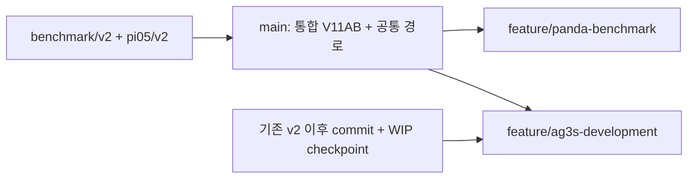

# AG3S_VLA 통합 실행 및 인수인계 결과

> 이 문서는 최초 통합 당시 기록입니다. 후속 storage 경로 분리 및 현재 Python 안내는
> `STORAGE_IMPLEMENTATION_REPORT.md`와 `../SHARED_STORAGE_AND_PYTHON.md`가 우선합니다.

- 갱신: 2026-10-11 12:25 UTC
- 상태: 로컬 통합·경로 전환·checkpoint 및 branch commit 완료. **Push는 미실행**.
- 원격 설정: `git@github.com:Ignimkk/AG3S_VLA.git`. 기존 원격 owner를 기준으로 설정했다.
  새 원격 repository의 존재와 push 권한은 이 작업에서 확인/생성하지 않았다.

## 1. 현재 사용할 폴더와 브랜치

| 폴더/branch | 기준과 목적 |
|---|---|
| `main` (두 clone에 같은 ref 보유) | 원본 benchmark/v2 + pi05/v2 + pinned OpenPI의 V11AB; 구조·경로·운영 규칙 수정만 추가 |
| `/mnt/dev/AG3S_VLA-development` · `feature/ag3s-development` | v2 이후 원본 commit과 현재 미커밋 source/doc/test checkpoint를 모두 포함; AG3S 개선 계속 개발 |
| `/mnt/dev/AG3S_VLA-benchmark` · `feature/panda-benchmark` | paired v2에서 Panda adapter와 LIBERO 계열 benchmark 개발을 시작할 준비 |

두 clone의 `.git` object store·HEAD·index·working files·Python 설치·venv·새 output·cache는 독립이다.
동일 origin을 사용하며 한쪽의 변경은 다른 쪽에 자동으로 전달되지 않는다.
현재 benchmark feature와 main은 같은 기준이다. Adapter 구현 이후 feature에서만 차이가 생긴다.
`main`은 서로 다른 두 원본 tag를 조합한 새 monorepo commit이므로 원본 v2 SHA 자체와 같지 않다.

## 2. 정확한 원본 기준 및 이력 보존

| 원본 ref | 원본 commit |
|---|---|
| `legacy/benchmark/v2` | `498f713b20bf9b75b4b065cd9bcdd508d7cdaecf` |
| `legacy/pi05_TO_hybrid/v2` | `f62ab814e867912af3cecea52519d00c470d39e3` |
| pi05/v2에 pinned OpenPI | `df127613c06c82567bec65f6e7e2b401dff8fa59` |
| 당시 workspace test 기준 | `9bf5bcdaf883bb1bcd74d26989f4fed549381462` |
| 개발 workspace checkpoint | `a5dca644b7676d4cd4feafb1506de9f518aeb420` |
| 개발 benchmark checkpoint | `dd0ddff4d0dd4415c1ae2c5774bc0260d354d943` |

Workspace에는 v2 tag가 없었다. 당시 tests는 benchmark/v2 commit 시간 이전 마지막
first-parent workspace commit을 사용했고 최신 tests는 개선 branch에만 포함했다.
기존 원본 commit·annotated tag object SHA를 rewrite하지 않았다. Source별 모든 기존
branch·tag·remote ref는 `legacy/<source>/*`에 보존한다. Git 내부 도구의 tree/commit 참조도
`legacy/workspace/auxiliary/*` 보존 tag로 이관했다. 이는 release tag가 아니다.

미커밋 내용을 원본 branch에 직접 commit하여 active tree를 정리하지 않았다.
임시 index와 commit-tree로 source checkpoint ref를 만든 뒤 개발 branch의 ancestry로 포함했다.
따라서 기존 workspace의 HEAD·index·dirty source는 통합 전 상태로 유지된다.
대형 raw attention 배열과 설치된 paper tool binary는 Git 외부로 분리했다.
이 과정에서만 **미공개 migration checkpoint**를 정정했으며 사용자 기존 commit은 바꾸지 않았다.



## 3. 실제 폴더 구조와 기타 자료

| 내용 | 현재 위치/관리 |
|---|---|
| AG3S·TrajOpt | `AG3S/ag3s`, `AG3S/trajopt` |
| 기존 benchmark/docs | `AG3S/docs` |
| 기존 method 내부 log/handoff/figure | `AG3S/ag3s/docs` 등 내부 구조 보존 |
| KNOWS·SEAM | `Baseline/knows_vla`, `Baseline/seam_vla` |
| 공식 benchmark | `benchmark/LIBERO`, `benchmark/SafeLIBERO`, `benchmark/LIBERO-Safety` 고정 submodule |
| pi05의 bringup/manipulation/docs/assets | `integration/rby1/*`; 로봇 description은 `robots/rby1/description` |
| 자체 수정 OpenPI fork | `third_party/openpi` 직접 추적; fork 원본 이력도 보존 |
| cuRobo·ALOHA | `third_party/curobo`, `third_party/aloha` 고정 submodule |
| RealSense·ZED | `third_party/ros/*` 기존 추적 source 유지 |
| script·tests·환경 명세 | `scripts/`, `tests/`, `environments/`, root `pyproject.toml` |
| 자체 관리 문서·발표/계획 source | `doc/`; 참고문헌은 `references/legacy-papers` |
| 현재 paper 작업 | 개선 branch의 `paper/`; v2 main에 최신 논문 작업을 섞지 않음 |
| 기존 output의 재사용 script | 개선 branch의 `experiments/legacy/outputs`; 테스트에 필요한 helper는 `scripts/testing/t43t` |
| 기존 V11 launcher | `scripts/benchmark/v11ab`; RB-Y1용 역사적 launcher이며 Panda runner가 아님 |
| dataset·checkpoint·raw recording·대형 media·기존 venv | `/mnt/dev/work`에 그대로 보존, Git 외부의 legacy input storage |
| 새 실행 output·config/cache·venv | 각 checkout의 ignored `outputs`, `.runtime`, `.cache`, `.venv-*`, `.python` |
| 이전 사용자 backup·raw evidence | 원본 위치 그대로 보존; 이번 임시 backup 제거와 별개 |

`integration/panda`, `AG3S/adapters/panda`, benchmark adapters/runners/evaluators 등은
다음 구현을 위한 경계와 안내다. 이관만으로 Panda 구현이 완성되었다고 해석하지 않는다.
과거 JSON/log·recording 내부의 원래 경로는 증거의 일부이므로 일괄 덮어쓰지 않았다.
Archived 연구 prototype 전체의 실행 가능성을 보증하지 않는다. 현재 실행 코드·tests·
사용되는 replay helper는 새 경로로 정리하고 검증했다.

## 4. 환경 및 경로

각 clone에 독립 Python 3.11.16과 `.venv-ag3s`를 만들었다.
CPU/기존 simulation dependencies와 msgpack·영상 backend는 requirements에 pin했다.
직접 관리 package의 editable install은 자기 checkout을 가리킨다.
`pyproject.toml`의 `0.0.0`은 설치 metadata이며 AG3S release 버전이 아니다.

```bash
cd /mnt/dev/AG3S_VLA-development  # 또는 benchmark 폴더
source scripts/setup/env.sh
.venv-ag3s/bin/python scripts/setup/check_workspace.py
.venv-ag3s/bin/python scripts/setup/prepare_legacy_test_fixture.py
```

`AG3S_LEGACY_STORAGE` 기본값은 `/mnt/dev/work`다. Dataset·checkpoint·raw input을 읽는 용도다.
활성 AG3S·TrajOpt·client·manipulation·OpenPI source는 자기 checkout에서 import한다.
일부 원본 Git 비교 tests는 자기 checkout의 ignored `.runtime/legacy-*`에 frozen historical
snapshot을 구성한다. Fixture는 이 clone의 Git objects만 참조하며 다른 clone에 의존하지 않는다.
원본 algorithm과 비교할 때 canonical import entry point도 해당 archived algorithm을 가리키게 했다.
기존 `benchmark.ag3s`/`benchmark.trajopt` import는 호환 bridge로 동일한 canonical module을 쓴다.

Git 밖의 attention 배열·paper tool은 `experiments/manifests/legacy-artifacts.json`에
원본 경로·크기·SHA-256을 기록했고 ignored link를 사용한다. 재연결 명령:

```bash
.venv-ag3s/bin/python scripts/setup/prepare_legacy_artifacts.py --storage /mnt/dev/work
```

GPU/VLA·cuRobo 별도 환경, LIBERO assets/dataset와 checkpoint 다운로드, Panda adapter와
실제 benchmark rollout은 아직 수행하지 않았다. CPU 환경을 GPU 환경 전체로 간주하지 않는다.

## 5. 검증 결과와 남은 제한

검증 raw log·JUnit·집계는 `doc/migration/validation`에 보관한다.
전체 검사 후 경로/의존성 수정 항목과 중단으로 미실행된 모든 항목을 추가 검증하고,
같은 test case는 마지막 결과만 집계했다. 수치 method를 고쳐 저장된 기준에 맞추지 않았다.

| 항목 | 결과 |
|---|---|
| 원본 파일 보존 | 13,051개 checksum/link 비교 일치 |
| 원본 Git 상태·이력 | 7개 HEAD·상태 및 원본 refs의 두 clone SHA 일치 |
| Git integrity | 두 clone `git fsck --full --no-reflogs` 정상; dangling 미공개 객체는 corruption 아님 |
| 원격 파일 크기 | reachable blob 중 100 MiB 초과 없음 |
| Python 경로/설정 | 양쪽 own-root import·로봇 geometry·client root 정상, AG3S/TrajOpt 중첩 기본값 원본과 일치 |
| Claude 경로/규칙 | 양쪽 hook JSON·shell syntax·실제 절대 role permissions 정상 |
| 개발 CPU 회귀 집계 | 2812 passed / 1 failed / 12 skipped / 0 errors |
| v2 benchmark CPU 회귀 집계 | 2670 passed / 1 failed / 6 skipped / 0 errors |

남아 있는 실패/skip의 세부 근거는 validation summary의 failed_cases/skipped_cases를 확인한다.
특히 `test_off_is_bit_identical_to_the_pre_fix_commit`의 `to_T42_L1992_16` 비교는
원본 workspace에서도 재현된 기존 수치 불일치다. 패키지·경로 이관의 새로운 실패로 숨기거나
skip 처리하지 않았으며 별도 numerical reproducibility 분석 대상으로 남긴다.
GPU·Torch/JAX·checkpoint opt-in 등 별도 환경 항목은 CPU 검증 범위 밖이다.
실제 충돌회피 성능을 판단할 benchmark episode 결과는 아직 없다.

## 6. Claude 전환 및 merge 규칙

`CLAUDE.md`와 `.claude`의 기존 multi-repository commit 규칙·module 경로·role ownership·
환경 안내를 통합 구조로 수정했다. SessionStart/UserPromptSubmit은 실제 root·branch·HEAD와
목적을 주입한다. Role launcher는 자신의 절대 경로 settings를 생성한다.
기존 workspace의 코드 편집 금지도 새 settings에 반영했다.

개선 폴더와 benchmark 폴더를 별도 VS Code 창으로 열고 각각 새 Claude session을 시작한다.
기존 `/mnt/dev/work` session을 resume해 새 개발을 이어가지 않는다.
전환 문구는 `doc/migration/CLAUDE_HANDOFF.md`에 있다. 실제 외부 메시지는 보내지 않았다.

`feature/ag3s-development` 전체를 benchmark/main에 merge하면 V11AB 기준이 바뀐다.
공통 구조 수정만 작은 commit으로 전달하고 알고리즘 개선은 별도 평가 profile로 다룬다.
PR template과 `doc/BRANCHES.md`에 target branch·source SHA·기능 변화·검증을 남기도록 했다.

## 7. Backup 및 기존 workspace

최초 수정 전에 7개 bundle·Git metadata·13,051개 source/doc/script 파일을 백업하고 검증했다.
백업 범위는 source-manifest에 기록했다. Large dataset·checkpoint·cache·venv·raw recordings는
원본을 건드리지 않아 추가 복제하지 않았다. 원본 보존 검사 결과는 validation에 남겼다.
이번 임시 백업 `AG3S_VLA-migration-backup-20261011T103548Z`: **검증 완료 후 제거 완료**.
기존 `/mnt/dev/work` 자체와 그곳의 다른 backup/data는 삭제하지 않았다.
원본 code/index/HEAD는 유지했고, 마지막 전환 단계에서 원본 CLAUDE·hook 요약에
새 작업 폴더를 안내하는 문구 및 이 관리 문서만 의도적으로 갱신한다.

## 8. 사용자가 수행할 작업

1. `Ignimkk/AG3S_VLA`가 없으면 **비어 있는** remote repository를 생성한다.
   README/initial commit을 별도로 생성하지 않는다. Owner가 다르면 두 clone의 origin을 바꾼다.
2. 아래 push를 실행한다. 기본 branch를 main으로 설정하고 필요하면 보호한다.
3. 새 폴더 두 개를 별도 VS Code 창으로 열고 독립 Claude session을 시작한다.
4. Benchmark branch에서 Panda adapter → LIBERO Spatial → SafeLIBERO Spatial I/II →
   전체 SafeLIBERO → LIBERO-Safety 순서로 다음 구현을 진행한다.

```bash
cd /mnt/dev/AG3S_VLA-development
git push origin main feature/ag3s-development feature/panda-benchmark
git push origin 'refs/heads/legacy/*:refs/heads/legacy/*'
git push origin --tags
```

Force push나 `--mirror`는 사용하지 않는다. 보존 branch/tag push도 필요하다.
원격 반영 후 각 창에서 `git fetch origin`하여 최신 ref를 확인한다.
새 장비에서 clone할 때 `git submodule update --init --recursive`로 고정 dependency를 가져온다.
