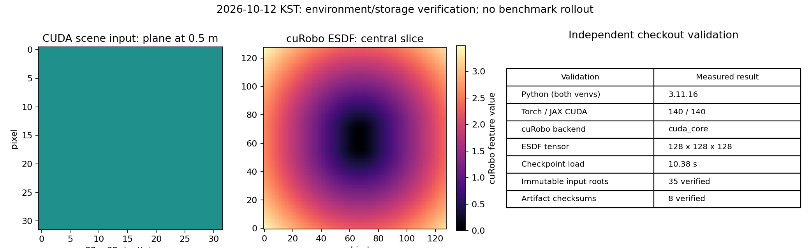

# Benchmark live environment 및 output 분리 검증

기록: **2026-10-12 KST**. 변경 목적: `layout/evaluation`.
작업 checkout: `/mnt/dev/AG3S_VLA-benchmark`, branch: `feature/panda-benchmark`.
시작 HEAD는 `8b4df07ba99d9fe6d64b50584ca5b63bb4653878`였다. 작업 중 다른 session의
문서 commit `1803e318e831`이 추가되었으며 그대로 보존했다. 이번 구현은 해당 HEAD 위에서
검증했으며 최종 구현 commit은 `git log -1`로 확인한다. Push는 하지 않았다.

## 판정

검증한 CPU record/TA 경로, OpenPI checkpoint loading, Torch/JAX CUDA 및 cuRobo ESDF는
이전 `/mnt/dev/work` source·venv·input backlink 없이 실행된다. 이전 폴더를 삭제하거나
숨기는 filesystem mount 실험은 수행하지 않았다. Python audit가 old checkout의 open,
listing, chdir 및 Python subprocess 접근을 차단한 상태에서 검증했다. Native syscall 전체를
차단하는 sandbox와 동일한 보장은 아니다. 실행 host의 기본 sandbox는 `bwrap` 권한 오류로
실행되지 않아 승인된 checkout 작업을 sandbox 밖에서 수행했다.

전체 archived V11 replay/analysis tool까지 실행 가능한 상태는 아니다. 아래 미완료 항목을
해결하기 전 historical postprocessing launcher를 실제 평가 완료 근거로 사용하지 않는다.
Panda adapter와 LIBERO 계열 rollout은 이번 환경 작업의 수행 범위가 아니다.

## 원본 알고리즘과 독립 환경

| 항목 | 기준 / 결과 |
|---|---|
| benchmark/v2 | `legacy/benchmark/v2` → `498f713b20bf9b75b4b065cd9bcdd508d7cdaecf` |
| pi05_TO_hybrid/v2 | `legacy/pi05_TO_hybrid/v2` → `f62ab814e867912af3cecea52519d00c470d39e3` |
| OpenPI source pin | `df127613c06c82567bec65f6e7e2b401dff8fa59` + 이번 record/path 수정 |
| cuRobo submodule | `78fd485fa82d9b9a063fb4985e371814587e666a`, source 무수정 |
| OpenPI live | 자기 `.venv-openpi-live`, 자기 `.python`의 Python **3.11.16** |
| cuRobo producer | 자기 `.venv-curobo`, Python **3.11.16**, system-site-packages 사용 안 함 |
| numerical pins | numpy 1.26.4, JAX/JAXlib 0.5.3, flax 0.10.2, orbax 0.11.13, Torch 2.7.1, MuJoCo 3.11.0 |
| install 방식 | 자기 uv cache로 새 설치, `--link-mode copy`, 자기 source의 editable install |
| LeRobot | upstream `0cf864870cf29f4738d3ade893e6fd13fbd7cdb5`를 자기 cache로 fetch 후 자기 site-packages에 설치 |
| V11AB 설정 | plan 16 / execution 8, obstacle lookahead, gate 20 mm, QP eps 1e-4, deflection weight 20; round-trip 통과 |

기존 inventory는 constraints 참고 자료로 사용했고 필요한 runtime dependency를 추가했다.
기존 venv/package directory나 다른 checkout source를 복사·연결하지 않았다.
cuRobo producer는 legacy inventory의 Python 3.10/system Torch 공유 대신 현재 checkout의
독립 Python 3.11.16/Torch 2.7.1을 선택했다. OpenPI live에도 cuRobo를 설치해야
기존 `serve_safe --esdf-backend curobo`가 같은 process 안에서 Mapper를 실행할 수 있다.

`gym-aloha==0.1.1` metadata는 MuJoCo `<3`를 요구하지만 legacy live 환경은 MuJoCo 3.11.0이었다.
이 package만 `--no-deps`로 설치하는 예외를 bootstrap에 명시했다. OpenPI의 `uv pip check`는
이 **한 가지 metadata 충돌**을 보고한다. 별도 cuRobo 환경의 pip check는 정상이다.
ALOHA simulator의 호환성을 검증한 결과로 해석하지 않는다. 처음 발견된 누락 dependency와
CUDA bindings는 보완 후 재검증했다. 최종 requirements + validated constraints dry-run은
두 환경 모두 **Would make no changes**였다.

```bash
source scripts/setup/env.sh
bash scripts/setup/create_live_env.sh
bash scripts/setup/create_live_env.sh .venv-curobo
```

## 새 output과 manifest

모든 새 V11 online run은 다음 namespace에 고유 root를 생성한다.

```text
/mnt/dev/AG3S_VLA-storage/results/benchmark/
  <KST 날짜시간>_<commit 12자리>_<run-id>/
    run_manifest.json
    source.patch
    logs/
    videos/
    policy_records/         # OpenPI --record가 최초 생성
    runs/                   # V11 client video/frame/traj, server constraint/log
    partial.json            # V11 진행 상태
```

`common/run_artifacts.py`는 run root를 exclusive mkdir로 생성한다. Shared input이나
symlink를 통해 그쪽으로 나가는 output 주소를 거부하며 기존 run을 명시적으로 재사용할 때
checkout/commit이 같은지 확인한다. Manifest 갱신은 lock + atomic replace를 사용한다.
Manifest에는 branch, full commit, dirty 상태, 원본 v2 tag object/commit, source 기준,
algorithm tree와 dependency pin, 설정, checkpoint, 저장 위치, 실제 server/client argv를 기록한다.
새 allocation은 tracked diff와 untracked source SHA-256도 남긴다. Cache는 자기 checkout의
`.cache/{openpi,huggingface,uv,warp,cuda,jax,torch-*}`로 분리했다.

OpenPI `--record`는 cwd의 `policy_records`를 사용하지 않고 위 run의 새 directory에 쓴다.
`--record-dir`도 선택한 run 안의 경로만 허용한다. Recorder는 기존 directory를 거부하고
각 `step_*.npy`도 exclusive open으로 작성하므로 기존 파일을 덮어쓰지 않는다.
기존 `third_party/openpi/policy_records` symlink는 보존된 input 조회용으로 유지했다.
OpenPI server log도 새 run의 `logs/serve_policy_<port>.log`에 exclusive 생성한다.
같은 run/port를 재사용해 기존 log/record를 덮는 restart는 거부된다.

V11 launcher의 obstacle config는 storage의 기존 `results/workspace/verify/T43/P2/configs`를 읽는다.
존재하지 않는 `-t43v11` snapshot 및 누락된 MD5 기준 파일에 대한 online 의존성을 제거하고,
현재 checkout fingerprint와 import origin을 저장한다. 미커밋 method/adapter 변경은 preflight에서
거부한다. 기존 broad `pkill -f`는 제거하여 cleanup은 자신이 시작한 server PID만 대상으로 한다.
GPU budget/stagger 및 V11AB server/client algorithm flag는 유지했다.

```bash
source scripts/setup/env.sh
# 새 run 선택; 출력된 절대경로를 이후 analysis/restart에서 명시적으로 보존한다.
export AG3S_RUN_DIR="$(.venv-ag3s/bin/python -m common.run_artifacts \
  --run-id my-run --settings-json '{"algorithm":"V11AB"}')"
# source scripts/benchmark/v11ab/env.sh 역시 필요할 때 새 run을 만든다.
# benchmark server/client 실행은 adapter·평가 gate를 별도로 통과한 뒤 수행한다.
```

## 검증 증거

Raw result root:
`/mnt/dev/AG3S_VLA-storage/results/benchmark/20261012T011257_1803e318e831_live-validation/`.
이 run의 HEAD는 실행 시점의 문서 commit이며 구현 파일은 당시 working tree였다.
최종 검증 source diff/hash와 결과 요약을 함께 저장한다. 후속 commit으로 raw HEAD를 덮어쓰지 않는다.
Git에 검증 요약은 `doc/migration/validation/live/`로 보존한다.

| 검증 | 결과 |
|---|---|
| checkout/storage | own-root import, submodule pin 5개 정상, input root 35개, artifact checksum 8개 정상 |
| old symlink | checkout에서 old workspace로 향하는 symlink 없음 |
| old access denial | CPU/TA/record, live import, checkpoint 및 ESDF 검증의 Python audit probe 정상 |
| Torch/JAX GPU | H200 NVL, 양쪽 실제 CUDA 계산 결과 140.0 |
| GPU 자원 확인 | 각 GPU command 직전 compute process 없음; 작업 종료 후에도 없음 |
| checkpoint loading | 실제 randomized-pick-place 16D LoRA `29999`를 Policy로 로드, 10.377 s |
| checkpoint checksum | params/assets/metadata 16개, 6,335,650,235 bytes; train_state는 제외 |
| checksum aggregate | `1cee3a588b4ab26d7fda2360bda0b0f2abbec59f0aaf155316320420374efacb` (파일별 digest 목록의 hash) |
| cuRobo kernels | OpenPI live와 별도 producer 모두 depth integrate → compute_esdf 정상 |
| producer ESDF | cuda_core backend, 128×128×128, 전부 finite, feature range 0.0–4.1875 |
| V11AB import/config | server/client own-root guard, config round-trip 모두 정상 |
| regression | **73 passed**, 77 dependency deprecation warnings; output safety, 기존 record, TA path 검증 |
| OpenPI record protection | 모의 server로 `main(--record)` 실행; 기존 shared recording 그대로, 새 run에 record/log 생성 |
| environment restore | 두 requirements/validated constraints dry-run 변경 없음 |



이 그림은 synthetic plane의 실제 cuRobo kernel 결과다. Benchmark scene의 success metric을
측정한 그림이 아니다. ESDF color는 native feature 값이며 별도의 물리 단위 검증을 주장하지 않는다.

## 남은 의존성과 미완료 항목

| 종류 | 남은 항목 / 영향 |
|---|---|
| 이전 process | Python discovery PID 1631540, 3277586, 3580744는 old Python executable 사용; Node PID 3496192, 3515591은 old cwd 사용. 모두 보존했으며 새 runtime 의존성이 아니다 |
| system | NVIDIA driver 580.173.02/H200, Linux CUDA runtime/driver와 OSMesa 등 system library 필요; fresh machine 전체 system 설치는 미검증 |
| 공유 자료 | checkpoint/dataset/attention/tool 및 obstacle config는 독립 storage에서 계속 읽는다. Python 설치 시 network 또는 자기 uv cache 필요 |
| 기존 누락 dataset | `datasets/lerobot-atomic/local/rby1_atomic_basket_14d_v2`, `datasets/lerobot-transport/local/rby1_dataset_v1`; 이관 이전부터 없음 |
| archived postprocessing | `run_replays_v11.sh`의 `replay_ct.py` 및 `analyze_t39`, `hurdle_metrics`, `hold_w`, `dx_common` 등 ignored helper/과거 output 경로가 남아 있음; 자기 checkout에 원본 기준으로 복원하고 새 run/input 주소를 분리하는 후속 작업 필요 |
| 모델 실행 | checkpoint loading까지 확인; action sampling, websocket 통신, 실제 V11AB closed-loop rollout은 미실행 |
| Panda 평가 | Panda geometry/camera/action adapter, LIBERO/SafeLIBERO/LIBERO-Safety environment와 해당 checkpoint/norm stats 검증은 미완료 |

공유 input·development checkout은 수정하지 않았다. 이전 workspace 삭제와 다른 session process
종료도 수행하지 않았다. 개발 branch 전체 merge/cherry-pick 없이 이 branch에서 경로·환경 변경만 했다.
