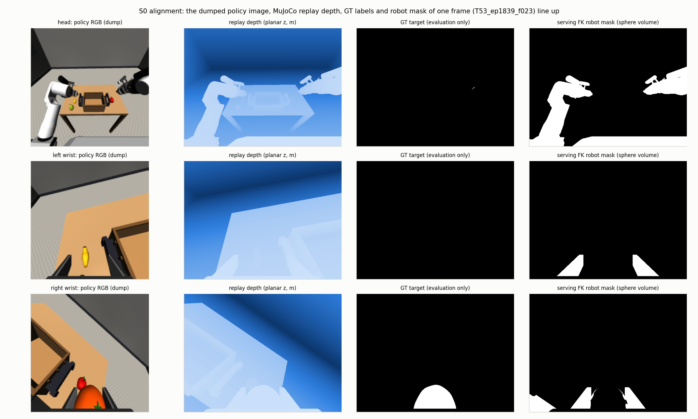
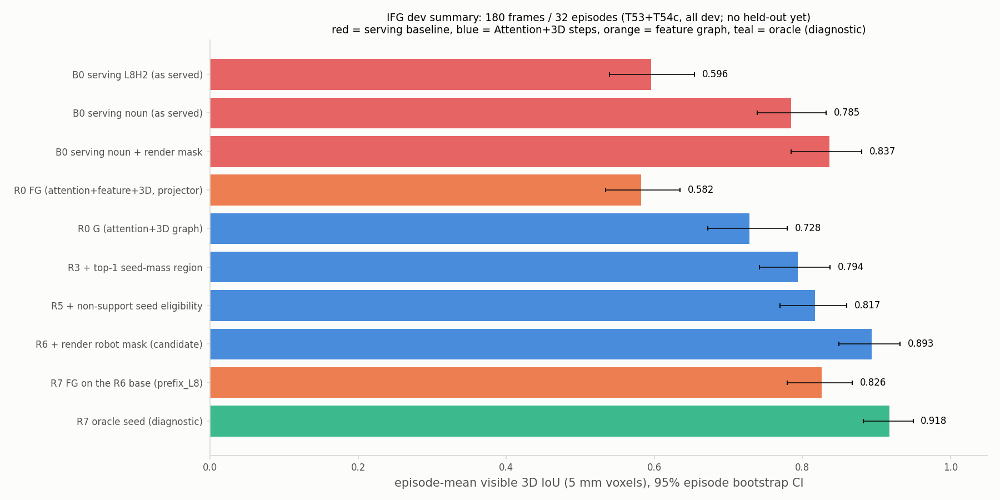

# 최종 보고서 — 로봇이 "잡을 물체의 3D 표면"을 찾는 방법 개선 (쉬운 설명판)

작성: 2026-10-15 KST.

- 기술 상세판: [SUMMARY_METHODS_RESULTS_KO.md](SUMMARY_METHODS_RESULTS_KO.md)
- 시간순 기록: [WORKLOG_S0S3_KO.md](WORKLOG_S0S3_KO.md)
- 방법론 변화: [METHODOLOGY_EVOLUTION_KO.md](METHODOLOGY_EVOLUTION_KO.md)
- 커밋: `4f36ff51` 이후 / branch `feature/ag3s-development`
- 데이터 run: `/mnt/dev/AG3S_VLA-storage/results/development/20261015T181706+0900_30955b6ca8ef_d4b3bafb79ba`

> **먼저 알아 둘 한계.** 모든 숫자는 이미 연구에 썼던 32개 episode(180장면)에서 나왔다(**dev**). 방법을 고른 데이터와 평가한 데이터가 같으므로, 처음 보는 데이터(**held-out**)로 다시 확인하기 전에는 "확정된 성능"이 아니다. Held-out 수집은 요청해 두었다.

## 0. 이 연구가 푸는 문제

AG3S는 VLA(카메라 영상과 명령을 보고 로봇 동작을 내는 AI, 여기서는 π0.5)의 동작을 안전하게 다듬는 시스템이다. 로봇 팔이 장애물에 부딪히지 않게 하려면 주변 3D 공간을 **"부딪히면 안 되는 곳"**으로 표시해야 한다. 그런데 **잡으려는 물체(target)는 손이 닿아야 하므로** 그 표면만은 예외로 둬야 한다.

이 예외 영역이 **너무 크면** 옆의 다른 물체까지 "부딪혀도 되는 곳"이 되어 위험하다. **너무 작으면** 잡아야 할 물체를 장애물로 보고 잡지 못한다. 그래서 **target의 3D 표면을 정확히 찾는 것**이 이번 작업의 목표다.

## 1. 용어 설명 (이 보고서에서 쓰는 말)

| 용어 | 뜻 |
|---|---|
| **Attention (주의 지도)** | VLA가 이미지의 어느 부분을 중요하게 보는지 나타내는 값. 이미지를 16×16 칸으로 나눈 칸마다 하나씩 있다. 명령 속 명사("orange")에 대한 attention을 **noun attention**이라 부른다 |
| **Feature (내부 특징)** | VLA가 각 칸의 내용을 2048개 숫자로 요약한 값. 비슷한 물체는 비슷한 feature를 갖는다고 기대했다. 역시 16×16 칸 단위다 |
| **Depth / 3D 점** | 카메라에서 각 pixel까지의 거리. 이를 이용해 각 pixel을 3D 점으로 바꾼다 |
| **Voxel / node** | 3D 공간을 5 mm 정육면체로 나눈 칸. 점들이 들어 있는 칸 하나를 graph의 node(점) 하나로 쓴다 |
| **표면 연결(edge)** | 두 node가 같은 물체 표면으로 이어져 있다는 표시. 이번 방법은 **이미지에서 이웃한 pixel이면서 depth가 끊기지 않을 때만** 잇는다. 3D로 가까워도 깊이가 갑자기 바뀌면(물체 경계) 잇지 않는다 |
| **Seed (시작점)** | target일 가능성이 가장 높은 칸. noun attention이 가장 큰 5칸을 쓴다 |
| **Region (영역)** | 표면 연결을 따라 seed에서 퍼져 나간, 서로 이어진 node 묶음 |
| **Robot mask** | 로봇 자신의 팔·손을 지우는 표시. 지우지 않으면 로봇 몸이 장애물로 보인다 |
| **Graph energy 풀이** | "seed는 target(1), 탁자는 target 아님(0)"이라는 단서를 표면 연결을 따라 매끄럽게 퍼뜨려 node마다 0–1 점수를 매기는 계산 |
| **IoU** | 예측한 target 표면과 실제 target 표면이 얼마나 겹치는지(0–1, 1이 완벽) |
| **Precision / Recall** | Precision: 예측한 것 중 진짜 target 비율(남의 물체를 덜 포함할수록 높음). Recall: 진짜 target 중 찾아낸 비율(target을 덜 놓칠수록 높음) |
| **FP / FN** | FP: target이 아닌데 target이라고 한 부분(위험). FN: target인데 놓친 부분 |
| **기존 방법 (serving, "B0")** | 현재 AG3S가 쓰는 방식. attention을 3D 점에 옮기고, 상위 5% 점에서 3 cm 반경으로 키워 덩어리를 만든 뒤 점수가 가장 높은 덩어리를 고른다 |
| **Oracle** | 정답(GT)을 몰래 알려 준 진단용 실험. 실제 방법이 아니라 "여기까지는 가능하다"는 상한을 보는 용도 |
| **Shuffle 대조군** | feature를 무작위로 섞은 가짜 실험. 섞어도 결과가 같으면 그 feature는 실제로 아무 역할도 하지 않았다는 뜻 |
| **95% CI** | 결과의 불확실성 범위. 범위가 0을 포함하면 "차이가 있다고 확신할 수 없음" |
| **Dev / Held-out** | Dev: 방법을 만들며 본 데이터. Held-out: 방법을 고정한 뒤 처음 보는 데이터 |

## 2. 결론 한눈에 보기

| 질문 | 답 (dev 기준) |
|---|---|
| **원래 계획: VLA feature를 3D graph에 넣으면 target 표면을 더 정확히 찾는가?** | **아니다.** 처음 계획대로 해도(정확도 0.73 → 0.58로 하락), 원인을 고쳐 가며 여러 방식으로 다시 해도, feature를 넣은 쪽이 나아지지 않았다 |
| **Attention + 3D(feature 없이)는 기존 방법보다 나은가?** | **나아 보인다.** 같은 robot mask 조건에서 0.837 → **0.893**(+0.057). 주로 남의 물체를 덜 포함한다. 다만 불확실성 범위의 하한이 0에 가까워 held-out 확인이 필요하다 |
| **Feature는 쓸모가 없는가?** | **아니다.** "이전 장면에서 본 target과 지금 고른 영역이 같은 물체인가"를 확인하는 **안전 경보**로는 잘 맞았다. 다만 잘못 고른 장면이 6개뿐이라 표본이 작다 |
| **3D 정보는 작업 단계·잡기 판단에도 도움이 되는가?** | **된다.** 손-물체 거리, 물체 높이, gripper 상태를 더하면 단계 판단 정확도가 0.78 → 0.94로 오른다(학습형 모델) |

## 3. 실험별 설명

각 실험은 **질문 → 한 일 → 결과 → 그림**으로 정리했다. 그림은 실제 장면 이미지 위에 결과를 겹친 것이다(초록 = 맞게 찾은 target, 주황 = 잘못 포함한 다른 물체, 파랑 = 놓친 target).

### 3.1 준비: 데이터가 정확한가 (S0)

- **질문:** 저장된 VLA 내부값, 다시 만든 depth, 정답 표시가 같은 장면을 가리키는가?
- **한 일:** 180장면 모두에서 이미지·로봇 상태·depth 단위·카메라 위치를 대조했다. 이전 진단 결과도 소수점까지 똑같이 재현했다.
- **결과:** 전부 일치했다. 발견한 문제는 기록하고 고쳤다: 먼 바닥 때문에 탁자 평면을 못 찾던 문제, 일부 저장값의 숫자 넘침(사용하지 않는 부분).
- **그림:** 위 §0의 장면 그림.

### 3.2 원래 계획 그대로 해 보기 (R0)

- **질문:** noun attention으로 시작점을 잡고, feature 유사도로 영역을 넓히고, depth 표면 graph로 다듬으면 target 표면이 더 정확해지는가?
- **한 일:** 시작점 3종 × feature 5종을 모두 비교했다. 같은 graph에서 feature를 (a) 연결 강도에만, (b) node 점수에만, (c) 둘 다에 넣는 경우와 (d) 전혀 안 넣는 경우를 비교했다.
- **결과:**
  - **feature 없는 3D graph: 0.728**
  - feature를 연결 강도에만 넣음: 0.728(변화 없음)
  - feature를 점수에 넣음: 0.58 수준(하락)
  - feature만 사용: 0.26
  - 기존 방법: 0.785
  - 하락 원인: feature가 바구니나 옆 과일까지 target으로 끌어들였다.
- **그림:** [실패 장면: feature가 바구니 전체로 번짐](../../../AG3S/ag3s/docs/figures/ifg/ifg-scene-T54c_ep1806_f031.png)

### 3.3 Feature를 살려 보는 시도 (R1–R3)

- **질문:** feature를 "영역이 target인지 판정"하는 데만 쓰면 되지 않을까?
- **한 일:**
  - R1: 이어진 덩어리 전체 단위로 판정했다.
  - R2: 예측한 영역 단위로 판정했다.
  - R3: 가장 유력한 영역은 보호하고 나머지만 판정했다.
- **결과:**
  - R1·R2는 진짜 target까지 버려 실패했다.
  - R3는 0.785로 좋아졌다. 그러나 **feature를 무작위로 섞어도 0.784로 같았고, feature를 아예 안 쓰고 "가장 유력한 영역 하나만 남기기"만 해도 0.794**였다.
  - 즉 좋아진 이유는 feature가 아니라 **"seed가 가장 많이 몰린 영역 하나만 고르는 규칙"**이었다. 이 규칙을 채택했다.
- **그림:** [덩어리 단위 판정이 target을 버리는 장면](../../../AG3S/ag3s/docs/figures/ifg/exp/exp-R1-R3-gate-unit.png)

### 3.4 기존 방법처럼 "attention 합"으로 고르기 (R4)

- **질문:** 기존 방법은 덩어리의 attention 합으로 target을 고른다. 이걸 따라 하면 좋아지는가?
- **결과:** 0.688로 하락했다. 큰 바구니가 크기만으로 attention 합을 많이 모았다.
- **덤으로 얻은 진단:** 정답을 알려 주고 영역만 고르게 하면 0.843이다. 즉 **표면을 나누는 방식 자체는 충분히 좋고, 남은 문제는 "어느 영역이 target인지 고르는 것"**이다.
- **그림:** [attention 합이 바구니를 고르는 장면](../../../AG3S/ag3s/docs/figures/ifg/exp/exp-R4-mass-bias.png)

### 3.5 시작점이 탁자에 떨어지는 문제 (R5) — 채택

- **질문:** 몇몇 장면에서는 시작점(seed) 자체가 target 밖에 있었다. 왜일까?
- **한 일:** 처음엔 "로봇 손 mask가 과일을 지워서"라고 생각했다. 측정해 보니 **이 가설은 틀렸다.** 실제로는 noun attention이 높은 칸에 **탁자 pixel이 대부분**(실패 장면에서 71%)이었다. 그래서 시작점 후보에서 탁자 pixel을 빼도록 했다(기존 방법도 탁자를 시작점에서 뺀다).
- **결과:** 0.794 → **0.817**(+0.023, 32 episode 중 7개 개선, 0개 악화).
- **그림:** [탁자 위 시작점 vs 물체 위 시작점](../../../AG3S/ag3s/docs/figures/ifg/exp/exp-R5-nonsupport-seed.png)

### 3.6 손에 든 과일을 로봇으로 지우는 문제 (R6) — 채택

- **질문:** 들고 있는 과일이 자주 사라졌다. 왜일까?
- **원인:** 기존 robot mask는 손 주변을 **공(구) 모양 부피**로 덮고, 그 안의 점을 모두 지운다. 손가락 사이의 과일도 같이 지워졌다(놓친 target의 46%).
- **한 일:** 로봇의 실제 모양(mesh)을 그 자세로 그려 보고, **카메라가 본 깊이와 로봇 표면 깊이가 1 cm 안에서 일치하는 pixel만** 로봇으로 지웠다. 과일이 손가락 앞에 있으면 깊이가 다르므로 남는다.
- **결과:** 0.817 → **0.893**(+0.076, 32 episode 중 31개 개선). 잡은 직후 장면이 0.72 → 0.94로 크게 좋아졌다.
- **그림:** [구 부피 mask는 과일을 지우고, 렌더 mask는 남긴다](../../../AG3S/ag3s/docs/figures/ifg/ifg-scene-r6-T54c_ep1817_f020.png)

### 3.7 Feature 재검증 (R7)

- **질문:** R0 실패 때는 시작점·robot mask 문제가 섞여 있었다. 고친 상태에서 feature를 다시 넣으면?
- **결과:**
  - 여전히 도움이 되지 않았다. 연결 강도에 넣으면 변화가 없고, 점수에 넣으면 0.07–0.11 하락했다.
  - **정답 시작점을 줘도** 마찬가지였다.
  - 원인(측정): (1) 칸이 거칠다. 경계 양쪽의 73%가 같은 칸이라 feature 차이가 0이다. (2) target 표면의 42%가 손·탁자와 섞인 칸에 있어 점수가 낮게 나온다. (3) feature 기준이 seed에서 만들어지므로 attention과 같은 정보다.
- **그림:** [섞인 칸 때문에 target이 빠지는 장면](../../../AG3S/ag3s/docs/figures/ifg/exp/exp-R7-feature-unary-loss.png)

### 3.8 더 촘촘한 신호: pixel gradient (R8)

- **질문:** 16×16보다 촘촘한 신호(224×224, 행동에 대한 pixel 민감도)를 쓰면?
- **결과:** target을 가리키는 비율이 0.02–0.07로, noun attention(0.50)보다 훨씬 낮았다. 이 신호는 "행동에 영향을 주는 곳"이지 "명령한 물체"가 아니었다.
- **그림:** [gradient는 장면 전체 경계에 흩어진다](../../../AG3S/ag3s/docs/figures/ifg/ifg-r8-gradient.png)

### 3.9 기존 방법과 공정하게 비교 (R9)

- **질문:** 0.893 대 0.785 차이에는 robot mask 개선이 섞여 있다. 기존 방법에도 같은 mask를 주면?
- **결과:**
  - 기존 방법도 0.785 → 0.837로 좋아졌다(mask 효과).
  - 같은 조건에서 **새 방법이 +0.057** 앞섰다(32 episode 중 27개 우위).
  - 바구니에 놓은 뒤 장면에서 차이가 컸다(0.88 대 0.62).
  - 반대로 **잡기에 실패한 직후 장면은 기존 방법이 낫다**(0.92 대 0.75).
- **그림:** [새 방법이 앞선 장면 / 기존 방법이 앞선 장면](../../../AG3S/ag3s/docs/figures/ifg/exp/exp-R9-vs-serving.png)

### 3.10 Feature를 다르게 쓰기 ① 시간축 기억 (R10, R10b) — 미확정

- **질문:** 이전 장면에서 target의 feature를 기억해 두면, 지금 attention이 틀렸을 때 바로잡을 수 있는가?
- **결과:**
  - 처음엔 작동하지 않았다. VLA feature는 모든 물체가 0.96–0.98로 비슷하게 나오기 때문이다(공통 성분이 큼).
  - **장면 평균을 빼는 보정(centering)** 후에는 target이 확실히 구별됐다(0.60 대 0.41).
  - 정확도는 0.893 → 0.912(+0.019)였다. 사전 기준(+0.02)에 약간 못 미치고 불확실성 범위가 0을 포함해 **미확정**이다.
- **그림:** [보정 전엔 모두 비슷, 보정 후 target이 구별됨](../../../AG3S/ag3s/docs/figures/ifg/exp/exp-R10-centering.png)

### 3.11 Feature를 다르게 쓰기 ② 안전 경보 (R11) — 긍정

- **질문:** 지금 고른 영역이 기억 속 target과 다르면 "확실하지 않음" 경보를 울릴 수 있는가? 경보가 울리면 그 영역에 접촉 예외를 주지 않는다.
- **결과:**
  - 147장면 중 경보는 15번 울렸다. **잘못 고른 6장면을 모두 포함**했고, 나머지 9번은 불필요한 경보였다.
  - 잘못 포함될 뻔한 영역의 82%를 막고, 정상 target은 6%만 잃는다.
  - feature 없이 만든 경보보다 낫다. 단 잘못된 장면이 6개뿐이라 확인이 더 필요하다.
- **그림:** [경보가 울린 장면들](../../../AG3S/ag3s/docs/figures/ifg/exp/exp-R11-confidence-gate.png)

### 3.12 작업 단계·잡기 판단 (R12)

- **질문:** 3D 정보(손-물체 거리, 물체 높이)를 더하면 "지금 집는 중 / 옮기는 중 / 놓은 뒤" 판단이 좋아지는가?
- **결과:**
  - 기존 판단기(HSR)만 쓰면 0.78이다. 특히 "놓은 뒤"를 절반만 맞힌다.
  - 3D와 gripper 상태를 더한 학습형 모델은 **0.94**다.
  - 잡았는지 판단도 0.83 → 0.93으로 오른다.
  - feature 추가 효과는 없었다. 이 데이터에는 엉뚱한 물체를 잡는 경우가 없기 때문이다.
- **주의:** "높이" 입력은 원래 "탁자 위 높이"를 의도했다. 실제로는 바닥 기준 절대 높이였다. 모든 장면의 탁자 높이가 같아 결과에는 영향이 없다.
- **그림:** [단계별로 바뀌는 3D 신호](../../../AG3S/ag3s/docs/figures/ifg/exp/exp-R12-phase-3d.png)

## 4. 채택·보류·기각 정리

| 구분 | 내용 |
|---|---|
| **채택(dev 후보)** | noun attention 시작점(탁자 제외) + depth 표면 graph + 가장 유력한 영역 하나 + 렌더 robot mask (0.893) |
| **긍정, 추가 확인 필요** | feature 기억 기반 안전 경보, 3D 기반 단계·잡기 판단 |
| **미확정** | feature 기억으로 영역 바꾸기(+0.019) |
| **기각** | feature를 3D graph의 연결·점수에 넣기, feature만으로 영역 찾기, attention 합으로 고르기, pixel gradient |
| **최종 채택(사용자 판정 2026-10-15)** | **B안**: Attention + 3D 범위 + feature 기억으로 영역 바로잡기 + feature 기억 안전 경보 + 3D 단계·잡기 판단. 영역 바로잡기는 dev에서 효과가 미확정(+0.019)이므로, held-out에서 "바로잡기 없음"(A안)과 나란히 비교한다 |

## 5. 남은 일

1. **Held-out 검증:** 처음 보는 episode로 확인한다. 설정은 이미 잠갔다. 요청서: [HELDOUT_COLLECTION_REQUEST_KO.md](HELDOUT_COLLECTION_REQUEST_KO.md).
2. **AG3S 연결:** 찾은 target 영역을 실제 "접촉 허용 영역"과 충돌 제약에 연결하고, 로봇이 실제로 움직이는 실험(closed-loop)에서 확인한다.
3. **가림 테스트(테스트용, 별도 보고):** target이 1/3, 1/2 가려진 장면에서 확인한다.
4. **강한 비교 대상:** 외부 분할 모델(Grounded SAM 등)과 정답 mask를 같은 안전 제약에 넣은 비교. Novelty 문서의 제안이다.
5. **약점:** 잡기에 실패한 직후 장면(기존 방법보다 낮음)을 개선한다.
