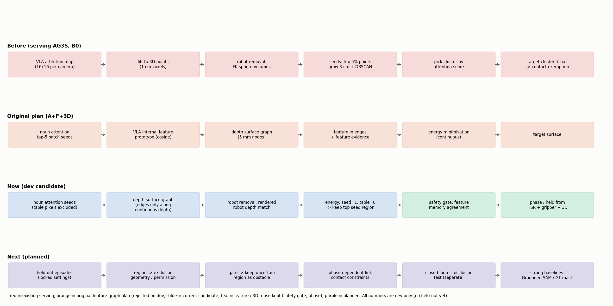

# AG3S 방법론의 변화: 이전 → 이번 작업 → 앞으로

작성: 2026-10-15 KST. 용어 설명과 실험별 결과는 [FINAL_REPORT_KO.md](FINAL_REPORT_KO.md)에 있고, 기술 상세는 [SUMMARY_METHODS_RESULTS_KO.md](SUMMARY_METHODS_RESULTS_KO.md)에 있다. 연구 방향의 근거는 사용자 문서 `Novelty_contribution.pdf`("novelty 강화3")다.

> **모든 판단은 dev 결과 기준이다.** 최종 채택은 §5의 후보안 중 **사용자가 판정**한다.

## 1. 이전 방법론 (현재 serving AG3S)

**목표:** VLA가 잡으려는 물체(target)는 접촉을 허용하고, 나머지는 충돌 제약으로 지킨다.

1. **Target 위치:** VLA attention(16×16)을 3D 점에 옮긴다(lifting). 상위 5% 점을 시작점으로 3 cm 반경 성장 + DBSCAN 군집을 만들고, attention 점수가 가장 높은 군집을 target으로 고른다.
2. **Target 범위:** 그 군집의 점과 둘러싸는 공(ball)에 접촉 예외를 준다.
3. **로봇 자신 제거:** FK로 계산한 구·캡슐 **부피** 안의 점을 지운다.
4. **작업 단계:** HSR(VLA 내부값 기반 분류기)이 pick / place / home을 판단한다.
5. **이후 단계:** ESDF와 trajectory optimization이 link별 접촉 규칙으로 동작을 보정한다(이번 작업에서는 변경하지 않음).

**이번 dev에서 확인한 약점:**
- 3 cm 반경 성장이 붙어 있는 다른 표면까지 합친다(precision 0.896).
- 부피 robot mask가 손에 든 과일을 지운다(놓친 target의 46%).
- HSR이 "놓은 뒤" 단계를 절반만 맞힌다.

## 2. 이번 작업의 원래 계획 (Attention + Feature graph + 3D)

**가설:** "noun attention이 **어떤 물체**인지 알려 주고, VLA 내부 feature가 **같은 물체의 범위**를 넓혀 주며, depth 표면 graph가 경계를 다듬는다."

**결과(dev):** 마지막 가설, 즉 feature로 범위를 정하는 부분은 성립하지 않았다.

| Feature 사용 방식 | 결과 |
|---|---|
| 연결 강도에 넣기 | 효과 없음 |
| 점수에 넣기 | 정확도 하락 |
| 정답 시작점을 줘도 | 하락 |

**원인(측정):**
1. Feature는 14×14 pixel 칸 단위라서 물체 경계의 73%에서 양쪽 값이 같다.
2. Target 표면의 42%가 다른 물체와 섞인 칸에 있다.
3. Feature 기준이 attention seed에서 만들어지므로 정보가 중복된다.

## 3. 이번 작업으로 바뀐 것 (현재 dev 후보)

| 단계 | 이전 | 현재 후보 | 근거 (dev) |
|---|---|---|---|
| 시작점 | lifted attention 상위 5% 점 | noun attention 상위 5칸, **탁자 pixel 제외** | R5: +0.023 |
| 표면 단위 | 1 cm voxel 점 | 5 mm voxel node | — |
| 연결 | 3D 반경 3 cm | **이미지 이웃 + depth 연속**일 때만 | R9 precision +0.073 |
| 범위 결정 | DBSCAN 군집 | graph energy(seed = 1, 탁자 = 0)를 푼 뒤 **seed가 가장 많은 영역 하나** | R3: +0.065(feature 없이) |
| 로봇 제거 | 구·캡슐 부피 | **로봇 mesh 렌더 depth와 표면 일치** | R6: +0.076, 기존 방법에도 +0.052 |
| Feature의 역할 | (없음) | 범위 결정에서 제외. **과거 장면 기억과의 일치도 → 안전 경보** | R11: 경보 15회가 잘못된 선택 6개를 모두 포함 |
| 단계·잡기 판단 | HSR | HSR + gripper + **3D 관계**(손-물체 거리, 높이) | R12: 0.78 → 0.94(학습형) |

**전체 효과:** 같은 robot mask 조건에서 기존 방법 0.837 → 후보 0.893(+0.057, 95% CI [+0.006, +0.103]).

## 4. Novelty 문서와의 대응

| Novelty 요소 ("Policy-conditioned 3D Safety Grounding without External Segmentation Models") | 이번 결과 |
|---|---|
| 1. Target **식별**과 **형상 복원**을 VLA 내부 표현 + RGB-D로 통합 (외부 segmenter 없음) | **식별**: noun attention(+탁자 제외). **형상**: depth 표면 graph. 외부 모델 없이 dev에서 기존 방법보다 +0.057 |
| 2. 영역 **불확실성**을 충돌 안전과 직접 연결 (불확실하면 target으로 단정하지 않음) | **VLA feature 기억 기반 경보**가 잘못 고른 장면을 잡아냈다(R11). Feature가 기여하는 지점이 여기로 옮겨졌다 |
| 3. 복원한 영역을 **작업 단계별 접촉 제약**에 연결 | 3D 관계가 단계·잡기 판단을 개선했다(R12). 실제 접촉 제약 연결은 아직이다 |
| 강한 비교 대상(B1 Grounded SAM, B2 개선된 외부 분할, B3 정답 mask) | B3에 해당하는 oracle 진단만 했다(정답 시작점 0.918, 정답 영역 0.843). B1·B2는 계획 단계다 |

**연구 메시지의 변화:**
- **이전:** "attention + feature + depth로 정밀한 3D 분할을 한다"
- **현재 근거가 지지하는 것:** "VLA attention은 **무엇을**, depth 표면은 **어디까지를** 정하고, VLA feature는 **그 판단이 믿을 만한지**를 알려 준다. 이 셋으로 외부 분할 모델 없이 안전한 3D target 영역을 만든다."

## 5. 채택할 방법론 후보 — 사용자 판정 대기

사용자 요청: 멋있고 타당한 방법론이 채택되기를 희망한다. 개선율이 조금 낮아도 괜찮지만 **채택 여부는 사용자가 판정**한다. 아래는 근거 수준과 함께 제시하는 후보다. 어느 안이든 held-out 검증 전까지는 "dev 후보"다.

| 후보 | 구성 | 근거 수준 (dev) | 장점 | 위험 |
|---|---|---|---|---|
| **A. 안전 중심 통합안** | Attention + 3D 범위(R6) + **feature 기억 안전 경보**(R11) + 3D 단계·잡기 판단(R12) | 범위 +0.057(CI 하한 0.006), 경보는 잘못된 6장면 모두 포함(표본 작음), 단계 +0.15(학습형) | Novelty 요소 1·2·3에 모두 대응한다. Feature의 역할이 측정 근거로 뒷받침된다 | 경보의 표본이 작다 |
| **B. 시간축 identity 강화안** | A + **feature 기억으로 영역을 바꾸는 기능**(R10b) | 영역 전환 +0.019(n.s., 기준 미달, δ 미조정) | VLA feature가 identity를 **능동적으로 바로잡는** 이야기라 가장 매력적이다 | 효과가 통계적으로 미확정이다. Held-out에서 사라질 수 있다 |
| **C. 최소안** | Attention + 3D 범위(R6)만 | 범위 +0.057 | 가장 단순하고 근거가 분명하다 | Feature 역할이 없어 novelty가 약하다 |
| **D. 원래 계획 유지** | Feature를 3D graph 연결·점수에 사용 | dev에서 −0.07 ~ −0.11(하락) | 원래 제목과 일치한다 | **근거와 반대**라 타당성 주장이 어렵다(비권장) |

분석 session 의견: **A를 주안으로, B의 영역 전환은 held-out에서 보조 arm으로 확인**하는 구성이 근거와 매력을 함께 갖춘다.

## 6. 앞으로의 계획

1. **Held-out 검증:** 잠근 설정(`LOCK_heldout.json`)으로 새 episode에서 확인한다. 성공 rollout 중심이고, 실패는 부록으로 둔다.
2. **AG3S 본체 연결:**
   - 후보 영역을 접촉 허용 영역과 exclusion geometry로 변환한다.
   - 경보가 울리면 그 영역을 장애물로 유지한다(보수적 처리).
   - 단계 판단을 link별 접촉 규칙에 연결한다.
3. **Closed-loop 평가:** 실제 충돌·접촉·성공률로 확인한다. 지금까지는 offline 표면 정확도만 봤다.
4. **강한 비교 대상:** Grounded SAM(B1), 다중 view·추적으로 개선한 외부 분할(B2), 정답 mask(B3)를 같은 안전 제약에 넣어 비교한다.
5. **가림 테스트(테스트용, 별도 보고):** target이 0, 1/3, 1/2 가려진 장면에서 확인한다. 비중은 사용자가 판단한다.
6. **약점 보완:** 잡기에 실패한 직후 장면에서 시작점 오류를 줄인다. 경보와 기억을 같이 쓰는 방향이 후보다.
