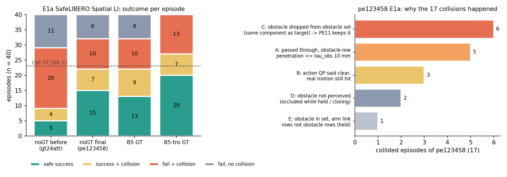

# E1a 실패 분해 — pe123458 (2026-11-09 12:1x KST, dev-4a)

GT 는 채점만 (SafeLIBERO 기록의 장애물 위치 · 충돌 시각). 판정 G170.

## 1. 결과 종류 (E1a 40, test init 5–14)

| | 안전 성공 | 성공 + 충돌 | 실패 + 충돌 | 충돌 없는 실패 |
|---|---:|---:|---:|---:|
| gt24att (GT 없는 이전 판) | 5 | 4 | 20 | 11 |
| **pe123458 (GT 없는 최종 판)** | **15** | 7 | 10 | 8 |
| B5 (GT) | 13 | 9 | 10 | 8 |
| B5-tro (GT) | 20 | 7 | 13 | 0 |

pe123458 의 충돌 17 중 15 는 쥐기 전 (접근 · 닫는 중).

## 2. 충돌 17 의 기제 (충돌 직전 call 의 server 기록)

| 그룹 | ep | 무엇 | 대응 |
|---|---:|---|---|
| **C** | 6 | 장애물이 대상 그릇과 같은 15 mm 연결 성분 → identity 가 진짜 그릇이 되는 call 부터 장애물 물체 집합에서 0 voxel → 그 근처 행은 일반 τ 100 mm 로 pass-through (t1 e6 · e12 · e14, t2 e10, t3 e8 · e13) | **PE11 `--scene-obstacle-target-cut`**: offline 에서 이 call 39 개 모두 장애물 유지, 잃은 call 0 |
| **A** | 5 | 장애물 행 침범 6–9.7 mm (≤ τ_obs 10 mm) 로 pass-through, 실제 접촉 (t0 e6 · e8 · e12 · e13, t3 e10) | τ_obs 축소 — LIBERO 거절 위험 (G75–G76) 이라 다음 순위 |
| **B** | 3 | action QP 결과 위반 0 인데 실제 움직임이 닿음 (t0 e10 · e11 · e14) | 응답 모델 · sphere 모델 오차; tro 가 일부 줄일 가능성 |
| **D** | 2 | 쥔 / 닫는 중 장애물이 cloud 에 없음 (t1 e9 · e10) | 3-request union 보다 긴 기억 |
| **E** | 1 | 쥔 채 팔 link 5 가 장애물에 닿음, 장애물 행 아님 (t1 e8) | — |

dev split 확인 (pe123458 SafeLIBERO 11): 충돌 t3 e2 · e3 가 C — PE11 이 127 call 에서 장애물 유지, 잃은 call 0.

## 3. A 그룹 대응 후보: τ_obs 축소 (offline, `tau_obs_scan.py`)

pe123458 기록에서 pass-through 된 call 중 장애물 행 침범이 X mm 를 넘은 수 (= τ_obs 를 X 로 줄이면 action QP 로 가는 call):

| bench | call | pass-through | > 0 mm | > 2 mm | > 5 mm | > 8 mm |
|---|---:|---:|---:|---:|---:|---:|
| LIBERO 27 | 733 | 643 | 20 | 17 | 14 | 6 |
| SafeLIBERO 11 | 556 | 445 | 26 | 20 | 12 | 2 |
| LIBERO-Safety 10 | 906 | 705 | 40 | 28 | 13 | 3 |
| E1a 40 | 1,752 | 1,278 | 134 | 106 | 60 | 25 |

τ_obs 5 mm 면 A 그룹의 충돌 call (6.2–9.7 mm) 은 모두 QP 로 가고, LIBERO 에서는 pass-through 643 중 14 call 만 바뀜 (거절이 아니라 QP 수정). PE11 다음 후보.

## 4. 도구

| 파일 | 하는 일 |
|---|---|
| `e1a_decompose.py` | episode 별 결과 종류 · 충돌 시점 (쥐기 전 / 쥔 동안 / 놓은 뒤) · HOLD · QP → `e1a_decomp.json`, `decomp.txt` |
| `e1a_passthrough_window.py` | 충돌 직전 4 call 의 경로 (pass / solve), 장애물 행 침범, 최악 점 → `passthrough_window_*.json` |
| `e1a_contact_geom.py` | 충돌 call 의 sphere ↔ 장애물 거리, 장애물 주변 ESDF, 실행 창 최소 clearance |
| `e1a_pe11_offline.py` | `_scene_obstacle_points` 를 target_cut 끔 / 켬으로 재생, 장애물 80 mm 안 voxel 수 |
| `tau_obs_scan.py` | τ_obs what-if: pass-through call 의 장애물 행 침범 분포 |
| `fig_e1a_decomp.py` | 그림 |
