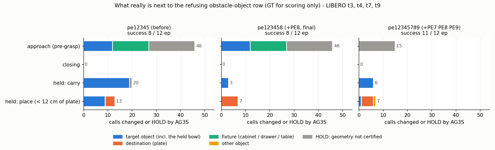
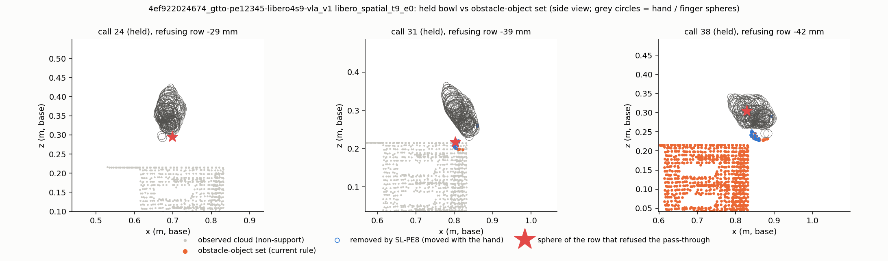

# 자율 작업 보고서 — 2026-11-09 02:06 – 11:00 KST (dev-4a, SL-PE)

사용자 지시 (02:06): 이전 세션 인계 (`outputs/2026-11-08_PE_경로끝점_identity/다음세션_프롬프트.md`) 를 이어서, 11:00 까지 스스로 판정하며 끊김 없이 진행. 관찰 — "장애물은 잘 피하는데 물체를 집으려다 못 집고, 잘 집어도 놓을 때 못 놓는다. 집지 못하는 것은 target 을 장애물로, 못 놓는 것은 접시 위를 장애물로 취급해서인가?" 최종 구성 문서는 AG3S 전체 구성을 쓰고, 변경 내용만 아래 교체 기록에.

이 파일 = 스스로 판정한 내용 · 구현 · 실험 · 결과 · 총 요약. 판정 번호는 `doc/active/experiments/E1_GTTO_DECISIONS_20261104_KO.md` 의 G162– 와 같다.

## 1. 스스로 판정한 내용 (시각순)

| 시각 | 판정 | 근거 |
|---|---|---|
| 02:2x | pe1234567b seed 9 run 은 실행되지 않은 run → `INVALID-notstarted-` 로 바꾸고 `pe1h_queue.sh` 로 재실행 | 02:04–02:06 의 commit 3 개로 HEAD 가 바뀌어 lock 대기 중이던 run 이 시작 순간 `Run belongs to another checkout or commit` 로 거절 (chunk 0) |
| 02:3x | 사용자 가설을 기록 (constraints full) 로 먼저 검증 — 통과를 거절한 장애물 행 옆 실제 물체 (GT, 채점만) 를 phase 별로 센다 | 기존 도구 (`cl_compare`) 는 개입 횟수만 셈 |
| 03:0x | 쥔 그릇 문제는 PE3 를 넓히는 것 (15 → 40 mm) 이 아니라 '손과 같이 움직인 점' 으로 푼다 | 40 mm 도 call 28 이후는 못 뺌; snapshot (들기 전 안쪽 면) 과 들어 올린 뒤 보이는 면 (바깥 벽) 이 26–73 mm 떨어짐 |
| 03:1x | 움직임 규칙의 제거 대상 = '검증된 점' 만, 손끝 경계 = snapshot 폭 + **20 mm** | snapshot 을 바로 지우면 SafeLIBERO 장애물 (책 90 점 · 머그 17 점) 이 빠짐; 경계 +30 mm 책 1 점, +40 mm 6 점, +20 mm 0 점 |
| 03:4x | PE6 · PE7 은 사전 기준 (LIBERO 안 나빠짐 + 큰 충돌 0) 은 통과했지만, PE8 효과와 섞이지 않게 `pe12345678` 로 PE8 위에서 다시 비교한 뒤 정한다 | pe1234567b: LIBERO 8 / 12 (= pe12345), 와인병 296 mm 충돌 0, 그러나 SafeLIBERO 성공 2 → 1 · 안전 성공 1 → 0 (e2 4.8 mm 접촉), t4 0 / 3 |
| 03:5x | pe123458 (PE8) 의 남은 실패 s7 t9 = 접근 단계 identity 오류 → 시간 초과 (220 step) 로 판정, 다음 대응은 접근 단계 identity (PE9) | s7 t9 는 pe12345 와 call 39 까지 같고, 쥔 뒤 개입은 9 → 1 로 줄었지만 call 6–19 의 접근 개입 10 call 로 늦어 44 call 안에 못 놓음 |
| 04:0x | PE9 = 손 닫는 지점이 없을 때 attention 최고점 아래 물체를 같은 컷으로 + attention 배수 ≥ 5 | offline (gt24att LIBERO s8, 쥐기 전 · close 명령 없는 83 call): 기록된 identity = target 46 %, 최고점 컷 = 84 %, 배수 ≥ 5 컷 93 % (74 call) |
| 04:1x | GPU 순서 변경: `pe12345678` (PE6+7+8) 취소 → **`pe12345789` (PE7+8+9, PE6 제외)** 기제 확인 | GPU 시간 한정. PE6 는 t4 궤적만 흔들고 (첫 손 닫는 지점 call 11 → 20) 안전 이득 없음; PE7 은 와인병 296 mm 충돌을 없앤 안전 장치라 유지 |
| 04:2x | PE9 에 '그 episode 의 request 5 번째부터' 조건 추가 (j2 를 멈췄다가 다시 시작) | SafeLIBERO offline: attention 최고점 컷이 장애물인 경우 7 / 9 가 request 0–4 (시작 때 VLA attention 이 장애물을 봄, 배수 수천 배라 배수 검사로 못 거름); 조건 뒤 장애물 2 / 37 (그 call 기존 identity 도 장애물), LIBERO target 100 % |
| 04:2x | 채택 기준 (결과 전 고정): pe12345789 가 LIBERO 12 ≥ pe123458, SafeLIBERO t3 큰 충돌 (> 10 mm) 0, 안전 성공 ≥ pe123458 이면 그 판, 아니면 pe123458 로 평가 규약 | — |
| 05:1x | PE10 (목적지 등록 지연) 은 이번에 구현 · 실험하지 않고 다음 단계로 | 기제 확인 GPU 시간 (~40 분) 을 넣으면 평가 규약이 11:00 안에 끝나지 않음 |
| 05:2x | **pe12345789 탈락 → 최종 판 = pe123458**, 평가 규약 시작, 최종 구성 문서 교체 | pe12345789 SafeLIBERO t3 큰 충돌 2 (와인병 787 mm · 머그 277 mm), 안전 성공 0 → 사전 기준 탈락. pe123458 은 LIBERO = pe12345, 쥔 그릇 거절 28 → 3, SafeLIBERO = pe12345 |
| 05:3x | 평가 · E1a 동안 공유 code 동결 (새 대응은 overlay 에서만) | dev-38 이 같은 판으로 E1a 40 을 이어서 돌림 — 정의가 바뀌면 다른 판이 평가됨 |

## 2. 구현

| 시각 | 무엇 | 파일 | test |
|---|---|---|---|
| 03:25:01 | **SL-PE8** `--scene-obstacle-held-motion` (기본 꺼짐): attach 중 손과 같이 움직인 점 (손 frame 에서 제자리 · 정지로 설명 안 됨 · 손끝 + 물체 폭 + 20 mm 안) 을 누적해 장애물 물체 집합에서 뺀다. 성분의 절반 이상이 그 점이고 성분 전체가 경계 안이면 성분째 | `AG3S/ag3s/stages/held_motion.py` (새), `pipeline.py` `_held_motion_mask` · `_scene_obstacle_points(held_motion=)`, `config.py`, `serve_safe.py`, `adapters/panda/profile.py` (판 `…-pe123458`, 03:4x `…-pe12345678`) | `tests/ag3s/test_sl_pe8_held_motion.py` 7; 회귀 묶음 259 통과 |
| 04:05:37 | **SL-PE9** `--attention-peak-seed K` (기본 꺼짐): 손 닫는 지점이 없는 쥐기 전 call (attach 전 · closing 전) 에 비받침 점 중 raw attention 최고점을 seed 로 `split_at_seed` (국소 받침면 · 벽 제거) 컷, 자른 물체 평균 raw attention ≥ K × 중앙값일 때만 grounding 입력으로 | `pipeline.py` `_attention_peak_point` · `_close_seed_grounding_input`, `config.py`, `serve_safe.py`, `profile.py` (판 `…-pe1234589`, `…-pe12345789`) | `tests/ag3s/test_sl_pe9_attention_peak.py` 6; 회귀 265 통과 |
| 08:1x (patch 만, 미적용) | **SL-PE11** `--scene-obstacle-target-cut` (기본 꺼짐): 장애물 물체 집합에서 조작 대상을 성분째가 아니라 점 단위 (점 15 mm + 중심에서 다시 자른 물체 + 바닥 아래 띠) 로 뺌 | `pe11_cut.patch` (pipeline · config · serve_safe · profile 판 `…-pe1234578911` + `tests/ag3s/test_sl_pe11_target_cut.py`) — code 동결 (dev-38 E1a · B5-tro 평가) 이라 적용 안 함 | overlay 에서 test 3 + 회귀 269 통과, `git apply --check` 통과 |

## 3. 실험 · 결과

### 3.1 사용자 가설 검증 (02:3x–03:1x, offline, GT 는 채점만)

도구 `pe_rowowner.py`: 통과를 거절한 장애물 물체 행 (worst row 의 로봇 구 중심) 옆 가장 가까운 실제 물체를 phase 별로 센다 (`rowowner_<tag>.json`, `log_*.txt`).

| 무엇 | 결과 | 원인 (기록) |
|---|---|---|
| 쥔 채 옮기기 · 놓기 실패 (t9) | 거절 행 옆 = **쥔 그릇 자신** 8–15 call / ep | held 동안 manipulated 형상 기록 없음 → 제외 근거는 PE3 뿐; attach 직전 snapshot (안쪽 · 테두리) 과 들어 올린 뒤 보이는 면 (바깥 벽 · 바닥) 이 26–73 mm 떨어져 PE3 (15 mm) 0 점 제거 (`held_drift.py`, `held_obst_replay.py`) |
| 놓기 (접시 12 cm 안) | 거절 행 옆 = **접시** 1–3 call / ep | 목적지 (접시) 등록이 늦음: 쥔 뒤 2–16 call 만에 등록 (PE5 의 3 frame 연속 조건이 끊김), 등록 형상도 일부 (`dest_latency.py`) |
| 쥐기 전 접근 (t4 · t9) | 거절 행 옆 = **target 그릇** 4–7 call + 서랍 · cabinet | 그 call 들의 identity 가 틀림 (s8 t4 call 6–19 접시, s7 t9 call 6–16 다른 그릇), 진짜 그릇은 cabinet · 서랍과 한 성분 (1,500–1,900 점) 이라 장애물 집합에 통째로 (`approach_check.py`) |

결론: 사용자 관찰이 맞다 — 집기 실패는 target (cabinet · 서랍과 붙은 그릇) 을, 놓기 실패는 쥔 그릇 자신과 접시를 장애물로 본 것.

### 3.2 PE8 (쥔 물체 = 손과 같이 움직인 점) — offline 과 기제 확인

offline (`held_motion_test.py`, 실제 구현 tracker 로 `fig_held_scene.py`): 관측된 쥔 그릇 점 64–88 % 제거, SafeLIBERO 장애물 점 제거 0.

기제 확인 (gt24att 실패 task, in-sample — 평가 아님):

| | pe12345 (지금 구성) | pe1234567b (+PE6 +PE7) | **pe123458 (+PE8)** |
|---|---|---|---|
| LIBERO t3 · 4 · 7 · 9 × s7 · 8 · 9 | 8 / 12 | 8 / 12 | 8 / 12 (s9 4 / 4 · s7 2 / 4 · s8 2 / 4) |
| 쥔 그릇이 거절 원인인 call (LIBERO, s7 + s8 + s9) | 28 (5 + 8 + 15) | 13 (s7 + s8 만) | **3** (0 + 1 + 2) |
| SafeLIBERO t3 성공 · 안전 성공 · 큰 충돌 | 2 · 1 · 1 (병 296 mm) | 1 · 0 · 0 (책 4.8 mm) | 2 · 1 · 1 (병 296 mm, PE7 없음) |

### 3.3 PE9 (접근 단계: attention 최고점 컷) · pe12345789 (PE7 + PE8 + PE9)

offline (`att_peak_seed.py`, gt24att): LIBERO s8 close 명령 없는 83 call — 기록 identity target 46 % → 최고점 컷 84 % (배수 ≥ 5: 93 %); SafeLIBERO 11 ep — 컷 (배수 ≥ 5) target 65 % · 장애물 13 %, 장애물 컷 7 / 9 가 request 0–4 → request ≥ 5 조건 뒤 장애물 2 / 37.

| 기제 확인 | pe123458 | **pe12345789** |
|---|---|---|
| LIBERO s9 · s7 | 4 / 4 · 2 / 4 | 4 / 4 · **3 / 4** (s7 t9 성공, 쥐기 전 개입 10 → 0) |
| LIBERO s8 | 2 / 4 | **4 / 4** |
| LIBERO 합 (12) | 8 | **11** |
| 접근 단계 거절 중 target · 고정물 원인 (s7 + s8 + s9) | 27 | **0** |
| SafeLIBERO t3 성공 · 안전 성공 · 큰 충돌 | 2 · 1 · 1 | 2 · **0** · **2** (와인병 787 mm, 머그 277 mm) |

→ 접근 단계 identity 는 확실히 고치지만 SafeLIBERO 에서 큰 충돌이 생겨 채택하지 않음.

**충돌 원인 (06:0x, `pe_safety.py` · 기록):** identity 는 장애물에 한 번도 찍히지 않았다 (e2 · e3 · e4). 충돌은 접근 중 (LATCHED, call 6–8) 이고 그때 통과 판정에 장애물 행이 없었다 (일반 위반 17–37 mm < τ 100 mm). identity 가 진짜 그릇이 되는 call 5 부터 **그릇에 닿아 있는 장애물 (책 · 머그) 의 집합 안 voxel 이 123–174 → 0** — 장애물 물체 집합 규칙 (SL-GTTO20) 이 '조작 대상 점 15 mm 안에 닿는 연결 성분 **전체**' 를 빼서, 그릇과 붙은 장애물이 함께 빠진다. PE9 가 identity 를 일찍 · 정확히 잡자 이 기존 결함이 접근 중에 드러났다 (pe123458 에서는 identity 가 closing 무렵에야 그릇이 되어 덜 드러남).

대응 후보 PE11 (offline `pe11_pointdrop.py`, code 동결 중이라 closed loop 안 함): 성분째 대신 점 단위로 target 만 제외 → SafeLIBERO 장애물 voxel 이 남음 (e2 · e4 33–122), 그러나 LIBERO 에서 자른 형상 밖 그릇 조각이 장애물로 남음 (target voxel 897 → 2,632). 변형 (bounding box · 크기별 혼합) 시험 결과는 아래 §3.4.

남은 실패 (pe123458): s7 t4 · s8 t4 (서랍, 접근 단계 identity · 첫 call HOLD), s7 t9 (접근 단계 identity 로 늦어 시간 초과), s8 t9 (목적지 등록이 call 30 으로 늦어 접시 거절 2 번 → 놓지 못하고 시간 초과; pe12345 는 call 25 등록 · 성공).

### 3.4 PE11 변형 (offline, 06:2x)

| 규칙 | SafeLIBERO: identity 후 남은 장애물 voxel | SafeLIBERO target 누출 | LIBERO s7 target 누출 |
|---|---|---|---|
| 성분째 (지금 구성) | 0 (빠짐 → 충돌) | 1,341 | 897 |
| 점 15 mm | 유지 (33–122 / call) | 2,085 | 2,632 |
| bbox + 15 mm | 유지 | 1,576 | 2,100 |
| 혼합 (작은 성분째 / 큰 성분 bbox) | 유지 | 1,576 | 1,901 |

| **cut (07:5x): identity 점 15 mm ∪ identity 중심에서 `split_at_seed` 로 다시 자른 물체 ∪ 바닥 아래 띠** | **유지** | 1,738 | 1,657 (t3 · t9 는 call 당 0–9 = 성분째와 같음; 누출 대부분 서랍 t4 call 6–17, 컷이 서랍 안에서 실패) |

점 · bbox · 혼합은 장애물 유지와 target 누출 없음을 함께 만족하지 못함 (G165). **cut 이 가장 유망** — cabinet 위 그릇은 성분째와 같이 빼면서 붙은 장애물은 남김; 서랍 경우만 남음 (G167). 다음 세션: cut 을 PE11 로 구현 → 서랍 처리 → pe12345789 + PE11 기제 확인 (SafeLIBERO 큰 충돌 0 이 조건).

### 3.5 평가 규약 (pe123458, `eval_pe123458/`)

| 단계 | 결과 | 참고 |
|---|---|---|
| 보정 LIBERO seed 10 · 11 | 14 / 18 (s10 t4 · t7, s11 t3 · t4 실패) | B5 (GT) 17 / 18 |
| 평가 LIBERO seed 7 | 7 / 9 (t4 · t9) | gt24att 7 / 9 |
| 평가 LIBERO seed 8 | 7 / 9 (t4 · t9) | gt24att 5 / 9 |
| 평가 LIBERO seed 9 | 8 / 9 (t1 실패 — 새 회귀) | gt24att 5 / 9 |
| **평가 LIBERO 27** | **22 / 27** | gt24att 17 / 27, B5 (GT) 27 / 27, VLA 단독 27 / 27 |
| SafeLIBERO t1 (2 ep) | 성공 2 · 안전 성공 2 · 충돌 0 | gt24att 1 · 1 · 0 |
| SafeLIBERO t2 (5 ep) | 성공 4 · 안전 성공 3 · 충돌 1 (우유 11.7 mm) | gt24att 2 · 1 · 4 (최대 436 mm) |
| SafeLIBERO t3 (4 ep) | 성공 2 · 안전 성공 1 · 충돌 3 (와인병 296 mm, 책 4.8 mm, 병 1.3 mm) | gt24att 1 · 0 |
| **SafeLIBERO 11** | **성공 8 · 안전 성공 6 · 충돌 4 (> 10 mm 2)** | gt24att 4 · 2 · 6 (> 10 mm 3); B5 (GT) 성공 9, 실제 충돌 1 |
| **LIBERO-Safety 10** | **성공 5 · 위반 0** (human_safety 2 / 4, obstacle_avoidance 2 / 4, affordance 1 / 2) | gt24att 3 · 0; B5 (GT) 9 · 0 |

**평가 실패 원인 (07:3x–07:5x, `rowowner_pe123458_eval_*.json`, LS 는 장면 재구성이 없어 call 기록만):**

| 실패 ep | 원인 (기록) | 대응 후보 |
|---|---|---|
| LIBERO s7 t4 · s8 t4 (서랍) | 첫 call 기하 미인증 HOLD 3–8 + 접근 단계 identity 오류 (거절 옆 = 그릇 · 서랍) | PE9 + PE11, 첫 HOLD 원인 |
| LIBERO s7 t9 | 접근 단계 identity 오류 (거절 10 call, 옆 = target 그릇 · cabinet) → 220 step 시간 초과 | PE9 + PE11 |
| LIBERO s8 t9 | 목적지 등록 지연 (쥔 뒤 16 call) → 놓기 직전 접시 거절 3 → 시간 초과 | PE10 |
| LIBERO s9 t1 (회귀) | 첫 held call 들에서 쥔 그릇이 장애물 행 원인 6 (PE8 검증 전) → 관절 한계 거절 연쇄 | PE8 첫 call 보완 |
| SafeLIBERO t3 e3 | 손 닫는 지점이 와인병에 찍혀 identity → 병이 집합에서 빠짐 → 296 mm 충돌 | PE7 (pe12345789 에서 0) |
| SafeLIBERO t2 e1 · t3 e0 | 접근 · closing 중 장애물 회피 개입 + 관절 한계 (t3 e0 는 장면 없음) | — |
| LS human_safety e0 · e2 | 기하 미인증 HOLD 49 · 18 call (쥔 뒤) | dev-38 쪽 (미인증 원인: dead camera · TSDF) |
| LS obstacle_avoidance e0 · e3 | 장애물 행 거절 13 call 씩 (피한 뒤 끝내지 못함) | SL-QE2 (회전 고정 QP) 대상 |
| LS affordance e0 | 쥐지 못함 (gt24att 와 같음) | — |

끝 2026-11-09 07:22. E1a 40 (같은 판) 은 dev-38 `qe4_queue.sh` 가 이어서 07:22–08:42 (log `outputs/2026-11-09_QE2_평가_E1a/queue.log`): TSR 22 · CAR 23 · **SSR 15** / 40 — 목표 23 미달, gt24att 5 · B5 GT 13 보다 높음. 같은 queue 의 B5-tro (GT, dev-38 SL-QE2) 는 SSR 20.

s9 t1 회귀 (gt24att 성공): 쥔 직후 call 18–30 에 쥔 그릇이 다시 장애물 행 원인 6 call (PE8 은 손이 충분히 움직여 점이 검증되기 전인 첫 held call 들은 못 뺌), 그 개입으로 자세가 바뀐 뒤 call 31–43 은 관절 한계 초과 (`limit`) 로 통과 거절이 이어져 시간 초과 (`rowowner_pe123458_eval_s9.json`).

## 4. 총 요약

**사용자 관찰은 맞았다.** 기록 (constraints full) 에서 통과를 거절한 장애물 행 옆의 실제 물체를 세 보니, 쥐기 전에는 **target 그릇** (cabinet · 서랍과 한 덩어리로 장애물 집합에 들어감 + 그때 identity 는 접시 · 다른 그릇), 쥔 채 옮기기 · 놓기에서는 **쥔 그릇 자신** 과 **접시** 가 장애물로 취급되고 있었다.

| 문제 | 대응 | 상태 |
|---|---|---|
| 쥔 그릇이 장애물 (옮기기 · 놓기) | **SL-PE8** 손과 같이 움직인 점 = 쥔 물체 | **최종 구성에 채택** (12 ep 거절 28 → 3 call, SafeLIBERO 장애물 오제거 0) |
| 접근 중 target 이 장애물 (identity 늦음) | SL-PE9 attention 최고점 컷 | 기제 확인 LIBERO 8 → 11 / 12 이지만 SafeLIBERO 큰 충돌 2 → **미채택** |
| PE9 의 충돌 원인 = 그릇에 붙은 장애물까지 집합에서 빠짐 (기존 SL-GTTO20 규칙) | SL-PE11 점 단위 제외 ('cut') | offline 에서 가장 유망, **patch 만** (code 동결) |
| 놓기 직전 접시가 장애물 (목적지 등록 지연) | PE10 후보 | 다음 단계 |

**최종 구성 = `…-t100-pe123458`** (문서 `doc/active/experiments/AG3S_FINAL_CONFIG_KO.md` 를 AG3S 전체 구성으로 다시 씀, 교체 기록 한 줄). 평가 규약 결과 (GT 없음):

| | pe123458 | gt24att (GT 없는 B5) | B5 (GT, 상한) |
|---|---|---|---|
| LIBERO 27 | **22** | 17 | 27 |
| SafeLIBERO 11 성공 · 안전 성공 · 충돌 | **8 · 6 · 4** | 4 · 2 · 6 | 9 · – · 실제 1 |
| LIBERO-Safety 10 (위반) | **5 (0)** | 3 (0) | 9 (0) |
| E1a 40 TSR · CAR · SSR (목표 SSR > 23) | 22 · 23 · **15** (π0.5 대비 9 / 0, p = 0.0039) | 9 · 16 · 5 | 22 · 21 · 13 |

GT 없는 판이 세 bench 모두에서 이전 GT 없는 판보다 나아졌고, 가장 큰 남은 격차는 LIBERO 의 서랍 t4 · 접근 identity 와 LIBERO-Safety 의 '피한 뒤 끝내기' · 쥔 뒤 미인증 HOLD 다. 다음 세션의 1 순위는 PE9 + PE11 (접근 identity 를 고치면서 붙은 장애물을 지키는 조합) 이고, 인계 = `다음세션_프롬프트.md`.

**지킨 것:** 결과 전에 채택 기준을 고정 (G163) 하고 그대로 판정 (LIBERO 가 크게 좋았던 pe12345789 도 안전 기준으로 탈락); peer 와 GPU · 공유 code 를 조율 (PE8 · PE9 적용 전후 알림, 평가 · E1a 동안 동결); commit 하지 않음 (사용자 요청 시에만, dev-38 queue 'queue end (qe4)' 뒤).
