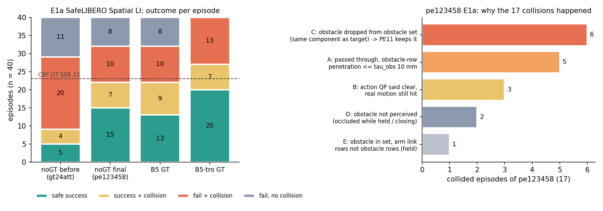
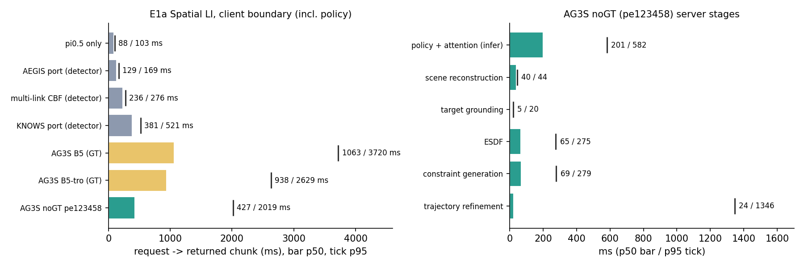

# 최종 실험 계획 대비 미리 모은 자료 (2026-11-09 12:4x KST, dev-4a)

기준 문서: `paper/evidence/AG3S-VLA_CVPR2027_FINAL_EXPERIMENT_PLAN_20261108_KO.md` (이하 '계획'). 이 폴더는 **연구 측 자료**다. `paper/` 의 원고 · evidence 문서는 고치지 않았다 (논문 작업 범위 규칙). 원고에 옮길 때는 아래 '자료 유형' 표시를 그대로 가져간다.

자료 유형: **MEASURED** (기록된 run 의 값), **DERIVED** (기록에서 계산; 계획의 protocol run 은 아님), **CANDIDATE** (선택 후보), **NOTE** (규약상 주의).

## 0. 한눈에

| 계획 항목 | 이 폴더 / 연결 자료 | 유형 | 상태 |
|---|---|---|---|
| §1.2 Tab. 1 E1a (pilot 분할 init 5–14 의 일부: Spatial · Level I · 4 task × 10) | `outputs/2026-11-08_E1a_SafeLIBERO_B5/E1a_spatial_LI_표.md` (dev-38, 11 arm, Wilson CI · McNemar · CSC) | MEASURED | pilot 9 arm 중 Spatial LI 만. AG3S 행은 GT 없는 최종 판 pe123458 |
| §1.2 '추가 기록' `end_reason` · 충돌 row (link, body, named?) | `e4f_labels_pe123458.json` (end reason 자동 라벨), `../2026-11-09_집기놓기_장애물취급/e1a_decomp/contact_geom_pe123458.json` (충돌 call 의 최근접 link), dev-38 `csc_*.json` (MuJoCo 로봇 접촉 step) | DERIVED | client 의 `end_reason` 기록 flag 는 아직 없음 → 기록에서 재구성 |
| §1.7 E4-F 실패 분류 · Tab. S9 | `e4f_labels.py` → `e4f_labels_pe123458.json` + §2 | DERIVED (자동 부분) | 수동 확인 2 명은 남음 |
| §1.8 E6 run time · Tab. S11 | `timing_summary.py` → `timing_summary.json`, `timing_e1a.png` + §3 | DERIVED | 계획 경계 (정책 포함) 와 같음, 2,000 request 고정 block · 최적화 전후 비교는 아님 |
| §6 Fig. 1 v3 위쪽 줄 · Video | `paired_candidates.py` → `paired_outcomes_pe123458.md`, `fig1_video_candidates_pe123458.json` + §4 | CANDIDATE | 최종 판이 정해지면 그 판으로 다시 뽑음 |
| §7 "dev/test 누수" | §5 | NOTE | 판정 G171: headline = init 15–49 |
| Tab. S14 margin 민감도 (관련) | `../2026-11-09_집기놓기_장애물취급/e1a_decomp/README.md` §3 τ_obs what-if | DERIVED | margin ±5 mm 실험은 아님 — 장애물 행 허용치의 분포만 |
| §1.5 Tab. 3 ablation (관련) | 판 이력 (gt24att → pe12345 → pe123458) 의 E1a · 평가 규약 수치, 최종 구성 문서 §8 | MEASURED | ablation protocol (full 과 paired, 7 변형) 은 아님 |

## 1. E1a Spatial LI (Tab. 1 일부) — dev-38 표 요약

| arm | TSR | CAR | SSR (/40) |
|---|---:|---:|---:|
| π0.5 only | 25 | 6 | 6 |
| AEGIS port (detector) | 21 | 18 | 17 |
| multi-link CBF (privileged GT) | 30 | 28 | 23 |
| KNOWS port (privileged GT) | 33 | 22 | 21 |
| AG3S B5 (GT) | 22 | 21 | 13 |
| AG3S B5-tro (GT) | 27 | 20 | 20 |
| **AG3S noGT pe123458** | 22 | 23 | **15** |

원본 · CI · McNemar · CSC 는 dev-38 표. AEGIS 는 port (계획의 주 행은 공식 코드), KNOWS · CBF detector 판은 SSR 1 · 11.

## 2. E4-F 실패 분류 — pe123458 E1a (자동 라벨, `e4f_labels.py`)

계획 §1.7 축으로 옮긴 것:

| 계획 분류 | 이 자료의 라벨 | ep | 근거 값 |
|---|---|---:|---|
| **P2** identity · 닿은 이웃 | `P2-merge`: 장애물이 대상과 한 15 mm 성분 → 장애물 물체 집합에서 0 voxel | 7 | 충돌 call 의 집합 재생 (target_cut 끔) |
| P1 미관측 | `P1-unseen` | 0 | (쥔 동안 가림 1 건은 A3 로 라벨됨: 1 voxel) |
| P3 / 모델 오차 | `A3-model`: solve 가 clear 라고 한 chunk 의 실제 움직임이 닿음 | 4 | sphere 모델 · 응답 모델 오차 |
| (계획에 없음) 허용치 | `A-tauobs`: 장애물 행 침범 ≤ τ_obs 10 mm 로 pass-through | 5 | pass-through 기록의 장애물 행 침범 6–9.7 mm |
| 기타 | 쥔 채 팔 link 5 | 1 | |
| A1 hold timeout | `A1-hold` | 2 | HOLD ≥ 30 % 또는 마지막 3 call HOLD |
| A2 grasp · place pose | `place-fail` 4 · `grasp-none` 2 | 6 | 쥔 뒤 시간 안에 못 놓음 / 한 번도 못 쥠 |

원고 투영 (perception 71 % = 46 / 17 / 8, action 93 % = hold 79 / deflected 14) 과 다른 점: 현재 판에서는 **P2 (닿은 이웃) 가 충돌의 41 % (7 / 17), 미관측은 0**, 무충돌 실패에서 hold 는 2 / 8 이고 놓기 실패가 4 / 8. 계획 §10.6 판정 ("hold 비율 < 50 % 면 action 축 근거를 고침") 에 해당할 가능성이 크다 — 최종 판 결과로 다시 셈.

P2-merge 는 원고 논거 A ("external mask spans touching objects") 와 같은 실패를 **우리 장애물 집합 규칙이** 만든 것이다. 대응 (SL-PE11 target cut) 의 offline 결과: 해당 call 39 / 39 에서 장애물 유지 (E1a), dev split 127 / 127.

## 3. Run time 초안 (Tab. S11 경계: 요청 → 반환 chunk, 정책 추론 포함)

| arm | p50 (ms) | p95 (ms) | n request |
|---|---:|---:|---:|
| π0.5 only | 88 | 103 | 1,544 |
| AEGIS port (detector) | 129 | 169 | 1,708 |
| multi-link CBF (detector) | 236 | 276 | 1,818 |
| KNOWS port (detector) | 381 | 521 | 2,053 |
| AG3S B5 (GT) | 1,063 | 3,720 | 1,696 |
| AG3S B5-tro (GT) | 938 | 2,629 | 1,474 |
| **AG3S noGT pe123458** | **427** | **2,019** | 1,748 |

AG3S noGT 단계 (p50 / p95 ms): policy + attention 201 / 582 · scene reconstruction 40 / 44 · target grounding 5 / 20 · ESDF 65 / 275 · constraint generation 69 / 279 · trajectory refinement 24 / 1,346 (pass-through 면 짧고, action QP / SQP 면 김).

주의: 각 run 의 첫 request (JIT) 만 뺐다. baseline run (2026-11-04) 과 AG3S run (11-08 · 11-09) 은 날짜가 달라 GPU 상태가 같다는 보장이 없다 → protocol run (E6) 에서 같은 날 · 같은 lock 으로 다시 잰다. 원고 투영 (AG3S 490 / 620 ms) 대비 p50 은 비슷하고 p95 가 3 배 — p95 는 refinement 경로가 지배.

## 4. Fig. 1 v3 · Video 후보 (pe123458)

조건: AG3S 안전 성공 ∧ π0.5 충돌 ∧ detector baseline 셋이 모두 안전 성공은 아님 → 9 개 (`fig1_video_candidates_pe123458.json`, 영상 경로 포함). 전체 짝 표: `paired_outcomes_pe123458.md`. 최종 판이 바뀌면 `python paired_candidates.py <tag>` 로 다시 뽑는다.

## 5. dev / test 누수 — **사용자 판정 (2026-11-09 13:0x, G171): headline = init 15–49, 5–14 는 개발 분할로 표시** (NOTE)

- E1a 의 init 5–14 는 계획에서 pilot (방향 판정) 분할이고, 계획 §2.3 은 "eval 분할의 결과를 본 뒤 설정을 바꾸면 새 실험 ID" 를 요구한다.
- 지금까지 이 분할의 결과를 보고 구성을 골랐다: B5 → B5-tro (dev-38), gt24att → pe123458, 그리고 이번 E1a 분해 → SL-PE11. (SL-PE11 의 설계 근거는 dev split SafeLIBERO 11 에서도 같은 기제를 확인한 것이지만, E1a 를 본 뒤의 결정이다.)
- 그래서 **init 5–14 결과는 '개발에 쓴 분할' 로 표시해야 하고, 최종 동결 구성의 headline 수치는 init 15–49 (아직 아무 arm 도 안 본 분할) 로 내는 것이 안전하다.** 계획의 headline 은 5–49 전체이므로, 5–14 와 15–49 를 나눠 표기하거나 5–49 를 보고하면서 5–14 가 개발에 쓰였음을 supplement 에 적는 방법이 있다.
- 기록 근거: 판정 G108–G112 (dev-38), G162–G170 (dev-4a) 의 날짜 < 최종 E1a 실행 날짜.
