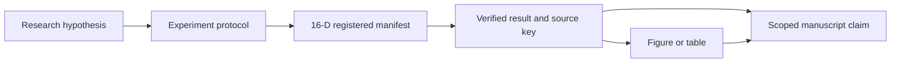

# Scientific Claims and Evidence

Updated: 2026-10-05 19:45 KST

## 운영 원칙

가설은 experiment를 설계하기 위한 문장이고, 검증된 주장은 특정 결과와 조건에 연결되는
문장이다. `SUPPORTED_DESCRIPTIVE`도 해당 snapshot과 측정 범위를 넘어 일반화하지 않는다.
`HYPOTHESIS`, `NOT_ESTABLISHED`, `REJECTED`, `DEPRECATED` 상태는 검증 사실로 쓰지 않는다.

## Claim registry

| ID | 문장·상태 | 필요한 근거 | 현재 연결 |
|---|---|---|---|
| C001 | `HYPOTHESIS`: task-relevant VLA representation을 3D safety representation으로 연결하면 금지 contact를 줄이면서 조작 능력을 유지할 수 있는가? | Grounding, safety, task outcome과 matched baseline | P001·P002·P003; 등록 결과 없음 |
| C002 | `HYPOTHESIS`: internal attention의 multi-view grounding이 task target을 정확히 구분하는가? | Phase별 target GT, attention-only 비교, alignment·ablation | P002·P003; 미측정 |
| C003 | `HYPOTHESIS`: target/obstacle contact policy가 목표 접촉과 obstacle 회피를 함께 지원하는가? | 허용 contact 정의, attached-object 상태, target 분리 ablation | P001·P003; 미측정 |
| C004 | `HYPOTHESIS`: refinement가 task success를 유지하며 forbidden contact를 감소시키는가? | 독립 geometry/contact 판정, collision·safe success, task-preservation 기준 | P001·P003; 미측정 |
| C005 | `HYPOTHESIS`: 지정된 unseen 조건으로 generalize하는가? | Train/tuning/test 분리 증명과 조건별 평가 | P004; 미측정 |
| C006 | `SUPPORTED_DESCRIPTIVE`: T39의 clear-scene apple/left-arm test 실행에서 동일 episode·seed에 대한 E0와 E3b의 task outcomes가 기록됐다. | 실제 16-D 기록, source hash와 verify key | EXP001 → R001·R002·R003 |
| C007 | `NOT_ESTABLISHED`: End-to-end 실행이 필요한 시간 예산 안에서 동작하는가? | Capture→inference→grounding→ESDF→optimization→response→execution의 같은 경계 | P005; runtime 결과 미등록 |

계획 ID P001–P006은 [EXPERIMENTS](EXPERIMENTS.md), 등록 ID EXP001은
[manifest](../experiments/manifests/EXP001_T39_task_outcomes.json)을 따른다.
C006은 task outcome 관찰이며 C001·C004의 성공 판정이 아니다.

## Claim 작성 시 필요한 항목

문장, status, experiment ID, result ID와 JSON pointer, 평가 대상·조건·범위,
unknown 항목·limitation, manuscript 위치, 최종 확인 시각을 함께 기록한다.

`safe`, `collision-free`, `preserves performance`, `real-time`, `generalizes`, `first`
등의 표현은 해당 근거 없이 쓰지 않는다. Target 접촉 전체를 충돌에서 제외하거나
HOLD가 늘었다는 이유로 물리적 안전성이 향상되었다고 쓰지 않는다.

Source: [현재 16-D research log의 T39 절](../../benchmark/ag3s/docs/AG3S_T0T6_LOG.md),
[T39.verify.json](../../benchmark/ag3s/docs/handoff/T39.verify.json),
[RESULTS](RESULTS.md), [PAPER_STORY](../notes/PAPER_STORY.md).
