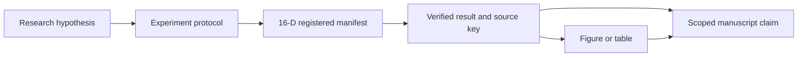

# Scientific Claims and Evidence

## 2026-10-18 CVPR v1 추가 등록 (EXP003–EXP006)

상태는 보수적으로 둔다. 모든 수치는 [RESULTS](RESULTS.md)의 R008–R026에 source pointer와 함께 있고, 등록 수준은 REGISTERED_SOURCE_LINKED(16-D manifest validation 아님)다. 원고에 쓸 때 반올림한다.

| ID | 문장·상태·범위 | 연결 |
|---|---|---|
| C012 | `SUPPORTED_DESCRIPTIVE`: 평가 전 잠근 설정의 held-out 34 episode(2,523 frame)에서 attention-seeded surface extent + rendered robot mask(A)는 기하 reference(G:N)보다 episode-mean observed-surface IoU가 .7730478249129286 → .876093971555441 높았고(paired +.10304614664251237 [.08323494981427215, .12313285145943233], 34/0 episode), precision .8941035687057404 → .9490830942021894, neighbour-surface FP mass 176069.97 → 46329.30(DERIVED −73.7 %)이었다. Offline replay-depth grounding이며 실행 성능이 아니다 | EXP003 → R008·R009·R010 |
| C013 | `SUPPORTED_DESCRIPTIVE`: 같은 held-out에서 rendered robot mask는 FK-sphere mask 대비 IoU +.04403272045947481 [.03801383050689502, .050055427622609866] (34/0), recall +.04834007118690548, precision −.006188040016010591; held state의 IoU는 .64040778567183 → .8475770155578735 | EXP003 → R010·R011 |
| C014 | `EXPLORATORY_DESCRIPTIVE`: identity memory switch(B)의 held-out 효과는 B − A +.014779314128842732 [−.0116789100514432, .03944222857471973], 14/6 episode로 **미확정**(dev와 같은 판정). adjacent +.028 / place +.025 / clear −.005는 stratum별 기술값 | EXP003 → R010 |
| C015 | `EXPLORATORY_DESCRIPTIVE`: dev에서 잠근 threshold .5904207590672415의 consistency alert는 held-out 성공 rollout 2,420 frame에서 wrong choice 100개 중 85개를 표시했고(false alarm 153), 표시 frame 영역 제거 시 wrong-surface FP mass의 .8788327204996255가 사라지고 TP의 .06698843965768998를 잃으며 AUROC .9251551724137931이었다. history-dependent cohort이며 closed-loop gating 효과는 미측정 | EXP003 → R012 |
| C016 | `SUPPORTED_DESCRIPTIVE` (**서로 다른 code state의 기술 통계**): T43 H 14 run에서 VLA 단독 E0(2026-10-05, T43 W)는 success 0 / grasp 11 / obstacle stop 13; V11AB(2026-10-07, T43 V11)는 success 12 / success_ct 12 (V8 13 / 8, V11A 10 / 8); 운반 중 사과–hurdle 접촉 run은 V8 5 → V11A 2 → V11AB 0. E0 대 V11AB의 paired 2×2는 등록 source에 없고, 두 arm은 같은 날·같은 code에서 돌지 않았다. 물리적 접촉 보장의 판정이 아니다 | EXP004 → R013·R014·R015 |
| C017 | `EXPLORATORY_DESCRIPTIVE`: 같은 14 (episode, seed)에서 현재 구현(2026-10-17)의 success_ct는 C1a 11, C1aN 11, SURF 7; C1aN vs SURF discordant 5 / 1 (McNemar p .21875). 표본 14로 어느 방향의 판정도 하지 않으며, C1a와 C1aN의 거의 같은 결과를 독립 증거 둘로 합산하지 않는다. SURF는 extent와 render mask를 함께 바꾼 구성이다 | EXP004 → R016·R017 |
| C018 | **`EXPLORATORY_SELECTION_CONDITIONED`**: "Under the 34 conditions in which C1a succeeded, C1aN succeeded in 34 and SURF in 28. This shows whether the baseline's successful cases are retained, but it does not estimate the performance difference over the full set of scenes not selected by success." (WL 2026-10-18 14:30의 충실한 번역; discordant 6 / 0, McNemar p .03125; SURF 실패 no_grasp 5 · not_placed 1; HOLD 50 vs 19; neighbour 접촉 2 vs 2; 비권한 link–target·obstacle 접촉 0 / 0). 개별 실패의 물리적 원인은 미확정 | EXP005 → R019·R020 |
| C019 | `SUPPORTED_DESCRIPTIVE` (runtime, 같은 측정 경계): client round-trip median / p95는 C1aN 1137.4754905700684 / 1923.847734928131 ms, SURF 2857.689142227173 / 3623.0645775794983 ms (IFG-CL1, 2,516 request씩); server total 796.4624175801873 vs 2586.567224934697 ms; SURF의 attention_surface 1663.4485451504588 ms (build 827.567 · solve 285.104 · codes 383.465), render mask 158.57859468087554 ms; hurdle에서는 C1a 1256.0148239135742 / 2034.055233001709, C1aN 1177.14262008667 / 2151.6876816749573, SURF 3330.8560848236084 / 4978.579664230347 ms. 등록된 모든 arm이 533.3333333333334 ms chunk budget을 request의 100 %에서 넘는다. C007(시간 예산 안 동작)은 `NOT_ESTABLISHED`로 유지한다 | EXP004 → R018; EXP005 → R021 |
| C020 | `NOT_ESTABLISHED` (Limitations context): (a) target 옆 기둥(T58)에서는 E0·ON 모두 3/3 run에서 robot–post 접촉이 있었고 실제 hand 최근접점이 hand constraint sphere 밖 12.72–38.8 mm였다; (b) CL4 18 pair에서 link-specific(X4) 대 global(G4) success_ct 9 vs 7, p .6875 — 이 범위에서 실행상 차이가 관측되지 않았다는 뜻이며 동등 판정이 아니다; extent arm success_ct X1 10 / X2 5 / X3 7 / X4 9; FT–target 접촉 0; (c) T46d gripper scope의 pre8close window에서 비권한 row 349,920개 중 target 50 mm 이내 0개(LTE와 global이 구분되지 않는 scope); (d) clear scene: T39 30/48 vs 29/48 (R001–R003), CL2 C0 14/18 (success_ct 12/18), T53 test 9/16 (success_ct 7/16, HOLD 37). 어느 것도 성능 유지나 coverage 보장을 확정하지 않는다 | EXP006 → R022–R026; EXP001 → R001–R003 |

C001–C005의 hypothesis 상태는 바뀌지 않는다. C012–C019는 해당 snapshot·population·측정 경계를 넘어 일반화하지 않는다.

## 2026-10-15 IFG 추가 등록

| ID | 상태·범위 | 연결 |
|---|---|---|
| C008 | SUPPORTED_DESCRIPTIVE: 동일 render mask에서 observed-surface IoU .837→.893, 전부 dev | EXP002 → R004 |
| C009 | SUPPORTED_DESCRIPTIVE: 시험한 feature boundary fusion은 geometric parent를 일관되게 개선하지 않음 | EXP002 → R005 |
| C010 | EXPLORATORY_DESCRIPTIVE: 147 matched frames / 6 errors에서 temporal consistency AUROC .998 대 .900 | EXP002 → R006 |
| C011 | SUPPORTED_DESCRIPTIVE: supervised LOEO phase accuracy .878→.939; 전체 pipeline 독립 검증은 아님 | EXP002 → R007 |

근거와 제외 범위는 [IFG 개정 기록](../notes/IFG_REVISION_20261015_KO.md), [전용 manifest](../experiments/manifests/ifg/EXP002_IFG_development.json)를 따른다. C001/C003/C004의 physical safety 가설을 입증하지 않는다.

Updated: 2026-10-05 19:45 KST

## 운영 원칙

가설은 experiment를 설계하기 위한 문장이고, 검증된 주장은 특정 결과와 조건에 연결되는
문장이다. `SUPPORTED_DESCRIPTIVE`도 해당 snapshot과 측정 범위를 넘어 일반화하지 않는다.
`HYPOTHESIS`, `NOT_ESTABLISHED`, `REJECTED`, `DEPRECATED` 상태는 검증 사실로 쓰지 않는다.

## Claim registry

| ID | 문장·상태 | 필요한 근거 | 현재 연결 |
|---|---|---|---|
| C001 | `HYPOTHESIS`: task-relevant VLA representation을 3D safety representation으로 연결하면 금지 contact를 줄이면서 조작 능력을 유지할 수 있는가? | Grounding, safety, task outcome과 matched baseline | P001·P002·P003; 등록 결과 없음 |
| C002 | `HYPOTHESIS`: internal attention의 multi-view grounding이 task target을 정확히 구분하는가? | Phase별 target GT, attention-only 비교, alignment·ablation | P002·P003; 미측정 |
| C003 | `HYPOTHESIS`: target/obstacle contact policy가 목표 접촉과 obstacle 회피를 함께 지원하는가? | 허용 contact 정의, attached-object 상태, target 분리 ablation | P001·P003; 미측정 |
| C004 | `HYPOTHESIS`: refinement가 task success를 유지하며 forbidden contact를 감소시키는가? | 독립 geometry/contact 판정, collision·safe success, task-preservation 기준 | P001·P003; 미측정 |
| C005 | `HYPOTHESIS`: 지정된 unseen 조건으로 generalize하는가? | Train/tuning/test 분리 증명과 조건별 평가 | P004; 미측정 |
| C006 | `SUPPORTED_DESCRIPTIVE`: T39의 clear-scene apple/left-arm test 실행에서 동일 episode·seed에 대한 E0와 E3b의 task outcomes가 기록됐다. | 실제 16-D 기록, source hash와 verify key | EXP001 → R001·R002·R003 |
| C007 | `NOT_ESTABLISHED`: End-to-end 실행이 필요한 시간 예산 안에서 동작하는가? | Capture→inference→grounding→ESDF→optimization→response→execution의 같은 경계 | P005; runtime 결과 미등록 |

계획 ID P001–P006은 [EXPERIMENTS](EXPERIMENTS.md), 등록 ID EXP001은
[manifest](../experiments/manifests/EXP001_T39_task_outcomes.json)을 따른다.
C006은 task outcome 관찰이며 C001·C004의 성공 판정이 아니다.

## Claim 작성 시 필요한 항목

문장, status, experiment ID, result ID와 JSON pointer, 평가 대상·조건·범위,
unknown 항목·limitation, manuscript 위치, 최종 확인 시각을 함께 기록한다.

`safe`, `collision-free`, `preserves performance`, `real-time`, `generalizes`, `first`
등의 표현은 해당 근거 없이 쓰지 않는다. Target 접촉 전체를 충돌에서 제외하거나
HOLD가 늘었다는 이유로 물리적 안전성이 향상되었다고 쓰지 않는다.

Source: [현재 16-D research log의 T39 절](../../benchmark/ag3s/docs/AG3S_T0T6_LOG.md),
[T39.verify.json](../../benchmark/ag3s/docs/handoff/T39.verify.json),
[RESULTS](RESULTS.md), [PAPER_STORY](../notes/PAPER_STORY.md).
