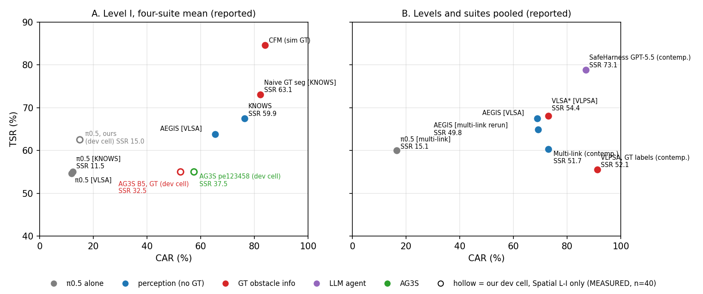

# 원고 수정안 — 원문 보고값 비교 · 관련연구 인용 · accept 대비 (2026-11-11 KST)

> **대상 원고:** `paper/AG3S_ Grounding Target Surfaces for Selective Contact in Vision-Language-Action Policies (5).pdf` (11-11 02:28).
> 아래 "l.NNN" 은 이 PDF 의 CVPR 줄 번호다. repo 의 `latex/sections/*.tex` 는 이 PDF 보다 오래되었으므로 (11-03 · 11-09) 수정은 PDF 를 만든 source 에 한다.
> **자료 표시:** [R] 원문 보고값 (논문 PDF 에서 옮김) · [D] 보고값에서 계산 · [M] 우리 측정 · [P] 계획 · [J] 판단 (제안).
> **이 문서는 수정 계획이다. 원고 tex 는 아직 고치지 않았다.**
> **사용자 방침 (2026-11-11):** 계획한 실험 (SafeLIBERO · LIBERO-Safety · ablation · grounding · 실로봇) 은 **모두 실행한다. 아직 안 했다는 이유로 원고에서 빼지 않는다.** 이 문서의 핵심은 조사한 문헌을 원고에 어떻게 배치하느냐 (§A) 이며, 원고 수정은 이 문서를 따라 한다.

---

## 0. 결정과 전제

| 항목 | 내용 |
|---|---|
| 사용자 결정 (2026-11-11) | SafeLIBERO 비교는 **각 원문의 보고 지표**와 한다. baseline 재구현 · 재실행은 하지 않는다 (제출까지 시간 부족). 우리 지표와 맞춰야 하면 변환 행을 추가한다. |
| 마감 [R] | paper submission **2026-11-16 AoE = 2026-11-17 20:59 KST** (연장 없음, `guidelines/CVPR_2027_DEADLINES.md`). 남은 시간 약 6 일. |
| 원고의 수치 자리 | Tab. 1 · Tab. 2 · Tab. 3 · Fig. 3 의 우리 수치 자리는 그대로 둔다. 실험은 주말 (11-14–15) 에 실행한다 (사용자 일정). 이 문서는 문헌 배치와 문장 · 표 구조만 다룬다. |
| 지금 측정된 AG3S 수치 [M] | 개발 셀만 있다: SafeLIBERO Spatial Level I, init 5–14, n = 40, pe123458 TSR · CAR · SSR = 22 · 23 · 15 / 40 (55.0 · 57.5 · 37.5 %). 4 suite × 2 level 측정은 없다. |

---

## A. 핵심 — 조사한 문헌을 원고 어디에 어떻게 쓰는가

**한 줄 요약 [J]:** 문헌을 "누가 무엇을 어디서 가져오는가" 로 정렬하면 AG3S 의 자리가 드러난다. 기존 방법은 모두 장애물 · target 정보를 **policy 밖** (VLM · detector · segmenter · simulator · 학습 데이터) 에서 가져오고, AG3S 만 **policy 안** (attention · hidden state) 에서 읽는다. 이 한 축으로 Intro · Related Work · Tab. 1 · 분석을 묶는다.

### A.1 문헌 배치표

| 논문 | Intro | Related Work | Tab. 1 | 그 밖 | 원고에서 맡는 역할 |
|---|---|---|---|---|---|
| VLSA / AEGIS (prior) | 문제 제기 (l.063–069) | 문단 2 | † level 별 (supplement 에서 계산) + 합산 | SafeLIBERO 벤치마크 · 지표 정의 출처 | 벤치마크의 원 baseline. "VLM 이 이름 붙인 장애물 1 개, 손끝만 보호" 의 대표 |
| KNOWS (prior) | 문제 제기 | 문단 2 + 마지막 대조 문장 | † level 별 (SSR 있음) + Naive GT 행 | Tab. 3 · ablation 논의에서 "attention 으로 선택하되 분할은 외부" | **가장 가까운 선행연구.** 차이 = 선택 vs 표면 분할, 타원체 vs 관측 표면, 접촉 권한 없음 |
| CFM (prior) | — | 문단 2 | † level 별, GT 블록 | 결론의 future work (생성 단계 제약) | "장애물을 안다고 가정한 제어 쪽 상한". 우리 GT oracle 행과 짝 |
| Multi-link (contemp.) | — | concurrent 문단 | † 합산 (1 mm · GT 없음) | — | 조건이 가장 같은 수치 기준. "여러 링크 보호, 장애물은 VLM + detector" |
| VLPSA (contemp.) | — | concurrent 문단 + 차이 문장 | 넣지 않음 (D5) | — | 전신 + 쥔 물체 보호의 동시대 연구. 차이 = 장애물 GT 라벨 필요, target 접촉 시점을 정하지 않음 |
| SafeHarness · DetAug · NUDGE (contemp.) | — | concurrent 문단 한 구절씩 | 넣지 않음 | — | 범주가 다른 접근 (LLM 계획 · 데이터 증강 · sampling guidance) |
| SafeVLA · WMPO · SafeDojo (prior) | — | 문단 2 (학습 기반) | 넣지 않음 | supplement 표 (OpenVLA-OFT) | "학습으로 안전을 얻는 계열" — 우리는 policy 를 고정 |
| OmniGuide · Lan-o3dp (prior) | — | guidance 계열 한 구절 | 넣지 않음 | — | SafeLIBERO 수치 없음 |
| LIBERO-Safety (prior) | 평가 문장 | — | — | Tab. LIBERO-Safety 의 π0.5 보고값 | 두 번째 벤치마크 |
| Grounded-SAM-2 · YOLOE · TokenCut · localization heads | — | grounding 문단 | — | **Tab. 3 (grounding) 비교 대상** | external segmenter 대비 근거 |

### A.2 원고에 추가할 비교표 — "정보를 어디서 가져오는가" (권장, Related Work 끝 또는 Tab. 1 옆) [J]

CVPR 2026 논문들이 Fig. 1 · Related Work 에서 "기존 vs 우리" 를 한눈에 보이는 것과 같은 역할이다. 수치가 아니라 **원문에 적힌 사실**만으로 채우므로 재실행이 필요 없고, Tab. 1 의 "Obstacle input" 열과 같은 내용을 미리 설명해 준다.

| Method | Policy 고정 (학습 없음) | Target 구분 | 장애물 · 형상 출처 | 보호 범위 | 쥔 물체 | 단계별 접촉 허용 | 근거 |
|---|---|---|---|---|---|---|---|
| AEGIS [VLSA] | ✓ | 장애물 1 개를 VLM 이 지목 | GLM-4.5V + detector → 타원체 | 손끝 타원체 | ✗ | ✗ | §V-A, §VI-C |
| KNOWS | ✓ (YOLOE 는 미세조정) | **VLA attention head** | YOLOE 분할 → 타원체 | 손끝 타원체 | ✗ | ✗ | §3, §5 limitations |
| CFM | ✓ | — (장애물이 주어짐) | simulator | 손끝 타원체 | ✗ | ✗ | §5.1, §6 |
| Multi-link ‡ | ✓ | 장애물 1 개를 VLM 이 지목 | Qwen3-VL + Grounding DINO → 타원체 | gripper · wrist · forearm (타원체 5) | ✗ | ✗ | abstract, §IV |
| VLPSA ‡ | ✓ | — (sim 에서는 GT 라벨) | occupancy map (sim: GT 라벨) | 전신 | ✓ | ✗ | abstract, §III-B, §IV-A |
| SafeVLA · SafeDojo | ✗ (RL fine-tuning) | 학습 | 학습 | 학습 | — | — | SafeDojo §5.1 |
| SafeHarness ‡ | ✓ (LLM agent 가 계획) | LLM | SAM-3 box | gripper · 쥔 물체 경로 | ✓ (경로 검사) | ✗ | §4.1 |
| **AG3S-VLA** | ✓ | **VLA attention + hidden state** | **depth 표면 + policy 내부 (외부 분할기 없음)** | 로봇 collision sphere + 쥔 물체 | ✓ | **✓ (stage · link 별)** | Sec. 3 |

‡ = 2026-09-15 이후 공개 (contemporaneous). **원고에 넣기 전 각 칸을 원문과 한 번 더 대조한다** (특히 VLPSA 의 target 처리, SafeHarness 의 보호 범위는 본문 서술에서 요약한 것).

이 표가 뒷받침하는 문장 (Intro l.066–078 · Related Work 끝): *"Prior safety layers obtain the obstacle, the target, or both from a model outside the policy — a VLM, a detector, a segmenter, or the simulator — and none decides which link may touch the target at which stage."*

### A.3 문헌이 각 실험의 비교 대상이 되는 방식

| 실험 (원고 위치) | 비교 대상 문헌 | 방식 |
|---|---|---|
| Tab. 1 SafeLIBERO | AEGIS · KNOWS · multi-link (GT 없음), CFM · Naive (GT) | 원문 보고값 + 조건 열 + π0.5 anchor (§3, §4) |
| Tab. 1 LIBERO 열 | π0.5 | 우리 측정 (safety layer 의 비용) |
| LIBERO-Safety | LIBERO-Safety 논문의 π0.5 보고값 | 원문 보고값 + 우리 π0.5 run |
| Tab. 2 ablation | (자체) — "external mask" 행이 KNOWS · AEGIS 식 설계를 대리 | 같은 episode 짝 비교 |
| Tab. 3 grounding | Grounded-SAM-2 · YOLOE · (supplement: TokenCut · localization heads) | 공개 모델을 같은 장면에 직접 실행 (offline) |
| 실로봇 Fig. 3 | π0.5 단독 | 직접 실행 |
| Supplement | SafeVLA · WMPO · SafeDojo (OpenVLA-OFT 보고값), VLPSA · SafeHarness 보고값과 조건 (§2 · §3.2 표 그대로) | 참고 표 |

---

## 1. CVPR 2027 contemporaneous 규정과 논문별 처리

**규정 [R]** (CFP "Contemporaneous Work", `guidelines/CVPR_SUBMISSION_POLICY.md`, 2026-11-11 재확인): 2026-09-15 이후 온라인 공개된 논문은 contemporaneous. 비교하지 않았다는 이유로 reject 하지 않는다. 그러나 **인용 · 논의는 기대되고**, 비교는 "가능한 범위에서". 우리 연구에 영향을 준 논문은 날짜와 관계없이 prior work. arXiv 와 학회 논문을 구별하지 않는다.

| 논문 (bib key) | arXiv · 첫 공개 [R, PDF 머리글] | 구분 | 지금 원고 | 처리 [J] |
|---|---|---|---|---|
| VLSA / AEGIS (`hu2026vlsa`) | 2512.11891, v2 2026-07-02 | prior | baseline · † 행 | † 행을 **level 별 값**으로 교체 (§3) |
| KNOWS (`park2026knows`) | 2606.09749, 2026-06-08 | prior | baseline · † 행 | 유지, 충돌 정의 각주 |
| SafeDojo (`tang2026safedojo`) | 2606.20698 (v1 6 월), v2 2026-10-21 | prior | supplement | 유지. 본문에 한 줄 (§5) |
| LIBERO-Safety (`cui2026liberosafety`) | 2606.23686, v2 2026-06-26 | prior | 벤치마크 | 유지 |
| **CFM** (`english2026constrainedfm`) | 2607.01378, 2026-07-01 | **prior** | Related Work [5] 만 | **† 블록에 추가 (필수)**. 같은 checkpoint · SafeLIBERO TSR · CAR 를 보고하는 prior work 를 표에서 뺄 근거가 없다 |
| OmniGuide (`song2026omniguide`) | 2603.10052, 2026-03-09 | prior | 인용 있음 | SafeLIBERO 수치 없음 → 비교 행 불필요 |
| Lan-o3dp (`li2025lano3dp`) | 2407.00451 | prior | 인용 있음 | RLBench → 비교 행 불필요 |
| DetAug (새 key) | 2609.18395, 2026-09-16 | contemp. | 없음 | Related Work 한 줄 |
| SafeHarness (새 key) | 2609.20822 (v1 9 월 16–18 일 사이 [D: arXiv 번호 순서]), v2 2026-10-02 | contemp. | 없음 | Related Work 한 줄 + 범주 차이 |
| **VLPSA** (새 key) | 2609.22462, 2026-09-18 | contemp. | 없음 | **Related Work 에서 논의 (필수에 가까움)**: 쥔 물체 보호가 우리 attachment 주장과 겹친다. † 블록 GT 행 (선택) |
| NUDGE (`guo2026nudge`) | 2609.35231 (v2 09-29) | contemp. | bib 에만 있음 | Related Work 한 줄 (SafeLIBERO 아님) |
| Multi-link (`agarwal2026multilink`) | 2609.40007, 2026-09-30 | contemp. | 재구현 baseline [1] | **재구현 행은 내리고 원문 Tab. Ib 값을 † 블록에** (조건이 우리와 가장 같다, §2) |

`CVPR2027_COMPLIANCE_AND_PAGES_20261023_KO.md` §2 의 "multi-link · NUDGE 공개일 확인" 은 이 표로 닫는다 (둘 다 2026-09-15 이후).

---

## 2. 원문 확인표 — 같은 SafeLIBERO 라도 조건이 다르다

모두 원문 PDF (`AG3S_VLA/papers/`, VLSA supplementary 는 `benchmark/SafeLIBERO/Supplementary_Materials.pdf`) 에서 직접 읽었다.
**공식 충돌 기준 [R, 코드]:** `benchmark/SafeLIBERO/main/main_aegis.py:370` — 매 step, 지정 장애물 1 개의 위치 변화 `|Δx|+|Δy|+|Δz| > 1 mm` 이면 충돌. 우리 E1a · 평가 규약도 이 경로다.

| 논문 | base policy | 장애물 정보 | 충돌 정의 | 집계 · 표본 | SSR | 근거 위치 |
|---|---|---|---|---|---|---|
| VLSA / AEGIS | π0.5-LIBERO, full action (평행이동 전용 설정도 따로) | GLM-4.5V + detector (GT 아님) | 본문 "strictly collision-free"; 코드 = 공식 1 mm | suite 별 · level 별 (supplement S1–S4), 시나리오당 50 ep, horizon 300 / 550 | 없음 | 본문 §V-A, Tab. I; Supp. Tab. S1–S4 |
| KNOWS | π0.5 | 미세조정 YOLOE + attention (GT 아님); Naive = t=0 GT segmentation | **target 이 아닌 물체와의 접촉** (CR) | suite × level, 과제당 50 ep, horizon 300 / 550 | 있음 | §4.1 Metrics, Tab. 1 |
| CFM | π0.5-LIBERO, **평행이동 성분만 보정** | **simulator GT 위치** ("isolating the control contribution from perception") | **최종 물체 위치**로 판정 | suite × level (Tab. 2), ep 수 미기재 | 없음 | §2 (l.190–193), §5.1, Tab. 1–2 |
| CFM 의 π0.5 · AEGIS 행 | — | — | — | **VLSA 평행이동 supplement 값과 같음** [D: Spatial L1 AEGIS 4 task 평균 73.5 / 65.5 = CFM Tab. 2] → 재실행이 아니라 인용으로 보임 (원문에 명시 없음) | — | |
| Multi-link (contemp.) | π0.5 `pi05_libero` | Qwen3-VL + Grounding DINO (GT 아님) | **공식 1 mm** (명시), 접촉 기준 결과도 보고 | 정적 SafeLIBERO 1,600 ep / 설정, **level · suite 합산만** | 있음 | §IV Metrics, Tab. Ib |
| Multi-link 의 AEGIS 행 | — | GLM-4.5V 대신 Qwen3-VL | 1 mm | 저자 공개 코드로 재실행 | 있음 | §IV Baseline implementations |
| VLPSA (contemp.) | π0.5 LIBERO checkpoint | **GT 장애물 라벨** (VLM 대신, 원문 명시) | "제외할 수 없는 충돌" (visual mesh 관통 또는 접촉 없이 변위)만. 성공 기준도 수정. 제어 100 Hz | **level 합산**, suite 당 n = 400, ±95 % CI | 있음 | §IV-A, Tab. II |
| SafeDojo / SafeVLA / WMPO | **OpenVLA-OFT** (안전 데모로 SFT 후 RL) | 학습 기반 | 원문에 명시 없음 ("without any collision", 접촉 step 수 CSC) | level 별, suite 별 | 있음 | §5.1, Tab. 1–2 |
| SafeHarness (contemp.) | frozen VLA + GPT-5.5 / GPT-6-Astra coding agent + SAM-3 | SAM-3 (GT 아님) | 공식 1 mm (명시) | 32 과제 × 10 seed, **최대 900 step** (공식 300 / 550) | 있음 (Tab. 3) | §4.1, Tab. 1, 3 |
| DetAug (contemp.) | **sim state 입력 10 M policy** (VLA 아님) | 학습 증강 | Avoid 비율 | **과제 약 20 % 제외**, 3 seed | Clean | §IV-A, Tab. I |

**우리 harness 가 원문 수준을 재현한다는 근거 [M]** (`doc/active/experiments/BASELINE_TRANCHE_PLAN_PORT_RATIONALE_20261109_KO.md` l.75, l.84, l.287): 같은 harness 의 π0.5 단독 Level I 55.8 · 10.8 · 8.3 (TSR · CAR · SSR) vs KNOWS 논문 π0.5 55.0 · 12.4 · 11.5 [D]; level 합산 60.0 · 15.0 · 13.5 vs multi-link 논문 π0.5 60.0 · 16.6 · 15.1 [R]. **원문 보고값과 나란히 놓는 비교의 정당성은 이 anchor 에서 나온다** — 본문에 한 문장 넣는다 (§4.3).

---

## 3. 원문 지표를 우리 표 형식으로 옮긴 값

생성: `python3 paper/tools/analysis/reported_safelibero_metrics.py` → `paper/evidence/reported_baselines_20261111/reported_safelibero_metrics.{json,md}`.
**모든 옮긴 표를 원문이 인쇄한 평균과 assert 로 대조했다** (VLSA supplement 의 suite 평균 8 개 · Tab. I 평균, KNOWS 의 원고 Tab. 1 값, CFM Overall 열, VLPSA Overall 행) — 전부 통과.

### 3.1 Level 별 · 4 suite 평균 (TSR / CAR / SSR, %)

| 출처 | 행 | 장애물 정보 | 충돌 | L-I TSR | L-I CAR | L-I SSR | L-II TSR | L-II CAR | L-II SSR |
|---|---|---|---|---|---|---|---|---|---|
| VLSA Supp. S1–S4 [D] | π0.5 | — | 1 mm | 54.6 | 11.9 | – | 60.9 | 22.4 | – |
| VLSA Supp. S1–S4 [D] | AEGIS (full action) | VLM + detector | 1 mm | 63.8 | 65.4 | – | 71.2 | 72.4 | – |
| KNOWS Tab. 1 [D] | π0.5 (No CBF) | — | 접촉 | 55.0 | 12.4 | 11.5 | 57.8 | 23.0 | 20.0 |
| KNOWS Tab. 1 [D] | KNOWS | attention + YOLOE | 접촉 | 67.5 | 76.4 | 59.9 | 71.1 | 68.8 | 53.8 |
| KNOWS Tab. 1 [D] | Naive (GT segmentation) | **GT** | 접촉 | 73.0 | 82.2 | 63.1 | 67.8 | 76.1 | 55.6 |
| CFM Tab. 2 [R] | CFM | **sim GT** | 최종 위치 | 84.6 | 84.0 | – | 78.6 | 81.6 | – |
| SafeDojo Tab. 1–2 [R] | SafeDojo (OpenVLA-OFT) | 학습 | 미기재 | 64.5 | – | 53.2 | 57.0 | – | 49.6 |

CAR = 100 − CR (KNOWS). 지금 원고 Tab. 1 의 KNOWS 행 (67.5 / 59.9 / 76.4, 71.1 / 53.8 / 68.8) 은 위 계산과 일치한다.
**새로 얻은 것:** 원고는 AEGIS 를 "levels pooled" 로만 적었지만, VLSA supplement 로 **level 별 값** (L-I 63.8 / 65.4, L-II 71.2 / 72.4) 을 낼 수 있다 → 원고의 level 열에 그대로 들어간다.

### 3.2 Level · suite 합산만 있는 논문 (TSR / CAR / SSR, %)

| 출처 | 행 | 장애물 정보 | 충돌 | TSR | CAR | SSR |
|---|---|---|---|---|---|---|
| VLSA Tab. I [R] | π0.5 / AEGIS | VLM + detector | 1 mm | 57.8 / 67.5 | 17.1 / 68.9 | – |
| Multi-link Tab. Ib [R] (CAR = 100 − C) | π0.5 | — | 1 mm | 60.0 | 16.6 | 15.1 |
| Multi-link Tab. Ib [R] | AEGIS (저자 코드, Qwen3-VL) | VLM + detector | 1 mm | 64.9 | 69.2 | 49.8 |
| Multi-link Tab. Ib [R] | Multi-link (full) | VLM + detector | 1 mm | 60.3 | 73.0 | 51.7 |
| VLPSA Tab. II [R] | π0.5 / VLSA* / VLPSA | **GT 라벨** | 제외 불가 충돌 | 49.1 / 68.1 / 55.5 | 23.1 / 73.0 / 91.2 | 18.3 / 54.4 / 52.1 |
| SafeHarness Tab. 3 [R] | GPT-5.5 / GPT-6-Astra | SAM-3 + LLM | 1 mm, 900 step | 78.8 / 81.2 | 86.9 / 91.9 | 73.1 / 78.1 |

### 3.3 그림



*그림 1 [R · D · M].* 원문 보고값의 TSR–CAR. A = Level I 4 suite 평균, B = 합산. 색 = 장애물 정보 (회색 π0.5 · 파랑 GT 없음 · 빨강 GT · 보라 LLM agent). 속 빈 원 = 우리 **개발 셀 (Spatial L-I, init 5–14, n = 40) 측정값** — suite 구성이 달라 같은 축에 놓아도 직접 비교가 아니다. script `paper/tools/plotting/reported_safelibero_scatter.py`.

**읽는 법 [J]:**
- GT 없는 π0.5 plug-in 의 보고 기준선은 **KNOWS L-I SSR 59.9** (접촉 기준), **multi-link 합산 SSR 51.7** (1 mm), **AEGIS 합산 CAR 68.9** (1 mm, SSR 없음) 이다.
- GT 를 쓰는 CFM · VLPSA · Naive 는 우리 GT oracle 행 (B5) 과 짝지어야 한다. 지금 개발 셀의 B5 (TSR 55.0 · CAR 52.5) 는 이들보다 낮다. 이 행을 표에 넣을지는 측정 뒤 판단한다 (§8 결정 D3).
- 개발 셀의 pe123458 (SSR 37.5) 은 위 기준선보다 낮다. 아래 §4 의 표 구조는 **측정값이 어떻게 나오든** 쓸 수 있게 짰고, 주장 문장은 §6 에서 결과에 맞춰 고른다.

---

## 4. Tab. 1 개편안

### 4.1 구조

지금 원고 Tab. 1 (l.410–433) 은 "†: 보고값 (순위 매기지 않음)" + "Our runs: AEGIS 공식 코드 · multi-link* · KNOWS* · 통제 baseline 2 개" 이다. 아래 블록 (재구현 · 재실행 baseline) 은 사용자 결정에 따라 측정하지 않으므로 **내린다**.

| 블록 | 행 | 값 | 비고 |
|---|---|---|---|
| (a) 원문 보고값, level 별 | π0.5 [VLSA] · AEGIS [VLSA] · π0.5 [KNOWS] · KNOWS · CFM | §3.1 | 장애물 정보 · 충돌 기준 열을 둔다 |
| (b) 원문 보고값, 합산만 | multi-link (contemp.) · AEGIS rerun [multi-link] | §3.2 | "All" 열에만 값. **VLPSA 는 표에 넣지 않고 Related Work 논의만 (사용자 결정 D5)** |
| (c) GT 정보를 쓴 보고값 | Naive GT seg [KNOWS] · CFM (sim GT) | §3.1 | 우리 GT oracle 행과 짝 |
| (d) 우리 측정 | π0.5 alone (anchor) · **AG3S-VLA** · **AG3S-VLA, GT oracle (사용자 결정 D3: 넣음)** | **측정 필요 [P]** | 같은 evaluator, 보고 분할, 같은 episode (짝) |

**통제 baseline 2 개 (generic geometry · external segmentation) 는 Tab. 1 에서 삭제 (사용자 결정 D4).** "external segmenter 보다 낫다" 는 주장의 근거는 grounding 표 (Tab. 3: Grounded-SAM-2 · YOLOE 대비) 와 ablation 의 "Extent: graph → external mask" 행이 맡는다.

열: `Method | Obstacle input | Collision criterion | LIBERO SR | L-I TSR SSR CAR | L-II TSR SSR CAR | All TSR SSR CAR` (table*, 전체 폭). 우리 행은 세 묶음 모두 채운다 → 어떤 논문과도 그 논문의 집계 방식으로 비교할 수 있다.

**우리 측정이 갖춰야 할 최소 조건 [J]:**
1. **4 suite × 2 level** 전부. 원문 값은 모두 4 suite 평균이므로 Spatial 만으로는 비교 행을 만들 수 없다. 시간이 모자라면 init 수를 줄이고 suite 는 줄이지 않는다.
2. 같은 시점 · 같은 기계의 **π0.5 alone anchor** (위 harness 재현 근거를 headline 분할에서 다시 보여줌).
3. 시간 예산 [D, 거칠게]: 11-09 E1a 40 ep 실행이 약 80 분 → 약 2 min/ep 상한. 31 init (19–49) × 32 시나리오 = 992 ep ≈ 33 h, 10 init (19–28) = 320 ep ≈ 11 h. 서버 이전 · dev-4a baseline queue 와의 GPU 순서는 사용자 결정 (§8 D1).
4. 원문은 시나리오당 50 init 전부를 쓴다. 우리 분할 (init 19–49 의 부분집합) 은 caption 에 적는다.

### 4.2 Caption 초안 (English)

> **Table 1. Comparison on SafeLIBERO and LIBERO (%), all with the frozen π0.5-LIBERO checkpoint.** Rows marked † are values **reported by the authors** under their own protocol, re-aggregated to our layout (four-suite means per level; CAR = 100 − collision rate); AEGIS per level is computed from the per-task tables in the VLSA supplement. The columns *Obstacle input* and *Collision* state what each run knows and how a collision is counted: *1 mm* is the official SafeLIBERO criterion (obstacle displaced by more than 1 mm at any step), *contact* counts any contact with a non-target object [KNOWS], *terminal* judges the final object positions [CFM], and *unrejectable* counts mesh penetration or contact-free displacement only [VLPSA]. Methods marked ‡ appeared after 2026-09-15 and report pooled levels only. Our rows use the official evaluator on initial states [19–xx] of the same 50 per scenario; our π0.5 alone row reproduces the reported π0.5 values of [VLSA, KNOWS, multi-link] within [x] points, which is the basis for reading the rows side by side. Reported rows are not re-run and differences to them carry no significance test.

### 4.3 본문 문장 초안 (Setup, l.389–409 대체; English)

> **Baselines.** Most safety layers for frozen VLAs release no code, and each is evaluated with its own perception stack. Following common practice on LIBERO-family benchmarks, we compare against the values reported by the authors of each method for the same π0.5-LIBERO checkpoint on SafeLIBERO — AEGIS [VLSA], KNOWS [KNOWS], and constrained flow matching [CFM], together with the contemporaneous multi-link filter [multi-link] and VLPSA [VLPSA] — and list, for each, the obstacle information it uses and the collision criterion of its evaluator (Tab. 1). Our own runs use the official evaluator. To check that our harness is comparable, we run the frozen policy alone on the same episodes: it reaches [TSR / CAR] on Level I against [55.0 / 12.4] reported by [KNOWS] and [60.0 / 16.6] pooled reported by [multi-link]. Safety-trained policies on OpenVLA-OFT [SafeVLA, WMPO, SafeDojo] use a different base policy and appear in the supplement.

---

## 5. 관련연구 추가 (Related Work, l.148–176; English 초안)

**문단 끝 (l.159 "All of these methods rely on …" 앞) 에 추가:**

> Concurrently with this work, several safety layers for frozen VLAs have been evaluated on SafeLIBERO. A multi-link filter [agarwal2026multilink] extends the end-effector barrier to the wrist and forearm and carries a moving hazard with optical flow; VLPSA [wilkinson2026vlpsa] builds Poisson safety functions over the full body and the grasped object, with the obstacle given by its ground-truth label in simulation; SafeHarness [xu2026safeharness] lets an LLM coding agent plan obstacle-aware routes around a frozen VLA; and DetAug [omahoney2026detaug] and NUDGE [guo2026nudge] add detours through data augmentation or sampling guidance. Safety-trained policies on OpenVLA-OFT [zhang2025safevla, zhu2026wmpo, tang2026safedojo] instead learn avoidance from obstacle-rich demonstrations and simulated rollouts.

**l.159–163 의 "All of these methods rely on a reliable geometric representation of what must be avoided" 다음에 한 문장:**

> Each of them takes the obstacle — its identity, its extent, or both — from a VLM, a detector, a segmenter, or the simulator; AG3S-VLA instead reads which observed surface is the target from the policy's own attention and hidden state. VLPSA and our attachment rule both protect the held object, but VLPSA requires the obstacle label and does not decide when the target may be touched.

**확인할 것 [J]:** Intro 기여 1 (l.106–114) 의 "the first VLA framework to perform task-conditioned 3D object surface segmentation directly from policy-internal representations" 는 KNOWS (attention 으로 *선택*, 분할은 YOLOE) 와 구분되므로 유지 가능. 단 "No prior work …" 류 문장은 쓰지 않는다 (VLPSA 가 held object 를 다룸).

### 5.1 새 bib 항목 (PDF 머리글에서 확인)

```bibtex
@misc{wilkinson2026vlpsa,
  author = {Meg Wilkinson and Emily Fourney and Joel W. Burdick and Aaron D. Ames},
  title = {{VLPSA}: Vision-Language-Poisson-Safe Actions for Full-Body Safety of Learned Policies},
  year = {2026}, howpublished = {arXiv preprint arXiv:2609.22462},
  eprint = {2609.22462}, archivePrefix = {arXiv}, primaryClass = {cs.RO}
}
@misc{xu2026safeharness,
  author = {Bingxin Xu and Yuzhang Shang and Zhen Dong and Emilio Ferrara},
  title = {{SafeHarness}: Coding Agents with Harness for Safe Robot Control},
  year = {2026}, howpublished = {arXiv preprint arXiv:2609.20822},
  eprint = {2609.20822}, archivePrefix = {arXiv}, primaryClass = {cs.RO}
}
@misc{omahoney2026detaug,
  author = {Reece O'Mahoney and Moritz Zoellner and Ioannis Havoutis},
  title = {{DetAug}: Obstacle-Blind Trajectory Augmentation for Zero-shot Obstacle Avoidance},
  year = {2026}, howpublished = {arXiv preprint arXiv:2609.18395},
  eprint = {2609.18395}, archivePrefix = {arXiv}, primaryClass = {cs.RO}
}
```

`tang2026safedojo` · `zhu2026wmpo` 는 `latex/exp_section/references_experiments.bib` 에만 있다 → main `references.bib` 로 옮긴다 (SafeDojo 저자 이름 약어는 그 파일 주석대로 펼친다).

---

## 6. 주장 문장 — 측정 결과에 맞춰 고를 것

지금 원고는 결과를 가정한 문장이다: Abstract l.024–027 "roughly halves the collisions of the strongest safety layer at the highest safe-success rate with task success on par", Intro l.096–100 "outperforms existing VLA-based methods … achieving state-of-the-art results", 기여 3 l.125–133, 결론 l.571–574.
**측정 전에는 이 문장들을 둘 수 없다 [J].** 측정 뒤 아래 중 하나를 고른다 (수치는 [ ] 채움).

| 측정 결과 | Abstract / 결론 문장 (English) |
|---|---|
| A. AG3S SSR 이 GT 없는 보고값 (KNOWS L-I 59.9, multi-link 합산 51.7) 보다 높음 | "On SafeLIBERO, AG3S-VLA reaches a safe-success rate of [x]% on Level I and [y]% pooled with the same frozen π0.5, above the [59.9]% and [51.7]% reported for the strongest segmenter-based and multi-link safety layers, without a segmentation network or any obstacle label." |
| B. SSR 은 비슷하고 CAR 가 높음 | "… avoids collisions in [x]% of episodes against [65.4–76.4]% reported for safety layers that take the obstacle from a detector or segmenter, at a comparable safe-success rate." |
| C. 보고값보다 낮음 | SOTA · 우위 문장을 모두 뺀다. 기여를 "segmenter-free, policy-grounded constraints whose failures are attributable" 로 옮기고, 비교는 Tab. 1 사실 기술 + 실패 분석 (§7 P1-2) 으로 무게를 둔다. Level I (장애물이 target 에 붙은 경우) 처럼 기제가 드러나는 부분 결과가 있으면 그것을 주장한다. |

**LIBERO (장애물 없음) [M, 주의]:** 지금 평가 규약 27 ep 에서 pe123458 22 / 27 vs π0.5 27 / 27. 원고 l.446–448 "cost 1.4 points on obstacle-free LIBERO" 는 실험 뒤 확정한다. 손해가 크면 Limitations 에 원인 (HOLD 시간 초과 등) 을 쓴다. 숨기면 리뷰어가 Tab. 1 LIBERO 열에서 바로 찾는다.

---

## 7. Accept 에 도움이 될 것 (우선순위) [J]

| 순위 | 항목 | 이유 | 비용 | 위치 |
|---|---|---|---|---|
| **P0-1** | 우리 실험 실행 (주말 예정, 사용자 일정): Tab. 1 · Tab. 2 · Tab. 3 · Fig. 3 · LIBERO-Safety | 원고의 모든 결과 자리 | 실험 실행 | 원고 전체 |
| **P0-2** | §4 의 Tab. 1 개편 + anchor 문장 + 조건 열 | 재실행 없이 공정성을 보여주는 유일한 방법 | 작성 반나절 | Tab. 1, §4.1 |
| **P0-3** | AG3S · GT oracle · π0.5 anchor 를 4 suite × 2 level 로 측정 (+ LIBERO, ablation) | 원문 비교의 최소 조건 | GPU ≈ 56–61 h (§10.4) | §4.1, §10 |
| **P0-4** | CFM † 행, VLPSA · multi-link · SafeHarness · DetAug · NUDGE 인용 · 논의 | prior work 누락 지적 방지, contemporaneous 규정 충족 | 1–2 h | §5 |
| **P0-5** | 분할 기술 정정: 원고 l.421–426 "five development initial states … remaining 45" ↔ 실제 결정 (개발 5–14, port 검증 15–18, 보고 19–49) | 원고와 기록 불일치 = 리뷰어 · 재현성 문제 | 10 분 | §4.1 |
| P1-1 | ~~개발 셀 짝 실험을 ablation 으로~~ → **§10.2 Q4 의 보고 분할 ablation 으로 대체** (개발 셀은 구성을 고른 분할이라 ablation 근거로 약함). 개발 셀 기록 (B5 GT 13 · GT 없음 5 · +PE 15 · tro 17 / 20) 은 supplement 의 개발 이력으로만 | 타당성 | — | Supp. |
| P1-2 | 실패 분석을 측정 분류로 (E4-F): 충돌 · 무충돌 실패를 원인별로 | 리뷰어는 "어디서 왜 실패하나" 를 좋아한다. 결과 C 인 경우 핵심 | CPU 반나절 | §4.4 |
| P1-3 | 지연 시간 p50 / p95 측정값 | AG3S 는 느리다 (원고도 인정). 숨기지 않고 보고 | 기존 로그 집계 | §4.4 |
| P1-4 | Level I (장애물이 target 옆) 에서의 기제 그림 — 실제 episode 로 (Fig. 1 v6 이 이미 실제 frame 사용) | 우리 차별점 (target 과 붙은 장애물 분리) 을 숫자 대신 그림으로 | 있음 | Fig. 1 |
| P1-5 | Supplement 에 §2 원문 확인표 + §3 변환 표 + 변환 script | 보고값 비교의 투명성 | 2 h | Supp. |
| P2 | 8 page 한도 · LLM Usage Statement · 참고문헌 원문 대조 (`/cvpr-reference-analysis`) · `/cvpr-compliance full` | 형식 desk reject 방지 | 각 1–2 h | 전체 |

**하지 말 것 [J]:** 원문 보고값과의 차이에 유의성 검정이나 "significantly" 를 붙이지 않는다 (다른 run 이다). 개발 분할 (init 5–14) 값을 headline 에 쓰지 않는다. GT 를 쓴 보고값 (CFM · VLPSA · Naive) 과 GT 없는 AG3S 를 같은 줄에서 순위 매기지 않는다.

---

## 8. 사용자 결정

| ID | 질문 | 결정 / 권고 |
|---|---|---|
| D1 | AG3S 쪽 GPU run 범위 | **미정** — §10.4 의 예산표로 다시 설명. 권고: init 19–28 (시나리오당 10 init) 으로 Tab. 1 의 우리 세 행 + ablation 을 먼저 채움 |
| D2 | dev-4a 의 baseline 보고 run (약 210 GPU h) | **계획의 맨 마지막으로 이동 (2026-11-11 사용자)** — 취소 아님. AG3S 논문 실험 뒤, AG3S 와 같은 init 부터 AEGIS → multi-link → KNOWS 순. 마감 전에 끝난 만큼 supplement 에 "같은 episode 직접 실행 (port)" 짝 비교 표로 추가 (본문 Tab. 1 의 원문 보고값 비교를 보강), 나머지는 rebuttal 용 |
| D3 | AG3S GT oracle 행을 Tab. 1 에 넣을지 | **넣음 (2026-11-11 사용자)**. 같은 최종 구성에 GT 인식만 바꾼 판이어야 한다 (§10.2) |
| D4 | 통제 baseline 2 개 | **삭제 (2026-11-11 사용자)**. 영향: §4.1 끝 · §10.3 |
| D5 | VLPSA | **Related Work 논의만 (2026-11-11 사용자)**. Tab. 1 에 넣지 않음 |
| D6 (새) | 최종 구성 동결 시점 | 권고: **지금 동결**. 보고 run 은 동결된 한 구성으로만 돈다. dev-55 의 st1 · T1 (PE11) 결과를 기다릴지 사용자 판단 |
| D7 | 실로봇 (E7) · LIBERO-Safety (E1b) · grounding 표 (E2) · ablation (E5) | **모두 실행하고 원고에 유지 (2026-11-11 사용자)**. 빼지 않는다 |

---

## 9. 근거 · 산출물

| 산출물 | 경로 | 자료 유형 |
|---|---|---|
| 원문 PDF | `AG3S_VLA/papers/` (VLSA supplement: `benchmark/SafeLIBERO/Supplementary_Materials.pdf`, SafeHarness · DetAug PDF 는 2026-11-11 arXiv 에서 받아 `papers/` 에 추가) | 1 차 출처 |
| 변환 script · 출력 | `paper/tools/analysis/reported_safelibero_metrics.py` → `paper/evidence/reported_baselines_20261111/reported_safelibero_metrics.{json,md}` | [R] + [D], 원문 평균과 assert 대조 |
| 그림 | `paper/tools/plotting/reported_safelibero_scatter.py` → `paper/evidence/reported_baselines_20261111/reported_tsr_car.png` | [R] · [D] · [M] |
| harness 재현 근거 | `doc/active/experiments/BASELINE_TRANCHE_PLAN_PORT_RATIONALE_20261109_KO.md` l.75 · 84 · 287 | [M] |
| 개발 셀 측정값 | `doc/active/experiments/AG3S_PLAN_SCHEDULE_20261110_KO.md` §3 표, `outputs/2026-11-08_E1a_SafeLIBERO_B5/E1a_spatial_LI_표.md` | [M] |
| CVPR 규정 | `paper/guidelines/CVPR_SUBMISSION_POLICY.md`, CFP (2026-11-11 재확인) | CONFIRMED_2027 |

---

## 10. 실험 구성 — CVPR 2026 논문 흐름에 맞춘 재설계 (2026-11-11 추가)

### 10.1 CVPR 2026 VLA 논문의 실험 흐름 [R]

`papers/cvpr2026/` 의 ACoT-VLA · AVA-VLA · ActiveVLA · ForceVLA2 와 이전 분석 (`paper/notes/CVPR2026_REFERENCE_STRUCTURE_REPORT.md` §1.7, Optimus · SaPaVe 포함) 의 공통점:

| 요소 | 그 논문들 | 우리에게 주는 것 |
|---|---|---|
| 연구 질문 | 실험 절 첫머리에 Q1–Q3 (ForceVLA2 "Q1 … Q2 Which components contribute most … Q3 …", Optimus 도 같음) | 각 표가 어느 질문에 답하는지 먼저 밝힌다 |
| 4.1 Setup | Benchmarks / Baselines / Metrics / Implementation 를 굵은 머리말로 | 같은 형식 |
| 주 비교 표 | 표준 벤치마크에서 **다른 논문의 보고값**을 나열하고, 직접 다시 돌린 행만 표시. 예: ACoT-VLA Tab. 2 caption "An asterisk (*) denotes results reproduced by utilizing officially released checkpoints" — 표시 없는 행은 보고값 | **원문 보고값 비교는 이 분야의 표준 관행**이다. 우리 결정 (§0) 이 이 흐름과 같다. 다만 우리는 충돌 정의가 논문마다 달라 조건 열을 더 둔다 |
| Ablation | 최종 모델에서 모듈을 하나씩 빼거나 더하는 표 (ACoT Tab. 4 "+EAR …", AVA Tab. 4, ForceVLA2 Tab. 2 "Component-wise ablations") | 최종 구성에서 한 요소만 바꾼 짝 실험 |
| 분석 | 정성 그림 (attention 등), 효율 (latency), 실기 | 실패 분석 · latency · 실제 episode 그림 |
| 실로봇 | 5 편 중 다수가 실기 실험을 둔다 | 우리도 유지 (Fig. 3, RB-Y1) |

### 10.2 우리 실험의 질문 · 근거 · 비교 방식

**원칙:** 각 주장은 정확히 하나의 표 · 비교에서 나오고, 비교 방식 (같은 episode 짝 비교 vs 원문 보고값 나란히 놓기) 에 따라 쓸 수 있는 말이 다르다.

| 질문 | 주장 (측정 뒤 문장 확정) | 근거 | 비교 방식 · 통계 | 필요 측정 |
|---|---|---|---|---|
| **Q1** AG3S 는 고정된 π0.5 의 충돌을 줄이면서 과제 성공을 지키는가? | "AG3S reduces collisions of the same frozen policy …" | Tab. 1 우리 행: AG3S vs π0.5 anchor + LIBERO (장애물 없음) 열 | **같은 episode 짝** → exact McNemar (SSR · CAR), Wilson 95 % CI. 유의성 주장 가능 | AG3S 320 ep, π0.5 320 ep, LIBERO 각 200 ep |
| **Q2** 기존 safety layer 와 비교하면? | "… compared with the values reported for …" (결과 A/B/C, §6) | Tab. 1 † 행 | **원문 보고값 나란히** — 집계를 원문에 맞추고 조건 열을 둠. 유의성 검정 없음. 정당성 = π0.5 anchor 재현 | Q1 과 같은 run (추가 없음) |
| **Q3** 남은 오류 중 얼마가 인식 (target · 장애물 판단) 탓인가? | "Replacing our grounding with ground truth changes SSR by [x] points" | Tab. 1 AG3S vs AG3S GT oracle (D3) + level 별 차이 (Level I = 장애물이 target 옆, 우리 기제가 겨냥하는 경우) | **같은 episode 짝** McNemar. GT oracle 은 GT 보고값 (Naive · CFM) 과만 나란히 | GT oracle 320 ep |
| **Q4** 각 구성 요소가 기여하는가? | "Removing X costs [y] SSR points" | Tab. 2 ablation (최종 구성에서 한 요소씩) | **같은 episode 짝**, paired 차이 + cluster bootstrap CI | 변형 8 개 × 80 ep |
| (분석) 어디서 실패하고 비용은? | 실패 원인 분포, latency p50 / p95 | Q1 의 AG3S episode 재분류, 서버 timing 로그 | 기술 통계 | GPU 없음 (CPU) |

**타당성 체크리스트 (보고 run 전에 고정):**
1. 보고 분할은 개발 · port 검증에 쓰지 않은 init 만 (init 19–28 ⊂ 19–49). 원고의 분할 기술 (l.421–426) 도 이에 맞춰 고친다 (P0-5).
2. **최종 구성을 먼저 동결하고 (D6)** 보고 run 은 그 한 구성만. 동결 뒤 바꾸면 새 실험 ID.
3. 우리 행 전부 (AG3S · GT oracle · π0.5 · ablation) 는 **같은 기계 · 같은 init · 같은 seed**. 서버 이전은 그 뒤 (이전하면 π0.5 chunk 가 달라짐, 11-03 확인).
4. 실패 · 시간 초과 · HOLD 모두 분모에 남김. 공식 evaluator · 1 mm · 공식 horizon.
5. GT oracle = **최종 구성에서 인식만 GT 로 바꾼 판** (`--oracle-seg` 계열, flag 확인 필요). 예전 B5 (다른 구성) 를 쓰면 Q3 의 차이가 인식 차이가 아니게 된다.
6. Ablation 각 행은 최종 구성에서 **flag 하나만** 바꾼다.
7. 절 · 표 · 주장은 유지한다. 결과 문장은 실험 뒤 §6 에서 고른다.

**Ablation (Tab. 2) [P]:** 원고 Tab. 2 의 행을 **모두 유지**한다 — 최종 실험 계획 §1.5 의 7 변형 (Seeds: attention → nearest object / Extent: graph → radius growth / Extent: graph → external mask / Identity: memory off / Policy: target always obstacle / Policy: target freed, all links · stages / Policy: no object attachment) + "Stage: grasp state only". 바꾸는 것은 분할뿐이다: 계획 §1.5 의 init 5–14 는 개발 분할이므로 **보고 분할 (init 19–)** 에서 full 과 같은 episode 로 돌린다. 변형별 flag · 구현 상태는 계획 §1.5 (nearest-object 선택기와 external mask 경로는 구현 필요).

### 10.3 원고 절별 정리 (절 · 표 · 그림은 모두 유지)

| 원고 위치 | 수정 |
|---|---|
| Setup l.389–409 Baselines | §4.3 초안으로 교체 (원문 보고값 비교 + anchor). 통제 baseline 2 개 문장만 삭제 (D4) |
| Tab. 1 | §4.1 구조로 교체 |
| Tab. 2 ablation | 유지. "Extent: graph → external mask" 행이 external segmenter 비교를 맡음 |
| Tab. 3 grounding · §4.4 | 유지 (Grounded-SAM-2 [liu2024groundingdino + SAM 2] · YOLOE [wang2025yoloe] 가 여기의 비교 대상) |
| LIBERO-Safety l.465–476 | 유지. 비교 대상 = LIBERO-Safety 논문 Tab. 3 의 π0.5 보고값 (35.3 / 56.7 / 51.3) + 우리 π0.5 run |
| Fig. 3 · 실로봇 | 유지 |
| 결과 문단 형식 | CVPR 2026 형식: 굵은 질문 머리말 (**Q1. …**) + "As shown in Tab. 1, … . We attribute this to … ." |

### 10.4 GPU 예산 (D1 설명)

episode 당 시간 [D, 거칠게]: AG3S ≤ 약 2 min (11-09 E1a 40 ep 실행 약 80 분; 짝 run 포함 여부 미확인), π0.5 단독 중앙값 39–79 s (`BASELINE_TRANCHE_PLAN_PORT_RATIONALE_20261109_KO.md` §2).

| run | 범위 | ep | 시간 (상한) |
|---|---|---:|---:|
| AG3S (최종 구성) | SafeLIBERO 4 suite × 4 task × L-I · L-II × init 19–28 | 320 | ≈ 11 h |
| AG3S GT oracle (D3) | 같은 320 ep | 320 | ≈ 11 h |
| π0.5 alone anchor | 같은 320 ep | 320 | ≈ 4–7 h |
| LIBERO (장애물 없음) AG3S · π0.5 | 4 suite × 10 task × init 19–23 | 200 + 200 | ≈ 7 h + 2–4 h |
| Ablation 8 변형 (Tab. 2 전부) | L-I, 4 suite × 4 task × init 19–23 (AG3S 본 run 의 부분집합과 짝) | 8 × 80 | ≈ 21 h |
| **합계** | | | **≈ 56–61 h 독점 GPU (약 2.5 일)** |

일정 [P]: 11-11 동결 (D6) → 11-12–11-14 run → 11-14–11-16 집계 · 원고 → 11-17 20:59 KST 마감 전 여유. 다른 GPU 작업 (dev-4a queue, 서버 이전) 이 이 사이에 들어오면 그만큼 범위를 줄인다 — 줄이는 순서: ablation · LIBERO 의 init 수 → (최후) SafeLIBERO init 수. **suite · level 은 줄이지 않는다** (원문 비교가 4 suite 평균이므로).
